## 第5章：漏洞与威胁

### 认证目标

| 目标 | 描述 | 目标 | 描述 |
|---|---|---|---|
| 5.01 | 漏洞带来的安全问题 | 5.04 | 对硬件的威胁 |
| 5.02 | 识别物理威胁 | ✓ | 两分钟速记 |
| 5.03 | 了解恶意软件 | Q&A | 自测 |

能够识别系统面临的不同威胁领域是安全专业人员的一项重要技能，也是你在 Security+ 认证考试中一定会被测试的内容。本章将介绍针对不同类型设备和系统的常见威胁类型，并讨论你在考试中应熟悉的各类恶意软件。

**错误** 错误是指在配置中出现的失误，可能使系统容易受到攻击。例如，在 DNS 服务器上不限制区域传输，可能会导致 DNS 数据暴露给攻击者。

**弱加密** 不对静态数据和传输中的数据加密是一个严重错误。对于所有设备、应用程序和协议，都要考虑如何对数据进行加密，以保护公司数据的机密性，并确保所使用的加密算法在当今标准下被认为是强算法。例如，你将在第12章学习加密算法，并了解 DES 和 3DES 被视为弱加密协议。如果某个应用程序使用 DES 或 3DES，你应考虑是否可以更改配置，使用更安全的 AES 算法。请参阅第12章和第13章，了解更多关于加密的内容。

**不安全的协议** 确保应用程序使用协议的安全版本，从而使通信得到加密。例如，确保 Web 应用程序使用 HTTPS 而不是 HTTP。

**默认设置** 检查系统或应用程序的默认配置，查找可能使系统面临风险的默认设置。例如，旧版本的 Windows Server 默认安装了 Microsoft 的 Web 服务器软件。这意味着你的 Windows Server 在开箱即用时就容易受到 Web 攻击。作为管理员，你应该在安装 Windows 后，如果不需要 Web 服务器软件，就将其删除。

**开放端口和服务** 务必限制系统上运行的服务，从而减少系统上开放的端口。

### 第三方风险

与第三方公司合作也存在风险。与你合作的第三方公司所采取的行动可能会使你的公司容易受到攻击。以下是一些示例：

- **供应商管理：** 供应商管理其产品的方式可能会给使用该供应商产品的环境带来漏洞。例如，供应商的系统如何与你的网络集成？是否使用安全协议？是否需要在网络上拥有账户？如果产品较旧，供应商可能不再支持该产品。不再受支持的产品不会再创建补丁，这意味着你可能面临零日攻击。

- **供应链：** 如果你与不遵循安全最佳实践的供应商合作，你可能会从该供应商处收到已被入侵的产品，然后将其连接到你的网络。

- **外包代码开发：** 不安全的应用程序代码是系统出现漏洞的一大原因。如果将应用程序要使用的组件开发外包出去，而外包公司不遵循安全编码实践，则可能导致这些组件不安全。

- **数据存储：** 你可能将数据存储在第三方公司——也许是作为存储数据备份的备用站点。要核实第三方公司是否保护了存储你数据的系统，同时也要采取自己的步骤，确保数据已加密，并且只有你的公司能够解密数据。

### 不当或薄弱的补丁管理

缺乏补丁策略是系统易受攻击的最大原因之一，因为补丁包含针对已知漏洞的安全修复程序。务必定期对以下内容应用补丁：

- **固件：** 对服务器、路由器、交换机以及公司内可能存在的任何其他硬件设备等设备上的固件应用更新。

- **操作系统（OS）：** 定期为操作系统打补丁，并考虑使用补丁管理软件来自动化补丁的部署。

- **应用程序：** 确保应用程序也已打补丁。应用程序中的漏洞可能会导致整个系统容易受到攻击。

### 遗留平台

遗留系统是你在网络上应该注意的，因为许多遗留系统不再获得供应商支持，这意味着它们很可能不再被打补丁。此外，遗留系统可能使用不安全的旧协议。如果你的网络上使用遗留系统，请考虑将它们放在独立的网段中，以帮助降低这些系统受到攻击的可能性。

### 理解漏洞的影响

一个不学习如何管理系统上存在的漏洞的公司可能会面临灾难性后果。以下是不减少其产品中存在的漏洞可能给企业带来的潜在影响：

- **数据丢失：** 系统上的漏洞可能导致你失去对数据的访问。例如，攻击者可能利用该漏洞删除数据，或用勒索软件加密数据。

- **数据泄露：** 当未经授权的人访问机密数据时，就会发生数据泄露。数据泄露也称为 *数据泄漏* 或 *数据外泄*。数据泄露可能包括健康记录、财务数据和知识产权等信息。数据泄露的影响对公司来说可能是灾难性的，因为调查和从数据泄露中恢复需要成本，而且公司还可能遭受声誉损害。


**数据外泄** 数据外泄发生在某人未经许可将数据从计算机或网络转移出去时。攻击者可能想要从系统中转移的敏感数据的示例包括财务数据（如信用卡号码）、个人身份信息（PII）以及用户名和密码。为了防止数据外泄，您可以禁用 USB 端口，以便便携式存储设备（如 USB 闪存驱动器和 USB 外部驱动器）无法连接到系统，或者您可以使用数据丢失防护（DLP）功能来阻止敏感数据被复制或通过电子邮件发送到组织之外。

**身份盗窃** 系统中的漏洞可能导致身份盗窃，即关于某人的个人信息被窃取，使攻击者能够冒充受害者的身份。

**财务损失** 漏洞可能由于多种原因导致财务损失。首先，漏洞可能允许攻击者使生产系统崩溃，导致收入损失，但也有恢复系统的成本以及声誉受损的无形成本。

**声誉受损** 如前所述多次，漏洞被利用导致系统被入侵可能会损害公司的声誉。如果客户认为他们的数据不安全，他们可能会选择不再与贵公司做生意。

**可用性丧失** 漏洞可能导致系统或服务的可用性丧失。例如，后端数据库中的漏洞可能导致电子商务 Web 应用程序无法显示产品或接受在线订单。

> exam watch
> 对于考试，请记住数据外泄是指未经许可将数据从计算机转移出去，并且您可以通过禁用 USB 驱动器的使用以及实施数据丢失防护（DLP）解决方案来降低数据外泄的风险。

# 常见安全问题和设备输出

系统和网络可以通过许多不同的方式被入侵，但好消息是，大多数漏洞利用和攻击都针对我们可以识别和解决的一小部分安全问题。在本节中，您将了解排查常见安全问题和不同安全技术常见输出的策略。您还将了解组织用于制定其安全策略的常见安全框架和指南。

# 排查常见安全问题

Security+ 认证考试期望您了解安全事件发生的常见原因，例如黑客利用系统、用户意外或故意删除文件，甚至用户将敏感数据通过电子邮件发送给公司外部的人员。

# 弱配置或错误配置

许多安全事件是由于错误配置问题或弱安全配置造成的。例如，一家小型公司可能会使用无线路由器设置无线网络，并且不更改任何默认值。

以下是导致安全问题的系统或设备常见错误配置：

- **未加密凭据/明文** 许多 Internet 技术和协议默认不加密网络流量，包括用于登录设备的用户名和密码。请务必在可能的情况下使用 SSL/TLS、VPN 和协议的安全版本等加密技术。
- **日志和事件异常** 在查看事件日志和活动日志时，请务必注意日志中出现的异常事件。任何可疑活动都需要进一步调查。从错误配置的角度来看，验证日志记录是否已启用，并且您知道系统和设备的日志存储位置。
- **权限问题** 未正确配置资源权限是内部攻击如此成功的常见原因。请定期审查资源权限，并且只授予所需权限（最小权限原则）。
- **访问违规** 访问违规发生在未经授权访问系统的人获得访问权限时。确保在任何人能够访问网络或系统之前要求身份验证，并且确保登录流量已加密。配置资源权限，以确保没有人能够访问不应访问的资源。
- **证书问题** 证书是包含用于加密通信的密钥的电子文件。证书应至少用于保护 Web 流量、电子邮件流量和服务器到服务器通信。请确保使用的证书未过期、未被撤销，并且来自受信任的证书颁发机构（CA）。您将在第 12 章和第 13 章中了解更多关于证书的内容。
- **数据外泄** 如前所述，数据外泄发生在某人未经许可将信息从系统转移出去时。请记住考试中为防止数据外泄，您可以禁用 USB 端口或使用 DLP 功能阻止敏感数据被复制或通过电子邮件发送到组织之外。

- **配置错误的设备** 设备配置错误是攻击者能够访问他们不应访问的系统的很大原因。请确保配置以下内容：
  - **防火墙** 确保使用防火墙将网络划分为不同的网络段。配置错误的规则的防火墙允许用户访问他们不应访问的网络段。请确保每个网络段的防火墙都正确配置，以控制可以穿过防火墙到达特定网络段的流量。
  - **内容过滤器** 内容过滤设备用于控制员工可以访问 Internet 上的哪些内容。如果内容过滤规则未正确配置，用户可能会访问不安全网站并在其系统上执行代码。
  - **接入点** 无线接入点和无线家庭路由器通常配置错误。请务必审查无线接入点的配置，并确保您已配置 MAC 过滤、WPA2 加密以及强加密密钥，并且已修改默认管理员密码。
- **弱安全配置** 安全事件的一个重要原因是弱安全配置。例如，网络管理员可能在无线网络上配置加密，但选择较弱的加密方法或使用弱加密密钥。请务必审查设备上的所有安全设置，例如访问控制列表、密码、加密密钥、加密算法以及可能可用的任何过滤功能。

**人员问题** 您可以在设备上配置最佳安全设置，但如果不注重培训员工提高安全意识，它们仍然很容易被黑入。您还必须警惕内部威胁。以下是涉及人员问题的关键安全考虑因素：

- **政策违规** 许多安全事件发生是因为员工违反公司安全政策。请务必向员工传达安全政策及其生效原因。如果员工了解政策存在的原因以及遵守政策如何保护公司及其资产，他们就不太可能违反安全政策。
- **内部威胁** 大多数公司将防火墙作为其安全保护重点。当然这很重要，但您也需要保护公司资产免受不满员工等内部威胁。请务必使用身份验证、权限和访问控制列表来控制员工可以访问的内容。还请务必实施反恶意软件软件以保护内部系统免受病毒侵害。

**社会工程** 向员工传授常见的社会工程攻击，以便他们能够识别自己何时成为社会工程的目标。教育是抵御社会工程攻击的关键。

**社交媒体** 向员工传授可以在社交媒体上发布什么信息以及不能发布什么信息。您应制定严格的政策，限制在社交媒体上发布工作场所照片，因为它们可能包含敏感信息。例如，员工坐在办公桌前的照片也可能在背景中显示屏幕上打开的敏感文件或桌上的文件。

**个人电子邮件** 许多员工在工作中使用个人电子邮件账户，并可能用此将公司数据发送到公司之外。请务必实施 DLP 功能以防止数据泄露。还要注意员工可能用来在工作内外传输数据的个人云存储。您可能考虑在防火墙或内容过滤设备上阻止访问这些网站。

# 应用程序问题

软件是安全的另一个关注领域。您应考虑与应用程序相关的所有以下问题：

**未经授权的软件** 组织应制定严格的政策，规定允许或不允许在公司系统上运行的软件。*应用程序白名单*是指定义允许在系统上运行的软件。您可以使用 Windows AppLocker 等工具作为政策的一部分来限制允许在系统上运行的软件。

**基线偏差** 安全基线是系统不得偏离的定义安全状态。任何可能使系统开放并使其安全性降低的系统修改都需要在实施前先进行审查，并在实施后密切监控。组织可以使用 PowerShell Desired State Configuration（DSC）等技术来防止系统发生偏离基线的更改。

**许可合规违规（可用性/完整性）** 如果发现公司不遵守软件许可，公司可能会面临严重罚款。有工具可用于跟踪软件安装并确保您不超过允许的许可安装数量。

**资产管理** 一旦系统投入生产，您需要维护该系统以保持其安全。集中维护系统是资产管理成功的关键。使用组策略对象（GPO）和 Microsoft Endpoint Configuration Manager（MECM）等产品来管理配置、补丁、驱动程序和应用程序的部署。

**身份验证问题** 确保应用程序以最安全的方式配置身份验证，以便某人无法窃听身份验证流量并使用应用程序使用的凭据访问网络。确保应用程序使用自己的账户连接数据库，而不是默认账户，例如 System 账户或“sa”账户。


## 分析和解读安全技术输出

有许多不同的安全设备和技术向用户显示消息或向系统管理员提供信息，以便他们了解发生的潜在安全事件。以下列表标识了您会从这些安全技术中看到的输出：

- **HIDS/HIPS** 主机入侵检测系统（HIDS）或主机入侵防御系统（HIPS）会显示应用程序内潜在威胁的通知，或将其发送到指定的电子邮件地址。您需要审查通知事件以识别系统上的任何可疑活动。在查看输出时，请审查事件的日期和时间、事件的来源（大多数 HIDS/HIPS 产品会审查来自多个来源的日志），以及导致事件发生的账户。利用这些信息，您可以决定是否需要进行配置更改。
- **Antivirus** 防病毒软件提供日志和通知。审查这些日志和通知以获取信息，例如计划扫描的结果，将报告是否发现恶意软件，如果发现，则报告恶意软件的名称和被感染的文件名称。您还将收到有关采取的任何纠正措施的信息，例如感染文件是否已从系统中删除或移至隔离区。
- **File integrity check** 当您运行检查文件完整性的工具时，它们会让您知道自计算文件哈希值以来文件是否发生了更改。您可能会收到文件完整性检查的输出，例如“hash mismatch”或“signature mismatch”，两者都意味着文件已被更改。诸如“hash match”、“hash valid”或“signature verified”之类的输出会让您知道文件未发生更改。
- **Host-based firewall** 基于主机的防火墙通常会在由于系统上配置的规则而丢弃流量时写入日志或显示警报。查找包含以下信息的输出，例如“dropped packet src=24.35.45.3:63378 TCP dst=32.46.58.62:80 TCP”。在此信息中，您应该看到源和目标 IP 地址（24.35.45.3 和 32.46.58.62）、源和目标系统使用的端口号（:63378 和 :80）以及协议（TCP）。
- **Application whitelisting** 应用程序白名单是为系统配置允许在系统上使用的已批准软件列表。如果有人尝试安装或运行不在列表上的应用程序，他们将收到一条错误消息，说明该应用程序未获授权。您可以使用 Windows 中的 AppLocker 创建允许在系统上运行的应用程序列表。
- **Removable media control** 可移动媒体控制是指控制可在系统上访问的媒体，例如光盘驱动器和可移动媒体（例如外部 USB 驱动器）。当用户尝试连接或访问他们无权使用的驱动器时，他们通常会在屏幕上看到一条通知，说明他们无权访问该驱动器。您可以通过 Windows 中的组策略配置可移动媒体控制，如即将进行的练习 5-1 所示。

Advanced malware tools  高级恶意软件工具会通知您检测到的恶意软件并提供有关恶意软件的详细信息。它们还会报告恶意软件是否已成功删除或移至隔离区。

Patch management tools  补丁管理工具旨在帮助向网络上的系统部署补丁。使用补丁管理工具时，您应该看到诸如系统需要哪些补丁以及部署补丁到系统时的状态更新之类的输出。如果由于某种原因补丁未应用于一个或多个系统，您也会收到通知。

UTM  统一威胁管理（UTM）系统是一种将许多安全功能组合在一起的设备，例如防火墙、IDS/IPS、网关防病毒和网关反垃圾邮件、内容过滤和数据丢失防护，仅举几个内置安全技术。UTM 系统输出各种信息，例如对可疑流量的警报、阻止的病毒和垃圾邮件数量的报告以及内容过滤违规次数的摘要。

DLP  数据丢失防护（DLP）解决方案可防止用户将敏感信息发送到公司外部。当用户尝试将数据复制到 USB 驱动器时，他们可能会收到 DLP 解决方案的错误消息，说明他们没有权限，或者如果用户尝试发送包含被 DLP 阻止的敏感信息的电子邮件，用户通常会收到一封电子邮件，说明由于 DLP 违规，内容未发送。

Data execution prevention  数据执行预防（DEP）是一种可以启用的功能，用于防止应用程序代码在用于存储数据（称为数据页）的内存区域中执行。有了 DEP，系统会将未用于执行程序的内存块标记为不可执行页面，以便恶意软件不会在该内存块中运行。您可以通过转到命令提示符并输入 wmic OS Get DataExecutionPrevention_SupportPolicy 来验证系统上是否启用了 DEP。您将收到 0（始终关闭）、1（始终开启）、2（仅对 Windows 二进制文件开启）或 3（对所有程序和服务开启）的输出。

Web application firewall  Web 应用防火墙旨在保护 Web 服务器免受恶意流量侵害，并且只允许流量通过防火墙到达 Web 应用程序。被防火墙阻止的流量会写入日志文件，以便系统管理员可以审查被阻止的流量。

## EXERCISE 5-1

### Removable Media Control

在本练习中，您将通过系统上的策略禁用对可移动媒体的写访问权限，然后尝试将文件保存到可移动驱动器以查看系统提供的输出。

- 1. 登录 Windows 10 虚拟机，然后单击“开始”按钮。
- 2. 输入 gpedit.msc 并按 ENTER 启动本地组策略编辑器。
- 3. 展开 Computer Configuration | Administrative Templates | System 然后选择 Removable Storage Access。
- 4. 在这里您会看到许多用于禁用对不同类型媒体的执行、读取或写入访问的策略。双击“可移动磁盘：拒绝写入访问”策略，然后选择“已启用”。
- 5. 单击“确定”关闭策略屏幕，然后单击 × 按钮关闭本地组策略编辑器窗口。
- 6. 将 USB 驱动器插入系统并尝试在 USB 驱动器上创建文件。
  您成功了吗？ _____________
  您收到的消息是什么？ _____________
- 7. 关闭所有窗口。

## 云端与本地漏洞

本章中包含的大部分漏洞都是以本地网络为前提进行讨论的，这意味着这些是在您的局域网内的系统和设备上会找到的漏洞。

许多常见漏洞也可能存在于云环境中，其中大多数涉及配置错误：

- Open ports  确保您不对云资源（如虚拟机（VM）或应用程序）打开不必要的端口。例如，许多 IT 管理员会创建 Azure VM，然后打开远程桌面协议（RDP）端口以远程登录到 VM。在这种情况下，Azure 提供了堡垒主机选项，因此您无需在每个 VM 上打开 RDP 端口。
- Authentication methods  由于云应用程序可以从世界任何地方访问，您应配置多因素身份验证（MFA），以便如果您或他人尝试使用您的账户登录，身份验证代码将发送到您的手机，需要输入后才能进行身份验证。
- Conditional access policies  您可以使用条件访问策略来帮助提高安全性并保护资源免受弱密码或弱身份验证的影响。条件访问策略允许您在用户访问云资源时设置限制。例如，您可以对用户、组、设备甚至其 IP 位置应用策略。
- Too many privileges  注意用户在云环境中被授予过多权限（例如，将不必要的用户添加到全局管理员组）。


# 认证目标 5.02

## 识别物理威胁

在深入探讨不同类型的恶意软件之前，我想先让你熟悉一些公司在现实世界中常见的物理威胁。在本节中，我将讨论针对系统和设备的一些常见物理威胁类型，并讨论如何尽量减少对公司资产的威胁。

### 窥探

在第4章中，你了解了垃圾搜寻（dumpster diving）的概念，即黑客翻找你的垃圾，拿走可能有助于攻击的机密文件。黑客不仅可能对你的企业进行垃圾搜寻，你的员工也可能偷看他人办公桌上的文件，甚至翻查他人的文件柜，查看与自己无关的文件。

为防止此类窥探攻击，务必在企业内部实施“清桌政策”。该政策规定，敏感文件不得随意摊开，不使用时必须归档存放。

你还必须保护存放在文件柜中的信息，确保文件柜位于安全区域并上锁，以防未经授权的人员访问这些信息。

> 考试提醒 你应该知道，所有文件在丢弃前都应进行粉碎，以防窥探或垃圾搜寻。

教育企业中的所有员工，确保他们销毁所有要丢弃的文件，不要将未粉碎的文件直接扔进垃圾桶或回收箱。所有待处置的公司文件都应先经过碎纸机！

### 资产的盗窃与丢失

许多物理安全威胁源于设备丢失或被盗，例如笔记本电脑或移动设备（智能手机、平板电脑等）。许多公司都有这样的政策：如果员工将公司笔记本电脑或移动设备留在汽车内，不得将其放在显眼处，以避免破窗抢夺式盗窃。在这种情况下，一些公司在政策中明确规定，员工需负责更换笔记本电脑或电子设备。

### 图5-1

使用锁定线缆辅助物理安全

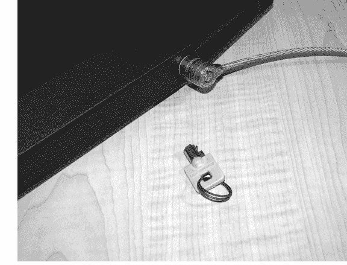

鼓励员工将所有电子设备锁在汽车后备箱中，而不是将其放在副驾驶座或后座上显眼可见。需要注意的是，一些组织可能会训斥不遵守此类政策的员工，以确保员工认识到对公司资产做出负责任决策的价值。

在办公室内，你可以使用锁定线缆来帮助阻止设备被盗，如笔记本电脑、平板显示器、投影仪，甚至台式电脑。锁定线缆是一种小型线缆，连接并锁定在设备上，将设备固定到桌子上。这些锁定线缆无法阻止决心坚定的窃贼盗走设备，但会起到威慑作用，防止有人随手走过顺走设备。图5-1展示了一根锁定线缆。

### 远程擦除设备

确保员工了解立即报告丢失或被盗移动设备的重要性，以便你能尽快远程擦除这些设备。擦除设备会从服务器向设备发送信号，抹掉其所有数据和配置。这可以确保丢失或被盗的移动设备上不包含敏感信息。

### 设备上的保护措施

在移动设备上实施保护措施非常重要，这样即使设备被盗或丢失，也能最大程度地增加他人使用该设备的难度。

### 蓄意破坏

另一种常见的系统威胁是蓄意破坏，这通常但并非总是由心怀不满的员工造成。识别公司资产易受蓄意破坏的情况非常重要。在我的安全课程中，我多次听到学生讲述公司数据库被心怀不满的员工篡改的事件。

你需要识别易受蓄意破坏的系统，并确保为这些系统制定恢复计划。*恢复计划*包含逐步恢复系统的程序，同时还确保服务器机房中有足够的备用零件。

# 认证目标 5.03

## 审视恶意软件

既然你已经了解了针对系统的一些常见物理威胁，让我们来看看当今对系统构成威胁的某些类型的恶意软件。恶意软件是指任何损害或滥用系统的软件，包括删除系统文件、监视系统活动，甚至只是拖慢系统速度这样简单的事情。

### 权限提升

权限提升是指黑客发现操作系统或系统中安装的某款软件存在缺陷，利用该缺陷后，黑客的权限从普通用户能力提升至管理员访问权限。一旦黑客获得系统的管理员访问权限，他们就可以对系统进行任意更改，包括植入后门以便日后访问。

权限提升有三种类型：

- **垂直权限提升**：当拥有普通用户访问权限的人能够将权限提升至管理员访问权限
- **水平权限提升**：当保持相同的访问级别，但所访问的资源不同
- **权限降级**：当拥有管理员访问权限的人能够降低权限级别，以访问特定用户可访问的数据

### 病毒

安全方面最大的担忧之一是系统被病毒攻占。病毒是一种感染系统（如计算机、平板电脑或智能手机）的恶意软件。感染可能破坏系统上的数据、阻止系统启动，或只是占用系统资源，导致系统变慢。本节讨论常见的病毒类型。

### 可执行病毒

早期的病毒是可执行病毒，病毒附着在可执行文件上，但直到你运行该文件才会被激活。这种病毒通常通过用户使用软盘、闪存驱动器或网络驱动器共享文件而在系统之间传播。

### 引导扇区病毒

引导扇区病毒是一种严重的病毒，它会攻击并覆盖引导扇区代码。引导扇区是磁盘上的第一个扇区，包含启动引导序列的操作系统加载程序代码。当引导扇区病毒覆盖该扇区时，系统将无法从受感染的磁盘启动。

### 宏病毒

当今大多数应用程序都支持宏，宏是一种在软件应用内自动执行任务的方式。例如，在 Microsoft Office 套件中，我们可以使用 Visual Basic for Applications（VBA）创建宏，VBA 是一种功能强大的编程语言，可以操作应用程序和操作系统。

宏病毒是使用宏语言编写的代码，可执行恶意操作，例如删除文件或向通讯录中的所有人发送电子邮件。宏通常创建在文件中，当有人打开该文件时自动触发。

### 逻辑炸弹病毒

逻辑炸弹是一种病毒，通过你安装包含逻辑炸弹的软件而植入系统。你安装的软件应用会正常运行，直到某个特定事件（如特定日期）发生。当你运行该软件时，它总是检查该特定日期，如果在该日期运行，它就会执行恶意行为。这是心怀不满的员工在辞职或被解雇后破坏公司数据的一种常用方法。他们编写软件的代码（通常正常运行），使其在特定日期删除数据。

> 考试须知：逻辑炸弹病毒会等待特定事件（如某个日期）发生后才被激活。


## 蠕虫病毒

蠕虫病毒是一种有害且常见的病毒。如今。蠕虫病毒是一种令人恐惧的病毒类型，因为它具有独特的特性，即能够在无需用户激活的情况下自行复制。蠕虫病毒可以通过多种方式复制自身：

- **网络协议** — 蠕虫病毒可以通过使用标准网络协议并通过系统上运行的网络应用程序中的漏洞入侵系统，从而自动在网络上复制自身。一个很好的例子是 2003 年的 Blaster 蠕虫，它通过 RPC 端口（端口 135）进行复制。谁能忘记同样来自 2003 年的 SQL Slammer 蠕虫病毒，它在 10 分钟内感染了互联网上的约 75,000 个系统？SQL Slammer 利用了 SQL Server 上已知的缓冲区溢出漏洞，并通过 UDP 端口 1434 连接到未修补的 SQL Server。
- **电子邮件** — 蠕虫病毒可以通过电子邮件自动传播。病毒通过电子邮件消息发送给用户，当该用户打开消息时，病毒代码会执行并遍历用户的联系人列表，并将电子邮件发送给所有联系人。臭名昭著的电子邮件病毒的例子有 2000 年的 ILOVEYOU 病毒，以及 2010 年发送的主题行为“Here you have”的病毒。
- **闪存驱动器** — 一波新的蠕虫病毒通过使用闪存驱动器（拇指驱动器）进行复制来感染系统。一旦蠕虫病毒进入系统，它就会等待有人在该系统上插入闪存驱动器，然后蠕虫病毒就会复制到拇指驱动器。用户将拇指驱动器带到另一台系统，一旦驱动器连接到 USB 端口，病毒就会从拇指驱动器复制到系统。Conficker 是一种可以通过使用 USB 拇指驱动器进行复制的蠕虫病毒。

## 特洛伊病毒

特洛伊病毒是一种用户被 tricked 安装的程序，因为它看起来能做一些有用的事情，但实际上，它是一种感染系统的病毒。特洛伊病毒通常通过在系统上打开一个 TCP/IP 端口来修改系统，这允许黑客连接到系统并控制它。

需要指出的是，特洛伊病毒不仅仅能打开系统上的端口，而且由于大多数人今天都有防火墙来阻止访问特洛伊打开的端口，你可能会发现特洛伊病毒会在系统上放置广告软件或键盘记录器。

表 5-1 列出了流行的特洛伊病毒及其在系统上打开的端口。

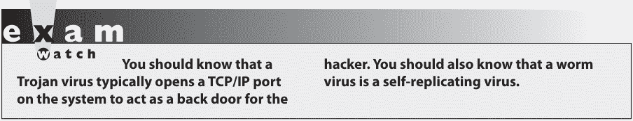

**表 5-1：流行的特洛伊病毒端口号**

| Protocol | Port | Trojan |
|---|---|---|
| TCP | 12345 | NetBus |
| TCP | 17300 | Kuang |
| TCP | 27374 | SubSeven |
| TCP | 31337 | BackOrifice |
| TCP | 48006 | FraggleRock |

### 排查特洛伊病毒

在离开特洛伊病毒主题之前，我想谈谈一些常用的 Windows 命令，如果你怀疑自己已感染，可以用来追踪特洛伊病毒。这里的目标是结束打开端口的程序，以便关闭端口。

用于追踪特洛伊病毒的第一个命令是 `netstat` 命令。如果你使用 `netstat -na` 命令，你将看到处于监听状态的本地端口列表。监听意味着端口是打开的并等待有人连接，而不是此时有人实际连接。

要找出打开端口的程序，你可以向 netstat 添加 `-o` 开关，它会显示打开端口的程序的进程 ID（PID）号。在图 5-2 中，注意端口 12345（NetBus 端口）处于监听状态，并且负责打开端口 12345 的 PID 为 208。

**图 5-2.** 使用 netstat 显示打开端口的程序的进程 ID

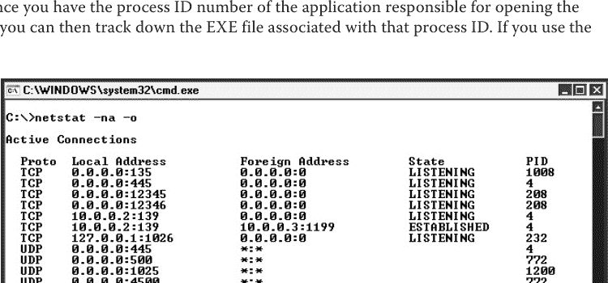

一旦你获得了负责打开端口的应用程序的进程 ID 号，你就可以追踪与该进程 ID 关联的 EXE 文件。如果你使用 `tasklist` 命令，你将看到内存中运行的进程（EXE 文件）以及每个进程关联的 PID（见图 5-3）。请注意以下输出中，`Patch.exe` 是与 PID 关联的 EXE 文件，并且负责打开端口！另请注意，你可以使用管道（`|`）功能来查找 `tasklist` 命令中的特定条目。例如，你可以使用 `tasklist | find "208"` 来查找结果中包含 "208" 的条目。

**图 5-3.** 使用 tasklist 显示内存中运行的可执行文件

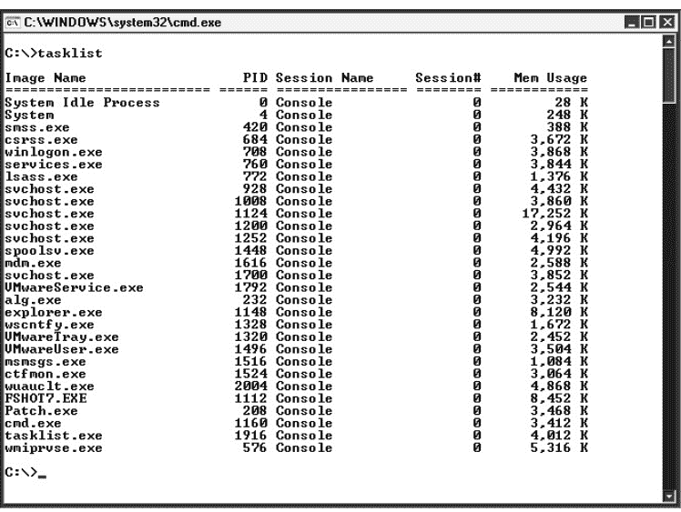

一旦你使用 `tasklist` 命令并知道了进程，你就可以使用 `taskkill` 命令终止该进程。使用 `taskkill` 命令时，你可以指定要终止的 EXE 文件，也可以通过使用 `/PID` 开关搜索 PID。图 5-4 中显示的代码使用 `taskkill` 命令通过其 PID 号强制终止进程。

**图 5-4.** 使用 taskkill 终止内存中运行的程序

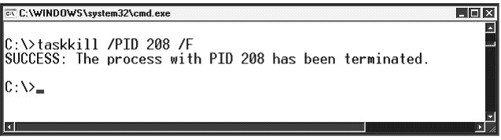

终止进程后，请务必检查系统上通常自动启动程序的配置区域。这将是“开始”菜单中的“启动”程序组，以及注册表中的“运行”部分，位于 `HKLM\Software\Microsoft\Windows\CurrentVersion\Run`（见图 5-5）。在我们的示例中，如果你运行 `regedit.exe` 并导航到注册表的“运行”部分，你会看到 `Patch.exe` 设置为在 Windows 重启时自动运行。你需要删除此条目。

**图 5-5.** 从注册表的“运行”部分中删除设置为自动启动的程序

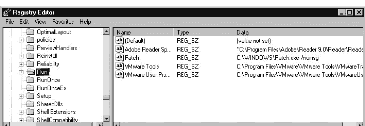

## 其他恶意软件

除了病毒之外，还有其他类型的恶意软件（称为恶意软件），你需要为现实世界和 Security+ 认证考试而熟悉。在本节中，你将了解间谍软件、广告软件和 rootkits 等，命名为几种今天威胁系统的常见恶意软件类型。

### 间谍软件

间谍软件是隐藏的软件，它监视并收集有关你和你的活动的 information，然后将该信息发送到远程系统供黑客查看。例如，间谍软件可以收集你的浏览习惯信息。间谍软件也已不仅仅是监视信息；它也曾被发现对系统进行更改，例如浏览器重定向（将你发送到不同的网页）以及减慢网络连接速度。

### 广告软件

广告软件是一种自动在屏幕上加载广告的软件，通常以弹出窗口的形式出现。广告旨在诱使你购买产品或订阅网站。

### 垃圾邮件

*垃圾邮件* 是指你收到的任何未经请求的商业电子邮件的术语。这些电子邮件通常是群发邮件，它们试图让你购买产品或服务。垃圾邮件发送者（发送垃圾邮件的人）通常从网站或新闻组获取你的电子邮件地址，在你发布评论到该组之后，或者垃圾邮件发送者从在线收集电子邮件地址的公司购买电子邮件列表。

垃圾邮件发送者使用自动程序，即 *垃圾邮件机器人*，来爬取网站并收集在其上发布的任何电子邮件地址。一旦垃圾邮件发送者收集了足够的电子邮件地址，他们就会通过向所有地址发送消息来寻找业务。

公司可以通过不在网站上发布电子邮件地址来防范垃圾邮件，或者如果显示电子邮件地址很重要，他们可以通过将电子邮件地址放在显示的图形文件中来做到这一点。垃圾邮件机器人无法从图形文件中检索电子邮件地址，因为它不是页面上的文本。

你还可以通过在电子邮件服务器上配置垃圾邮件过滤器（见图 5-6）或使用反垃圾邮件设备（如 Cisco IronPort）或在线反垃圾邮件服务（如 Barracuda）来保护你的公司免受未经请求的商业电子邮件的接收。大多数电子邮件服务器支持以下垃圾邮件过滤器：

- **收件人过滤器** — 收件人过滤器是一种阻止发送到指定收件人（电子邮件头中的收件人行）的消息的方法。

**图 5-6.** 查看电子邮件服务器上的垃圾邮件过滤选项

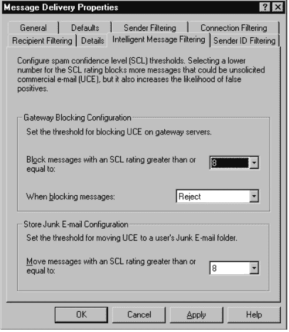


发件人过滤器  发件人过滤器可以阻止来自指定发件人（电子邮件标头中的“发件人”行）的邮件。

- 连接过滤器  连接过滤器是一个禁止连接到你的简单邮件传输协议（SMTP）服务器的 IP 地址列表。你通常会将发送垃圾邮件的邮件服务器（称为垃圾邮件主机）的 IP 地址添加到连接过滤器中。

- 实时黑名单（RBL）  认为你可以将互联网上所有垃圾邮件主机的 IP 地址都添加到连接过滤器中是不现实的，因此你可以订阅实时黑名单，这是一个跟踪互联网上所有垃圾邮件主机的公司。

- 发件人 ID 过滤器  发件人 ID 过滤器允许你的 SMTP 服务器在 DNS 中查找向你的用户发送电子邮件者的所谓发件人策略框架（SPF）记录。你的 SMTP 服务器会检查发送电子邮件的域名的 SPF 记录，如果发送 SMTP 服务器列在 SPF 记录中，你的邮件服务器将接受该电子邮件。

> 考试注意 垃圾邮件行为是指某人向大量收件人发送未经请求的电子邮件。你可以通过在电子邮件服务器上实施过滤器以及不在互联网上发布电子邮件地址来保护你的公司免受垃圾邮件的侵扰。

## 内核套件（Rootkit）

内核套件是黑客安装在系统上的一种软件，通常对管理员隐藏，并赋予黑客对系统的特权访问权限。以下是五种主要类型的内核套件：

- 应用程序级  应用程序级内核套件是一种用户模式可执行文件，使黑客能够访问系统。应用程序级内核套件的示例包括木马病毒。

- 库级  库级内核套件不是可执行文件，而是可供应用程序调用的代码库。库级内核套件是运行在用户模式下的 DLL 文件，通常会替换系统上的某个 DLL 以隐藏自身。

- 内核级  内核级内核套件是由操作系统内核加载的内核套件，通常通过替换系统上的设备驱动程序文件植入系统。内核级内核套件运行在内核模式下，而不是用户模式，这意味着它比用户模式内核套件具有更高的权限，因此对系统有更大的访问权限，可能造成更大的破坏。

- 虚拟化  虚拟化内核套件是在系统启动时加载以代替操作系统的内核套件。然后，这种内核套件会在虚拟化环境中加载真实操作系统。这些内核套件很难检测，因为操作系统不知道它正被托管在虚拟化环境中，而且操作系统中没有应用程序代码或 DLL 被替换。

- 固件  固件内核套件存储在系统或设备的固件代码中，由于它不存在于操作系统中，因此很难检测。

## 僵尸网络（Botnet）

*僵尸网络*是已被黑客入侵并被用来协助执行其他类型攻击的系统的集合。在僵尸网络中受黑客控制的系统被称为*僵尸系统*或*僵尸主机*，因为它们没有自主意识，只会听从黑客的指令。

僵尸网络可以用于多种目的，例如发送垃圾邮件或对特定目标执行拒绝服务（DoS）攻击。一旦黑客控制了许多系统，就可以出租僵尸网络的服务，利用僵尸网络中的所有系统发起攻击。

> 考试注意
> 对于 Security+ 考试，要知道僵尸网络是由黑客控制的一组系统，用于对互联网上的系统发起攻击。

## 远程访问木马（RAT）

*远程访问木马（RAT）*是一种恶意软件，用户通常会不知不觉地安装它，例如从互联网安装游戏或运行通过电子邮件发送给他们的程序。RAT 程序随后会为攻击者打开后门，以便日后远程访问系统。RAT 恶意软件允许攻击者连接到系统并在该系统上远程运行命令。如果网络上的某个系统运行了 RAT，黑客可能会利用它来破坏其他系统，从而实质性地创建一个僵尸网络。

## 键盘记录器

键盘记录器是旨在捕获系统上所有按键的软件或硬件设备。作为硬件，键盘记录器是一个小设备，连接到键盘线缆，然后连接到计算机（见图 5-7）。通常，黑客会进入某个设施，将键盘记录器连接到系统。一旦设备连接到键盘和计算机之间，该系统上的任何按键都会被捕获并存储在设备上。然后黑客回来取回该设备。

### 图 5-7

键盘记录器是一种记录按键的软件或硬件设备。

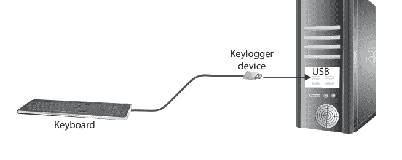

键盘记录器也可以是一种安装在系统上的软件。该软件在后台运行，将所有按键捕获到硬盘驱动器上的文件中，或将按键发送到远程系统。然后，黑客可以逐个字符地看到系统上输入的所有内容。这将使黑客能够看到用户名和密码等机密数据。

> 考试注意 对于考试，请记住 RAT 是一种恶意软件，它允许攻击者连接到系统并运行远程命令。还要知道键盘记录器是记录按键的恶意软件或硬件。

## 后门

当黑客入侵系统时，他们通常会在系统上安装后门，以便日后能够访问该系统。黑客安装后门是因为他们知道自己最初用于入侵系统的方法日后可能会被阻止，因此他们创建了另一种访问系统的方法。黑客可能会使用木马病毒、通过软件开放系统上的端口，或在系统上创建用户帐户作为后门，以便日后利用其访问系统。

## 勒索软件

当今发现的另一种恶意软件是勒索软件。勒索软件是当今常见的恶意软件，当它在你的系统上运行时，会加密你硬盘驱动器中的内容，而黑客是唯一拥有解密密钥的人——他们实际上会劫持你的数据，直到你支付赎金。黑客通常希望以比特币形式收款，因为更难追踪。如果你决定不支付，则需要对系统进行完全擦除，并从备份中恢复数据。

## 潜在不需要的程序（PUP）

Security+ 考试要求你理解*潜在不需要的程序*（简称 PUP）的概念。PUP 是一种安装到你的系统上的软件，你并不想要它，但它却因为与你真正想要并安装的另一个程序捆绑在一起而被安装。PUP 会做许多令人讨厌的事情，例如显示广告、安装工具栏、可能降低计算机速度，以及收集关于你的私人信息。为帮助防范 PUP，你在安装软件时应仔细查看每个屏幕，确保禁用安装附加软件的选项，并务必运行反恶意软件。

## 无文件病毒

无文件病毒是不在系统上安装任何文件的恶意软件，而是在系统内存中运行。这种恶意软件通常与另一个程序相关联，因此当你运行该程序时，恶意软件会被加载到内存中并从内存中运行。

## 命令与控制（C&C）

Security+ 考试还会测试你关于命令与控制（C&C）的知识，即攻击者入侵一个系统（或系统网络），然后在其上加载恶意软件。随后，攻击者使用命令与控制服务器向运行恶意软件的系统发送命令，从而执行诸如从系统中检索敏感数据和破坏系统功能等任务。

## 考试内幕

### 键盘记录器：硬件或软件

请记住，对于 Security+ 考试以及现实世界而言，键盘记录器既可以是黑客安装在系统上的软件，也可以是黑客连接到系统与键盘之间的硬件设备。

软件键盘记录器通常将按键捕获到本地系统上的文件中，或者可以将数据发送到远程系统上的文件中。硬件键盘记录器通常将按键记录到设备中，以便黑客稍后取回该设备。


如果您正在寻找一些免费软件来帮助防范恶意软件，甚至是移除恶意软件，您可以使用以下工具：

- **Windows Defender** 这是微软包含在所有受支持操作系统中的病毒防护、间谍软件防护和恶意软件防护软件。与其他病毒防护软件一样，Windows Defender 提供对恶意软件的实时防护。
- **Microsoft Malicious Software Removal Tool** 如果您的系统已被感染，您可以从微软下载恶意软件删除工具，该工具会定期更新。它是帮助从受感染系统中移除恶意软件的绝佳工具。

还应指出的是，如果您发现系统已感染，则不能信任该受感染系统上运行的任何软件，包括防病毒软件。在这种情况下，您需要从具有独立操作系统和病毒防护软件的实时光盘或 USB 驱动器启动。一旦从实时操作系统启动，您就可以从实时操作系统启动防病毒软件来扫描系统并移除病毒。

## CERTIFICATION OBJECTIVE 5.04

## Threats Against Hardware

在保护系统时，您不仅需要担心诸如恶意软件之类的系统威胁，还需要担心应得到保护的系统硬件相关功能。本节介绍用于正确保护系统的流行硬件功能。

### BIOS Settings

计算机中的 BIOS 芯片包含用于与系统中的硬件通信的低级代码。BIOS 代码还包含所谓的 *CMOS 设置程序*，该程序用于配置系统上的硬件设置，例如系统中的内存和驱动器类型以及计算机的日期和时间。

就安全性而言，CMOS 设置程序（图 5-8 所示的示例）可用于控制可以从哪些设备启动。安全最佳实践是确保系统只能从本地硬盘启动，而不能从网卡、USB 驱动器或系统上存在的光盘驱动器启动。有人使用实时光盘（包含可启动操作系统的 USB 驱动器或 DVD）将操作系统启动到内存中以获得系统访问权限实在太容易了。为确保这种情况不会发生，请配置 CMOS 以仅允许从硬盘启动（如果可能）。

### FIGURE 5-8

使用 CMOS 设置帮助保护系统

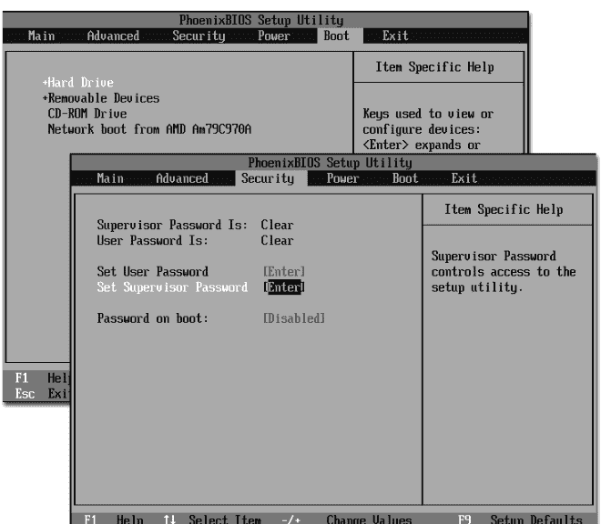

在 CMOS 设置程序中，您还可以设置“用户”密码，即使用系统所需的密码。请勿将此密码与 Windows 密码混淆，因为 CMOS 密码会在操作系统加载之前出现。还要确保设置“管理员”密码，即有人想要更改 CMOS 设置时所需的密码。

如果您担心人们将未经授权的设备连接到计算机并可能通过未经授权的设备带走数据或损害系统，您应确保通过 CMOS 设置程序禁用不必要的端口。

### USB Devices

关于端口，重要的是更新您的安全策略并向用户传达允许放置在 USB 驱动器上的数据类型。因为员工很容易将数据的副本带在闪存驱动器上，所以安全策略必须明确规定允许放置在 USB 驱动器上的数据类型。在高安全环境中，您可能会决定禁用 USB 端口以便无法使用它们。

> exam watch
> 由于已知蠕虫病毒会从拇指驱动器复制到系统，因此您应考虑在办公室的系统上禁用 USB 端口。

使用 USB 拇指驱动器周围的一个重要风险是，员工可能在家用系统上携带病毒并将 USB 驱动器插入其系统，从而使蠕虫病毒复制到拇指驱动器。从业务角度来看，其安全问题在于，如果员工将拇指驱动器带到办公室并将其连接到系统，病毒可能会复制到工作系统。

### Smart Phones and Tablets

智能手机和平板电脑等移动设备是当今业务运营中的关键设备。大多数员工在受雇时都会获得一部手机或平板电脑，保护移动设备上的数据安全非常重要。如今大多数手机被称为智能手机，因为它们不仅仅是打电话。它们存储业务联系信息和敏感文档，并且具有数据计划，允许连接互联网以检查电子邮件和浏览互联网。

从安全角度来看，确保员工在不使用时锁定智能手机和平板电脑，并且对这些设备上的数据进行加密。这将保护公司免受公司外部人员在员工手机丢失或被盗时查看机密数据的影响。

作为安全专业人员，您应研究贵公司员工使用的所有移动设备的漏洞。熟悉公司使用的所有设备的特性并了解每个产品存在的不同漏洞非常重要。

由于当今大多数移动设备都使用 Bluetooth，一种允许一个 Bluetooth 设备在短距离（最远 30 英尺）内与另一个 Bluetooth 设备通信的无线技术，因此如果启用了 Bluetooth，黑客很容易与您的手机通信并窃取数据。今天的手机容易受到各种攻击，包括以下内容：

- **Bluesnarfing** 一种 Bluetooth 漏洞，允许黑客连接到启用了 Bluetooth 的手机并从手机检索数据
- **Bluejacking** 从一个 Bluetooth 设备向另一个 Bluetooth 设备发送未经请求的邮件
- **Bluebugging** 一种 Bluetooth 漏洞，涉及黑客获得对手机的访问权限并利用其全部功能，包括使用手机上的 AT 命令集拨打电话

7. 扫描应向您报告您附近的任何 Bluetooth 设备以及该设备的 MAC 地址。记录您找到的 Bluetooth 设备的 MAC 地址：____________

8. 一旦您拥有 Bluetooth 设备的 MAC 地址，您就可以使用 **bluesnarfer** 命令检索有关 Bluetooth 设备的信息。要查看手机上的地址列表，请输入

```
bluesnarfer -r 1-50 -b <mac of phone>
```

9. 请注意，**-r** 用于读取 1 到 50 条条目，而 **-b** 是用于指定要利用的设备的 MAC 地址的开关。

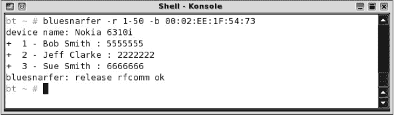

10. 然后您可以使用 **bluesnarfer** 命令通过输入以下内容来查看手机上的已接收来电（请注意，**RC** 指定您希望查看已接收来电）：

```
bluesnarfer -s RC -r 1-50 -b <mac of phone>
```

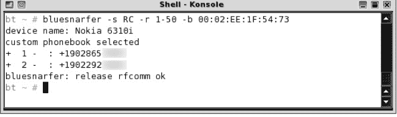

11. 要使用 **bluesnarfer** 从地址簿中删除前五个电话簿条目，请输入

```
bluesnarfer -w 1-5 -b <mac of phone>
```

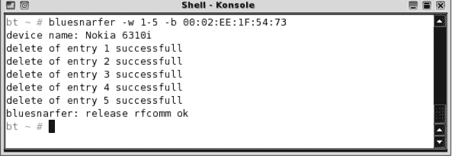

12. 要使用 BackTrack 系统通过被黑的手机拨打电话，请输入

```
bluesnarfer -c 'ATDT######;' -b <mac of phone>
```

13. 请注意，**-c** 指定自定义操作，而 **AT** 命令拨打号码，# 符号用作电话号码的占位符。

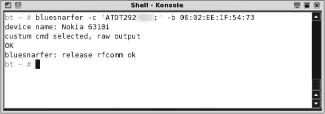

14. 您将如何防止设备上的蓝牙嗅探？

在使用用户所需的移动设备时，请确保在不需要或员工未使用时禁用 Bluetooth 功能。如果需要 Bluetooth，则将可见性选项设置为禁用或不可见，以便其他设备在扫描时无法看到员工的 Bluetooth 设备。

| exam watch |  |
|---|---|
| **对于考试，请知道 bluesnarfing 是从 Bluetooth 设备未经授权检索数据，而** | **bluejacking 是从一个 Bluetooth 设备向另一个 Bluetooth 设备发送未经请求的邮件。** |

大多数 Bluetooth 设备今天使用配对安全——这意味着另一个 Bluetooth 设备不能在不先提示您输入 PIN 号码的情况下连接到您的 Bluetooth 设备，PIN 号码充当访问代码。如果连接的人输入相同的 PIN 号码，则允许连接。

### Removable Storage

重要的是在您的安全策略中包含有关 *可移动存储* 的规则，可移动存储是指可以存储数据然后从系统中移除的任何存储介质。


例如，通过USB、FireWire或eSATA连接到系统的闪存盘（也称为U盘）和外置硬盘，被视为可移动存储。

围绕可移动存储的安全问题在于，员工可能会从家里带来一个存储驱动器，并将其连接到公司系统。这会带来问题，因为某些蠕虫病毒可以通过从可移动驱动器复制到公司系统来感染公司系统。最好的做法是，不允许员工在公司网络上使用可移动存储，并确保安全策略明确规定这一点。

如果公司向员工提供可移动存储设备用于存储公司信息，请确保这些驱动器能够对存储在驱动器上的数据进行加密。员工很容易丢失或被盗可移动驱动器，因此务必确保驱动器上的机密数据已加密。

最后，一些高安全性环境的工作站配有可移动硬盘。这些组织有相关政策：当员工离开工作站时，必须将驱动器从系统中拔出，然后将其锁在安全的柜子里。员工使用的笔记本电脑可能也是如此。员工在下班离开时，可能需要将笔记本电脑锁在安全柜中。这样做的好处是，如果任何人在晚间能够进入设施（例如清洁人员），驱动器或笔记本电脑也能被安全存放起来。

## 网络附加存储

网络附加存储（NAS）设备是一种连接到网络并安装有一组驱动器的设备。这些驱动器通常以容错方案配置，例如RAID阵列，并允许网络上的客户端直接连接到该设备。

NAS提供了一个中心位置，用于向网络上的客户端共享文件，并支持不同类型的客户端（Linux和Windows）连接到NAS以访问文件。这之所以成为可能，是因为NAS设备运行大多数文件共享协议，例如用于Windows客户端的服务器消息块（SMB）和用于Linux客户端的网络文件系统（NFS）。

一旦将NAS连接到网络，就可以通过基于Web的界面修改其配置设置。

必须非常小心地保护NAS设备上的数据，因为所有公司数据现在都可能存储在这个单一位置。在处理NAS时，需要考虑以下几点：

-   访问被入侵会影响所有数据。如果有人能够获得对NAS的访问权限，他们可能会访问NAS上的所有数据。为了控制对NAS设备的访问，请确保有防火墙将NAS设备与Internet隔离开。
-   病毒可能会感染所有文件。因为所有数据都存储在一个位置，病毒可能会传播到所有数据中。请务必对存储在NAS上的数据定期进行病毒扫描。
-   实施基本措施。尽可能在NAS设备上使用身份验证、权限和加密来控制谁可以访问设备上的数据。

## PBX（专用交换机）

专用交换机（PBX）是一种先进的电话系统，充当公司内部所有电话的交换机。PBX允许公司购买一条外部线路，然后让公司内部的多个内部电话系统（和号码）使用该PBX。公司内的每部电话都被分配一个唯一号码，作为外部线路的分机号码（参见图5-9）。

由于电话系统的特性，通常有许多安全问题与PBX相关。第一个关键点是控制谁可以访问PBX，方法是将其放置在受限访问的锁闭房间中。确保PBX的硬件组件位于安全位置，并考虑使用防篡改设备来帮助保护PBX。在评估安全性时，请务必定期检查硬件组件，确保它们未被篡改。

与任何设备一样，请务必尽可能修改PBX上的任何默认设置，包括默认账户和密码。此外，如果需要远程管理PBX，请务必实施回呼安全机制，即系统断开原始连接，然后连接到预定义号码。这将确保黑客无法尝试远程连接到PBX。

确保用户不在公司内部将调制解调器连接到电话线，因为这会造成风险：未经授权的人可能拨入该号码，然后获得对内部网络的远程访问权限（这可不是好事！）。有人拨号寻找连接到某个号码的调制解调器的术语是*战争拨号*。多年前战争拨号的常见场景之一是，管理员为了远程管理PBX而将调制解调器连接到PBX。黑客会通过战争拨号找到PBX，然后获得对PBX的访问权限，通过PBX拨打长途电话。

> **不要将战争拨号与战争驾驶混淆。** *战争拨号*是指黑客拨打各种号码，期望找到连接到电话线的调制解调器；而*战争驾驶*是指黑客使用无线扫描器定位无线网络。

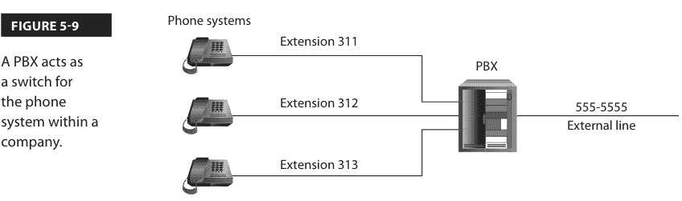

## 嵌入式系统和专用系统的安全风险

在本节中，您将学习在使用不同类型技术的环境中降低风险的常用技术。为了降低风险，您必须理解这些技术及其相关的安全风险。

降低安全威胁的主要挑战在于当今组织使用的产品和技术种类繁多。作为安全专业人员，您需要为这些技术和专用系统中的每一种创建（或至少建议如何创建）安全环境。

### 嵌入式系统

注意那些具有可能带来风险的嵌入式组件的设备。这包括任何连接到网络的设备，如打印机或智能电视，同时也要注意包含蓝牙技术的设备。请务必对这些设备实施加固实践（例如，如果设备不使用蓝牙，应尽可能禁用它）：

-   **树莓派** 树莓派是一种小型系统板，包含处理器、内存以及USB端口、Micro HDMI和千兆以太网端口等端口。这些小型系统在家庭用户中很常见，用于创建提供某种功能的定制设备。
-   **现场可编程门阵列（FPGA）** 现场可编程门阵列是一种集成电路，交付给客户后，客户可以自行编程功能到芯片中。
-   **Arduino** Arduino是一种流行的产品，客户用它来创建自己的电子设备。Arduino带有一个小板，包含微处理器和控制器，可以使用C和C++等语言进行编程。

### 其他嵌入式技术

还有其他一些技术要么与嵌入式系统配合使用，要么自身包含嵌入式组件。以下是需要注意的其他相关技术列表：

-   **HVAC** HVAC系统具有嵌入式计算机系统，用于感知和控制环境温度。
-   **SoC** 片上系统（SoC）本质上是一块计算机芯片上的计算机系统，嵌入到电路板中。SoC可以包含丰富的功能，包括CPU、GPU和无线模块。使用SoC的设备示例是树莓派。
-   **RTOS** 实时操作系统（RTOS）是嵌入式系统上的一种操作系统，旨在数据到达设备时即时处理数据。
-   **智能设备** 智能设备是连接到网络或Internet并能够与其他设备通信的设备。这些设备通常使用蓝牙、Wi-Fi或蜂窝网络等无线技术连接到网络或Internet。
-   **可穿戴设备** 可穿戴设备是可以佩戴在身上的电子设备，例如智能手表。例如，智能手表可以通过蓝牙与智能手机通信。可穿戴设备可能能够充当健身监测器和心率监测器。
-   **设施自动化** 设施自动化系统旨在控制建筑物内的元素，例如供暖、通风和空调（HVAC）。
-   **弱默认设置** 许多物联网设备可能具有导致设备不安全的默认设置。您必须审查其默认配置，并尽可能修改默认配置，因为默认设置是黑客所知道的！

### 专用系统

许多特殊用途系统包含嵌入式系统，包括医疗设备、车辆以及飞机/无人机系统。这些系统中的每一个都应进行漏洞评估。

-   **车载计算系统** 如果您的组织在车辆中有计算机系统，请确保除了常规安全实践之外，还为这些系统实施特殊的安全控制。例如，如果公司车辆配备了笔记本电脑，请务必加密磁盘上的数据，实施防止设备被盗的锁定控制，并禁用笔记本电脑中不必要的端口和网卡。如今的汽车具有OnStar等通信系统，这些系统通过卫星连接到汽车，使制造商能够提供许多功能，如紧急呼叫。潜在的安全问题是黑客可能会利用该系统控制车辆。
-   **医疗系统** 医疗系统具有嵌入式计算机系统，具有网络连接，用于收集和传输医疗数据。
-   **车辆** 车辆制造商正在使用物联网技术，使车辆与制造商的计算机系统保持持续通信。制造商利用从这些车辆收集的数据来改进功能并使车辆更安全。当制造商需要部署软件更新时，该通信通道也用于更新车辆上的软件。
-   **飞机** 与汽车中的物联网技术类似，航空公司也在飞机中使用物联网，以便收集有关飞机及其航班的信息。
-   **智能电表** 智能电表是收集电力消耗信息的设备，以便电力公司更好地监控您的用电量。


## 通信注意事项

嵌入式系统和物联网设备将使用不同的通信方法将收集到的数据发送到制造商的系统。在评估公司使用的物联网设备风险时，不要忘记研究所采用的通信技术以及通信渠道中的漏洞。以下是这些设备使用的通信技术：

-   **5G** 嵌入式系统和物联网设备可以使用蜂窝网络将收集到的信息传输给制造商，当前标准是第五代（5G）蜂窝网络。
-   **窄带** 设备可以使用窄带无线电通信信道进行短距离通信。例如，RFID技术和车辆遥控无钥匙进入通常使用窄带。
-   **基带无线电** 基带无线电是一种使用无线电波在两点之间发送信号的通信技术。
-   **用户身份模块（SIM）卡** SIM卡是放置在手机中的小型计算机芯片，存储连接蜂窝网络所需的信息。您还可以在SIM卡上存储消息和联系人等个人数据。
-   **Zigbee** Zigbee是一种通信协议，用于在家庭自动化系统或医疗设备等设备之间创建个人区域网络（PAN）。

## 约束

以下是在使用嵌入式系统或物联网设备时可能会遇到的一些潜在限制：

-   **电源** 物联网设备需要使用电力来产生足够强的信号以发送数据。制造商需要确保组件获得足够的电力，以保证组件功能的稳定。
-   **计算** 组件需要具备处理所收集信息的计算能力。
-   **网络** 网络需要高效、可靠，以便能够传输收集到的数据。
-   **密码学** 为了确保通信安全，技术将使用某种形式的密码算法来加密通信。考试时，请留意使用弱加密算法（如DES和3DES）的解决方案。您将在第12章和第13章中了解更多关于加密的内容。
-   **无法修补** 考试中需要记住的另一个关于物联网设备的关键点，也是巨大的限制或漏洞，是设备无法应用更新（修补系统）。如果设备无法提供应用补丁的方式，这意味着设备内发现的漏洞将始终存在。
-   **身份验证** 查看设备支持的身份验证协议，并确保如果您可以选择身份验证协议，请使用最安全的协议（支持加密身份验证流量的协议）。
-   **范围** 技术的范围也可能是一个限制。例如，Bluetooth 4.2的有限范围是60米，而Zigbee的最大范围是100米。
-   **成本** 嵌入式技术的成本可能会增加客户组件的成本。
-   **隐式信任** 该技术可能遵循隐式信任规则，即信任所有通信。

## 认证摘要

在本章中，您了解了当今系统面临的一些最常见的威胁类型。您已经了解了针对资产的物理威胁（例如设备盗窃），以及恶意软件和硬件威胁。以下是有关系统安全威胁需要记住的一些关键点：

-   大多数公司的IT战略以技术为重点；然而，他们不应忘记物理安全威胁，例如窥探和硬件盗窃。
-   干净桌面政策以及确保员工粉碎不需要的文件将有助于防止窥探。
-   确保您为任何移动设备设置密码保护，并加密这些设备上的数据，以防它们丢失或被盗。
-   熟悉不同类型的恶意软件，例如病毒、间谍软件和广告软件。
-   确保通过安装病毒防护软件并保持病毒定义最新来保护系统免受恶意软件侵害。您可以使用操作系统命令（如**netstat**、**tasklist**和**taskkill**）来监控系统上运行的内容。
-   确保用户对存储在可移动驱动器上的任何数据进行加密，以防可移动驱动器丢失或被盗——这包括USB拇指驱动器。还要确保控制哪些驱动器可以连接到企业系统；您不希望从员工家用计算机感染了病毒的拇指驱动器进入您的网络。
-   当您在办公室获得新设备（如智能手机）时，请务必研究这些设备的功能，并禁用未使用的功能，例如蓝牙。同时，研究这些特定设备的漏洞。

了解针对系统的威胁是安全专业人员应具备的重要技能，并将帮助您回答考试中的相关问题。在安全方面始终保持怀疑的态度，对于任何新技术，问问自己：“这存在哪些威胁？”

## 两分钟速记

### 漏洞相关的安全问题

-   注意软件或硬件设备的弱配置，这些配置可能使系统易受攻击。弱配置的示例包括没有权限控制已授权的操作、弱加密（例如使用DES或3DES）以及不安全的协议使用（例如使用HTTP而不是HTTPS）。
-   记住要修改系统默认配置，因为黑客知道他们攻击的系统的默认设置。
-   确保定期为系统应用补丁。这包括固件更新、操作系统更新以及您正在运行的任何应用程序更新。
-   您应该禁用系统上的USB端口或实施DLP，以防止数据泄露。

### 识别物理威胁

-   确保员工在处置敏感文件时将其粉碎，以帮助防止窥探技术，例如垃圾搜寻（dumpster diving）。
-   实施干净桌面政策，规定敏感文件不得暴露在外。
-   确保员工接受充分的工作任务教育，以帮助防止人为错误，例如意外删除文件或因静电放电（ESD）损坏计算机设备。
-   使用密码加密和保护设备，以保护设备上的公司数据，以防设备丢失或被盗。

### 审视恶意软件

-   特权提升是指用户利用系统漏洞获得系统的管理访问权限。
-   逻辑炸弹是一种由特定事件（如日期）触发的病毒。
-   蠕虫病毒是一种自我复制的病毒，通过闪存驱动器、电子邮件或在网络中复制以感染系统。
-   特洛伊木马病毒是一种您安装时认为该程序是合法程序，但实际上它让黑客能够访问系统（通常通过在您的计算机上打开一个端口）的病毒。
-   您可以使用操作系统命令（如**netstat**、**tasklist**和**taskkill**）来帮助排查已感染恶意软件的系统。您还可以使用Microsoft恶意软件删除工具从受感染的系统中移除恶意软件。
-   间谍软件是收集您上网习惯信息的软件，而广告软件是在弹出窗口中在屏幕上加载广告的恶意软件。
-   垃圾邮件是大量发送的未经请求的电子邮件，用于宣传产品或服务。
-   rootkit是黑客安装的一种软件，之后授予他们对系统的管理访问权限。不同类型包括应用程序级、库级、内核级和虚拟化rootkit。
-   键盘记录器是一种软件或硬件，捕获按键并将其存储在文件中，供黑客稍后查看。

### 针对硬件的威胁

-   您应该在所有工作站和服务器上配置BIOS设置，以使系统不会从包含可引导操作系统的可启动驱动器（如USB驱动器或DVD驱动器）启动。
-   确保禁用系统上任何未使用的端口（如USB端口），以防止员工将敏感数据带回家，甚至通过USB拇指驱动器将病毒引入系统。
-   确保调查手机的任何已知漏洞，并禁用手机上不必要的功能。
-   蓝劫（Bluesnarfing）是通过从蓝牙设备复制数据来利用蓝牙设备，而蓝袭（bluejacking）是向蓝牙设备发送未经请求的消息。
-   限制工作场所中可移动媒体的使用，以减少知识产权盗窃的可能性。如果您要使用可移动媒体，请对驱动器上的数据进行加密，以防媒体丢失或被盗。


## 自测

以下问题将帮助您衡量对本章节所呈现内容的理解程度。如所示，有些问题可能有多于一个正确答案，因此请务必仔细阅读所有答案选项。

## 与漏洞相关的安全问题

- 1. 您的经理了解到数据外泄是当今企业面临的一个主要问题。她来找您寻求降低数据外泄风险的方法。您会推荐什么？
  A. 安装杀毒软件。
  B. 禁用USB端口。
  C. 启用Windows防火墙。
  D. 禁用不必要的服务。

- 2. 您的经理要求您实施一种解决方案，阻止员工在未经授权的情况下向公司外部发送包含敏感信息的电子邮件。您会推荐什么解决方案？
  A. NAT
  B. NAC
  C. DES
  D. DLP

- 3. 您阅读了一份新的安全公告，其中讨论了一个关键Web服务器所运行的操作系统中的新漏洞。为降低该关键系统被利用的风险，您应该怎么做？
  A. 使用HTTPS代替HTTP。
  B. 锁定权限。
  C. 修补系统。
  D. 启用基于主机的防火墙。

- 9. 六个月前，Bob在办公室的十台电脑上安装了一个应用程序，该应用程序运行正常。今年2月12日，该应用程序从系统中删除了大量关键文件。这是什么类型的病毒？
  A. 特洛伊病毒
  B. 蠕虫病毒
  C. Rootkit
  D. 逻辑炸弹

- 10. 在执行安全评估时，您注意到其中一台系统在键盘和电脑之间连接了一个小型设备。该设备是什么？
  A. 特洛伊病毒
  B. Rootkit
  C. 键盘记录器
  D. 逻辑炸弹

- 11. 哪种类型的rootkit通过替换操作系统驱动程序文件来隐藏自身？
  A. 库级rootkit
  B. 内核级rootkit
  C. 应用程序级rootkit
  D. 虚拟化rootkit

- 12. 用户使用普通用户帐户登录，然后利用操作系统中的漏洞获得对系统的管理权限。这是什么类型的攻击？
  A. 字典攻击
  B. 暴力破解
  C. 缓冲区溢出
  D. 权限提升

- 13. 黑客入侵后用于执行额外攻击的一组系统，其术语是什么？
  A. CompNet
  B. HackNet
  C. 僵尸网络
  D. SurfNet

- 14. 一位用户打电话给您，想让她检查一下系统，因为系统运行缓慢。您不仅注意到系统运行缓慢，而且在尝试执行病毒扫描时，病毒扫描软件没有响应。为了运行病毒扫描，以下哪项是接下来要采取的最佳操作？
  A. 启用防火墙。
  B. 从启动盘/U盘启动。
  C. 禁用NIC。
  D. 禁用防火墙。

## 自测答案

## 与漏洞相关的安全问题

1. ☑ B。数据外泄是指有人在未经许可的情况下将数据从系统中转移出去。您可以禁用系统上的USB端口，以防止便携式存储设备连接到系统，或使用DLP解决方案来防止未经授权的信息传输。☒ A、C和D不正确。使用杀毒软件、启用Windows防火墙或禁用不必要的服务并不能防止数据外泄。

2. ☑ D。数据丢失防护（DLP）解决方案旨在防止有人复制敏感数据或在电子邮件中发送敏感信息。☒ A、B和C不正确。网络地址转换（NAT）是一种隐藏内部IP地址方案的技术，网络访问控制（NAC）是一种限制可连接网络的设备的技术，而DES是一种被认为加密强度较弱的旧加密协议。

3. ☑ C。当发现公司使用的软件存在新漏洞时，您应尽快应用安全补丁以消除漏洞。☒ A、B和D不正确。虽然您应该遵循使用HTTPS代替HTTP、锁定系统权限以及使用基于主机的防火墙等最佳实践，但这些与所发现漏洞的风险没有直接关系，并且不能消除该漏洞。

## 识别物理威胁

4. ☑ B。在处理移动设备安全时，重要的是教育员工如何远程擦除设备，或立即报告设备丢失，以便网络管理员远程擦除它。☒ A、C和D不正确。虽然您的销售经理最终可能会向管理层申请更换设备，但她应该做的第一件事是通过远程擦除数据或请求管理员远程擦除来清除设备上的数据。她可以尝试给手机打电话并请求归还，但从安全角度来看，第一步应该是擦除设备。禁用蓝牙不是一个有效的选项，因为她并未持有该设备。

5. ☑ C。所有敏感文件在丢弃前都需要经过碎纸机处理。☒ A、B和D不正确。这些操作并不能防止敏感信息落入他人之手。

6. ☑ A。为了保护诸如液晶显示器、投影仪和笔记本电脑等小型计算机设备免遭轻易盗窃，请使用锁定电缆将设备固定在桌子上。
☒ B、C和D不正确。在此示例中，您需要的是诸如锁定电缆之类的物理安全控制措施。虽然驱动器加密和禁用从启动盘启动是提升安全性的好措施，但它们无法阻止他人窃取设备。这些选项可能保护设备上的数据，但无法防止设备被盗。在没有物理安全措施的情况下，注销工作站根本无法保护系统。

## 审视恶意软件

7. ☑ D。使用U盘的一个主要担忧是蠕虫病毒可以复制到U盘上，然后该U盘可能连接到公司系统，从而使病毒在整个系统中传播。
☒ A、B和C不正确。U盘确实具有大容量——足以存储典型用户的数据——并且携带起来也不算太大。U盘上的数据可以——而且应该——被加密。

8. ☑ B。特洛伊病毒是一种伪装成合法程序的病毒，安装后，通常通过打开系统上的端口使系统向黑客敞开。
☒ A、C和D不正确。逻辑炸弹是由特定日期等事件触发的恶意软件。间谍软件是监控您互联网活动的恶意软件，而蠕虫是一种自我复制的病毒。

9. ☑ D。逻辑炸弹是由特定日期等事件触发的恶意软件。
☒ A、B和C不正确。特洛伊病毒是一种伪装成合法程序的病毒，安装后，通常通过打开系统上的端口使系统向黑客敞开。蠕虫病毒是一种自我复制的病毒，而rootkit是植入系统后门，使黑客获得系统管理权限的恶意软件。

10. ☑ C。此处的键盘记录器是一种连接在键盘和电脑之间的硬件设备，旨在捕获用户的按键操作。
☒ A、B和D不正确。特洛伊病毒是一种伪装成合法程序的病毒，安装后，通常通过打开系统上的端口使系统向黑客敞开。Rootkit是植入系统后门，使黑客获得系统管理权限的恶意软件。逻辑炸弹是由特定日期等事件触发的恶意软件。

11. ☑ B。内核级rootkit替换核心操作系统文件（如驱动程序文件）以隐藏自身。
☒ A、C和D不正确。库级rootkit是系统上被替换的DLL文件，而应用程序级rootkit以EXE文件的形式植入系统。虚拟化rootkit在计算机启动时立即加载，然后加载真正的操作系统。


12. ☑ D. 权限提升是指某人将其权限或权利从用户级别提升到管理员级别。这通常是通过利用操作系统或在操作系统上运行的软件来实现的。
☒ A、B 和 C 是错误的。字典攻击和暴力攻击是密码攻击的类型，并不涉及提高某人对系统的访问级别。缓冲区溢出是对软件的一种攻击，有助于权限提升。

13. ☑ C. 僵尸网络是一组黑客控制的系统，并将其用于垃圾邮件和拒绝服务攻击等攻击。
☒ A、B 和 D 是错误的。这些不是与安全相关的术语。

14. ☑ B. 你可以从自己创建的运行独立操作系统并具有病毒防护软件的实时光盘/USB 驱动器启动，或者，如某些防病毒软件所支持的，创建可启动的启动介质以调用扫描。这里的关键点是，一旦计算机被入侵，就不能信任正在运行的现有操作系统。
☒ A、C 和 D 是错误的。这些不代表下一步应采取的操作以调用病毒扫描。

## 硬件威胁

15. ☑ A. 为了在系统上保持高度的安全性，请禁用从实时光盘启动，甚至更改启动顺序，使硬盘始终在任何光盘之前启动。
☒ B、C 和 D 是错误的。移除光驱不是一个好的解决方案，因为这意味着用户将没有光盘设备。实施管理员账户的强密码并设置账户锁定策略也不是好的选择，因为当使用实时光盘时，这些措施会被绕过。

16. ☑ B. 如果 NAS 设备感染病毒或被黑客入侵，则安全事件可能会影响公司中的所有文件，如果所有数据都存储在 NAS 设备上。应非常谨慎地配置 NAS 设备。
☒ A、C 和 D 是错误的。大多数 NAS 设备运行 SMB 和 NFS 协议以供客户端连接数据，不被视为安全问题。NAS 设备还具有网络界面设备，您可以使用它来对设备进行配置更改。

17. ☑ D. 蓝牙嗅探是通过利用蓝牙设备并从中检索数据。
☒ A、B 和 C 是错误的。蓝牙劫持是针对蓝牙设备的另一种流行攻击，是向蓝牙设备发送未经请求的邮件。答案 B 和 C 不是实际的安全术语。

## 基于性能的问题

18. 下表标识了每种缓解技术所属的列。请记住，对于类似的问题，Security+ 考试可能会要求你将项目拖放到相应的列中。

| 移动设备 | 恶意软件 |
|---|---|
| 1. 屏幕锁定 | 2. 更新定义 |
| 3. 设备加密 | 4. 使用防病毒/反恶意软件 |
| 5. 远程擦除 | 6. 监控开放端口 |

19. 识别你在 Windows 系统上用于查看系统上所有侦听端口的命令：netstat -na
