# 第 6 章

## 缓解安全威胁

## 认证目标

- 6.01 理解操作系统加固
- 6.02 系统加固程序
- 6.03 服务器加固最佳实践
- ✓ 两分钟练习
- Q&A 自测

确保系统安全的一个重要部分是确保你遵循有关操作系统加固和应用程序安全方面的最佳实践。系统加固是指从系统中删除不必要的软件和功能的概念。其原理基于这样一种可能性：系统上安装的软件越多，操作系统的功能越多，存在的安全漏洞就越多，黑客入侵系统的途径就越多。

本章重点介绍如何通过遵循良好的操作系统加固和应用程序加固技术来缓解系统安全威胁。

## 认证目标 6.01

## 理解操作系统加固

操作系统（OS）加固是删除操作系统不必要功能、禁用不必要的服务以及删除不必要的账户的过程。删除系统中的不必要功能的目的在于减少攻击面，攻击面包括黑客可以入侵的系统组件。因此，你需要减少系统上运行的软件数量（参见图 6-1）。

你需要执行许多任务来加固系统。其中大多数任务涉及删除不必要的组件、卸载不必要的软件、禁用不需要的服务以及禁用不必要的账户。本节概述了你应采取的一些核心步骤来加固系统。

> exam Watch 对于 Security+ 认证考试，要了解系统加固的概念以及系统加固涉及的内容——它是卸载不必要的软件和禁用不需要的服务的流程。加固还涉及修补系统和禁用未使用的账户。

# 图 6-1 卸载软件可减少系统的攻击面。

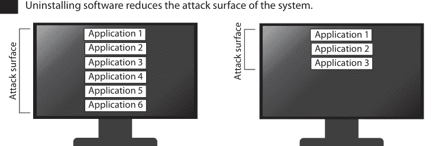

## 卸载不必要的软件

加固系统的第一步是确保从系统中卸载任何不必要的软件。首先，重点卸载可能已安装在系统上的不必要的第三方软件。例如，当你从商店购买新电脑时，系统通常预装了大量你从未使用的软件。从公司安全角度来看，系统应重新格式化并应用操作系统的全新安装，无论是手动还是通过映像。对于在家中使用的个人电脑，如果你无法重新安装操作系统的全新副本，请查看已安装的软件并删除每件你不会使用的软件。

请注意，今天的 Windows 操作系统已安装最少的功能或角色，但你可以按照以下步骤从 Windows 客户端或 Windows Server 操作系统卸载第三方应用程序：

- 1. 在 Windows 客户端系统上，在开始菜单中键入 **control panel**，然后从搜索结果中选择控制面板。
- 2. 在控制面板中，单击程序（参见图 6-2）。
- 3. 单击卸载程序。
- 4. 然后你会看到已安装的应用程序列表。要删除应用程序，请选择它并单击卸载。在确认卸载对话框中，单击是。

在卸载任何你不打算使用因此应删除的应用程序后，你可以着手删除不会使用的操作系统组件。例如，在 Windows 2000 Server 时代，微软默认安装了其网络服务器软件 Internet Information Services（IIS）。这造成了巨大的安全问题，因为 IIS 存在许多漏洞，例如文件夹遍历和缓冲区溢出漏洞。如果网络管理员卸载了 IIS，这些漏洞就不会在该服务器上起作用。

要卸载在 Windows 客户端或 Windows Server 中不会使用的操作系统功能，请按照以下步骤操作：

- 1. 在 Windows 客户端系统上，在开始菜单中键入 **control panel**，然后从搜索结果中选择控制面板。
- 2. 在控制面板中，单击程序（参见图 6-2）。
- 3. 选择打开或关闭 Windows 功能。这将打开 Windows 功能对话框，你可以在其中启用和禁用不同的 Windows 功能。
- 4. 要在 Windows Server 操作系统上添加/删除功能，请选择开始按钮并单击服务器管理器图标。这将启动服务器管理器。
- 5. 选择选项 管理 | 删除角色和功能。
- 6. 单击下一步两次。
- 7. 你会看到已安装的角色列表。要卸载角色，请取消选中角色旁边的复选标记，然后单击下一步。
- 8. 你会看到已安装的 Windows 功能列表。要卸载功能，请清除其复选框，然后单击删除以卸载已被取消选中的角色和功能。

## 禁用不必要的服务

在卸载所有不必要的软件后，将重点转移到系统后台运行的服务（Windows）或守护进程（Linux）。每个服务为操作系统提供一项功能。例如，以下服务通常在 Windows 系统上找到：

- **Print Spooler**  此服务负责 Windows 环境中的打印。
- **Workstation**  此服务允许你的系统连接到另一系统上的共享文件夹。
- **Server**  此服务允许其他人连接到你系统上的共享文件夹。
- **Messenger**  此服务存在于旧版本的 Windows 中，负责在有人使用 **net send** 命令时向其他用户或计算机发送消息。此服务应被禁用。
- **Remote Desktop Services**  此服务允许用户远程访问计算机并控制它。


作为负责加固系统的安全专业人员，您必须获取系统上运行的服务的列表，然后评估每项服务是否需要。如果某项服务在单台机器上不需要，则可通过 Windows 中的服务控制台禁用该服务；对于多台机器，可在 Active Directory 域中使用组策略集中禁用它们。要查看 Windows 中的服务列表，请按照以下步骤操作：

1. 在 Windows 系统上，选择 开始 | 管理工具 | 服务。
2. 右键单击您要停止的服务，然后选择 停止。
3. 为确保该服务在下次 Windows 启动时不会自动启动，您必须将启动类型设置更改为 已禁用。右键单击该服务并选择 属性。这将打开一个属性对话框。
4. 将启动类型设置更改为 已禁用，如图 6-3 所示。
5. 单击 确定。

**图 6-3** — 修改服务，使其在重启时不会自动启动。

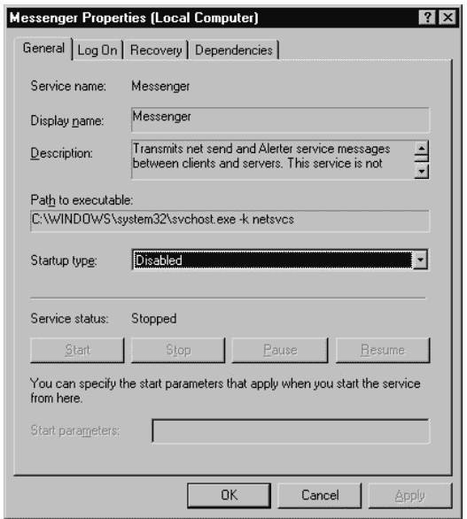

> **考试内部：理解系统加固**
>
> Security+ 认证考试将测试您对系统加固概念和系统加固程序的了解。请记住，系统加固是指移除不必要的软件以及禁用系统上不必要的服务。这些服务可能容易受到缓冲区溢出攻击，因此运行的服务越少越好！
>
> 在加固系统时，请务必花时间调查正在运行的服务，然后确定每项服务的作用。在发现服务的用途后，您需要决定是否需要该服务处于运行状态。确保您拥有测试系统，以便您可以确定禁用服务的结果，并确保它不会对系统产生负面影响。
>
> 请注意，禁用服务通常会关闭与该服务关联的端口。端口是由正在运行的程序或服务打开的。要关闭端口，您只需禁用打开端口的服务或结束该应用程序。您也可以使用防火墙来阻止对端口的访问。

### 练习 6-1：禁用远程桌面服务

在本练习中，您将调查 Windows 中运行的远程桌面服务相关的安全风险，然后禁用该服务。

1. 确保 ServerA 和 Windows 10 虚拟机正在运行。登录到每个系统。
2. 切换到 Windows 10 虚拟机，并确保远程桌面已启用，方法是右键单击开始按钮，然后选择 系统 | 远程桌面（最右侧）。
3. 从 ServerA 系统，进入开始菜单，输入 mstsc，然后按 ENTER。这将启动远程桌面连接客户端。
4. 输入 Windows 10 系统的 IP 地址，然后单击 连接。
5. 系统会要求您登录。输入管理员帐户的用户名和密码，然后登录。
6. 登录后，您会注意到可以控制 Windows 10 系统。通过单击右上角的 × 按钮断开远程桌面会话。
7. 在 Windows 10 客户端上停止远程桌面服务，以确保没有人可以远程访问您的系统。右键单击开始按钮并选择 控制面板 | 管理工具 | 服务。
8. 右键单击远程桌面服务并选择 停止。
9. 右键单击远程桌面服务并选择 属性。将启动类型字段设置为 已禁用，以便系统重启时服务不会启动。
10. 从 ServerA 虚拟机，再次尝试远程桌面连接到 Windows 10 虚拟机。您成功了吗？__________

## 保护管理界面和应用程序

在保护系统时，请确保限制对管理软件（界面）的访问。此处的原则是，如果某些员工无法使用管理工具，他们将无法更改系统或应用程序的配置。

您可以通过多种方式限制对系统和应用程序的管理界面的访问，其中最好的方法之一是使用系统提供的策略。此外，从 Windows Vista 开始，Microsoft 现在会限制对某些命令的访问，如果登录的人员没有执行它们的权限。此功能称为用户帐户控制（UAC）。

不要依赖于某人没有程序——恶意用户会找到方法获取程序以进行更改。限制用户权限和权限也很重要。

## 禁用不必要的帐户

加固系统时经常被忽视的一个方面是禁用任何未使用的帐户。您可能不想立即删除帐户，因为您可能会发现公司中的某个人需要该帐户，或者您在系统上运行的某款软件可能需要该帐户。请注意，管理员帐户在 Windows 10 中默认处于禁用状态。

要在 Windows 中禁用帐户，您可以按照以下步骤操作：

1. 在 Windows 10 或 Windows Server 中，单击开始按钮，然后输入 control panel。从搜索结果中选择控制面板条目。
2. 选择 系统和安全 | 管理工具 | 计算机管理。
3. 在计算机管理控制台中，在左侧展开本地用户和组。
4. 选择用户文件夹以查看系统上的用户帐户列表（见图 6-4）。
5. 右键单击您要禁用的用户，然后选择 属性。
6. 在属性窗口中，选择 帐户已禁用 选项。
7. 单击 确定。

**图 6-4** — 在 Windows 中查看用户列表

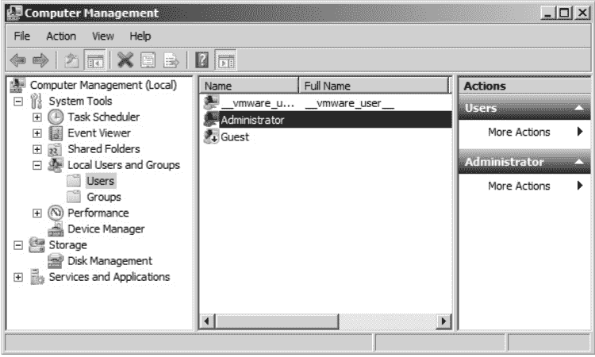

您不仅应禁用不必要的帐户，还应密切关注有多少帐户具有对系统的管理访问权限。在某些环境中，建议最多只有两个帐户具有管理权限。

> **考试须知**
>
> 对于 Security+ 考试，请记住，系统加固的一部分是确保不必要用户帐户被禁用或删除。

## 补丁管理

您为加固系统采取的下一个关键步骤是确保对系统进行补丁更新。当您对系统进行补丁更新时，您会将软件修复程序应用于系统上运行的软件中已知的错误。这些软件中的错误是黑客用来获取系统访问权限的手段。如果您没有定期对系统进行补丁更新，您可以确定您的系统会被经验丰富的黑客入侵。

Security+ 考试中需要熟悉的补丁包括以下内容：

- **安全热修复** — 安全热修复，也称为关键更新，是一种安全更新，应尽快应用到您的系统，因为该漏洞会使系统面临严重的风险。
- **补丁** — 补丁，也称为更新，是对软件或操作系统代码中特定问题的修复，不需要立即应用，因为安全风险不如热修复所解决的严重。
- **服务包** — 服务包提供了从产品发布之日起到服务包发布之时为止的产品的所有更新，包括补丁和安全热修复。如果您安装服务包，则无需单独安装每个补丁，因为服务包包含到该时点为止的所有更新。您将需要安装服务包发布后出现的安全补丁和修复程序。

要对系统进行补丁更新，您可以从开始菜单中运行 Windows Update 程序，或使用 Windows Server Update Services（WSUS）等集中补丁管理软件一次将补丁部署到多台系统。作为安全专业人员，重要的是您评估补丁如何部署到系统，并确保该策略使系统保持最新的安全修复。

作为补丁部署策略的一部分，请确保网络管理员在测试补丁之前不会将其应用到系统。管理员应有一组测试系统，先将补丁部署到这些系统，以确保补丁不会导致业务应用程序停止工作。一旦补丁在测试系统上得到验证，就应将其部署到一小部分生产系统。验证补丁未对该小部分生产系统造成问题后，您就可以将其部署到更大范围的系统。

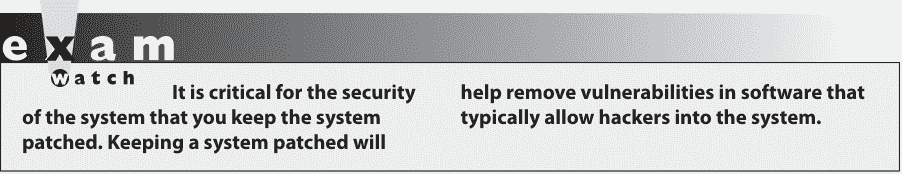

对系统进行补丁更新的另一个考虑是，您应应用已安装在系统上的其他软件的任何第三方更新。当您对操作系统应用更新时，其他第三方公司的软件将不会被修补，因此研究如何对系统上运行的第三方软件应用更新非常重要。

您还应考虑在操作系统和系统上运行的应用程序中启用自动更新功能。如果您启用自动更新，您降低了以后忘记应用更新的风险——它们将自动应用。

## 密码保护

您应将到系统加固程序中的最后一种做法是为您的资产设置密码保护功能。从系统角度来看，这意味着您将确保已对 CMOS 设置程序进行密码保护，以便未经授权的更改不会发生。另请确保系统提示输入密码。


系统启动时。大多数系统今天都会要求输入用户名和密码（这比只要求密码更好），但重点是你要确保在启动时没有任何系统自动登录。

考虑对路由器、交换机甚至打印机等其他资源进行密码保护。大多数人不会想到为其移动设备（如笔记本电脑或手机）使用密码——但这些设备包含敏感的公司信息，因此在系统启动时也应进行密码保护。

系统在启动时不仅应要求输入密码，而且你还应确保在这些设备上遵循良好的密码实践。所有密码至少应为八个字符长，并且应使用小写和大写字符、数字和符号的组合。还应确保用户不会将密码写下来，因为别人很容易找到写有密码的纸张。

## 注册表加固

在加固系统的方面，你也可以加固注册表。注册表是 Windows 系统所有设置的数据库。通常，你通过控制面板配置系统，但你也可以使用 Windows 中的 regedit.exe 通过注册表进行更改。如果你对注册表进行了错误更改，可能导致系统无法正常运行，因此只有熟悉注册表时才应进入注册表。

就加固注册表而言，你应重点关注确保只有管理员才有权更改注册表关键区域的权限。例如，恶意软件可能会将自身添加到注册表的 Run 部分，而程序自动启动的位置就在此处。你可以修改注册表 Run 区域的权限，以确保只有管理员可以修改注册表的这一部分。

在讨论注册表时，我还应提到，对注册表进行更改对于锁定系统是有用的，因为注册表中存在许多控制面板中找不到的设置。以下是有关使用注册表的一些有用要点：

- Regedit.exe 是我们用来修改注册表的工具。
- 你可以右键单击注册表的一个区域并选择权限命令，以修改该区域的注册表权限。
- 你可以使用 regedit.exe /E 命令将注册表设置导出到 .reg 文件。
- 你可以使用 regedit.exe <filename.reg> 命令导入注册表设置文件。这是一种确保注册表中的自定义设置能够轻松部署到多个系统的好方法。

## 磁盘加密

在加固系统的同时，你还应加固系统上的驱动器。你可以通过设置硬盘上文件和文件夹的权限来实现这一点，但人们发现，如果攻击者可以启动到替代操作系统然后访问驱动器，他们可以绕过权限。因此你应考虑加密硬盘。如果你加密驱动器的内容，未经授权的人员在没有解密密钥的情况下无法访问文件——即使他们启动到替代操作系统。

你应了解的不同驱动器加密技术有：

- **Encrypting File System (EFS)**  Encrypting File System (EFS) 是 Windows 中的一项安全功能，可放置在格式化为 NTFS 的驱动器上的文件上。你可以转到文件的属性，然后在“常规”选项卡上单击“高级”按钮。然后你可以设置属性以加密文件。默认情况下，只有加密文件的人才能解密文件。请注意，这是一种加密单个文件而不是整个硬盘的方法。
- **BitLocker**  BitLocker 是 Windows 中的驱动器加密功能，允许你加密整个驱动器。建议在移动设备（如笔记本电脑）上使用它，这样如果笔记本电脑丢失或被盗，你可以确信硬盘已加密。
- **BitLocker To Go**  BitLocker To Go 是一项功能，允许你加密 USB 驱动器。由于这些便携式驱动器很容易丢失或被盗，你应使用 BitLocker To Go 对其进行加密。

## 系统加固程序

现在你对系统加固有了大致了解，让我们来看一下安全管理员用来加固网络和系统的一些流行工具。在本节中，你将了解网络加固以及使用的一些软件工具。

### 网络安全加固

网络加固的第一方面需要考虑的是更新所有网络设备的固件。网络设备虽然是硬件，但它们就像计算机一样，因为它们由软件运行。运行网络设备的软件称为 *firmware*，存储在称为 EEPROM 的闪存中，EEPROM 代表 *electrically* erasable programmable read-only memory。你通常可以前往设备的制造商网站下载固件的修订更新版本。此版本的固件将包含创建时对任何错误的修复。

更新固件后，请确保你已为设备配置了密码，以便只有授权人员可以管理它。如今大多数设备，如路由器和交换机，都支持 Web 管理界面，你应对其进行密码保护并在支持时配置为使用 HTTPS。

在查看网络加固时，确保你使用尽可能安全的设备。例如，使用交换机而不是集线器，因为交换机具有过滤功能，可确保交换机仅将流量发送到目标系统所在的端口。这意味着很难让某人将嗅探器放在网络上并捕获流量，因为流量永远不会到达进行数据包嗅探的设备。集线器流行时，数据包会被发送到集线器的所有端口，任何在系统上安装嗅探器的人都可以查看所有网络流量。

### 端口安全

如今大多数网络交换机都支持一种称为端口安全的功能，你可以使用它通过列出端口上的特定 MAC 地址来限制哪些系统可以连接到交换机的端口。端口安全也称为 MAC 限制，因为你通过 MAC 地址限制哪些系统可以连接到端口。

以下代码显示了如何在 Cisco 交换机上配置端口安全。此示例通过为该交换机端口配置 MAC 地址来限制哪些系统可以连接到交换机的端口 1：

```
NY-SW1>enable
NY-SW1#config term
NY-SW1(config)#interface f0/1
NY-SW1(config-if)#switchport mode access
NY-SW1(config-if)#switchport port-security
NY-SW1(config-if)#switchport port-security mac-address 0000.1111.2222
NY-SW1(config-if)#switchport port-security maximum 1
NY-SW1(config-if)#switchport port-security violation shutdown
```

让我们回顾一下前面的代码。前三行用于导航到交换机上的快速以太网端口 1。然后端口被置于访问模式，以便工作站可以连接到端口，并使用 switchport port-security 命令启用端口安全功能。接下来的行用于为端口配置 MAC 地址（0000.1111.2222），然后配置该端口的最大地址为一个，以便交换机不会为其学习任何额外的 MAC 地址。最后，你配置端口在地址违规时禁用（shutdown），也就是说，如果具有不同 MAC 地址的人连接到端口，你希望禁用该端口以便不允许网络访问。

### MAC 限制和过滤

MAC 过滤是一种流行的访问控制方法，可与许多不同设备一起实现，例如网络交换机和无线接入点。对于无线接入点，你可以实施 MAC 过滤来控制哪些 MAC 地址可以连接到无线网络。请注意，这也称为 *MAC limiting*，因为你通过 MAC 地址限制哪些设备可以访问无线网络。

在交换机上，MAC 过滤的含义略有不同，因为它允许你限制哪些系统可以将数据发送到网络上的其他系统。交换机的过滤通常与端口安全功能一起配置，并允许你限制哪些交换机端口可以成为发送到特定系统的数据的“源端口”。

### 禁用未使用的接口（端口）

你不仅应限制哪些系统可以连接到交换机的哪些端口，而且还应禁用交换机上任何未使用的端口。这将阻止有人走进你的办公室，将笔记本电脑插入端口并获得对你网络的访问权限。以下代码演示了如何导航到交换机上的端口 2，然后使用 **shutdown** 命令禁用该端口：

```
NY-SW1>enable
NY-SW1#config term
NY-SW1(config)#interface f0/2
NY-SW1(config-if)#shutdown
```

你也可以通过使用 Cisco 交换机上的 **interface range** 命令选择一组端口的范围，一次禁用一组端口。选择端口后，你可以使用 **shutdown** 命令禁用这些端口，如下所示：

```
NY-SW1>enable
NY-SW1#config term
NY-SW1(config)#interface range f0/4-8
NY-SW1(config-if-range)#shutdown
```


在禁用所有未使用的端口后，有时可能需要启用某个端口，因为新员工入职后需要连接网络。要在 Cisco 交换机上启用端口，请导航到该端口，然后使用 no shutdown 命令：

```
NY-SW1>enable
NY-SW1#config term
NY-SW1(config)#interface f0/4
NY-SW1(config-if)#no shutdown
```

> 考试提示 请记住，对于 Security+ 考试，交换机上任何未使用的端口都应在加固网络的过程中禁用。

## 802.1X

加固网络的一种常用方法是确保任何连接到网络的人在允许网络连接之前提供有效的凭据。这与普通操作系统登录不同：当你登录系统时，系统通常已经具有网络访问权限。802.1X 标准是 IEEE 制定的用于控制网络访问（包括有线和无线）的标准，通常被称为基于端口的访问控制保护。使用 802.1X，在你向 802.1X 环境进行身份验证之前，你不会被授予网络访问权限。

802.1X 的工作方式是，你有一个客户端（如台式机、笔记本电脑或网络设备）希望连接到网络交换机或无线接入点。网络交换机或无线设备被称为认证器，需要先对连接设备进行身份验证，然后才授予网络访问权限。交换机或无线接入点会向运行 RADIUS 或 DIAMETER 等协议的中心认证服务器发送身份验证请求（见图 6-5）。这些是不同类型网络环境中常见的认证服务器。

> 考试提示 请记住，对于 Security+ 考试，802.1X 是一种常见的身份验证协议，用于控制谁可以访问物理网络资源，例如连接到交换机或无线接入点。

## 图 6-5

802.1X 涉及网络设备向中心认证服务器发送身份验证请求。

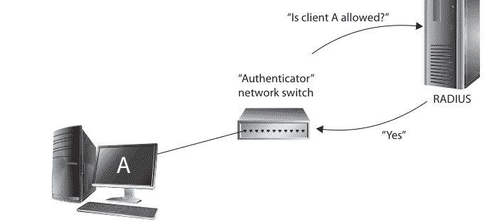

## 安全管理协议

作为加固路由器和交换机等网络设备的一部分，你应该确保设备上只运行安全的管理协议。例如，你应该禁用 Telnet 作为远程管理协议，因为它不会加密管理系统与设备之间的通信。这包括身份验证流量未被加密，这意味着有人可以捕获 Telnet 流量并看到你的 Telnet 用户名和密码。作为一种加固技术，你应该确保禁用 Telnet，并启用 SSH 作为远程管理协议。SSH 会加密 SSH 客户端（管理员的管理系统）与网络设备之间的所有通信——包括身份验证流量。

## 练习 6-2

## 加固网络交换机

在本练习中，你将通过禁用交换机上的端口 3 来加固网络交换机，因为该端口没有计划连接任何系统。你还将在端口 10 上配置端口安全，以便只有你的 MAC 地址可以用于该端口。

- 1. 确保你有一台已通电的 Cisco 交换机。从你工作站的串行端口连接到交换机上的控制台端口。

- 2. 要禁用交换机上的端口 3，请键入以下命令：

```
NY-SW1>enable
NY-SW1#config term
NY-SW1(config)#interface f0/3
NY-SW1(config-if)#shutdown
```

- 3. 要在端口 10 上配置端口安全，请键入以下命令，并在指示处使用你的 MAC 地址（使用 1111.2222.3333 的格式）：

```
NY-SW1(config)#interface f0/10
NY-SW1(config-if)#switchport mode access
NY-SW1(config-if)#switchport port-security
NY-SW1(config-if)#switchport port-security mac-address <MAC>
NY-SW1(config-if)#switchport port-security maximum 1
NY-SW1(config-if)#switchport port-security violation shutdown
```

- 4. 将一个非你 MAC 地址的工作站连接到端口 10，然后尝试 ping 网络上的另一个系统。你成功了吗？____________

## 未授权机器检测

监控网络环境的工作之一就是监控网络中是否存在未授权的机器和设备。未授权机器是指连接到网络中但不属于该网络的机器。个人可能将系统或设备连接到网络的原因有很多：

- **未授权系统** 有人可能将运行数据包嗅探器的系统连接到网络，意图捕获机密信息，例如通过网络传输的密码。

- **未授权设备** 未授权设备的一个例子是连接到网络的无线路由器。员工可能将无线路由器连接到网络，以便使用移动设备或笔记本电脑在办公室内漫游，并利用公司网络接入互联网。

尽管加固网络基础设施以及在网络交换机上使用端口安全等功能应该会降低未授权系统或设备连接到网络的可能性，但确保你监控和跟踪连接到网络的系统和设备仍然很重要。一旦你识别出连接到网络的未授权设备，应立即禁用交换机上的相应端口，然后调查该未授权系统或设备。

## 系统加固工具

既然你已经熟悉了一些用于控制谁有权访问网络的常用技术，下面让我们看看可以用来加固系统的一些常见工具。你需要熟悉这些概念以应对 Security+ 认证考试，所以请务必尝试它们。

## 组策略

加固 Windows 系统的第一个重要工具是 *组策略*，它是 Windows 的核心功能，允许网络管理员启用或禁用 Windows 中的不同功能——例如，组成员身份、正在运行的服务、密码策略，以及桌面限制（例如用户是否可以使用**运行**命令）。

组策略可以在本地系统（管理员正在配置的系统）上配置，也可以在 Active Directory 域中集中配置，这意味着这些设置将每 90 分钟、在用户下次登录时或系统重启时应用于多个系统和用户。

要在单个系统上配置组策略，请单击“开始”按钮，然后键入**mmc**（Microsoft 管理控制台）。进入 MMC 后，选择“文件”|“添加/删除管理单元”。在“添加或删除管理单元”对话框中看到管理单元列表后，选择“组策略对象编辑器”，然后点击“添加”以将其移到“所选管理单元”列表中。点击“完成”按钮确认你正在配置本地计算机，然后点击“确定”。

现在你可以开始配置系统上的本地组策略了（见图 6-6）。组策略分为两类——计算机设置和用户设置。计算机设置无论谁登录都应用于该机器，而用户设置则应用于用户账户。总结两者之间的区别：*用户*设置通常包含限制桌面设置的方法，而*计算机*设置允许你通过密码策略、禁用服务以及软件限制（允许在系统上运行哪些软件）来加固系统，仅举几例。

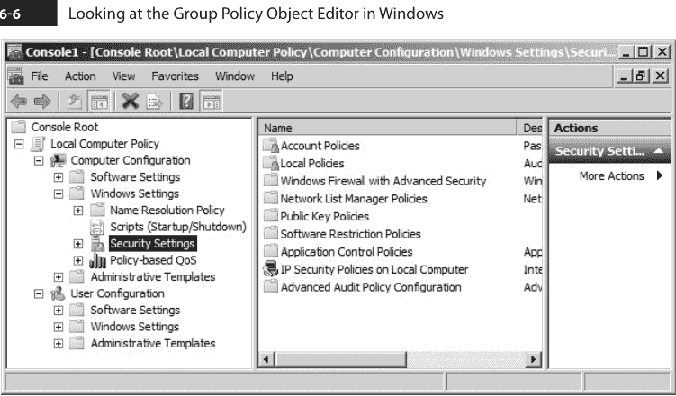

以下是组策略中“计算机配置”部分的一些常见策略的简要说明：

- **Windows 设置 | 脚本（启动/关机）** 在此策略中，你可以配置计算机首次启动时运行的启动脚本或计算机关机时运行的关机脚本。
- **安全设置 | 账户策略** 此策略部分允许你配置与用户账户相关的策略，例如账户锁定和密码策略。
- **安全设置 | 本地策略** 一个与系统加固相关的重要策略部分。在此部分中，你可以配置系统上的用户权限、审核，以及其他安全设置（例如创建登录横幅）。
- **安全设置 | 高级安全 Windows 防火墙** 此策略允许你配置 Windows XP 之后内置在 Windows 系统中的新防火墙功能。
- **安全设置 | 软件限制策略** 此策略允许你配置允许在系统上运行哪些软件。
- **安全设置 | 高级审核策略配置** 此策略允许你更好地控制系统审核以及你想要审核的事件类型。

以下概述了在组策略的“用户配置”设置中找到的一些常用策略：

- **Windows 设置 | 脚本（登录/注销）** 此策略用于配置在用户登录或注销时执行的脚本。
- **Windows 设置 | Internet Explorer 维护** 此策略用于配置 IE 中的设置，例如收藏夹列表或默认主页。
- **管理模板 | 控制面板** 此策略允许你启用或禁用 Windows 中控制面板的功能。这样做的好处是，通过禁用控制面板中的组件，你可以防止用户更改系统。
- **管理模板 | 桌面** 此策略设置允许你控制桌面上应显示哪些图标，例如“我的计算机”、“Internet Explorer”和“我的文档”。
- **管理模板 | 开始菜单和任务栏** 此策略设置允许你控制开始菜单中可以显示哪些项目，例如“运行”命令和“搜索”命令。

如果你想修改网络上所有系统的策略，可以在域级别配置组策略。你也可以在 Active Directory 中的特定组织单位（OU）上配置组策略，以便该策略仅应用于特定 OU 内的计算机或用户。例如，你可能希望确保 Tom 是……的本地管理员


会计部门的所有计算机。您可以在会计部门的 OU 上配置一个组策略，将 Tom 放置在所有会计系统管理员组中。这样可以节省您手动前往会计部门的每个系统并将 Tom 手动添加到管理员组的麻烦。图 6-7 显示了使用组策略管理控制台 (GPMC) 在 Active Directory 中配置策略。

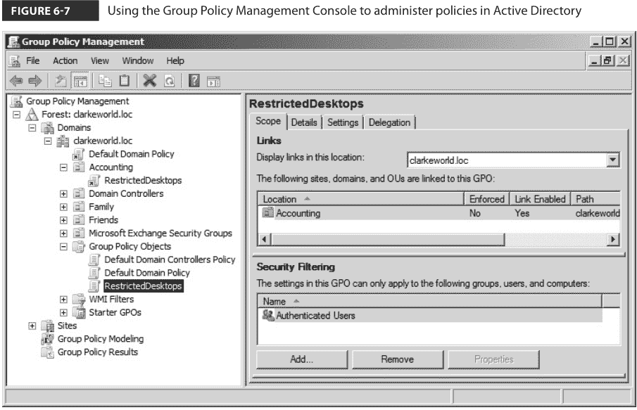

## 安全模板

Windows 的另一个流行功能，可让您快速加固多个系统，是安全模板功能。安全模板是您创建的文本文件，其中包含策略设置。安全模板的好处是一旦您配置了模板，它就可以导入到本地系统的组策略中或导入到 Active Directory 中。

您可以通过 MMC 中的安全模板管理单元创建安全模板（见图 6-8）。创建模板后，您可以修改模板中的策略设置，然后保存文件。

**图 6-8**

在 Windows 中查看安全模板

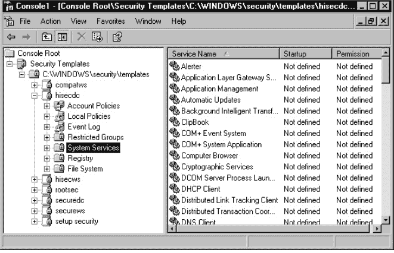

配置模板后，您可以使用组策略对象编辑器管理单元将其应用于本地组策略，或使用组策略管理编辑器将其导入 Active Directory。

安全模板是确保将一系列安全设置应用于一组类似服务器的绝佳方法，例如您公司所有的 Web 服务器。

## 练习 6-3

### 创建安全模板

在本练习中，您将创建一个安全模板，然后将该模板应用于 Windows 系统的本地安全策略。

1. 确保 ServerA 和 Windows 10 虚拟机正在运行。
2. 转到 Windows 10 虚拟机。
3. 创建自定义 MMC 并加载安全模板管理单元：
   a. 在开始菜单中，键入 MMC。在搜索结果中右键单击 mmc.exe 并选择以管理员身份运行。单击是允许该程序对您的系统进行更改。
   b. 选择文件 | 添加/删除管理单元。
   c. 单击添加。
   d. 找到安全模板管理单元并将其添加到已选管理单元列表中。
   e. 单击关闭，然后单击确定返回到 MMC。
4. 在左侧展开安全模板节点，注意您将放置安全模板的文件夹。
5. 在左侧展开该文件夹（最可能以 C:\Users 开头），然后选择该文件夹。
6. 右键单击模板文件夹并选择新建模板。创建一个名为 **Company_Policy** 的模板。
7. 在安全模板中设置以下策略选项：
   a. 密码策略设置：

   | 策略设置 | 值 |
   | --- | --- |
   | 强制密码历史 | 记住 18 个密码 |
   | 最大密码使用期限 | 20 天 |
   | 最小密码使用期限 | 2 天 |
   | 最小密码长度 | 8 个字符 |
   | 密码必须符合复杂性要求 | 已启用 |

   b. 账户锁定策略设置：

   | 策略设置 | 值 |
   | --- | --- |
   | 账户锁定持续时间 | 0 分钟（直到管理员解锁） |
   | 账户锁定阈值 | 2 次无效登录尝试 |
   | 重置账户锁定计数器后 | 45 分钟 |

   c. 安全选项策略设置：

   | 策略设置 | 值 |
   | --- | --- |
   | 账户：重命名管理员账户 | Adminguy |
   | 交互式登录：不要显示上次用户名 | 已启用 |
   | 交互式登录：尝试登录用户的消息正文 | Warning! This system is for authorized users only. Anyone using this system without authorization will be prosecuted. Also, use of this system will be monitored, including Internet activity, e-mail usage, and access to resources. |
   | 交互式登录：尝试登录用户的消息标题 | Authorization Warning! |

8. 配置模板中的设置后，右键单击模板并选择保存。

### 将模板导入本地系统

9. 要将模板导入本地系统，请从管理工具启动本地安全策略控制台。
10. 右键单击左上角的安全设置并选择导入策略。这将允许您选择要导入设置的<|message|> 安全模板。浏览到您的安全模板并将其选为要导入的模板。
11. 导入模板后，验证本地安全策略中的设置，以确保已应用模板设置。
12. 要刷新策略，请在命令提示符下键入 **gpupdate /force**。
13. 以用户 **adminguy** 注销并重新登录。您是否看到新的横幅？__________
14. 为什么或为什么不？________________________________

## 补丁管理

如前所述，对系统应用补丁是系统加固非常重要的一部分。随着软件供应商发现其软件中的漏洞，他们会通过补丁发布这些缺陷的修复程序。如果您不对系统进行修补，您就不会收到修复程序。

重要的是，您应制定补丁策略，而不是简单地对每个系统执行 Windows Update。您可以使用 Windows Server Update Services（WSUS）等软件从中央服务器下载、审查和部署补丁（见图 6-9）。

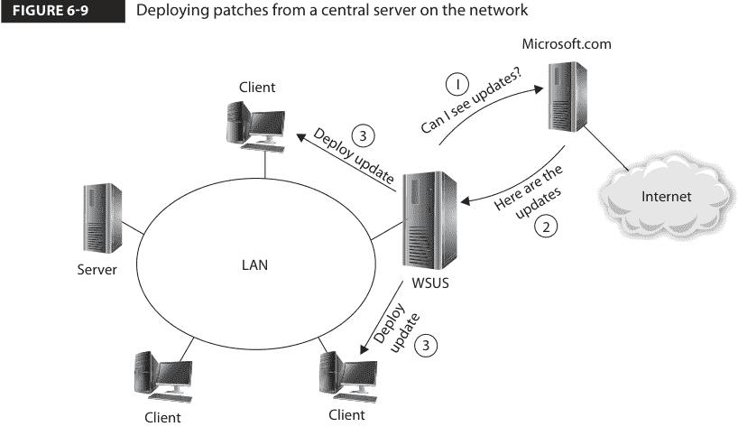

WSUS 的工作方式是，您选择希望获取补丁的产品，然后可以获取这些产品的补丁列表。一旦补丁从 Microsoft 更新站点下载，您可以批准它并选择将其部署到一组系统。如前所述，您通常会先将补丁应用于一组测试系统，然后如果补丁似乎不会导致系统出现问题，您就可以将其部署到一组生产系统。

## 配置安全基线

安全基线是由公司批准的、被认为对特定类型系统或设备安全的标准配置。此标准配置是所有系统为满足公司的期望安全要求所必需的。

在系统实施安全基线后，对系统的任何更改都必须遵循公司定义的变更管理流程。如果您对已应用安全基线的系统进行更改，则重要的是在更改后评估系统，以确保它没有影响系统的安全状态。例如，请确保在管理员对系统进行更改后，该更改没有打开系统端口或安装容易受到缓冲区溢出攻击的软件。这两种意外结果都可能导致您的系统被入侵，从而使系统的安全状态从安全变为不安全。

您很可能对网络上不同类型的系统和设备有不同的安全基线。例如，DMZ（非军事区）中 Web 服务器的安全基线将比 LAN 上内部系统的安全基线严格得多。并不是说您不会保护内部系统，但它很可能安装了比 DMZ 中的 Web 服务器所需的更多软件和服务。

每种类型系统的安全基线应得到妥善记录，并且实现安全基线的步骤必须在分发给安全管理员之前准确记录并经过测试。此文档将包含实现安全基线的详细步骤。

前面描述的安全模板功能是 Windows 中实施安全基线的绝佳方式。

如前所述，安全基线已记录下来，以便任何配置网络上特定系统的管理员都可以查看文档并了解如何满足系统的安全基线。安全基线文档可能包含以下项目：

- 系统类型的物理安全要求
- 网络连接要求
- 有助于保护系统的配置设置
- 补丁要求


基线的配置要求可能包含任意数量的操作系统或应用程序配置步骤，这些步骤旨在满足公司对何为安全系统的标准。以下是一些应考虑的配置要求示例：

- **文件系统** 目前所有 Windows 系统都应使用新技术文件系统（NTFS）而非 FAT/FAT32 文件系统，因为 NTFS 具有权限、加密、配额和审计服务等功能。
- **权限** 系统硬盘驱动器上的文件夹应得到妥善保护。这不仅包括系统上存储的任何数据，还包括 Windows 目录和程序文件目录。
- **正在运行的服务** 确保系统上仅运行所需的服务。
- **网络连接** 确保系统连接到正确的网段。
- **正在运行的协议** 确保系统或设备上仅运行所需的协议。
- **防火墙规则** 确保系统上所需的任何防火墙规则都已实施，以帮助保护系统免受不必要的流量影响。
- **存储加密** 考虑是否应对存储中的信息进行加密——无论是在文件系统内，还是在包含敏感信息的数据库中。
- **通信加密** 调查是否应对通过网络传输的数据进行加密。
- **补丁管理** 确保系统已正确打补丁，并保持补丁级别。这对于 DMZ 中的公共服务器非常重要，因为它们在部署后有时会被遗忘。

## 安全态势与报告

在本节中，您将学习如何管理系统安全态势，以及应用程序用于发送安全通知的报告方法类型。

### 安全态势

一旦安全基线要求得到确定并记录在案，就可以将安全基线付诸实践。本节概述了管理安全基线的关键阶段。

### 初始基线配置

您需要依据安全基线文档在系统上配置初始安全基线。在将初始安全基线轻松应用于系统的多种方法中，最有效的方法之一是使用预配置映像为系统创建镜像，或者将安全模板应用于需要初始安全基线的系统。

### 持续安全监控

一旦您使用初始安全基线配置了系统，就必须对系统进行监控，以确保其持续处于安全运行状态。持续监控涉及许多工具和技术，用于在安全事件发生时及时识别。公司应定期使用漏洞扫描器检查系统是否存在已知漏洞。漏洞扫描会告知您系统安全方面的任何错误配置，并告知您是否缺少补丁。执行漏洞扫描的常用软件类型包括 Nessus（常用于 Linux）、Microsoft 基线安全分析器（MBSA）和 GFI 的 LANGuard。您可以免费从 Microsoft 网站下载和使用 MBSA，也可以使用 Nessus 免费版扫描最多 16 个 IP 地址。Nessus 和 LANGuard 的完整版本需要付费，因为它们是商业产品。还有许多企业监控解决方案也是可购买商业工具，例如 System Center Operations Manager (SCOM) 和 System Center Configuration Manager (SCCM)，两者均由 Microsoft 提供。

持续监控还涉及使用反恶意软件，以确保系统始终免受恶意软件的侵害。您还需要确保定期向系统安装安全补丁。有多种工具可帮助您进行补丁管理，包括 Microsoft 的 WSUS。LANGuard 也提供了可用于向系统部署补丁的功能。

最后，持续监控还涉及使用简单网络管理协议（SNMP）来监控支持 SNMP 的网络设备的配置和统计信息。

> **考试注意**
>
> 考试时请记住，持续监控包括对漏洞和错误配置的持续监控、反恶意软件保护、补丁部署，以及使用 SNMP 监控设备配置和统计信息。

### 修复

在运行漏洞扫描器发现任何配置错误或缺失补丁后，您需要确保纠正问题。修复是纠正系统中故障的过程。例如，如果发现某个安全配置设置未应用于系统，您可能需要回到初始安全基线，确保该配置步骤已应用。

修复还可能涉及修正尝试连接到网络的用户的安全态势。例如，如果使用了网络策略服务器（NPS），它会检查用户是否已安装最新的补丁和病毒定义更新。如果用户未满足这些特定条件，NPS 会将该用户置于受限子网中，该系统可以在其中下载并安装缺失的补丁和病毒定义更新。这是一个利用技术帮助修复同时保持安全性的示例，因为该用户被置于无法访问网络资源的受限子网中。

### 报告

大多数系统、设备和应用程序都可以配置为在特定事件发生时发送通知，但它们使用不同的方法来报告与事件相关的不同严重级别。以下是您在 Security+ 考试中需要熟悉的常见报告方法。

**警报** 警报用于报告严重事件，这些事件通常需要系统或网络管理员采取某种形式的措施。例如，警报可用于通知管理员网络上的可疑流量。在这种情况下，警报用于引起网络管理员的注意，以便他们调查该问题。

**告警** 告警是一种严重性较低的通知类型，用于通知系统或网络管理员特定事件已发生，但管理员可能无需采取任何措施。通常，告警用于通知管理员发生的更改，例如系统上线或打印机被清除。

**趋势** 趋势是一种报告方法，用于识别安全事件，例如有人在网络上执行端口扫描。趋势分析通常涉及查看日志文件或数据包捕获，并分析信息以识别趋势，这有助于管理员了解网络上正在发生的情况。例如，如果网络管理员正在查看数据包捕获，并看到同一个源 IP 地址在极短时间内连接到多个端口，那么很可能正在发生端口扫描。

## 认证目标 6.03

### 服务器加固最佳实践

本节介绍了加固网络上服务器时应遵循的常见做法，例如限制每台服务器上打开的端口数和运行的服务数。本节概述了保护大多数网络常见的不同类型服务器的步骤。

### 所有服务器

在讨论常见的服务器类型以及保护这些服务器应采取的一般步骤之前，我想强调所有服务器都应采取的步骤。对任何服务器要做的第一件事就是加固它，确保只安装必要的软件和服务。

系统加固完成后，请确保已为系统和在其上运行的应用程序打补丁。打补丁后，务必配置密码策略和账户锁定策略等策略，然后在系统上启用审计。此外，务必检查您的用户账户。禁用不必要的账户，并为其余账户设置强密码。将默认账户名称重命名为不易猜测的名称也是一种安全最佳实践。例如，您可以将名为 Administrator 的账户重命名为 HAL12345。

### HTTP 服务器

对于 Web 服务器，请应用前面“所有服务器”一节中提到的所有概念，但同时还要遵循一些额外步骤。首先，确保 Web 服务器位于 DMZ 中——即外部防火墙和内部防火墙之间的区域。Web 服务器应加固，确保服务器上没有多余的软件或用户账户。

此外，禁用不使用的 Web 服务器功能。例如，如果您的网站仅使用静态 HTML 页面，请务必禁用 Web 服务器上所有活动内容功能，例如 ASP 和服务器端包含。您可以进入服务器管理器并选择“删除角色和功能”来管理 Microsoft IIS 服务器的功能。在向导中，当显示角色列表时，展开 Web 服务器角色，并取消选择您不打算使用的功能（参见图 6-10）。

图 6-10 在 IIS 中禁用 Web 服务器功能

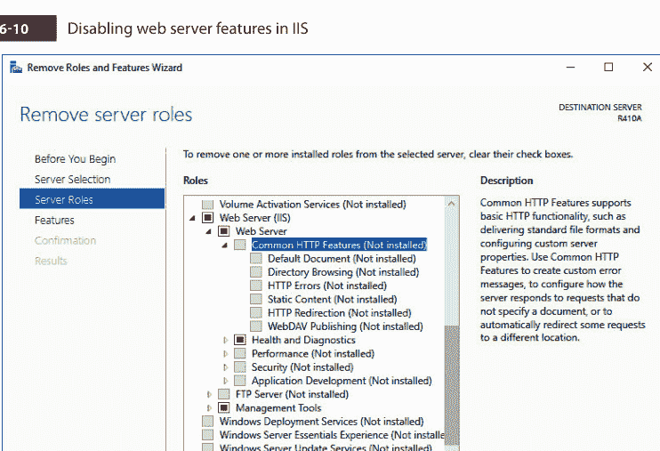


需要注意的是，很多年前，Windows 服务器默认安装了 IIS，但现在情况已不再如此。在评估服务器安全性时，你应该检查已安装了哪些组件，如果 IIS 是因为有人安装而存在的，则应确认它是否必要——如果不需要，就将其卸载。

如果 Web 服务器不向公众开放，请确保禁用匿名访问（允许任何人访问服务器）并在服务器上启用身份验证。如果你在网站上处理机密数据，请务必使用 SSL/TLS 保护 Web 流量。

## DNS 服务器

要强化 DNS 服务器，你应应用前面“所有服务器”部分中的所有步骤，但此外还应限制 DNS 服务器上的区域传送。区域传送发生在主 DNS 服务器将 DNS 数据发送到辅助 DNS 服务器时。如果黑客通过区域传送获取 DNS 数据，他们就会知道你的不同系统所使用的 IP 地址。

在 DNS 服务器的属性中，你应该会看到一个选项，可以限制哪些系统能从你的 DNS 服务器接收区域传送。通常你应确保只有你的 DNS 服务器列在此处。图 6-11 显示了如何在 Microsoft DNS 服务器上限制区域传送。

### 图 6-11

控制 DNS 区域传送

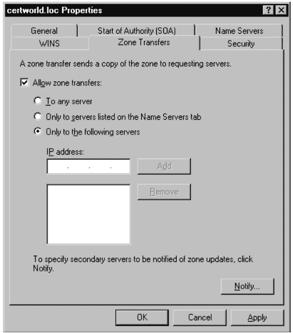

你还可以在防火墙处阻止 TCP 53（区域传送使用的端口），这样网络外部的人员就无法进行区域传送。如果你在互联网另一端有其他位置的辅助 DNS 服务器，则此选项可能不可用。

## 练习 6-4

### 限制 DNS 区域传送

在本练习中，你将确保 Windows 服务器上的 DNS 区域传送仅限制到你的辅助 DNS 服务器。

- 1. 确保 ServerA 和 Windows 10 虚拟机正在运行。注销每个系统。
- 2. 登录到 ServerA 虚拟机。从“开始”菜单中，选择“DNS”以启动 DNS 管理控制台。
- 3. 展开左侧的 ServerA，然后展开“正向查找区域”。右键单击你的 DNS 区域并选择“属性”。例如，右键单击 certworld.loc 并选择“属性”。
- 4. 在区域“属性”对话框中，选择“区域传送”选项卡。
- 5. 选中“允许区域传送”复选框，然后选择“仅允许到下列系统”单选按钮。
- 6. 输入你的 Windows 10 客户端的 IP 地址，然后点击“添加”按钮，将 Windows 10 系统添加为可从该 DNS 服务器接收区域传送的系统。在本练习中，假设 Windows 10 系统是你的辅助 DNS 服务器。
- 7. 点击“确定”。
- 8. 转到 Windows 10 虚拟机并启动命令提示符。
- 9. 在命令提示符中输入以下命令（每行后按回车键）。你的域名，例如，可能是 certworld.loc。
- 10. 你应该会在屏幕上看到 DNS 数据。如果你从其他系统尝试相同的命令，则应收到“查询被拒绝”的错误，因为区域传送仅授权给该 IP 地址。

```
nslookup
ls certworld.loc
```

## DHCP 服务器

你可以通过应用“所有服务器”部分中讨论的所有强化技术来帮助保护 DHCP 服务器，但也可以应用一些额外的预防措施。首先，当你创建作用域（供 DHCP 分配的 IP 地址）时，只创建足够满足网络需求的地址数量。例如，如果有 20 个系统需要地址，则应创建一个只分配 20 个地址的作用域。这样做的好处是，如果未授权人员连接到网络（第 21 个系统），作用域中将没有可用的 IP 地址供 DHCP 服务器分配给客户端系统。结果是该系统将无法在网络上通信。

除了在作用域中只保留足够的地址外，你还可以实现地址保留，即你在作用域中创建的 20 个地址中的每一个都关联一个 MAC 地址。这样做的好处是，每个地址只会分配给具有关联 MAC 地址的网卡。

## SMTP 服务器和 FTP 服务器

对于 SMTP 服务器和 FTP 服务器，你应应用“所有服务器”部分中讨论的强化技术，但同样，你还应进一步采取安全措施。

在处理 SMTP 服务器时，确保使用防火墙保护服务器，并打开 TCP 端口 25 以允许 SMTP 服务器通过防火墙到达服务器。你还需要确保 SMTP 服务器上禁用 SMTP 中继。SMTP 中继是指你的 SMTP 服务器将任何不是发送给它的 SMTP 消息转发到目标服务器。中继是不好的，因为黑客可以将垃圾邮件消息发送到你的服务器，然后你的服务器将其转发到目的地。从目的地的角度来看，你的服务器正在发送垃圾邮件！

对于 FTP 服务器，请确保限制谁可以上传文件到 FTP 服务器，也许只允许从服务器下载文件。你还应决定是否允许匿名访问 FTP 服务器，还是强制用户向服务器进行身份验证。如果强制身份验证，请确保以安全的方式进行。

## 常见缓解策略

你已经了解了一些常见策略，用于减少（缓解）安全事件发生的可能性。以下是这些要点的总结，供你复习备考认证考试：

- **网络分段** 对网络进行分段可以让你控制网络上的哪些系统可以相互通信。你可以使用 VLAN 和 IP 子网来创建网段。在某些常见场景中，你会希望对网络进行分段，以将生产系统与客户系统分开——例如，酒店客人或教室环境中的学生系统。在高度安全的环境中，你还希望将绝密系统与其他机密系统分开。

- **安全层** 通过修补系统、使用防火墙和网络分段以及强化系统来分层实施安全。
- **应用防火墙** 使用应用层防火墙，因为它们允许你根据数据包中的负载数据过滤流量。
- **手动更新** 定期执行系统更新，以确保系统中的任何已知安全问题都得到修补。
- **固件版本控制** 请务必定期对路由器、交换机等设备应用固件更新。
- **包装器** 在可能的情况下，应使用包装器（例如 TCP 包装器）来创建对系统上特定服务的连接。例如，在 Linux 中，你可以使用 `/etc/hosts.allow` 文件来指定可以访问 FTP 服务和 HTTP 服务等服务的系统。
- **控制冗余和多样性** 控制冗余和多样性是一种安全原则，即确保你多样化用于构建安全层的产品。例如，如果你决定在内部网络和 Internet 之间设置多个防火墙，则可以创建多层防火墙，黑客需要突破这些层才能访问内部网络。如果你在每一层使用相同的防火墙产品，当黑客找出如何突破第一层防火墙时，他们可以轻松绕过其余防火墙。如果你在每一层购买不同的防火墙产品，每个产品都会有不同的漏洞，黑客将需要花时间弄清楚如何绕过每一个，而不是利用从第一个防火墙获得的知识。

## 认证总结

在本章中，你学习了缓解系统和应用程序常见安全威胁的方法。在准备 Security+ 认证考试时，应记住以下要点：

- 所有系统都应进行强化，即移除不必要的软件并禁用不必要的服务。
- 在强化系统时，应调查系统上运行的每项服务，并确定该服务是否必要。如果不需要该服务，则应将其禁用。
- 作为系统强化的一部分，请确保禁用不必要的帐户并重命名默认帐户（例如“administrator”）。同时，请务必定期修补系统。


- 诸如交换机等网络设备也应进行加固。务必更新路由器和交换机的固件。在高度安全的环境中，禁用交换机上未使用的端口，并在已使用的端口上配置端口安全，该功能可将特定 MAC 地址与端口关联。
- 确保在网络设备上使用安全的管理协议，例如使用 SSH 而不是 Telnet。
- 802.1X 标准被称为端口访问控制标准，它通过使用中央认证服务器（如 RADIUS）来控制谁可以访问有线或无线网络。
- 在众多可用于帮助系统加固的软件工具中，两种常见的方法是安全模板和组策略。您可以使用安全模板来帮助创建安全基线，而组策略则是一种用于对系统施加限制的方法。
- 可以参考常见的服务器加固技术，例如仅允许 DNS 服务器将区域传输发送到特定主机，将 DNS 和 Web 服务器等公共服务器置于 DMZ 中，并禁用 Web 服务器上未使用的功能。

## 两分钟速览

### 理解操作系统加固

- 操作系统加固的目标是通过移除不必要的软件并禁用不需要的服务来减少系统的攻击面。
- 确保禁用不需要的用户帐户，并重命名默认帐户名称。
- 规划好补丁管理策略。重要的是，补丁在部署前必须经过测试，并且要定期为系统打补丁。

### 系统加固流程

- 加固流程应从加固路由器、交换机等网络设备开始。第一步是更新设备上的固件。
- 禁用网络交换机上任何未使用的端口，以防未经授权的人员连接到可用端口。
- 在交换机上实施端口安全，以限制哪些系统可以连接到交换机的特定端口。同时，使用 MAC 过滤来筛选哪些系统可以向网络上的其他系统发送数据。
- 802.1X 是一种网络访问控制标准，允许您通过使用中央认证服务器（如 RADIUS 服务器）来控制谁可以连接到网络。
- 组策略是一种在 Active Directory 环境中从单一中心位置配置所有系统的方法。您可以通过组策略配置组成员身份和运行的服务，还可以控制桌面的外观。
- 安全模板是创建安全基线的好方法。安全模板是一个包含策略设置的文本文件，可以将其导入系统或 Active Directory 中。
- 安全基线是一种已获批准的标准配置，该配置被认为是使系统处于安全状态所需的配置。
- 要建立并保持良好的安全态势，您必须首先应用安全基线，然后使用漏洞扫描器等工具持续监控系统的状态。最后一步是根据监控结果修复系统配置中的任何错误。

### 服务器加固最佳实践

- 所有服务器都应进行加固并打补丁。
- Web 服务器应进行加固，同时还要确保 Web 服务器（如果是 Internet 服务器）放置在 DMZ 中，并受到防火墙的保护。此外，禁用那些不会用到的 Web 服务器功能。
- 为保护 DNS 服务器，请将它们置于 DMZ 中，并在防火墙上开放 UDP 53 端口，以允许 DNS 查询到达 DNS 服务器。务必限制 DNS 服务器仅向您的辅助 DNS 服务器进行区域传输，并且如果您不向 Internet 上的辅助 DNS 服务器进行区域传输，则在防火墙处阻止 TCP 53。
- 在高度安全的环境中，请配置 DHCP 保留，将每个 IP 地址与特定的 MAC 地址关联。这将确保网络上的未授权系统无法从 DHCP 服务器获取 IP 地址。
- SMTP 服务器应禁用 SMTP 中继，而 FTP 服务器则应实施身份验证，以控制谁可以访问 FTP 服务器上的文件。

## 自测

以下问题将帮助您衡量对本章节所呈现内容的理解程度。如所述，有些问题可能不止一个正确答案，因此请务必仔细阅读所有选项。

### 理解操作系统加固

- 1. 以下哪项操作是在系统加固过程中执行的？
  A. MAC 过滤
  B. 禁用不必要的服务
  C. 启用端口安全
  D. 配置 802.1X 认证
- 2. 您的经理了解到需要从系统中卸载不必要的软件并禁用不必要的服务。执行这些加固技术的目的是什么？
  A. 关闭系统上的端口
  B. 评估漏洞
  C. 模糊测试
  D. 减少攻击面
- 3. 软件供应商发现其软件产品中存在一个严重漏洞，对系统造成重大安全风险。该软件供应商将发布哪种类型的补救措施，应立即应用于系统？
  A. 补丁
  B. 服务包
  C. 热修复
  D. 更新
- 4. 您正在为组织内使用的所有系统和移动设备规划安全评估策略。在评估手机等移动设备时，您应该关注什么？
  A. 确保手机有密码保护。
  B. 确保未安装短信软件。
  C. 确保手机未运行移动操作系统。
  D. 确保手机未配置电子邮件。

### 系统加固流程

- 5. 以下哪项安全技术涉及使用中央认证服务器（如 RADIUS）来控制对有线或无线网络的访问？
  A. 端口安全
  B. 802.1X
  C. MAC 过滤
  D. 防火墙
- 6. 网络交换机的哪项功能允许您通过 MAC 地址来控制哪个系统可以物理连接到特定的网络端口？
  A. 802.1X
  B. MAC 过滤
  C. 防火墙
  D. 端口安全
- 7. 办公室里的一位新网络管理员了解到公司要求所有系统都应用初始安全基线。她正在查看需要应用的 50 项不同策略设置，想知道是否有一种简单的方法来部署这些设置。她应该怎么做？
  A. 在本地安全策略中配置这些设置。
  B. 导入注册表文件。
  C. 使用安全模板。
  D. 构建宏。
- 8. 系统或应用程序应使用哪种报告机制来通知管理员需要立即关注的事件？
  A. 警报
  B. 趋势
  C. 日志
  D. 告警

### 服务器加固最佳实践

- 9. 您的公司在总部有一台主 DNS 服务器，在全球另外两个办事处各有一台辅助 DNS 服务器。您应该怎么做来保护 DNS 数据？
  A. 仅允许向总部 DNS 服务器进行区域传输。
  B. 将区域传输限制到辅助服务器的 IP 地址。
  C. 在总部防火墙上阻止 TCP 端口 53。
  D. 在总部防火墙上阻止 UDP 端口 53。
- 10. 以下哪项指出了 SMTP 服务器的一个安全关注点？
  A. 消息中继
  B. 区域传输
  C. 电子邮件欺骗
  D. 无效地址分配
- 11. 您的经理希望在 DHCP 服务器上实施额外的安全措施。您会推荐哪些操作？（选择两项。）
  A. 禁用区域传输。
  B. 修改作用域，使网络上的每台主机只有一个地址。
  C. 停用作用域。
  D. 为 DHCP 作用域中的每个地址配置地址保留。
  E. 禁用 DHCP。

## 实操题

12. 根据图示，将左侧的缓解技术与右侧最匹配的术语或描述对应起来。

| 缓解技术 | 术语或描述 |
|---|---|
| 禁用未使用的接口 | 用于在某人连接到有线或无线网络之前对其进行身份验证 |
| 减少攻击面 | 限制哪个系统可以连接到交换机上的接口 |
| 端口安全 | 用于应用安全基线 |
| 限制可连接到无线网络的系统 | MAC 过滤 |
| 802.1X | 不健康的系统被连接到某个网段以获取缺失的补丁 |
| 安全模板 | 保护 DNS 数据 |
| 修复 | 修补系统 + 防火墙 + 网络分段 + 恶意软件保护 |
| 限制区域传输 | 防止明文密码在网络中传输 |
| 安全层 | 一种网络交换机加固技术 |
| 实施 SSL/TLS | 防止前员工登录网络 |
| 禁用不必要的账户 | 限制系统上的漏洞 |


## 自测答案

### 理解操作系统加固

1. ☑ B. 系统加固涉及禁用不必要的服务和从系统中卸载不必要的软件。系统加固还涉及禁用未使用的账户并修补系统。
   ☒ A、C 和 D 是错误的。这些都是网络加固技术，而不是系统加固技术。MAC 过滤控制哪些系统可以向其他系统发送数据，端口安全控制哪些系统可以通过 MAC 地址连接到端口，而 802.1X 通过使用中央身份验证服务器控制谁有权访问有线或无线网络。

2. ☑ D. 当你通过卸载不需要的软件和禁用不必要的服务来加固系统时，你是在减少系统的攻击面。
   ☒ A、B 和 C 是错误的。虽然删除某些软件可能会关闭系统上的端口，但选项 D 是更好的答案。评估漏洞可以识别系统上的漏洞是什么——它并不会加固系统。模糊测试是一种软件测试程序，其中向应用程序输入无效数据以查看应用程序如何响应。

3. ☑ C. 热修复是用于应立即应用的软件更新的术语。
   ☒ A、B 和 D 是错误的。补丁是对软件错误的修复，不一定需要立即应用。服务包包含自上一个服务包或软件发布以来所有的补丁和热修复。更新是为系统应用补丁的通用术语。

4. ☑ A. 在使用移动设备时，确保员工对设备进行密码保护，这样如果设备丢失或被盗，设备上的数据就不会轻易被访问。
   ☒ B、C 和 D 是错误的。在手机上运行移动操作系统对其功能是必要的，而短信和电子邮件等功能是员工最有可能使用的流行功能，因此无法禁用。

### 系统加固程序

5. ☑ B. 802.1X 标准通过使用 RADIUS 等中央身份验证服务器来控制对有线或无线网络的访问。
   ☒ A、C 和 D 是错误的。端口安全控制哪些系统可以通过 MAC 地址连接到端口。MAC 过滤控制哪些系统可以向其他系统发送数据，而防火墙控制允许进入或离开网络的流量。

6. ☑ D. 端口安全通过为特定 MAC 地址配置端口来控制哪些系统可以连接到交换机上的端口。
   ☒ A、B 和 C 是错误的。802.1X 标准通过使用 RADIUS 等中央身份验证服务器来控制对有线或无线网络的访问。MAC 过滤控制哪些系统可以向其他系统发送数据，而防火墙控制允许进入或离开网络的流量。

7. ☑ C. 安全模板是创建系统安全基线的绝佳方法，因为你可以在安全模板文件中配置许多“策略”设置，然后将模板导入系统。
   ☒ A、B 和 D 是错误的。在每个系统的本地安全策略中配置设置会花费太多时间——最好使用安全模板然后将其导入本地安全策略。导入注册表文件将不起作用，因为这些是策略设置，因此如果你想进行导入，应使用模板。宏不是系统配置的一部分。

8. ☑ D. 警报是一种报告方法，通知管理员安全事件并期望立即采取行动。
   ☒ A、B 和 C 是错误的。警报是一种通知，可能不需要管理员采取纠正措施。趋势是在分析系统或网络活动时要寻找的内容，日志可以被查看以查看系统或应用程序上的活动。

### 服务器加固最佳实践

9. ☑ B. 为了帮助保护你的 DNS 服务器，确保区域传输仅限于将 DNS 区域数据交付给辅助 DNS 服务器。
   ☒ A、C 和 D 是错误的。总部服务器是主 DNS 服务器，因此不会接收区域传输。在这种情况下，你不能在防火墙上阻止 TCP 53，因为区域传输就是通过该端口运行的，你需要该端口保持开放，以便辅助服务器可以进行区域传输。阻止 UDP 53 不是一个选项，因为它用于 DNS 查询而不是区域传输。

10. ☑ A. 确保 SMTP 服务器不中继 SMTP 消息，因为黑客随后可以向你的服务器发送垃圾邮件以将其中继到目的地。
    ☒ B、C 和 D 是错误的。区域传输是与 DNS 相关的安全问题，而不是 SMTP。电子邮件欺骗是对消息源地址的修改，而无效地址分配将是 DHCP 问题。

11. ☑ B 和 D. 你可以通过限制 DHCP 服务器分配的地址数量并为每个地址保留来保护你的 DHCP 环境。
    ☒ A、C 和 E 是错误的。区域传输是与 DNS 相关的安全问题。你不能停用作用域或禁用 DHCP，因为这些解决方案将使 DHCP 无法分配地址。

### 基于性能的问题

12. 以下图像显示了问题的结果。真正的考试可能要求你将屏幕左侧的框拖到屏幕右侧找到的正确答案上。

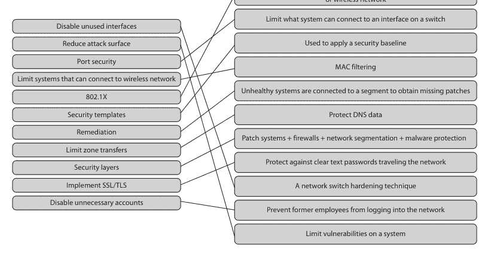
