# 第 7 章

### 实现基于主机的安全

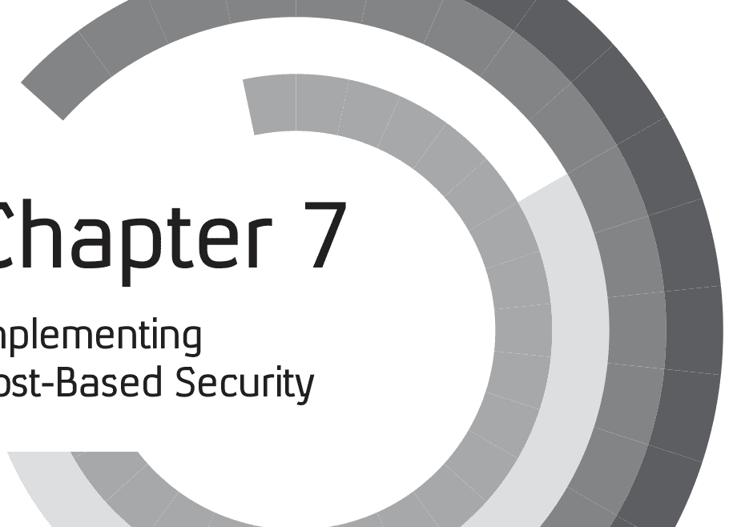

### 认证目标

- 7.01 主机和应用程序安全解决方案
- 7.02 实现基于主机的防火墙和 HIDS
- 7.03 防止恶意软件
- 7.04 设备安全和数据安全
- ✓ 两分钟练习
- Q&A 自测

在第 6 章中，你学习了如何减轻对系统和设备的常见威胁。本章继续讨论安装和配置在系统上以提高其安全级别的常见安全功能。

### 认证目标 7.01

### 主机和应用程序安全解决方案

Security+ 考试的一个重点是了解不同系统的风险以及如何减轻该风险。例如，一家公司可能担心敏感公司数据泄露或被盗，并希望你提供解决方案来降低该风险。在这种情况下，你会建议禁用计算机上的 USB 端口，以便无法将可移动驱动器连接到系统，并使用 *数据丢失防护 (DLP)* 解决方案来阻止敏感数据类型通过电子邮件发送。

在本节中，你将学习通过使用常见的<|message|> 安全解决方案（如端点保护、启动完整性和数据安全功能）来实现对系统（称为主机）和在该系统上运行的应用程序的安全的方法。

### 端点保护

*端点保护*，也称为 *端点安全*，是用于保护客户端设备（如台式机、笔记本电脑、平板电脑和移动设备——这些统称为端点）的技术的术语。以下是你应实施以帮助保护端点的技术列表：

- **防病毒** 你在第 5 章中学习了恶意软件和病毒。为了防止不同类型的病毒，请确保在端点（客户端）上安装防病毒软件，并保持病毒定义为最新以最大化保护。

- **反恶意软件** 为了防止其他形式的恶意软件，你应该安装反恶意软件。大多数时候，反恶意软件软件也是你的防病毒软件。

- **端点检测和响应 (EDR)** 端点检测和响应是一种安全技术，监控端点设备上的活动和事件，将从端点设备收集的数据发送到中央数据库，分析收集的数据，并从数据中识别任何潜在的网络安全威胁。当 EDR 软件识别到威胁时，它会通知客户端采取行动以减轻威胁。

- **DLP** 你在第 5 章中学习了数据丢失防护 (DLP)，但简单回顾一下，DLP 是一种你可以实施的解决方案，它会监控敏感数据是否在组织外部泄露并防止其发生。例如，你可以在电子邮件软件中实施 DLP 解决方案，防止员工在电子邮件中共享信用卡号码（或其他敏感数据）。

- **基于主机的防火墙** 基于主机的防火墙是安装或启用在计算机系统上的防火墙软件，旨在控制可以到达该系统的流量。


例如，如果你在网络上有一台专为向客户端提供网页而设计的内网服务器，你可以在该系统上启用基于主机的防火墙，并只允许 HTTP 或 HTTPS 流量到达该系统。这是一种保护该系统免受恶意流量的方式，例如如果黑客进入网络，或者网络上存在恶意软件。另一个应使用基于主机防火墙的例子是当你将笔记本电脑连接到不受信任的网络时，例如无线网络或酒店网络。例如，如果你有一名员工在外旅行并住在酒店，你希望员工的笔记本电脑上启用基于主机的防火墙，因为酒店被视为不受信任的网络。

### 基于主机的入侵检测系统 (HIDS)
基于主机的入侵检测系统会查看系统上的日志和事件，以确定该系统是否受到攻击。入侵检测系统会发出通知，表明可能发生了入侵，但不会尝试纠正问题。

### 基于主机的入侵防御系统 (HIPS)
基于主机的入侵防御系统与 HIDS 类似，因为它可以检测系统上的潜在攻击，但它可以采取纠正措施，例如阻止导致可疑流量的 IP 地址的连接。你将在本章后面了解更多关于 HIDS 和 HIPS 的内容。

exam Watch
对于 Security+ 考试，
记住不同的安全解决方案
以提高终端设备的安全性。

### 下一代防火墙 (NGFW)
下一代防火墙是常规防火墙，它过滤流量，同时执行深度包检测（检查数据包的有效载荷），并且还包括 IPS 中常见的入侵防御功能。

## 启动完整性

攻击者获取敏感公司数据的一种常见方式是找到一台丢失的笔记本电脑或窃取笔记本电脑，然后从可启动介质（如可启动 USB 驱动器或 DVD 驱动器）上的不同操作系统启动。一旦启动到自己的操作系统，黑客就可以浏览随笔记本电脑提供的驱动器上的文件（假设未加密）。为帮助防止此类攻击，你应使用全盘加密，但你也可以使用系统的启动完整性功能来验证启动环境是否未更改（从 USB/实时光盘启动会更改启动环境）。以下是你可以用来确保启动完整性的一些解决方案：

### 启动安全/统一可扩展固件接口 (UEFI)
Secure Boot 是 UEFI 类型 BIOS 系统的一项功能，可检测启动环境是否发生了更改。如果启动环境已更改，Secure Boot 功能将停止启动过程。启动环境通过存储启动文件的哈希值并在启动时验证这些哈希值来进行验证。

Measured Boot
Measured Boot 与 Secure Boot 类似，因为它在允许系统启动之前验证启动环境的完整性。Measured Boot 通过将启动文件的哈希存储在系统上的可信平台模块 (TPM) 芯片中来实现这一点。

Boot attestation
Boot attestation 是系统向远程系统证明其上运行的软件的可信度。请注意，这与 Secure Boot 或 Measured Boot 有点不同，因为软件已经在运行并经过验证，系统正在证明该验证。

## 数据库

Security+ 考试期望你了解应与数据库中的敏感数据一起使用的安全解决方案。这包括令牌化、哈希和加盐。

## 令牌化

令牌化是指敏感数据存储在令牌服务中，而不是与使用敏感数据的应用程序数据一起存储。令牌服务还为该敏感数据提供一个无关的替代值。令牌服务随后存储敏感数据和无关值的映射以供将来参考，以便在需要时查找。例如，网上购物网站可能使用以下步骤：

- 1. 网站提示用户输入其信用卡号码。
- 2. 当用户输入信用卡号码时，网站会联系位于安全网络上的令牌服务，并向令牌服务提供信用卡号码。
- 3. 令牌服务创建一个用于购物的替代号码，并将其发送给网站，以便与电子商务数据库中的客户数据一起存储。
- 4. 令牌服务在令牌服务数据库中存储真实信用卡号码和替代值的映射。
- 5. 当用户在以后进行购买时，电子商务应用程序将替代值提供给令牌服务，以便其检索真实的信用卡号码。

这种令牌化和令牌服务的优点是电子商务数据不存储信用卡号码——它通过令牌服务检索。令牌化系统及其数据库（确实存储信用卡号码）位于受限的、安全的网络上，只能由网站（以及任何其他授权应用程序）访问。

这降低了信用卡号码被泄露的风险，因为如果电子商务网站和数据库被黑，信用卡号码不在那里，而令牌服务数据库位于不同的受限网络上。

> exam Watch
> 对于 Security+ 考试，请记住你应该使用令牌化来保护信用卡号码等敏感数据，以便以安全的方式重复使用信用卡。

## 哈希

你在第 2 章中已经了解了哈希，但只是复习一下，哈希是指将数据通过哈希算法运行以生成哈希值。哈希的一种用途是密码存储。系统可能会将密码通过哈希算法运行，然后将哈希值存储在数据库中，而不是将用户的密码以明文形式存储在数据库中。这样，如果有人入侵数据库，他们就看不到明文密码。

那么在这种情况下如果数据库中未存储密码的明文版本，身份验证如何工作？很简单！当用户登录系统时，他们提供的密码会使用相同的哈希算法进行哈希以生成哈希值。然后将尝试密码的哈希值与身份验证数据库中的哈希值进行比较，如果匹配，系统就知道提供了正确的密码。

这种技术的问题在于密码破解工具的工作方式——它们从密码列表文件（称为字典文件）中取出单词，将这些单词通过哈希算法运行，然后将每个哈希值与数据库中的哈希值进行比较，直到找到匹配项。

## 加盐

为防止哈希密码被破解，可以使用的一种技术是加盐，这涉及取一个随机值，将其添加到明文值中，然后对加盐值 + 密码的组合进行哈希并将其存储在数据库中。该盐值也单独存储，以便当用户登录时，他们的密码与存储的盐值连接，然后进行哈希。如果生成的哈希值与存储在数据库中的哈希值匹配，则用户通过身份验证。

加盐可防止在不知道盐值的情况下破解哈希密码，并确保只有在应用程序逻辑执行以包含盐值时才能进行身份验证。

> exam Watch
> 对于 Security+ 考试，请记住你应该使用哈希结合加盐来保护数据库中存储的密码。

## CERTIFICATION OBJECTIVE 7.02

## 实施基于主机的防火墙和 HIDS

创建安全环境的一个重要部分是确保每个单独的系统都已安全配置——这包括台式机、服务器、移动设备，尤其是员工在不同网络环境中漫游时使用的笔记本电脑。

## 基于主机的防火墙

应首先在系统上配置的安全应用程序之一是基于主机的防火墙，也称为个人防火墙。基于主机的防火墙是一段控制系统进出通信的软件。今天大多数网络在网络边界都有防火墙来控制进入和离开网络的流量，但你还应为工作站和服务器配置基于主机的防火墙。

我发现大多数网络管理员不会在网络中的所有工作站和服务器上配置基于主机的防火墙，我可以理解他们可能不这样做的原因。在网络中的所有系统上配置基于主机的防火墙将使远程连接到这些系统并解决它们的问题变得困难。基于主机的防火墙应允许企业环境中适当的入站流量。

话虽如此，某些系统必须安装和配置基于主机的防火墙非常重要。例如，如果你有一名员工经常旅行并将公司笔记本电脑连接到酒店或机场网络，那么你应该为该系统配置基于主机的防火墙，以保护系统免受这些网络上的恶意活动。

> exam Watch
> 对于 Security+ 考试，请记住连接到不受信任的网络（例如酒店网络或任何无线网络）的系统应由基于主机的防火墙保护。

你也可以在特定服务器上安装基于主机的防火墙，以确保与该服务器的通信仅限于允许通过防火墙的流量类型。例如，如果你在网络上有一个 FTP 服务器，并且 FTP 是服务器的唯一用途，那么你可以启用基于主机的防火墙并仅打开 FTP 端口，以保护服务器免受任何恶意流量。


**图 7-1** 主机型防火墙的通知消息

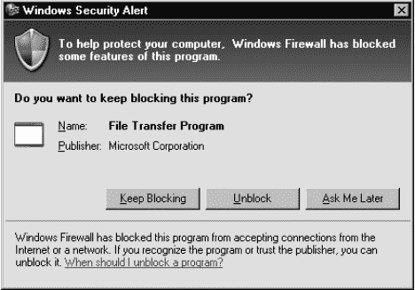

大多数主机型防火墙具有一些共同的功能，如下所示：

- **阻止传入流量** 可以阻止从网络或互联网上的主机发送到系统的数据包。
- **阻止传出流量** 可以阻止离开系统前往网络或互联网的数据包。
- **通知** 大多数主机型防火墙可以配置为在有人尝试连接你的系统或系统上的程序尝试向网络或互联网发送数据时显示一条消息，如图 7-1 所示。
- **默认规则** 一旦启用，大多数防火墙的默认规则是拒绝所有流量，除非你允许该流量通过。你可以将默认规则更改为允许所有流量，除了你指定的数据包，但这种情况很少见。
- **创建规则** 大多数防火墙允许你在默认规则之上添加规则，以自定义允许或拒绝进入或离开系统的流量。

## 配置概述

当你配置主机型防火墙时，通常要么安装软件，如果它是由第三方公司提供的，要么启用防火墙，如果你使用的是随操作系统提供的防火墙软件。

当你启用防火墙时，它通常具有默认规则，即拒绝所有流量，除非该流量是对来自防火墙系统的请求的响应。例如，当 Windows 防火墙启用时，你仍然可以浏览互联网，因为你通过输入网站的 URL 请求网页（实际上你正在发送 HTTP GET 请求），因此响应（在本例中为网页）被允许通过防火墙。

如果你在系统上托管服务，则需要打开主机型防火墙上的端口以允许这些请求通过。例如，如果你想通过远程桌面访问服务器并且已启用主机型防火墙，则需要打开远程桌面端口（TCP 端口 3389）。

## 基于 Windows 的防火墙

要在 Windows 中配置主机型防火墙，请按照以下步骤操作：

1. 右键单击“开始”按钮并选择“控制面板”。
2. 选择“系统和安全” | “Windows 防火墙”（见图 7-2）。
3. 注意在 Windows 防火墙窗口中，左侧有以下链接：
   - **允许程序或功能通过 Windows 防火墙** — 添加或删除允许的程序和端口。允许的程序是可以将数据发送到互联网的程序。
   - **更改通知设置** — 打开或关闭 Windows 防火墙并配置是否希望在 Windows 防火墙阻止程序时收到通知。
   - **打开或关闭 Windows 防火墙** — 对特定网络位置打开或关闭 Windows 防火墙并配置是否希望在 Windows 防火墙阻止程序时收到通知。
   - **还原默认值** — 将 Windows 防火墙还原为默认值。
   - **高级设置** — 带你进入 Windows 防火墙和高级安全管理工具，你可以使用它来配置更详细入站和出站规则。

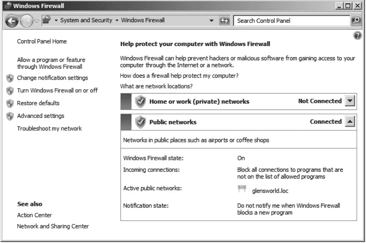

**图 7-2** Windows Server 中的 Windows 防火墙

4. 单击“高级设置”以访问可让你更控制防火墙上可配置的出站和入站规则的设置。
5. 要创建允许流量通过防火墙的新入站规则，请在左侧窗格中右键单击“入站规则”并选择“新建规则”。
6. 在“新建入站规则向导”的“规则类型”步骤中，选择“端口”以创建基于 TCP 或 UDP 端口的规则（见图 7-3），然后单击“下一步”。

**图 7-3** 选择要创建的规则类型。

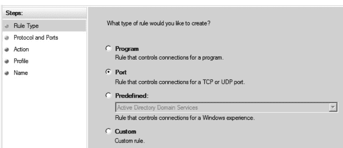

7. 在“协议和端口”向导步骤中，选择协议并指定你希望允许通过防火墙的本地端口。在此示例中，我选择 TCP 端口 3389（见图 7-4）。单击“下一步”。
8. 在“操作”向导步骤中，指定你是否要允许或阻止此流量（称为连接）。请注意，你还可以指定仅在流量为安全流量时才允许。选择“允许连接”然后单击“下一步”。

**图 7-4** 在防火墙上打开端口 3389

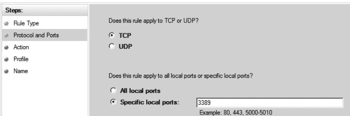

9. 在“配置文件”向导步骤中，确保规则在连接到企业域、私有网络和公共网络时适用，方法是为每个网络配置文件启用复选框。单击“下一步”。
10. 在最终的向导步骤中，输入 **RDP Traffic** 作为规则的名称并单击“完成”。

## Linux 防火墙和 TCP Wrappers

Windows 操作系统并不是唯一具有防火墙功能的系统；大多数操作系统允许你启用主机型防火墙。如果你想在 Linux 中启用防火墙功能（我使用的是 Fedora），你可以按照以下步骤操作：

1. 选择“系统”菜单，然后选择“管理” | “安全级别和防火墙”。
2. 在“防火墙选项”选项卡上，选择启用 Linux 防火墙，如图 7-5 所示。
3. 然后你可以通过执行以下任何任务在防火墙上打开端口：
   - **受信任服务** — 你可以使用受信任服务的列表打开特定端口以允许与该服务通信。要为服务打开端口，只需选中该服务的复选框即可。例如，如果我想让客户端连接到我的 Linux 系统上的 FTP 服务，我将启用 FTP 复选框。
   - **其他端口** — 如果你想打开未列在受信任服务中的端口，可以展开“其他端口”并单击“添加”按钮。在“添加端口”对话框中，输入你希望打开的端口的端口号和协议（TCP 或 UDP）（见图 7-6）。

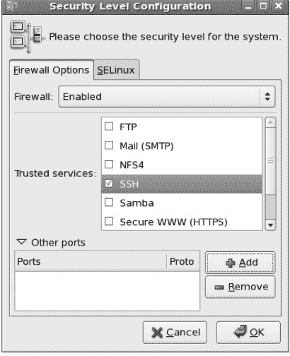

**图 7-5** 配置 Linux 防火墙

**图 7-6** 在 Linux 防火墙上添加例外

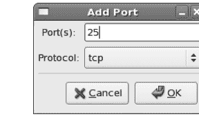

虽然它并不是真正的防火墙功能，但 TCP wrappers 是 Linux 中另一个很棒的访问控制功能。TCP wrappers 允许你控制对 Linux 系统上运行的不同服务（如 Telnet、SSH 和 FTP）的访问。TCP wrappers 功能易于实现，因为你只需要配置两个文件：

- `/etc/hosts.allow` — 此文件列出你希望允许客户端访问的不同服务，并指定哪些客户端可以访问这些服务。
- `/etc/hosts.deny` — 此文件列出你希望拒绝客户端访问的不同服务，并允许你指定哪些客户端被拒绝访问不同的服务。

对于这两个文件，你都可以为客户端允许访问的服务添加规则（如果服务配置在 hosts.allow 文件中）以及不允许客户端访问的服务（如果服务配置在 hosts.deny 文件中）。你通常通过 IP 地址或 DNS 名称允许或拒绝对不同系统的访问。

当客户端连接到特定服务（如 Telnet）时，Linux 系统会读取 hosts.allow 文件以确定客户端是否允许访问该服务。如果 hosts.allow 文件中没有该服务的规则，则会读取 hosts.deny 文件以查找规则。如果在任一文件中都没有与客户端匹配的服务规则，则尝试连接服务的客户端将被授予访问权限。

作为使用 TCP wrappers 的示例，我将进入 hosts.deny 文件以指定所有系统都被拒绝访问 FTP 服务。要为此规则配置文件，我添加一行并输入服务名称，添加冒号（:），然后列出规则适用的客户端，如以下代码所示：

```
vsftpd : ALL
```

图 7-7 显示了我更改后 hosts.deny 文件的内容。

在我配置 hosts.deny 文件后，所有系统都被拒绝访问，但我希望 192.168.2.0 网络上的任何系统都可以访问该服务，并且我希望 IP 地址为 10.0.0.2 的系统可以访问 FTP 服务。为了实现此目标，我在 hosts.allow 文件中添加一行，指定服务名称，然后是冒号（:），后跟允许的 IP 地址列表，每个地址用逗号分隔。请注意，在以下代码中我如何指定了 192.168.2.0 网络的网络 ID（我没有在末尾加上零）：

```
vsftpd : 192.168.2.,10.0.0.2
```


# 图 7-7

配置 /etc/hosts.deny 以拒绝所有客户端的 FTP 流量

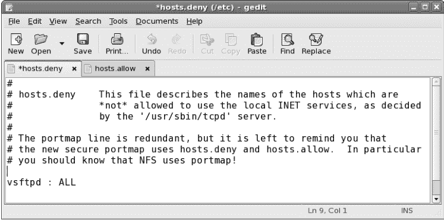

图 7-8 显示了 hosts.allow 文件的内容。请注意，这两个文件的组合允许来自 192.168.2.0 网络以及 IP 地址为 10.0.0.2 的任何系统访问 Linux 系统上的 FTP 服务，而所有其他系统都被拒绝访问。

> **请记住，使用 TCP wrappers 时，遵循的是与客户端请求匹配的第一条规则。** 如果客户端同时出现在 allow 文件和 deny 文件中，那么该客户端将被允许访问，因为 allow 文件会先被读取。

TCP wrappers 的规则可能相当复杂，但也非常灵活。以下是可以添加到 hosts.deny 文件或 hosts.allow 文件中的一些规则示例。在第一个示例中，您可以指定域名而不是 IP 地址。下面的代码

# 图 7-8

配置 /etc/hosts.allow 以允许来自单个系统的 FTP 流量

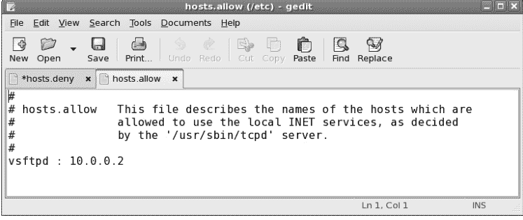

示例允许来自 gleneclarke.com 域的任何系统访问 SSH 服务（如果放置在 hosts.allow 文件中）：

```
sshd : .gleneclarke.com
```

以下规则可以应用于除 gleneclarke.com 域中的系统之外的所有系统。如果将此规则放置在 hosts.deny 文件中，则意味着除来自 gleneclarke.com 的系统外，所有系统都被拒绝访问 FTP 服务。

```
vsftpd : ALL Except *.gleneclarke.com
```

使用 hosts.allow 和 hosts.deny 文件还能做的另一件事是构建一条规则，引用系统上的一个文本文件，该文件包含按 IP 地址列出的系统列表。这使得修改地址列表更加容易，因为您只需编辑文本文件，而无需修改 hosts.allow 或 hosts.deny 文件中的规则。以下示例指定 Telnet 服务应引用 /etc/telnet.hosts 文件来获取被拒绝的系统列表（如果将此规则放置在 hosts.deny 文件中）：

```
in.telnetd : /etc/telnet.hosts
```

## 练习 7-1

### 在 Linux 中配置 TCP wrappers

在本练习中，您将通过控制对 FTP 服务器的访问来练习在 Linux 中配置 TCP wrappers。

- 1. 确保您可以通过输入 `ftp <IP_of_Linux>` 连接到 Linux 上的 FTP 服务器。
- 2. 使用用户名 **ftp** 登录，无需密码。成功登录后，输入 `quit` 退出 FTP 会话。
- 3. 要拒绝任何人连接到您的 Linux FTP 服务，请打开 `/etc/hosts.deny` 文件，并添加一行设置 `vsftpd : ALL`。所有尝试连接到您的 Linux FTP 服务的用户都应收到“连接被拒绝”的消息。
- 4. 修改 `/etc/hosts.allow` 文件，通过添加以下行将您的 IP 地址添加为可以连接到 FTP 服务的系统：`vsftpd : <your_ip>`。
- 5. 确保您可以通过输入 `ftp <IP_of_Linux>` 并输入用户名为 **ftp**、无密码登录来 FTP 进入 Linux 服务器。

## 基于主机的 IDS 和基于主机的 IPS

配置系统安全性的另一部分是在系统上安装和配置*基于主机的入侵检测系统（HIDS）*或*基于主机的入侵防御系统（HIPS）*。

基于主机的 IDS 负责监视系统上的活动，并在发现任何可疑活动时向您发出警报；而基于主机的 IPS 则监视可疑活动，然后采取纠正措施，例如锁定系统或禁用网络通信。关于 HIDS/HIPS，需要记住的关键点是，它只监视安装了该软件的单个系统上的活动。如果您想监视五个不同系统上的活动，则需要在五个系统中的每一个上安装 HIDS/HIPS。

HIDS/HIPS 软件通过检查系统的不同区域来监视可疑更改。以下是 HIDS/HIPS 监视的一些关键区域：

- **内存** — HIDS/HIPS 可以监视内存区域，并留意在系统上执行的任何可疑程序。
- **系统文件** — HIDS/HIPS 可以为系统文件生成哈希值，并将其存储在数据库中。当系统文件被访问或执行时，HIDS/HIPS 可以计算该文件的新哈希，并与数据库中存储的哈希进行比较，以确定文件是否被篡改。
- **日志文件** — 许多应用程序会将活动记录到日志文件中，HIDS/HIPS 可以读取这些日志文件以查找可疑活动。
- **文件系统** — HIDS/HIPS 可以监视文件的多项更改，例如权限、所有者、文件大小和最后访问时间的更改。
- **连接** — HIDS/HIPS 可以监视到系统的连接，查找未经授权的连接，甚至针对系统的端口扫描。

您将在第 19 章中了解更多有关监视和审计的内容，但需要理解的是，HIDS/HIPS 可以通过分析日志文件中发生的事件或捕获正常活动的*基线*来检测可疑流量，任何异常（偏离正常活动的偏差）都被视为可疑。

> ### 考试须知
> 
> **监视加密流量**
> 
> 对于认证考试，请记住基于网络的 IDS 的一个局限是，如果网络流量是加密的，NIDS 将无法根据其认为可疑的特征来分析该流量，因为 NIDS 无法解密信息。
> 
> HIDS 是安装在系统上的软件，因此它可以监视涉及进出该系统加密通信的活动。运行 HIDS 软件的系统会解密加密的通信，然后记录该活动；HIDS 只需查看系统上未加密的日志即可识别可疑活动。

您将在下一章中学习另一种类型的入侵检测系统——基于网络的 IDS（NIDS）。NIDS 通过分析网络流量并将其与识别可疑流量的特征进行比较来识别可疑活动。关于 HIDS 与 NIDS 相比，需要记住的一个关键点是，如果网络流量是加密的，NIDS 将无法检测到可疑流量。使用 HIDS 的一大优点是，网络流量是否加密并不重要，因为 HIDS 不会通过查看网络流量来识别问题。

# 认证目标 7.03

## 防范恶意软件

鉴于互联网上充斥着大量恶意软件，关键是要正确配置系统以防范病毒、间谍软件和垃圾邮件等恶意软件。您还需要实施解决方案，以阻止用户在浏览互联网时显示那些烦人的广告和弹出窗口。

## 补丁管理

我们计算机上安装的应用程序和操作系统是由人类开发的，因此很可能在编码时就存在错误，同时也包含应用程序的出色功能。这些程序代码中的错误（称为漏洞）可能会被某些人发现并利用，从而接管您的系统或网络。这被称为网络攻击或系统攻击，具体取决于被接管的是整个网络还是仅单个系统。

软件和操作系统制造商一直在寻找其代码中的漏洞。他们修复这些错误，并通过所谓的修复程序、补丁或更新来发布修复内容。通过此过程可以防止许多网络攻击。您通常可以通过制造商的网站获取这些修复程序和更新。例如，微软操作系统具有 Windows 更新功能，它会访问微软的更新网站，并扫描您的系统以查找需要安装的更新。可以通过右键单击“开始”菜单，选择“控制面板 | 系统和安全 | Windows 更新”来运行此 Windows 更新功能。Windows 更新确定系统所需的更新后，您的系统将从 Windows 更新网站下载这些更新（参见图 7-9）。


### 图 7-9

使用 Windows Update 修补系统

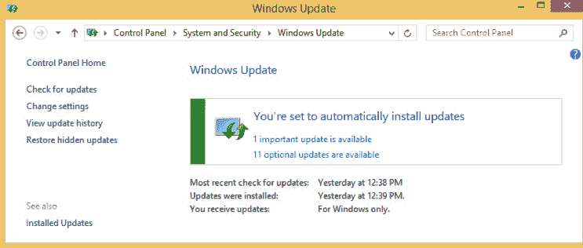

各种类型的更新可以通过 Windows Update 网站交付给你。它们列示如下：

- **安全热修复：** 安全热修复是一种关键的安全更新，应尽快应用到你的系统上，因为该漏洞会使系统面临严重的 安全风险。
- **补丁：** 补丁是对软件或操作系统代码中特定问题的修复，它不会造成安全风险，但会给系统或应用程序带来问题。
- **服务包：** 服务包是产品从发布之日起到服务包发布之日止的所有更新，包括补丁和安全热修复。如果你安装了服务包，就无需逐个安装每个补丁，因为服务包已包含到该时点为止的所有更新。你需要安装服务包发布后发布的补丁和安全修复。

## Windows Server Update Services

在一台系统上运行 Windows Update 没问题，但如果你必须管理 500 台系统并确保每台系统都使用当前的补丁和热修复保持最新怎么办？微软创建了 Windows Server Update Services（WSUS），它允许你创建 WSUS 服务器并从 Internet 下载更新到 WSUS 服务器。然后你可以 在一些测试系统上测试这些更新的安装，以验证更新不会与这些系统上的任何应用程序冲突；然后你可以将更新发送到 500 台系统。

当你将更新发送到网络上的 500 台系统时，你可以从一个中心点进行——WSUS 服务器。WSUS 服务器具有基于 Web 的管理工具，允许你手动批准更新。这些更新将被下载到 WSUS 服务器。

在 WSUS 中，你可以创建计算机组，然后将更新发送到网络上的不同组。你未批准的更新将不会发送到网络上的系统。图 7-10 显示了 WSUS 结构。

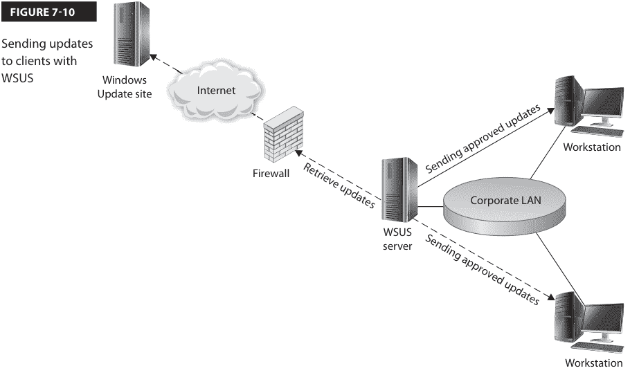

WSUS 有许多好处；例如，你可以从 Internet 将更新下载到一台中心机器，而不是让每台系统都从 Internet 下载。这有助于保持可用带宽，因为不是每个人都执行下载。WSUS 的另一个好处是客户端只接收你已批准的更新。这是因为你将配置每个客户端从 WSUS 服务器而不是从 Internet 检索更新。一旦你在 WSUS 服务器上批准了更新，客户端将通过 WSUS 自动获取更新。任何未批准的更新都不会被网络上的客户端下载。还需要注意的是，使用 WSUS 时，安装是由系统本身执行的，而不是已登录的用户执行的。这很重要，因为用户通常没有安装软件的权限。

你可以通过转到服务器管理器并启动添加角色和功能向导，在 Windows Server 上安装 WSUS。安装 WSUS 并从 Microsoft 网站下载更新后，你需要批准更新。下一步是配置客户端指向 WSUS 服务器，以便它们从 WSUS 服务器而不是从 Windows Update 网站下载更新。请注意，只能使用 WSUS 对 Microsoft 软件进行更新。

## 配置客户端使用 WSUS 服务器进行更新

要配置网络上的 Windows 客户端使用 WSUS 服务器，你可以创建一个域策略，配置域中的每个客户端指向 WSUS 服务器以获取更新。如果你不在域环境中，你可以通过本地策略配置客户端。要更改网络上的默认域策略，请按照以下步骤操作：

1. 单击 开始 | 管理工具 | 组策略管理。
2. 右键单击 默认域策略 并单击 编辑。
3. 组策略管理编辑器出现。在 计算机配置 部分，展开 策略 | 管理模板 | Windows 组件，然后选择 Windows Update（见图 7-11）。

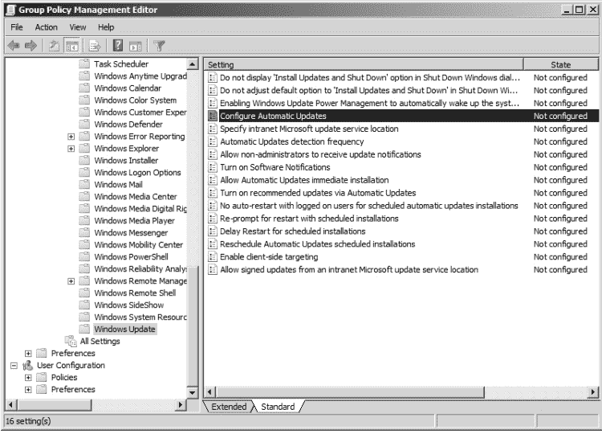

4. 要在域中的客户端上启用自动更新，请双击 配置自动更新。
5. 在 配置自动更新 对话框中，选择 已启用，然后选择“4 - 自动下载并安排安装”。指定“0 - 每天”在“03:00”（凌晨 3 点）的自动安装计划（见图 7-12）。

### 图 7-12

指定自动下载和安装更新

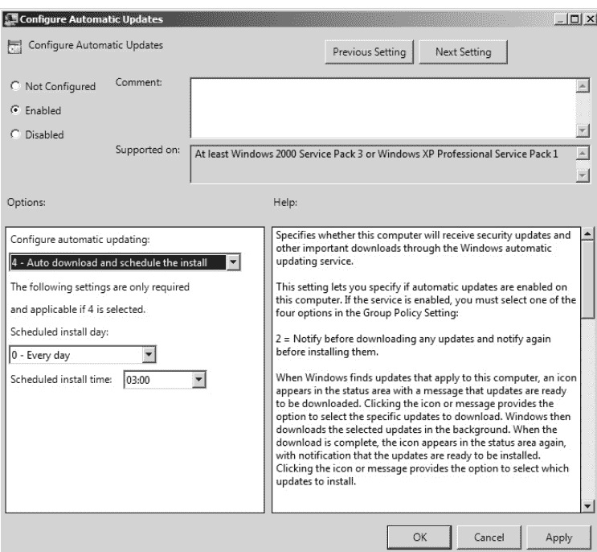

6. 单击 确定。
7. 双击 指定 Intranet Microsoft 更新服务位置 策略并启用该策略设置。在此对话框中，你将 Intranet 服务器和统计服务器设置为你安装 WSUS 的服务器的名称。例如，我的服务器名为 Server2008A，因此 Intranet 服务器和统计服务器地址设置为 http://Server2008A。单击 确定。WSUS 中可用的报告依赖于统计服务器接收来自 WSUS 客户端的状态消息。
8. 关闭所有窗口。

现在策略已在 Active Directory 中配置，客户端将自动引用你的 WSUS 服务器并安装你在 WSUS 管理站点中批准的任何更新。

- **计划的定义更新：** 病毒防护软件应允许安排病毒定义更新。病毒定义是在创建定义文件时已知的所有病毒的列表。安装防病毒软件后，请确保定期更新病毒定义；这将确保你的系统始终受到最新病毒的保护。
- **实时保护：** 大多数防病毒产品提供实时保护，这是一种在你访问文件时扫描任何文件的功能。这是自动功能；一旦启用，你就无需在打开文件前手动调用文件扫描。你可以启用实时保护功能，但也可以指定软件在发现病毒时应采取什么操作。例如，防病毒软件可以先尝试清除病毒（将其删除）；如果不成功，它将隔离病毒。
- **电子邮件功能：** 一些防病毒产品与你的电子邮件软件集成，以扫描电子邮件的内容并帮助保护你的系统免受通过电子邮件接收的病毒侵害。你也可以将服务器级防病毒产品加载到电子邮件服务器上，以便服务器在将电子邮件放入用户邮箱之前扫描电子邮件。绝对要在你的电子邮件服务器上加载基于服务器的防病毒产品。

> 微软提供了许多免费工具来处理保护系统免受恶意软件侵害的问题。微软有名为 Windows Defender 的免费恶意软件保护软件，还有恶意软件清除工具，用于清理受感染的系统。

## 配置反垃圾邮件软件/垃圾邮件过滤器

垃圾邮件是未经请求的电子邮件。发送者通常从在访问其网站并填写表单时收集你的电子邮件地址的供应商处获取你的电子邮件地址。垃圾邮件发送者也可以在 Internet 上搜索网页上的电子邮件地址。

重要的是你的组织在电子邮件服务器上实施垃圾邮件过滤软件，以便在垃圾邮件试图进入组织时捕获大部分垃圾邮件。我曾与一位客户交谈过，其垃圾邮件过滤器报告显示，每天有 40,000 条消息被捕获并阻止进入公司邮件服务器。

公司还可以购买 *一体式安全设备*，该设备负责执行多个功能，例如公司防火墙、入侵检测系统，以及对试图进入网络的电子邮件消息进行病毒扫描和垃圾邮件过滤。一体式安全设备通常放置在网络的边缘，以阻止恶意流量进入网络。一体式安全设备通常具有以下功能：

- **URL 过滤：** 内置于安全设备中的 URL 过滤器可以限制员工可以浏览的网站。这是阻止常见社交网络网站（如 Facebook.com）的一种典型方法，以便员工不会浪费公司时间在这些网站上。


- **内容检查** 安全设备的**内容检查**功能允许设备查看数据包内容（称为有效载荷），并根据数据包中发现的信息过滤流量。例如，黑客可能希望阻止在应用程序中的某些命令，例如能够上传到 FTP 服务器。
- **恶意软件检查** 一体化安全设备也可以内置恶意软件保护，防止网络受到病毒、广告软件、垃圾邮件和其他形式的恶意软件的侵害。

## 间谍软件和广告软件

间谍软件是加载到系统上用于监控你互联网活动的软件，而广告软件是加载到系统上会弹出推广产品和网站的广告的软件。这两种软件在过去几年里已成为互联网的烦恼。它们最常在你浏览恶意或被黑的网站时被加载到你的系统上。

反间谍软件（和反广告软件）是可以用来从系统中清除这些麻烦入侵者的软件。可用以清除此恶意软件的产品包括 Spybot、Ad-Aware 和 Microsoft 的 Windows Defender。反间谍软件已变得与防病毒软件一样流行，而且许多新反间谍软件产品中的功能与防病毒软件相同，例如实时保护和扫描计划。Windows Defender 包括以下功能：

- Antivirus and anti-malware
- Real-time protection
- Scheduled scans
- Browser hijack protection
- Automatic updates of malicious software definitions

需要注意的是，微软多年来经历了许多版本的反恶意软件，最初是 Windows Defender。然后公司开始推广名为 Microsoft Security Essentials 的防病毒软件，并在 Windows 8.1 中更新了 Windows Defender，使其包含防病毒软件以配合反间谍软件，使其成为功能齐全的反恶意软件工具。

## 钓鱼过滤器和弹出窗口拦截器

在第 4 章中你了解了不同类型的攻击，包括钓鱼攻击。记住，钓鱼攻击是指黑客向你发送一封电子邮件，引导你进入某个特定公司（如银行）的假网站。

至关重要的是，你必须通过实施钓鱼过滤器和弹出窗口拦截器来保护系统免受钓鱼攻击以及弹出窗口中运行的恶意代码。你可以寻找第三方应用程序来提供钓鱼过滤器和弹出窗口拦截器，但重要的是要知道大多数网络浏览器今天都已内置了这些功能。

Flash drives 如果员工需要在闪存驱动器上存储公司数据，请确保其已加密，并且他们仅在公司系统上使用闪存驱动器。确保员工不要带闪存驱动器到办公室，这些驱动器曾连接到他们的家庭系统或不受信任的计算机。McAfee 的 DLP 等产品可用于阻止未经授权的 USB 驱动器。

## CERTIFICATION OBJECTIVE 7.04

## 设备安全和数据安全

在本节中，你将了解保护系统（如笔记本电脑、移动设备和组织数据）的常见安全实践。安全并不止于办公室，你需要考虑如何保护带出组织的资源。

## 硬件安全

在处理诸如交换机、路由器和笔记本电脑等硬件设备时，应确保这些设备免遭盗窃。路由器和交换机应放置在安全设施中，例如机房，在那里你可以控制对房间的访问。这将有助于防止路由器和交换机被盗，并防止未经授权的人员对这些设备进行物理篡改。任何便携式硬件设备，如笔记本电脑、液晶显示器，甚至投影仪，都应使用锁定电缆固定在设施中，该电缆连接到设备上的端口，然后可以固定到桌子上。这可以阻止机会主义盗窃。请记住，锁定电缆并非万无一失，因为窃贼可以将其剪断。高度安全的环境可能要求员工在夜间不使用时将可移动/便携式驱动器、笔记本电脑和其他移动设备锁在保险箱或带锁的柜子中。

## 移动设备安全

由于移动设备存储了公司消息和公司数据的本地副本，因此它们已成为公司今天面临的巨大问题。围绕智能手机和平板电脑等移动设备的使用制定强有力的政策并确保执行这些政策非常重要。

## 连接方法和接收器

手机和平板电脑有多种连接到网络和互联网的方式。以下列表概述了移动设备使用的一些常见连接方法：

- **蜂窝** 移动设备最常用的连接到网络或互联网的方法是通过其蜂窝网络。蜂窝网络由移动设备的服务提供商提供。
- **Wi-Fi** 移动设备可以连接到公司 Wi-Fi 网络以获得互联网连接并访问网络资源。Wi-Fi 网络随后连接到企业网络。
- **SATCOM** SATCOM 是 *卫星通信* 的缩写，是一种常见的连接方法，用于发送或接收少量数据，例如通过销售点系统。
- **蓝牙** 移动设备可以使用蓝牙在设备靠近时获得与计算机或设备的连接。蓝牙使用 2.4-GHz 频率。
- **NFC** 近场通信允许两个电子设备在彼此相距两英寸以内时交换数据。你可以使用 NFC 让设备共享联系人等信息或支付交易。
- **ANT** ANT 是一种无线通信协议，允许你在设备之间传输数据。ANT 使用与蓝牙相同的 2.4-GHz 频率。与蓝牙不同，ANT 不会消耗太多电池寿命，这使其非常适合智能设备。
- **红外** 红外或 IR 是一种无线通信，依赖于两个共享数据的设备之间的视线通过红外光。
- **USB** 你可以使用 USB 电缆将移动设备连接到系统的 USB 端口。这对于将视频和图片等数据传输到计算机很常见。
- **点对点** 移动设备支持点对点通信的不同协议（例如，移动设备与另一移动设备通信）。
- **点对多点** 移动设备还支持点对多点，这涉及同时向许多其他设备发送数据。
- **全球定位系统 (GPS)** 移动设备包含 GPS 技术，可让你使用显示位置信息的服务。
- **RFID** 使用射频识别 (RFID) 技术，你可以将标签附加到物体并使用 RFID 跟踪这些标签。

了解可用于允许与智能手机或笔记本电脑等移动设备通信的不同技术非常重要。从安全角度来看，你可能希望在设备上禁用这些类型的功能。

## 移动设备管理概念

移动设备给组织带来了巨大的安全挑战，因此了解如何管理设备的特性和设备本身的整体情况非常重要。以下是你需要管理的移动设备的一些安全方面：

- Screen locks 确保智能手机和笔记本电脑等移动设备的屏幕在短暂不活动后配置为锁定至关重要。因此，任何希望使用移动设备并访问其上数据的人都必须输入设备的密码。因此，如果你丢失设备并且有人找到它，他们需要知道密码才能访问设备上的数据。

- Strong passwords and PINs 确保所有移动设备都配置了复杂的密码以使用设备，从而访问其上的数据。对于公司设备，你可以配置策略来强制执行设备的复杂密码。例如，你可以在 Microsoft Exchange Server 上的 ActiveSync 策略中执行此操作，该策略适用于支持 ActiveSync 的移动设备（参见图 7-13）。

- Full device encryption 大多数移动设备支持加密设备上的数据。设备加密至关重要，以确保任何能够将设备或其内存连接到计算机的人都无法读取数据。

# FIGURE 7-13

Policies ensure strong passwords are used on devices.

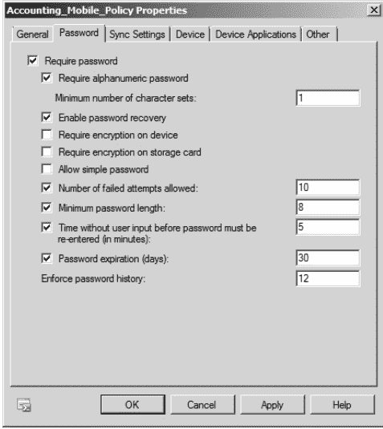


- **远程擦除/清除** — 智能手机和平板电脑等移动设备支持在丢失或被盗时远程擦除设备。远程擦除设备将清除其上的所有数据。
- **语音加密** — 对于任何支持语音通信加密的设备，应启用此功能以防止他人窃听通信。对于VoIP设备，可以对VoIP数据包进行加密，以防止有人使用嗅探器捕获和分析通信。例如，Wireshark有一个命令可以分析捕获中的VoIP数据包，它会重新组装语音数据包，并允许黑客播放对话。务必加密所有流量！
- **GPS跟踪** — 大多数智能手机具有GPS功能，允许跟踪移动设备的位置。确保GPS功能已启用，以便在设备丢失或被盗时用于定位。
- **地理围栏** — 地理围栏是一项功能，允许软件管理员定义GPS坐标以创建边界（或虚拟围栏）。当运行该软件的设备超出边界时，会触发警报。
- **地理定位** — 地理定位是指识别物品（如手机）地理位置的技术。例如，一旦确定了手机的地理位置（GPS坐标），就可以使用地图技术将其关联到街道地址。
- **锁定** — 应对移动设备制定严格的政策，以保护设备上的敏感数据。确保在短暂不活动后激活屏幕锁定，同时确保配置设备上可用的任何锁定设置。某些设备允许配置为连续三次错误登录尝试后锁定。
- **应用程序管理** — 在设备上实施任何应用程序控制，以限制应用程序可以执行或访问的内容。
- **内容管理** — 使用设备上的内容过滤功能，阻止某些类型的内容。
- **存储分段** — 某些设备允许对存储进行分段，从而控制可访问的数据。例如，移动设备可以将公司数据与个人数据分开，如果公司需要，可以仅擦除公司数据。Microsoft 365 具有工作配置文件功能，可以将移动设备上的个人数据存储与工作数据存储分开。
- **资产跟踪** — 实施任何资产跟踪功能，以便通过GPS定位丢失或被盗的设备。
- **库存控制** — 对所有设备进行库存登记，并跟踪设备的持有人。
- **移动设备管理** — 使用移动设备管理软件来管理移动设备上可用的功能，并远程擦除设备。
- **设备访问控制** — 实施任何设备访问控制功能，以控制谁可以访问设备及其不同功能。
- **可移动存储** — 如果设备支持可移动存储，可以查找设置将其禁用，以防止数据从设备复制到可移动存储。
- **禁用未使用的功能** — 如同加固计算机一样，应禁用移动设备上不必要的功能以增强安全性。
- **推送通知服务** — 移动设备允许配置使用哪些推送通知服务来向设备发送状态更新和通知。
- **生物识别** — 某些设备可能允许配置生物识别功能以供使用。例如，某些设备可能进行视网膜扫描或指纹读取以进行身份验证。
- **情境感知认证** — 情境感知认证是一种新型安全功能，允许应用程序或云服务了解您的习惯，例如您通常登录的位置或您通常用来登录的设备。使用情境感知认证，如果系统根据情境高置信度地确定确实是您在使用您的凭据，那么您将获得简单的登录体验。如果系统对登录者是否真的是您置信度较低，则会采用更复杂的登录方式，例如双因素认证。
- **容器化** — 有时称为沙箱化，您可以在设备上运行软件，创建安全容器，防止访问其中存储的敏感数据。
- **存储分段** — 存储分段是一项功能，允许将移动设备上的存储分为多个隔间，使组织数据与用户个人数据分开存储。
- **全设备加密** — 如前所述，应启用全设备加密，以加密设备上的所有数据，以防设备丢失或被盗。

> **考试提醒**
> 对于Security+考试，请注意前面列出的移动设备管理功能。务必了解锁定、屏幕锁定、存储分段、地理围栏、地理定位、全设备加密和远程擦除等功能的目的。

## 执行与监控

- **第三方应用商店** — 组织可能希望禁用对第三方应用商店的访问，以控制设备上安装的应用。
- **Root/越狱** — Root或越狱是指设备用户能够获得设备的特权访问权限，并以任意方式配置设备。务必监控设备的越狱行为！
- **侧载** — 侧载是指从供应商提供的应用商店以外的来源安装应用程序。许多组织尝试将应用程序的侧载限制在公司控制的中心位置。
- **自定义固件** — 监控组织的设备上需要执行的固件升级，以保持设备的最新状态。同时务必确保员工没有在设备上应用自定义固件解决方案。
- **运营商解锁** — 监控设备是否被解锁。设备通常与特定运营商关联，但如果用户希望使用其他运营商，可以解锁设备。运营商通常会对解锁设备收费。
- **固件空中（OTA）更新** — 可以使用运营商的无线网络向移动设备和平板电脑发送固件更新，这称为空中（OTA）更新。OTA更新最初仅用于更新设备固件，现在也可用于更新操作系统。
- **摄像头使用** — 组织应制定政策，规定是否允许员工在工作场所使用移动设备摄像头。如果不允许使用（通常出于安全原因），则应禁用摄像头。组织可以部署设备策略，要求禁用设备上的摄像头。
- **SMS/MMS/RCS** — 组织应决定员工是否应使用移动设备的短信服务（SMS）、多媒体消息服务（MMS）和富通信服务（RCS）。许多组织制定了政策，规定用户何时不允许发短信（例如驾驶或行走时）。
- **外部媒体** — 设备通常可以连接外部媒体，如SD卡或MicroSD卡。考虑禁用这些插槽，以控制连接到设备的外部媒体。


- **USB即插即用（OTG）** USB OTG是一项规范，它使符合要求的移动设备能够连接多种不同类型的设备。例如，如果你的移动设备或平板电脑支持USB OTG，你可以连接键盘或鼠标等通信设备，并在移动设备上使用这些设备。
- **录音麦克风** 出于隐私原因，你可以在组织的设备上禁用录音麦克风。
- **GPS标记** 评估设备上的GPS标记功能，确保设备不会（如果允许的话）标记所拍摄照片的GPS坐标。如果员工拍摄照片并上传到社交媒体，此功能可用于追踪员工的位置。
- **Wi-Fi直连/临时模式** 你可能需要监控无线网络功能的使用方式，并控制用户是以基础架构模式还是临时模式连接到无线网络。在基础架构模式下，管理员可以控制谁能够连接到网络以及启用了哪些安全功能。
- **网络共享（Tethering）** 网络共享是指将手机连接到笔记本电脑的USB端口，利用手机的网络连接为笔记本电脑提供互联网访问。你可能需要限制移动设备上的网络共享功能，以防止用户以这种方式使用手机的网络连接，因为开启这种连接可能使笔记本电脑遭受攻击。
- **热点（Hotspot）** 公司可以决定禁用移动设备上的热点功能。热点功能允许你将移动设备转换为无线热点，其他人可以连接到该热点并通过你的移动设备访问互联网。在移动设备上开启热点可能会使你面临攻击风险。
- **支付方式** 监控和控制用户如何通过移动设备进行支付。借助NFC等技术，用户可以轻松地通过移动设备完成交易。

## 部署模型

当组织决定让员工使用移动设备执行与工作相关的任务时，组织可以选择几种不同的方式将移动设备集成到工作场所中。以下是各种部署模型：

- **自带设备办公（BYOD）** “自带设备办公”模式鼓励用户使用个人移动设备连接到公司网络来处理工作事务。这样做的好处是组织可以避免购买移动设备的成本，但你需要明确相关策略，以及组织是否会向设备推送设置。要了解更多关于BYOD的安全问题，请参阅本章后面的“BYOD安全隐患”部分。
- **公司所有，个人可用（COPE）** 从安全角度来看，公司所有、个人可用（COPE）模式可能比BYOD模式更有效，因为公司在不拥有设备的情况下很难对其进行控制。采用COPE模式时，公司向用户提供设备，因此该设备由IT部门管理，但公司也允许并鼓励将该设备用于个人用途。
- **自选设备（CYOD）** 自选设备模式是指组织向用户提供一份经批准的设备列表，并允许每位用户选择他们想要使用的设备。
- **公司所有设备** 在公司所有设备模式下，公司全权管理这些设备，员工在使用时必须遵守公司政策。
- **虚拟桌面基础架构（VDI）** 虚拟桌面基础架构是一种模型，其中用户使用瘦客户端连接到在数据中心运行的桌面环境。通过VDI，你可以将移动设备作为瘦客户端引入，从而使用户能够随时随地访问其桌面环境。其好处在于，资源并不存储在移动设备上——它只是连接到公司内部的虚拟桌面。

> 考试
> 注意
> 对于Security+考试，要了解移动设备的不同部署模式，如BYOD、COPE和CYOD。

## 移动设备管理解决方案

由于如今移动设备常被用于处理业务，许多用于更好地管理这些设备安全性的技术应运而生：

- **MicroSD硬件安全模块（HSM）** MicroSD硬件安全模块（HSM）是一种以MicroSD卡形式出现的特殊硬件安全模块。该安全模块提供诸如加密、数字签名、身份验证和密钥生命周期管理等安全服务。
- **MDM/统一端点管理（UEM）** 组织可以使用移动设备管理（MDM）软件对所有移动设备进行集中管理，并在移动设备上强制执行策略。这一能力可以通过统一端点管理（UEM）软件加以扩展，该软件允许公司管理所有端点设备，包括移动设备、笔记本电脑和台式机系统。
- **移动应用管理（MAM)** 移动应用管理是指公司使用企业软件集中管理移动设备上运行的应用程序。这包括向设备交付应用程序、更新应用程序以及从中心点实施应用程序安全。
- **SEAndroid** SEAndroid是一个为Android操作系统添加安全增强功能的项目。这些安全增强功能旨在防止应用泄露数据，防止应用特权提升，并保护设备上应用及其数据的完整性。

## 数据安全

保障系统安全的一个关键部分，是确保系统或设备上的数据免受未经授权人员的访问。你应该通过多种不同的方式保护数据：

- **文件权限** 你可以控制谁有权访问哪些文件，以防止未经授权人员在正常情况下访问这些文件。之所以说“正常情况”，是因为我曾见过受权限保护的文件，却被人通过从Live光盘启动并访问数据而绕过了权限。
- **加密** 为确保信息机密性并防止未经授权的使用，请对存储中的数据进行加密。如果你对数据进行了加密，即使未经授权人员获得了文件，他们也只能看到加密后的文本，而无法解读其中的信息。
- **数据丢失防护（DLP）** 数据丢失防护是一种软件或硬件，旨在分析离开组织的数据，以确保敏感信息不会泄露。DLP可用于监控网络流量，识别通过即时通讯工具、电子邮件或HTTP和FTP等协议发送的敏感信息。DLP还可以分析存储中的数据，以确保敏感信息未被存储在错误的位置。

## Windows文件权限

在Windows操作系统中，你可以保护文件夹和文件，使得只有特定用户能够访问某些文件夹。例如，你想要确保只有会计人员才能访问会计文件夹。

在Windows服务器上保护文件夹需要两个步骤：首先使用NTFS权限保护文件夹，然后在将文件夹共享到网络时设置共享权限。将文件夹共享到网络是你向Windows客户端“发布”该文件夹的方式。用户只有在连接到服务器时才能连接到共享文件夹。以下列表总结了NTFS权限和共享：

- **NTFS权限** 这些权限只能应用于NTFS分区。如果你没有使用NTFS，可以使用 `convert <drive_letter> /fs:ntfs` 命令从FAT或FAT32转换为NTFS。设置NTFS权限后，当用户从本地或通过网络访问该文件夹时，这些权限都将生效。
- **共享** 共享文件夹是你向网络客户端发布文件夹的方式。当你共享文件夹时，还需要指定共享权限。请记住，当NTFS权限与共享文件夹权限冲突时，以最严格的权限为准。例如，如果你授予NTFS权限为“修改”，而共享权限为“读取”，那么当用户通过共享访问该文件夹时，他们的权限将是“读取”，因为它更加严格。

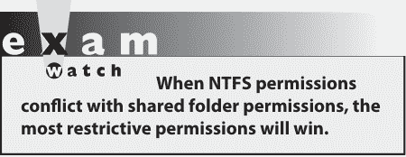

**NTFS权限** 在保护文件夹安全时，你应该熟悉一些NTFS权限；常用的NTFS权限列于表7-1中。

**共享文件夹权限** 使用NTFS权限保护文件夹后，你需要共享该文件夹以将其发布到网络。在共享文件夹时，你需要配置共享文件夹权限。在保护网络上共享的文件夹时，你应该熟悉几种共享文件夹权限。请注意，当共享权限应用于某个文件夹时，该权限也将保留应用于所有子文件夹。

| NTFS权限 | 说明 |
|---|---|
| 列出文件夹内容 | 此权限分配给文件夹；允许用户查看文件夹的内容列表，但不一定能够读取文件夹中的文件。 |
| 读取 | 这是一种文件夹和文件权限，使用户能够打开并读取文件的内容。 |
| 读取和执行 | 这是一种文件夹和文件权限，允许用户读取文件内容并执行可执行文件。 |
| 写入 | 这是一种文件和文件夹权限，允许用户修改文件的内容（向其写入）或在该文件夹中创建新文件或文件夹。 |
| 修改 | 这是一种文件夹或文件权限，包括之前提到的所有权限。拥有“修改”权限，用户可以读取、执行、删除、列出文件夹内容以及写入文件夹或文件的内容。 |
| 完全控制 | 这是一种文件夹或文件权限，赋予用户所有可能的权限。如果你分配了“完全控制”权限，用户不仅可以修改文件内容，还可以更改该资源的权限。 |


| 共享权限 | 描述 |
|---|---|
| 读取 | 此共享权限允许用户打开并读取共享内文件的内容。 |
| 更改 | 此共享权限允许用户打开并读取共享内文件的内容、创建新文件以及更改共享内文件的内容。 |
| 完全控制 | 此共享权限允许用户打开并读取共享内文件的内容、创建新文件、更改共享内文件的内容，以及更改共享的权限。此权限通常不分配给网络上的用户。 |

例如，如果你共享了 data 文件夹且用户拥有“更改”权限，那么当用户连接到该数据共享时，他们将拥有“更改”共享权限；当他们双击子文件夹时，该权限仍然有效。如果需要，你将依靠 NTFS 在每个子文件夹级别更改权限。共享权限如表 7-2 所示。

练习 7-3 演示了如何为 Windows 系统配置 NTFS 权限，然后通过共享资源并配置共享权限来发布该资源。

## 练习 7-3

### 在 Windows 10 中配置权限

在本练习中，你将学习设置 NTFS 权限和共享文件夹权限，以保护 Windows 10 系统上的 data 文件夹。

1. 登录 Windows 10 虚拟机，在 C 盘上创建一个名为 **Data** 的文件夹。
2. 右键单击 Data 文件夹，选择“属性”。
3. 选择“安全”选项卡，然后单击“高级”按钮。
4. 单击“禁用继承”按钮，然后在提示时选择“从此对象中删除所有已继承的权限”。
5. 单击“确定”关闭窗口。
6. 单击“编辑”按钮以更改权限。
7. 单击“添加”以将用户或组添加到权限列表，然后输入 **sales;administrators**，并单击“确定”。
8. Sales 被添加到权限列表中。选择 Administrators，然后在“允许”列中选择“完全控制”。选择 Sales，然后在“允许”列中选择“修改”权限。
9. 单击“确定”关闭所有窗口。


### 共享数据文件夹

10. 右键单击 Data 文件夹，选择“属性”，然后选择“共享”选项卡。
11. 在“共享”选项卡中，单击“高级共享”按钮。
12. 选中“共享此文件夹”复选框。请注意，共享名称与文件夹名称相同——在本例中为 Data。单击“权限”以设置共享权限。
13. 单击“删除”以删除 Everyone 拥有“读取”权限的默认权限。
14. 单击“添加”，输入 administrators;sales，然后单击“确定”。
15. 选择 Administrators，然后选择“完全控制”作为权限。
16. 选择 Sales，然后选择“更改”作为权限。
17. 单击“确定”。
18. 再次单击“确定”。

## Linux 文件权限

在 Linux 中保护文件略有不同。Linux 对文件和文件夹有三种权限，每种权限都对应一个数值：

- 读取（R）：4
- 写入（W）：2
- 执行（X）：1

三个实体可以对文件或文件夹拥有这三种权限：文件所有者、组和其他所有人（“其他”）。若要查看分配给文件的权限，可以在 Linux 中使用 `ls -l` 命令列出文件（参见图 7-14）。

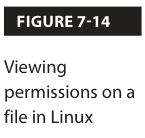

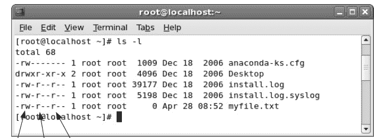

## 其他数据安全注意事项

在实施数据安全时，你还应考虑许多其他事项，包括：

- **云存储** 如果你将信息存储在云端，请确保你了解组织的相关安全策略。由于数据的敏感性，某些组织无法在云中存储数据。
- **SAN** 大多数组织使用存储区域网络来存储其所有数据。请务必花时间验证 SAN 是否以安全的方式配置。
- **处理大数据** 确保用于存储公司数据的任何大数据都处于安全状态，并且在网络上的客户端访问时使用安全通道。大数据是组织用于分析和做出业务决策的大型数据集。
- **传输中的数据、静态数据、使用中的数据** 确保你通过权限或加密保护存储中的数据，并通过加密保护传输中的数据。同时，通过限制某人在软件中对该数据可以执行的操作，确保数据在使用时的安全性。

## 实施数据策略

你在第 2 章中了解到，对于任何组织而言，安全最重要的方面之一是拥有详细的安全策略，明确组织内所有允许和禁止的行为。更新你的安全策略并包含指定以下内容的数据策略非常重要：

- **擦除** 确保策略规定设备在不再使用时必须进行安全擦除，清除设备上的所有数据。同时确保策略规定丢失或被盗的设备应进行远程擦除。
- **处置** 务必在策略中指定如何处置存储数据的设备。例如，在更换系统中的硬盘时，高度安全的环境需要粉碎旧硬盘，以确保任何人都无法获取该硬盘上的数据。
- **保留** 确保你的组织制定了保留策略，明确规定数据和记录的保留时间。
- **存储** 确保策略指定数据可以存储的位置。例如，你可能需要在策略中规定 U 盘是否是公司文件的有效存储选项，或者公司是否允许使用云存储。

## 数据安全与隐私实践

处置和销毁数据的方式有很多种。所有组织都应实施数据销毁和介质清理策略，以帮助 IT 专业人员了解如何从旧硬盘和移动设备等设备中移除数据。以下是保护组织隐私的一些数据处置方法：

- **焚烧** 销毁敏感文件的一种简单方法是焚烧文件。
- **粉碎** 你可以粉碎文件以销毁敏感信息。务必使用横切式碎纸机；普通碎纸机切成的条状文件很容易被重新拼接起来。你也可以购买特殊类型的碎纸机来销毁旧硬盘。
- **制浆** 你可以使用化学品将敏感文件分解成液体/糊状形式，从而对其进行制浆处理。
- **研磨** 研磨可销毁旧硬盘并将其还原为细小颗粒。
- **消磁** 消磁是移除硬盘磁场的过程，使数据丢失。
- **清除** 清除数据意味着将数据从硬盘等存储介质中永久擦除。
- **擦写** 你可以使用程序对驱动器进行安全擦写，即多次覆盖驱动器，以确保数据无法被找回。

> **考试重点**
> 对于 Security+ 考试，要了解在设备不再需要后确保数据机密性的不同技术。在高度安全的环境中，旧驱动器会被物理销毁，以确保无人能恢复其中的数据。

## 应用程序安全与 BYOD 注意事项

Security+ 认证考试中新增的一个热门主题是应用程序安全最佳实践和自带设备（BYOD）注意事项。在本节中，你将了解一些有助于创建更安全的应用程序环境的常见最佳实践，以及在允许用户将个人设备带入办公室时应考虑的注意事项。


## 应用程序安全最佳实践

让我们首先看一些常见的最佳实践，以帮助创建更安全的应用程序基础设施。虽然其中一些主题在前面的章节中已经涉及过，但重新审视它们仍然很重要：

- **密钥管理** 确保应用程序正在创建加密密钥并以安全的方式存储它们。
- **凭据管理** 确保应用程序中以安全的方式使用任何安全凭据，并确保它们以加密格式存储在数据库中。
- **身份验证** 确保你的应用程序对所有用户进行身份验证，并根据该身份验证控制用户可访问的内容。
- **地理标记** 验证应用程序是否使用了任何地理标记功能，这些功能会将地理识别信息与照片或视频等媒体一起存储。这可能是一个隐私问题，因为物理位置可以从这些地理标记数据中确定。
- **加密** 确保应用程序对任何敏感信息进行加密，包括网络通信和存储中的敏感数据。
- **应用程序白名单** 根据应用程序的用途，验证它是否具有白名单功能，即可以在应用程序中配置的允许列表。例如，电子邮件程序可以有一个联系人白名单，该白名单列出了软件中允许发送邮件的联系人。
- **传递信任/身份验证** 这指的是一项功能，允许你的应用程序信任由另一个环境信任的安全主体，因为你的应用程序信任该环境。

## BYOD 安全相关问题

如今一个重大的安全问题是员工将个人设备（如手机、平板电脑和笔记本电脑）带入办公室，并用它们执行公司任务。以下内容代表允许员工使用个人设备的一些顾虑，在设计你的 BYOD 政策时应加以考虑：

- **数据所有权** 你需要确保，如果允许员工使用个人设备工作，你就明确说明信息归公司所有，而非员工所有。如果员工离开公司，他们必须从设备上擦除所有公司数据。
- **支持所有权** 明确说明，如果设备出现故障，谁负责设备支持，这一点很重要。大多数公司会确保员工知道他们自己负责支持自己的设备。
- **补丁管理** 明确谁负责使设备保持最新的补丁。同样，这可能被视为员工的工作，并且应该向员工明确他们必须使设备上的补丁级别保持最新。
- **防病毒管理** 决定谁管理防病毒功能。如果是员工，则确保员工在设备上安装了防病毒软件，并保持病毒定义更新。
- **取证分析** 你的 BYOD 政策应明确，如果个人设备发生安全事件，公司有权对该设备执行取证分析。员工可能不同意这一点，这也是不允许将个人设备用于工作用途的一个充分理由。
- **隐私** 另一个敏感话题是对设备隐私的期望。你应该让员工同意，如果他们将公司数据存储在设备上，那么你有权审查和监控其上的活动。同样，员工可能不同意这一点，因此，你不应允许在个人设备上存储公司数据。
- **入职/离职管理** 当允许需要访问你的系统和网络的个人设备时，你需要确保已有程序将这些个人设备添加到身份和访问管理（IAM）系统中，该系统用于识别公司外部的个人或设备，并控制对系统的访问。将新设备添加到系统的过程称为 *入职*，而从系统中移除设备的过程称为 *离职*。
- **遵守公司政策** 另一个要点是确保员工在使用个人设备时遵循公司政策。这可能包括防病毒和补丁管理政策以及可接受使用政策。
- **用户接受** 确保员工同意出于工作目的使用个人设备的条款，如果他们不同意，你将不得不禁止使用该设备。记住你的目标是保护公司的利益。
- **架构/基础设施考虑** 你需要考虑为允许个人设备访问你的系统而对网络基础设施进行任何更改。例如，你可能需要创建证书并将其部署到设备，或扩展 DHCP 服务器上的 IP 范围。
- **法律问题** 允许将个人设备用于商业用途存在许多法律问题，这些通常也是公司选择稳妥做法并说“禁止将个人设备用于工作目的”的原因。法律问题的示例包括：谁拥有数据、对设备进行取证调查，以及员工隐私（因为这是他们的设备）。
- **可接受使用政策** 确保员工在使用自己的个人设备时同意可接受使用政策。通常，员工希望使用自己的设备来绕过可接受使用政策。
- **板载摄像头/视频** 如果物理安全是一个问题，你可能需要禁用摄像头，以便在工作场所不拍摄照片和视频。

## 安全系统设计

保护网络中的每个系统和设备的安全是环境安全的关键。本章重点介绍了用于改善系统安全的一些常用工具，如防火墙和防病毒软件。本节旨在回顾主机安全时的关键点。

### 硬件/固件安全

在实现系统和设备安全时，检查可以为系统或设备增加安全性的硬件功能或固件功能至关重要。例如，支持 TPM 模块的设备可以使用 TPM 模块来实现全盘加密。以下是一些可以增加设备安全性的硬件或固件功能：

- **FDE/SED** 如前所述，全盘加密（FDE）是一种安全功能，允许设备加密整个硬盘，以帮助在设备丢失或被盗时维护机密性。你还可以使用 *自加密驱动器（SED）* 来保护数据，这是一种特殊的硬盘驱动器，无需额外软件或用户输入即可自动加密驱动器内容。例如，你可以使用 Opal 驱动器，这是一种独立硬盘驱动器，可自动始终加密驱动器上的数据。
- **TPM** 在使用全盘加密时，你可以使用受信任的平台模块（TPM），它是位于主板上的计算机芯片，用于存储 FDE 功能的加密密钥。
- **HSM** 需要高安全级别的环境可以利用硬件安全模块（HSM），它是一种附加卡或单独设备，负责管理环境的加密密钥。
- **UEFI/BIOS** 有许多 UEFI 或 BIOS 功能可以启用以帮助增强硬件安全。例如，在使用 BIOS 的系统中，你可以为设备添加启动密码、防止从光盘驱动器或 USB 驱动器启动，并对 BIOS 设置程序进行密码保护。使用统一可扩展固件接口（UEFI）时，你有更先进的安全启动功能，例如安全启动，它会在启动期间验证启动设备的完整性。
- **安全启动和证明** 安全启动是一种可启用的设备安全功能，涉及系统对启动文件进行数字签名。一旦文件被签名，系统在启动期间将只加载经过数字签名的文件。这有助于防止某人在该系统上启动另一个操作系统以访问系统和其中的数据。在此上下文中，*证明* 意味着系统按照数字签名所规定的预期方式完成了启动。


- **供应链**：供应链是产品在到达客户之前必须经过的组织和人员清单。务必确认在发生硬件故障时，您能够快速订购零件并收到交付。
- **硬件信任根**：硬件信任根是系统所信任的硬件组件，用于执行安全功能（例如生成和存储密钥对的 TPM）。
- **EMI/EMP**：电磁干扰（EMI）是由外部源引起的干扰，会扭曲正在传输的信息。电磁脉冲（EMP）是电磁能量的突发。确保您使用对 EMI/EMP 具有免疫力的技术，例如使用光纤电缆代替双绞线电缆，以保护您的数据。

## 操作系统加固和反恶意软件

实施主机安全的第一步是通过加固设备并安装任何反恶意软件功能来锁定系统或设备。以下是锁定系统的关键步骤：

- **操作系统安全和设置**：确保您已审查系统或设备上的设置，以将设备置于安全状态。尽可能更改设置，使您不使用默认设置，因为黑客知道并期望默认设置。
- **操作系统加固**：加固系统或设备意味着您需要花费时间删除不必要的特性和禁用不必要的服务。每个特性都有漏洞，因此删除它们可以减少系统上的漏洞。
- **补丁管理**：确保您已为设备应用了最新的固件并修补了软件。

根据您审查的操作系统类型，您需要完善将系统置于安全状态的步骤。以下是您可能遇到的一些常见操作系统类型：

- **网络**：网络操作系统设计用于在服务器上运行。确保仅加载网络操作系统所需的功能，以帮助减少暴露的漏洞数量。
- **服务器**：服务器操作系统设计用于向客户端提供资源，例如文件和打印机。通过仅安装所需的软件并使用补丁保持其最新状态来锁定每台服务器。
- **工作站**：工作站是用户用于访问网络资源的东西。确保安装反恶意软件并保持客户端为最新状态。
- **设备**：设备是用户使用的任何设备。确保调查设备上运行的任何服务或协议，以便在需要时禁用它们。
- **信息亭**：信息亭是公共场所的计算机系统，例如建筑物前大厅，人们可以在其中出于选定原因使用。确保锁定信息亭并限制可在其上运行的应用程序。

如您所学，您需要防范多种恶意软件。以下是恶意软件保护功能的列表：

- **防病毒**：安装防病毒软件并保持病毒定义为最新状态。
- **反垃圾邮件**：确保电子邮件软件已启用反垃圾邮件功能，以减少到达用户的未经请求的电子邮件。
- **反间谍软件**：确保您已安装反间谍软件，以防止软件监控您的活动。
- **弹出窗口拦截器**：确保您已安装广告软件拦截器和弹出窗口拦截器，以防止弹出窗口出现。

## 软件安全和移动操作系统安全

您可以采取许多步骤来保护计算机系统和移动操作系统。以下列表概述了实施软件安全的常见技术：

- **补丁管理**：确保修补所有系统，包括为移动设备及其应用程序应用更新。
- **禁用不必要的端口和服务**：始终查看设备上运行的默认软件并禁用任何打开的不必要的端口和任何正在运行的不必要的服务。
- **最小功能**：在处理诸如移动设备之类的设备时，查看设备提供的功能并禁用您不会使用的任何功能。
- **安全配置**：确保审查系统或设备的配置并启用任何安全功能。例如，移动设备应启用自动锁定功能。
- **应用程序白名单/黑名单**：您可以使用白名单限制允许在系统上运行的软件，也可以使用黑名单阻止软件运行。
- **受信任的操作系统**：使用受信任的操作系统，该操作系统实施多层安全，例如身份验证和授权，以确定谁可以访问系统以及他们可以做什么。
- **基于主机的防火墙**：实施基于主机的防火墙以控制允许到达系统的流量。如果您的用户将笔记本电脑带出办公室并连接到不受信任的网络，例如家庭或酒店网络，则基于主机的防火墙至关重要。
- **基于主机的入侵检测**：实施基于主机的入侵检测系统以监控系统上的可疑活动。
- **主机软件基线**：使用基线软件确保系统处于安全状态并已加固。
- **禁用默认账户/密码**：禁用任何存在的默认账户并创建自己的替换账户，使用强密码。

您可以采取许多步骤来帮助保护与物理安全相关的资产：

- **电缆锁**：对于较小的设备，例如笔记本电脑和投影仪，使用电缆锁以防止有人轻松窃取这些设备。
- **保险箱**：为员工提供保险箱以存放敏感文件。
- **带锁柜子**：提供带锁柜子以存放可移动驱动器、移动设备以及在不使用时可能包含敏感数据的任何其他设备。

## 保护外设

确保系统安全的另一个方面是确保外设处于安全状态。以下是保护外设的一些考虑因素：

- **无线键盘/鼠标**：使用无线键盘（或鼠标）会使您的系统暴露于来自不需要来源的通信。接收传输的 USB 加密狗可能会被黑客劫持，使黑客能够在您的系统上输入命令。保持系统使用补丁为最新以帮助防止利用，但也不要在高度安全的环境中使用无线键盘和鼠标。
- **显示器**：为了保护显示器，请确保在显示器上放置屏幕遮光板，以帮助防止有人从用户身后窥视并看到敏感信息。
- **Wi-Fi 启用 MicroSD 卡**：Wi-Fi 启用 MicroSD 卡是内置无线芯片的 SD 卡，可使其从诸如相机之类的设备远程接收数据。
- **打印机/MFD**：对于打印机和其他多功能设备，您应首先禁用未使用的任何功能，例如无线功能或（如适用）内置 Web 服务器。在处置打印机之前，请检查打印机中是否有用于排队打印作业的驱动器，因为这可能是有人在您处理掉打印机后访问数据的方式。处置打印机时，请确保销毁驱动器。
- **外部存储设备**：允许用户将外部存储设备连接到系统可能会使该系统暴露于存在于外部或可移动驱动器上的蠕虫病毒。此外，允许某人连接外部驱动器会让他们轻松复制数据并带走。 为了帮助保护系统，请限制外部存储设备的使用并实施 DLP 以防止数据泄露。
- **数码相机**：注意相机内置的任何技术，例如无线通信和存储，并确保禁用您未使用的功能。例如，如果您不使用相机的无线功能，请禁用无线功能以防止黑客通过无线方式利用该设备。

## 安全分阶段部署

在实施系统时，以安全的方式部署它并遵循组织制定的任何变更管理流程非常重要。确保将用于开发解决方案的系统与用于测试解决方案的系统以及用于运行解决方案生产版本的系统分开。以下是安全部署应用程序和系统的一些关键点：

- **沙箱**：沙箱是为应用程序创建单独的运行环境并确保限制这些运行环境之间的通信的过程。
- **环境**：您应为部署的不同阶段创建不同的环境。以下是您应有的四个环境：
  - **开发**：开发系统或系统用于开发或创建解决方案的设计。
  - **测试**：设计创建后，它将在测试系统或系统上进行测试。
  - **暂存**：初步测试解决方案完成后，解决方案将移至暂存环境，在此环境中执行更接近生产的环境验证，以确保解决方案有效。
  - **生产**：暂存后，您将解决方案投入生产。
- **安全基线**：安全基线是一组将系统置于安全状态的配置设置。每个系统都应应用安全基线以确保其满足安全要求。


完整性度量 完整性度量在计算机安全中是指确保你能够知晓环境中可能发生的任何变化。为了实现系统的完整性，务必使用审计功能和哈希技术来跟踪系统和文件的变化。

考试重点 对于 Security+ 考试，要了解沙箱化的目的，并且要知道为确保软件部署安全而需要遵循的不同阶段的顺序。顺序为 开发 → 测试 → 暂存 → 生产。

## 认证总结

在本章中你学习了在系统上实施安全性的不同方法。以下列表总结了在准备 Security+ 认证考试时关于系统安全需要记住的一些关键点：

- 在连接到不可信网络（如无线或酒店网络）的系统上实施基于主机的防火墙。
- 通过安装防病毒和反间谍软件来保护系统免受恶意软件侵害。
- 大多数网络浏览器都内置了钓鱼过滤器，会将访问的站点与已知的钓鱼站点列表进行检查。
- 安装弹出窗口拦截器以防止弹出窗口出现。
- 移动设备应使用密码进行保护，并且在设备空闲一段时间后应要求输入密码。数据应通过配置权限来保护，也应通过加密数据来保护。

## 两分钟速览

### 主机和应用安全解决方案

- 使用端点安全解决方案，例如恶意软件保护、数据丢失防护（DLP）功能以防止数据泄露，以及基于主机的防火墙来控制对系统的通信。
- 你可以通过实施启动完整性工具（如安全启动、度量启动和启动证明工具）来帮助保护系统上的敏感数据。
- 令牌化是一种涉及令牌服务的解决方案，为敏感数据创建替代项并存储替代项与实际数据的映射，以便进行查找。
- 在哈希时应使用加盐来帮助保护存储在数据库中的密码。

### 实施基于主机的防火墙和 HIDS

- 任何连接到不可信网络的系统都应使用基于主机的防火墙。
- Windows 和 Linux 均具有可启用以保护系统的防火墙。
- Linux 中的 TCP wrappers 功能允许你控制哪些系统可以连接到不同的服务。

### 防御恶意软件

- 确保已安装病毒防护软件，并且病毒定义是最新的。
- 确保在服务器上安装了垃圾邮件过滤器，以防止向用户发送垃圾邮件。
- 确保已安装反间谍软件和其他反恶意软件。

### 设备安全和数据安全

- 移动设备应配置密码，以便在被盗或丢失时，其他人无法访问设备上存储的信息。
- 对移动设备和可移动驱动器上的数据进行加密，以保持机密性。
- 可信平台模块（TPM）是在计算机芯片上安全存储密钥的一种方法。
- 使用全盘加密（FDE）对移动设备上的驱动器进行加密，以帮助在设备丢失或被盗时保护敏感数据。
- 使用应用程序白名单解决方案（控制允许运行的软件）或应用程序黑名单解决方案（控制禁止运行的软件）来限制系统上可运行的软件。
- 确保为开发、测试、暂存和生产设置不同的环境，以提高生产环境的安全性。
- 为网络上每种类型的系统创建安全的基线配置，并确保将该基线应用于系统以确保系统的安全性。

## 自测

以下问题将帮助你衡量对本章所介绍材料的理解程度。如有说明，部分问题可能有多个正确答案，因此请务必仔细阅读所有答案选项。

### 主机和应用安全解决方案

1. 你正在为内部开发的应用程序创建自定义身份验证逻辑。你决定在数据库中对密码进行哈希处理，以便如果有人访问数据库，他们无法以明文形式查看密码。与哈希一起使用以更好地保护密码的是什么？
   A. 加密
   B. 加盐
   C. 令牌
   D. 安全启动

2. 你创建了一个应用程序，用户可以使用信用卡在多次访问网站时购买产品。对于存储在数据库中的信用卡等敏感数据，最佳的保护机制是什么？
   A. 加密
   B. 加盐
   C. 令牌化
   D. 哈希

3. 你希望阻止用户通过电子邮件发送敏感信息，例如信用卡号码或敏感医疗信息。你会使用什么端点安全功能？
   A. 反恶意软件
   B. 基于主机的防火墙
   C. NGFW
   D. DLP

### 实施基于主机的防火墙和 HIDS

4. Mark 是你组织销售团队的一员，在外出时花费大量时间在酒店。你会向管理员就 Mark 笔记本电脑的安全性提出什么建议？
   - A. 虚拟化
   - B. 云计算
   - C. TCP wrappers
   - D. 基于主机的防火墙

5. 启用基于主机的防火墙时，通常应用的默认规则是什么？
   - A. 允许所有流量。
   - B. 拒绝所有流量。
   - C. 转发所有流量。
   - D. NAT 所有流量。

6. Linux 中什么功能允许你配置可以访问特定服务的客户端列表？
   - A. 虚拟化
   - B. 云计算
   - C. TCP wrappers
   - D. 基于主机的防火墙

7. HIDS 如何确定可能发生了可疑活动？
   - A. 日志文件
   - B. 网络流量
   - C. 数据包分析
   - D. TCP wrappers

### 防御恶意软件

8. 你的经理希望确保不会浪费大量时间手动为网络上的每个系统打补丁。你会推荐什么？
   - A. 病毒防护
   - B. WSUS
   - C. Windows Update
   - D. 基于主机的防火墙

## 基于性能的问题

13. 写出你在 Linux 中用来设置名为 test.txt 的文件的权限的命令，以便所有者具有读、写和执行权限，而其他人只有读权限：

14. 通过从左侧的术语画线到右侧的描述来匹配以下术语与其描述。

- COPE
- 地理定位
- 沙箱化
- 地理标记
- 地理围栏
- BYOD

鼓励用户使用个人移动设备连接到企业网络用于工作目的的部署模型

允许管理员定义创建边界的 GPS 坐标的功能

识别项目（如移动电话）的地理位置

将地理识别信息存储在媒体（如照片或视频）中

创建单独的运行环境以控制对应用程序的通信

部署模型涉及用户使用公司拥有的设备，但用户可以将其用于个人用途

15. 将左侧列出的环境按应用程序应进行测试的正确顺序排列。

部署测试顺序

- 暂存
- 生产
- 测试
- 开发

## 自测答案

### 主机和应用安全解决方案

1. ☑ B. 加盐是取一个随机值并将其与正在哈希的值，即密码，连接起来以创建哈希值，从而更好地抵御运行字典单词通过哈希以破解密码的密码破解工具。☒ A、C 和 D 是错误的。加密不与哈希一起使用；它会替代使用。令牌用于数据库中的敏感数据，例如信用卡号码。安全启动是一种启动完整性技术，可防止系统从被更改的启动状态启动。

2. ☑ C. 令牌化是将敏感数据替换为随机、无关数据，并将敏感数据与替换数据的映射存储在令牌服务中。应用程序然后向令牌服务发送请求，通过提供替换数据来查找敏感数据。☒ A、B 和 D 是错误的。加密用于保护数据库中的敏感数据，但令牌化常用于频繁使用的敏感数据。加盐是将随机值与数据组合，然后将两者组合运行哈希算法。哈希是将数据通过哈希算法运行以创建唯一的哈希值（校验和类型值）。

3. ☑ D. 数据丢失防护（DLP）是一种防止数据泄露发生的解决方案，例如有人通过电子邮件消息发送敏感信息或将数据下载到 USB 驱动器。☒ A、B 和 C 是错误的。反恶意软件是防止系统感染病毒的软件。基于主机的防火墙用于限制对系统的通信。下一代防火墙（NGFW）包括防火墙功能，但也包括入侵防御功能以阻止攻击。

### 实施基于主机的防火墙和 HIDS

4. ☑ D. 每当系统将要连接到不可信网络时，都应使用基于主机的防火墙。☒ A、B 和 C 是错误的。这些不代表关于 Mark 笔记本电脑安全性的实施建议。

5. ☑ B. 大多数防火墙在启用防火墙后都有默认规则拒绝所有流量。☒ A、C 和 D 是错误的。这些不代表默认规则。大多数防火墙允许你将默认规则从拒绝所有修改为允许所有。


6. ☑ **C.** Linux 中的 TCP 包装器功能允许你控制哪些客户端可以连接到哪些服务。
   ☒ **A、B 和 D** 不正确。虚拟化是在一台物理机器上的虚拟机中托管多个操作系统。云计算是由提供商为你托管服务器，而你通过互联网远程连接这些系统进行管理。基于主机的防火墙控制与系统的通信。

7. ☑ **A.** 基于主机的入侵检测系统（IDS）通过分析日志文件、文件属性以及系统上的连接和内存等动态数据来识别可疑活动。
   ☒ **B、C 和 D** 不正确。网络流量和数据包分析由基于网络的入侵检测软件执行。TCP 包装器功能不查找可疑流量；它只是控制对服务的访问。

## 防范恶意软件

8. ☑ **B.** Windows Server 更新服务（WSUS）是一种允许你下载、审查、批准并将补丁部署到网络上多个系统组的服务。
   ☒ **A、C 和 D** 不正确。病毒防护和基于主机的防火墙不处理系统修补。在每个系统上使用 Windows 更新是管理上的噩梦，因此应使用 WSUS。

9. ☑ **D.** 安装防病毒软件后，确保病毒定义是最新的至关重要。大多数病毒防护软件可以安排病毒定义的更新。
   ☒ **A、B 和 C** 不正确。基于主机的防火墙与维护防病毒软件无关，你不应禁用病毒定义的自动更新；你应该*启用*它们。你也不应禁用实时保护，因为它会在文件被访问时进行扫描。

10. ☑ **C.** 在互联网上公开电子邮件地址，无论是在网页上还是通过某人的网站提交，总是存在该电子邮件地址可能收到垃圾邮件的风险。
    ☒ **A、B 和 D** 不正确。间谍软件、病毒和网络钓鱼与提供电子邮件地址无关。

## 设备安全与数据安全

11. ☑ **B 和 D。** 你应该确保锁定屏幕并加密移动设备上的数据，以保护其免受未经授权的访问。
    ☒ **A、C 和 E** 不正确。你应该启用密码而不是禁用密码，并且永远不要禁用紧急呼叫，这样即使手机被锁定，你仍然可以拨打 911。如果未使用蓝牙，则应禁用蓝牙，但大多数人使用蓝牙连接无线耳机。

12. ☑ **B.** 当共享权限与 NTFS 权限冲突时，应用最严格的权限——在本例中为“读取”。
    ☒ **A、C 和 D** 不正确。这些不是该场景中最严格的权限。

## 基于性能的问题

13. 以下 Linux 命令用于设置名为 test.txt 的文件的权限，使所有者具有读、写和执行权限，而其他所有人只有读权限：`chmod 744 test.txt`

14. 以下是端点安全术语及其描述的匹配。在实际考试中，你可能会被要求将术语拖到匹配的描述上。

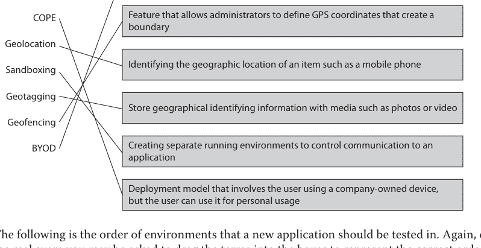

15. 以下是新应用程序应进行测试的环境顺序。同样，在实际考试中，你可能会被要求将术语拖入框内以表示验证代码的正确顺序。

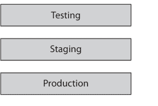
