# 第 8 章：保护网络基础设施

### 认证目标

- 8.01 了解防火墙
- 8.02 使用入侵检测系统
- 8.03 网络设计与管理原则
- 8.04 保护设备
- ✓ 两分钟练习
- Q&A 自测

如今，组织内部安全的很大一部分来自于保护网络基础设施。这涉及确保用于将员工计算机连接到服务器的网络尽可能安全，以抵御来自网络外部或内部的威胁。

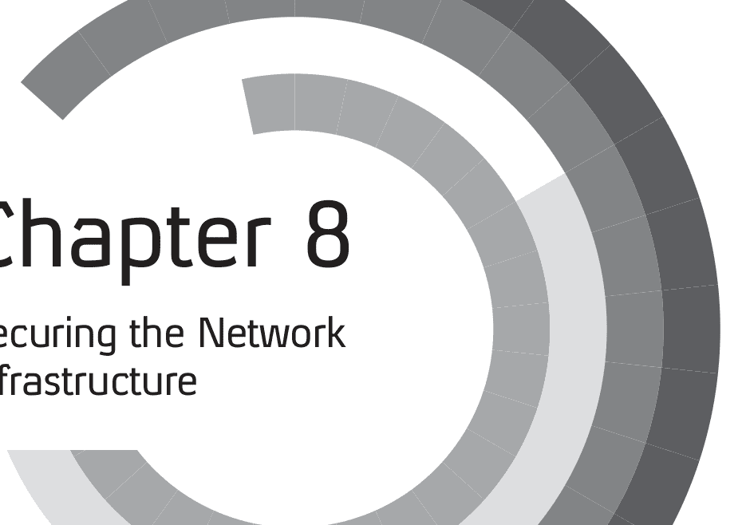

前几章的重点是你可以采取哪些措施来保护单个系统，这非常重要，但你还需要确保连接这些系统的网络尽可能安全。为了为这些系统创建安全的网络基础设施，你必须采取分层安全方法（也称为纵深防御），其中包括使用防火墙保护网络基础设施，同时确保使用入侵检测系统来识别可疑的网络流量。

本章将向你介绍防火墙、入侵检测系统和网络访问控制等主题。在你的 Security+ 认证考试中，你将会被测试这些技术，因此请确保你熟悉本章内容。

### 认证目标 8.01：了解防火墙

在本节中，你将了解防火墙、代理服务器以及其他用于创建安全网络基础设施的安全设备类型。防火墙和代理服务器是当今网络环境中最常见的两种设备，因为它们负责确保网络外部（例如互联网上）的未经授权人员无法访问你的网络。

### 防火墙

防火墙旨在通过分析到达防火墙的数据包并确定是否允许每个数据包通过，来保护防火墙一侧的系统免受另一侧系统的侵害。你将在防火墙上配置规则，向防火墙指示哪些流量可以通过，哪些流量应被阻止。

> **考试提示** 针对 Security+ 考试，请了解防火墙是保护性控制的示例，因为它们配置了规则来控制哪些类型的流量可以进入网络。本章还讨论了入侵检测系统（IDS），通常它被视为检测性控制——除非它是主动式 IDS，在这种情况下它被称为入侵防御系统（IPS），但稍后会详细介绍！

例如，作为一般规则，你应将防火墙配置为阻止所有流量，这意味着没有流量可以通过。一旦你配置了阻止所有流量的“默认”规则，你就可以配置该规则的例外，允许特定流量通过。例如，如果你有一台要暴露到互联网的 Web 服务器，你应该阻止除 TCP 端口 80（Web 服务器流量运行的端口）之外的所有流量（如图 8-1 所示）。

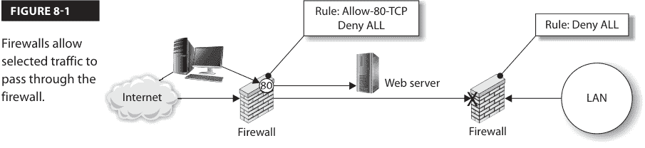

在进一步讨论防火墙之前，我需要强调防火墙有两大类。*基于主机的防火墙*是你安装在系统上用于保护该系统本身的软件。*基于网络的防火墙*放置在网络边缘，控制允许进入和离开网络的流量。本章重点介绍基于网络的防火墙。

### 防火墙的类型

防火墙随着时间不断演进，对于 Security+ 认证考试，了解多年来出现的不同类型的防火墙非常重要。

### 包过滤防火墙（无状态）

第一种类型的防火墙是包过滤防火墙，也称为*无状态防火墙*。包过滤防火墙可以根据源或目标 IP 地址以及源或目标端口号来阻止或允许流量（称为过滤流量），如图 8-2 所示。

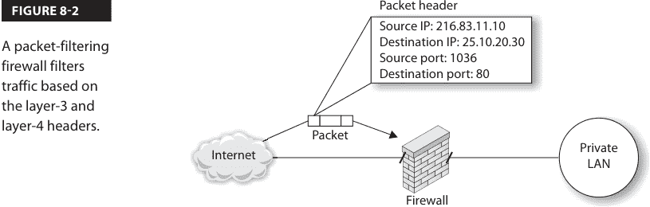

### 状态数据包检测防火墙

包过滤防火墙起初看起来是一种很好的防火墙类型，但它们并不那么智能，因为黑客很容易伪造数据包以满足防火墙的规则。例如，如果你在包过滤防火墙上开放了端口 80，任何目标为端口 80 的数据包都将绕过防火墙。

与包过滤防火墙一样，状态数据包检测防火墙可以根据源和目标 IP 地址或端口号过滤流量，但还可以查看对话的上下文，并确定该数据包是否应在对话的该点被接收。如果防火墙在对话的正确上下文中收到数据包，并且该数据包符合某条规则，则允许该数据包进入网络。状态数据包检测防火墙也使用规则来过滤流量，但它们也足够智能，能够知道对话的上下文。

状态数据包检测防火墙了解对话上下文的一个例子是：如果黑客试图向防火墙发送目标端口为 80 的恶意命令，而黑客尚未首先执行三次握手，防火墙会表示：“不，抱歉，你不被允许进入，因为我没有看到我们已建立连接。”状态数据包检测防火墙知道，在 TCP 通信发生之前，需要进行三次握手。

> **考试提示** 状态数据包检测防火墙通过第 3 层和第 4 层头部过滤流量（类似于包过滤防火墙，也称为无状态防火墙），但此外，它还可以通过了解对话的特定阶段预期接收哪些数据包来过滤流量。

### 应用层防火墙

下一种类型的防火墙，即应用层防火墙，实现了包过滤防火墙和状态数据包检测防火墙的功能，但还可以根据数据包的负载数据进行流量过滤。

应用层防火墙不仅实现了包过滤和状态数据包检测功能，还可以检查数据包中的应用程序数据，即负载。这意味着应用层防火墙可以拒绝包含可疑命令的数据包。例如，应用层防火墙可以检查目标端口是否为 80，同时确保没有执行 HTTP put 命令。或者，防火墙可以确保数据从 FTP 服务器下载（get），但不能上传（put）到服务器（参见图 8-4）。


# 图 8-4

应用层防火墙检查数据包的有效载荷

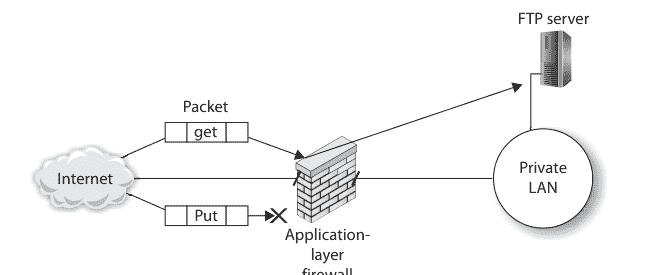

## 考试提示

应用层防火墙可以根据数据包的数据部分，即有效载荷数据来过滤流量。这使得防火墙能够控制哪些类型操作或命令可以通过防火墙在数据包的有效载荷中传递。

## 其他防火墙类型

防火墙的世界在过去几年中不断发展。以下是对 Security+ 考试而言需要记住的其他重要防火墙和防火墙类型要点列表：

- **Web 应用防火墙** Web 应用防火墙（WAF）是一种应用层防火墙，允许你控制哪些 HTTP 消息可以到达你的 Web 服务器或 Web 服务。控制 HTTP 消息允许你防御针对 Web 服务器的常见攻击。WAF 与普通网络防火墙的区别在于，WAF 专注于分析 HTTP 流量，而网络防火墙分析所有网络流量。

- **下一代防火墙** 下一代防火墙（NGFW）像状态ful 数据包检查防火墙一样执行数据包过滤功能，但同时还执行深度数据包检查（DPI），这允许防火墙检查数据包的数据部分并根据数据包的数据采取行动。NGFW 还具有入侵防御功能，允许其根据数据包中发现的头部和数据来阻止可疑流量。

- **统一威胁管理** 请使用统一威胁管理系统（UTM）为组织提供一体化的安全解决方案。UTM 系统是多功能设备，具有防火墙功能、入侵检测和防御、防垃圾邮件、防病毒和内容过滤等功能。

- **开源 vs 专有** 在查看防火墙解决方案时，你可以选择在许多不同平台上受支持的开源解决方案，也可以选择公司的专有解决方案。
- **硬件 vs 软件** 防火墙可以是连接到不同网络段的硬件设备，允许其从一个段过滤到另一个段的流量，也可以是运行在系统上的软件，过滤可以通过该系统传输的流量。
- **设备 vs 主机型 vs 虚拟** 你可以使用防火墙设备、主机型防火墙或虚拟防火墙。设备的优点是它是一个具有多个接口的独立设备，通常还带有入侵防御等其他安全功能。主机型防火墙是可以在不同硬件配置的系统上运行的软件，这对于设备可能无法实现。虚拟防火墙是安装在虚拟机中的防火墙软件，可用于保护网络或一组虚拟机。


## 使用 IPTables 作为防火墙

防火墙的一个重要示例是 IPTables，这是 Linux 中非常强大的防火墙功能，已取代旧的 IPChains 功能。IPTables 得名于控制允许进入或离开系统或转发到另一系统的流量的规则表。

IPTables 使用三个主要表：

- **Input** 该表控制允许通过网卡进入 Linux 系统的流量。
- **Output** 该表控制允许通过网卡离开 Linux 系统的流量。
- **Forward** 如果你想将数据包从 Linux 系统转发到另一系统，则使用该表。

要查看表的列表，你可以在 Linux 中使用 **iptables -L** 命令。请注意在图 8-5 中，我有三个表，并且每个表都有一个默认策略为 ACCEPT。这意味着，默认情况下，Linux 允许所有流量进入或离开系统。

如果你想更改 INPUT 表的默认策略，可以使用 **iptables** 命令并使用 **-P** 开关，然后指定默认规则。以下命令用于将 INPUT 表的默认策略更改为 DROP 所有流量：

```bash
iptables -P INPUT DROP
```

- 4. 通过在终端会话中输入 **iptables -L** 列出所有表。三个默认表是什么？ ________________________________

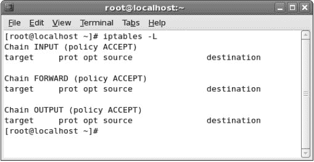

- 5. 请注意 INPUT 表的策略为 ACCEPT，这意味着系统将接受所有入站流量。

- 6. 前往 Windows 10 虚拟机并确保你可以通过在 Web 浏览器地址中输入 **http://<IP_Of_Linux>**（例如，**http://10.0.0.150**）来导航到位于 Linux 系统上的网站。

- 7. 返回 Linux 虚拟机。

- 8. 要将 INPUT 表更改为拒绝所有传入流量，请输入

```bash
iptables -P INPUT DROP
```

- 9. 要通过再次列出所有表来查看你的更改，请输入

```bash
iptables -L
```

- 10. INPUT 表的默认策略是什么？ ________________

- 11. OUTPUT 表的默认策略是：ACCEPT 还是 DROP？
  
  _______________

- 12. 前往 Windows 10 虚拟机并再次通过在 Web 浏览器地址中输入 **http://<IP_Of_Linux>**（例如，**http://10.0.0.150**）导航到位于 Linux 系统上的网站。

- 13. 你能查看该网站吗？为什么或为什么不能？
  
  ________________________________________________________________________________
  ________________________________________________________________________________

- 14. 返回 Linux 虚拟机。

- 15. 你只想允许 Windows 10 系统查看网站，因此你将创建一个 INPUT 规则，如果源 IP 地址为 10.0.0.5，则允许访问网站的流量。输入以下内容：

```
iptables -A INPUT -p TCP -s 10.0.0.5 --source-port 1024:65535 -d 0.0.0.0/0 --destination-port 80 -j ACCEPT
```

- 16. 该规则做了什么？

- 17. 要查看 INPUT 表中的新规则，请输入 iptables -L。

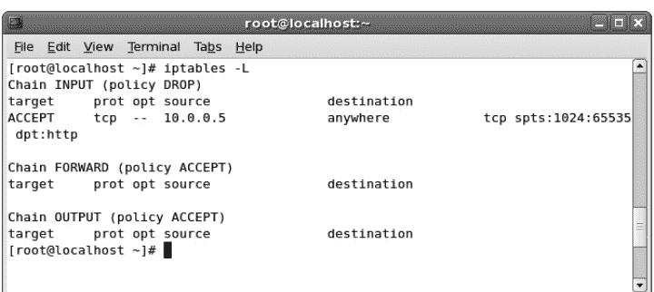

- 18. 前往 Windows 10 虚拟机并验证你是否可以浏览 Linux 网站。你成功了吗？ _________

- 19. 前往 ServerA 虚拟机并验证你无法浏览 Linux 网站。你成功了吗？ _________

## 在家庭路由器上使用防火墙功能

大多数家庭用户和小型企业使用所谓的“家庭路由器”来建立网络与互联网之间的高速连接。这些家庭路由器的好处是它们是多功能设备，因为它们是 NAT 设备和防火墙设备，提供 URL 过滤功能以限制网络用户可以访问的网站。

默认情况下，家庭路由器通常会阻止所有源自互联网的流量，因此如果你想在网络内部托管自己的网站，你必须在家庭路由器的防火墙上打开其端口。为你的指导，这里是我在我的 D-Link DIR-615 路由器上使用的步骤：

- 1. 启动 Web 浏览器并导航到路由器的内部 IP 地址（通常为 192.168.0.1）。
- 2. 选择页面顶部的 Advanced 链接。
- 3. 选择屏幕左侧的 Port Forwarding 链接。
- 4. 进入 Port Forwarding 屏幕后，你可以配置防火墙规则以将发往特定端口的数据包转发到网络内部的系统。要允许入站 Web 流量访问你的 Web 服务器，请在适当字段中输入以下信息（见图 8-6）：
  - Name: HTTP。
  - IP Address: 192.168.1.3（你希望将流量转发到的内部系统的 IP 地址）。
  - TCP: 80（流量目的端口；如果你使用的是基于 UDP 的流量，也可以指定 UDP 端口）。
- 5. 输入完规则的所有信息后，点击 Apply 按钮以应用更改。

# 图 8-6

配置端口转发规则

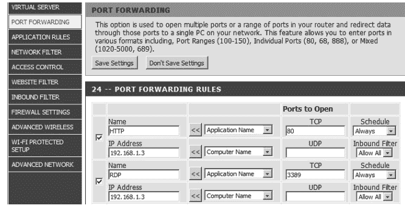


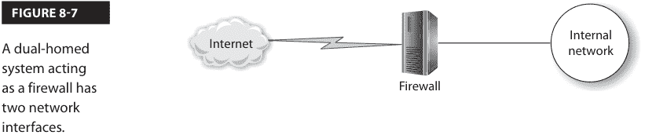

# 防火墙拓扑结构

让我们继续讨论防火墙拓扑结构。防火墙的流行配置包括双宿主、屏蔽主机和屏蔽子网防火墙。

**双宿主主机防火墙** 双宿主主机防火墙由一台具有两个物理网络接口的单台计算机组成，作为两个网络之间的网关。服务器的路由功能被禁用，以便安装在系统上的防火墙软件可以处理所有流量管理。通常在此系统上运行防火墙软件或代理服务器软件，以将数据包从双宿主系统的[content]


# Firewall Topologies

Let’s move on to firewall topologies. Popular configurations for firewalls include dual-homed, screened-host, and screened-subnet firewalls.

**Dual-Homed Host Firewalls** A dual-homed host firewall consists of a single computer with two physical network interfaces that acts as a gateway between the two networks. The server’s routing capability is disabled so that the firewall software installed on the system can handle all traffic management. Firewall software or proxy server software is typically run on this system to pass packets from one side of the dual-homed system to the other. You must be careful not to enable routing within the network operating system that will be used as the dual-homed system; otherwise, you will bypass your firewall software and simply be routing data. Figure 8-7 shows a dual-homed host firewall configuration.

**Screened-Host Firewalls** Screened-host firewall configurations are considered by many to be more secure than dual-homed firewalls. In this configuration, you place a screening router between the dual-homed host and the public network. This enables you to provide packet filtering before the packets reach the dual-homed firewall, thereby adding an extra layer of network security. The dual-homed system can then run firewall software or proxy server software to provide additional security to this configuration. Figure 8-8 shows a screened-host configuration.

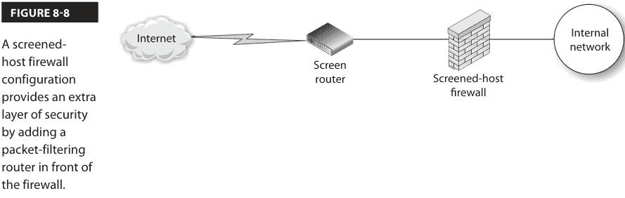

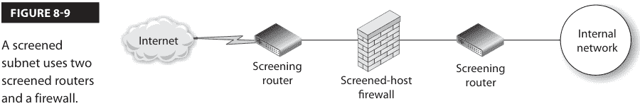

A screened subnet uses two screened routers and a firewall.

# Screened-Subnet Firewalls

A screened-subnet firewall configuration takes security to the next level by further isolating the internal network from the public network. An additional screening router is placed between the internal network and the dual-homed firewall. This provides two additional levels of security. First, by adding a screening router internally, you can protect the dual-homed firewall host from an attack by an internal source. Second, it makes an external attack much more difficult because the number of layers an attacker must go through is increased. Normally, the outside screening router will be configured to send any data that has passed the filter rule to the dual-homed firewall, which will perform more tests on the incoming traffic. Once the incoming traffic has passed the test performed by the dual-homed system, the traffic may then be sent to the internal screening router, where additional tests on the packet are performed. The internal screening router is typically configured to accept only data from the dual-homed firewall, ensuring that hackers can’t skip past the outside firewall layers. Figure 8-9 shows the screened-subnet firewall configuration.

> **For the Security+ certification exam, know the different types of firewall topologies such as dual-homed, screened host, and screened subnet.**

# Security Zones

Firewalls allow the network administrator to divide the network into different network segments known as zones. As shown in Figure 8-10, when creating your firewall plan, you will typically create three zones:

- **Private LAN/intranet** — The firewall placed in front of the private LAN ensures that no traffic from any other network is sent through the firewall to the private LAN. Note that this zone could be called the private zone, private LAN, or intranet zone.
- **DMZ** — The DMZ is an area between two firewalls (typically referred to as external and internal firewalls) that allows selected traffic from the Internet to pass through the external firewall into systems within the DMZ. The purpose of the internal firewall is to not allow any traffic originating from the Internet to pass through it. The DMZ is where you place any servers that need to be reached by the general public, such as a web server, SMTP server, FTP server, or DNS server.

# Understanding Firewalls

> **For the Security+ exam,** know that the purpose of segmenting your network into different zones is so you can control communication between the zones.
> 
> **For example, you wouldn’t want a system in the Internet zone or the guest zone to access resources in the intranet zone.

# INSIDE THE EXAM

# Understanding DMZs

For the Security+ certification exam, know that the demilitarized zone (DMZ) is an area between two firewalls: an external firewall and an internal firewall. The DMZ is an area on the network that you allow selected traffic from the Internet to reach. You normally place DNS servers, web servers, FTP servers, and SMTP servers in the DMZ.

The following ports are opened on the external firewall to allow communication to the appropriate services inside the DMZ:

- **DNS** — UDP port 53
- **HTTP** — TCP port 80
- **FTP** — TCP port 21 (control port) and port 20 (data port)
- **SMTP** — TCP port 25
- **SSH** — TCP port 22


To see a demonstration of how to configure separate zones on a Watchguard UTM security device, watch the video included in the online resources that accompany this book.

# NAT and Ad Hoc Networking

Many firewall solutions provide network address translation (NAT), which allows you to use a private address range on the inside of the network that is then translated to a public address used on the NAT device. This is accomplished by the NAT device having one of its interfaces connected to the Internet (known as the public interface), while the other interfaces are connected to the private network (known as private interfaces).

The public interface is connected to the Internet and gets an IP address (a public IP address). The other interfaces on the NAT device are assigned private addresses, and all systems inside the network have a private address in that same range. When someone on the private network tries to surf the Internet, for example, the packet first goes from the client computer to the NAT device, which switches the private source IP address of the packet to the IP address of the public interface on the NAT device. The packet is then sent out on the Internet so that as far as anyone on the Internet is concerned, it is the NAT device surfing the Internet. The rest of the systems remain hidden on the private network.

Ad hoc networking involves a topology with no central server or device to create the network; you simply connect two devices together, such as two laptops on the fly, to create a network. A good example of this is an ad hoc wireless network where there is no wireless access point, just two laptops with wireless network cards that connect directly with one another so that the laptop users can share information.

# Proxy Servers

By definition, a proxy server is a server that performs a function on behalf of another system. A proxy server is responsible for making requests for Internet resources on behalf of the systems within the organization (because it is using NAT technology). Figure 8-11 and the following list detail how a proxy server works:

- 1. The workstations (clients) on the network are configured to send Internet requests to the proxy server.
- 2. A workstation submits a request for a web page on the Internet to the proxy server.
- 3. The proxy server then connects to the Internet site on behalf of the user and transmits the request on to the Internet web server.
- 4. The Internet web site sends the reply to the proxy server.
- 5. The proxy server sends the reply to the original workstation that made the request.

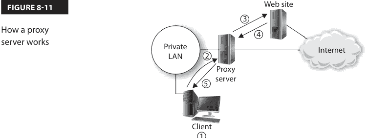

The VPN aggregator also supports high availability so that it is always available to answer VPN requests from clients. When implementing your VPN solution, you can configure the VPN aggregator to allow clients to connect remotely to the network. Or you could implement remote access, where VPN aggregators are used to connect from one site to another site (known as a site-to-site VPN) to allow entire offices to communicate over a secure connection. In this scenario, the client computers would not need to establish the VPN connection manually like they would in a client access scenario.

- **URL filter** Most proxy servers, Internet gateway products, and even your home routers allow you to configure URL filters (see Figure 8-12), which are listings of web sites that you want to allow or deny access to.
- **Content filter** Again, most proxy servers and Internet gateway devices can inspect the content of a page and, based on the type of content the user has requested, either deny or allow the content to enter the network.
- **Malware inspection** As mentioned earlier in the list, a number of Internet gateway products not only inspect web page content to see whether it is inappropriate but also check for malware in the content.

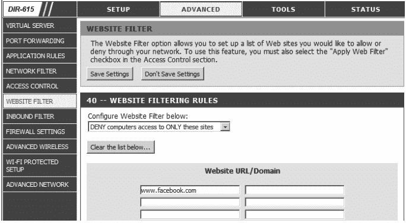

URL filters limit what web sites can be visited.


基于行为的异常系统的优点在于，您无需配置已知可疑活动的定义文件；系统会根据用户的活动来学习什么是正常行为。基于行为的系统的缺点是，任何超出常规的行为都被视为可疑，这会导致大量误报（假阳性）。

## 启发式/行为分析

启发式分析是一种基于供应商生成的规则来识别恶意活动的分析类型，这些规则存储在数据库中，然后由检测软件使用。供应商规则是基于以往处理恶意活动的经验创建的。启发式分析是防病毒软件常用的一种方法。在病毒检测中，启发式分析的目标是检测未知的新病毒。防病毒软件通常在称为虚拟机（VM）的隔离区域中运行该程序。然后，防病毒软件会分析程序执行时所做的所有操作，并将这些活动与以往的经验进行比较。例如，防病毒软件可能会查找恶意活动，如文件覆盖或程序自我复制或试图隐藏自身的迹象。

> 考试提示
> 对于 Security+ 考试，请记住，基于签名的系统根据文件中的签名来确定可疑活动，您需要对这些签名进行编程或保持更新。基于异常的系统根据活动是否异常来确定恶意活动。启发式分析会监控活动，并根据以往事件判断什么是可疑的。

## IDS 的类型

在实施入侵检测系统时，您可以选择实施基于主机的 IDS 或基于网络的 IDS。以下是这两种 IDS 类型之间差异的概述。

## 基于主机的 IDS

您在第七章中了解到，基于主机的 IDS（HIDS）安装在单个系统上，并监控该系统的活动。HIDS 通过监控内存、系统文件、日志文件和网络连接等领域（仅举几例）来识别可疑活动。

实施 HIDS 的一个限制是，它只能监控安装了该软件的系统的活动。如果您想监控多个系统上的可疑活动，则必须在多个系统上安装 HIDS 软件。

## 基于网络的 IDS

基于网络的 IDS（NIDS）可以作为独立的网络设备安装，也可以作为系统上的软件安装。无论哪种方式，NIDS 都会分析网络中传输的所有流量。NIDS 分析网络流量，寻找可疑活动，记录活动详细信息，并发出管理警报。

如图 8-13 所示，NIDS 由几个协同工作的组件组成，用于识别可疑流量：

- **传感器** 传感器是一种软件或硬件组件，放置在每个网段上，负责收集该网段的流量，然后将流量转发到分析引擎——或者转发到收集器（如果您的基础设施中有收集器）。收集器是一种从传感器收集所有流量并将其发送到分析引擎的组件。

- **分析引擎** 分析引擎也称为*关联引擎*，负责接收来自传感器（或收集器）的数据包，然后对数据包进行分析，以判断它们是否可疑。例如，如果此处的 NIDS 是基于签名的 IDS，则分析引擎会将数据包与已知可疑流量的数据库进行比较。

- **控制台** 控制台也称为*管理控制台*，通常是发送警报和通知的地方。管理员通过控制台配置 NIDS。

> 考试提示
> 对于 Security+ 认证考试，请了解基于网络的 IDS 会监控网络流量以识别可疑活动。另请注意，如果流量经过加密，基于网络的 IDS 将无法监控该流量。

## 图 8-13

基于网络的 IDS 的组件

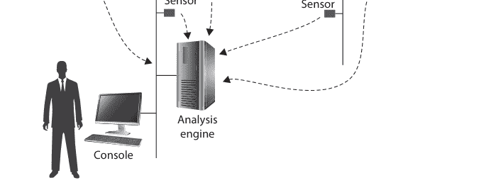

## IDS 的类别

为了通过 Security+ 认证考试，您需要熟悉不同类型的 IDS。IDS 的类别表示 IDS 如何响应可疑活动——它只是记录活动，还是也会采取某种纠正措施？

**被动式 IDS 与内联式 IDS** 被动式 IDS 监控可疑活动，当检测到其认为可疑的活动时，它只是将活动记录到日志文件中，并向管理员发送通知。重要的是要理解，被动式 IDS 不会采取任何措施来保护网络免受进一步的可疑活动侵害。请注意，按此方式配置的被动式 IDS 通常连接到监控端口或网络分路器，以使 IDS 能够接收所有网络流量。

内联式 IDS 是放置在数据包路径中的 IDS，数据包必须通过该 IDS 才能到达目的地。这样做的好处是，IDS 可以采取行动（从技术上讲，这使其成为*IPS*，但稍后会详细说明），例如在流量可疑时阻止流量。内联式 IDS 的另一个好处是，如果 IDS 发生故障，在 IDS 修复之前，任何数据包都无法通过该系统。对于被动式 IDS，它只是接收所有数据的副本并监控数据，如果 IDS 发生故障，流量仍然会到达目的地，但不会被检查。

**主动式 IDS 和 IPS** 主动式 IDS 监控可疑活动，当检测到任何其认为可疑的活动时，它可能会将活动记录到文件中并向管理员发送通知，但它也会采取行动来保护环境。例如，如果主动式 IDS 注意到某个系统正在执行 ping 扫描，它可能会将该系统从网络中断开，以便可疑系统无法再发送任何流量。

需要注意的是，“主动式 IDS”一词已被淘汰，现在主动式 IDS 被称为网络*入侵防御系统（IPS）*，因为它会采取措施防止可疑活动继续下去。

> **考试提示**
> 
> 对于 Security+ 认证考试，请了解被动式 IDS 仅发送通知或记录可疑活动，因此它被视为一种检测性控制。入侵防御系统（IPS）将采取纠正措施。例如，IPS 可能会将可疑系统从网络中断开，以防止该可疑系统产生任何其他活动。“主动式 IDS”现在被称为 IPS，并被视为一种预防性控制。

## HIPS 与 NIPS

入侵防御系统有两大类。*基于主机的入侵防御系统（HIPS）*负责监控单个系统上的活动，通常通过查看日志来识别该系统上的可疑活动，然后采取纠正措施。*基于网络的入侵防御系统（NIPS）*负责监控所有网络活动（不仅仅是单个系统上的活动），并在采取纠正措施之前识别可疑的网络流量。

## 带内与带外

在 IDS 和 IPS 的上下文中，*带内*指的是以内联方式部署的 IPS，这意味着流量必须通过它才能到达目标系统。这使 IPS 不仅可以监控流量，还可以在流量可疑时进行阻止。*带外*指的是通过将流量的副本发送给 IDS/IPS，使其仅监控网络中传输的流量。在这种情况下，IDS 只能触发警报或向管理员发送可疑流量的通知。

## 规则

在配置 IDS 时，您需要配置规则，以指明哪些类型的流量被视为可疑，以及在检测到这些流量时应采取什么操作。例如，以下代码生成一条规则，记录源 IP 地址不来自我们内部网络 192.168.1.0、目的地址是 192.168.1.0 网络上任何系统的 ICMP 类型 8 数据包（回显请求消息）。在日志文件中，我们会记录显示文本“ICMP Traffic Detected”以及数据包详细信息。

```
log icmp !192.168.1.0/24 any -> 192.168.1.0/24 any (itype:8;msg:"ICMP Traffic Detected";)
```

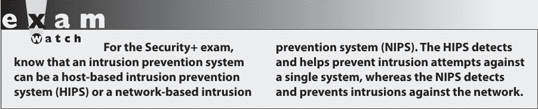

**对于 Security+ 考试，请了解入侵防御系统可以是基于主机的入侵防御系统（HIPS）或基于网络的入侵防御系统（NIPS）。HIPS 检测并帮助防止针对单个系统的入侵尝试，而 NIPS 检测并防止针对网络的入侵。**

## 分析

分析引擎是 IDS 中对收集到的流量进行分析的组件。分析引擎使用您在 IDS 上配置的规则来确定哪些流量被视为可疑流量。规则中的操作告诉 IDS 如何响应可疑流量。


**误报与漏报**  在评估 IDS 时，务必核实产品产生误报和漏报的可能性。如果 IDS 报告大量虚假结果，那将是个坏消息，因为这意味着 IDS 在不该触发警报时触发了警报，或者在该触发警报时没有触发。为了应对 Security+ 考试，请了解以下两种假结果：

- **误报**  误报是指 IDS 声称存在可疑活动（肯定），但实际上并不存在（虚假假设）。简而言之，IDS 报告了可疑活动，但实际上什么也没有发生。
- **漏报**  漏报是指 IDS 未发现任何可疑活动，而这再次是错误的——实际上确实有可疑活动！简而言之，IDS 未能检测到实际发生的可疑活动，因此没有报告。

## 练习 8-2


## 使用 Snort：一种基于网络的入侵检测系统

在本练习中，你将学习如何使用 Snort——一种流行的基于网络的入侵检测系统。请记住，Snort 是一款复杂的软件，本练习的目的仅仅是向你介绍一个基于网络的 IDS 示例。

- 1. 确保 Linux、Windows 10 和 ServerA 虚拟机正在运行。
- 2. 从 Internet 下载 Snort 并安装到 ServerA 虚拟机上。安装 Snort 后，请务必安装 WinPcap，这是 Snort 使用的数据包嗅探驱动程序。
- 3. 安装完 WinPcap 和 Snort 后，启动命令提示符（务必以管理员身份运行），然后键入以下内容：
- 4. 列出你在那里看到的三个文件夹：__________________
- 5. 要启动 Snort，请键入 `cd bin` 进入 bin 目录。
- 6. 要查看你正在使用的 Snort 版本，请键入 **snort -V**。

```
C:
cd\snort
dir
```

7. 要查看 Snort 可以使用的网络适配器列表，请键入 snort -W。你的网卡接口编号是多少？ ______
请注意，在下图中，我的网卡的索引/接口编号为 1（位于索引列中）：

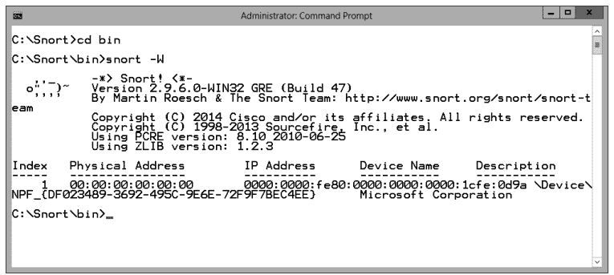

## 使用 Snort 监控流量

- 8. 要使用 Snort 在屏幕上监控流量，请键入 snort -i# -v（其中 # 是你的接口编号），然后按 ENTER。
- 9. 进入另一台虚拟机，产生一些流量，如 FTP、HTTP 或 Ping 流量。
- 10. 切换回 ServerA 虚拟机，然后按 CTRL-C 停止 Snort。
- 11. 滚动到顶部，然后向下浏览以查看输出。

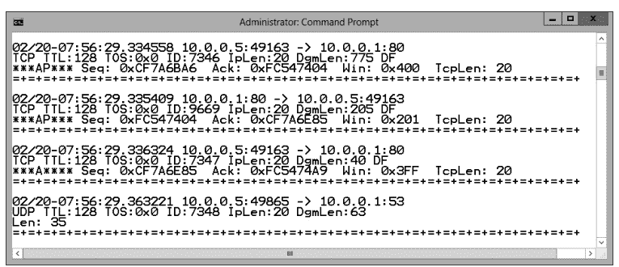

大多数公司会犯下不保护蜜罐的错误，因为他们希望黑客攻入蜜罐，但如果你让黑客太容易攻破蜜罐，黑客可能会察觉到陷阱而离开。关键是要通过强化蜜罐来给黑客制造挑战，并实施安全控制，让系统看起来好像具有价值。

另一个常见的安全术语是蜜网，它是一个完整网络，伪装成生产网络，但仅仅是为了将黑客引诱离开真正的生产网络。

## 蜜文件

蜜文件是你放在系统上以诱使黑客打开的一个文件。当文件被打开时，你可以收到一个警报，告知你这一事实，从而使你知道系统上有人。例如，你可以在桌面上放置一个名为 passwords.txt 的文件，让攻击者误以为你有一个包含所有密码的文件。当黑客打开该文件时，警报就会发出，通知你该文件已被打开。

## DNS 沉洞

DNS 沉洞是指 DNS 服务器针对已知恶意的 URL 或域名，使用伪造的 IP 地址信息进行响应。这些伪造的 IP 地址会发送给客户端，从而使客户端不会连接到已知的恶意地址。

## 伪造遥测数据

遥测数据是为监控目的而收集的数据。某些应用程序允许你生成伪造的遥测数据，这些数据可以是关于基础设施、服务器和客户端的信息。可以生成伪造的遥测数据，以测试使用遥测数据的解决方案。

> 考试重点 对于 Security+ 认证考试，要了解欺骗与破坏技术，如蜜罐、蜜文件和 DNS 沉洞。请记住，桌面上名为 passwords.txt 的文本文件是蜜文件的经典示例。

## 协议分析器

入侵检测系统和蜜罐用于监控黑客的活动，并发现网络或系统上的恶意活动。另一种可用于发现可疑活动的常用工具是协议分析器（也称为数据包嗅探器）。协议分析器（或数据包嗅探器）可以捕获网络段上的所有流量，并可用于识别可疑流量。

例如，你可以使用 Wireshark 这样的数据包嗅探器（见图8-14）来捕获网络流量，并发现来自同一系统的许多 TCP SYN 消息的目标是同一目标系统上的不同端口。这是一个很好的迹象，表明有人在网络上进行端口扫描。

如今，由于网络交换机的安全特性，监控流量比以前更困难一些。请记住，交换机只将流量转发到目标系统所在的端口，因此如今仅有数据包捕获软件是不够的。如今要捕获流量，你必须将网卡设置为混杂模式运行，这意味着你的网卡将接收所有流量。通常，系统只接收并处理数据包头部目标 MAC 地址为自己的 MAC 地址或广播地址的流量。

# 图8-14

数据包嗅探器可以帮助识别异常流量。

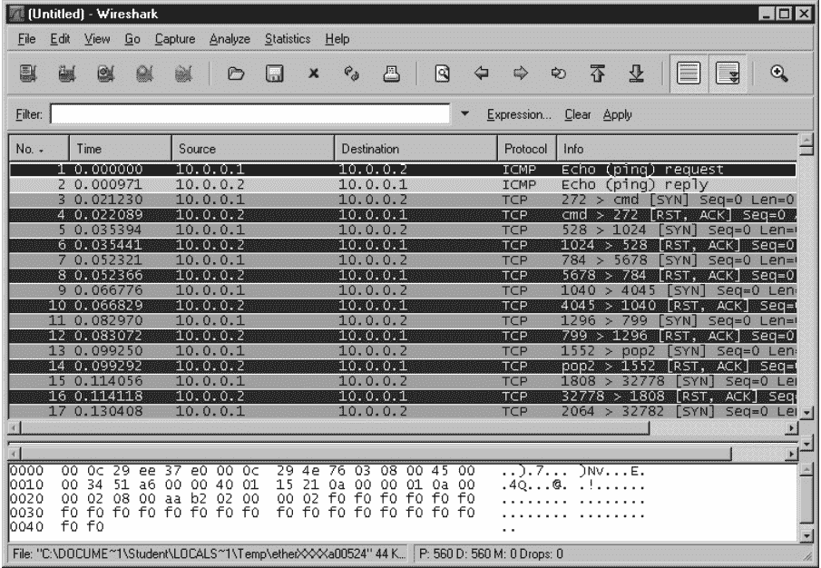

物理网络结构。例如，如果你的公司有一个网络地址，如 216.83.11.0，但有两个由路由器连接的不同物理网络，你将需要将该网络地址划分为两个不同的网络地址，即子网。

要将网络地址划分为两个（或更多）子网，你需要修改该网络 ID 的子网掩码。在我的示例中，默认子网掩码为 255.255.255.0。要划分为两个网络，我需要将子网掩码最后一个八位组的第一位改为 1。这样我就得到了新的子网掩码 255.255.255.128，以及两个子网：216.83.11.0 子网和 216.83.11.128 子网。

我知道这是你学习 Network+ 时的子网划分快速复习，但关键在于子网划分有一点安全好处：一旦你将用户分配到一个逻辑子网（IP 地址范围），除非有路由器在网段之间进行路由，否则他们只能与该 IP 地址范围内的其他系统通信。

## 物理分段

另一种对通信实施控制的方法是将网络划分为多个物理网段。根据你的目标，可以通过以下几种不同方式创建网段：

- **多个冲突域** 如果你的目标是拥有多个冲突域，那么你可以使用网桥、交换机或路由器来分隔流量。这些设备上的每个接口都会创建一个冲突域，即一组系统之间可能会发生数据冲突。这些冲突域中的每一个也称之为网段，其安全好处在于，在默认情况下，黑客在某个网段上监控流量时只能捕获该网段上的流量。

- **多个广播域** 如果你想控制广播消息在网络上传播的距离，可以使用路由器将网络划分为多个广播域。使用路由器将网络划分为多个广播域的好处是，你可以随后在路由器上使用访问控制列表来控制哪些流量可以进入或离开每个广播域（见图8-15）。

## 虚拟局域网

如果你想通过将网络划分为不同的广播域来创建通信边界，但又不想使用多个路由器，你可以在网络交换机上使用虚拟局域网（VLAN）来实现。你在第 1 章中已经了解到，一旦系统连接到交换机上属于特定 VLAN 的端口，该系统就无法与其他 VLAN 中的系统通信，除非使用路由器将数据从一个 VLAN 路由到另一个 VLAN。


**图8-15** 使用路由器将网络划分为广播域

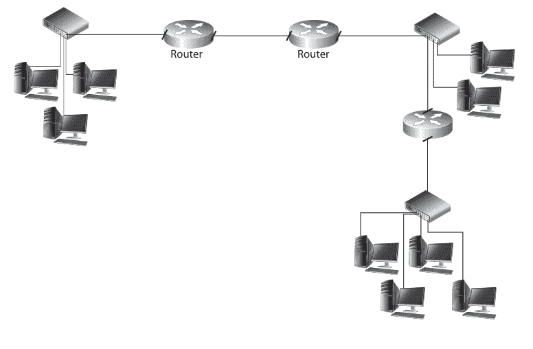

> **考试要点** 针对Security+考试，要熟悉这一点：你应该通过将网络划分为通信边界来保护网络的各个区域。你可以通过将网络拆分为多个网络并使用访问列表来实现，也可以在交换机上使用VLAN创建通信边界。

## 虚拟化

如今的虚拟化产品允许你使用虚拟网络来划分流量。通过虚拟网络，你可以将虚拟机放置在不同的网段上，并控制哪些虚拟机可以相互通信。

## 物理隔离（Air Gaps）

在网络分段中，“物理隔离”是一个概念性术语，指的是一个网络与另一个网络之间没有任何连接点。例如，在高度安全的环境中，可能存在一个秘密网络和一个非秘密网络。由于秘密网络的敏感性，两个网络之间不得有任何物理连接，从而形成物理隔离。

## 网络交换机

网络交换机为网络环境提供了强大的安全性。首先，网络交换机旨在过滤流量，只将数据发送到交换机的目标端口。这意味着使用交换机可以防止他人轻易监控网络通信。交换机还有许多其他功能可以增强网络安全性：

- **第2层与第3层** 交换机可以是第2层交换机或第3层交换机。第2层交换机没有任何路由功能；它只是一个设计用于仅将流量发送到帧的第2层头部中包含的目标MAC地址的交换机。这被称为*媒体访问控制（MAC）过滤*。第3层交换机本质上是一台交换机与一台路由器的结合体。第3层交换机上有交换端口，但也有几个路由器端口，用于将数据发送到另一个网络。
- **端口安全** 你可以通过配置端口安全来控制哪些系统可以连接到交换机上的端口。启用端口安全后，你可以启用某个端口，但将该特定系统的MAC地址与该端口关联起来。只有具有该MAC地址的系统才能连接到该端口。
- **环路保护** 环路可能导致网络崩溃，因此采取防止网络环路的措施至关重要。路由器使用数据包的生存时间（TTL）值来确定数据包何时应从网络中移除。交换机通过实施生成树协议（STP）等环路预防协议来在第2层防止环路。当你将交换机连接在一起并形成网络环路时，STP会动态选择环路中涉及的一个端口并将其置于阻塞状态，以消除环路。
- **洪水防护** 洪水防护通常是防火墙或路由器上的一项功能，允许你控制和阻止恶意流量，例如发送到你网络的洪水攻击。常见的洪水流量示例是SYN洪水攻击，黑客向你的网络端口发送大量SYN消息。洪水防护会识别该流量，阻止其进入网络，并防止拒绝服务（DoS）攻击。
- **广播风暴防护** 使用交换机，你可以通过VLAN创建不同的网络段，也称为*广播域*。通过这种方式，你可以限制广播风暴的影响，因为广播消息被限制在VLAN内部。
- **网桥协议数据单元（BPDU）防护** 交换机使用生成树协议来防止网络环路。它们通过每2秒在网络中发送BPDU帧来发现可能存在的环路。连接到网络的黑客可以通过发布自己的BPDU帧来执行中间人攻击。为应对这种情况，你可以在端口上启用BPDU防护，这样如果交换机看到BPDU消息，它就会将该端口置于“错误禁用状态”。此功能应在所有用户工作站连接的端口上启用。
- **动态主机配置协议（DHCP）侦听** DHCP侦听是你可以交换机上启用的一项功能，它使交换机能够检测未经授权连接到网络的路由DHCP服务器。

> **考试要点** 对于Security+认证考试，记住交换机的主要安全功能，例如用于分段的VLAN、BPDU防护和DHCP侦听。记住，对于BPDU防护，如果BPDU消息发送到端口（可能是黑客执行中间人攻击），交换机会将该端口置于错误禁用状态。

## 网络地址转换

网络地址转换（NAT）是一种已使用多年的网络技术，允许你在网络内部使用私有地址范围，然后在NAT网关上转换为用于公共网络的地址（见图8-16）。其安全优势在于，你隐藏了上网系统使用的内部IP地址，因为所有出站流量的源IP地址都会被转换NAT网关的地址。

如前所述，内部网络通常使用所谓的私有地址范围，该范围在Internet上不可用。这意味着任何出站流量都必须将数据包中的源IP地址从私有IP地址转换为公共地址。

**图8-16** NAT用于隐藏内部网络并共享公共地址。

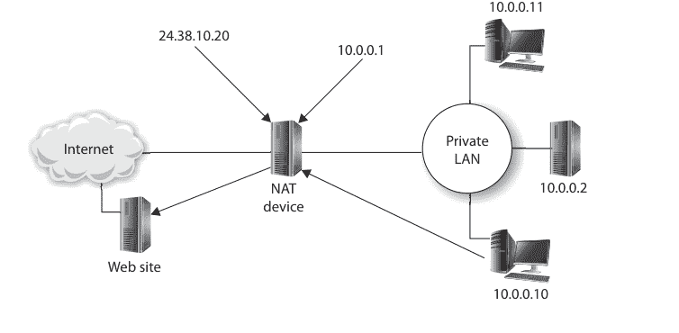

**图8-17** 网络访问控制用于对连接到网络的系统提出健康要求。

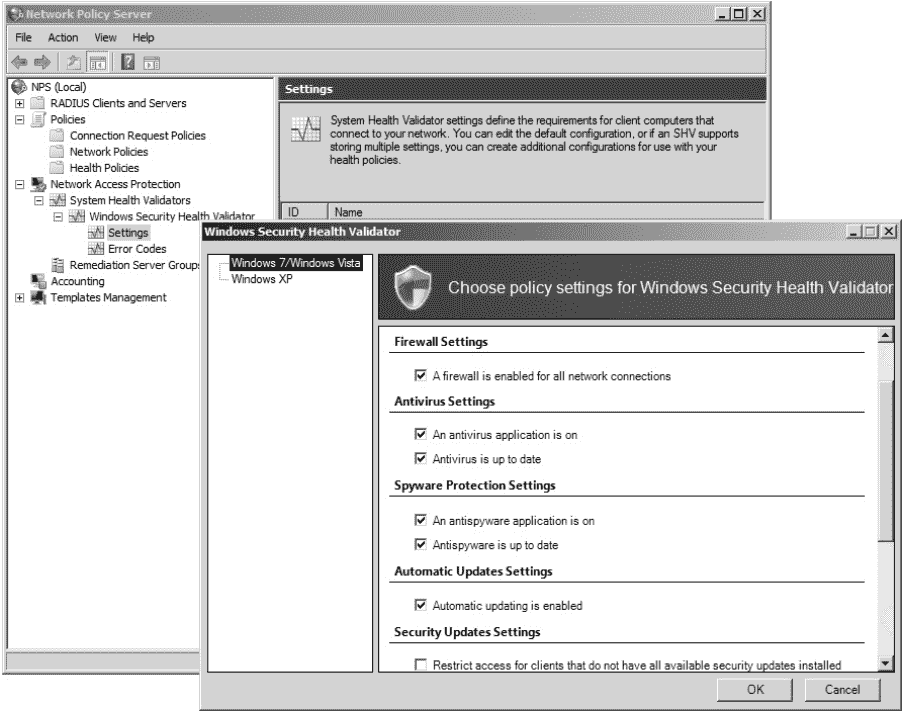

如今，NAC在许多场景中得到应用。以下是你在Security+考试中应熟悉的一些场景和一些NAC概念：

> **考试要点** 对于Security+考试，务必熟悉网络访问控制（NAC），并能够识别使用NAC的场景。

- **连接到无线网络** 当连接到无线网络时，NAC系统可能要求客户端接受无线网络使用条款，然后才允许其访问网络。
- **补丁状态** 当客户端尝试连接到网络时，无论是本地连接还是通过VPN连接，系统都会检查其健康状态，以确保已安装防病毒软件、病毒定义是最新的，并且系统在允许连接之前已安装最新补丁。
- **连接到交换机** 如果交换机符合802.1X标准，则可以对其进行配置，以确保在允许客户端访问网络之前，先由身份验证服务（如RADIUS）对接入客户端进行身份验证。
- **基于代理与无代理** 网络访问控制解决方案可以是基于代理的，也可以是无代理的。基于代理的解决方案要求客户端安装客户端软件（代理），以便客户端能够向系统进行身份验证，并且NAC能够确定系统的健康状态。无代理解决方案不要求客户端系统安装代理软件。在这种情况下，NAC检查通常由身份验证服务器在登录过程中执行。
- **可溶解代理与永久代理** 如果你在客户端系统或设备上安装代理软件，则称为永久（或常驻）代理，因为NAC系统可以持续监控系统的健康状态。可溶解代理则是未永久安装的代理。它是一段用于检查系统当前状态的软件，但不会被安装。
- **主机健康检查** NAC解决方案的一个关键特性是它能够检查试图连接到网络的系统的健康状态。作为健康检查的一部分，NAC解决方案可以验证操作系统是否最新、是否安装了带有最新病毒定义的防病毒软件，以及是否安装并启用了防火墙。

## 数据保护

保护网络基础设施的一部分是确保你为数据部署保护控制措施，以防未经授权的人员访问敏感数据。你可以使用多种保护方法来帮助保护数据，例如数据丢失防护、加密，以及令牌化和掩码等功能。

### 数据丢失防护

如今，各组织都在寻求实施数据丢失防护（DLP）解决方案的方法，这些解决方案旨在防止数据泄露到组织外部。DLP涉及多种安全控制措施，以确保数据不会有意或无意地泄露到组织外部。以下是实施DLP安全控制的一些关键领域：

- **USB阻断** 你可以在系统上禁用USB设备的使用，使用户无法将数据复制到U盘并将其带出组织。你可以通过软件配置禁用USB设备，甚至可以在BIOS设置中的硬件层面禁用它们。


**基于云的解决方案** 许多基于云的解决方案都提供了创建 DLP 策略以防止敏感数据共享的能力。例如，Office 365 提供了为不同类型敏感信息（如财务数据和健康信息）创建 DLP 规则的能力。这些规则可以防止用户通过电子邮件发送敏感信息、将信息存储在云中，甚至在组织的内网上共享信息。

**电子邮件** 电子邮件系统是应用 DLP 的典型场景。为了防止用户通过电子邮件发送敏感信息，你可以使用具有 DLP 策略功能的电子邮件系统，或者购买/订阅为电子邮件系统提供 DLP 功能的服务。

## 数据掩码

数据掩码是应用程序中常用的一种保护敏感数据的技术，它通过用掩码字符（如星号（*））替换数据来实现保护。一个常见的例子是，在屏幕上显示客户数据时，将信用卡号掩码掉，这样查看客户记录的员工就无法知道客户的信用卡号。

## 加密

当处理敏感数据（如个人身份信息（PII）、健康信息或财务数据）时，你通常会考虑对数据进行加密，以防止未经授权的人员访问这些敏感数据。你将在第12章和第13章中了解更多关于加密的内容，但现在你需要知道，在以下情况下敏感数据应进行加密：

- **静态数据** 敏感数据在存储中应加密，无论是在磁盘上还是存储在数据库中。
- **传输中的数据** 当敏感数据从一个系统传输到另一个系统时，应以加密格式传输。
- **处理中的数据** 数据在处理过程中也可能被加密，直到信息被实际读取并需要解密为止。

## 令牌化

你在第7章中学习了令牌化，但这里让我们回顾一下。*令牌化*是指将敏感数据存储在令牌服务中，而不是与使用该敏感数据的应用程序数据存储在一起。令牌服务还为该敏感数据提供一个无关的替代值。然后，令牌服务会存储敏感数据与无关值之间的映射关系，以备将来参考，以便在需要时进行查找。

## 权限管理

权限管理涉及在数据本身施加保护性控制，以管理可以对数据执行的操作类型。例如，电子邮件系统可能会在电子邮件消息上施加权限管理保护，以防止用户将消息转发给其他人。或者，电影租赁公司可能会在电影上施加权限管理保护，允许你在两天内观看，但之后则不能。

## 哈希

正如你在第2章中学到的，哈希是确保数据完整性的一种方法。你可以通过哈希算法处理数据以生成哈希值。如果稍后希望验证文件未被修改，可以再次通过哈希算法处理该文件，看看是否计算出相同的哈希值（不同的内容会产生不同的哈希值）。

> 考试提示
> 对于 Security+ 考试，请记住 DLP、掩码、加密、令牌化和哈希等数据保护机制之间的区别。

## 数据主权

数据主权是指数据受其所在国家的法律管辖的概念。这在云计算中是一个重大问题，因为公司希望确保其数据位于本国境内，以便他们了解管辖这些数据的法律。

## 邮件网关

邮件网关是放置在 DMZ 中的设备或服务器，用于为组织发送和接收电子邮件。当互联网上的人向组织内的员工发送邮件时，邮件会被定向到 DMZ 中的邮件网关。此时，邮件网关应对邮件进行病毒扫描和反垃圾邮件过滤检查，以确保邮件是有效且不含有任何病毒的。一旦邮件通过病毒检查和垃圾邮件过滤器，邮件网关就会将邮件转发到内部的邮件服务器。请记住，DMZ 和内部网络之间通常有一道防火墙，因此你需要在此防火墙上配置一条规则，仅允许邮件流量从邮件网关流向内部邮件服务器。

以下是你在邮件网关中应关注的功能：

- 垃圾邮件过滤器 应配置垃圾邮件过滤器，以检查邮件是否为污染用户邮箱的垃圾邮件。

> 考试提示
> 对于 Security+ 考试，请记住 IPSec 协议（如 ESP、AH 和 IKE）之间的区别。

IPSec 可以配置为在传输模式或隧道模式下运行。传输模式用于主机到主机的加密，也就是说，如果两个系统想要加密它们之间的通信，它们就在传输模式下运行。如果你希望将一个网络上的所有系统与另一个网络上的所有系统之间的通信进行加密，则可以将 IPSec 配置为隧道模式。隧道模式的好处是，每个客户端系统或主机不需要配置 IPSec；只需在两个网络的网关上配置 IPSec 即可。

## SSL/TLS 加密

传输层安全（TLS）加密是安全套接字层（SSL）加密的后继者，用于许多场景，例如加密 Web 流量、邮件流量或 VoIP 流量。TLS 通过使用对称密钥加密双方之间的通信来提供保密性，并通过确保数据在传输过程中未被更改来提供数据完整性。还可以使用非对称加密来配置身份验证服务。你将在第12章和第13章中了解更多关于对称加密和非对称加密的内容。

安全套接字层（SSL）/传输层安全（TLS）检测是当今讨论网络安全时的常见话题，因为 SSL 检测（或 TLS 检测）允许安全专业人员拦截发送方到接收方之间的 SSL/TLS 流量，并解密数据以进行监控或检查。如果你的安全解决方案需要检查加密流量中是否包含恶意内容，你可能会希望这样做，因为黑客正在利用加密来隐藏恶意内容。

## 用于保护通信安全的 VPN

VPN 技术使你能够通过不信任的网络（如互联网）加密双方之间的通信。在实施 VPN 解决方案时，你可以将其配置为远程访问，即客户端与 VPN 服务器之间创建加密隧道。如果你需要保护两个网络之间通过互联网的所有通信，则可以配置站点到站点 VPN。对于站点到站点 VPN，安全隧道由每个办公地点的中心设备创建。每个网络上的所有客户端都通过集中的加密隧道发送数据，这带来的好处是无需在每个客户端系统上配置 VPN 软件。

VPN 的另一个应用场景是无线网络。由于已知的无线安全协议存在缺陷，你可以将无线网络视为不信任的网络，并让无线客户端在允许其访问公司网络之前，先创建到服务器的 VPN 连接。

## 始终在线

VPN 领域出现了一种新的热潮，称为*始终在线 VPN*。使用传统的 VPN 解决方案，用户必须在任何时候想要与公司网络通信时，通过在其系统上启动 VPN 软件来发起安全 VPN 连接。而使用始终在线 VPN，计算机被配置为一旦检测到互联网连接（通常在系统启动时），就始终与公司网络建立安全连接。始终在线 VPN 的好处是无需依赖用户；系统会自动建立连接，而且该功能对用户来说是透明的。

## 分流隧道与全隧道

另一个 VPN 选项是决定将 VPN 实现为全隧道还是分流隧道。

*全隧道*是传统的实现方式，用户从远程网络（如家庭网络）启动 VPN 软件，在其系统与公司网络 VPN 服务器之间创建加密隧道。用户在使用全隧道时常遇到的一个问题是，他们无法访问其所连接的局域网（此处为家庭网络）上的任何资源；例如，如果他们想打印到家里的打印机，他们做不到，因为从技术上讲，一旦 VPN 连接建立，用户就处于公司网络上，只能访问这些资源。

*分流隧道*是一种 VPN 功能，允许用户在启动 VPN 软件后通过安全 VPN 隧道访问公司网络，同时保留访问局域网资源的能力。分流隧道功能可以指定哪些目标系统的流量通过隧道传输，哪些流量保留在局域网上。这被称为*分流包括隧道*。

## 远程访问与站点到站点

在考虑 VPN 解决方案时，你应该决定是需要远程访问解决方案还是站点到站点解决方案。远程访问解决方案涉及员工在其笔记本电脑上使用 VPN 软件。当员工想要连接到网络时，他们会启动 VPN 软件、登录，然后连接到网络。如前所述，站点到站点解决方案使你无需在每位员工的系统上安装 VPN 软件，因为当用户将数据发送出网络时，路由器会创建到其他位置的 VPN 隧道，并通过该连接发送所有员工数据。这是分支机构需要连接到总部时的常见场景。

## VPN 协议

你将在第12章和第13章中了解更多用于执行加密的安全协议细节，但为了完成 VPN 的讨论，我们必须讨论 VPN 解决方案所使用的协议：

- **IPSec** Internet 协议安全（IPSec）是一种可用于加密所有 IP 流量的协议，也可用于加密你的 VPN 流量。
- **SSL/TLS** 许多供应商提供的 VPN 解决方案使用 SSL/TLS 加密流量，就像 Web 流量使用数字证书加密一样（同样，你将在第12章和第13章中了解这一点）。


- **HTML5**：HTML5 VPN 基于 SSL/TLS 加密，为我们提供了一种通过 Web 浏览器使用无客户端 VPN 连接远程访问内部网络系统的方法。
- **Layer 2 Tunneling Protocol (L2TP)**：L2TP VPN 协议使用 IPSec 对 VPN 隧道内的数据进行加密。

## API Considerations

一个 *application programming interface (API)* 是软件开发人员可以从其应用程序中调用的函数库。安全的一部分是确保由您内部应用程序调用的任何第三方库都遵循安全最佳实践。您可以确保开发人员遵循安全编码实践，但您也应该测试第三方组件。

## Network Administration Principles

要创建安全的网络环境，网络管理员遵循常见的安全网络管理原则至关重要。以下概述了一些网络管理员在寻求创建更安全环境时应遵循和使用的基本原则或安全技术：

- **Rule-based management**：使用支持基于规则管理的技术实施规则，包括路由器、防火墙和代理服务器。务必测试允许或拒绝流量的规则，并确保您的规则按预期工作。
- **Firewall rules**：以仅允许必需流量通过防火墙的方式管理防火墙上的规则。将防火墙配置为默认规则为拒绝所有流量，然后为允许通过防火墙的流量添加例外。
- **VLAN management**：务必使用 VLAN 在网络上创建通信边界。默认情况下，系统只能与同一 VLAN 中的其他系统通信，除非您配置路由器在 VLAN 之间路由。
- **Secure router configuration**：确保以安全的方式配置路由器。这包括创建访问控制列表，为设备本地访问设置密码，为远程访问设置密码，并且仅使用安全的远程访问协议，如 SSH。
- **Access control lists**：在可能的情况下实施 ACL。ACL 通常应用于文件和文件夹权限以及路由器和防火墙。
- **802.1X**：实施这种常见的身份验证协议，通过要求客户端针对中央身份验证数据库（如 RADIUS 服务器）进行身份验证来控制谁可以访问有线或无线网络。
- **Implicit deny**：在可能的情况下，为路由器和防火墙配置隐式拒绝。这意味着除非您在设备上专门添加允许流量进入网络的规则，否则路由器和防火墙将自动拒绝该流量。文件夹和文件上的权限也应具有隐式拒绝规则。
- **Network segmentation/separation**：如前所述，将网络划分为更小的网络段然后控制从一个网络段到另一个网络段的流量至关重要。
- **Log analysis**：安全的一个被忽视方面是定期审查日志文件。重要的是确保您在所有关键系统和设备上实施日志记录，并定期审查日志。
- **Bridge**：桥接技术使一个网络上的系统能够连接到另一个网络上的系统。桥接的一个例子是无线桥接，其中两个网络通过无线链路连接在一起。从安全角度来看，请跟踪正在使用的任何桥接技术，以便您了解存在的所有通信通道。
- **SSL accelerators/TLS accelerators**：在加密大量使用的环境中，您可以通过使用 SSL/TLS 加速器来避免系统处理器过载，SSL/TLS 加速器是安装在系统中的卡片，具有自己的处理器来处理系统的加密功能。
- **SSL decryptors**：SSL 和 TLS 解密器是企业网络上的设备，用于解密消息，以便 DLP 策略可以审查内容。它们还用于在消息解密后使恶意软件检测功能能够扫描消息，或允许云监控服务扫描消息。
- **Media gateway**：媒体网关设备是用于将数据流从一种通信形式翻译成另一种通信形式的组件。例如，媒体网关可以将您网络上的数据翻译成 3G 无线网络使用的格式。
- **HSM**：*hardware security module (HSM)* 是一种设备，通常是卡片，可以安装在服务器中，用于执行加密功能并管理这些加密功能的密钥。
- **Load balancers**：负载均衡器是一种用于将负载分配到多个服务器上的设备，以便一个服务器不会因工作而过载。
- **DDoS mitigator**：DDoS 缓解器将放置在 Internet 和您的公共 Internet 资源（如 Web 服务器和电子邮件服务器）之间。DDoS 缓解器是一种监控从 Internet 到您公共服务器的网络流量的设备，并识别可能旨在使您的服务器不堪重负的流量。缓解器检查数据包的特征，包括源 IP 地址和 HTTP 头，以确定流量是否来自僵尸网络。如果是，则缓解器会阻止该流量，使其无法到达您的公共服务器。
- **Aggregation switches**：在大多数组织中，每层楼都有一个位于配线间中的交换机，该楼层上的用户连接到该交换机。每层的交换机然后连接到数据中心内的汇聚交换机。该汇聚交换机充当所有交换机的连接点，但也可能是三层交换机并能够将流量路由到 Internet。如果它不是三层交换机，则它将连接到路由器，然后路由器连接到 Internet。
- **Taps and port mirror**：网络交换机可以配置为将所有网络流量的副本发送到一个端口，您可以在该端口上运行监控软件或入侵检测系统。这至关重要，因为交换机会过滤流量，防止除目标之外的人看到该流量。您还可以安装网络 TAP 设备，该设备将包含多个端口，外加一个监控端口，并接收所有流量的副本。
- **Out-of-band management**：带外管理涉及连接到网络设备的管理端口以管理该设备（例如，连接到交换机的控制台端口以配置设备）。在保护设备时，务必通过在管理接口上配置密码用于身份验证来锁定管理接口。
- **DNS**：在 DNS 服务器上实施安全时，务必限制哪些系统可以接收区域传输，并查看 DNSSEC 以保护 DNS 区域数据的完整性。
- **Route security**：路由安全涉及保护您的路由设备免受攻击，包括不允许黑客获得访问权限并操纵路由表。查看通过限制设备上运行的协议并锁定正在运行的协议来加固您的路由设备。
- **Quality of service**：您应监控网络性能并衡量用户在使用电话和基于云的服务时接收到的服务质量（QoS）。
- **Monitoring services**：务必锁定任何监控服务和协议，以便黑客无法访问监控数据。例如，确保设备使用支持数据身份验证和加密的 SNMP 版本 3。
- **File integrity monitors**：您可以实施文件完整性监视器，允许您监控网络上文件的更改。如果文件被更改，您可以让警报发送给您。
- **SDN**：软件定义网络是可以在您的虚拟化环境中配置的功能，允许您创建虚拟网络并分割网络流量。


## 业务连通性考虑

在为您的组织评估企业安全时，您还应考虑业务地点的地理因素，因为办公室的位置会影响您可能遇到的自然灾害类型以及应急人员的响应时间。

您还应考虑事件响应程序以及在发生安全事件时业务将依赖的恢复控制类型。您将在第 18 章了解更多关于灾难恢复和业务连通性的内容，而第 21 章则讨论事件响应。

## 安全设备和网络设备的放置

在设计网络时，将不同的安全设备和网络设备放置在正确的位置非常重要。以下列表确定了关键的安全设备和网络设备以及它们应放置的位置：

- **传感器** 传感器应放置在每个网络段上，以便它们可以捕获该网络段的网络流量并将其发送到收集器或分析引擎。
- **收集器** 您可以在任何网络段上放置一个收集器，并让每个传感器将捕获的流量发送到该收集器。
- **关联引擎** 关联引擎应运行在可以访问收集器上数据的系统上，并且应放置在安全的网络段上。
- **过滤器** 这些组件过滤不同类型的流量，应放置在网络的边缘。例如，您可以在代理服务器上使用 URL 过滤器阻止用户访问特定网站。代理服务器放置在 Internet 连接和用户之间，以便它可以审查每个被访问的网站并过滤掉已被禁止的网站。
- **代理服务器** 正向代理是一种放置在网络边缘、位于 Internet 连接和用户之间的设备。用户对 Internet 资源的所有请求都通过代理传递，以便它可以过滤掉任何未经授权的内容。反向代理放置在 DMZ 中，用于将网络内的服务器（例如 Web 服务器）发布到 Internet。当 Internet 上的系统尝试访问您的服务器时，它首先联系反向代理（分配有 DNS 名称），然后反向代理将流量发送到内部系统。

## 认证目标 8.04

## 保护设备

本章的最后一个主题回顾了一些保护网络设备的常见做法。在过去几章中，您已阅读到应采取常见步骤来保护系统和设备。让我们回顾一下这些要点与网络设备的关系：

- **权限提升** 请务必了解某人连接到系统或设备后如何提升其在系统上的权限并获得对其的管理员访问权限。这通常是由于产品中的漏洞造成的，因此请务必对系统或设备应用更新。对设备应用更新涉及在固件修订发布时升级设备上的固件。
- **弱密码** 我简直不敢相信还有多少管理员仍在使用弱的、显而易见的密码。在对一家公司 Cisco 路由器进行评估时，我查看了运行配置，注意到公司管理员使用密码“telnet”配置了对路由器的 Telnet 访问。我还通过输入密码“cisco”获得了对路由器的管理员访问权限。这些不仅不是强密码，而且还是黑客会尝试用来获取访问权限的常见密码。此示例中的另一个安全问题是，我本不应该能够查看密码，因为它们应该在配置中加密。对于 Cisco 设备，您可以使用 **service password-encryption** 命令来加密配置文件中的密码。
- **后门** 检查网络设备是否存在潜在后门。我发现的一个好例子是，网络管理员在路由器的控制台端口上配置了密码，但在路由器的辅助端口上未设置密码（如果存在）。辅助端口就像另一个控制台端口，有物理访问路由器的人可以连接到它来管理设备。务必对这些设备上的所有端口进行密码保护！
- **默认账户** 注意系统或设备上存在的默认账户，并确保这些账户使用强密码保护。如果可能，您应将默认账户重命名为不那么明显的名字。
- **DoS** 可以对网络系统和设备执行各种拒绝服务攻击。在防火墙上实施洪水防护应可保护您的系统免受大多数 DoS 攻击，因为大多数攻击都涉及黑客试图用大量信息淹没您的系统，从而导致系统崩溃。洪水防护会阻止洪水消息进入您的网络。

## 认证总结

在本章中，您了解了可用于帮助提高网络环境安全性的常见网络组件。请务必熟练掌握本章内容，因为您在 Security+ 考试中肯定会遇到有关防火墙、NAT、NAC 和其他安全设备的问题。以下是关于本章的一些要点：

- 了解数据包过滤防火墙（无状态）、状态检测防火墙和应用层防火墙之间的区别。
- 不同的防火墙拓扑包括双宿主机防火墙、屏蔽主机防火墙和屏蔽子网防火墙。您的防火墙设计应创建网络上的不同区域，例如私有区域和公共区域。
- 代理服务器是流行的设备，可让您控制网络用户在访问 Internet 时可以使用的内容和应用程序类型。
- 了解基于主机的入侵检测系统和基于网络的入侵检测系统之间的区别。还需知道 IDS 检测入侵，而 IPS 检测并阻止入侵。
- 使用网络设计原则来帮助创建安全的网络环境，例如创建多个网络段并控制从一个段到另一个段可以传输的流量。
- 不要混淆 NAT 和 NAC。NAT 是用于 Internet 访问的功能，可将私有地址信息转换为公共地址。NAC 用于检查连接到网络的系统的状态，如果未通过要求，则系统不会连接到网络。
- 关于网络设备的常见安全实践包括确保使用复杂密码、重命名或禁用默认账户，以及通过补丁保持系统最新等。

## 两分钟速览

## 了解防火墙

- 数据包过滤防火墙允许您按第 3 层头（IP）和第 4 层头（TCP 或 UDP）过滤流量。状态检测防火墙可以进行数据包过滤，但也了解会话的上下文。应用层防火墙可以查看数据包中的应用程序数据并做出决策。
- DMZ 是一个区域，允许来自 Internet 的选定流量到达公共服务器，例如 DNS、FTP 和 HTTP 服务器。
- 代理服务器通常将防火墙功能与内容控制功能结合在一起。例如，您可以限制用户可以访问的网站或他们用于访问 Internet 的应用程序类型。

5. 您是公司 XYZ 的防火墙管理员，需要确保在防火墙处阻止 DNS 区域传输。您将使用以下哪条规则？
A. deny ip any any
B. deny udp any any port 53
C. deny tcp any any port 25
D. deny tcp any any port 53

6. 您的经理找到您，担心访问并连接到无线访客 SSID 的客户将能够访问公司数据和资产。您会推荐什么安全解决方案？
A. 实施网络访问控制。
B. 分段为不同区域。
C. 安装网络地址转换。
D. 使用数据丢失防护策略。

## 使用入侵检测系统

7. 哪个基于网络的 IDS 组件负责根据签名分析流量？
A. 传感器
B. 通知
C. 引擎
D. 签名数据库

8. 您拥有入侵检测软件，可以监控活动并根据过往经验识别可疑活动。正在执行什么类型的分析？
A. 异常
B. 启发式
C. 被动
D. 签名

9. 您的入侵检测软件使用基线，任何超出该基线的活动都被视为可疑流量。正在执行什么类型的分析？
A. 异常
B. 启发式
C. 被动
D. 签名


14. 通常使用哪种类型的系统来监控和控制用户访问哪些网站，并且可以根据访问内容中的信息阻止内容？
A. NAT
B. Proxy
C. NAC
D. VLAN

15. 你正在监控 LAN 上的网络流量，注意到大量使用 SIP 和 RTP 协议的数据包。以下哪项操作将用于在 LAN 上隔离该流量？
A. 创建 DMZ。
B. 配置 NAT。
C. 实施 NIPS。
D. 创建语音 VLAN。

16. 你希望使用 IPSec 提供加密、身份验证和数据完整性服务。你将使用哪种 IPSec 协议？
A. AH
B. IKE
C. ESP
D. PPTP

17. 你的经理希望实施一种 VPN 解决方案，以在两个办公地点之间通过互联网传输的所有通信进行加密，并且每个客户端的配置最少。你会推荐什么？
A. 全隧道
B. 站点到站点 VPN
C. 远程访问 VPN
D. 分流隧道

18. 你是公司的安全管理员，希望防止员工将敏感数据通过电子邮件发送到他们的个人电子邮件账户。你将如何做到这一点？
A. DLP
B. NAC
C. VPN
D. NAT

## Securing Devices

19. 购买无线路由器后，以下哪一项是你应该首先做的事情？
- A. 禁用 DHCP。
- B. 配置代理规则。
- C. 配置 VLAN。
- D. 为设备设置密码。

20. 你的经理担心为办公网络购买的特定交换机可能存在漏洞。你可以做什么来确保免受已知漏洞的侵害？
- A. 启用防火墙。
- B. 配置登录时间。
- C. 更新固件。
- D. 配置 VLAN。

## Performance-Based Questions

21. 你负责配置公司防火墙。参考网络拓扑图，使用以下要求选择你将配置的防火墙规则：
- 只有会计系统可以使用 HTTPS 与 12.0.0.10 通信。
- 只有会计系统可以使用 SMTP 与 12.0.0.10 通信。
- 所有系统都可以使用任何类型的流量与 12.0.0.11 通信。

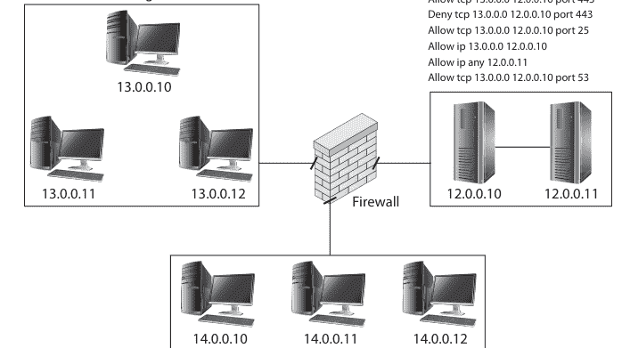

Allow tcp 13.0.0.0 12.0.0.10 port 80
Allow tcp 13.0.0.0 12.0.0.10 port 443
Deny tcp 13.0.0.0 12.0.0.10 port 443
Allow tcp 13.0.0.0 12.0.0.10 port 25
Allow ip 13.0.0.0 12.0.0.10
Allow ip any 12.0.0.11
Allow tcp 13.0.0.0 12.0.0.10 port 53

22. 将左侧的术语与右侧的描述进行匹配。
- NGFW
- East-west traffic
- Zero trust
- Reverse proxy
- Air gap
- Honeyfile
- DHCP snooping
- DNS sinkhole
- BPDU guard
- WAF
- North-south traffic
- Data sovereignty

- 一个应用层防火墙，允许你控制哪些 HTTP 消息可以到达你的 Web 服务器或 Web 服务
- 系统上的一个文档，用于诱使黑客打开文件
- 在网络内部传输的流量
- 对已知恶意 URL 或域名做出虚假 IP 地址信息的响应
- 用于检测网络上的 rogue DHCP 服务器
- 一种安全原则，意味着连接到网络的网络设备和系统默认不应被信任
- 如果在端口上看到 BPDU 消息，则将端口置于 err-disabled 状态
- 云计算的一个问题，因为数据受数据所在国家/地区的法律管辖
- 一种执行深度包检测并具有入侵防御能力的防火墙
- 从外部网络到内部网络的流量
- 两个网络段之间没有物理连接
- 用于将内部网络上的服务器发布给互联网上的系统

## SELF TEST ANSWERS

## Understanding Firewalls

1. ☑ D. 状态检测防火墙理解会话的状态以及应期望接收哪些数据包。如果收到一个与会话上下文不符的数据包，即使该数据包的目标端口在防火墙上是开放的，防火墙也不会允许该数据包。

☒ A、B 和 C 是错误的。虽然状态检测防火墙可以根据源/目标 IP 地址和源/目标端口号过滤流量（包过滤防火墙也可以这样做），但使其独特的是理解会话的上下文。应用层防火墙可以根据应用数据（也称为有效载荷）过滤流量。

8. ☑ B. 启发式分析是指 IDS 根据过去的经验识别可疑事件。例如，使用启发式分析的病毒防护软件可以通过分析未知软件的行为，并基于过去病毒的行为，将该软件标记为病毒。 ☒ A、C 和 D 是错误的。基于异常的分析是确定正常活动的基线，任何超出该正常活动的情况都被视为可疑。被动不是一种分析方法。基于签名的分析使用已知可疑活动的数据库来识别可疑流量。

9. ☑ A. 基于异常的分析是确定正常活动的基线，任何超出该正常活动的情况都被视为可疑。 ☒ B、C 和 D 是错误的。启发式分析是指 IDS 根据过去的经验识别可疑事件。被动不是一种分析方法。基于签名的分析使用已知可疑活动的数据库来识别可疑流量。

10. ☑ A. 基于签名的 IDS 可以减少误报的数量，因为它专门针对要视为可疑流量的类型进行编程。除非流量符合 IDS 已编程的条件，否则不会将其视为可疑。 ☒ B、C 和 D 是错误的。基于签名的 IDS 更不可能出现误报，因为它们根据产品中编程的签名来识别可疑流量。

11. ☑ D. 主机入侵防御系统（HIPS）旨在防止针对特定系统的攻击。 ☒ A、B 和 C 是错误的。主机入侵检测系统（HIDS）会识别针对特定系统的可疑活动，但不会采取纠正措施来防止攻击。基于网络的入侵检测和防御系统并非旨在防止针对特定系统的攻击。

## Network Design and Administration Principles

12. ☑ D. 你可以在交换机上使用 VLAN 将网络分解为多个虚拟 LAN。默认情况下，一个 VLAN 中的系统无法与另一个 VLAN 中的系统通信。 ☒ A、B 和 C 是错误的。答案 A 很接近正确答案，因为为会计系统获取单独的交换机是可行的，但不幸的是你在花钱，而目标可以用 VLAN 实现。对路由器（答案 B）可以做出同样的论点——虽然可行，但需要购买更多硬件的费用。最后，这个问题与代理服务器（答案 C）无关。

13. ☑ C. 网络准入控制（NAC）是网络的一项功能，允许你控制哪些系统可以连接到有线或无线网络。你可以在允许客户端连接之前对系统的状态（称为系统健康状况）设置条件。 ☒ A、B 和 D 是错误的。网络地址转换（NAT）用于通过共享单个公共地址将私有网络上的系统隐藏在 NAT 设备之后。代理服务器可用于代表用户向互联网发送请求，同时管理员在代理服务器上监控和过滤请求。VLAN 是交换机的一项功能，允许你在交换机上创建通信边界。

## Performance-Based Questions

21. Security+ 考试可能会向你展示一个网络拓扑图，并期望你根据问题中提出的标准识别需要在防火墙上配置的规则。考试最有可能要求你从可用规则列表中选择规则。以下插图标识了此场景的规则：

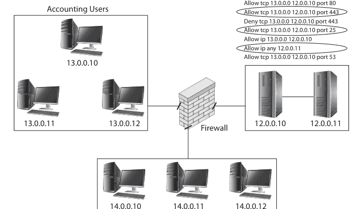

22. 以下是安全术语与其描述的正确匹配。

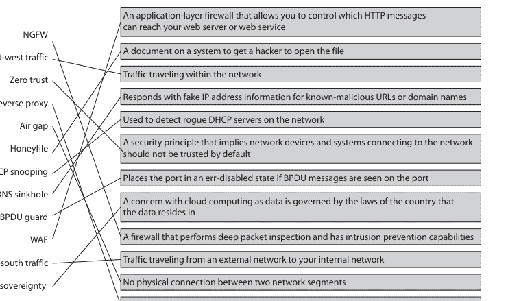


## 图 9-1

无线接入点，又称无线路由器

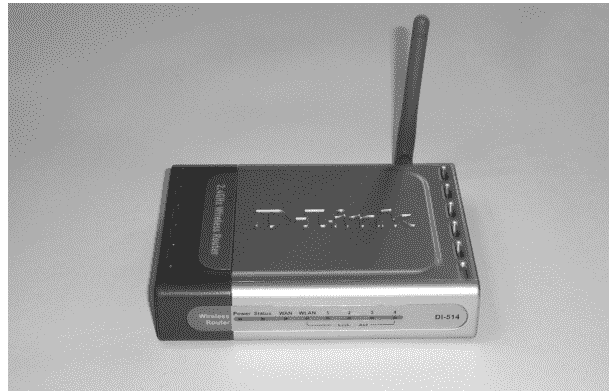

本章将带你进入无线网络的世界。对于 Security+ 认证考试来说，这是一个需要了解的重要主题，因此请务必好好研读本章。本章将介绍无线标准与协议，展示如何设置无线网络，并讨论一些无线安全问题。

## 认证目标 9.01

## 理解无线网络

如前所述，无线网络使用无线电频率在空中传输数据。这意味着，如果有笔记本电脑用户希望在办公室内移动办公，只要他们的笔记本电脑装有无线网卡，你就可以让他们通过无线接入点访问网络。

你可以创建两种类型的无线网络：ad hoc 模式无线网络和基础设施模式无线网络。在 ad hoc 模式中，无线设备（如笔记本电脑）直接与其他无线设备进行对等连接，无需无线接入点。在基础设施模式中，无线客户端连接到中央无线接入点。无线客户端将数据发送到接入点，接入点再将数据发送到有线网络上的目的地，如图 9-2 所示。

这两种无线模式各有优势。ad hoc 模式的优势在于你无需购买接入点，因为 ad hoc 模式旨在通过无线通信将系统直接连接到一起。使用 ad hoc 无线时，你的目标

## 图 9-2

运行在基础设施模式下的典型无线网络

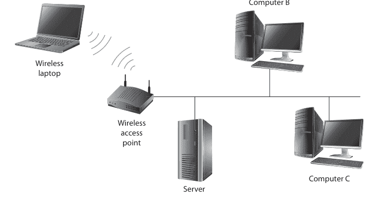

是让系统连接起来，以便用户共享数据，或者一起玩局域网游戏。基础设施模式的优势在于，你可以使用无线接入点为所有无线用户提供互联网访问。在基础设施模式下，你通常可以控制谁能连接到无线网络，并且可以过滤掉某些类型的网络流量。例如，如果你使用无线接入点允许无线客户端连接到互联网，就可以控制用户可以访问哪些网站。这种集中控制使基础设施模式非常流行。

## 标准

电气与电子工程师协会（IEEE）委员会在 802 项目模型中为无线网络制定了无线标准。无线网络由 802.11 项目模型定义，并定义了多个标准。

## 802.11a

802.11a 无线标准是首个运行在 5 GHz（千兆赫）频率上的无线标准。802.11a 设备可以以 54 Mbps 的速率传输数据。

## 802.11b

802.11b 无线标准的传输速率为 11 Mbps，使用 2.4 GHz 频率。802.11b 设备与 802.11a 网络不兼容，因为它们运行在不同的频率上。还应注意，802.11b 开启了 Wi-Fi（无线保真）标准。

## 表 9-1 不同无线标准比较

|  | 802.11a | 802.11b | 802.11g | 802.11n | 802.11ac |
|---|---|---|---|---|---|
| 频率 | 5 GHz | 2.4 GHz | 2.4 GHz | 2.4/5 GHz | 5 GHz |
| 传输速率 | 54 Mbps | 11 Mbps | 54 Mbps | 高达 600 Mbps | 1 Gbps |
| 传输范围 | 150 英尺 | 300 英尺 | 300 英尺 | 300 英尺 | 300 英尺 |
| 兼容性 | 802.11a | 802.11b/g/n | 802.11b/g/n | 802.11a/b/g | 802.11b/g/n |

表 9-1 总结了你在 Security+ 认证考试中需要熟悉的不同无线标准的关键要点。

## 信道

如上一节所述，802.11b/g/n 都运行在 2.4 GHz 频率上，但重要的是要理解 2.4 GHz 是一个频率范围。该范围内的每个频率称为一个信道。

大多数无线设备允许你指定要使用的信道。这一点很重要，因为如果你发现无线网络出现问题，可能是无线设备之间相互冲突，或与你所在区域的其他无线设备相互干扰。无绳电话就是一个很好的例子；它们也运行在 2.4 GHz 范围内，可能会给无线网络带来问题。作为解决方案，你可以更改无线接入点上的信道，这会改变频率——有望防止与其他家用设备发生冲突！

> 考试要点
> 要避免无线网络受到其他无线设备的干扰，你有多种解决方案。首先，尽量购买无绳电话等运行在 2.4 GHz 以外频率上的设备。如果你在无线网络上遇到问题，可以尝试更改无线设备上的信道，看看不同的信道是否更可靠。如果无绳电话运行在 2.4 GHz 频率上，你也可以考虑让无线网络运行在 5.0 GHz 频率上，前提是你的无线接入点和客户端支持该频率。

## 认证与加密

多年来，已经开发出许多无线认证和*加密协议*。这些协议的目的是帮助保护你的无线网络安全，你应该考虑在无线网络中实施它们。

## WEP

有线等效加密（WEP）旨在为无线世界提供与有线网络世界同等水平的安全性。在有线世界中，某人必须进入你的办公室才能将网线连接到你的网络；而在无线网络中，某人可以坐在你办公楼外的汽车里连接到你的无线网络。WEP（以及后来的 WPA 和 WPA2）旨在通过要求任何希望连接到无线网络的人输入*无线密钥*（一个配置在无线接入点上、任何希望连接的人都必须输入的值）来为无线网络增加安全性。

WEP 现在是一个已弃用的协议，不应再使用；但在过去，如果要使用 WEP 配置无线网络，你只需在无线接入点上指定一个共享密钥或密码短语。其原理是，如果有人想连接到你的无线网络，他们需要知道共享密钥，并用该密钥配置自己的工作站。

当你在接入点和客户端上配置共享密钥后，客户端与接入点之间发送的任何数据都会使用 WEP 加密。这将防止未授权个人捕获传输中的数据并读取数据。

WEP 是一种无线加密协议，使用 RC4 作为对称加密算法，采用 64 位或 128 位加密。64 位或 128 位加密密钥基于一个 24 位的*初始化向量（IV）*，该值随机生成并随数据包头部发送。IV 与一个 40 位密钥（用于 64 位加密）或 104 位密钥（用于 128 位加密）配合使用，这些密钥配置在无线接入点和无线客户端上。

> 考试要点
> WEP 可以使用 64 位或 128 位加密密钥，该密钥由一个 24 位的初始化向量（IV）加上一个 40 位密钥（用于 64 位加密）或一个 104 位密钥（用于 128 位加密）组成。

重要的是要明白，WEP 在加密和密钥使用的实现上存在巨大缺陷，因此 64 位和 128 位 WEP 都已被破解。IV 只是一个 24 位的值，这意味着只有 16,777,216 种可能的 IV。因此，在流量较大的环境中，IV 会重复出现。由于 IV 在数据包头部中传输，如果黑客能够捕获足够的流量，那么 64 位/128 位密钥的剩余部分就可以在几分钟内被破解。因此，出于安全原因，你不应使用 WEP。如果你使用的是较旧的无线设备


仅支持 WEP 的硬件，你应该用更新的硬件替换该硬件，以便创建更安全的环境。

## WPA

Wi-Fi Protected Access（WPA）旨在改进安全性并修复 WEP 中发现的一些缺陷。WPA 使用 128 位密钥和 Temporal Key Integrity Protocol（TKIP），这是一种用于更改每发送一个数据包时加密密钥的协议。这将使黑客破解密钥变得困难得多，而使用 WEP 则非常容易。

> exam Watch 在考试中请记住，WEP 使用 RC4 和静态密钥进行加密，而 WPA 使用由 TKIP 动态生成的 128 位密钥。

WPA 相对于 WEP 还有许多其他改进；例如，它具有改进的完整性检查，并且支持使用可扩展认证协议（EAP）进行身份验证，这是一种非常安全的认证协议，支持多种认证方法，如 Kerberos、令牌卡、证书和智能卡。

在第 6 章中，你学习了 RADIUS 和 802.1X 以及它们如何用于使用网络设备（如网络交换机或无线接入点）实现身份验证。EAP 消息被封装在 IEEE 802.1X 数据包中，用于有线或无线网络的网络访问认证。当使用 IEEE 802.1X 控制对无线网络的访问时，无线客户端尝试连接到无线接入点；接入点要求客户端提供身份证明，然后将其转发给 RADIUS 服务器进行身份验证。

随着时间的推移，EAP 协议出现了许多变体：

- LEAP  Lightweight Extensible Authentication Protocol 是 Cisco 在 IEEE 创建 802.1X 之前创建的 Cisco 专有 EAP 解决方案。
- PEAP  Protected Extensible Authentication Protocol（PEAP）用于通过使用传输层安全（TLS）的安全隧道封装 EAP 消息。该协议的目的是 EAP 假设数据包通过安全网络发送；使用 PEAP 时，TLS 用于在两点之间创建安全隧道。
- EAP-FAST  EAP-FAST 是 Cisco 设计的用于取代 LEAP 的认证协议。EAP-FAST 通常用于为无线网络提供认证服务。
- EAP-TLS  EAP-TLS 是使用 TLS 安全进行无线网络安全认证的 EAP 协议。EAP-TLS 解决方案通常涉及使用客户端证书来执行身份验证。
- EAP-TTLS  EAP-TTLS 在 EAP-TLS 的基础上构建，具有同时认证客户端和服务器的能力，尽管客户端无需使用证书进行身份验证。服务器可以在使用服务器证书建立安全通道后对客户端进行身份验证。

配置无线网络上的 WPA 时，请注意 WPA 采用以下模式运行：

- **WPA Personal**  WPA Personal 也称为 WPA-PSK，即 WPA 预共享密钥。使用 WPA Personal 时，你使用一个起始密钥值配置接入点，该值称为预共享密钥，然后用于加密流量。此模式主要由家庭用户和小企业使用。
- **WPA Enterprise**  WPA Enterprise，也称为 WPA-802.1X，是使用中央认证服务器（如 RADIUS 服务器）进行身份验证和审计功能的 WPA 实现。WPA Enterprise 由大型组织使用，以便他们可以使用现有的认证服务器控制谁有权访问无线网络并记录网络访问。
- **Open**  开放式无线网络无需任何密码即可连接，并且不使用任何形式的加密来防止窥探者窃取无线数据。当然，不建议将你的无线网络保持开放（你应该实施 WPA2）或将客户端系统连接到你不熟悉的开放网络。

**尽管 Security+ 认证考试会测试你对 WEP、WPA、WPA2、WPA3 和开放网络的知识，但在现实世界中请务必实施 WPA2 或 WPA3，因为它们是更安全的协议。**


## WPA2

WPA2 改进了 WPA 的安全性，如果你有选择，应使用 WPA2 而不是 WPA。WPA2 使用 *Counter Mode with Cipher Block Chaining Message Authentication Code Protocol（CCMP 或 CCM Mode Protocol）* 来实现 WPA2 无线网络的数据隐私、完整性和身份验证。WPA2 使用 CCMP 与 *Advanced Encryption Standard（AES）* 协议对无线流量进行加密，而不是 TKIP，并且还支持诸如为临时网络添加保护和密钥缓存等附加功能。由于 WPA2 使用 AES 作为其加密协议，因此支持 128 位、192 位和 256 位加密。


**要了解如何配置 WPA2，请观看随本书附带的在线资源中包含的视频。**

## WPA3

2018 年，创建了一种新的无线安全协议，称为 WPA3，它改进了 WPA2 的安全性。与之前的 WPA 安全协议一样，WPA3 支持个人和企业模式。在个人模式下它使用 CCMP-128，该模式使用 AES-128（AES 在 CCM 模式下的 128 位加密），但在企业模式下它使用 192 位加密。

WPA3 通过使用多种安全功能而得到改进，例如 *Simultaneous Authentication of Equals（SAE）*，它通过允许接入点对客户端进行身份验证以及客户端对接入点进行身份验证来提高安全性。这种对身份验证安全的改进有助于防止 WPA2 中常见的握手流量破解。

另一个主要改进是 WPA3 在加密过程中使用会话密钥，这有助于防止一个用户解密另一个用户的流量，即使两个用户使用的无线密码/密钥相同。

## RADIUS Federation

用于无线网络身份验证的另一种常见安全技术是 *RADIUS federation*。使用 RADIUS federation，两个或多个相互信任的组织可以为其 RADIUS 服务器配置相互身份验证。例如，如果 CompanyX 的员工访问 CompanyY 的办公室并尝试登录，CompanyY 的服务器会将身份验证请求转发给 CompanyX。在 CompanyX 的 RADIUS 服务器对用户进行身份验证并生成令牌后，该令牌就可以用于访问 CompanyY 的网络资源，因为 CompanyX 和 CompanyY 之间建立了信任关系。

## CERTIFICATION OBJECTIVE 9.02

## Securing a Wireless Network

几年前我购买了我的第一台无线路由器时，我对无线一无所知，并且担心自己无法设置无线网络。我的担忧很快就消失了，当我把无线路由器（接入点）从盒子里拿出来并通电时。我的笔记本电脑几乎立即连接上了！我对连接无线网络是多么容易感到惊讶——*无需*配置。然后我意识到——如果我的笔记本电脑无需配置即可连接，有什么能阻止世界其他地方的人连接到我的无线网络呢？答案当然是，没有什么能阻止有人坐在我院子外并连接到我的无线网络。我需要想办法阻止未经授权访问我的无线接入点。

你可以使用各种技术来防止未经授权的人员连接到你的无线网络。你可能希望实施其中一些或全部功能。为了帮助保护你的无线基础设施，请考虑更改路由器上的设置，例如

## FIGURE 9-4

显示附近的无线网络

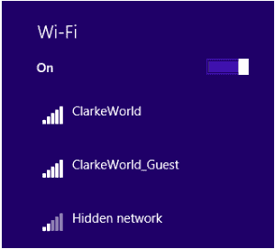

## Service Set Identifier

服务集标识符（SSID）是你为无线网络指定的名称，并且为了让某人连接到你的无线网络，该人需要知道 SSID。任何希望连接到你的无线网络的客户端都需要在其无线网卡设置中指定 SSID 名称。因此，重要的是你将 SSID 从默认值更改。

问题是无线路由器被配置为自动广播此 SSID，因此即使你将 SSID 更改为难以猜测的名称，路由器也会广播该名称。这意味着个人可以通过名称连接到你的网络，而无需事先知道网络名称，因为路由器正在广播它。证明这一点的方法是，当你在 Windows 中选择连接到网络的选项时，会显示一个对话框（如图 9-4 所示），列出附近的所有无线网络。

要解决此问题，请配置路由器不要广播 SSID。这将在用户在范围内显示无线网络列表时隐藏网络的真实名称。Windows 客户端将 SSID 广播禁用的无线网络列为“隐藏网络”。用户在尝试连接到“隐藏网络”时必须提供正确的 SSID。图 9-5 显示了如何在 D-Link 无线路由器上禁用 SSID 广播（将可见性状态设置为不可见）。大多数路由器都有一个名为禁用 SSID 广播的设置。

> exam Watch 请记住，SSID 应从默认值更改，并且应禁用 SSID 广播。此外请注意，你可以使用 Acrylic WiFi 或 Kismet 等工具进行无线勘测并获取附近无线网络的列表。Kismet 等工具能够检测隐藏 SSID，因为尽管接入点未广播，但空中仍有包含 SSID 名称的数据包。如果 Kismet 收集到足够多的流量，它可以识别隐藏的或伪装的 SSID。


## 图 9-5

在 D-Link 路由器上禁用 SSID 广播

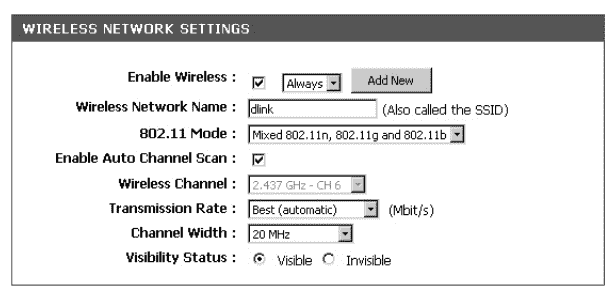

因此，为了总结 SSID 问题，请确保将 SSID 改为难以猜测的名称（如果为公司设置无线网络，不要使用公司名称），并且确保在路由器上禁用 SSID 广播。

尽管本章提供了许多最佳实践来使他人更难入侵你的无线网络，但请知晓大多数安全措施都可能被攻破。例如，当你禁用 SSID 广播时，Windows 和大多数无线扫描仪将无法检测到无线网络名称，但 Linux 中的 Kismet 等工具可以。

## MAC 地址过滤

大多数无线网络允许你限制哪些无线网卡可以连接到无线接入点。你可以通过查找你希望允许连接的系统的 MAC 地址，然后配置路由器拒绝除你输入的 MAC 地址之外的所有系统的流量，来限制哪些系统可以连接到你的无线网络。这就是所谓的 MAC 地址过滤。

默认情况下，无线接入点未配置 MAC 地址过滤，因此请确保对其进行配置。请注意，仅靠 MAC 过滤无法阻止有决心的黑客。有决心的黑客可以监控空中的流量，看到授权客户端的 MAC 地址，然后伪造该地址，使黑客的流量被允许。图 9-6 显示了在无线接入点上配置 MAC 过滤的情况。

要了解如何更改 SSID 并配置 MAC 过滤，请观看随本书附带的在线资源中的视频。

## 图 9-6

配置 MAC 过滤

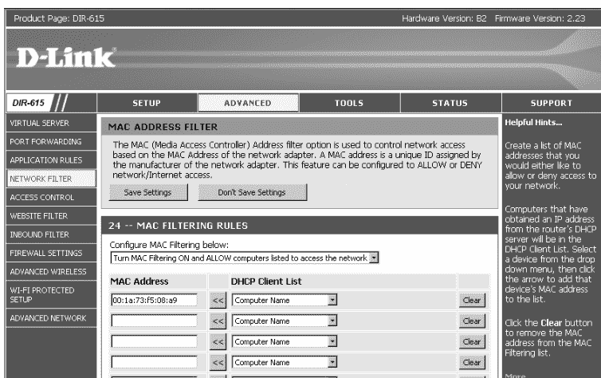

## 天线放置和功率等级

另一个重要的安全最佳实践是无线接入点的放置。你应将无线接入点放置在建筑物的区域内，该区域允许所有无线客户端连接，但最大限度地减少无线网络在场外暴露。例如，不应将无线接入点放置在建筑物外墙附近，因为这种放置可能会允许设施外的人员连接到无线网络。无线接入点应放置在建筑物的中心，以便来自建筑物外的客户端信号难以到达接入点（见图 9-7）。

> exam Watch
> 对于 Security+ 考试，请记住，无线接入点（天线）应放置在建筑物中心，而不是靠近建筑物外墙，以便限制外部人员的连接。

在配置无线接入点时，你可能还想调整功率等级以控制接入点的信号强度。如果降低功率等级，无线信号将无法传播那么远，这将再次限制来自设施外人员甚至来自设施其他区域人员的连接。你可以通过设备的 Web 配置屏幕在大多数无线接入点上调整功率等级。

WEP 是最初用于在无线客户端和接入点之间加密内容的协议。在配置无线加密协议时，你必须使用加密密钥配置无线接入点，然后确保每个无线客户端都使用相同的密钥。请注意，WEP 绝不应该使用，因为 WEP 加密很容易被破解。我曾在不到三分钟内破解过 128 位 WEP 加密。你应使用接入点支持的最强的无线加密协议，目前是 WPA2 或 WPA3。始终使用无线接入点和无线网卡支持的最大加密密码强度（例如 128 位而不是 64 位）。

关于使用无线加密协议的另一点是，它不仅加密你的流量，而且任何希望连接到你的无线网络的人都必须知道密钥，并且在连接到无线网络时必须将其配置在无线客户端上。如果他们不知道密钥，就无法连接到无线网络！这有助于确保未经授权使用无线网络的人无法连接到无线网络。

## VPN 解决方案

大多数公司对使用无线存在安全顾虑，原因也很充分。黑客可以绕过 MAC 过滤，可以破解加密密钥，并且可以使用 Kismet 等无线扫描仪在 SSID 广播被禁用时发现无线网络。那么如何确保无线网络的安全呢？

大多数具有最高安全需求的大型无线公司使用 VPN 解决方案与他们的无线客户端配合使用。他们将无线客户端视为任何其他远程用户：“如果你想在不在现场时访问网络，你需要通过 VPN 连接。” 这种对虚拟专用网络的高度依赖是由于 VPN 解决方案提供的高度安全性。

如果在你的组织中确保无线安全是一个问题，请考虑使用 VPN 解决方案。

在典型的无线客户端 VPN 解决方案中，无线客户端首先连接到无线网络。无线网络可能已实施之前讨论的一些安全预防措施，例如禁用 SSID 广播、启用 WPA2 或配置 MAC 过滤。关键是，如果授权的无线客户端连接到无线网络，他们仍然无法访问公司资源，因为他们尚未通过 VPN 连接。在连接到无线网络并获取 IP 地址后，无线客户端将通过 VPN 软件访问网络。VPN 软件将对用户进行身份验证，并创建加密隧道以保护从客户端传输到企业网络的数据。

## 考试内幕

## 保护无线网络

Security+ 认证考试期望你了解无线网络和安全最佳实践。保护无线网络至关重要，因为未经授权的个人无需 physically 在你的建筑物内即可访问网络。未经授权的人可能坐在你建筑物外的汽车里，甚至在隔壁办公楼里。

保护无线网络时应记住的关键点如下：

- 为管理员账户设置密码。
- 更改 SSID。
- 禁用 SSID 广播。
- 使用 MAC 过滤。
- 使用 WPA2 或 WPA3 配置加密。
- 将接入点放置在建筑物中心。
- 降低功率等级以控制无线信号可以传播的距离。
- 在高安全环境中使用 VPN 解决方案。

## 无线网络的漏洞

现在你了解了一些用于保护无线网络的常见做法，我想讨论黑客在无线攻击中利用的无线网络的常见漏洞。以下是一些现实世界中需要记住的关键漏洞，也是 Security+ 认证考试需要记住的。

## 数据辐射、阻塞/干扰和数据包嗅探

由于无线网络流量是通过空气传输的，因此容易受到干扰和数据包嗅探的影响。关于无线漏洞的考虑如下：

- **数据辐射** 电子元件总是会释放辐射，有人可能会收集电气元件的辐射并将其拼凑成可读数据。
- **阻塞/干扰** 如前所述，你可能会遇到来自无绳电话等组件的无线网络干扰。这是一个安全问题，因为干扰会使无线网络瘫痪，这违反了可用性（请记住第 2 章中的 CIA 讨论）。


数据包嗅探。任何拥有无线网卡和嗅探器的人都可以轻松捕获无线数据。务必对所有无线通信进行加密以保护机密数据。

**考试提示：** 对于 Security+ 考试，请记住无线网络的风险是数据辐射、阻塞和干扰以及数据包嗅探。您可以通过实施法拉第笼或 TEMPEST 系统来减轻这些风险。两者都用于阻止信号离开特定区域。

## 战争驾驶和战争粉笔

无线网络的另一个常见漏洞是战争驾驶，即有人带着笔记本电脑四处行驶，试图找到可以连接的无线网络。

与战争驾驶相关的一个你应该知道的另一个术语是战争粉笔。在战争粉笔中，当有人发现一个无线网络时，他们会在建筑物外用粉笔写一个符号，通知其他战争驾驶社区内部有无线网络。在战争粉笔中，不同的符号代表所发现的无线网络的配置。例如，图 9-8 显示了三种不同的符号：开放网络，允许任何人连接；带有 SSID 的封闭网络；以及使用 WEP 的安全网络。对于每个符号，黑客都会在符号上方写上 SSID，并在下方写上带宽。

**考试提示：** 对于 Security+ 考试，请记住战争驾驶是带着笔记本电脑四处行驶以定位无线网络。战争粉笔是在建筑物或人行道上画符号以标明附近有无线网络。

## SSID 广播

我们讨论过的另一个常见漏洞是 SSID 的广播。启用 SSID 广播时，人们很容易找到你的无线网络并尝试连接。更改 SSID 为不明显于网络用途的名称，并关闭无线路由器上的 SSID 广播。

##  rogue 接入点和邪恶双胞胎

Rogue 接入点对组织来说是一个严重的漏洞，也是你需要为 Security+ 认证考试熟悉的内容。场景是，你已经保护了你的网络环境，但网络的安全性很容易被员工将无线路由器连接到网络以便在公司食堂吃午饭时连接网络并访问互联网所破坏。

在这个例子中，员工没有意识到通过将无线路由器连接到网络，他们给公司资产带来了风险。这被认为是对网络的 rogue 接入点，因为它是一个未经授权的设备，网络管理员并不知情。

对于考试，请记住 rogue 接入点是对网络的巨大漏洞。你应该使用 Acrylic WiFi、Cain & Abel 或 Kismet 等软件定期进行无线扫描以定位任何 rogue 无线接入点。

需要注意的是，对于企业网络，使用无线控制器在整个网络中集中配置无线接入点。它们还可以用于检测和阻止网络上的 rogue 接入点。

黑客可以从其无线连接的笔记本电脑上安装 rogue 接入点，并使笔记本电脑设备看起来像一个有效的接入点。这被称为邪恶双胞胎，其对黑客的好处是客户端会连接到黑客的假接入点，以为它是有效的无线网络。在此无线网络上传送的所有数据都将发送到黑客的笔记本电脑，在那里他们可以捕获并读取数据。

为了帮助保护公司系统免受邪恶双胞胎攻击，请为所有连接到企业系统的无线客户端使用 VPN 解决方案。VPN 将通过使用加密隧道在无线客户端和企业服务器之间传输数据来保护传输。

## 弱加密和 IV 攻击

无线网络的另一个漏洞是使用 WEP 等弱加密方法，甚至是弱加密密钥。WEP、WPA 和 WPA2 都已被破解，但 WEP 加密可以在几分钟内被破解，这是由于无线数据包头中重复的 24 位 IV。看一下以下练习，它破解了一个 128 位 WEP 密钥。

- 11. 在屏幕顶部部分，你可以看到检测到的无线网络。使用上下箭头键滚动列表。当你选择一个无线网络时，你可以看到已连接客户端的 MAC 地址。要查看有关无线网络的信息，请单击该无线网络。

  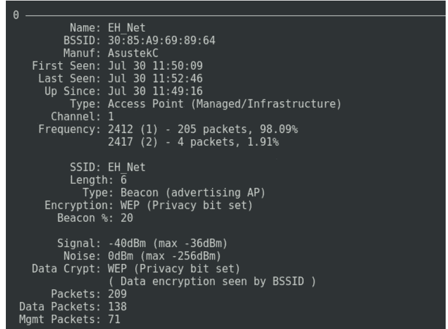

- 12. 记录以下信息：
  - SSID：________________
  - BSSID：________________
  - 制造商：________________
  - 客户端（#）：________________
  - 信道：________________
  - 加密类型（WEP/WPA/WPA2）：________________

- 13. 要关闭 Network View 窗口，请单击 Network View（顶部）并选择 Close Window。

- 14. 要查看连接到无线网络的客户端列表，只需突出显示无线网络，在其下方的窗口中即可看到客户端的 MAC 地址。请记住，黑客现在将拥有有效的 MAC 地址列表以进行伪造，以便通过无线网络上的 MAC 过滤。

  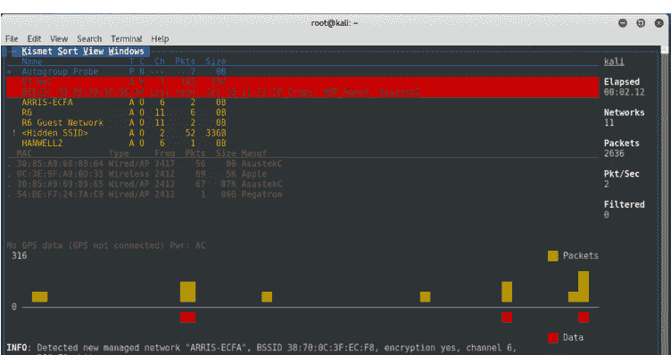

- 15. 记录已连接的无线客户端的 MAC 地址：________________

- 16. 要退出 Kismet，请单击顶部的 Kismet 菜单并选择 Quit。

### 使用 Airodump-ng 捕获无线流量

- 17. 在同一终端中，输入以下命令以在你之前写下的信道和 BSSID（接入点的 MAC 地址）上捕获流量。请记住，此命令将记录到名为 wep123-01.cap 的文件中。你应该看到 Data 列随着数据收集而增加。你需要收集数千个数据包：

  ```
  airodump-ng -c 1 -w wep123 --bssid 00:13:46:C7:CF:2C wlan0
  ```

  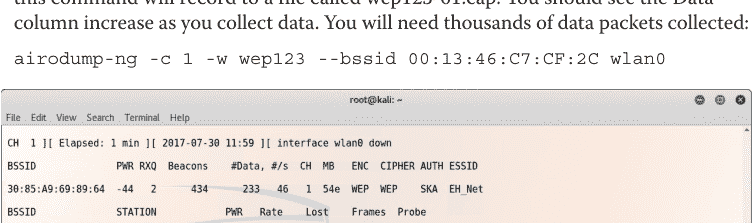

请注意，前述插图中，上半部分列出了无线接入点和流量统计信息，而下半部分显示了连接到接入点的客户端（请注意 STATION 列）。看起来有一个站点（STATION 列）连接到一个接入点（BSSID 列）。

### 使用 Aireplay-ng 重放流量

在本节中，你将尝试重放部分收集的流量，以便获得可用于破解 WEP 密钥的更多流量。

- 18. 通过选择顶部菜单中的 Terminal 菜单，然后选择 New Terminal 来启动一个新的终端窗口。

- 19. 你现在将输入一个用于将你的系统与无线接入点关联的命令，以便它接受来自你的系统的流量。请注意，在此命令执行后，系统已成功通过身份验证：

  ```
  aireplay-ng -1 0 -a 30:85:A9:69:89:64 wlan0
  ```

  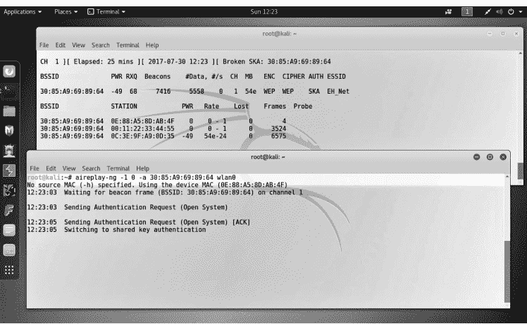

- 20. 下一个命令捕获 ARP 数据包，因为它们包含可用于无线破解的良好 IV。输入以下命令以使用你之前记录的接入点的 BSSID 重放 ARP 数据包（以下插图显示正在收集的 ARP 数据包）：

  ```
  aireplay-ng -3 -b 30:85:A9:69:89:64 wlan0
  ```

  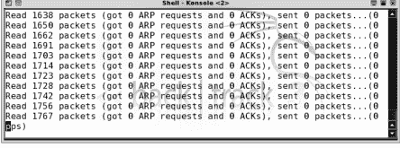

### 破解 WEP 密钥

- 21. 要破解 WEP 密钥，请在其他终端正在运行并收集和重放流量的同时，启动一个新的终端（通过选择 Terminal | New Terminal）。

- 22. 输入以下命令，使用你的 BSSID（接入点的 MAC）以及包含在 wep123-01.cap 中的捕获流量来破解 128 位 WEP 密钥（以下插图显示 Aircrack-ng 正在尝试破解加密密钥）：

  ```
  aircrack-ng -n 128 -b 30:85:A9:69:89:64 wep123-01.cap
  ```

  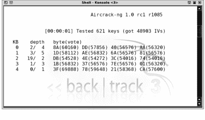

- 23. 这可能需要一些时间，所以请耐心等待。你会注意到它会失败，然后在收集到一定数量的 IV 后指示它将重试。


使用 D-Link 模拟器 https://support.dlink.ca/emulators/wbr2310/index.htm。该模拟器提供了所有设置屏幕，因此您可以尝试配置无线路由器的步骤，而无需实际设备。

## 配置接入点

无线接入点有两种不同的形式。胖型无线接入点是独立的接入点，可以单独配置或与无线控制器一起配置。胖型接入点连接到您的交换机，以便无线客户端可以访问网络。瘦型无线接入点不能作为独立设备单独配置。瘦型接入点由无线控制器配置，而无线控制器现在是 Ethernet 交换机的一部分。与使用一堆独立接入点相比，使用无线控制器与瘦型接入点的好处在于，您可以更集中地管理无线功能和安全性，因为您可以将配置从无线控制器推送到接入点。

当您将无线路由器从包装盒中取出时，首先将 Internet 调制解调器连接到无线路由器的 WAN 端口。然后，您可以将网络上的任何有线系统连接到路由器交换机部分上的任意四个端口，如图 9-9 所示。请记住，如果这只是一个无线接入点，而不是具有无线接入点功能的无线路由器，无线接入点将只有一个网络端口，允许您将其连接到有线网络。

一旦所有东西都已连接并且路由器已通电，您就需要进行一些基本配置步骤以确保设备的安全性。我想强调的是，仅通过插电，无线路由器就已在工作并允许无线客户端访问网络。您需要控制谁可以连接到无线网络！以下部分概述了一些您可以更改的基本设置。

FIGURE 9-9

查看 D-Link 无线路由器的物理端口

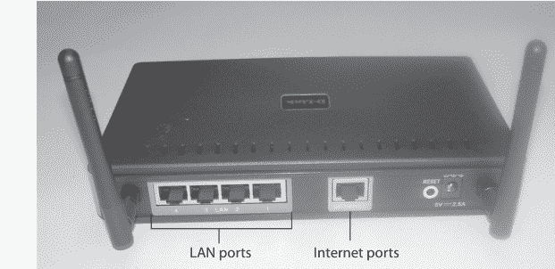

## FIGURE 9-13

在无线路由器上启用 WPA-Personal

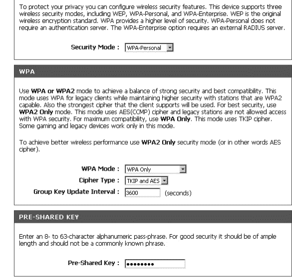

您希望使用的加密协议，AES 是最安全的加密协议。使用 WPA 时，您还可以使用组密钥更新间隔设置指定密钥更改的频率。

## 控制 Internet 站点

如今大多数无线路由器都允许您控制 Internet 活动，例如员工何时可以使用 Internet 以及他们可以访问哪些 Internet 站点。

您可能希望阻止多个站点。也许您为一家小型公司工作，使用无线路由器并且不希望员工在 Facebook.com 等网站上浪费公司时间，或者您可能希望阻止不合适的网站。查看图 9-14，您可以看到我能够阻止访问特定站点。请注意，顶部的规则是仅拒绝访问列出的站点，或者您可以将规则更改为仅阻止访问未列出的所有站点。

## 查看 Web 活动

许多无线路由器允许您监控 Web 活动并查看用户正在访问的站点。在配置无线接入点或路由器时，请检查是否可以将设备配置为通过电子邮件将日志发送给您。

## 阻止访问特定站点

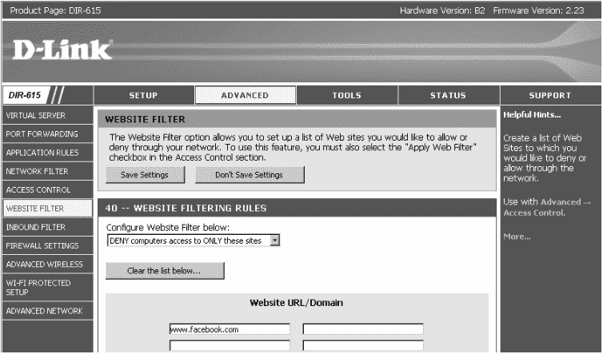

要查看 DIR-615 路由器的日志，请单击页面顶部的 Status 链接，然后单击左侧的 Log 链接。您将在屏幕中间看到路由器的日志活动（见图 9-15）。

## 使用路由器的日志查看用户访问的网站。

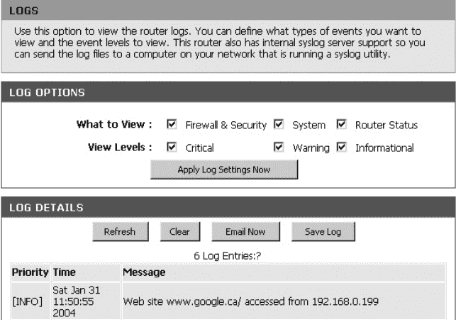

## 配置客户端

一旦无线路由器已配置完毕，您就可以准备将无线客户端连接到网络。要将无线客户端连接到网络，请在开始之前确保您拥有以下信息：

- **SSID 名称** 因为您很可能已禁用 SSID 广播，因此您需要知道 SSID，以便您可以手动将其输入到客户端中。
- **WPA2 密钥** 如果您已使用 WPA2 保护无线网络，则需要知道密钥。
- **客户端的 MAC 地址** 如果您按 MAC 地址进行过滤，则需要知道每个客户端的 MAC 地址，然后将该 MAC 地址输入到路由器中。

一旦您拥有了上述列表中的所有信息，您就可以准备将客户端连接到无线网络。本节将概述所需的步骤。

## 连接 Windows 客户端

要将 Windows 客户端连接到无线网络，首先需要确保其无线网卡驱动程序已安装。无线网卡驱动程序安装后，您可以使用系统托盘中的无线网络图标连接到无线网络。单击系统托盘中的无线网络图标即可查看您已连接的网络。如果您想连接到不同的网络，可以单击无线网络，如图 9-16 所示（这些是您附近网络的 SSID）。

当连接到需要预共享密钥的无线网络时，在您选择连接到无线网络时会被提示输入密钥。如果无线网络旁边显示一个小黄盾，则它是未受保护的网络，连接时不会提示输入密钥。如果有隐藏网络，您会看到一个名为“Hidden Network”的条目，可以连接。如果您确实连接到隐藏网络，您将被提示指定 SSID 名称（见图 9-17），然后输入加密密钥以进行连接。

FIGURE 9-16
使用 Windows 连接到无线网络

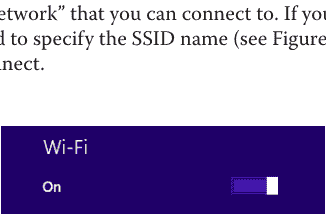

## FIGURE 9-17

连接到隐藏网络

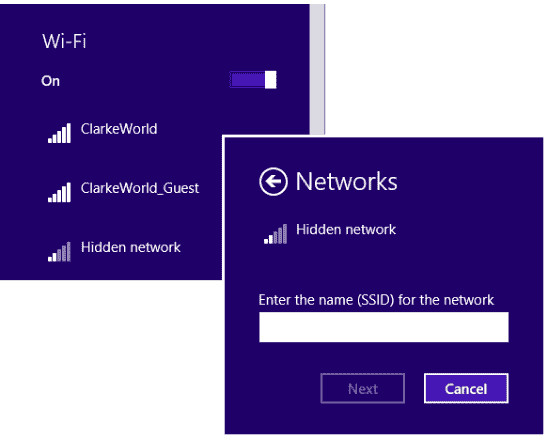

## CERTIFICATION OBJECTIVE 9.04

## 其他无线技术

当今的无线网络环境不仅限于 802.11 无线局域网设备。作为 Security+ 专业人员，您应该熟悉其他流行的无线标准，例如红外和蓝牙。

## 红外

红外无线是电视遥控器和一些计算机外围设备使用的无线通信类型。红外通常是一种视线技术，这意味着如果任何东西阻挡了两个设备之间的路径，信号就会丢失。使用红外时，两个设备需要在彼此一米范围内。

红外设备包含一个收发器，它以开-关模式发送和接收光信号，以创建以高达 4 Mbps 的传输速率传输的数据。由于需要视线，如果出现问题，您可能需要使用蓝牙等射频解决方案。

- 如果您遇到无线客户端连接不到无线接入点的问题，可能是由于其他家用设备造成的干扰。尝试更改无线设备的频道。
- WEP 使用 RC4 加密算法和静态密钥（64 位或 128 位），而 WPA 使用 TKIP 为每个发送的数据包动态生成 128 位密钥。WPA2 使用 AES 作为加密算法。

## 保护无线网络

- WEP 是一种简单的加密形式，使用密码短语或共享密钥来保护通信。
- 您可以使用 WPA 企业版设置中央身份验证服务器。这被称为 802.1X 标准。
- 确保更改 SSID 并禁用 SSID 广播。
- 通过使用 MAC 过滤限制哪些系统可以连接到您的无线网络。
- 使用 WPA2 而不是 WEP 或 WPA 配置无线加密，因为它是三种中最安全的。
- 为了获得最高级别的安全性，请使用 VPN 解决方案来保护您的无线基础设施。

## 配置无线网络

- 确保在路由器上设置管理员密码。
- 在路由器上配置日志记录，以便您可以监控访问了哪些网站。
- 您可以实施网站过滤器来控制网络用户可以访问哪些站点。

## 其他无线技术

- 蓝牙的传输速率为约 1 Mbps，并被许多手持设备使用。
- 红外被一些设备使用，是一种视线技术。
- 蓝牙嗅探是有人利用启用蓝牙的设备并窃取设备上的数据。
- 蓝牙劫持是向蓝牙设备发送未经请求的短信。
- NFC 是一种移动设备标准，允许您将移动设备相互靠近到几英寸内以传输信息。
- RFID 是一种技术，涉及一个小型设备，例如 ID 徽章，其中包含芯片和天线，用于向连接到计算机的读卡器发送包含数据的无线电波。


## 自测

以下问题将帮助你衡量对本章材料理解的程度。如图所示，部分问题可能有多个正确答案，因此请务必仔细阅读所有答案选项。

### 理解无线网络

1. 哪种无线模式涉及两台笔记本电脑直接相互连接？
   - A. 基础设施模式
   - B. 特设模式
   - C. 笔记本模式
   - D. 企业模式

2. 以下哪种无线标准不属于 Wi-Fi 标准？
   - A. 802.11n
   - B. 802.11g
   - C. 802.11b
   - D. 802.11a

3. 哪种无线标准在 2.4 GHz 频率下运行速度为 54 Mbps？
   - A. 802.11n
   - B. 802.11a
   - C. 802.11g
   - D. 802.11b

4. 哪种无线标准可达到高达 600 Mbps 的传输速率？
   - A. 802.11n
   - B. 802.11a
   - C. 802.11g
   - D. 802.11b

5. 哪种无线安全协议使用 TKIP 更改密钥？
   - A. WEP
   - B. WPA
   - C. WEP2
   - D. WPA5

6. 哪种无线安全协议使用 CCMP 和 AES 对通信进行加密？
   - A. WEP
   - B. WPA
   - C. WEP2
   - D. WPA2

7. 你希望实现一种支持无线客户端与无线接入点之间 SAE 身份验证的无线安全协议。你会使用哪种无线安全协议？
   - A. WPA2
   - B. WPA
   - C. WPA3
   - D. WEP

### 保护无线网络

8. 以下哪一项是你为无线网络分配的名称？
   - A. MAC 地址
   - B. 服务集标识符（SSID）
   - C. WEP 密钥
   - D. IP 地址

9. 为了帮助隐藏无线网络不被未经授权的用户发现，你应该对无线路由器做什么？
   - A. 不使用时将其关闭。
   - B. 启用 WEP。
   - C. 禁用 SSID 广播。
   - D. 从路由器上拔下网络电缆。

10. 你希望在无线客户端和接入点之间加密流量，但你没有支持 WPA 或 WPA2 的无线路由器。你会怎么做来保护流量？
    - A. 使用第三方程序加密流量。
    - B. 在客户端使用 WPA 但在路由器上使用 WEP。
    - C. 在客户端使用 WPA2 但在路由器上使用 WEP。
    - D. 在客户端和路由器上都使用 WEP。

11. Derek 正在进行无线现场勘查，发现网络上连接了一个无线路由器。站在他发现无线路由器旁边窗外，Derek 还注意到对面建筑物上有一些奇怪的标记。这些标记的术语是什么？
    - A. 战争拨号
    - B. 战争驾驶
    - C.  rogue 接入点
    - D. 战争粉笔标记

12. Sean 是你公司的资深安全官，他一直在监控无线活动一段时间，并怀疑攻击者已伪造其网络卡上的 MAC 地址以获得网络访问权限。在此示例中，哪种无线安全功能受到了损害？
    - A. MAC 过滤
    - B. WEP
    - C. WPA2
    - D. SSID 广播已禁用

13. Sue 负责为 Jetstream, Inc. 配置无线网络。管理层对无线安全表示极大关注，希望确保建筑物外的任何人都无法连接到无线网络。Sue 应该怎么做？
    - A. 配置 MAC 过滤。
    - B. 启用 WPA2。
    - C. 启用 WPA。
    - D. 降低功率等级。
    - E. 禁用 SSID 广播。

14. Jeff 是公司 XYZ 的初级安全官，目前负责公司无线网络的安全。Jeff 正在配置无线加密，并希望使用与 RADIUS 服务器进行身份验证的最安全加密选项。他应该使用哪种加密选项？
    - A. WPA 个人版
    - B. WPA2 个人版
    - C. WEP
    - D. WPA 企业版
    - E. WPA2 企业版

15. Dan 是你公司的安全工程师，他最近通过 MAC 地址限制了哪些设备可以连接到交换机的每个端口。以下哪种无线攻击方法正在被 Dan 缓解？
    - A. IV 攻击
    - B. WPA2 破解
    - C.  rogue 接入点
    - D. MAC 欺骗

### 配置无线网络

16. 无线路由器通电后，你应该首先更改什么？
    - A. 加密协议
    - B. 管理员密码
    - C. IP 地址
    - D. DHCP 服务器作用域

17. 你刚刚购买了一台无线路由器，但在未来六个月内不打算使用任何无线客户端。为了帮助保护路由器，你应该怎么做？
    - A. 启用 WEP。
    - B. 禁用 SSID 广播。
    - C. 启用 WPA2。
    - D. 禁用无线功能。

18. 哪个程序可用于对你的区域进行勘查并发现无线网络？（选择两个。）
    - A. MBSA
    - B. 设备管理器
    - C. Cain & Abel
    - D. 路由和远程访问
    - E. Kismet

### 其他无线技术

19. 蓝牙 3.0 的传输速率是多少？
    - A. 3 Mbps
    - B. 24 Mbps
    - C. 4 Mbps
    - D. 1 Mbps

20. 哪种类型的无线漏洞涉及利用蓝牙设备并从设备上复制数据？
    - A. 蓝牙劫持
    - B. 蓝牙化
    - C. 蓝牙窃取
    - D. 蓝牙鼻

21. Tom 最近在其移动设备上收到了许多不需要的广告。发生了什么类型的攻击？
    - A. 蓝牙劫持
    - B. 蓝牙化
    - C. 蓝牙窃取
    - D. 蓝牙鼻

### 基于性能的问题

22. 使用以下图表，将右侧的每个术语与其左侧对应的描述进行匹配。
    - 用于控制哪些设备可以连接
    - 使用密码的无线加密
    - 用于确保有人靠近无线路由器才能连接
    - 用于隐藏无线网络
    - 使用 RADIUS 服务器进行身份验证的无线加密
    - 功率等级
    - MAC 过滤
    - WPA2 企业版
    - WPA2 个人版
    - 禁用 SSID 广播

23. 使用以下图表，将右侧的每个术语与其左侧对应的描述进行匹配。
    - 一种可由设备用于在商店支付商品的无线通信协议
    - 黑客通过蓝牙利用智能手机并从手机上复制数据
    - 黑客设置的 rogue 接入点，使用与你公司无线网络相同的网络名称
    - 一种无线评估功能，可在图表中绘制无线覆盖范围和信号强度
    - 用户通过蓝牙向其智能手机接收未经请求的短信
    - 可由公司用于让访客用户在获得无线网络访问权限前同意使用条款
    - 强制门户
    - 恶意双胞胎
    - 热图
    - 蓝牙窃取
    - NFC
    - 蓝牙劫持

### 配置无线网络

14. ☑ E. WPA 企业版和 WPA2 企业版都是使用 RADIUS 服务器进行集中身份验证的无线安全协议，但 WPA2 是其中更安全的协议。☒ A、B、C 和 D 是错误的。WPA 个人版、WPA2 个人版和 WEP 不支持 RADIUS 服务器身份验证。WPA 企业版确实支持 RADIUS 服务器身份验证，但其安全性不如 WPA2 企业版。

15. ☑ C. 为了帮助防止 rogue 接入点连接到网络，Dan 可以通过其 MAC 地址限制哪些设备可以连接到交换机。这是一种称为端口安全性的网络安全功能。☒ A、B 和 D 是错误的。这些攻击方法均无法通过端口安全性来缓解。

16. ☑ B. 当你第一次获得路由器时，你应该设置管理员密码以防止他人登录并更改你的路由器设置。☒ A、C 和 D 是错误的。虽然你希望更改路由器上的许多设置，但管理员密码应首先更改。

17. ☑ D. 如果你不需要路由器的无线功能，则应禁用它们。☒ A、B 和 C 是错误的。这些都是在你拥有无线客户端时应设置的设置。

18. ☑ C 和 E. Cain & Abel 是一款具有可检测附近无线网络的无线扫描功能的密码破解工具。Kismet 是 Linux 的无线扫描器，可显示无线网络以及连接到这些网络的客户端。☒ A、B 和 D 是错误的。这些不是无线扫描器。

### 其他无线技术

19. ☑ B. 蓝牙版本 3.0 的速度为 24 Mbps。☒ A、C 和 D 是错误的。没有一个代表蓝牙的传输速率。

20. ☑ C. 蓝牙窃取是指利用蓝牙设备并从设备上复制或删除数据。☒ A、B 和 D 是错误的。蓝牙劫持是向蓝牙设备发送未经请求的短信。蓝牙化和蓝牙鼻是虚构的术语。

21. ☑ A. 蓝牙劫持是一种蓝牙漏洞，涉及黑客向启用蓝牙的设备发送未经请求的短信。☒ B、C 和 D 是错误的。蓝牙窃取是另一种蓝牙漏洞，允许黑客从设备检索数据。蓝牙化和蓝牙鼻是虚构的术语。


## 基于实操的问题

22. 下图显示了术语及其定义的关联。请注意，Security+ 考试可能会出类似题目，并期望你将右侧包含术语的方框拖到对应的描述上。

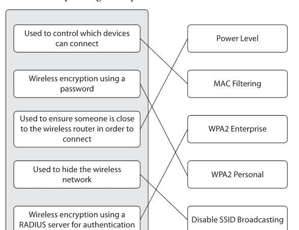

23. 下图显示了术语及其定义的关联。请注意，Security+ 考试可能会出类似题目，并期望你将右侧包含术语的方框拖到对应的描述上。

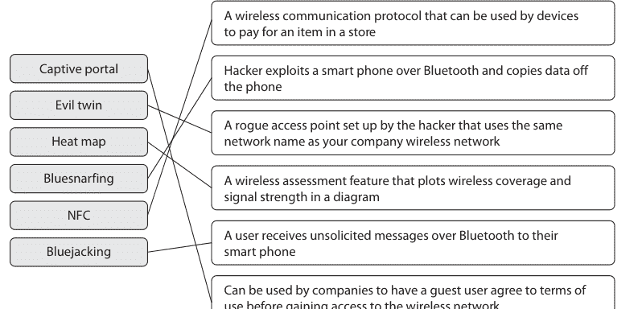
