# 第10章

### 认证

#### 认证目标

- 10.01 识别认证模型
- 10.02 认证协议
- 10.03 实施认证
- ✓ 两分钟演练
- Q&A 自测

所有安全程序的一个重要考虑因素是，经批准的个人如何向不同系统标识自己，以及该信息如何用于验证个人确实是其声称的那个人。验证个人身份的过程称为认证。在组织中的员工能够进入建筑物的安全区域或访问服务器上的资源之前，他们必须经过认证。

#### 认证目标 10.01 识别认证模型

最常见的认证示例是员工向系统提供用户名和密码，系统针对数据库验证该信息，以确定用户名和密码是否存在。如果信息与数据库中存储的内容匹配，则员工通过认证并被授予系统访问权限。

在本节中，你将了解不同的认证因素和单点登录的概念，但让我们首先回顾一下你在第2章中学到的一些术语——标识和认证。

##### 认证术语

请记住第2章的内容：用户必须先向系统标识自己，然后才能进行认证。例如，当用户在登录屏幕上输入用户名时，他们是在标识自己；而当他们输入密码时，他们是通过知晓只有本人应该知道的信息来证明自己的身份。

大多数认证示例涉及由服务器对用户进行认证。但从安全角度来看，更安全的场景是让客户端也认证服务器。这将确保没有其他系统冒充服务器来截获来自客户的机密信息。用于描述通信双方都进行认证的认证方案的术语是*相互认证*。

##### 认证方法和技术

当需要向系统或网络进行认证时，可以使用多种不同方法。以下概述了常见的认证方法及其用途描述：

- **目录服务** 目录服务是一种系统，用于存储对象（如用户和组）以及这些对象的属性（如部门和城市）。目录服务是用于对尝试访问系统或网络的个人进行认证的用户名和密码数据库。Active Directory 是 Microsoft 域网络中的目录服务示例。

- **联合** 使用联合服务是在组织或应用程序之间实现认证的方式。例如，公司可能建立一个网站，允许你使用 Google 或 Facebook 账户进行认证。本章稍后将更详细地学习联合服务。

- **证明** 证明是指某人替他人作保。作为其在认证中使用的一个示例，你可以将一个数字证书链接到账户，并用它来认证个人。

- **智能卡认证** 智能卡，也称为 PKI 卡，是一种带有芯片的卡片，芯片中存储认证信息，如用户的数字证书。当用户需要向系统认证时，可以将智能卡插入读卡器，然后输入与智能卡关联的 PIN 码。

系统、设备和网络可以使用多种不同技术来执行认证。以下是你在准备 Security+ 考试时应该熟悉的几项与认证相关的关键技术：

- **TOTP** *基于时间的一次性密码* 是由认证系统生成的随机密码码，它基于当前时间，并且仅在短时间内有效。例如，基于云的应用可能会向手机上的应用发送一个验证码，你在输入用户名和密码后有30秒的时间输入该验证码。

- **HOTP** *基于 HMAC 的一次性密码* 是一种基于哈希的消息认证码（HMAC）算法，用于生成密码。

- **短信** 短消息服务（SMS）涉及向你的移动设备发送文本消息。例如，启用了多因素认证（MFA）的应用可以使用短信在你输入用户名和密码后向你的手机发送一个验证码。如果你有手机并输入该验证码，就证明了你就是正在认证的那个人。

- **令牌密钥** 令牌密钥是企业网络用于多因素认证（MFA）的常见工具。在输入用户名和密码后，你持有的令牌密钥上会生成一个随机数，然后将该数字作为第二个认证因素输入。

- **静态代码** 静态代码与 TOTP 代码的不同之处在于，TOTP 代码只在短时间内有效，然后会变化。静态代码不会过期，因此不会改变。静态代码的一个例子是 Facebook 中的恢复代码。当你已设置多因素认证但手机不在身边无法接收短信时，可以使用恢复代码。你可以输入恢复代码作为第二种认证形式，而不是接收短信文本消息。

- **认证应用程序** 认证应用程序是一种可用于认证个人的应用程序。例如，Google Authenticator 应用就是一款基于软件的认证应用程序，它同时使用 TOTP 和基于 HMAC 的 OTP。

- **推送通知** 推送通知被应用程序用作多因素认证（MFA）的一种形式，这要求用户在登录网站时持有其移动设备。在向网站输入用户名和密码后，网站将要求用户通过选择推送到设备上的“批准”或“认证”按钮，在移动设备上批准该认证。

- **电话呼叫** 作为应用程序内多因素认证的一部分，你使用用户名和密码登录，然后可能会收到一个选择：向账户中注册的号码接收短信或电话呼叫。如果你选择接收电话呼叫，认证系统将拨打注册的电话号码（比如说打到你家里），然后提示你输入 PIN 以完成认证。

##### 多因素认证因素和属性

多因素认证（MFA）是当今认证系统的重要组成部分，也是你在准备 Security+ 考试时应熟悉的内容。多因素认证涉及用户使用不同的因素向系统进行认证，例如他们拥有的东西（PKI 卡）和他们知道的东西（卡的 PIN）。总体而言，MFA 提高了认证过程的安全性，确保某人就是他们声称的那个人。Security+ 考试期望你了解不同的认证方法或因素。

###### MFA 因素

个人可以使用以下任何认证因素进行认证：

- **你知道的东西** 这是最常见的认证因素，即你知道某些信息来证明你的身份。该认证因素的一个示例是知道密码或 PIN。

- **你拥有的东西** 这也是常见的认证因素，它基于你拥有某些东西来获得环境访问权限。例如，你使用刷卡或物理令牌进入建筑物。另一个示例是当网站在你登录时向你发送包含授权码的短信。你需要随身携带手机才能收到此短信，然后输入授权码以确认你拥有手机。这发生在你输入用户名和密码之后。

- **你本身是什么** 使用这种更高级的认证因素，你提交自己的生理特征，如视网膜、指纹或声音，以证明你的身份。使用这种方法向系统进行认证称为生物识别，被认为是最安全的认证方法。


## MFA 属性

除了身份验证因素之外，我们还有身份验证属性，可用于确定某人是否有权访问系统：

- **你所在的某个地方** 身份验证系统可以根据你的位置对你进行身份验证。这可能是使用地理位置的 GPS 位置或 IP 子网信息。
- **你能做的某件事** 此身份验证因素属性基于你执行的操作，例如用手指在图片上画图或连接点。
- **你所表现出的某件事** 使用个人特征或个人行为模式的身份验证系统。
- **你认识的某个人** 此属性通常用于密码重置，其中用户必须选择系统信任的、可以帮助重置用户密码的熟人。

Security+ 考试要求你了解刚才提到的不同身份验证因素，但它也要求你识别所谓的单因素身份验证、双因素身份验证和三因素身份验证方案。如果你仅使用其中一个身份验证因素对系统进行身份验证，那么你就是在使用单因素身份验证方案。例如，知道用户名和密码进行身份验证是一种单因素身份验证方案，因为它们都是你所知道的某件事的例子。

exam watch 对于 Security+ 考试，请务必了解身份验证的不同因素和不同的身份验证属性。例如，记住你所拥有的某物是身份验证因素，但你能做的某件事是身份验证属性。

双因素身份验证方案将基于两个身份验证因素，例如你所知道的某件事和你所拥有的某物。例如，你有一张银行卡（你所拥有的某物），你知道银行卡的 PIN（你所知道的某件事）。这种身份验证方案比仅仅需要持有银行卡来访问账户要强大得多。如果是这种情况，那么任何持有银行卡的人都可以从账户中取钱。

对于考试，请记住智能卡是双因素身份验证，因为你需要持有智能卡并且需要知道 PIN。双因素身份验证的另一个例子是进行指纹扫描然后输入密码。在该示例中，两个因素是你本人的某物和你所知道的某件事。

三因素身份验证方案将基于全部三个因素——你所知道的某件事、你所拥有的某物和你本人的某物。例如，员工可能需要进行视网膜扫描、刷卡并知道卡的 PIN。

## 身份验证管理

当我们谈论身份验证时，我们大多数人通常会想到一个环境，在该环境中我们必须输入长而复杂的密码或使用加密密钥来访问加密信息。Security+ 考试要求你熟悉许多术语和技术，这些术语和技术有助于管理这些密码和加密密钥：

- **密码密钥** 密码密钥是用户用于访问本地系统或网站的秘密值。
- **密码库** 密码库是一个加密数据库，用于存储用户可能访问的本地系统和网站的许多不同密码。密码管理器软件生成复杂的密码并为不同的系统检索它们。
- **TPM** 受信任平台模块（TPM）是系统上的一个计算机芯片，可用于存储具有加密驱动器的系统的加密密钥。TPM 还可与安全启动配合使用，以确保启动环境的完整性。
- **HSM** 硬件安全模块（HSM）是可以添加到系统中的卡，用于生成和存储加密密钥。它还可以根据需要对系统上的数据进行加密和解密。
- **基于知识的身份验证** 当系统或验证你身份的人员要求你提供只有你才知道的信息时。例如，如果你给银行打电话，他们可能会要求你提供账户上最近一次购买的信息，或者如果你给加拿大税务局（CRA）打电话，他们会要求你提供去年报税表的详细信息，例如“去年报税表第 150 行的价值是多少？”

### 单点登录

关于身份验证的一个重要概念是单点登录，也称为 SSO。单点登录的原则是，当你对网络进行身份验证时，你可以根据身份验证信息访问多个系统。有了 SSO，你无需对访问的每个不同系统进行身份验证——你只需一次身份验证，然后即可在无需再次身份验证的情况下访问多个系统。

为什么 SSO 如此有价值？许多年前，你必须单独对每个服务器进行身份验证。这意味着每个系统都存储单独的用户名和密码数据库，用户必须记住各种密码才能访问一个以上的服务器。有了 SSO，用户只需使用一组凭据登录，然后即可访问许多不同的服务器，甚至是其他组织的服务器。对组织中的身份存储进行身份验证并被授权使用其他组织的网络服务被称为*身份联合*。

**主组安全标识符** 为了符合 POSIX 标准，你可以指定你的主组——即在 POSIX 环境中成为文件和目录所有者的组。主组默认设置为 Domain Users，在 Microsoft 环境中很少使用。

**访问权限** 在登录过程中，Windows 会确定你在操作系统中的权限，并将你的权限列表存储在访问令牌中。例如，如果你拥有“更改系统时间”权限，则该信息会在登录过程中存储在访问令牌中。如果你尝试更改计算机上的时间，你的访问令牌将被检查是否具有该权限；如果权限在访问令牌中，你将被允许更改系统时间。

需要注意的是，访问令牌仅在登录时创建，因此如果你将用户添加到新组，用户需要注销并重新登录，以便访问令牌包含组成员列表中的新组。重新登录后，用户应该能够访问新添加的组可以访问的任何资源，因为访问令牌已更新。

### 云与本地要求

当我们查看本地环境的身份验证方案时——即你每天访问的本地 LAN 或 WAN 上的服务器——大多数这些系统都要求你首先对网络进行身份验证。对于常规网络，你通常只需使用用户名和密码登录，但对于高度安全的网络，你可能使用多因素身份验证（MFA）形式。

对于基于云的环境或任何需要身份验证的网站，你应考虑实施 MFA。大多数云服务允许用户将其移动设备与其用户账户关联，以便在他们登录时，代码会发送到他们的手机，他们必须输入该代码以证明他们就是他们声称的人。这确保了即使有人猜出你的用户名和密码，也无法进入网站或云服务。

## 认证目标 10.02

## 身份验证协议

当用户提供用户名和密码等凭据时，它们会通过身份验证协议传递给身份验证服务器。身份验证协议决定身份验证信息如何从客户端传递到服务器。在本节中，你将了解不同的身份验证协议。

### Windows 身份验证协议

我首先要介绍的是 Windows 身份验证协议。这些身份验证协议存在于 Microsoft 产品中，例如 Internet Information Services（IIS）和 Exchange Server。以下是 Microsoft 世界中使用的多种身份验证方法的描述：

- **匿名身份验证** 你无需登录服务器。Windows 使用实际服务的账户，你将作为该账户通过。匿名账户拥有的任何权限都是你在匿名连接时拥有的权限。这是网站和 FTP 服务器流行的身份验证方法。
- **基本身份验证** 你需要登录，并且用户名和密码以明文形式发送到服务器。这意味着如果有人在你和服务器之间使用数据包嗅探器，那个人将能够捕获你的密码并查看它，因为它未加密。
- **集成 Windows 身份验证** 你需要登录服务器，但你的用户名和密码以加密格式发送到服务器。如果用户需要登录，这种身份验证方法比基本身份验证更安全。
- **Kerberos** 一种流行的相互身份验证协议，默认用于 Microsoft Active Directory 环境。Active Directory 遵循轻量级目录访问协议（LDAP）标准，这是访问和查询目录的 Internet 协议。Kerberos 使用密钥分发中心（KDC）服务器负责签发票据。这些票据是客户端请求网络上任何其他服务器（称为 realm）的服务所必需的。Kerberos 流程始于客户端登录网络。KDC 有一个组件称为身份验证服务器（AS），它向客户端授予票据授予票据（TGT），从而使客户端有权请求服务票据。服务票据是请求网络上服务器服务的必要条件。当客户端想要连接到网络上的特定服务器时，它必须向票据授予服务（TGS）请求票据，TGS 是 KDC 的另一个组件。TGS 向客户端授予票据，以便客户端可以访问网络上的所需服务器。

> exam watch
> Security+ 考试要求你了解刚才列出的不同身份验证方法。请务必知道 KDC 在 Kerberos 中用作向需要访问网络服务的客户端发送票据的系统。


## TACACS 和 XTACACS

TACACS 是 Terminal Access Controller Access Control System（终端访问控制器访问控制系统）的缩写，最初是一种运行在 Unix 系统上的身份验证服务。TACACS 服务通过 TCP 和 UDP 端口 49 运行。

TACACS 推出几年后，Cisco 创建了自己的专有身份验证服务，称为扩展 TACACS（XTACACS），该服务充当 Cisco 设备的中央身份验证服务。

## TACACS+

终端访问控制器访问控制系统+（TACACS+）协议是 Cisco 网络使用的 AAA 协议，取代了原有的 TACACS 和 XTACACS 协议。TACACS+ 使用传输控制协议（TCP）进行通信，并且与 RADIUS 具有相同的拓扑结构：客户端尝试连接网络，而网络设备（即 TACACS 客户端）将身份验证请求发送到 TACACS 服务器。

> 考试要点
> Security+ 考试期望你了解向网络提供身份验证、授权和计费（AAA）服务的协议。请记住，RADIUS、DIAMETER 和 TACACS+ 提供 AAA 服务。

从安全角度来看，TACACS+ 比 RADIUS 有所改进，因为它会加密 TACACS 客户端与 TACACS 服务器之间的所有信息，而 RADIUS 只加密 RADIUS 客户端与 RADIUS 服务器之间的密码。

## 其他身份验证协议

系统与应用程序还会使用许多其他身份验证协议或方法，对用户进行身份验证以使其能够访问某个环境。以下是你在 Security+ 考试中应该熟悉的其他一些身份验证技术：

- LDAP 轻型目录访问协议（Lightweight Directory Access Protocol，LDAP）是一种互联网协议，旨在通过 TCP 端口 389 访问目录服务，并允许支持 LDAP 的应用程序向目录进行身份验证，然后检索目录中存储的关于对象的信息。
- 安全 LDAP 安全 LDAP 是一种使用安全套接字层（SSL）的轻型目录访问协议，通过 TCP 端口 636 加密客户端与 LDAP 系统之间的通信。
- **SAML** 安全断言标记语言（Security Assertion Markup Language，SAML）是一种 XML 标准，旨在允许系统交换身份验证和授权信息。它通常与身份联合和基于声明的身份验证一起使用。
- **隐式拒绝** 一种与身份验证相关的安全概念，即在用户通过身份验证之前，拒绝任何人访问系统。
- **可信操作系统** 一个术语，用于标识实现了多层安全性（如身份验证和授权）的系统，以确定谁可以访问系统以及他们可以执行哪些操作。
- **OAuth** 一种行业标准协议，用于授权应用程序访问用户信息，而不会暴露密码等敏感信息。
- **OpenID Connect** 与 OAuth 授权协议配合使用的身份验证协议。OpenID Connect 允许应用程序检索有关身份验证会话的信息。
- **Shibboleth** 一种使用 SAML 令牌和联合服务实现单点登录（SSO）应用程序的软件实现。
- **安全令牌** 用户用来获取网络资源访问权限的硬件令牌。安全令牌可以采用智能卡或钥匙扣的形式。
- **NTLM** NT LAN Manager（NT 局域网管理器）是一种在较旧的 Microsoft 网络上使用的安全协议，可向网络提供身份验证服务。NTLM 已被 Kerberos 取代。

> **考试要点** 对于 Security+ 考试，请记住，SAML 是用于联合服务的基于声明的令牌的语言。还要记住，OAuth 是一种授权协议，允许用户授权应用程序访问其信息，而无需提供其密码。

## 认证目标 10.03

## 实现身份验证

在本章前面部分，你已经了解了不同的身份验证因素，例如你知道的信息、你拥有的物品以及你自身的特征。你还了解到，许多身份验证方案会组合这些因素，以创建双因素或三因素身份验证方案。

在本节中，你将了解用于实现身份验证的常见方法，例如用户账户、访问令牌和生物识别。

## 用户账户

最常见的身份验证形式是确保每位员工拥有唯一的用户名和密码来访问网络。在使用用户账户向网络进行身份验证时，每位员工通过输入用户名来标识自己，但通过输入密码来完成身份验证。

标识的其他示例包括用户 ID、账号和员工编号——任何可用于识别个人身份的信息。

员工在输入与账户关联的用户名密码、口令短语或 PIN 码以证明身份后，即完成身份验证。

用户输入用户名和密码后，账户信息会被发送到身份验证服务器以验证其是否正确。身份验证服务器验证信息后，会为用户生成一个访问令牌。

> 考试要点
> 在考试中，请记住标识与身份验证之间的区别。标识是提供用户名等标识信息，而身份验证是证明你就是拥有该用户名的人——在本例中，即知道密码。

在用户账户和身份验证方面，请确保使用强密码并设置账户锁定策略。如果你希望评估用户的密码，请务必执行离线密码审计：将账户数据库的副本带到测试环境中，然后运行密码审计。这一点至关重要，这样就不会锁定账户；如果进行在线评估，就会发生这种情况。

> 实际工作
> 如果你的身份验证方案基于用户账户，请务必配置强密码策略和账户锁定策略，以保护这些账户。

## 令牌

如今，许多网络环境都使用令牌。在讨论安全性时，我们有三种主要类型的令牌：

- 硬件令牌 一种通常用于标识个人并在身份验证过程中使用的小型设备。在各类硬件令牌中，最流行的一种是显示随机数的设备，该随机数在 30 到 60 秒内有效（见图 10-2）。用户输入该随机数以及用户名和密码以登录。
- 软件令牌 与硬件令牌非常相似，区别在于它是存储在计算设备上的软件（应用程序），而不是独立的硬件设备。

## 图 10-2

用于身份验证的令牌

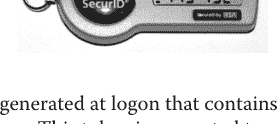

逻辑令牌 登录时生成的令牌，包含用户 SID、组 SID 和用户权限。该令牌会呈现给任何资源，以确定是否应授予对这些资源的访问权限。

请注意，硬件令牌也可以是需要用户随身携带才能进入建筑物的实体物品，例如卡片或挂在钥匙链上的设备，在电子读卡器上刷一下即可进入建筑物的某个区域。

## 了解生物识别技术

生物识别技术是通过使用自身的身体特征（如指纹、视网膜图案或声纹）向系统或网络进行身份验证的过程。在与身份验证相关的方面，生物识别提供了最高级别的安全性，但由于成本原因，它不像简单的用户名和密码身份验证那样普遍。

## 生物识别因素

以下是一些常见的生物识别身份验证因素：

- **指纹** 指纹扫描仪扫描你的指纹，并将其与你在注册期间（下一节介绍）提交并由系统存储的指纹进行比较。类似的系统还有掌纹扫描仪。
- **视网膜** 视网膜扫描仪扫描你眼睛视网膜的血管图案，并将其与系统存储的图像进行比较。
- **虹膜** 虹膜扫描仪扫描你眼睛中环绕瞳孔的有色部分，并将其与系统存储的图像进行比较。
- **面部** 面部识别根据面部参考点（例如双眼之间的距离以及鼻子到下巴的距离）对用户进行身份验证，本质上就是一张面部参照图。
- **语音** 语音识别系统要求你说话，并根据你之前提交并由系统存储的样本验证你的语音模式。
- **静脉** 静脉识别（也称血管识别）涉及分析透过皮肤可见的血管图案。
- **步态分析** 通过分析个人的身体运动来识别其身份。步态分析通常分析个人行走或跑步时的步幅。


## 生物特征注册

某人第一次使用生物特征设备时，会经历所谓的 *注册过程*。在注册过程中，生物特征数据由生物特征读取器采集，然后转换为数字表示形式。随后生物特征数据会经过数学运算，该运算的结果会被存储在数据库中以便对系统进行身份验证。

## 有效性率和生物特征错误类型

在评估生物特征系统时，了解有效性率和错误率非常重要。*有效性率*是指系统在执行其工作并提供令人满意结果方面的有效程度。

尽管生物特征是最安全的身份验证方法，但由于识别信息中的细节程度，生物特征系统仍可能出现错误。以下是生物特征的两种常见错误类型：

- **I 型** I 型错误被称为 *误拒率 (FRR)*，发生在生物特征系统未能验证有权访问系统的人员时。
- **II 型** II 型错误与 I 型错误相反，它允许无权访问系统的人员访问系统。这种错误被称为 *误接受率 (FAR)*。

生物特征设备有时会根据一个称为 *交叉错误率 (CER)* 的值来评定错误百分比。CER 是一个数值，表示 I 型错误数量等于 II 型错误数量时的点。例如，如果 100 次身份验证尝试中有 5 次是 I 型错误，100 次身份验证尝试中有 5 次是 II 型错误，则 CER 为 5。CER 值越低，生物特征系统的准确性越高。

> **注意** 考试时，务必记住误拒率 (FRR)、误接受率 (FAR) 和交叉错误率 (CER) 之间的区别。

## 基于证书的身份验证

基于证书的身份验证要求用户或客户端计算机通过向身份验证系统出示公钥基础设施 (PKI) 客户端证书来对网络进行身份验证。你将在第 12 章和第 13 章学习加密和 PKI。身份验证系统通过检查以下内容来验证证书：

- 证书是否来自受信任的证书颁发机构 (CA)？
- 证书验证期是否已过期？
- 证书是否已被吊销？

政府雇员，例如用于验证人员身份并控制对计算机系统和设施访问的身份验证信息（包括生物特征）。

## IEEE 802.1X

当需要控制哪些设备可以连接到无线网络或有线局域网时，可以使用 802.1X 与局域网上的可扩展身份验证协议 (EAPOL)。图 10-4 显示了 802.1X 环境的基本配置。

## IEEE 802.1X 术语

图 10-4 描绘了左侧的客户端计算机或设备试图连接到中央的 802.1X 兼容交换机或无线接入点。试图建立连接的客户端系统被称为 supplicant，而 802.1X 兼容交换机或无线接入点被称为 authenticator。图右侧显示了中央身份验证服务器，即 RADIUS 服务器。请注意，authenticator 与 RADIUS 服务器进行通信，这使得 authenticator 在此场景中成为 RADIUS 客户端。

为了使 supplicant 获得网络访问权限，它会向 authenticator 发送 EAPOL 帧以请求网络访问。请注意，此时 supplicant 尚未获得网络访问权限，在 supplicant 获得授权之前，authenticator 仅接受 EAPOL 流量。在简单配置中，EAPOL 流量可用于将用户名和密码从 supplicant 传输到 authenticator。或者，在更复杂的配置中，EAPOL 流量可将证书用于身份验证，从 supplicant 发送到 authenticator。

一旦 authenticator 获得了身份验证信息，它随后会将该信息封装在 IP 数据包中，使用 RADIUS 传递给身份验证服务器。如果身份验证服务器回复表示凭据有效，authenticator 就会允许 supplicant 访问网络（交换机或无线接入点）。

## 图 10-4

802.1X 组件

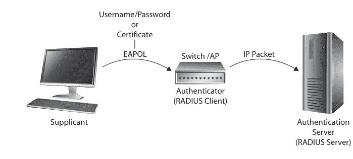

## 图 10-5 802.1X 通信阶段

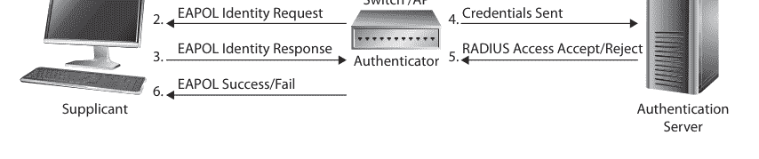

## 802.1X 通信阶段

准备 Security+ 认证考试时，了解 802.1X 通信的各个阶段以及每个阶段使用的协议非常重要。图 10-5 描述了 802.1X 组件之间通信的以下阶段：

- 1. **EAPOL Start** 通信始于客户端机器或 supplicant 发送 EAPOL Start 消息。这是一个第 2 层帧，请求访问交换机或无线接入点。
- 2. **EAPOL Identity Request** 交换机或无线接入点，也称为 authenticator，向 supplicant 发送 EAPOL 帧，要求 supplicant 识别自身。
- 3. **EAPOL Identity Response** supplicant 发送 EAPOL 响应消息，其中包含其身份验证信息。这可能是用户名和密码，也可能是证书。
- 4. **凭据发送** authenticator 使用 RADIUS 将包含凭据的 IP 数据包发送到身份验证服务器。
- 5. **RADIUS Access: Accept/Reject** 身份验证服务器向 authenticator 发送回 RADIUS Access 消息，其中包含接受或拒绝状态。如果凭据已验证，则发送 Access-Accept 消息，如果凭据不正确，则发送 Access-Reject 消息。
- 6. **EAPOL Success/Fail** 最后，authenticator 向 supplicant 发送 EAPOL 消息，其中包含成功或失败状态。收到 Success 消息后，客户端系统将被授予网络访问权限。

## 基于声明的身份验证/联合服务

联合服务是当前的重要主题，也是 Security+ 认证考试中你需要掌握的内容。联合服务为你提供了单点登录的能力，这意味着一旦你登录并获得令牌，就可以使用该令牌访问不同的环境。联合服务负责生成基于 Internet 技术和标准格式的访问令牌，以便该令牌可在整个 Internet 上使用。

让我们看一个例子。假设 Bob 是你公司的员工，他想访问第三方网站或 Web 应用程序。你公司与第三方网站已建立关系（称为信任），该关系存在于 Internet 上的 Web 应用程序与你公司的联合服务器之间，后者负责生成 SAML 格式的基于声明的令牌。SAML，如本章前面所述，是用于描述安全令牌及其内容的基于 XML 的标准。安全令牌的内容由声明组成。声明是描述 Bob 的信息片段，并存储在令牌内部。这可能是 Bob 的用户名、组成员身份、他所在的部门、他的电子邮件地址，甚至他所在的城市。存储在 SAML 令牌中的信息基于联合服务器的配置。

查看图 10-6，让我们回顾使用联合服务器进行身份验证的步骤：

- 1. Bob 尝试连接到第三方 Web 应用程序，该应用程序被称为依赖方，因为它依赖于联合服务器生成的令牌。
- 2. 第三方 Web 应用程序将 Bob 重定向到联合服务器以获取访问令牌。

## 图 10-6

查看联合服务

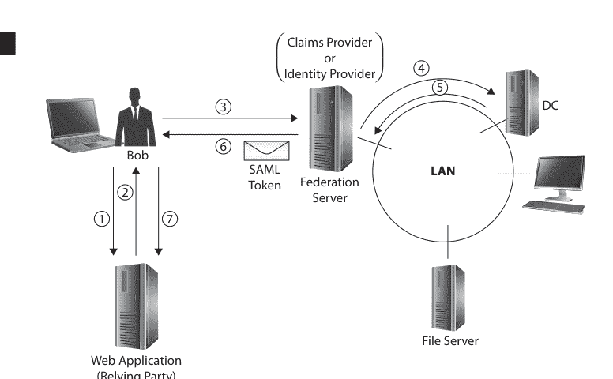


## 两分钟速览

### 识别身份验证模型

- 身份验证因素的类型包括所知信息、所持物品、生物特征、所处位置和所做行为。
- 多因素身份验证是将两个或更多身份验证因素组合在一起，形成双因素身份验证或三因素身份验证。一种常见的双因素身份验证使用智能卡（所持物品），同时需要输入PIN码（所知信息）。
- 单点登录（SSO）是一种常见的身份验证原则，允许用户只需验证一次即可访问多个系统，而不必对每个访问的系统都进行验证。

### 身份验证协议

- Microsoft产品中常见的身份验证协议有匿名验证、基本验证和集成Windows验证。
- RAS和VPN服务器使用的常见远程访问协议包括PAP、CHAP和MS-CHAPv2等。
- 请记住，Kerberos是一种相互身份验证协议，它使用密钥分发中心（KDC）向希望访问网络上服务的客户端分发票证。
- 许多网络环境正在实施AAA服务，例如RADIUS，它是一个中央身份验证服务器，其他系统和设备可以使用它进行身份验证。

### 实施身份验证

- 当基于用户名和密码设计身份验证模型时，请务必制定强密码策略，并配合帐户锁定策略。
- 请记住，用户名用于识别用户，而密码用于验证用户身份。
- 另一种常见的身份验证方法是使用包含微处理器和代表用户数据的智能卡。硬件或软件令牌也可以用于身份验证。
- 生物识别技术可以使用用户的生物特征（如指纹扫描、视网膜扫描或语音识别）来对系统进行身份验证。

4. 当你的身份验证信息自动传递到多个服务器，使你无需登录每个服务器时，这个术语是什么？

    - A. SSO
    - B. PAP
    - C. CHAP
    - D. MS-CHAP

### 身份验证协议

5. 哪种身份验证协议要求用户在向服务器请求服务之前必须拥有票证？

    - A. PAP
    - B. Kerberos
    - C. CHAP
    - D. MS-CHAP

6. 哪种身份验证协议使用三步过程来验证用户身份，该过程首先发送质询？

    - A. Kerberos
    - B. PAP
    - C. CHAP
    - D. Basic

7. 将VPN服务器配置为与RADIUS协同工作时，VPN服务器的角色是什么？

    - A. 网络客户端
    - B. RADIUS服务器
    - C. ISP
    - D. RADIUS客户端

8. 在使用AAA服务时，计费功能负责什么？

    - A. 跟踪服务的使用情况
    - B. 允许访问网络
    - C. 验证用户身份
    - D. 拒绝访问网络

### 实施身份验证

9. 以下哪种是最安全的生物识别方式？

    - A. 指纹扫描
    - B. 虹膜扫描
    - C. 视网膜扫描
    - D. 语音识别

10. 哪种身份验证设备内部装有微处理器？

    - A. 802.1X认证器
    - B. RAS
    - C. 智能卡
    - D. RADIUS

11. 你的经理希望允许一家关联公司通过使用贵公司服务器生成的SAML令牌，授权贵公司的用户访问该关联公司的网站。你需要实施哪种类型的系统？

    - A. 802.1X认证器
    - B. 联合服务
    - C. EAPOL请求者
    - D. 网络地址转换

### 基于性能的题目

12. 查看图示，将右侧列出的每个组件与图中的项目进行匹配。

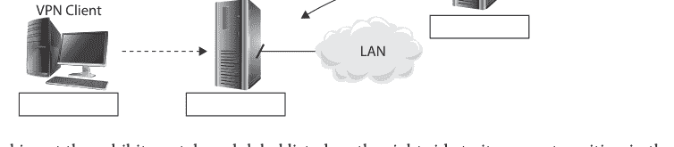

13. 查看图示，将右侧列出的每个标签与802.1X图中的正确位置进行匹配。

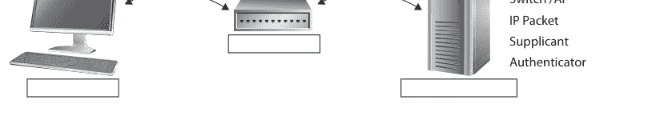

7. ☑ D. VPN服务器是网络客户端所连接的设备，然后它会将身份验证请求发送到RADIUS服务器，这意味着VPN服务器是RADIUS客户端。☒ A、B和C不正确。这些并不代表VPN服务器所扮演的角色。

8. ☑ A. 计费功能负责跟踪使用情况，以便对不同的部门或客户进行计费。☒ B、C和D不正确。这些都不是计费功能的目的。身份验证功能负责验证用户身份，而授权功能负责允许或拒绝用户访问网络。

### 实施身份验证

9. ☑ B. 虹膜扫描是最强的生物识别方式。☒ A、C和D不正确。虽然这些都是生物识别方法，但它们并不是最强的生物识别方式。

10. ☑ C. 智能卡内部装有微处理器，以及身份验证信息和供应商决定存储在卡上的其他数据，这些数据可能被系统或应用程序使用。☒ A、B和D不正确。这些设备内部不包含微处理器。令牌是一种身份验证设备，RAS是一种远程访问协议，RADIUS是一种AAA协议。

11. ☑ B. 联合服务是一种技术，允许你在第三方应用程序和生成可用于跨应用程序边界的身份验证令牌的服务器之间建立信任关系。☒ A、C和D不正确。认证器是802.1X配置中的交换机或无线接入点。请求者是试图连接到认证器的客户端，而NAT用于隐藏网络的内部地址方案。

### 基于性能的题目

12. 下图标识了RADIUS客户端和RADIUS服务器的位置。Security+考试可能会给出类似的题目，要求你将标签拖放到图中的对象上。

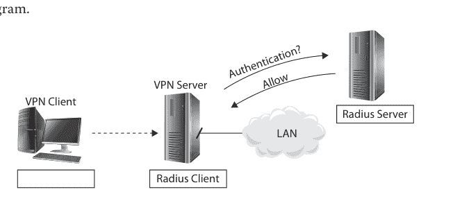

## 认证目标11.01

### 访问控制简介

在任何环境中配置安全时，第一道防线之一就是要求对系统进行身份验证（上一章中你已经接触过）。身份验证之后，用户还必须获得授权才能访问资源或执行系统任务。授权通常通过访问控制系统来实现。访问控制系统决定谁可以访问环境以及他们拥有什么级别的访问权限。

在实现对资源（如网络或文件）的访问控制时，你通常会创建所谓的访问控制列表（ACL），其中列出了有权访问该资产的系统或个人。随着本章的深入，你将进一步了解访问控制列表。

> **考试提示**
> 对于考试，请记住授权是通过使用访问控制方法来实现的。

本节首先讨论不同类型的安全控制，然后回顾访问控制方面一些常见的安全原则，从而向你介绍访问控制的概念。

### 安全控制的类型

安全控制是用于保护资产的机制；例如，防火墙是一种保护网络免受外部攻击的安全控制。对于Security+认证考试，你应该熟悉不同类别的安全控制和不同类型的安全控制。

### 控制的类别

安全控制有三个主要类别，每个类别对安全计划都有不同的作用：

- **管理（管理）控制** 管理控制（也称为管理控制）是书面的策略、规程或指导方针。在设计安全策略时，你应首先制定管理控制，因为它们将决定需要使用哪些其他类型的控制。管理控制的示例包括密码策略、招聘政策、员工筛查、强制休假和安全意识培训。


## 隐式拒绝

在不同环境中实现访问控制通常涉及一条默认规则，称为“隐式拒绝”，这意味着在配置访问控制列表（ACL）时，列表中未包含的任何内容都被禁止访问该资源。例如，在文件上配置 NTFS 权限时，未列在权限列表（即 ACL）中的任何人默认都会被拒绝访问该文件。以下是一些可以找到隐式拒绝规则的日常示例：

- **路由器 ACL** 路由器上的访问控制列表指定什么流量，无论是离开还是进入网络，允许通过接口传输。当你在路由器上启用访问列表时，默认的隐式拒绝意味着，除非另有说明，否则流量将被拒绝。
- **权限** 在文件上配置 NTFS 权限时，你列出谁可以访问该文件以及他们的权限是什么。如果某人未包含在权限列表中，无论是直接还是通过组成员身份，他们将被隐式拒绝访问该文件。
- **防火墙** 当你配置防火墙时，默认规则会拒绝所有流量进入网络，除非该流量符合你在防火墙上配置的规则。例如，你可能决定允许 TCP 端口 80 流量通过防火墙，因此你配置一条规则来实现这一点。所有其他流量默认会被防火墙阻止。

## 安全原则/通用概念回顾

在第 2 章中，你学习了一些有助于实现访问控制的重要安全原则。这些原则是最小权限、职责分离和工作轮换。在深入了解访问控制的其他方面之前，让我们回顾一下这些原则。

## 最小权限

最小权限的概念是给予用户履行其职责所需的最小权限。你不希望给予超出需要的权限，因为这样用户或管理员就可以对资源执行超出预期的操作。例如，如果 Bob 将负责备份 Windows 服务器，你不希望将他加入管理员组，因为他将有能力做超出备份的事情——他可以对系统进行任何他想要的更改。在此示例中，你希望将他加入备份操作员组，以便他的重点是备份。

> exam Watch Security+ 认证考试会测试你对这些安全原则的了解，因此请确保为考试熟悉它们。

## 职责分离

职责分离意味着你确保所有关键任务被分解为不同的流程，并且每个流程由不同的员工执行。例如，在大多数公司中，写支票支付购买的人与签署支票的人不同。通常，写支票的人是会计部门的人员，但支票通常由公司的首席财务官（CFO）签署。

## 工作轮换

在第 2 章中，你了解到你的公司应强制执行强制休假，以便通过另一名员工在某人休假期间接管工作角色来检测组织内其他员工的欺诈或可疑活动。强制休假也有助于保持员工士气高昂并让员工保持精力充沛。就像强制执行强制休假很重要一样，你也应在企业内部采用工作轮换。工作轮换确保不同员工定期执行不同的工作角色。这也有助于检测企业内的欺诈活动。

## 其他账户实践

与用户账户和访问控制相关的许多其他常见实践，你需要为 Security+ 认证考试熟悉。以下列表概述了一些常见的账户实践：

- **入职/离职** *入职* 指新员工经历的面试和入职培训流程，并包括从为该职位选择候选人的流程开始的所有步骤。一旦员工被聘用，入职流程应继续进行，确保员工拥有账户并可以访问该职位所需的所有资源。入职流程还应包括针对特定工作角色的培训，以便员工从一开始就能在你的组织中取得成功。*离职* 是员工离开组织时需要遵循的流程。这包括离职面谈，提醒他们在受聘时签署的保密协议（NDA）（如适用），禁用其账户，并收回他们可能拥有的组织资产。

- **再认证** 账户会经过 *认证* 流程以确定其是否需要。再认证是在定期基础上重新评估用户账户是否仍需要的流程。例如，你可能有一项 *再认证政策* 规定账户必须每 90 天再认证一次。如果账户被认为不必要，或者账户所有者未对再认证请求做出回应，则账户将被暂停。

## 图 11-2

访问令牌有助于确定是否应授予访问权限。

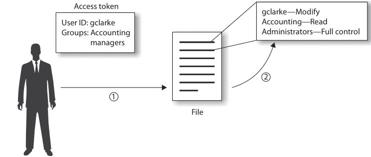

## 强制访问控制

在强制访问控制（MAC）模型中，每个个人（称为主体）会被分配一个许可级别，例如限制、秘密或绝密。组织中的数据和其他资产会被分配分类标签，表示信息的敏感性。分类标签的示例有公开、机密、秘密、绝密和未分类等。

> exam Watch 对于考试，请记住强制访问控制涉及员工根据其许可级别和分配给资源的资料分类标签获得对资源的访问权限。

系统根据其许可级别与分配给资源的分类标签匹配来控制谁获得对资源的访问权限，如图 11-3 所示。需要注意的是，如果某人具有较高的许可级别，他们可以访问分配该敏感性标签或更低敏感性标签的任何信息。

**服务账户** Windows 和 Linux 等安全操作系统要求一切都必须向系统进行身份验证，无论是用户还是软件。当软件在系统上运行时，它需要以特定用户身份运行，以便可以为软件分配权限。你与软件关联的用户账户称为服务账户，因为它是操作系统内服务使用的功能。在创建服务账户（软件应用程序将配置为使用的用户账户）时，你通常会为服务账户配置强密码并指定密码永不过期。


**确保服务账户不具有管理权限，因为否则，如果服务被缓冲区溢出攻击等攻击入侵，攻击者将拥有与服务关联的账户相同的凭据。**

**特权账户** 特权账户是具有超出分配给普通用户的额外权限的账户。特权账户通常有权对系统进行配置更改或执行普通员工通常不执行的操作。

## 使用安全组

在大多数环境中实现访问控制的第一种方法是授予安全组的访问权限。授予资源访问权限的正确方法是将用户账户放入组中，然后将组分配给资源的权限。这允许你将新用户放入组中，而无需返回修改权限。

## 练习 11-2


## 配置安全组和分配权限

在此练习中，你将在 Active Directory 中创建一个安全组，然后将用户账户放入该组中。创建组后，你将为文件夹分配组的权限。

- 1. 在 ServerA VM 上，转到服务器管理器，然后选择 工具 | Active Directory 用户和计算机。
- 2. 通过右键单击用户文件夹并选择 新建 | 用户 来创建名为 Lab11UserA 的新用户。
- 3. 输入名字 Lab11UserA。
- 4. 在用户登录名字段中输入 Lab11UserA，然后单击下一步。


5. 在“密码”和“确认密码”字段中输入 `P@ssw0rd`，然后清除“用户下次登录时须更改密码”复选框。单击“下一步”，再单击“完成”。
6. 要创建安全组，右键单击“用户”文件夹，然后选择“新建”|“组”。
7. 在组名中输入 `Authors`，然后单击“确定”。
8. 要为该组分配权限，请转到文件资源管理器并导航到 C: 盘。右键单击 C: 盘，选择“新建”|“文件夹”，并在 C: 盘上创建一个名为 `Publications` 的文件夹。
9. 要为 Authors 组分配权限，请右键单击“Publications”文件夹并选择“属性”。单击“安全”选项卡。
10. 要将作者添加到权限列表中，请单击“编辑”，然后单击“添加”。
11. 在“选择用户、计算机或组”对话框中输入 `authors`。单击“确定”。
12. 在权限列表中选择“Authors”，然后为该组分配“修改”权限。
13. 单击“确定”两次。

## 权限与特权

> **考试注意** Security+ 考试要求你理解组和权限的正确用法。请记住，用户被分配到组中，组被分配权限。

系统安全的一大部分来自于只有特定的安全主体（用户或组）才能执行某些操作。例如，如果任何人都可以备份系统上的任意文件，那将是一个巨大的安全隐患。在 Microsoft 世界中，只有拥有“备份文件和目录”权限的人才能执行备份。

在 Windows 系统上，你通常必须以管理员身份登录才能对系统进行更改，而在 Linux 中，你通常需要以 root 身份登录才能进行更改。通过授予其他人正确的权限或特权，可以允许他们对系统进行更改。

Microsoft 操作系统在系统策略中有一个“用户权限分配”部分，你可以在其中控制谁可以执行常见的行政任务，例如备份文件和目录或更改系统时间。以下概述了 Windows 中的一些常见权限：

- **从网络访问此计算机** 此权限控制谁可以从网络连接到系统。
- **允许本地登录** 此权限控制谁可以坐在计算机前并登录。

5. 要允许 Authors 组备份文件，请双击右侧的“备份文件和目录”策略。列出当前有权执行备份的用户：

6. 单击“添加用户或组”按钮，将 Authors 添加到可执行备份的用户列表中。
7. 单击“确定”，然后关闭“本地安全策略”窗口。

在课堂上教授安全概念时，我经常纠正人们对术语的使用——**权限（right）** 是某人执行任务的权力，而**权限（permission）** 是某人对资源的访问级别。例如，Authors 组被授予对 Publications 文件夹的“修改”权限（permission），而不是“修改”权限（right）。反之亦然——Authors 组被授予执行备份的权限（right），而不是执行备份的权限（permission）！

> **考试注意** 对于 Security+ 考试，请记住 **permission** 是某人对资源的访问级别，而 **right** 是某人执行特定任务的权力。

## 文件系统安全与打印机安全

你还可以控制对文件、文件夹和打印机等资源的访问。在第 7 章中，你学习了如何在 Windows 和 Linux 中应用权限，但这里我们回顾一下，因为它是访问控制的重要组成部分。

### NTFS 权限

第 7 章讨论了许多 NTFS 权限，所以我想在这里通过一种实际的方法来配置 NTFS 权限的安全性，从而总结讨论。
在配置 NTFS 权限时，请考虑你只需分配三个级别的权限：

- **读取** 我认为读取权限是我会授予的最低访问级别，它实际上包括读取、列出文件夹内容和执行权限。
- **修改** 修改权限赋予读取的所有权限，但也允许他人修改文件、删除文件，如果该权限分配给文件夹，还可以创建新文件。
- **完全控制** 此权限允许用户执行修改权限的所有任务，但也允许他们更改权限并取得文件的所有权。

## Cisco 标准访问列表

标准访问列表分配一个从 1 到 99 的数字，并且只能基于源 IP 地址允许或拒绝流量。配置标准访问列表需要两个步骤——首先必须定义访问列表，然后将其应用于路由器上的接口。

以下语法用于在标准访问列表 23 中创建两条规则，该列表拒绝源 IP 地址为 192.168.10.7 的数据包以及源地址位于 10.0.0.0 网络上的任何数据包。最后一条规则允许所有其他流量。注意，允许所有其他流量的规则放在最后，因为如果它放在第一位，那么所有流量都会被允许（匹配数据包的第一条规则就是数据包遵循的规则）。

```
enable
configure terminal
access-list 23 deny 192.168.10.7 0.0.0.0
access-list 23 deny 10.0.0.0 0.255.255.255
access-list 23 permit 0.0.0.0 255.255.255.255
```

现在我已经创建了访问列表 23，我需要将其应用到接口上以实现入站或出站通信。我可以使用入站规则阻止不需要的流量进入网络，但我也可以使用出站规则阻止流量离开网络。以下命令用于将访问列表 23 应用到我的快速以太网接口以实现入站通信：

```
interface FastEthernet0/0
ip access-group 23 in
```

Cisco 路由器在访问列表底部有一条隐式拒绝所有规则，这就是为什么我在底部放置了自己的允许所有流量规则。这意味着除非另有说明，所有流量都将被允许。

## Cisco 扩展访问列表

扩展访问列表的配置方式与标准访问列表类似，不同之处在于其分配的数字从 100 开始及以上。扩展访问列表可以基于源和目标 IP 地址，以及数据包中的协议信息来控制流量。

以下命令概述了向扩展访问列表添加规则的基本思路。注意，你以 `access-list` 命令开始，为访问列表分配一个数字，并指定是允许还是拒绝流量。新的地方是，如果需要，你可以指定 TCP、UDP 或 IP 等协议。然后指定规则要适用的数据包的源 IP 地址和源通配符掩码。接着指定目标 IP 地址和目标通配符掩码。最后，添加一个运算符，如 `EQ`（等于）以及端口号。

## 组策略

Microsoft 环境允许你使用单个系统的本地安全策略来保护系统，或者通过组策略在多台系统上配置安全设置。组策略用于在网络中的系统上配置大量设置：

- **安装软件** 使用组策略，你可以在客户端计算机启动或用户登录时自动安装软件。
- **配置密码策略** 组策略允许你配置密码策略，包括密码历史、密码复杂性、密码长度和密码过期（称为最长密码使用期限）。
- **配置审核** 使用组策略，你可以将审核策略部署到多个系统，以跟踪这些系统上的事件。
- **配置用户权限** 组策略还用于配置用户权限，即执行任务的权力。
- **受限制的组** 使用组策略，你可以控制哪些用户或组是不同组的成员。
- **禁用服务和配置事件日志** 作为系统加固过程的一部分，你可以使用组策略在多台系统上禁用服务并配置事件日志。
- **文件系统权限** 使用组策略，你可以将权限部署到不同的文件夹。
- **软件限制** 组策略也可用于部署软件限制，以限制允许在系统上运行的软件。
- **通过禁用功能锁定系统** 使用组策略，你可以通过从“开始”菜单、桌面和控制面板中删除功能来控制整个 Windows 桌面。

在配置组策略时，理解不同类型的组策略非常重要，这些策略按可配置策略的位置进行分类。以下按位置列出了组策略的类型：

- **本地** 本地策略是在单个系统上配置的策略，即你正在运行组策略对象编辑器的系统。要配置本地策略，你可以创建自定义 Microsoft 管理控制台 (MMC) 并添加组策略对象编辑器。
- **站点** 你可以将组策略部署到 Active Directory 站点，该站点可以应用于该站点中的多个域。


- 3. 在屏幕左侧展开你的服务器，然后右键单击数据库文件夹并选择新建数据库。

- 4. 输入数据库名称 SecPlus_McgrawHill，然后单击确定。

- 5. 单击工具栏上的新建查询按钮并输入以下代码：

```
--Switch to the database
Use SecPlus_McgrawHill

-- Create a customer table to store customer data

CREATE TABLE [dbo].[Customer] (
    [CustomerID] [int] IDENTITY(1,1) NOT NULL,
    [LastName] [nvarchar](50) NULL,
    [FirstName] [nvarchar](50) NULL,
    [Email] [nvarchar](50) NULL,
    [EncryptedCreditCardNumber] [varbinary](128) NULL,
    CONSTRAINT [PK_Customer] PRIMARY KEY CLUSTERED (
    [CustomerID] ASC
    )
)
```

- 6. 要加密表中的数据，你必须首先创建数据库主密钥（如果尚未存在），然后创建证书以保护对称密钥。输入并执行以下代码以创建主密钥：

```
--Create a database master key for encryption of keys
use SecPlus_McgrawHill
if not exists
    (select * from sys.symmetric_keys where symmetric_key_id = 101)
    create master key encryption by password='Pa$$w0rd'

--Then create a certificate to encrypt the symmetric key
create certificate CustomerCreditCardCert
with subject = 'Customer Credit Card Number Encryption Key'
GO
--Create a symmetric key that uses AES
create symmetric key CustomerCreditCardKeyAES with algorithm=AES_256
encryption by certificate CustomerCreditCardCert;
GO
```

- 7. 现在你已准备好在 Customer 表中存储数据。在开始插入记录之前，你需要打开对称密钥以加密信用卡号码。在查询窗口中输入并执行以下命令：

```
--Open key so that we can encrypt data with it
open symmetric key CustomerCreditCardKeyAES
    decryption by certificate CustomerCreditCardCert;

--insert records
insert into Customer (
    Lastname,
    Firstname,
    Email,
    EncryptedCreditCardNumber
) Values (
    'Clarke',
    'Glen',
    'gleneclarke@hotmail.com',
    encryptbykey(key_guid('CustomerCreditCardKeyAES'),'3695-3445-9227',
    1,HASHBYTES('SHA1',convert(varbinary,9899))) -- function to encrypt data
)

insert into Customer (
    Lastname,
    Firstname,
    Email,
    EncryptedCreditCardNumber
) Values (
    'Dixon',
    'Sean',
    'sdixon@email.com',
    encryptbykey(key_guid('CustomerCreditCardKeyAES'),'5622-3498-3467',
    1,HASHBYTES('SHA1',convert(varbinary,9899)))--function to encrypt data
)
-- close encryption key now that data is written
close symmetric key CustomerCreditCardKeyAES
```

- 8. 为了证明数据已加密，对 Customer 表执行选择操作：

```
-- To view customer data. Note the credit card is encrypted
select * from customer;
```

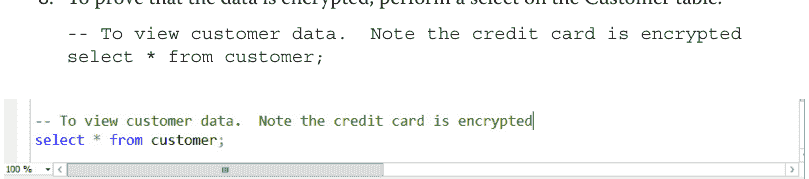

- 9. 要读取信用卡信息，你必须打开密钥然后对 EncryptedCreditCardNumber 字段使用 decryptbykey 函数。输入以下代码以查看信用卡信息：

```
-- To decrypt credit card data and view customer data
open symmetric key CustomerCreditCardKeyAES
    decryption by certificate CustomerCreditCardCert;

select customerid, lastname, firstname, email,
    convert(varchar,decryptbykey(encryptedcreditcardnumber,1,HASHBYTES('SHA1',
convert(varbinary,9899)))) as 'CCNumber' from customer

Close symmetric key CustomerCreditCardKeyAES;
```

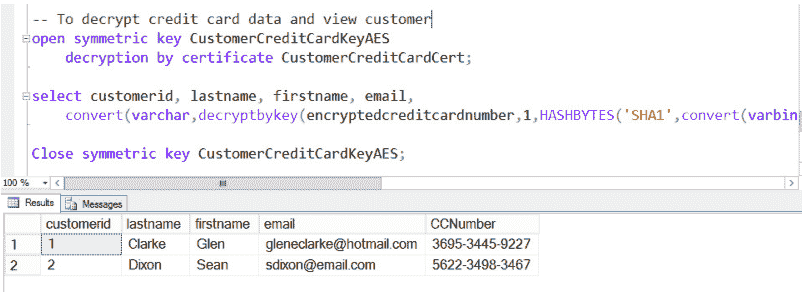

## 账户限制

访问控制的另一个重要部分是对用户账户设置限制。第一个重要限制是确保所有员工都有用于登录的用户账户，并且这些用户账户使用强密码。

## 账户过期

如果你是为临时员工创建的账户，你也可以为账户实施账户过期。例如，会计师事务所可能会决定在税务季节雇佣一名新的临时会计，但在税务季节结束后员工就会被解雇。在网络上创建此账户时，请务必设置账户过期日期（见图 11-4），这样在离职当天，账户将不再有效。

**FIGURE 11-4**

设置用户账户的账户过期时间

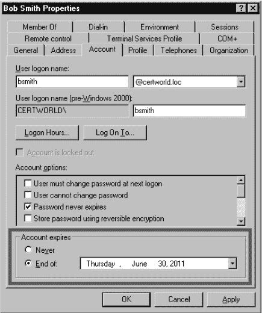

## 时间限制

对用户账户可以设置限制的另一个例子是账户登录的时间限制。大多数环境允许你将员工允许登录系统的时间作为用户账户的属性进行指定（见图 11-5）。这样做的好处是，你可以确保员工在非工作时间不会访问网络资源。

**FIGURE 11-5**

设置登录时间以控制用户可以登录网络的时间

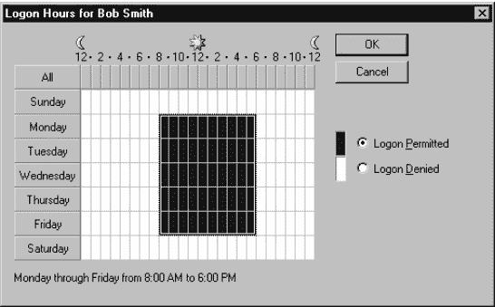

该命令将检索 Active Directory 账户信息，例如账户名称、账户过期时间、密码信息和工作站限制。

以下代码列表显示了 Tanya 用户账户的账户详细信息：

```
C:\>net user tclarke /domain
User name                  tclarke
Full Name                  Tanya Clarke
Comment
User's comment
Country code               000 (System Default)
Account active             Yes
Account expires            Never

Password last set          2/14/2021 7:11 PM
Password expires           Never
Password changeable        2/15/2021 7:11 PM
Password required          Yes
User may change password   Yes

Workstations allowed       All
Logon script               users.bat
User profile
Home directory             \\win2003\users\tanya
Last logon                 5/20/2021 5:33 AM
Logon hours allowed        Monday 8:00 AM - 6:00 PM
                           Tuesday 8:00 AM - 6:00 PM
                           Wednesday 8:00 AM - 6:00 PM
                           Thursday 8:00 AM - 6:00 PM
                           Friday 8:00 AM - 6:00 PM

Local Group Memberships
Global Group memberships   *Domain Users          *Marketing
The command completed successfully.
C:\>
```

## 账户策略执行

你应该熟悉与访问控制相关的许多概念和最佳实践。其中一些主题在本章中已详细讨论过，但我想对在组织内实施账户策略的最佳实践进行总结。

> exam Watch
> Security+ 考试要求你了解接下来列出的不同类型的账户策略，尤其是地理围栏、地理标记和地理定位。

- **共享账户** 必须确保所有用户都有自己的账户，以便可以唯一应用权限并审计每个人的操作。
- **凭证管理** 确保你拥有中央凭证管理工具以及用户必须多久更改一次密码的策略。
- **组策略** 应使用组策略将安全设置部署到网络上的所有服务器和客户端。
- **密码复杂度** 确保对系统上的任何账户和网络访问使用复杂密码。这些密码比非复杂密码更难破解。
- **过期** 确保密码在一段时间后过期并且用户必须设置新密码。此外，请确保为创建的任何临时用户账户设置过期日期。
- **恢复** 确保你能够恢复任何被删除的账户或重置任何忘记的密码。
- **禁用** 确保禁用任何不必要的账户并在员工休假时禁用账户。
- **锁定** 配置账户锁定策略，以便如果在三次尝试后输入错误密码，账户将被锁定（无法使用），直到管理员将其解锁。
- **密码历史** 一个重要的密码设置是密码历史选项——确保你的系统通过保留之前的密码来防止用户重复使用相同的密码。
- **密码重用** 确定你的组织对重用密码的政策并确保将密码历史配置为执行该政策。
- **密码长度** 大多数组织要求密码最小长度为八个字符。
- **禁止通用账户** 与前面提到的共享账户点类似，确保没有为用户或系统共享而创建的通用账户，因为这使得审计操作变得困难。
- **网络位置** 你的公司可能希望实施访问控制策略，限制从特定网络位置访问特定资源。例如，为了访问敏感服务器，用户必须连接到安全网络。前面提到的另一个例子是，在 Azure 中你可以根据来自特定国家的 IP 地址阻止访问。此外，像 Netflix 这样的流媒体服务可以根据你所在的国家阻止对内容的访问。
- **地理围栏** 地理围栏是一项功能，允许软件管理员定义创建边界（或虚拟围栏）的 GPS 坐标。当运行该软件的设备超出边界时，会触发警报。


- **地理标记** 地理标记是指在社交媒体应用（如 Facebook 或 Instagram）中使用帖子来识别你的位置。作为公司政策，你可能希望限制地理标记的使用以及在社交媒体上发布公司信息。
- **地理定位** 地理定位是指识别项目（如手机）的地理位置的术语。例如，一旦确定了手机的地理位置（GPS 坐标），你就可以使用地图技术将其与街道地址关联起来。
- **基于时间的登录** 如前所述，你可以限制用户登录系统的日期时间。你可能制定了政策，限制不同工作角色员工的登录时间。
- **访问策略** 访问策略是一种定义每个用户账户对系统或信息的访问级别的策略。
- **账户权限** 你应制定政策，规定账户对网络中系统和数据的不同类型的权限。
- **账户审计** 你应审计用户账户的活动。这包括登录活动、对敏感数据的访问，以及用户权限的任何更改。
- **不可能的旅行时间/风险登录** 这是今天在 Azure 等云环境中常用的一个属性，可以识别不可能的旅行时间。这意味着如果你在 UTC 时间 6:00 从日本登录，然后在 UTC 时间 7:00 从哈利法克斯登录，就会触发不可能的旅行通知，因为在该时间内你不可能在两个物理位置之间旅行。这被视为风险登录，可以被阻止或需要多因素身份验证（MFA）。

## 监控账户访问

访问控制的一个重要部分是监控对系统的访问，并确保你的访问控制模型和实施是有效的。以下是与访问控制相关的一些监控最佳实践：

- **基于组的权限** 确保你大部分情况下是将权限分配给组而不是用户，因为这样更容易管理且错误更少。例如，如果你需要某些员工更改时间，创建一个“时间更改者”组并将权限分配给该组。务必定期监控已分配的权限。
- **用户分配的权限** 可能有时候你决定将权限分配给用户而不是组。你希望将此情况降到最低，因为员工的工作角色会发生变化，这意味着你需要更改分配给该员工的权限。组管理将是更好的方法。

11. 用于更改 Linux 文件权限的命令是什么？

- A. cat
- B. chmod
- C. ls
- D. chperm

## 基于性能的问题

12. 使用展品，将不同的控制措施与其控制类别匹配。

**控制措施：**

- 防火墙
- 锁定电缆
- 密码策略
- 监控摄像头
- 安全意识培训
- 防病毒软件
- 员工筛选

**控制类别：**

- 物理控制
- 逻辑控制
- 管理控制

13. 使用展品，将左侧的不同术语与右侧的访问控制技术描述类型匹配。

**术语：**

- 自主访问控制
- 服务账户
- 基于角色的访问控制
- 地理围栏
- 不可能的旅行时间/风险登录
- 地理标记
- 强制访问控制
- 网络位置

**描述：**

- 确定某人无法在短时间内从两个不同位置登录
- 根据用户连接的国家/地区确定访问权限
- 允许软件管理员定义创建边界的 GPS 坐标
- 根据分配给数据的安全标签和分配给人员的安保许可确定访问权限
- 使用 Facebook 或 Instagram 等社交媒体应用的帖子识别你的位置
- 根据用户所属的组确定访问权限
- 一个确定在系统上运行的软件的安全上下文的账户
- 根据权限列表确定访问权限

## 自测答案

### 介绍访问控制

1. ☑ D. 管理控制是组织内部的政策，是你的安全计划中不太技术性的方面。管理控制的例子有安全政策、招聘政策、终止政策、员工筛选以及设计培训计划。☒ A、B 和 C 是错误的。防火墙、加密和入侵检测系统是逻辑控制的例子。

2. ☑ B. 入侵报警系统是侦测控制的一个例子。☒ A、C 和 D 是错误的。控制的另外两个类别是预防性和纠正性。预防性控制防止事件发生，而纠正性控制在事件发生后恢复系统。逻辑是控制的类别，而不是控制的类别。

3. ☑ C. 职责分离是安全的基本原则，要求将关键任务分解为不同的流程，并指派不同的人员执行每个流程，以便没有个人执行关键任务的两个流程。让执行安全审计的人创建环境是有安全风险的。☒ A、B 和 D 是错误的。最小权限原则意味着给予用户履行其职责所需的最小权限。隐式拒绝是访问控制原则，涉及拒绝未明确授予的任何内容。工作轮换是确保员工轮换不同工作岗位以帮助防止欺诈活动。

### 访问控制方案

4. ☑ A. 强制访问控制（MAC）涉及为信息分配分类标签以识别信息的敏感性。☒ B、C 和 D 是错误的。自主访问控制（DAC）涉及为用户和组分配权限。基于角色的访问控制（RBAC）涉及将用户放入具有分配权限的角色（或组），而基于规则的访问控制（也称为 RBAC）涉及创建具有指定授权或未授权内容的规则的访问控制列表。纠正性是控制类型，而不是访问控制方法。

5. ☑ C. 基于角色的访问控制涉及将用户放入具有分配权限的角色（或组）。☒ A、B 和 D 是错误的。强制访问控制涉及为信息分配分类标签以识别信息的敏感性。自主访问控制涉及为用户和组分配权限。基于规则的访问控制涉及创建具有指定授权或未授权内容的规则的访问控制列表。

### 实施访问控制

6. ☑ B. 自主访问控制涉及为用户和组分配权限。☒ A、C 和 D 是错误的。强制访问控制涉及为信息分配分类标签以识别信息的敏感性。基于角色的访问控制涉及将用户放入具有分配权限的角色（或组）。基于规则的访问控制涉及创建具有指定授权或未授权内容的规则的访问控制列表。

7. ☑ D. 在强制访问控制中，安全许可分配给用户，该用户称为主体。☒ A、B 和 C 是错误的。资源被分配分类标签，而不是许可级别。数据和文件是资源的例子。

8. ☑ C. 基于规则的访问控制涉及创建具有指定授权或未授权内容的规则的访问控制列表。☒ A、B 和 D 是错误的。强制访问控制涉及为信息分配分类标签以识别信息的敏感性。自主访问控制涉及为用户和组分配权限。基于角色的访问控制涉及将用户放入具有分配权限的角色。

9. ☑ D. 基于属性的访问控制（ABAC）涉及根据对象的属性（如用户账户）控制谁有权访问资源。☒ A、B 和 C 是错误的。基于角色的访问控制（RBAC）涉及将用户放入具有分配权限的角色，而基于规则的访问控制（也称为 RBAC）涉及创建具有指定授权或未授权内容的规则的访问控制列表。基于组的访问控制（GBAC）涉及通过将用户放入组然后将组权限分配给资源来控制访问。强制访问控制（MAC）涉及为信息分配分类标签以识别信息的敏感性。

10. ☑ A. 隐式拒绝安全原则意味着使用隐含的“拒绝其他所有内容”规则，例如 Cisco 路由器上的访问列表。☒ B、C 和 D 是错误的。最小权限原则意味着给予用户履行其职责所需的最小权限。职责分离是安全的基本原则，要求将关键任务分解为不同的流程，并指派不同的人员执行每个流程，以便没有个人执行关键任务的两个流程。工作轮换是确保员工轮换不同工作岗位以帮助防止欺诈活动。

11. ☑ B. chmod 命令用于在 Linux 中更改文件的权限。☒ A、C 和 D 是错误的。cat 命令用于在 Linux 中显示文本文件的内容，而 ls 命令用于列出文件。没有 chperm 命令。


## 基于性能的问题

- 12. 该图显示的是识别不同控制及其类别的答案。请注意，真正的 Security+ 考试可能会要求你将方框从屏幕的一侧拖到另一侧。另请注意，密码策略包含密码的规则（管理控制），而不是组策略对象中的设置（逻辑控制）。

  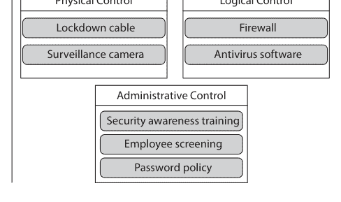

- 13. 下图显示了每个访问控制术语与其功能描述或示例的匹配情况。

  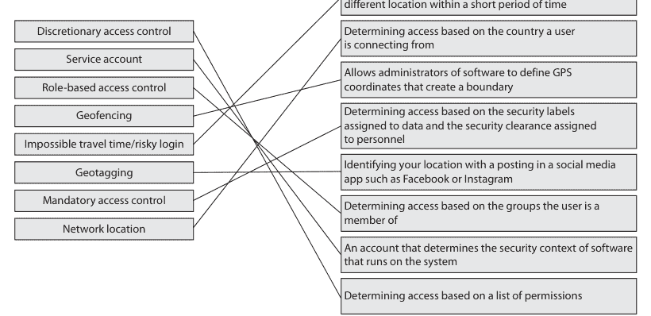

本章介绍了与密码学及其术语相关的概念。在参加 Security+ 认证考试时，你一定会在这个主题领域受到测试，因此你应该很好地掌握本章内容（并注意考试提示！）。

## 认证目标 12.01

### 密码学服务简介

本节介绍密码学提供的服务以及与密码学相关的一些术语，如*密钥*和*算法*。

### 理解密码学

在讨论密码学时，大家首先想到的是加密信息，但密码学提供的不仅仅是加密。密码学提供三项核心服务：加密、散列和认证。

#### 加密

最常见的密码学服务是*加密*，它通过将明文信息转换为密文来保持数据的机密性。*明文*是以可读格式存在的信息。*密文*是经过加密的、不可读格式的信息。

要将信息转换为密文，必须将明文信息通过加密算法进行处理。之后要解密信息，必须将密文通过数学算法进行处理。这将信息从密文转换为明文（见图 12-1）。

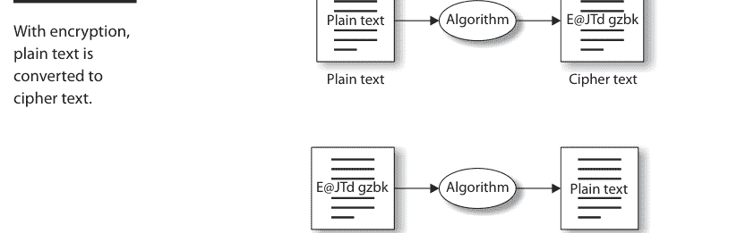

在加密的历史上，人们使用了不同类型的密码。两种常见的密码类型是替换密码和换位密码。

#### 替换密码

替换密码涉及将一个字符替换为另一个字符。例如，你可以将消息中的每个字母替换为字母表中其后面第五个位置的字母。这意味着每个字母 e 都会被转换为字母 j，每个 a 都会被转换为 f，以此类推。以下是此替换密码结果的示例：

```
Plain text:  This is a plain text message
Cipher text: Ymnx nx f uqfns yjcy rjxxflj
```

使用替换密码的两种经典算法示例是凯撒密码和 ROT13。凯撒密码通过将消息中的每个字符递增一定数量（例如 3）来替换字符。ROT13 密码将字符递增 13。以下示例显示了凯撒密码和 ROT13 的结果：

```
Plain text:  This is a plain text message
Caesar cipher: Wklv lv d sodlq whaw phvvdjh
ROT13 cipher: Guvf vf n cynva grkg zrffntr
```

#### 换位密码

换位密码涉及将消息中的字符移动一定数量的位置。例如，在以下示例中，消息通过将字符向右移动两个位置进行加密：

```
Plain text: Glen
Cipher text: enGl
```

> **考试注意**
> 对于 Security+ 考试，请记住，替换密码是用一个字符替换另一个字符，而换位密码是移动字符的位置。

#### 散列

散列用于维护信息的完整性。使用散列时，目标是证明信息在发送给接收者或存储到磁盘后未被更改。为了验证数据未被更改，需要将数据通过散列算法运行，以生成散列值（称为消息摘要）。然后，散列值与数据一起存储。

之后读取数据时，再次将数据通过散列算法运行，以生成新的散列值。然后将新散列值与存储的散列值进行比较，如果两者相同，则数据未被更改（见图 12-2）。

使用维吉尼亚密码加密信息时，你写下消息，然后在消息下方重复密钥，持续时间与消息长度相同，就像前面的示例一样：

```
Message: h i t h e r e
Key: b a d b a d b
```

要加密消息，你一次处理一个字符。例如，要加密消息中的字母 h，请在维吉尼亚表中找到 h 行，并将其与代表密钥中字符的列（在此示例中为 b 列）相交。相交处的值即为密文字符，在此例中为 i。

以下是使用维吉尼亚表得到的密文：

```
Message: h i t h e r e
Key: b a d b a d b
Cipher: i i w i e u f
```

请注意，使用“bad”这样的短密钥并不是一个好做法，因为它比长密钥更容易破解。我在这些示例中使用短密钥只是为了在消息长度内重复密钥。

### 其他密码学术语

对于 Security+ 认证考试而言，还有其他一些密码学概念需要理解。以下各节将介绍这些密码学术语和概念。

#### 密钥强度/密钥长度

密钥强度，也称为密钥空间或密钥长度，指的是加密密钥中有多少位。密钥空间越大，加密效果越好。这是因为如果有人试图破解密钥，更大的密钥空间意味着需要计算的可能值更多。例如，2 位密钥空间只允许四个值：00、01、10 和 11。计算一个 2 位密钥可能拥有的所有密钥值根本不费时间。如果将密钥空间增加到 3 位，则有八个可能的值：000、001、010、011、100、101、110 和 111。

常见的密钥空间有 64 位、128 位、256 位，有时还有 512 位。

#### 工作因子

术语“工作因子”指的是表示破解加密所需时间的值。工作因子通常以时间衡量，并且通常密钥空间越大，工作因子越高。

例如，破解 64 位密钥比破解 128 位密钥所需的时间更少，因此破解 64 位密钥的工作因子较低。

### 表 12-1：分组密码模式

| 分组密码模式 | 描述 |
|---|---|
| 电子密码本（ECB） | 每个分组使用相同的密钥单独加密。如果相同的数据在文本中出现多次，例如常见单词，由于使用相同的密钥加密，它会生成相同的密文。 |
| 密码分组链接（CBC） | 为防止相同的数据生成相同的密文，将初始化向量（IV）与数据分组进行 XOR 运算，然后使用密钥对结果进行加密。生成的密文作为下一个待 XOR 的数据分组的 IV。然后对结果使用密钥进行加密。此过程对每个数据分组重复进行。 |
| 密码反馈（CFB） | 此模式使用前一个分组的密文来加密当前数据分组。 |
| 输出反馈（OFB） | 此模式使用加密密钥加密 IV，然后使用该结果（称为输出）来加密下一个数据分组。然后将明文分组与当前输出分组进行 XOR 运算，以创建该分组的密文。 |
| 计数器模式（CTR） | 此模式的行为与 CFB 模式非常相似，但不用前一个分组的密文，而是使用发送方和接收方都知道的共享值（也称为计数器）与密钥一起加密数据。 |
| Galois/计数器模式（GCM） | 一种高性能对称分组密码模式，可用于数据完整性和机密性服务。GCM 建立在 CTR 模式之上，将密文与身份验证码相结合，以验证该数据分组的完整性。 |

### 填充

在加密数据时，明文消息通常不会占用整数个分组。很多时候，必须在最后一个分组中添加填充以完成数据流。

添加的数据可以全部为 1、全部为 0，或 1 和 0 的组合。所使用的加密算法负责确定将应用的填充。根据算法实现的不同，有各种填充技术可用。

### XOR

异或（XOR）是一种在密码学中常见的数学运算。对于 XOR 运算，如果两个被比较的比特中恰好有一个值为 1，则该计算比特的结果为 1。但如果两个被比较的比特值都为 1，或者都不为 1，则结果比特的答案为 0。


以下内容总结了当两个位进行异或运算时，XOR 函数的公式：

```
0+0=0
0+1=1
1+0=1
1+1=0
```

对于加密，纯文本会与密钥进行异或运算以创建密文。考虑以下示例：

```
Plain text: 10110101
Key:        01101011
Cipher text: 11011110
```

纯文本加密为密文后，XOR 函数的原理是，你可以通过再次将密文与密钥进行异或运算来解密信息：

```
Cipher text: 11011110
Key:         01101011
Plain text:  10110101
```

现在你已经了解了基本的密码学术语，让我们来看看不同类型的加密。

## Salt, IV, and Nonce

大多数加密实现都使用密钥，但许多也使用盐值、初始化向量和随机数来增强加密或哈希函数。

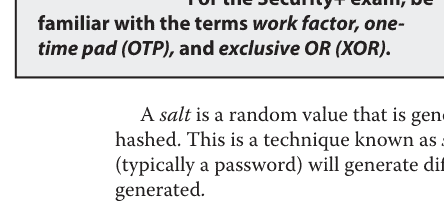

> Watch For the Security+ exam, be familiar with the terms work factor, one-time pad (OTP), and exclusive OR (XOR).

盐值是在数据被哈希之前生成并与数据结合的随机值。这是一种称为加盐的技术，用于确保相同的输入数据（通常是密码）在生成密码哈希时产生不同的哈希值。

与盐值概念相似，初始化向量或 IV 是一种生成的随机值，用于与加密密钥一起加密数据。将 IV 与密钥结合的目的在于确保如果黑客获得了对加密数据的访问权限，他们就无法比较加密数据的不同部分来尝试确定密钥值。IV 为使用相同密钥加密的每个数据段提供了随机性。

随机数是非随机生成的数字，仅使用一次，通常应用于身份验证流量。随机数的典型场景是在身份验证过程开始时。客户端向服务器请求随机数值。服务器向客户端发送一个随机数，客户端随后使用该数字对密码进行哈希处理（使用哈希算法），并将哈希后的身份验证信息通过网络发送给服务器。

对称加密有许多其他名称，例如以下：

- **共享或预共享密钥**  这个名称源于你需要与将要解密信息的个人共享密钥。这是描述对称密钥的术语。
- **密钥**  这个名称来自于你必须将密钥保密，不让不应解密信息的任何人知道。这是描述对称密钥的另一个术语。
- **密钥算法**  这是执行加密的对称算法。术语*密钥*经常与*对称*互换使用，因为它来自于密钥应保密给不应解密消息的人这一事实。请记住，算法并不是秘密的；它们是公开验证的算法。
- **会话密钥**  这个名称来自于许多对称加密实现使用随机密钥，即会话密钥，来进行加密/解密。你将在下一章了解更多相关内容。
- **私钥**  这个名称来自于你需要将密钥保密，仅限于需要解密信息的各方；否则，你将失去保密性。

> Watch  For the Security+ exam, remember that symmetric encryption is encrypting and decrypting information with the same key.

## Advantage of Symmetric Encryption

对称加密的优点是它比非对称加密快得多。如果你要加密大量信息，使用对称加密而不是非对称加密可以获得性能优势。

## Disadvantages of Symmetric Encryption

使用对称加密有两个主要缺点。首先，如何将密钥传达给需要解密消息的各方？你必须确保以安全的方式传达密钥。

对称加密的第二个缺点是确保所有人员保密所需的密钥数量。这意味着为了让三个人互相加密消息，你需要为每个人的安全通信准备三个不同的对称密钥。随着需要通信的人数增加，所需的密钥数量急剧上升。用于计算所需对称密钥数量的公式如下：

Number of keys = people × (people − 1) / 2

如上所述，如果三个人需要通信，你需要 3 × (3 − 1)/2，即 3 个密钥。如果你有六个人，你需要 6 × (6 − 1)/2，即 15 个密钥！在一个拥有数十名员工的组织中，使用对称加密需要管理的密钥数量会使加密变得复杂。

## EXERCISE 12-2

## Encrypting Data with the AES Algorithm

在本练习中，你将使用练习 12-1 中的 CrypTool 使用 AES 算法加密一条消息。

- 1. 启动 CrypTool 程序，如果显示启动提示则单击关闭。
- 2. 选择 File | Close 以关闭出现的示例文档。
- 3. 创建一个新文档（选择 File | New），然后在文档中输入以下文本：
- 4. 选择 Crypt/Decrypt | Symmetric (modern) | Rijndael (AES)。
- 5. 输入以下 128 位密钥：
- 6. 单击 Encrypt。
- 7. 注意，密文与使用凯撒密码生成的密文完全不同。这是因为它使用了不同的算法（数学计算）。

```
This is a short message to test encryption
```

```
ABCDEFABCDEFABCDEFABCDEFABCDEFAB
```

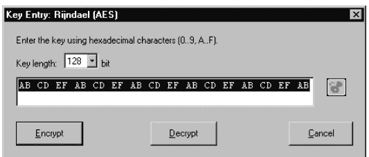

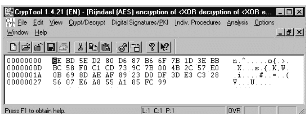

## FIGURE 12-5

非对称加密使用两个在数学上相关的密钥。

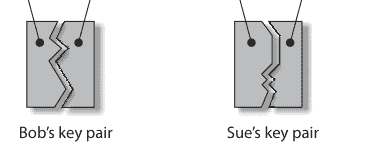

然后将 Bob 的私钥交给 Bob，并告诉他这是他的私钥，他必须将其保存在所有其他人之外。向 Bob 解释私钥在网络上标识他，如果任何其他人获得此密钥，他们就可以冒充他，这不是一件好事。

接下来，对 Sue 做同样的事情。生成 Sue 的密钥对，然后将公钥放在所有员工都可以访问的位置。给 Sue 她的私钥，并要求她确保不将私钥交给任何其他人。

我们的设置如图 12-6 所示。一旦你将公钥放在所有员工都可以访问的位置，并配置 Bob 和 Sue 将访问的应用程序以使用他们的私钥，你就可以开始使用密钥了。

Security+ 认证考试期望你知道哪个密钥用于执行不同的密码学操作。例如，当 Bob 想加密一条消息并发送给 Sue 时，使用哪个密钥？（记住 Sue 将使用密钥对中的相应密钥来撤销操作，即解密。）以下哪个是正确的密钥？

Bob's private key No. 如果 Bob 使用他的私钥加密消息，那么他的公钥将被用于解密它。虽然 Sue 可以访问 Bob 的公钥，但其他人也可以。所以，如果使用 Bob 的私钥，就不会有保密性，因为每个人都可以解密消息。

## FIGURE 12-6

公钥存储在中央位置；私钥与用户在一起。

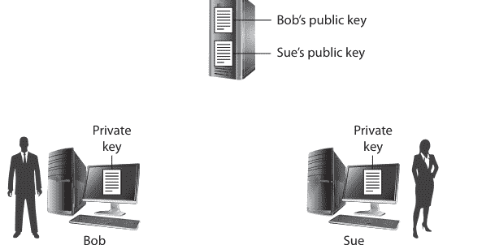

- **Bob’s public key** No. 如果使用 Bob 的公钥加密消息，他的私钥将被用于解密消息，而 Sue 没有访问 Bob 私钥的权限。因此，她将无法解密发给她的消息。
- **Sue’s private key** No. Bob 没有访问 Sue 私钥的权限，所以他永远无法使用 Sue 的私钥加密消息。
- **Sue’s public key** Yes. 在非对称加密环境中，消息始终使用接收者的公钥加密。Bob 可以访问 Sue 的公钥，而 Sue 是唯一拥有在数学上相关密钥的人，所以她是唯一可以解密消息的人。

> exam watch
> For the Security+ exam, remember that when using asymmetric encryption, the message (or data) is encrypted with the recipient’s public key. Also remember that to ensure nonrepudiation, the message is signed using the sender’s private key.

如果 Bob 想签署消息以便 Sue 知道消息绝对来自他，Bob 将使用他的私钥对消息进行数字签名，然后将消息发送给 Sue。当 Sue 收到消息时，她将比较密钥与所有公钥并发现在数学上相关的密钥是 Bob 的公钥。这就是不可否认性的实现方式。Bob 不能说他没有发送消息，因为他的系统使用他的私钥对消息进行签名。我们将在第 13 章中更多地讨论非对称环境中的身份验证。

## Advantages and Disadvantages of Asymmetric Encryption

非对称加密的优点在于你可以安全地将公钥传达给其他各方，而与对称加密不同。在非对称系统中，你可以自由地分发公钥，而私钥保留在用户手中。

密钥管理也是使用非对称加密的好处。你看到随着用户数量的增加，对称加密中密钥数量急剧上升。而使用非对称加密，每个用户只需一个密钥对即可为所有其他用户加密消息。

非对称加密的缺点是它比对称加密慢。如果性能是关键因素，对称加密可能是更好的选择。


哈希值被称为 *单向哈希值*，因为不可能对哈希值进行逆向操作来计算出消息（或数据）。这就是大多数厂商在系统上存储密码时会对其进行哈希处理的原因——哈希值无法被检索并用来计算用户账户的密码。

记住关于哈希的以下关键点：

- 哈希值具有固定的长度，具体取决于哈希算法。无论被哈希的数据量有多大，哈希算法始终生成相同大小的哈希值。
- 哈希值也被称为 *消息摘要*。
- 哈希基于数据本身，而不是文件的头信息。例如，如果你计算一个文件的哈希值，然后更改文件名并再次计算哈希，它将是相同的哈希值。这样可以防止有人通过重命名文件来隐藏或歪曲文件。技术上，如果你想证明它是同一个文件，只需计算哈希即可。
- 尽管可能性极低，但从技术上讲，两个不同的数据片段可能会生成相同的哈希值，这取决于算法创建的哈希值的大小。例如，64 位哈希值只能有这么多可能的值，因此在进行计算时可能会得到重复的哈希。另一方面，128 位哈希值有更多可能的哈希值可以计算。这意味着有更多机会获得唯一的哈希值。
- *碰撞* 是指两段不同数据计算出相同哈希值的术语。

## 哈希算法

正如对称加密算法执行加密信息所涉及的数学运算一样，哈希算法执行从数据计算哈希值的数学运算。

以下是近年来使用过的一些常见哈希算法：

- **消息摘要 (MD)** MD 算法由 Ron Rivest 创建，并有不同版本，如 MD2、MD4 和 MD5。MD5 算法是当今最常见的哈希算法之一。它生成 128 位哈希值。
- **安全哈希算法 (SHA)** 由国家安全局创建，SHA 算法有不同版本，如 SHA-0、SHA-1 和 SHA-2。三种目前使用中最常见的哈希协议 SHA-1，创建 160 位哈希值。
- **SHA-256 和 SHA-512** 这是 SHA 算法的两个较新版本，分别生成 256 位和 512 位哈希值。它们被认为不易受到碰撞攻击。


哈希是一个重要的概念，需要在现实世界中理解，因为它用于在大多数应用环境中识别数据的完整性。例如，当你从互联网下载文件时，大多数网站都会提供文件的哈希值，以便你在下载完成后检查下载文件的完整性。

## CERTIFICATION OBJECTIVE 12.05

## 识别加密用途

本节讨论了当今计算和网络环境中使用经过验证的技术对加密的常见用途。加密用于加密存储中的数据，但也用于加密系统或人员之间的通信。

## 常见用例

在日常使用中，有许多情况会使用不同的密码学概念和技术。以下概述了一些在实践中可以看到这些概念的常见场景：

- **低功耗设备** 使用低功耗设备是我们今天用来限制通信信号传播距离的方法。例如，你应该降低无线信号的功率，以便建筑物外的人无法连接到你的无线网络。
- **低延迟** 延迟是衡量日常网络性能的一个指标。低延迟意味着响应等待时间最小。例如，你希望客户端系统与身份验证服务器之间的延迟很低。
- **高弹性** 弹性是指解决方案对故障的抵抗能力。提供高弹性的技术示例包括高可用性解决方案（例如，集群和 RAID）和负载均衡解决方案。
- **支持保密性** 有大量技术用于维护保密性，包括任何加密技术，例如无线使用的 WPA2，以及磁盘加密，例如 BitLocker。
- **支持完整性** 完整性解决方案使用的一个例子是当你为文件创建 MD5 或 SHA-1 哈希时，这样当有人下载文件时，他们可以验证他们拥有未被修改的文件版本。
- **支持混淆** 加密算法和不同的分组模式是混淆的一个例子。
- **支持身份验证** 客户端证书和与网站的双因素身份验证是支持身份验证的概念示例。
- **支持不可否认性** 当你对电子邮件消息进行数字签名时，你就是在支持不可否认性，以确保发送者不能否认他们发送了该消息。
- **资源与安全约束** 资源可能与安全约束冲突的用例有很多。例如，今天许多设备都内置了无线功能，而一些公司有不允许使用无线的政策。在这种情况下，设备的无线功能被禁用，因为公司安全约束优先于资源。

## 理解局限性

Security+ 考试期望你了解不同的加密协议以及每个协议局限性所涉及的风险。例如，如果应用程序使用 DES 或 3DES，安全风险在于它们是弱加密方法，因为它们是已被破解的老标准。以下是需要了解的加密标准的一些局限性：

- **速度** 知道对称加密比非对称加密更快，这就是为什么许多技术同时使用这两种方法——对称用于速度，非对称用于密钥管理。
- **大小** 知道密钥越大，加密越强。例如，256 位 AES 加密比 128 位 AES 加密更强。
- **弱密钥** 使用弱加密密钥会使加密容易受到攻击。使用具有最大可能密钥大小的加密标准会降低密钥被破解的风险。
- **时间** 知道不同类型的加密在加密和解密更多数据时需要更长的时间。例如，使用对称加密加密大文件所需的时间比非对称加密少。
- **寿命** 了解加密协议或应用程序的预期寿命很重要。你不希望在实施后不久技术就不再可接受。
- **可预测性** 使用使技术使用的随机值难以预测的技术。例如，使用可预测的 IV 可能会对被加密数据的隐私构成风险。
- **重用** 重用密钥可能会对你的环境构成安全风险，因为它可以帮助攻击者破解加密密钥。
- **熵** 熵是加密应用程序用于加密数据的系统随机信息。无法创建良好熵的应用程序可能容易被攻击者解密数据。
- **计算开销** 加密算法越先进，系统所需的处理能力就越多。你可以使用 GPU 来处理强加密应用程序的计算开销。
- **资源与安全约束** 与计算开销相关，加密算法和密钥大小越强，使用资源（RAM 和处理器）就越多。在获得良好安全性和不使系统过载之间找到平衡很重要。

## 加密数据

如果你想确保公司信息不会被未经授权的个人查看，你需要加密数据。在考虑加密数据时，请考虑加密以下内容：

- **传输中数据** 在数据从源传输到目的地的网络中加密数据，这样如果有人窃听通信，他们将无法读取数据。你将在本章后面学习通信加密协议。
- **静态数据** 在磁盘或数据库上存储信息时，加密数据，这样如果有人获得驱动器或数据库的访问权限，他们就无法查看敏感数据。
- **使用中数据** 当数据存储在 RAM、CPU 缓存甚至 CPU 寄存器中时对其进行加密。其目的是确保没有人可以通过编写代码从这些区域检索数据来获得对敏感数据的访问权限。

让我们在这里关注存储中的数据，并回顾你在第 7 章中学到的一些关键点。作为回顾，你可以使用以下任何经过验证的技术来加密存储中的数据：

- **全盘** 今天大多数操作系统都支持全盘加密（FDE）。例如，Windows 有 BitLocker，允许你加密整个驱动器的内容，包括操作系统，或加密特定分区。为了完全启动系统，个人需要知道密钥，以便解密加密内容。
- **数据库** 在数据库中存储信息时，加密敏感信息至关重要。例如，如果你的公司有一个应用程序存储客户信用卡号码，甚至客户密码，你应该在数据库中加密这些数据，因为黑客可能会获得对数据库的访问权限并发现此信息。许多数据库产品允许你加密整个数据库，这样如果攻击者窃取数据库文件，他们将无法读取数据，因为解密密钥不在他们的系统上。


- **单个文件** 如果你没有加密整个驱动器的内容，那么你可以加密所选敏感文档的内容。例如，你可以使用 Windows 中的加密文件系统（EFS）来加密单个文件和文件夹。
- **可移动介质** 如果你将数据存储在可移动驱动器上，例如闪存驱动器，请务必加密该驱动器上的所有公司数据。闪存驱动器很容易丢失或忘在某处，如果数据未加密，任何人都可以读取！
- **移动设备** 大多数移动设备都允许你加密移动设备的内容，这样如果设备丢失或被盗，就没有人能够检索设备上的数据。

加密数据时，加密可以由系统上的软件执行，也可以由硬件（安装在系统上的计算机芯片）执行。基于硬件的加密优于软件解决方案，并且由于计算的复杂性，你会发现硬件解决方案完成工作要快得多。

可信平台模块（TPM）是系统上用于存储用于加密数据的加密密钥的计算机芯片。使用密码加密数据的应用程序容易受到字典攻击；TPM 内置了字典攻击预防模块。Windows BitLocker 支持使用 TPM 存储密钥。但请记住，要在系统上使用 TPM，你必须拥有 TPM 支持的 BIOS。

## 通过混淆实现安全

通过混淆实现安全是使技术的设计或实现如此复杂以至于保持秘密的安全原则。例如，你可以使系统的文档如此晦涩，以至于无法完全理解。或者你可以使应用程序或系统的命令如此晦涩，以至于有人需要很长时间才能入侵系统，因为他们首先必须学习系统。我应该强调，通过混淆实现安全不应作为唯一的保护方法来依赖！

## 加密通信

如果你通过网络或互联网发送或接收机密信息，甚至在移动设备上进行通信时，你希望确保通过安全通道进行通信。安全通道是建立的通信对话，它加密对话中系统之间发送的流量。

## 安全通信协议/传输加密

你可能需要加密的常见流量类型有 Web、电子邮件、Telnet 和 FTP 流量。在设计或评估安全时，你希望确保使用尽可能安全通信协议。Security+ 认证考试期望你能够根据场景知道要实现哪些安全协议。以下是常见的安全协议，由经过验证的技术或应用程序用于加密传输（网络流量）中的通信：

- **HTTP 安全（HTTPS）** 而不是使用 HTTP，即未加密 Web 流量的协议，你应该使用 HTTPS，也称为安全 HTTP（SHTTP）。HTTPS 使用 SSL（接下来讨论）来加密客户端和 Web 服务器之间的通信。HTTPS 可用于的场景或用例是，如果你有一个允许客户更新其个人资料信息的网站，并且你希望确保其信息在通过互联网传输时被加密。
- **安全套接层（SSL）/传输层安全（TLS）** SSL 多年来一直是加密流量（如 Web 和电子邮件流量）的流行协议。TLS 是更安全的协议，旨在取代 SSL。SSL 或更新的 TLS 协议可用于加密组织内部服务器之间的通信。你也可以用它来保护两个电子邮件服务器之间的通信，无论是在组织内部还是与合作公司之间。
- **安全多用途互联网邮件扩展（S/MIME）** S/MIME 是用于在网络上加密电子邮件消息的协议。例如，S/MIME 可用于加密来自客户端的电子邮件消息。
- **安全实时传输协议（SRTP）** 对于使用 RTP 的语音和视频会议应用程序，如果你担心有人可以捕获你的语音和视频流量然后回放，你可以实施 SRTP 作为替代协议。它为语音和视频通信提供加密和身份验证服务。
- **通过 SSL 的轻型目录访问协议（LDAPS）** LDAPS 是一种安全的目录服务访问协议，当安全是问题时应使用它来代替 LDAP，因为它加密了到目录服务器的所有通信。
- **域名系统安全扩展（DNSSEC）** DNSSEC 是 DNS 的重要安全协议。DNSSEC 不加密到 DNS 服务器的通信，但确实为 DNS 记录增加了完整性，以便客户端知道 DNS 数据是否被未经授权的人修改。DNSSEC 通过为每条记录添加包含数据哈希值的数字签名来实现这一点，可以进行验证。
- **互联网协议安全（IPSec）** IPSec 是一种流行的安全协议，旨在加密所有 IP 流量，无论应用程序如何。IPSec 有两种模式：传输模式和隧道模式。使用 *传输模式*，仅加密数据包的有效负载（数据部分）。使用 *隧道模式*，数据包的头部和数据都被加密。IPSec 使用不同的协议提供不同的密码服务：
  - **身份验证头（AH）** 在 IPSec 中负责数据完整性和发送者身份验证。
  - **封装安全有效载荷（ESP）** 提供数据完整性、身份验证和通过加密数据包中的数据（也称为有效载荷）实现的数据保密性。

IPSec 可用于的场景是，如果你需要加密所有网络流量，或者也许是某组系统之间的所有网络流量。

exam watch 对于考试，请记住 AH 提供数据完整性和身份验证，但不提供数据保密性（加密）。ESP 在 IPSec 中提供数据完整性、身份验证和数据保密性。

- **安全 Shell（SSH）** SSH 旨在成为 Telnet 的安全替代品，并提供身份验证和加密服务。SSH 可用于创建加密通道，以便通过该通道的通信被加密。SSH 使用的常见场景是用于远程访问交换机和路由器。
- **FTP 安全（FTPS）** FTP 安全，也称为 FTP-SSL，应作为 FTP 的安全替代品使用，因为它使用 SSL 或 TLS 安全协议加密 FTP 通信。
- **SSH FTP（SFTP）** SFTP 是 SSH 的扩展，允许通过 SSH 通道安全传输和管理文件。请注意，这与使用 SSL 或 TLS 保护 FTP 流量的 FTPS 不同。
- **简单网络管理协议 v3（SNMPv3）** 应使用此版本而不是 SNMP 的早期版本，因为它提供身份验证和通信加密功能。SNMP 用于监控和管理网络上的设备，例如路由器和交换机。你应该检查这些设备并验证它们使用的是 SNMPv3 而不是版本 1 或版本 2。
- **安全邮局协议/互联网消息访问协议（安全 POP/IMAP）** 当你有互联网上的电子邮件客户端将使用 POP 或 IMAP 连接到公司电子邮件服务器时，POP 或 IMAP 以未加密格式发送数据（包括用户名和密码），你应该考虑使用安全 POP 或安全 IMAP 来加密通信。安全 POP 和安全 IMAP 都使用 TLS 或 SSL 来保护电子邮件通信。
- **安全复制协议（SCP）** 与 SFTP 类似，SCP 运行在 SSH 通道之上，以便加密用于传输文件的通信。
- **无线** 你应该使用 WPA2 加密无线通信。

exam watch 对于考试，请确保了解用于加密不同类型流量的协议。请记住 TLS 正在取代 SSL，SSH 应代替 Telnet 使用，如果安全是问题，则应使用 HTTPS 代替 HTTP。


## 安全协议的用例

有许多常见场景需要使用安全协议而不是不安全版本的协议。以下列出了一些关键场景：

- **语音和视频** 如果您的组织正在使用 VoIP 解决方案，请务必使用 SRTP 在网络上加密您的语音流量。
- **时间同步** 许多网络设备，例如路由器和防火墙，具有连接到时间同步服务器以维护设备时间的 capability。
- **电子邮件和网页** 如果您在网上收集敏感信息，请务必使用 HTTPS 而不是 HTTP。对于需要加密电子邮件的组织，他们可以使用 S/MIME 来进行电子邮件加密。
- **文件传输** 在互联网上下载文件时，您希望加密通信以维护保密性——请务必使用 SFTP 或 SCP 来保护您的文件传输通信。
- **目录服务** 访问目录服务时，例如 Active Directory，请使用 LDAPS 来加密客户端与服务器之间的通信。
- **远程访问** 当您需要为用户提供对网络的远程访问时，请考虑远程访问的 VPN 解决方案并使用 SSTP 或 L2TP 等协议来加密 VPN 流量。
- **域名解析** 在保护您的 DNS 环境方面，请考虑使用 DNSSEC 来为其添加完整性。今天很常见的是黑客入侵您的 DNS 环境，然后更改您的 DNS 记录以指向黑客的系统。DNSSEC 可以为您的 DNS 记录添加完整性。
- **路由和交换** 对于路由器和交换机，请使用 SSH 而不是 Telnet 进行对路由器的远程访问，如果要在设备上运行 SNMP，请使用 SNMPv3，因为它是安全性最强的 SNMP 版本。
- **网络地址分配** 您可以配置设备在网络上分配 IP 地址。请务必只分配所需数量的地址。
- **订阅服务** 许多设备都有您可以订阅以增加安全性的服务。例如，您可能可以订阅防病毒服务或 DDoS 保护服务。

## 密码套件和前向保密

近年来，已有许多技术可用，有助于提高安全性并防止对密码学的攻击。密码学的一个弱点是使用相同密钥加密通信的解决方案；一旦黑客知道

## 图 12-7

隐写术应用程序 JPHS for Windows 可用于将文本文件隐藏在图形文件中。

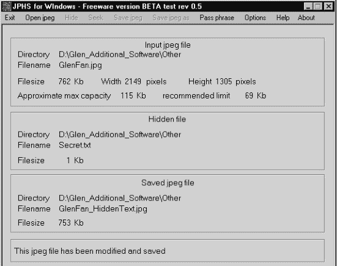

恐怖分子用来在互联网上传递信息的一种方法。文本嵌入到图形文件中，然后放置在网站上。预期收件人可以导航到网站并将图形文件下载到其工作站。一旦图形文件在其工作站上，他们就可以使用与嵌入文本时使用的相同程序从图形文件中检索文本文件。

## 考试提示

对于考试，请记住隐写术是将文本文件隐藏在图形文件内部。另请注意，有一些程序可以检测隐写术，例如名为 Stegdetect 的程序。

## 认证总结

在本章中，您学习了密码学的基础知识。本章为下一章奠定了基础，下一章将花费更多时间讨论非对称环境。以下要点应记住以备考试：

- 密码学由三个核心服务组成：加密、哈希和身份验证。
- 有两种类型的加密：*对称加密*，使用相同的密钥进行加密和解密，以及*非对称加密*，使用一对密钥——一个用于加密，另一个用于解密。
- 哈希是一种用于确保数据完整性的方法。

您肯定会在考试中看到一些与密码学相关的问题。凭借对本章所介绍材料的透彻理解，您将不会遇到任何这些问题。

## 两分钟速览

### 密码学服务简介

- 有三个核心密码学服务：加密、哈希和身份验证。
- 对称加密使用相同的密钥进行加密和解密。对称加密协议的示例有 DES、3DES 和 AES。
- 非对称加密使用一对密钥进行加密和解密。非对称加密算法的示例有 RSA 和 Diffie-Hellman。

### 对称加密

- 对称加密涉及使用相同的密钥加密和解密消息。
- 对称加密速度快，但这使得安全地将密钥传达给另一方变得更加困难。
- 常见对称加密算法的示例有 DES、3DES、RC4 和 AES。

### 非对称加密

- 非对称加密涉及使用一对密钥执行密码学服务。
- 这对密钥被称为公钥和私钥。公钥分发给所有人；私钥对用户保密。
- 消息使用收件人的公钥加密。
- 消息由发送者的私钥签名。签名消息是一种实现不可否认性的方法。

## 理解哈希

8. 以下哪些被视为哈希协议？（选择两个。）
- A. 3DES
- B. AES
- C. MD5
- D. SHA-1
- E. RC4

9. 以下哪个哈希算法生成 160 位哈希值？
- A. MD5
- B. AES
- C. RC4
- D. SHA-1

## 识别加密用途

10. 以下哪个协议被设计为 SSL 的更安全替代品？
- A. SSH
- B. TLS
- C. HTTPS
- D. S/MIME

11. 以下哪个 VPN 协议使用 IPSec 来保护通信？
- A. L2TP
- B. TLS
- C. PPTP
- D. S/MIME

## 基于性能的问题

12. 使用以下数据和二进制格式的加密密钥，使用 XOR 逻辑计算密文。

```
Plain text: 1 1 0 1 1 0 1 1
Key:       1 0 1 1 0 1 0 1
Cipher text: ________________
```

13. 使用以下插图，将右侧列出的算法放入其适当的类别中。

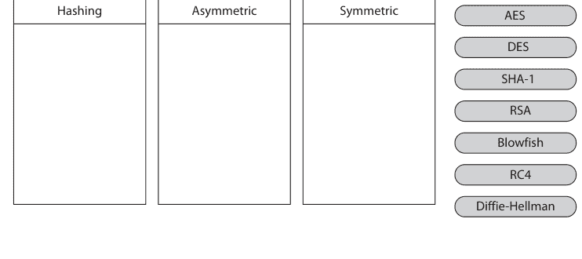

## 自测答案

### 密码学服务简介

- 1. ☑ B. 加密是提供保密性的密码学服务，通过将明文信息转换为密文，使其对未经授权的个人不可读。
  ☒ A、C 和 D 是错误的。哈希用于确保数据完整性，身份验证用于确保不可否认性，而授权不提供密码学服务。

- 2. ☑ A. 哈希是用于确保数据完整性的密码学服务。
  ☒ B、C 和 D 是错误的。加密是提供保密性的密码学服务，身份验证用于确保不可否认性，而授权不提供密码学服务。

### 对称加密

3. ☑ D. 新的也是最安全的对称加密算法是 AES，而使用 256 位加密的 AES256 是列出的最强算法。 ☒ A、B 和 C 是错误的。3DES 提供 168 位加密，SHA-1 是哈希协议而不是对称加密协议，DES 执行 56 位加密。

4. ☑ C. 对称加密的最大缺点是密钥管理，这意味着随着用户数量的增加，您需要创建太多密钥。此外，您如何安全地将密钥传达给个人？ ☒ A、B 和 D 是错误的。与非对称加密相比，对称加密速度快。冲突是两个不同数据生成相同哈希值的结果。取决于所使用的算法以及您如何传达密钥，对称加密可以以安全的方式实现。

### 非对称加密

5. ☑ D. 要不对称加密消息，消息将使用收件人的公钥加密。 ☒ A、B 和 C 是错误的。未使用 Bob 的私钥，因为任何人都可以将消息与相应的公钥解密。未使用 Bob 的公钥，因为只有 Bob 拥有解密消息所需的相应私钥。未使用 Sue 的私钥，因为 Bob 无法访问她的私钥。

6. ☑ A. Bob 的私钥用于数字签名消息，以证明消息来自 Bob 而不是其他人。这是确保不可否认的一种方式。 ☒ B、C 和 D 是错误的。这些不是用于数字签名消息的密钥。对于考试，请记住收件人的公钥用于加密消息，但发送者的私钥用于签名消息。

7. ☑ B. RSA 是列出的唯一非对称加密算法。另一个非对称加密算法的示例是 Diffie-Hellman。 ☒ A、C 和 D 是错误的。DES、RC4 和 AES 都是对称加密算法的示例。

### 理解哈希

8. ☑ C 和 D. MD5 和 SHA-1 是哈希算法的示例。MD5 用于创建 128 位哈希值。SHA-1 用于创建 160 位哈希值。 ☒ A、B 和 E 是错误的。3DES、AES 和 RC4 是对称加密算法的示例，而不是哈希算法。


本章首先快速回顾加密，然后讨论 PKI 的基础知识。你还将学习管理 PKI 时所涉及的重要概念。最后，本章讨论了 PKI 在实践中常见的应用示例。

## 认证目标 13.01

## 公钥基础设施简介

正如你在第 12 章中所学到的，加密主要有两种类型：对称加密和非对称加密。对称加密使用相同的密钥进行加密和解密，其优点是对称加密比非对称加密更快。非对称加密使用密钥对进行加密和解密，其优点是密钥管理。密钥管理涉及加密密钥如何创建、安全共享以及在需要时撤销——非对称加密环境例如 PKI 在这方面表现出色。

非对称密钥对中的密钥通常称为公钥和私钥，如图 13-1 所示。公钥之所以得名，是因为它可供基础设施中的任何一方使用。私钥应由用户保密。

正如你在上一章中所学到的，接收者的公钥用于加密消息，而发送者的私钥用于对消息进行数字签名并证明消息发送者是谁（称为不可否认性）。

## 理解 PKI 术语

公钥基础设施这一术语源于存在一个完整的组件基础设施来帮助创建这种用于管理和使用公钥和私钥的环境。我们将从该基础设施的一个基本组件开始——证书。

## 图 13-1

回顾私钥和公钥

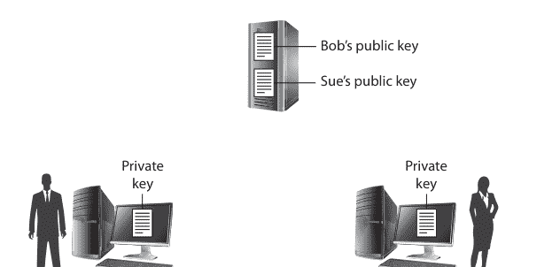

## 考试内部

## 理解密钥用途

Security+ 考试期望你理解公钥或私钥何时用于执行密码学功能。对于 Security+ 考试，请记住接收者的公钥用于加密数据或消息。这使得只有接收者的私钥可用于解密信息。

还需了解在数字签名消息时，使用发送者的私钥来执行此操作。用发送者的私钥对消息进行签名可证明消息发送者是谁，因为只有该人有权访问其私钥。

## 证书

证书是用于存储公钥（有时还存储私钥）并将公钥与个人或公司等实体关联的电子文件。例如，如果你托管一个网站并希望保护通信，你需要为 Web 服务器配置公钥。你获取一个证书（其中包含公钥）并将其分配给 Web 服务器以加密通信。

如前所述，证书存储公钥，同时还包含有关公钥所有者的信息。因此，证书也被视为将公钥与其所有者绑定在一起的电子文件。

数字证书包含以下信息，称为证书属性。证书属性是与数字证书一起存储的信息字段（部分显示在图 13-2 中）：

- **Public key** 证书所有者的公钥
- **Algorithm** 证书使用的非对称算法
- **Serial number** 分配给证书的唯一序列号
- **Subject** 证书分配给的组织或个人名称
- **Issuer** 创建证书的组织或实体
- **Valid from** 证书有效的期间的开始日期
- **Valid to** 证书有效的期间的结束日期
- **Thumbprint algorithm** 用于创建证书哈希以确保其未被更改的算法
- **Thumbprint** 证书的哈希值

在图 13-2 的示例中，你可以看到证书有效期从 2011 年 6 月 27 日至 2013 年 6 月 26 日。还请注意，用于生成证书上消息摘要的哈希算法是 sha1RSA，签发证书颁发机构（CA）是 2003ServerA（这是创建证书的 CA），用于公钥的非对称算法是 RSA。请特别注意 Subject 属性设置为 www.certworld.loc。这有时被称为证书的通用名称，它应与用户访问使用该证书的应用程序的 URL 匹配（本章后面在讨论创建 PKI 时会详细介绍）。

## 图 13-2

证书的属性

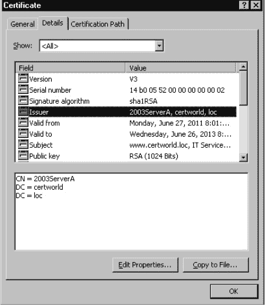

> Watch 请记住，证书是将实体与公钥绑定的电子文件。还请记住，证书由签发该证书的 CA 签名。

## 证书类型

有许多不同类型的证书。每种证书类型用于特定情况。例如，代码签名证书将用于对公司创建的应用程序代码进行数字签名，而电子邮件证书将用于加密你的电子邮件消息。以下是不同证书类型的列表：

**Wildcard** 证书在创建时会被分配一个通用名称，通用名称与使用证书的站点或实体的 URL 匹配。通配符证书是一种特殊证书，可应用于域内的多个 URL。例如，我可以拥有一个 *.gleneclarke.com 的通配符证书，它可用于 www.gleneclarke.com、mail.gleneclarke.com 和 login.gleneclarke.com 等服务器。

**SAN** 主体备用名称（SAN）证书是一种可以关联多个通用名称的证书。这在服务器运行多个服务因此会使用多个名称时很有用。例如，我可以为我的 Exchange 服务器拥有一个 SAN 证书，其中包含 mail.gleneclarke.com 和 autodiscover.gleneclarke.com 名称。如果不使用 SAN 证书，我就需要购买多个单通用名称证书。

**Code signing** 代码签名证书将用于对你创建的应用程序代码进行数字签名。当你对应用程序代码进行签名时，你是在对代码进行数字标记以表明代码的来源。对代码进行数字签名还包括在签名中包含用于检测是否有人更改代码的消息摘要。

**Self-signed** 自签名证书由根 CA 使用。PKI 中的每个实体都需要一个证书。根 CA 创建自己的证书（因此称为自签名），而所有其他系统和用户将从 CA 获取证书。

**Machine/computer** 公司可能希望加密网络上计算机之间的通信。例如，公司可能希望加密其服务器之间的通信。为此，每台计算机都需要应用机器证书，也称为计算机证书。

**E-mail** 电子邮件证书用于使用 S/MIME 协议加密电子邮件消息。电子邮件客户端软件需要配置为使用证书，以便电子邮件消息得到加密。

**User** 正如机器证书由计算机使用一样，用户证书由系统用户用于加密不同类型的信息。例如，用户证书可用于使用 Microsoft 的加密文件系统（EFS）加密磁盘上的数据。

**Root** 当创建 PKI 时，安装的第一个证书颁发机构称为根 CA。根 CA 拥有一个自签名证书，用于对 CA 创建的每个其他证书进行数字签名。根 CA 使用的证书称为根证书。


续期 在证书过期之前，您可以对其进行续期，以便在更长时间内使用该证书。证书通常续期一到两年。如果证书未续期且验证期已过，应用程序将无法使用该证书，因为它们在每次使用证书前都会检查此验证期设置。

暂停和吊销 如果CA在任何时候确定您在证书申请或使用中存在欺诈行为，CA可能会决定暂停甚至吊销您的证书。被暂停的证书不再可用，但可以轻松地恢复到活动状态。被吊销的证书将永久不可用（下一节将详细介绍被吊销的证书）。

销毁/过期 作为证书生命周期的一部分，您需要确定在验证时间过后如何销毁证书及相关密钥。您要确保黑客无法获取PKI结构中使用的任何密钥，以免他们尝试重新使用这些密钥来冒充用户或设备。还要注意，证书都有与之关联的验证期，超过该期限后，证书即视为过期。过期的证书不再有效，也不能再使用。

## 证书吊销列表与OCSP

如前所述，如果CA认定您在获取证书时存在欺诈行为，或者出现了与证书相关的安全破坏，CA可以随时吊销您的证书。

CA负责创建证书吊销列表（CRL），该列表列出了已被吊销的证书。CRL定期发布到网站上，应用程序在使用证书之前会下载CRL以验证证书未被吊销。

> 考试提醒 Security+考试一定会考察您对CRL的掌握。请记住，CRL由CA定期发布，应用程序会检查CRL以验证所用证书未被吊销。

系统和应用程序可用于验证证书是否已被吊销的另一种方法依赖于在线证书状态协议（OCSP）。OCSP是一种Internet协议，使用HTTP与CA通信并检查证书的状态。

一种使用恢复代理来恢复数据的技术是微软的加密文件系统（EFS）。使用EFS时，默认情况下管理员是恢复代理，如果用户丢失了私钥或离开组织，管理员有权解密文件。

## 密钥托管

密钥托管是将加密密钥交给第三方的过程，第三方可以在任何时间点使用这些加密密钥解密您组织内的信息。例如，您可能需要将加密密钥交给政府机构或执法部门进行调查。

密钥托管的概念是一个有争议的话题，因为将能够解密组织内信息的密钥存放在组织外部显然存在安全风险。

## 信任模型、信任路径和证书链

当您创建PKI时，您可以根据生成的密钥对来控制对信息的访问。但如果您想与另一家企业共享信息怎么办？如果您要与其他企业共享信息，该企业将需要拥有PKI中的密钥。然而，实际上，您的CA不应该承担为另一家公司创建证书的负担。

在PKI中，您可以在两个不同的CA之间创建信任关系，使每个CA都信任另一个CA生成的证书。有了这种信任，您环境中的应用程序就可以验证来自其他公司的证书，因为应用程序会沿着信任路径回到另一个CA。这通常被称为交叉证书。

证书的验证方式是沿着与证书关联的信任路径进行，这也称为证书链。例如，如果您从从属CA处获得证书来保护网站，那么当客户端导航到该网站时，客户端首先验证该网站使用的证书（例如，客户端检查证书是否未过期、未被吊销以及是否来自受信任的CA）。接下来，必须验证从属CA的证书，因为该证书是由它颁发的。然后，验证向从属CA颁发证书的CA（根CA）。这就是信任路径，可以通过查看证书的属性来查看，如图13-4所示。

查看图13-4，您可以看到2003ServerA Web服务器证书来自2003ServerA CA。要查看该CA的证书信息，请选择该项，然后单击“查看证书”按钮。

另一个需要熟悉的与吊销证书或证书欺诈相关的术语是HTTP公钥固定（HPKP）。固定允许网站发布公钥列表

## 安装CA

如果您想为企业内部使用创建自己的证书，您需要安装CA。要在Windows服务器上安装CA，请按照以下练习中的步骤操作。

## 练习13-1

## 安装证书颁发机构

在本练习中，您将在Windows Server上安装Active Directory证书服务（ADCS），以创建证书颁发机构。

- 1. 从“开始”菜单启动服务器管理器。
- 2. 在服务器管理器中，选择“管理 | 添加角色和功能”。
- 3. 在“开始之前”页面上，单击“下一步”。
- 4. 在“选择安装类型”页面上，单击“下一步”以安装角色或功能。
- 5. 在“选择目标服务器”页面上，注意已选择ServerA.certworld.loc服务器，然后单击“下一步”。
- 6. 在“选择服务器角色”页面上，选中“Active Directory证书服务”复选框以安装它，然后选择“下一步”。
- 7. 当弹出窗口询问您添加所需功能时，选择“添加功能”。
- 8. 单击“下一步”三次。在“选择角色服务”页面上，确保选中“证书颁发机构”复选框和“证书颁发机构Web注册”复选框。然后单击“下一步”。
- 9. 单击“安装”。安装需要几分钟时间，然后您可以单击“关闭”。
- 10. 既然已安装证书颁发机构，您可以通过选择标志图标（位于“管理”左侧），然后选择“在此服务器上配置Active Directory证书服务”链接来执行初始配置。在“凭据”页面上，注意正在使用管理员帐户（在底部），然后单击“下一步”。
- 11. 在“角色服务”页面上，同时选中“证书颁发机构”和“证书颁发机构Web注册”复选框，然后单击“下一步”。
- 12. 然后，系统会在“设置类型”页面上询问您希望执行哪种类型的设置：
  - 企业CA 用于在Active Directory环境中创建根CA
  - 独立CA 用于在非Active Directory环境中的服务器上创建根CA

## 考试提醒

对于Security+考试，请记住证书签名请求（CSR）是证书请求的术语，这是在使用PKI的应用程序中实现安全性的第一步。

## 练习13-2

## 为网站启用SSL

在本练习中，您通过创建证书请求并将请求提交到Windows CA来为网站启用SSL。然后，您将证书分配给网站，以加密客户端与Web服务器之间的通信。

## 创建证书请求

按照以下步骤创建证书请求，该请求将发送到CA：

- 1. 确保您已运行Windows 10虚拟机和ServerA虚拟机。
- 2. 在ServerA虚拟机上，从服务器管理器中选择“工具 | Internet信息服务（IIS）管理器”。
- 3. 在左侧选择ServerA节点（如果弹出窗口询问您是否要开始使用Web平台，请选择“否”），然后在“功能视图”中向下滚动，直到找到IIS部分中的“服务器证书”。双击“服务器证书”。
- 4. 在右侧的“操作”窗格中，选择“创建证书请求”。
- 5. 在“可分辨名称属性”屏幕中键入以下信息，然后单击“下一步”：
  - 公用名 www.certworld.loc。
    注意：请务必将此名称添加到DNS。公用名应该是用户输入到浏览器地址栏以访问网站的URL。如果用户用来访问该站点的地址与此公用名不同，用户将收到名称不匹配的警告消息。
  - 组织 Certification World Fake Company
  - 组织单位 IT Support
  - 城市/地点 Toronto


State/province ON

Country/region CA

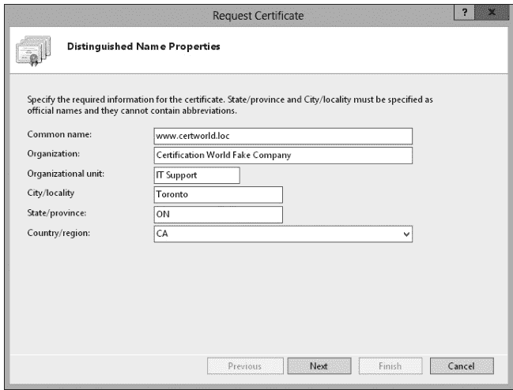

+   6. 在证书服务提供程序属性屏幕上单击下一步。
+   7. 输入 c:\certreq.txt 作为请求的文件名，然后单击完成。

## 提交证书请求到 CA

使用以下步骤将请求提交给 CA。 （在此示例中，网站和 CA 是同一系统，但在现实生活中它们将是不同的系统。）

+   8. 在 ServerA VM 上，启动 Web 浏览器并输入 http://10.0.0.1/certsrv/ 以将证书请求发送给 CA。
+   9. 使用管理员的用户名和密码登录。
+   10. 选择请求证书链接。
+   11. 选择高级证书请求链接以请求 Web 服务器证书。
+   12. 选择第二个链接以提交证书请求文件（标签为“使用 base-64 编码的 CMC 或 PKCS #10 文件提交证书请求或使用 base-64 编码的 PKCS #7 文件提交续订请求”的那个）。

## 测试站点

您现在将测试站点以确保您需要使用 https 而不是 http：

+   28. 转到 Windows 10 VM 并启动 Web 浏览器。
+   29. 导航到 http://10.0.0.1。 您应该会收到错误。 错误说什么？
+   30. 使用 https://10.0.0.1 连接到站点上的 SSL 端口，以验证您是否可以浏览启用 SSL 的网站。

## 管理 PKI

在实施和维护 PKI 环境时，您需要执行许多任务。 您执行这些任务的方式将取决于您使用的软件。 以下各节提供了如何执行这些管理功能的一般思路。

### 撤销证书

如前所述，在任何时间点，如果 CA 确定证书是通过欺诈方式获得的或涉及证书存在安全漏洞，CA 可以撤销证书。 可以执行以下步骤来撤销证书：

+   1. 从服务器管理器中，选择工具 | 证书颁发机构。
+   2. 选择已颁发证书文件夹。
+   3. 右键单击您要撤销的证书并选择所有任务 | 撤销证书（参见图 13-5）。
+   4. 从下拉列表中选择撤销证书的原因，然后单击是。

### 图 13-5

撤销证书

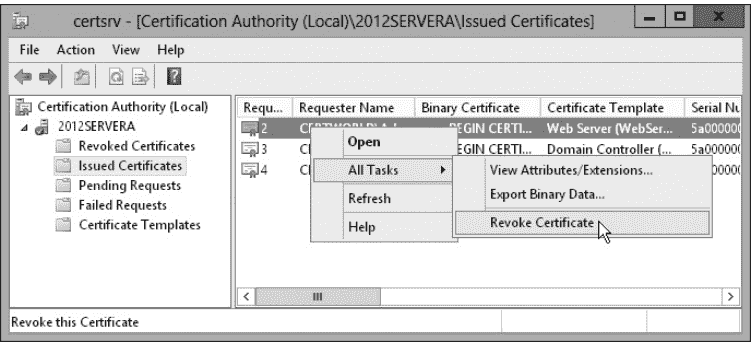

### 发布 CRL

撤销证书后，CA 可以将 CRL 发布到应用程序检查 CRL 的分发点。 请按照以下步骤将 CRL 发布到分发点：

+   1. 在证书颁发机构控制台中，右键单击已撤销证书并选择所有任务 | 发布。
+   2. 选择要发布的 CRL 类型：
    - 新 CRL  选择此项以发布 CRL 的新完整版本。
    - Delta CRL  选择此项以仅发布对现有 CRL 的更新。
+   3. 单击确定。

CRL 发布到指定为服务器设置的分发点。 请按照以下步骤验证或修改分发点的<|message|>位置：

+   1. 在证书颁发机构控制台中，右键单击服务器并选择属性。
+   2. 选择扩展选项卡。
+   3. 确保已选择 CRL 分发点 (CDP) 扩展（参见图 13-6）。
+   4. 您可以使用添加或删除按钮添加或删除分发点。

### 图 13-6

指定 CRL 分发点

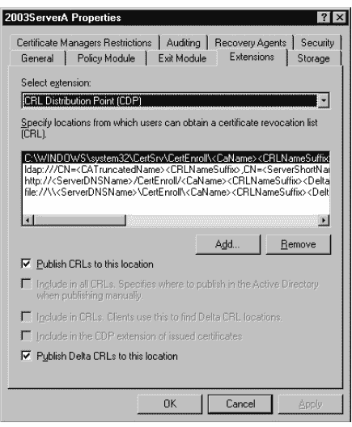

### 实施恢复代理

要为您的 PKI 结构创建恢复代理，您首先需要的是作为恢复代理的个人使用的恢复代理证书。 您可以通过创建证书请求并选择恢复代理模板来获取证书。

一旦恢复代理证书创建完成，您可以在 CA 服务器设置中指定恢复代理作为对标记为进行密钥归档的证书的恢复代理。

请执行以下步骤使用 Windows CA 实施恢复代理：

+   1. 在证书颁发机构控制台中，右键单击服务器并选择属性。
+   2. 选择恢复代理选项卡并选择归档密钥（参见图 13-7）。
+   3. 指定允许的恢复代理数量。
+   4. 单击添加以添加恢复代理的证书，然后单击确定。

### 实施密钥托管

请记住，密钥托管是允许第三方恢复加密密钥，因此在实施密钥托管时应格外小心。 您还希望确保指定第三方被允许参与密钥恢复的严格条件。 例如，公司政策可能要求第三方恢复加密密钥时需要法院命令。

### 图 13-7

指定
恢复代理

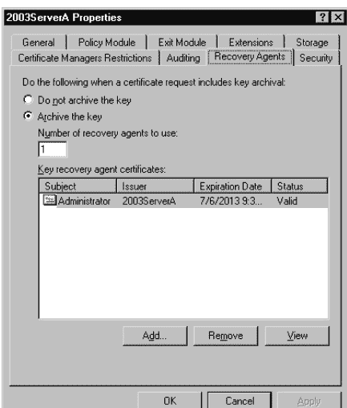

## 实施公钥基础设施

10. 使用 SSL，网页内容是用以下哪一项加密的？

+   A. 服务器的公钥
+   B. 随机对称密钥
+   C. 服务器的私钥
+   D. 客户端的私钥

11. 在数字签名消息时，以下哪一项是正确的？

+   A. 消息使用发送者的私钥加密。
+   B. 消息使用发送者的公钥加密。
+   C. 消息摘要使用发送者的公钥加密。
+   D. 消息摘要使用发送者的私钥加密。

### 基于绩效的问题

12. 您正在配置证书服务器并希望使用创建 160 位哈希值的哈希算法。 使用展品，确定您将使用的哈希算法。

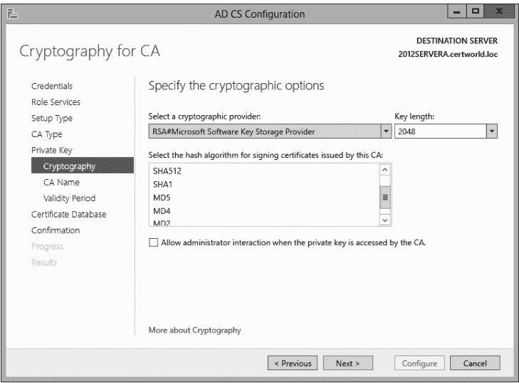

## 自测答案

### 公钥基础设施简介

+   1. ☑ B. 注册机构 (RA) 负责验证证书请求和请求证书的实体。
      ☒ A、C 和 D 是不正确的。 根证书颁发机构 (CA) 和子 CA 用于在 RA 验证请求后创建证书。 证书吊销列表 (CRL) 是 CA 发布的一份已吊销证书的列表。
+   2. ☑ B、C 和 E。 证书是将实体绑定到私钥的电子文件。 证书还存储诸如公钥、证书的有效期以及颁发证书的 CA 等信息。
      ☒ A 和 D 是不正确的。 客户端 IP 地址和服务器 IP 地址与证书无关。
+   3. ☑ D. 使用自己的私有 CA 的主要缺点是，默认情况下应用程序不信任由您的 CA 生成的证书。 您可以将 CA 的证书安装到受信任的 CA 列表中以更改此设置。
      ☒ A、B 和 C 是不正确的。 从公共 CA 获得的证书需要付费，但从私有 CA 获得的证书不需要。 公共 CA 和私有 CA 证书都需要续订，并且私有 CA 的证书默认不受信任。
+   4. ☑ C. 根 CA 应与网络断开连接并可能关闭电源，以便无法被入侵。
      ☒ A、B 和 D 是不正确的。 这些不是应使用根 CA 执行的常见做法。
+   5. ☑ D. PEM 证书文件格式是 ASCII 文件，其中包含文本 -----BEGIN CERTIFICATE----- 和 -----END CERTIFICATE-----。
      ☒ A、B 和 C 是不正确的。 CER 和 PFX 是不正确的，因为它们是二进制文件而不是 ASCII 文件。 P7B 是 ASCII 文件，但文件中没有文本 -----BEGIN CERTIFICATE----- 和 -----END CERTIFICATE-----。

### 管理公钥基础设施

6. ☑ B. 证书仅在特定时间内有效（通常为一到两年），之后需要续订。
☒ A、C 和 D 是不正确的。 已吊销的证书无法续订，但已暂停的证书可以重新激活。

7. ☑ D. 如果涉及证书存在安全漏洞或证书是通过欺诈方式获得的，CA 可能会吊销证书。
☒ A、B 和 C 是不正确的。 这些不是吊销证书的理由。

8. ☑ A. 证书吊销列表 (CRL) 是已吊销证书的已发布列表。
☒ B、C 和 D 是不正确的。 URL 是网站的地址。 密钥托管是您将密钥副本交给第三方公司，以便在需要时解密信息。 M of N 控制是对恢复密钥所需人员数量的最低限制。

9. ☑ C. 密钥托管是向第三方提供可用于解密公司信息的密钥。
☒ A、B 和 D 是不正确的。 M of N 控制是对恢复密钥所需人员数量的最低限制。 CRL 是 CA 已吊销的证书列表。 密钥归档是将密钥备份以便在需要时恢复。

### 实施公钥基础设施

10. ☑ B. SSL 使用对称密钥。 这是会话随机生成的密钥，用于加密客户端和服务器之间的通信。
☒ A、C 和 D 是不正确的。 这些不用于加密网页内容。

11. ☑ D. 消息摘要，而不是消息本身，使用发送者的私钥加密。 数字签名并非旨在维护保密性（这需要加密消息）。
☒ A、B 和 C 是不正确的。 在数字签名时，消息本身不会使用发送者的私钥加密，并且发送者的公钥不会用于加密消息或消息摘要。


## 基于实操的问题

12. 要回答考试中这种热点题，你只需点击正确的选项；在这种情况下，点击 SHA1。SHA1 哈希算法生成 160 位哈希值。

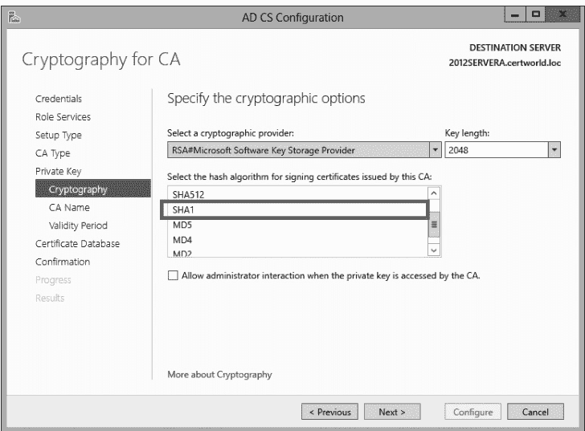
