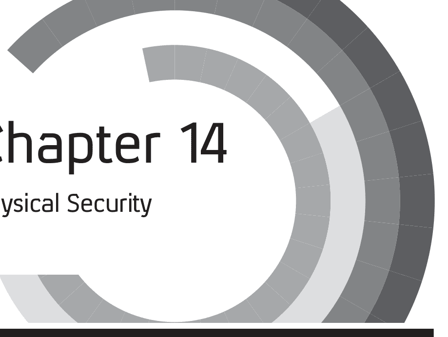
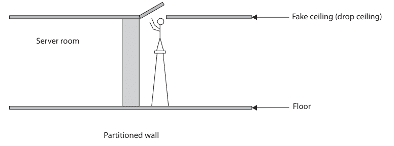
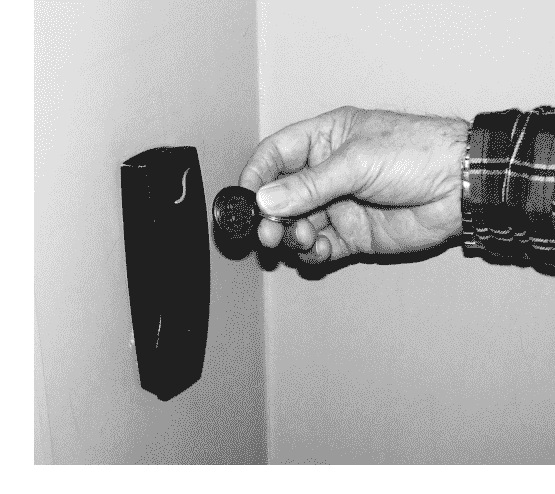
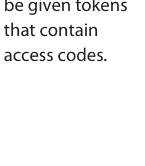
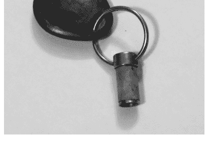
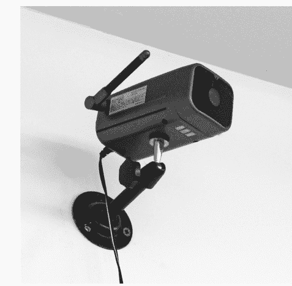
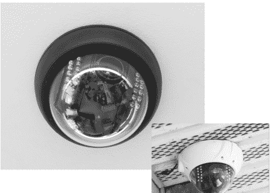
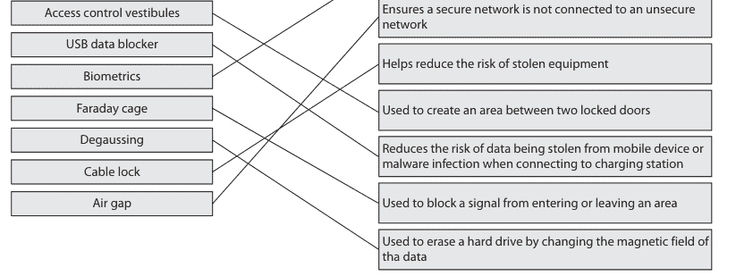

# 第14章：物理安全



### 认证目标

- 14.01 选择业务位置
- 14.02 物理访问控制
- 14.03 实施环境控制
- ✓ 两分钟练习
- 问答自测

关于计算机安全、网络安全或信息系统安全，最重要的一点是：你可以实现所有你想要的防火墙和访问控制方法，但如果没有物理安全，如果黑客能够物理访问系统，大多数控制都可以被绕过。例如，如果你没有将 Web 服务器锁在安全的位置，并限制谁可以访问该安全位置，那么未经授权的人可能会走到系统前，从 Live 盘（DVD 或 USB 驱动器）启动，然后擦除系统管理员密码。一旦密码被擦除，未经授权的个人可以重新启动系统，在无密码的情况下登录，并拥有系统的完全管理能力。

本章将介绍在物理安全方面需要考虑的概念，并为你准备 Security+ 考试中的相关问题。让我们从回顾你已经了解的一些物理安全要点开始。

所有关键系统，如服务器、路由器和交换机，都应放置在安全的位置——通常称为服务器机房。服务器机房应上锁，并且你应该监控谁进出房间。在服务器机房内，服务器、路由器和交换机应放置在服务器机架中，服务器机架本身的门也应上锁，以进一步控制谁能够物理访问这些关键系统。务必锁住每个系统的机箱盖，以防止硬件组件被盗。大多数系统还具有机箱入侵功能，你可以在 CMOS 芯片中启用该功能，它会告知你是否有人打开了系统机箱盖。

在保护服务器机房中的设备时，确保所有服务器都设置了 CMOS 密码，并将启动顺序更改为仅从硬盘启动。这将有助于防止有人从 Live 盘启动并加载不同的操作系统。

此外，保护服务器机房中的路由器和交换机。确保已禁用交换机上任何未使用的端口，以防止未经授权的系统连接到交换机。使用交换机上的端口安全功能，以便只有合适的系统才能连接到特定端口。另外，对于路由器和交换机，务必在控制台端口和辅助端口上配置密码，以确保有人无法连接到交换机或路由器并更改配置。

服务器机房应只有一个入口，并且该入口应持续受到监控，同时机房不应有窗户。作为额外的安全层，最好将服务器机房设置在只有有限人员能够进入的区域。

## 认证目标 14.01：选择业务位置

### 设施考虑

选择业务位置时，要研究你正在考虑的区域。与设施安全相关的关键问题之一是你考虑区域的犯罪率。如果一个区域的犯罪率很高，那么在那里建造或租赁可能没有意义，因为你

### 门、窗和墙

在建设设施时，确保规划设施入口的位置，以便能够密切监控，并确保为员工提供安全的进出口。在高度安全的环境中，所有入口附近都应设有安保台，安保人员可以在那里监控进出人员。

确保进入安全区域的入口使用安全门，门铰链带有不可拆卸的销钉。还要确保每扇门都配有紧急推杆，以便在紧急情况下轻松打开。

确认墙壁从真实地板延伸到真实天花板，而不是使用隔断来创建不同的房间。如果使用隔断并未从真实地板延伸到真实天花板，那么入侵者可能通过门上方（见图14-2）或地板下方的爬行空间进入安全区域。

如果设施中确实有通风管道或公用设施隧道，建议在这些区域放置运动传感器，以便你知道是否有人利用它们侵入你的设施。以下是一些常见的运动探测器类型：

- **闭路传感器：** 使用闭路传感器时，存在一条电路，当电路被断开时会触发警报，表示有人在该区域。这通常用于窗户（带有细线），因此如果窗户被打碎，电路断开，警报响起。
- **压力垫传感器：** 你也可以使用压力垫，在下班后激活，这样如果入侵者进入设施并踩到垫子，警报就会响起。

**图14-2** 确保安全区域的墙壁从真实地板延伸到真实天花板。



### 考试内幕

**物理安全的价值**

对于 Security+ 考试，要知道如果黑客能够物理接触到系统或服务器，他们可以轻松绕过系统的安全性。操作系统的任何安全功能仅在操作系统运行时才有效，因此大多数希望绕过操作系统安全性的黑客只需从 Live 盘启动即可。

为了防止这种情况发生，你需要在组织内实施物理安全，以确保你控制谁能够物理访问系统。记住在考试中，物理安全是帮助防止未经授权的个人访问关键系统和网络的重要方法。

### 练习14-1：在无物理安全的情况下访问系统

在本练习中，你将使用 Windows 10 安装介质启动，在 Windows 10 系统上创建自己的管理帐户，然后使用该帐户访问系统。本练习的目的是向你展示，如果有人能够物理访问系统，他们可以轻松绕过大多数安全控制。确保你在测试用的 Windows 10 系统上操作，而不是在生产系统上。

- 1. 在 Windows 10 虚拟机上，使用 Windows 10 安装介质（ISO 文件、DVD 或 USB 驱动器）启动。
- 2. 当出现要求选择安装语言的 Windows 安装程序对话框时，按 SHIFT-F10 打开命令提示符。
- 3. 输入以下命令以定位 Windows 安装所在的分区。你正在寻找包含 Windows 目录的驱动器（很可能是 D: 或 E: 驱动器）。

```
c:
dir
Is there a Windows directory? ____
d:
dir
Is there a Windows directory? ____
e:
dir
Is there a Windows directory? ____
```

## 文档内容提取示例

这是一个用于测试文档结构提取的示例页面。页面中包含标题、段落、列表和表格等多种元素，用于验证文档解析功能的完整性与准确性。

文档解析是自然语言处理领域中的一个重要任务，其目标是将非结构化的文档内容转化为结构化的数据表示。通过识别文档中的不同元素，可以为后续的信息检索、知识图谱构建等应用提供基础支持。

- 标题识别
- 段落分割
- 列表提取
- 表格解析
- 引用标注
- 代码块识别

在实际应用中，文档结构提取需要考虑多种因素，包括版式的复杂性、字体大小的差异、图片与文字的混合排列等。针对不同的文档类型，需要采用不同的处理策略。

> 结构化的文档表示是连接非结构化内容与智能应用之间的桥梁。

| 元素类型 | 说明 | 优先级 |
|---------|------|-------|
| 标题 | 标识章节层级 | 高 |
| 段落 | 正文内容 | 中 |
| 列表 | 条目化信息 | 中 |
| 表格 | 结构化数据 | 高 |
| 引用 | 引用来源内容 | 低 |

```python
import json

def extract_content(image):
    elements = detect_elements(image)
    return json.dumps(elements, ensure_ascii=False)
```

以上示例展示了一个典型文档页面的结构组成。通过对这些元素的有效识别与提取，可以实现对文档内容的全面解析，为后续的自动化处理流程奠定基础。


**图 14-3** 使用令牌和电子传感器进入设施



使用 *电子锁*，也称为 *电子密码锁*，员工可输入个人识别号码（PIN）以获得进入权限。我见过在按下开始按钮之前按钮上没有数字的电子键盘。一旦按下开始按钮，系统会随机生成数字的位置，这样即使有人观察你的手指位置，也无法帮助他们猜测访问代码。电子密码锁也称为 *密码锁*。

使用这两种电子锁定系统中的任何一种，组织都可以根据访问代码控制员工可以进入的区域。这些系统还可以记录访问情况，包括员工进入设施或设施不同区域的日期和时间。

锁定区域还可以通过 *生物识别* 进入，生物识别使用你自身的特征来解锁门。例如，你可以通过视网膜扫描、语音识别或指纹读取器解锁门。

另一种类型的锁是 *电缆锁*，用于锁定笔记本电脑、显示器、台式机和投影仪等设备。例如，你可以使用电缆锁将接待员的台式电脑和显示器固定在桌子上，这样就不会让人在无人看管时轻易走进来拿走设备。

## 访问系统

组织可以通过称为访问系统的多种方法控制对设施的访问。本节介绍你在 Security+ 考试中可能会被测试到的一些流行访问系统。

访问系统的一部分组件可以被视为失效安全或失效保护。以下是两种类型的区别：

- **失效安全** 失效安全设备在发生故障时不会采取任何可能造成伤害的行动。例如，如果锁发生故障，它会默认为解锁状态，以便人们可以进出。这也称为 *失效打开*，因为门会默认为打开状态。
- **失效保护** 失效保护设备在发生故障时会确保设备处于安全状态。例如，如果锁发生故障并且是失效保护锁，它将默认为锁定状态。这也称为 *失效关闭*，因为门会默认为锁定状态且无法打开。

## ID 徽章

如前所述，在高度安全的环境中，员工必须佩戴显示其姓名和照片的 ID 徽章。组织的安保政策还可能要求员工始终佩戴可见的 ID 徽章，这意味着他们必须将徽章显眼地佩戴在衣服上或挂在挂绳上。

ID 徽章可能需要通过在读卡器上刷卡来进入某个区域。徽章通常在其上有一个磁条，其中包含员工访问代码。如果员工是被授予该物理区域访问权限的人员，则门将打开。ID 徽章还可能包含存储识别信息的芯片，例如用于控制对系统和资源访问的数字证书。

## 物理令牌

一些访问系统使用物理令牌（见图 14-4），或钥匙扣，员工随身携带并用于进入设施或设施的特定区域。访问令牌通常放在员工的钥匙链上并随时携带。





- **密钥管理与日志** 为了控制对设施的访问，组织应有一名中央人员管理钥匙并记录钥匙发放和归还的时间。更现代的密钥管理解决方案要求人员输入其用户凭据以访问保险箱内的部分钥匙。系统记录钥匙从保险箱取出和放回保险箱的时间。
- **路障/障碍** 组织可以使用路障或防撞柱来控制对设施不同区域的访问。例如，建筑物正面可以通过混凝土路障保护免受车辆侵害。
- **生物识别** 控制对建筑物不同区域访问的常用方法是生物识别。高度安全的环境可能要求视网膜扫描或指纹扫描才能进入建筑物的安全区域。
- **受保护的电缆分配** 控制对电缆的访问并使用受保护的分配系统（PDS）非常重要。PDS 通过将电缆穿过安全管道来控制和监控对电缆的物理访问。如果黑客能够获得对电缆系统的物理访问，他们可以窃听通信，因此你需要确保控制对电缆的访问。
- **工业伪装** 物理安全的一部分是设计建筑物和校园，使其掩盖其规模、用途，甚至建筑物本身的存在。工业伪装可以追溯到二战时期，当时建筑物被隐藏以防止轰炸。

## USB 数据阻断器

对于移动用户而言，今天主要的安保风险之一是智能手机用户会在电量不足时将移动设备插入任何充电站或计算机进行充电。如果充电站具有恶意性质，它可能会窃取你的数据或感染你的智能手机。

有助于我们移动设备安全的[content]

**图 14-3** 使用令牌和电子传感器进入设施


使用 *电子锁*，也称为 *电子密码锁*，员工可输入个人识别号码（PIN）以获得进入权限。我见过在按下开始按钮之前按钮上没有数字的电子键盘。一旦按下开始按钮，系统会随机生成数字的位置，这样即使有人观察你的手指位置，也无法帮助他们猜测访问代码。电子密码锁也称为 *密码锁*。

使用这两种电子锁定系统中的任何一种，组织都可以根据访问代码控制员工可以进入的区域。这些系统还可以记录访问情况，包括员工进入设施或设施不同区域的日期和时间。

锁定区域还可以通过 *生物识别* 进入，生物识别使用你自身的特征来解锁门。例如，你可以通过视网膜扫描、语音识别或指纹读取器解锁门。

另一种类型的锁是 *电缆锁*，用于锁定笔记本电脑、显示器、台式机和投影仪等设备。例如，你可以使用电缆锁将接待员的台式电脑和显示器固定在桌子上，这样就不会让人在无人看管时轻易走进来拿走设备。

## 访问系统

组织可以通过称为访问系统的多种方法控制对设施的访问。本节介绍你在 Security+ 考试中可能会被测试到的一些流行访问系统。

访问系统的一部分组件可以被视为失效安全或失效保护。以下是两种类型的区别：

- **失效安全** 失效安全设备在发生故障时不会采取任何可能造成伤害的行动。例如，如果锁发生故障，它会默认为解锁状态，以便人们可以进出。这也称为 *失效打开*，因为门会默认为打开状态。
- **失效保护** 失效保护设备在发生故障时会确保设备处于安全状态。例如，如果锁发生故障并且是失效保护锁，它将默认为锁定状态。这也称为 *失效关闭*，因为门会默认为锁定状态且无法打开。

## ID 徽章

如前所述，在高度安全的环境中，员工必须佩戴显示其姓名和照片的 ID 徽章。组织的安全政策还可能要求员工始终佩戴可见的 ID 徽章，这意味着他们必须将徽章显眼地佩戴在衣服上或挂在挂绳上。

ID 徽章可能需要通过在读卡器上刷卡来进入某个区域。徽章通常在其上有一个磁条，其中包含员工访问代码。如果员工是被授予该物理区域访问权限的人员，则门将打开。ID 徽章还可能包含一个芯片，存储识别信息，例如用于控制对系统和资源访问的数字证书。

## 物理令牌

一些访问系统使用物理令牌（见图 14-4），或钥匙扣，员工随身携带并用于进入设施或设施的特定区域。访问令牌通常放在员工的钥匙链上并随时携带。


- **密钥管理与日志** 为了控制对设施的访问，组织应有一名中央人员管理钥匙并记录钥匙发放和归还的时间。更现代的密钥管理解决方案要求人员输入其用户凭据以获得对保险箱内部分钥匙的访问权限。系统记录钥匙从保险箱取出和放回保险箱的时间。
- **路障/障碍** 组织可以使用路障或防撞柱来控制对设施不同区域的访问。例如，建筑物正面可以通过混凝土路障保护免受车辆侵害。
- **生物识别** 控制对建筑物不同区域访问的常用方法是生物识别。高度安全的环境可能要求视网膜扫描或指纹扫描才能进入建筑物的安全区域。
- **受保护的电缆分配** 控制对电缆的访问并使用受保护的分配系统（PDS）非常重要。PDS 通过将电缆穿过安全管道来控制和监控对电缆的物理访问。如果黑客能够获得对电缆系统的物理访问，他们可以窃听通信，因此你需要确保控制对电缆的访问。
- **工业伪装** 物理安全的一部分是设计建筑物和校园，使其掩盖其规模、用途，甚至建筑物本身的存在。工业伪装可以追溯到二战时期，当时建筑物被隐藏以防止轰炸。

## USB 数据阻断器

对于移动用户而言，今天主要的安保风险之一是智能手机用户会在电量不足时将移动设备插入任何充电站或计算机进行充电。如果充电站具有恶意性质，它可能会窃取你的数据或感染你的智能手机。

有助于我们移动设备安全的重要设备是 USB 数据阻断器。你将 USB 数据阻断器连接到移动设备的数据端口，例如智能手机或平板电脑，然后将设备插入充电站。USB 数据阻断器通过在充电站和智能手机之间创建屏障来防止访问你的智能手机。

> **考试提示** 请记住，USB 数据阻断器可由员工在将移动设备插入不可信充电站时使用，以降低数据被盗或恶意软件感染的风险。

## 安全数据销毁

物理安全的一部分是确保在你停用系统并处置后，没有人能够访问存储在硬盘上的数据。我想强调的是，有工具可以让你或拥有你旧硬盘的人在磁盘重新格式化后从硬盘中检索数据。

组织应实施数据销毁和媒体清理政策，以帮助 IT 专业人员了解他们应如何从旧硬盘和移动设备等设备中删除数据。以下是一些用于保护组织隐私的处置数据选项：

- **焚烧** 销毁敏感文件的一种简单方法是焚烧不需要的纸质文件。
- **碎纸** 你可以碎纸以销毁敏感信息。务必购买碎纸机；普通碎纸机将文件切成条状的文件很容易重新拼凑。你可以购买一种特殊类型的碎纸机来销毁旧硬盘。
- **制浆** 你可以通过使用化学品将纸分解成液体/糊状形式来制浆敏感文件。
- **粉碎** 粉碎会破坏旧硬盘并将其减少为小颗粒。
- **消磁** 消磁是从硬盘中去除磁场的过程，从而使数据丢失。
- **清除** 清除数据意味着永久从存储介质，例如硬盘中擦除数据。
- **擦写** 你可以使用程序安全擦写驱动器，这意味着多次重写驱动器以确保数据无法检索。
- **第三方解决方案** 可以使用多个第三方工具安全地从驱动器中擦除数据。确保软件使用不同技术对驱动器进行多次传递以安全擦除数据。你还应测试该工具并确保在安全擦除驱动器后无法恢复数据。

## 物理访问列表和日志

访问控制系统使用访问列表（具有环境访问权限的人员名单）来控制对区域的访问。当访问列表创建时，系统通常默认为拒绝所有对设施的访问，除非提供正确的访问代码。访问代码可能是输入的内容，也可能是刷卡的令牌或卡——无论员工使用何种方法提供访问代码，系统都会对照访问列表检查员工是否应被授予访问权限。


如今，大多数访问控制系统不仅允许你控制谁可以进入某个区域，还可以记录谁已获准进入设施。当员工获准进入设施的某个区域时，你可以让系统记录日期和时间以及所使用的访问代码。如果你在处理某段时间内的资产失窃问题，这些信息可能非常有价值。

组织还应在设施入口处保留访客日志，并记录访客的姓名、公司、电话号码、来访目的以及联系人等信息。这使你可以掌握设施内当前的访客人数以及宾客的历史记录。

## 视频监控

当今物理安全的很大一部分涉及实施闭路电视（CCTV）或其他视频监控技术。CCTV 是指在设施的各个区域安装摄像机进行监控，并将信息发送到中央安全区域的计算机屏幕上，由安保人员在那里监视可疑活动。CCTV 系统用于监控和记录设施内的活动，并将视频流保密，仅供组织内部使用。

> 考试提示
> 请记住，CCTV 系统会捕获视频并将其发送到特定的系统或一组显示器。通常，这些视频流会被发送到控制室，安保人员在那里监视屏幕上的可疑活动。

如今的监控系统更为先进，因为设备所有者现在可以通过互联网远程连接到摄像机，实时查看捕获的视频。当今大多数监控系统还可以将捕获的视频通过网络录制到远程位置，例如中央服务器。图 14-5 展示了一个无线视频监控摄像机。

以下列表概述了一些常用的视频监控解决方案：

- 假摄像机：如果你在寻找廉价的解决方案，可以只安装一些假摄像机作为威慑；缺点是如果发生安全事件，这些摄像机并没有监控任何东西。
- 隐藏摄像机：你可以购买隐藏式摄像机，其中一些看起来像设施内的装饰物或摆件，但实际上正在录制视频。

### 图 14-5

无线视频监控摄像机



夜视摄像机：你可以购买能够在夜间或低照度区域进行录制的摄像机。这些摄像机使用红外线帮助捕获黑白视频图像（参见图 14-6）。

无线摄像机：由于无线设备易于安装，许多安防摄像机都以无线设备的形式推出。将摄像机作为网络设备，你可以将摄像系统配置为录制到远程位置，还可以从网络上的任何位置控制摄像机。

### 图 14-6

夜视摄像机利用红外光在黑暗中拍摄图像。



- 运动识别/检测：当今的视频监控解决方案内置了运动检测器，系统检测到移动后才会让摄像机开始录制。这还带来了额外好处：节省磁盘空间，并且无需回放数小时毫无动静的视频。

- 物体检测：如今许多视频监控系统都能检测视频流中存在的不同类型的物体，这有助于减少被触发的误报次数。例如，可以编写程序让家庭监控系统在家猫成为移动物体时不触发警报。

## 无人机

无人机是另一种常见的监控工具。它们可以飞越占地广阔的设施上空。无人机通过远程控制，可以从空中录制画面。它既是监控设施的绝佳工具，也可以用于记录土地情况。

## 传感器类型

Security+ 考试会指出不同安全控制措施（如监控系统、访问控制系统和环境控制）中存在的不同类型的传感器。以下是需要熟悉的常见传感器类型：

- 运动检测：运动检测传感器安装在监控摄像头等运动检测设备中，用于触发视频录制的开始。
- 噪音检测：噪音检测传感器使用一层薄膜，当接收到噪音声波时薄膜会振动。然后噪音检测传感器将振动转换为电信号，并处理该信号以触发警报。
- 接近读卡器：正如本章前面所学的，接近读卡器使用非接触式卡，将卡在读卡器上方一挥即可获得访问权限。
- 卡片：许多使用传感器的不同类型的卡片也可用于获准进入设施。例如，你可以在接近读卡器上刷一下接近卡来解锁门。
- 温度：正如你将在下一节学到的，环境控制可以通过传感器监控环境温度。
- 湿度检测：湿度检测传感器用于环境控制，以确定空气中有多少水分。

## 认证目标 14.03

## 实施环境控制

Security+ 认证考试在考查物理安全时，会评估你对环境控制的知识。本节介绍环境控制的背景知识，例如 HVAC、屏蔽和灭火系统。

## 了解 HVAC

供暖、通风和空调（HVAC）是一种提供或减少热量、湿度和室外空气的系统。HVAC 系统的目标是提供气候控制，以帮助维持工作场所的良好环境。

HVAC 控制建筑物内的温度和湿度。这有助于计算机系统保持最佳运行状态。建筑物内的温度应保持在华氏 70 到 74 度左右。如果温度过高，可能导致系统过热并关闭。湿度水平应保持在 40% 到 60% 之间。如果湿度低于 40%，可能会遇到大量静电放电（ESD）。ESD 会损坏计算机组件和计算机芯片。湿度高于 60% 会腐蚀计算机组件。

当你处理 HVAC 等环境系统时，一些常见组件包括环境监控、冷热通道以及温度和湿度控制。以下列表介绍了这些组件：

- **环境监控**：务必确保你已建立监控环境系统的机制，并包含检测与热量、湿度和空气质量相关问题的办法。监控数据中心内的温度和湿度水平，可以让你在设备开始过热并发生故障之前检测到 HVAC 系统的故障。
- **冷热通道**：为了保持数据中心内的系统冷却，机架采用冷/热通道配置。这种配置将机架分成一排排，机架正面相对形成冷通道，机架背面形成热通道（热空气从机架背面排出）。HVAC 的气流设计会将热通道中的热空气排放到数据中心之外的室外，同时从机架正面的冷通道引入新的冷空气。
- **温度和湿度控制**：环境系统应配备相应的控制装置，让你能够调节温度和湿度水平。

## 屏蔽

物理安全的另一个关键方面是确保未经授权的人员无法通过辐射接收信息。辐射是来自显示器、键盘和打印机等计算机组件的电信号发射。这些发射可能被接收器截获并分析，从而发现潜在的机密和敏感信息。辐射安全通过拉开设备之间的距离，并建立能够阻止信号传播到屏蔽区域之外的屏蔽层，来保护通信免受此类截获。屏蔽环境被称为 TEMPEST 系统——一种保护系统免受窃听的标准。

你还可以实施屏蔽以抵御*电磁干扰（EMI）*，即来自照明或电机等其他电气元件的干扰。我的一位朋友曾在化工厂工作多年，由于工厂内的 EMI，他们每 15 个月就必须购买新的 CRT 显示器。他说，屏幕显示会被大型电机扭曲，最终他们无法通过调整显示器的任何设置来解决问题。

考试提示
考试时要知道，法拉第笼是一种外壳，通过阻挡电子场或信号到达其内部内容物来屏蔽其内容。在计算机取证中，使用法拉第笼来屏蔽组件，使其无法发送或接收信号，已成为常见做法。

## 灭火系统

本章的最后一个主题是物理安全的重要组成部分——保护你的环境免受火灾严重破坏的方法。在本节中，你将学习到一定会在 Security+ 考试中遇到的灭火系统类型。

设计火灾检测方案时，需要考虑以下一些关键要点：

- 你可以将检测设备配置为使用预先录制的消息给消防部门打电话。
- 你还应让火灾检测方案关闭 HVAC，因为它可能会通过通风系统传播烟雾。


## 选择业务地点

1. 你的经理想要创建一个服务器机房，用来存放公司的所有服务器、路由器和交换机，他正在征求意见。以下哪些适合作为服务器机房？（选择两项。）

   - A. 只有一扇窗户
   - B. 没有窗户
   - C. 两个入口，一个出口
   - D. 单一入口
   - E. 两个入口

2. 杰夫是公司的网络管理员，他希望在交换机上实施一些最佳实践。他已经将交换机放置在始终锁定的服务器机房中。他还应该做什么？（选择三项。）

   - A. 关闭交换机的电源。
   - B. 禁用未使用的端口。
   - C. 禁用控制台密码。
   - D. 配置控制台密码。
   - E. 设置控制台横幅以欢迎连接人员。
   - F. 配置辅助密码。

3. 你已经确保通往所有出口、入口和停车场的通道都有充足的照明。关于照明，你还应该考虑什么？

   - A. 确保灯与灯之间有2英尺的暗区。
   - B. 配置应急照明。
   - C. 确保灯与灯之间有1英尺的暗区。
   - D. 安排照明仅在非工作时间工作。

## 物理访问控制

4. 你正在建设一个办公地点，并正在制定物理安全计划。在高度安全的环境中，你的第一级物理安全是什么？

   - A. 上锁的门
   - B. 服务器机房
   - C. 围栏
   - D. 门卫

## 自测答案

### 选择业务地点

1. ☑ B和D。服务器机房应只有单一入口，以便监控进出人员，并且不应有窗户。
   ☒ A、C和E不正确。服务器机房应只有一个入口点并且没有窗户。

2. ☑ B、D和F。物理安全的一部分是确保交换机上未使用的端口被禁用，并在控制台端口和辅助端口上设置密码。
   ☒ A、C和E不正确。你不会关闭交换机电源，因为它需要电源才能运行。你也不想禁用控制台密码；应该配置并使用它。绝不要将欢迎消息设置为横幅，因为它可能被解释为对未经授权人员的邀请。

3. ☑ B。重要的是确保在整个设施中配置带有备用电源的应急照明，以便员工能够安全疏散。
   ☒ A、C和D不正确。你绝对不希望在照明之间出现暗点，并且照明应安排在工作时间开启。

### 物理访问控制

4. ☑ C。围栏是实施物理安全时的第一道防线。它们确保设施只有一个入口点——大门。
   ☒ A、B和D不正确。虽然你会安装上锁的门和服务器机房，但目的是通过设置围栏来防止入侵者到达这些地点。门卫，或者更好的是保安，可能会有所帮助，但这是围栏实施后被安排在大门处的人员。

5. ☑ D。禁用从光盘驱动器启动的目的是防止未经授权的人员从活动光盘启动，以绕过操作系统及其提供的安全控制。
   ☒ A、B和C不正确。这些不是禁用从光盘驱动器启动的原因。

6. ☑ A。保安的优势在于他们能够检测与物理安全相关的异常行为并采取相应措施。
   ☒ B、C和D不正确。围栏、转盘密码锁和密码键盘锁不能检测异常行为并作出响应。

7. ☑ B。电子组合密码锁也称为密码锁。
   ☒ A、C和D不正确。电子组合密码锁不被称为挂锁、硬件锁或组合锁。

8. ☑ D。故障时默认为锁定状态的设备称为故障安全锁定设备（fail-secure device）。
   ☒ A、B和C不正确。故障安全（fail-safe）和故障开放（fail-open）都意味着发生故障时，默认故障状态是打开、解锁状态。这对紧急门很有用，因为即使门锁发生故障，人们也能出去。“Fail-save”不是有效术语。

9. ☑ C。系统感应式接近读卡器会在员工携门禁卡接近设施时触发锁定系统解锁。使用此装置将确保没有人发现其他人的密码来进入设施。
   ☒ A、B和D不正确。TEMPEST 是一种屏蔽系统，CCTV 是监控系统，而 HVAC 有助于控制温度。

10. ☑ B。USB数据阻断器是一种连接到移动设备（如智能手机或平板电脑）数据端口，然后将设备插入充电站的设备。USB数据阻断器通过在充电站和智能手机之间建立屏障来防止访问智能手机。
    ☒ A、C和D不正确。法拉第笼是一种屏蔽系统，防止信号进入或离开笼子。接近读卡器用于读取非接触式卡以进入设施。空气间隙用于在两个网络之间创建空间，且网络之间没有物理连接。

### 实施环境控制

11. ☑ C。使用冷热通道的配置是一种常见设置，其中机架排列成排，机架正面相对。这样，面向机架的通道可以吸入冷空气，而机架背面将热空气输出到热通道。
    ☒ A、B和D不正确。这些不是与数据中心机架相互面对相关的术语。

12. ☑ B。法拉第笼是一种屏蔽容器，可阻止信号进入或离开。这是取证调查员存储证据的一种常用容器。
    ☒ A、C和D不正确。这些不是屏蔽容器的术语。

13. ☑ B。为了控制数据中心设备的温度，你将使用创建冷热通道的布局，以防止过热。
    ☒ A、C、D和E不正确。这些无助于管理设备温度。

### 基于实操的问题

14. Security+ 认证考试期望你能够识别哪些安全控制用于数据中心，哪些用于移动设备或工作站。公司数据中心需要高安全性，因此你需要使用诸如 HVAC 来控制温度、CCTV 来监控数据中心的访问、接近徽章或生物识别扫描仪来控制谁可以进入，以及一个防尾随通道来帮助确保没有人尾随进入数据中心。你可以对移动设备使用远程擦除、电缆锁、设备加密和 GPS 追踪。办公室环境中可以使用保险箱。

| 设备安全 | 数据中心安全 |
|---|---|
| B. 电缆锁 | A. 防尾随通道 |
| D. 设备加密 | C. 接近徽章 |
| H. GPS 追踪 | E. 闭路电视 |
| J. 远程擦除 | G. 生物识别扫描仪 |
| F. 保险箱 | I. HVAC |

15. 以下是安全术语与其描述的对应关系。


