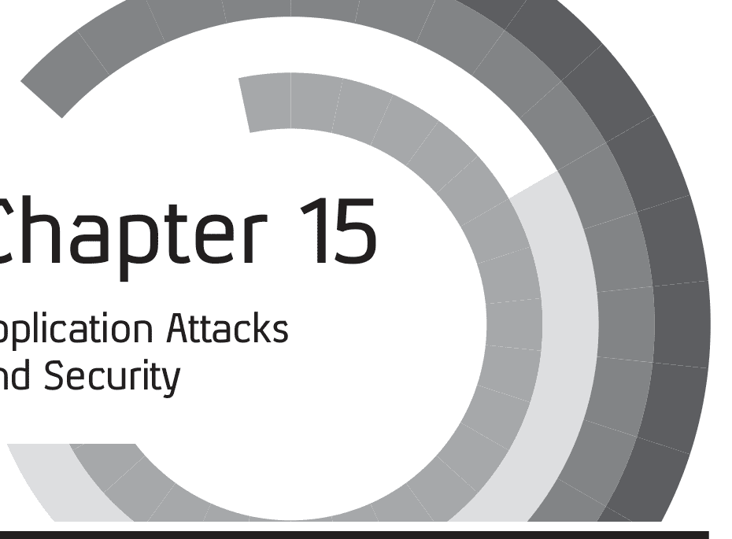
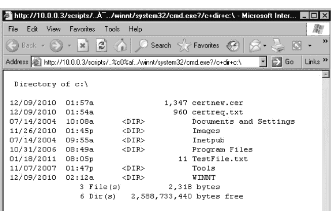
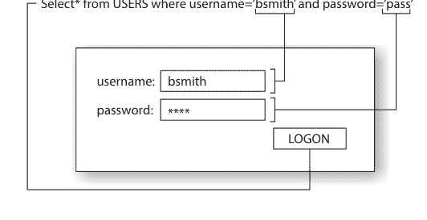
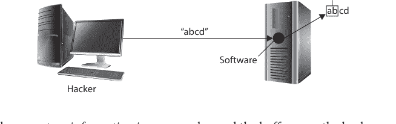
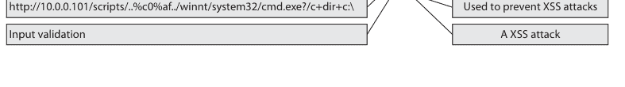

# 第15章：应用程序攻击与安全



### 认证目标

- 15.01 理解应用程序攻击
- 15.02 安全应用程序开发概念
- 15.03 实现主机和应用程序安全
- ✓ 两分钟演练
- 问答自测

多年来，系统网络一直通过您在第四章中学到的各种网络攻击方式遭到入侵，例如字典攻击或暴力破解密码。这些仍然是需要熟悉的重要攻击类型，但如今许多用来破坏系统的攻击是针对系统上运行的应用程序的攻击。本章为您介绍系统如何通过安装在其上的软件应用程序被黑客入侵的背景知识。


## 认证目标 15.01

## 理解应用程序攻击

应用程序攻击是通过我们每天使用的软件应用程序进行的攻击。黑客学习软件，然后学习如何通过软件中的漏洞攻击系统。黑客了解编程概念，并利用该知识来利用软件中的漏洞以获得系统访问权限。

## 目录遍历

多年来，针对 Web 服务器的流行攻击之一是目录遍历攻击，该攻击用于导航目标 Web 服务器的文件系统，并可能在 HTTP 消息中注入命令。目录遍历的工作方式是黑客在 URL 中多次输入 ../.. 以便遍历 Web 服务器的目录结构。向后导航目录结构后，黑客然后进入操作系统目录并尝试运行操作系统命令。以下是对 Microsoft IIS 5.0 Web 服务器的流行命令：

```
http://10.0.0.3/scripts/..%c0%af../winnt/system32/cmd.exe?/c+dir+c:\
```

前述命令用于遍历 Windows 2000 服务器上的文件夹结构。请注意，命令中使用的是 ..%c0%af.. 而不是 ../..；这是因为 Windows 2000 有一个安全功能会阻止任何对 ../.. 的请求，因此黑客想出了一个六个字符的字符串（%c0%af），其含义与 "/" 相同，以便绕过安全检查。

请注意，前述命令调用 cmd.exe，然后使用 dir 命令获取 C: 驱动器上的文件列表（见图 15-1）。黑客然后可以用其他命令（如 del）替换 dir 命令以删除文件。

为了防止目录遍历攻击，您应确保系统已使用安全补丁更新，并考虑在 URL 中列入黑名单的常见字符（例如 ../..），这些字符可能构成威胁。

### 图 15-1

目录遍历攻击用于导航文件系统。



## 练习 15-1

## 利用目录遍历攻击 IIS Web 服务器

在此练习中，您导航一个网站并提供一个精心制作的恶意 URL，该 URL 遍历 Web 服务器的文件夹结构，然后执行 dir 和 del 命令以操作 Web 服务器上的文件。本练习使用较旧版本的 Microsoft 软件，因为该漏洞在较新的 Windows 操作系统版本上不起作用。此练习仅用于让您直观了解目录遍历攻击的样子。

- 1. 确保 Windows 2000 Server VM 和 Windows 客户端 VM 正在运行。
- 2. 登录 Windows 2000 Server VM，并在命令提示符中使用 ipconfig 记录系统的 IP 地址：________________
- 3. 在 Windows 2000 Server VM 上转到 C: 驱动器并创建一个名为 myfile.txt 的文本文件。
- 4. 转到 Windows 客户端 VM 并通过在浏览器中输入 http://<ip_of_server> 导航网站，其中 <ip_of_server> 是您之前记录的 IP 地址。
- 5. 要使用目录遍历利用 Web 服务器，请在 Web 浏览器中输入以下内容：

```
http://<ip_of_server>/scripts/..%c0%af../
winnt/system32/cmd.exe?/c+dir+c:\
```

- 6. 此命令做什么？
- 7. 要从 Web 服务器删除您之前创建的文件，请在浏览器中输入以下内容：

```
http://<ip_of_server>/scripts/../%c0%af../
winnt/system32/cmd.exe?/c+del+c:\myfile.txt
```

- 8. 您将收到 CGI 错误，但请单击后退按钮，然后单击刷新按钮刷新页面，您应该会看到文件已从 Web 服务器删除。
- 9. 转到 Windows 2000 Server VM 并检查 c:\myfile.txt 是否仍然存在。文件还在吗？______
- 10. 您将如何防止此类攻击？

## 注入攻击

对应用程序的注入攻击今天非常常见。注入攻击涉及应用程序提示用户提供信息。攻击者利用此提示插入不同类型的编程代码，而不是预期的数据，以操纵软件的运行方式。根据注入的信息类型，存在许多不同类型的注入攻击。

## SQL 注入

SQL 代表结构化查询语言，是程序员用来操作数据库的通用语言。大多数 Web 应用程序和内部业务应用程序使用 SQL 从数据库检索数据。例如，您办公室可能有一个库存系统，实际的库存数据存储在数据库中。应用程序使用 SQL 从数据库检索该数据并将其显示给您。

在 SQL 注入攻击中，黑客使用在幕后执行的 SQL 命令来操纵数据库中的数据，因此黑客实际上将一些 SQL 代码插入应用程序中，知道应用程序会将其传递给数据库。黑客在您不期望的地方插入 SQL 命令——例如应用程序登录屏幕中的密码字段。

图 15-2 显示了 SQL 注入攻击的流行示例。该示例是一个登录屏幕，并显示了应用程序开发人员编写的典型代码作为 SQL 语法以允许用户登录。命令是 select 命令，用于在数据库中查找信息——在这种情况下，命令试图查找输入到应用程序中的用户名和密码。

### 图 15-2

查看 SQL 注入攻击



在此示例中，黑客需要确保结果为真条件；由于黑客不知道有效的用户名和密码，他们将一些 SQL 代码作为“密码”插入以强制产生真条件。以下代码是黑客通常在密码框中输入以通过 SQL 注入攻击绕过登录屏幕的内容：

```
pass' or 1=1 --
```

“pass” 是黑客实际输入为其密码的内容，这实际上不会起作用，因为黑客没有该应用程序的帐户。' 用于关闭应用程序代码下方的 select 语句，以便 or 1=1 实际上作为 select 语句的条件执行，而不是作为实际密码进行测试。末尾的 -- 用于注释掉后续的任何代码，这很重要，因为应用程序的开发人员在代码末尾还有另一个 '，除非黑客将其注释掉，否则会导致错误。

以下是其他流行 SQL 注入攻击的一些描述：

- 以下命令将允许登录访问，但同时执行一个 update 语句，将 titles 表中所有书籍的价格修改为 50 美分：

pass' or 1=1;update titles set price=.5 --

- 以下命令调用 SQL Server 上可用的内置存储过程，允许数据库开发人员 shell 出并调用操作系统命令。在此示例中，黑客从网站的登录页面在 Windows 中创建自己的名为“fromSQL”的用户帐户。请注意，在 SQL Server 2005 之后的 SQL Server 版本中，xp_cmdshell 存储过程默认情况下处于禁用状态，并且出于此原因不应启用。

pass';exec master..xp_cmdshell "net user fromSQL password /add" --

以下命令在前一个命令的基础上，通过将用户帐户添加到系统的本地管理员组来扩展。前一个命令意味着黑客现在拥有具有完全管理能力的后门。

```
pass';exec master..xp_cmdshell
"net localgroup administrators fromSQL /add" --
```

exam Watch For 考试时，请注意，为了防止 SQL 注入攻击，应用程序的开发人员必须在处理之前验证输入。

您可以防止 SQL 注入攻击的几种方法：

- **Sanitization** 开发人员应清除用户输入中可能作为 SQL 代码执行的任何字符。例如，他们应从输入中删除分号和双破折号。
- **Validation** 开发人员应验证输入并确保限制可以输入的字符数量和字符类型。
- **Parameterized queries** 使用参数化查询意味着输入不是直接传递给 SQL 语句，而是传递到仅接受特定值的参数中。如果参数值良好，则它将被参数化查询中的 SQL 代码使用。

## 练习 15-2

## SQL 注入攻击

在此练习中，您可以看到黑客如何通过对连接到 SQL Server 的网站执行 SQL 注入攻击来绕过应用程序安全。要执行此练习，请确保已安装 SQL Server 并有一个连接到该 SQL Server 的网站。

- 1. 确保您有一台运行 SQL Server 的服务器和一个查询该 SQL Server 的网站。还确保 Windows 10 和 ServerA VM 正在运行。
- 2. 转到 Windows 10 VM 并启动 Internet Explorer。输入 http://10.0.0.1 以导航到课程网站。
- 3. 要通过 SQL 注入攻击绕过登录屏幕，请在用户名框中输入您的名字，然后在密码框中输入 pass' or 1=1 -- 并登录。实际上根本不需要用户名或密码！


4. 一旦黑客验证了自己可以绕过登录，接下来他们可能会对你的数据进行恶意操作，例如更改所有书籍的价格：

```
pass' or 1=1;update titles set price=.5 --
```

5. 接下来，攻击者可能想通过 Web 应用程序使用 SQL 注入攻击来调用操作系统命令。请注意，要使此操作生效，你必须在 SQL Server 中启用 xp_cmdshell 支持。在以下示例中，你使用 SQL 注入创建一个名为“fromSQL”的用户账户，并将该用户放入管理员组：

```
pass';exec master..xp_cmdshell
"net user fromSQL password /add" --

pass';exec master..xp_cmdshell
"net localgroup administrators fromSQL /add" --
```

## 动态链接库注入

动态链接库注入发生在程序被迫在其地址空间中加载一个 DLL 并运行该 DLL 的代码时。DLL 中的代码可能是黑客希望在系统上执行的恶意代码。

## 轻量级目录访问协议注入

轻量级目录访问协议注入是指黑客填写一个 Web 表单，该表单通常使用表单数据通过 LDAP 调用查询数据库，但由于应用程序开发人员未对任何输入进行验证，黑客可以向页面中插入任意内容，并且该内容将被服务器执行。

## 可扩展标记语言注入

可扩展标记语言注入与 SQL 注入和 LDAP 注入类似，只是黑客将 XML 代码插入到应用程序中。如果应用程序开发人员未验证输入，黑客就可以通过注入的 XML 数据操纵应用程序的流程。

你可以通过清理输入和验证输入来防止所有不同类型的注入攻击。

## 缓冲区溢出攻击

大多数攻击都是缓冲区溢出。缓冲区是用于存储发送到应用程序的信息的内存区域。缓冲区溢出是指黑客向应用程序发送过多信息，导致信息填满缓冲区以及缓冲区外的内存（见图 15-3）。

### 图 15-3

查看缓冲区溢出攻击



如果黑客能够在缓冲区区域之外存储信息在内存中，黑客就可以以管理员权限运行他们想要的任何代码。容易受到此攻击的软件可能是一个应用程序或在操作系统中加载的后台服务。

要查看缓冲区溢出攻击的示例，请查看随本书一起提供的在线资源中包含的视频。

## 跨站脚本

跨站脚本（XSS）是一种流行的攻击形式，涉及黑客将脚本代码插入到网页上的表单中并将脚本代码提交给服务器。这里的想法不是攻击服务器，而是让服务器将该脚本提供给另一个客户端，后者解析脚本并执行它。一个简单的例子是，如果黑客在存储在数据库中的字段中提交脚本代码。当另一个人访问该网站时，Web 服务器将从数据库返回数据并将其发送到客户端浏览器——此代码随后将被客户端解析并执行。

跨站脚本攻击有不同类型：

- **反射型** 反射型 XSS 攻击是指脚本代码被插入到表单中然后提交给服务器处理。服务器在此时处理脚本，而不是像前面描述的那样将其存储在数据库中。
- **存储型/持久型** 存储型 XSS 攻击，也称为持久型 XSS，就是前面描述的情况，即黑客提交脚本，服务器在后台将其存储在数据库中（如讨论表单网站）。当有人访问该网站时，网站从数据库检索数据，然后将内容发送到用户的 HTML 页面中。用户的浏览器读取 HTML 以创建页面，并在遇到脚本代码时在客户端系统上执行它。

以下是当黑客试图对你的网站进行 XSS 攻击时 URL 可能典型的示例：

```
http://site/processpayment.asp?txtName=<script>alert('hello');</script>
```

## SSL 剥离

SSL 剥离攻击是指黑客能够置身于受害者与受害者使用的安全 HTTPS 网站之间。当用户向安全站点发送请求时，黑客拦截请求并基本上与目标网站建立自己的安全连接。受害者与黑客之间的通信被降级为不安全的 HTTP 通信（允许黑客查看所有数据），但受害者流量随后由黑客使用 HTTPS 发送到安全站点。

## 驱动程序操纵和重构

遵循持续的代码改进思维，我们始终在寻找改进代码的更好方法。当应用程序在环境中运行出现问题时，可以创建一个 shim 并将其应用于应用程序以修复兼容性问题。就驱动程序操纵而言，可以创建一个 shim 以允许驱动程序在驱动程序存在兼容性问题的操作系统上运行。从安全角度来看，对应用程序进行 shimming 可能会为攻击创造新的途径，因为在 shim 中重写函数并将 shim 应用于应用程序或驱动程序可能会无意中引入缺陷——或者如果创建 shim 的人是黑客，则可能是故意引入缺陷。驱动程序重构是指用恶意驱动程序替换标准驱动程序。当应用程序调用重构后的驱动程序时，它们正在执行恶意代码。

## 其他应用程序攻击

对于 Security+ 考试，你需要熟悉许多其他应用程序攻击。以下列出了额外的应用程序攻击类型：

- **竞态条件** 竞态条件是软件编程问题，其中由线程执行的代码（线程是工作单元）必须在另一个线程执行相同逻辑之前按特定顺序完成。例如，假设银行账户存款操作有三个步骤：（1）读取账户余额，（2）加上存款金额，（3）将新的余额金额保存回账户余额。如果两个线程或进程执行该逻辑，我们会假设每个步骤在下一个线程执行逻辑之前完成；否则，账户余额将不准确。例如，假设银行账户中有 100 美元。如果逻辑执行顺序错误（竞态条件），则线程 1 读取账户余额（100 美元），线程 2 也读取账户余额（100 美元）。然后每个线程加上 50 美元并保存值返回。最终余额中只有 150 美元而不是期望的 200 美元。这是因为发生了竞态条件，我们需要每个线程在下一个线程或进程执行相同逻辑之前执行全部三个步骤。这被称为 *时间检查/时间使用（TOCTOU）* 软件错误，要修复它，你应该让代码检查正在访问的对象以确保它未被访问，然后最小化对象的使用时间并再次释放它，以便其他代码可以访问它。
- **重放攻击** 重放攻击，或会话重放攻击，是指攻击者拦截受害者的流量并能够从该流量中获取其会话 ID。攻击者然后可以重新提交流量到目标，本质上冒充受害者，因为攻击者拥有会话 ID。
- **应用程序编程接口（API）攻击** API 是程序员创建的函数库，提供某种功能。API 攻击是指黑客试图将该 API 用于恶意目的——通常是通过调用函数并对这些函数执行注入攻击。
- **资源耗尽** 人手不足以妥善完成工作是一种漏洞类型。例如，程序员不足可能会导致偷工减料并跳过重要任务，例如输入验证。同样，过度工作的程序员更容易犯错误。
- **内存/缓冲区漏洞** 有许多内存漏洞或缓冲区漏洞需要注意：
  - **内存泄漏** 内存泄漏发生在程序在完成使用后未释放内存供其他进程使用。如果每个程序在完成使用后都保留内存，系统将耗尽内存并崩溃。
  - **整数溢出** 当数据存储在内存中时，会分配特定大小的内存块。整数溢出错误发生在为存储整数值而创建的内存块，但算术运算的结果超过了分配的整数类型的最大大小。人们发现应用程序对处理整数溢出有意外的响应，从而带来安全问题。
  - **缓冲区溢出** 缓冲区溢出发生在软件写入其未被分配的内存区域时。
  - **指针/对象解引用** 指针是程序员用来引用内存区域的工具。当程序员想要读取内存内容时，他们 *解引用指针*。从安全角度来看，确保阻止不受信任或注入代码的执行，以便黑客无法读取这些内存区域。


## 为什么存在应用程序漏洞

你可能会问为什么这些攻击会成功。有很多原因，但关键是要记住黑客会学习技术，以便弄清楚如何破坏它们或恶意使用它们。

以下是应用程序攻击成功的关键原因：

- **不当的输入处理** 输入处理是软件程序员的另一项工作。只要数据被传入应用程序，程序员就应该验证该数据并确保其适合该任务。如果数据无效，则应向用户显示错误，而不是处理信息。如果程序员未验证输入，黑客就可以向应用程序注入恶意数据，以非预期的方式控制软件。
- **不当的错误处理** 错误处理也是软件程序员的另一项工作，包括确保应用程序捕获发生的任何错误，然后适当处理这些错误，以使应用程序不会崩溃。在测试软件时，开发人员会寻找错误的存在。不当的错误处理可能导致程序被利用。
- **默认配置** 安装软件或系统时，务必尽可能更改默认配置。黑客知道产品的默认配置，并学习如何基于默认配置利用系统。你应该更改默认值，使黑客更有可能放弃并寻找更容易的目标。
- **配置错误/配置薄弱** 大多数漏洞存在的原因是管理员错误配置了软件或操作系统，使其处于不安全状态。审查任何新部署系统的配置，并遵循这些系统的加固程序。
- **弱密码套件和实现** 当今系统中的另一种常见漏洞是使用弱加密技术或协议。例如，你可能会发现应用程序使用 DES 或 3DES 对称算法加密数据。这被认为是弱加密，你应该升级到更强的算法，例如 AES。另一个例子是用更新的实现 TLS 1.3 替换使用较弱的加密协议 TLS 1.0 和 TLS 1.1。
- **新威胁/零日** 需要注意的最大漏洞类型之一是零日威胁，即供应商尚未意识到或刚刚意识到的未公开或未知漏洞，因此尚未有机会提供补丁来修复它。

## 认证目标 15.02

### 安全应用程序开发概念

安全的一个被忽视的方面是我们日复一日使用的应用程序的安全性。了解黑客如何通过运行在公司系统上的应用程序来入侵系统非常重要。这里的关键教训是，作为网络管理员，你可以做好本职工作，加固系统并确保其已打补丁，但如果系统上安装的某个应用程序未遵循安全编码概念，系统就可能很容易被入侵。在本节中，你将了解用于抵御应用程序攻击的安全编码概念。

### 安全编码概念

如前所述，保护系统的很大一部分是确保运行在系统上的应用程序已以安全的方式开发。这取决于应用程序开发人员——他们需要学习以安全的方式开发应用程序的方法，以便黑客无法通过应用程序入侵系统。

### 开发生命周期模型

软件开发生命周期（SDLC）概述了开发应用程序的主要阶段。软件开发生命周期有六个阶段：

- **需求收集和分析** 第一个阶段涉及收集应用程序的需求。
- **设计** 收集需求后，你再根据需求设计应用程序。
- **实现（编码）** 实现阶段也称为编码阶段。在此阶段，你编写应用程序的代码。
- **测试** 编码阶段后，你必须测试代码以验证其是否按预期工作。
- **部署** 测试后，你就可以将应用程序安装（部署）到需要该应用程序的系统或系统上。
- **维护** 在维护期间，你通常会收到使用应用程序的人员的反馈。在此阶段，你需要修复应用程序出现的所有问题。

有不同的软件开发生命周期模型可供选择。其中两种更受欢迎的模型是瀑布模型和敏捷模型。它们具有相同的阶段，但在从一个阶段移动到另一个阶段的方式上有所不同：

- **瀑布** 在瀑布模型中，你会按顺序通过 SDLC 的每个阶段，任何时候都无法回退到之前的阶段。重点是你必须确保完全完成每个阶段，以避免回退（在该模型创建时，回退被视为成本高昂）。
- **敏捷** 在敏捷模型中，你可以采用更迭代的方法，如果意识到遗漏了某些内容或需要重新处理，就可以返回到之前的阶段。例如，你可以进行一些需求收集，进行一些设计，然后为客户审查实现一个原型。然后，基于客户的反馈，你可能需要重新审视前几个阶段以完成需求收集和应用程序设计。在测试期间，你可能会发现需要更改设计或更改代码。敏捷模型认为能够返回到某个阶段对于应用程序开发至关重要。

### 应用程序环境

将新创建的软件通过大量测试运行以确保软件遵循安全编程概念开发至关重要。这意味着应用程序在其生命周期内要经过不同的阶段或环境。以下是应用程序所经过的环境顺序：

1. **开发** 开发环境是应用程序创建并调试以修复任何应用程序错误的地方。
2. **测试** 应用程序开发完成后，应将其部署到测试环境，该环境具有应用程序运行所需的所有基本元素，例如测试数据库服务器。
3. **暂存** 测试后，应用程序会移动到暂存环境，该环境尽可能接近生产环境（可视为“假生产”环境）。这本质上是应用程序在进入生产环境之前的最后一个测试环境。
4. **生产** 一旦应用程序在所有环境中，包括暂存环境中进行了测试，你就可以将应用程序部署到生产环境——这意味着应用程序已上线并可使用！
5. **质量保证** 质量保证（QA）环境用于测试应用程序是否满足客户期望。质量保证环境是所有 QA 测试发生的地方。

> **考试提示**
> 对于 Security+ 考试，请记住部署到应用程序环境的顺序。

### 版本控制和变更管理

拥有开发团队创建应用程序的大型组织将受益于使用版本控制功能来识别开发人员正在处理的应用程序版本。这是通过版本号或修订号完成的。版本号有助于你跟踪哪些文件代表对文档所做的最新更改。版本控制软件自动跟踪更改，并在需要时让你轻松恢复到任何时间点的先前版本。

变更管理是你应遵循以实施更改的过程。大多数公司都有变更管理政策，规定应如何进行更改。变更管理流程通常涉及为变更做计划、测试变更、应用变更，然后验证变更。变更管理还包括变更管理审批流程，在实施变更之前必须获得批准，通常由变更咨询委员会（CAB）批准。

### 供给与撤销供给

计划部署应用程序时，重要的是确保你有流程来供给将运行应用程序的系统。供给是设置新系统的过程。如今这是应用程序安全的重要组成部分，因为应用程序复杂且通常涉及使用多台服务器。你可能需要供给应用程序服务器、Web 服务器和数据库服务器以部署应用程序。确保你供给系统以支持应用程序，同时确保你遵循安全最佳实践，例如加固系统。供给的目标是确保系统合规，从而减少攻击的漏洞。作为供给流程的一部分，你将授予用户访问应用程序的权限。

撤销供给系统是从应用程序环境中移除系统的过程。在撤销供给应用程序或系统时，首先更改访问控制以确保用户无法访问系统或应用程序。需要注意的是，如果你不撤销供给或从网络中移除旧系统，它们可能最终不会被修补，这会使这些系统容易受到攻击。

另一个例子是为离职员工撤销供给用户账户。作为离职流程的一部分，你应撤销供给离职员工使用的账户，并确保他们不再有权访问系统。

### 完整性测量

完整性测量是一种用于验证文件是否已被系统上的软件修改的技术。完整性测量系统将关键操作系统文件的哈希值存储在中央列表中，以便以后可以通过将其与文件哈希列表进行比较来验证每个文件的当前文件哈希值。


# 安全编码技术

开发安全代码的两个重要部分，是编写良好的异常处理例程，以及验证所有传递给应用程序的数据。

## 正确的错误处理

应用程序开发人员在创建应用时，有时无法预见到不同情况下可能出现的错误。例如，在创建“文件打开”对话框时，一个常见错误是没有考虑到用户会在系统未放入 DVD 的情况下，选择从 DVD 设备打开文件。这通常会导致运行时错误——一种只有在应用程序运行时才会出现的错误——这意味着开发人员在创建应用程序时，没有任何迹象表明该错误会存在。

运行时错误必然会发生，因为开发人员无法强制用户在浏览该资源之前先把 DVD 放入光驱。因此，开发人员必须做的是捕获在那一刻出现的错误。所谓捕获错误，是指程序员拦截错误，而不是让错误真正发生，并显示一条友好的警告消息，或采取某种纠正措施，而不是让应用程序崩溃（运行时错误会导致应用程序崩溃）。

异常处理是一种更高级的错误处理方法。异常是运行时错误的花哨说法，.NET 或 Java 等开发人员会实现异常处理代码。异常处理代码使用所谓的 try/catch 块——意思是“尝试这段代码并捕获任何错误”。以下是 try/catch 块的示例：

```
Try
    MessageBox.Show(cdbl(txtAmount.text) + cdbl(txtTax.text))
Catch ex as InvalidCastException
    MessageBox.Show("Please supply two numbers as input")
Catch ex as Exception
    MessageBox.Show("An error has occurred. Please try again.")
End Try
```

## 正确的输入验证

开发人员必须遵循这样的理念：当有人向应用程序输入信息并点击“保存”、“查找”或“执行”等按钮时，开发人员必须在应用程序中使用该输入之前对其进行验证。验证输入意味着开发人员要确保用户在应用程序中输入的信息，符合预期输入类型的要求。任何未通过验证测试的输入都应被丢弃，不予处理。

> 考试要点
> 针对 Security+ 考试，请记住，安全的内部应用程序必须从开发人员验证输入开始。你在 Security+ 考试中一定会遇到与输入验证相关的题目！

例如，在应用程序的登录界面中，用户需要输入用户名和密码。用户名和密码大多为少于 14 个字符的短词。程序员应测试该输入，确保用户名不超过 14 个字符，密码也不超过 14 个字符。此外，密码中不应包含空格，因此程序员应检查是否有空格被用作字符之一——如果有，则应取消处理该信息，因为它可能是恶意的。其他需要留意的字符示例包括破折号和撇号。它们通常不会出现在密码中，但黑客会将其输入登录界面，以操纵软件的执行方式。

## 存储过程

存储过程是在数据库上创建的对象，其中封装了执行插入记录、删除记录和更新记录等操作所需的 SQL 代码。这些代码可以直接写在客户端应用程序（Web 应用、移动应用或桌面应用）中，但将数据库逻辑放入存储过程有许多好处：

- **性能** 如果将数据库代码放在客户端应用程序中，应用程序执行时，必须将代码发送到服务器，服务器随后解析代码、优化代码、编译代码并执行。而使用存储过程时，解析、优化和编译仅在存储过程第一次被调用时执行。后续调用只需执行已调用过的存储过程的缓存编译版本。
- **可维护性** 如果将 SQL 代码放在存储过程中，而不是放在每个软件应用程序中，你就有了一个集中更新数据库逻辑的地方。当逻辑需要更改时，只需修改存储过程中的 SQL 代码，所有调用该存储过程的应用程序都会运行更新后的代码。
- **安全性** 当使用参数且存储过程已准备就绪（即在首次使用前已预编译）时，存储过程有助于防止 SQL 注入攻击。其优势在于，由于存储过程已预编译，如果黑客试图将 SQL 命令注入参数，他们会收到错误，因为存储过程已经编译完成，因此作为参数插入的代码不会被接受。

## 代码签名

开发人员可以对其代码进行数字签名，以便企业了解代码的来源。这样，他们就可以信任该代码不会对系统造成危害。代码签名还增加了代码的完整性，因为会生成代码的哈希值，这意味着代码会经过算法处理并生成一个结果。该结果与代码一起存储。这使你日后将代码与哈希值（结果）进行核对时，能够验证代码是否未被篡改。

为了对代码进行数字签名，例如 DLL 或 EXE 文件，甚至脚本（如 PowerShell 脚本），你需要一份代码签名证书。该证书是一个电子文件，包含用于对其他文件进行数字签名的密钥。你将在第 12 章和第 13 章中了解更多关于证书和公钥基础设施（PKI）的内容。

## 加密

在开发应用程序时，对敏感数据进行加密是一个重要的考虑因素。在开发应用程序时，有几个方面需要考虑加密。首先是通信协议。如果你的应用程序正在与网络或互联网上的其他系统通信，是否应该对通信进行加密？如果你正在传输敏感数据，那么答案是肯定的。另一个需要考虑加密的方面是数据存储。如果你正在将敏感信息存储到文件中，那么该文件应被加密，或者文件中的数据应被加密。如果你正在将敏感数据存储到数据库中，请务必在信息存入数据库时对其进行加密。

## 其他技术

在开发应用程序时，还有许多其他常见的安全编码实践需要遵循。即使你不是程序员，而是组织中的信息安全主管，你也需要了解这些编码技术，并确保你的内部应用程序正在使用这些技术构建。在开发应用程序或评估应用程序的安全性时，请务必检查以下领域是否采用了安全编码技术：

- **规范化** 在为应用程序开发数据库时，你会将数据拆分为多个表，以减少数据冗余。例如，数据库中有一个客户表，存储 CustomerID（客户 ID）、Lastname（姓氏）和 Firstname（名字）等客户信息。每次客户进行购买时，你只需在购买表中记录 CustomerID，而无需记录客户姓名信息。
- **混淆/伪装** 混淆和伪装是常见的安全原则，通过使功能或组件变得晦涩或难以理解来增强安全性。其理念是，如果产品或功能难以理解或发现，那么它就更难被利用。

**代码重用/死代码** 代码重用是一种常见的编程实践，可以增强应用程序的安全性。你可以创建一组遵循安全编码原则的函数，然后从任何需要该功能的应用程序中调用这些函数。其目的是确保你调用的是已经过测试和验证的代码，而不是重新创建可能包含漏洞的新代码。你还应该评估代码并查找死代码，即函数中执行并返回结果，但该结果从未在应用程序任何地方使用的代码。死代码应该被移除，因为如果这些代码长期无人维护并被遗忘，就可能容易受到攻击。例如，你可能有一个 API，其中某个函数已不再使用。应从 API 中移除该函数，以防止将来针对该函数的攻击。

**服务器端与客户端执行及验证** 从安全应用程序设计的角度来看，在服务器端执行代码比在客户端执行代码更安全。客户端代码可以在客户端被更改，因此不应被依赖。例如，你应该始终在服务器端实现验证代码，但只要可能，在客户端和服务器端同时实现验证代码也无妨。

**内存管理** 开发人员学会正确管理内存至关重要。这包括通过正确销毁不再使用的对象来释放这些对象所占用的内存。如果开发人员未能清理内存，可能会导致应用程序出现内存泄漏。

**第三方库和 SDK 的使用** 限制应用程序和软件开发工具包（SDK）中第三方 DLL 的使用。你并不了解这些组件中的代码有多安全，因为代码不是你编写的。

**数据暴露** 务必限制应用程序暴露的数据量。其中一种技术称为*封装（encapsulation）*。你可以创建与数据交互的公共方法，而不直接公开数据。

## 应用程序框架和脚本

在结束本节之前，我想谈谈 Security+ 考试目标中提到的几个与应用程序和应用程序安全相关的概念。

## 开放式 Web 应用程序安全项目

作为安全专业人员，如果你负责测试软件的安全编码实践，你一定要了解开放式 Web 应用程序安全项目（OWASP）。该项目由一个在线社区支持，发布了大量文章、工具和文档，专注于教育人们了解 Web 应用程序中的常见漏洞，以及用于保护 Web 应用程序的常见安全技术。


你可以访问 OWASP，网址为 www.owasp.org。OWASP 最常见的文档之一是“OWASP Top 10”，它详细说明了在 Web 应用中发现的前 10 大漏洞。可以在 https://owasp.org/www-project-top-ten/ 查看“OWASP Top 10”。针对每一项前 10 大漏洞，你都可以选择一个链接阅读有关该漏洞的更多信息，包括预防技术。我强烈建议你查阅这些信息。

## 软件多样性

你会遇到各种类型的软件环境。例如，你会遇到 *编译代码*，即开发人员开发一个应用程序，然后将其编译成二进制文件（一个不可读的可执行文件）。

这与在脚本环境中创建的程序不同。脚本未被编译，因此可以轻松在编辑器中打开、修改、保存，然后再次运行。脚本由已安装在系统上的脚本引擎解析并运行。

*软件多样性* 是使用不同的编译器创建二进制代码的不同编译版本。这还包括二进制的随机化，其中可以对二进制文件应用运行时随机化，以使代码更难被利用。

## 自动化/脚本

当今安全工作的一大重点是尽可能自动化，以便不必反复执行重复性任务。自动化是指创建脚本来为我们执行任务的概念。自动化的好处是，一旦脚本创建并测试完毕，你就可以确信每次运行脚本时流程都以一致的方式执行。以下是自动化常用的领域（请注意，此列表中 *continuous* 一词指的是可重复的、持续进行的流程）：

- **自动化行动方案** 自动化的目标是自动化你必须定期执行的任务或行动方案，从而降低执行这些任务时出现人为错误的机会。
- **持续交付** 一种编程术语，指软件开发团队以短周期更新软件，以确保他们可以随时发布新版本。
- **持续验证** 使用脚本自动化代码验证流程，在应用程序编译并最终部署之前执行代码检查。
- **持续部署** 编译后的应用程序随后部署到生产系统时。
- **持续集成** 每次代码签入系统时触发的流程，它会触发持续验证，如果验证成功则编译代码。构建成功后（应用程序已编译），它可能会通过持续部署触发应用程序的自动化部署到生产环境。
- **持续监控** 一旦系统或应用程序部署后，你可以使用脚本自动化监控该系统或应用程序的健康状况。

## 弹性与可扩展性

我们今天常听到的术语，尤其是在云计算中，是 *弹性* 和 *可扩展性*。将应用程序放在云中将为你提供弹性和可扩展性的好处。*弹性* 是指云环境可以根据工作负载动态调整分配给应用程序的资源。如果负载很重，云环境可以分配更多 RAM 或处理能力，然后在不需要时降低这些资源。*可扩展性* 是指云提供商可以在需求随时间增长时在后台手动提供更多服务器。

## CERTIFICATION OBJECTIVE 15.03

## 实现主机和应用程序安全

现在你已经了解了针对软件的常见攻击，并了解了一些可用于帮助通过软件防止攻击的安全编码技术，让我们来看看一些可用于保护主机系统和应用程序免受攻击的常见技术。

## 主机安全

有多种方法可以帮助保护主机系统免受该系统上运行的恶意代码的侵害。以下是 Security+ 考试需要了解的三个关键安全功能：

- **允许列表** 以前称为白名单。你可以创建允许在系统上运行的应用程序列表。任何其他应用程序将被阻止运行。这有助于确保只有经过测试和批准的应用程序才能在公司系统上运行。
- **阻止列表/拒绝列表** 以前称为黑名单。你可以创建应用程序阻止列表（或拒绝列表）。除非将应用程序放在阻止/拒绝列表上，否则所有应用程序都允许在系统上运行。这是在通过电子邮件发送恶意应用程序并希望确保用户不会运行它时处理问题的好方法。
- **安全编码实践** 遵循我们之前讨论的安全编码实践至关重要，包括在将应用程序部署到生产环境之前对其进行测试。

## 应用程序安全

为了提高应用程序安全性，你可以遵循以下最佳实践：

- **输入验证** 许多针对应用程序的攻击如果软件程序员在处理输入之前验证发送到应用程序的输入就可以防止。这就是防止许多类型注入攻击和跨站脚本攻击的方法。
- **安全 Cookie** Cookie 用于在用户访问网站时存储用户偏好。Cookie 从客户端发送到 Web 服务器以读取信息并根据用户偏好定制网站。使用安全 Cookie 会在 Cookie 上设置一个标志，以便只有在网站使用 HTTPS 时才会将其发送到 Web 服务器。
- **超文本传输协议（HTTP）头** HTTP 现在支持可以提高 Web 应用程序安全性并防止点击劫持和跨站脚本攻击的头值。例如，你可以使用 Content-Security-Policy 头来控制允许脚本、样式和图像的来源。
- **代码签名** 代码签名是验证应用程序代码完整性的重要功能。出于安全原因，许多环境只会执行由受信任来源使用代码签名 HTTP 证书数字签名的代码。

## 代码质量与测试

创建安全应用程序的关键是确保实施适当的代码质量检查和测试。以下是应执行的代码质量检查和应用程序测试：

- **静态代码分析** 静态代码分析通常是执行的第一个代码测试类型，涉及在不运行代码的情况下审查代码以识别问题。代码可以由团队手动审查，但也有称为静态代码分析器的工具可以审查代码并查找潜在漏洞。
- **动态代码分析** 动态分析涉及通过执行代码并查看应用程序在系统上使用时的响应来测试代码。动态分析的示例包括运行单元测试、集成测试、系统测试和验收测试。
- **压力测试** 压力测试是一种测试形式，对应用程序施加大量负载，以确定如果大量用户同时使用应用程序，生产环境中的响应情况。
- **沙箱** *沙箱* 是指在与生产系统隔离的环境中运行已更改的代码，以测试代码更改的效果这一术语。

## TWO-MINUTE DRILL

## 理解应用程序攻击

- SQL 注入攻击涉及黑客将 SQL 语句插入应用程序中的表单中，以试图控制应用程序的行为。
- 缓冲区溢出攻击是黑客向应用程序发送过多数据，通常导致黑客获得具有管理员权限的系统 shell 访问权限。
- 零日漏洞利用是一种漏洞利用，应用程序的供应商尚不知晓，但黑客社区已知晓。
- 为了防止应用程序攻击，开发人员必须确保在对输入采取行动之前验证发送到应用程序的任何输入。网络管理员可以通过定期修补所有软件和操作系统来防止应用程序攻击。

## 安全应用程序开发概念

- 请记住，应用程序应按以下顺序部署到以下环境中：开发 → 测试 → 暂存 → 生产 → 质量保证（QA）。
- 开发人员通过实现 **try/catch** 块在大多数编程环境中实现错误处理。
- 任何输入到应用程序的数据在处理之前都应经过验证。
- 应使用存储过程来帮助防止 SQL 注入攻击。
- 在分布式应用程序中，在客户端和服务器端实现输入验证（尤其是在服务器端）。

## 实现主机和应用程序安全

- 你可以通过使用允许列表（以前称为白名单）来控制允许在系统上运行的应用程序。
- 你可以通过使用阻止/拒绝列表（以前称为黑名单）来禁止特定应用程序在系统上运行。
- Fuzzing 是一种测试应用程序对随机输入的响应方式。


## 自测

以下问题将帮助你衡量对本章所介绍材料的理解程度。如图所示，部分问题可能有多个正确答案，因此请务必仔细阅读所有答案选项。

### 理解应用攻击

1. 你正在监控网络流量，注意到一个数据包的内容中包含 pass' or 1=1--。发生了什么类型的攻击？

- A. 缓冲区溢出
- B. SQL 注入
- C. 目录遍历
- D. 跨站脚本

2. 什么类型的攻击涉及黑客向应用程序发送过多数据，通常会导致黑客以管理员权限远程访问系统？

- A. 缓冲区溢出
- B. SQL 注入
- C. 目录遍历
- D. 跨站脚本

3. 黑客试图通过向网页中的一个字段提交脚本代码来入侵你的系统，该代码随后被提交并作为数据存储在网站数据库中。黑客预计当你导航到该站点并显示数据时，你的浏览器将解析脚本并执行它。这是什么类型的攻击？

- A. 缓冲区溢出
- B. SQL 注入
- C. 目录遍历
- D. 跨站脚本

9. 你的经理听说有一款新游戏通过电子邮件在流传，每个人都在下载和玩。有传言称该游戏名为 newgame.exe，可能是特洛伊病毒。你可以做什么来防止用户在公司系统上运行该游戏？

- A. 使用允许列表。
- B. 使用阻止列表。
- C. 使用存储过程。
- D. 对应用进行数字签名。

### 基于绩效的问题

10. 将左侧的项目与右侧最对应的项目进行匹配。

- 同步令牌
- pass' or 1=1;update titles set price=.5 --
- http://site/processpayment.asp?txtName=<script>alert('hello')</script>
- 转义字符
- http://10.0.0.101/scripts/../%c0%af../winnt/system32/cmd.exe/?c=dir+c:\
- 输入验证

- 防止注入攻击
- 目录遍历攻击
- SQL 注入攻击
- 用于防止 CSRF 攻击
- 用于防止 XSS 攻击
- XSS 攻击

## 自测答案

### 理解应用攻击

1. ☑ B. 当你看到包含 pass' or 1=1-- 的数据包时，你很可能正遭受 SQL 注入攻击。SQL 注入攻击是指黑客将 SQL 命令插入应用程序以控制应用程序的流程。

☒ A、C 和 D 是错误的。缓冲区溢出攻击是指黑客向应用程序发送过多数据，导致数据存储在缓冲区区域之外。目录遍历是指黑客在 URL 中放置 ../.. 以尝试导航出网站文件夹并访问 Web 服务器上的信息。跨站脚本是指黑客找到一种方法将客户端脚本发送到服务器，以便由客户端处理，例如将脚本提交到网站中的一个字段，然后将其作为数据存储在网站数据库中。当访问该站点的用户显示数据时，代码将在客户端系统上执行。

2. ☑ A. 缓冲区溢出攻击是指黑客向应用程序发送过多数据，导致数据存储在缓冲区区域之外。如果黑客可以访问缓冲区之外的区域，他们可以运行任何代码，这通常会导致他们获得对系统的管理员访问权限。

☒ B、C 和 D 是错误的。SQL 注入攻击是指黑客将 SQL 命令插入应用程序以控制应用程序的流程。目录遍历是指黑客在 URL 中放置 ../.. 以尝试导航出网站文件夹并访问 Web 服务器上的信息。跨站脚本是指黑客找到一种方法将客户端脚本发送到服务器，以便由客户端处理，例如将脚本提交到网站中的一个字段，然后将其作为数据存储在网站数据库中。当访问该站点的用户显示数据时，代码将在客户端系统上执行。

3. ☑ D. 跨站脚本是指黑客找到一种方法将客户端脚本发送到服务器，以便由客户端处理，例如将脚本提交到网站中的一个字段，然后将其作为数据存储在网站数据库中。当访问该站点的用户显示数据时，代码将在客户端系统上执行。

☒ A、B 和 C 是错误的。缓冲区溢出攻击是指黑客向应用程序发送过多数据，导致数据存储在缓冲区区域之外。SQL 注入攻击是指黑客将 SQL 命令插入应用程序以控制应用程序的流程。目录遍历是指黑客在 URL 中放置 ../.. 以尝试导航出网站文件夹并访问 Web 服务器上的信息。

4. ☑ C. 这是目录遍历的一个例子。目录遍历是指黑客在 URL 中放置 ../.. 以尝试导航出网站文件夹并访问 Web 服务器上的信息。黑客通常会尝试访问操作系统文件，并尝试从 URL 运行 cmd.exe。

☒ A、B 和 D 是错误的。缓冲区溢出攻击是指黑客向应用程序发送过多数据，导致数据存储在缓冲区区域之外。SQL 注入攻击是指黑客将 SQL 命令插入应用程序以控制应用程序的流程。跨站脚本是指黑客找到一种方法将客户端脚本发送到服务器，以便由客户端处理，例如将脚本提交到网站中的一个字段，然后将其作为数据存储在网站数据库中。

### 安全应用开发概念

5. ☑ B. 开发人员必须验证输入到应用程序中的所有数据。

☒ A、C 和 D 是错误的。这些都与确保应用程序易于使用有关，但与创建安全应用程序无关。

6. ☑ C. 异常处理是捕获运行时错误（异常）并显示用户友好的错误消息而不是让应用程序崩溃的常用方法。

☒ A、B 和 D 是错误的。输入验证是开发人员的重要要求，他们在处理数据之前检查输入到应用程序中的每条数据。忽略运行时错误不是一个选项，因为它们会导致应用程序崩溃。由于应用程序的语法没有问题，验证语法在这里没有帮助。

7. ☑ D. 跨站脚本涉及黑客向网站输入包含脚本代码的数据，当其他访客查看页面时该代码将被执行。

☒ A、B 和 C 是错误的。ActiveX 和 Java 小程序是应用程序（如网站）使用的编程组件，而宏病毒是用随软件提供的宏语言编写的病毒。

### 实施主机和应用安全

8. ☑ A. 模糊测试是通过向应用程序的字段输入无效数据来测试应用程序安全性的方式，以查看应用程序如何响应。

☒ B、C 和 D 是错误的。输入验证是开发人员的重要要求，他们在处理数据之前检查输入到应用程序中的每条数据。这将有助于防止应用程序中的缓冲区溢出和注入攻击。异常处理和错误处理是添加到应用程序中的逻辑，以帮助防止运行时错误（崩溃）发生。

9. ☑ B. 你应该实施应用程序阻止/拒绝列表，以防止应用程序在系统上运行。这以前称为应用程序黑名单，但 CompTIA 已更新了术语。

☒ A、C 和 D 是错误的。使用允许列表是一种允许已批准的程序在系统上运行的方法（以前称为应用程序白名单）。存储过程可用于防止 SQL 注入攻击。你不会对别人创建的有害应用程序进行数字签名。你会对自己的应用程序进行数字签名，以表明你已创建并测试了该应用程序。

### 基于绩效的问题

10. 以下概述了左侧和右侧列出的项目之间最佳匹配的解决方案。




