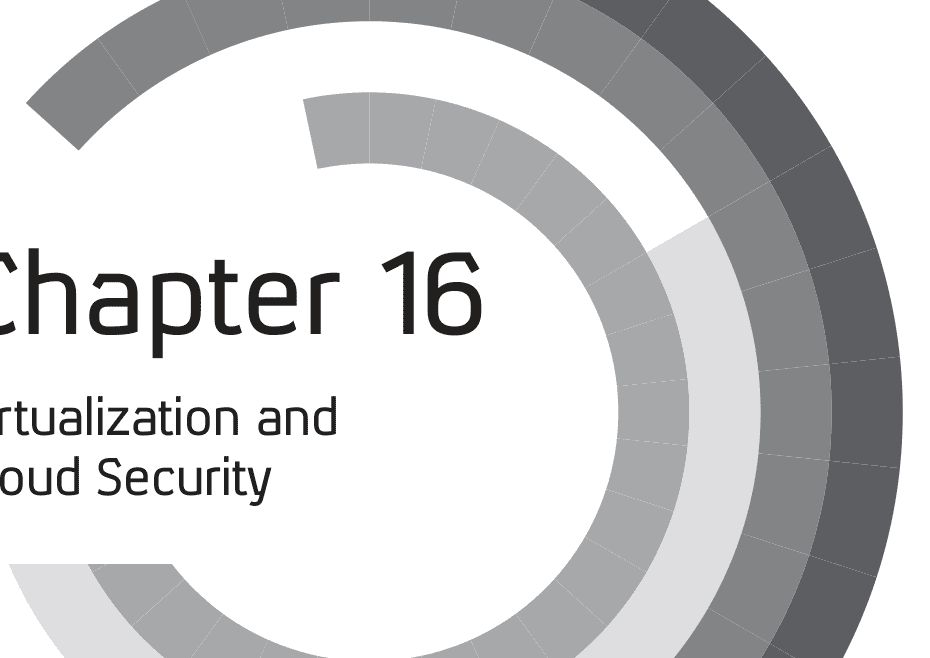
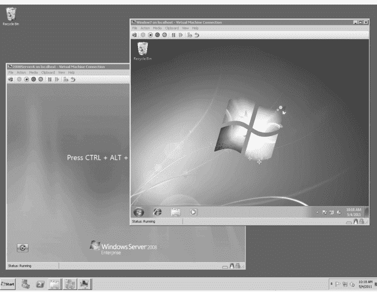
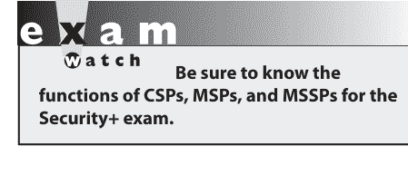
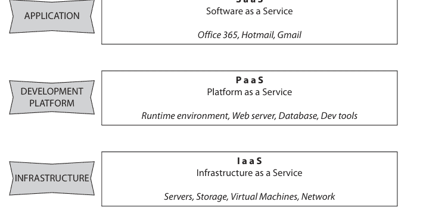
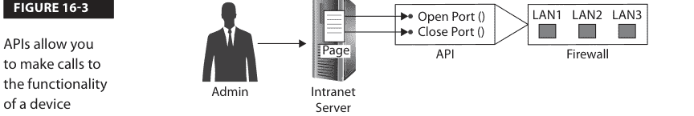
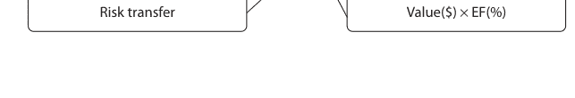

# 第16章：虚拟化与云安全

### 认证目标

- 16.01 虚拟化与虚拟化安全
- 16.02 云计算概念
- 16.03 云安全解决方案

两分钟速览  
问答  
自测

在过去几年中，计算领域发生了巨大变化，各公司正在寻求减少为向网络上的客户端提供服务而需要购买的服务器数量。在本章中，你将了解虚拟化如何通过在每个服务器上运行多个虚拟机来减少服务器数量，以及围绕虚拟化的安全问题。你还将学习云中托管服务、不同的云模型，以及为保护云资源而应关注的安全功能。



### 认证目标16.01：虚拟化与虚拟化安全

在本节中，你将了解虚拟化的目的以及虚拟化带来的安全问题。在Security+认证考试中，你可能会遇到一两道关于该主题的题目。

### 虚拟化简介

虚拟化是这样一种概念：与其为每个不同的操作系统或服务准备一台独立的服务器或计算机，你可以在单台计算机上以独立的虚拟机（VM）方式运行其中每一个。虚拟机由虚拟化软件（如VMware的ESXi或Microsoft的Hyper-V）提供，它允许你在隔离环境中运行每个操作系统，即使所有系统都在同一台物理计算机上运行。图16-1展示了一个运行着两个虚拟机的系统——一个虚拟机运行Windows Server，另一个运行Windows客户端。

**图16-1.** 在单台宿主机上运行的Windows Server和Windows客户端虚拟机



### 虚拟化的优势

虚拟化技术带来了巨大的好处，最主要的好处是你可以更好地利用服务器资源，因为传统上服务器的利用率并不高。例如，在过去，一家公司会购买一台文件服务器，而它对系统造成的负载很小。当公司需要一台内网服务器时，它会为此再购买一台物理服务器。这种情况下，两台服务器可能都只使用了其CPU的20%，这意味着公司并没有真正从服务器上获得物有所值的回报。通过虚拟化，你只需购买一台物理服务器，在上面运行两个虚拟机（一个用于文件服务器，另一个用于内网服务器），并使用40%的CPU能力，从而更好地利用公司资产并减少资金浪费。

如果你从事支持工作，需要协助运行不同操作系统（OS）的客户端，这也为你提供了一种方法，可以在单台计算机上安装每个已授权操作系统的一份副本。如果你需要接听针对某个特定操作系统的支持电话，该操作系统就在你面前。

测试和培训环境也能从虚拟化中受益，因为你可以在同一台物理机上安装不同的服务器和客户端，以搭建一个网络环境的模拟模型。

管理层同样受益于虚拟化技术。你可以将几十台服务器整合为少数几台物理服务器，因为你只需在各自的虚拟机中运行每个服务器，这样所需的物理服务器更少。我的一个客户将26台服务器整合为四到五台物理服务器。结果，该公司在硬件升级和维护上节省了大量资金，因为只需维护四到五台物理服务器。

使用虚拟化的一个环境效益是消耗更少的电力，因为涉及的物理服务器更少。这也为组织节省了资金。我的一个客户之所以通过虚拟化整合服务器，正是因为它即将达到最大功耗！

### 虚拟机监控程序（Hypervisor）

系统的虚拟化由虚拟机监控程序（hypervisor）提供，它也称作虚拟机监视器（VMM），是允许你在系统上创建和运行虚拟机的软件组件。当你将虚拟机监控程序安装到系统上后，该系统便称为宿主机系统，而每个虚拟机则称为客户机系统。

虚拟机监控程序有不同的类型：

- **类型I** 这种虚拟机监控程序是直接运行在硬件之上的软件，随后宿主操作系统作为父虚拟机运行。这使虚拟机监控程序能够控制宿主机和客户机系统对硬件的访问。Microsoft的Hyper-V和VMware的ESXi Server是类型I虚拟机监控程序的示例。这些虚拟机监控程序也被称为裸机虚拟机监控程序，因为它们直接运行在硬件之上。
- **类型II** 类型II虚拟机监控程序是指先在硬件之上安装操作系统，然后安装用于创建虚拟机的虚拟化软件。类型II虚拟机监控程序的示例包括VMware Workstation和Oracle VM VirtualBox。

以下是你在使用虚拟化技术和管理虚拟机时还应熟悉的其他术语：

- **应用程序容器** 应用程序容器是一项允许你在隔离环境中运行应用程序的功能，该环境拥有分配给它的自有资源。容器与虚拟机非常相似，但它们共享宿主系统的操作系统内核，因此它们的性能优于虚拟机（同时提供虚拟机的隔离特性）。Docker是提供应用程序容器的软件示例，也是Windows 10的一项功能。
- **虚拟机蔓延防范** 虚拟机蔓延（VM sprawl）发生在组织在没有为构建虚拟机设置任何流程的情况下创建了大量虚拟机时。问题在于，所创建的虚拟机数量超出了网络管理员管理所有虚拟机的能力。虚拟机到处出现却缺乏集中管理，意味着没有人能够确保所有这些系统在需要时及时打上补丁。请记住，未打补丁的系统可能会在你的网络中造成安全漏洞。集中管理虚拟机宿主机系统是解决虚拟机蔓延问题的关键，需要使用管理软件来部署虚拟机。
- **虚拟机逃逸防护** 虚拟机逃逸（VM escape）允许某人从虚拟机的客户操作系统中访问宿主操作系统。虚拟化供应商会针对其产品中存在的任何虚拟机逃逸漏洞发布补丁，因此请务必保持虚拟化软件已打补丁。

> **考试提示** 针对考试，请记住，虚拟机蔓延是指公司内的虚拟机数量失控。应使用虚拟机管理软件来管理各宿主机系统上的虚拟机。还要记住，虚拟机逃逸是指软件可以从虚拟机内部向宿主机系统发起调用，这是一个巨大的安全风险！请定期为虚拟化平台打补丁，以消除虚拟机逃逸漏洞。

### 虚拟化的安全问题

请记住以下与安全相关的虚拟化技术要点：

- **需要保护的硬件更少** 虚拟化的一大好处是，你可以在一个物理服务器上运行多个系统，这意味着需要保护的硬件更少。请务必遵循宿主机系统的物理安全实践，但好处是它只有一个系统。
- **磁盘空间** 虚拟化技术允许你创建系统快照，以便随时回滚到该快照。这是一个很棒的功能，因为如果你在系统配置中犯了错误，可以回滚到快照。但请记住，每个快照都会占用磁盘空间。
- **补丁** 尽管所有虚拟机都运行在同一个物理系统上，但为宿主机系统打补丁并不会给虚拟机打补丁。你需要负责为每个虚拟机打补丁。

> **考试提示** 针对考试，请记住，虚拟化的一个好处是需要你担心物理安全的系统更少。请确保对宿主机系统遵循物理安全最佳实践，但少担心一些硬件总是好事！

如今，大多数组织都在使用虚拟化软件在单个服务器上托管多个虚拟机，从而节省硬件采购成本并减少电力消耗。以下是有关虚拟化的一些安全最佳实践：

- **快照** 创建快照提供了一个恢复点，一旦虚拟机出现任何问题，你都可以回滚到该点。例如，如果你做出了错误的配置更改，或者虚拟机受到恶意软件攻击，你可以回滚到以前的快照以恢复虚拟机的状态。
- **补丁兼容性** 确保补丁在应用于虚拟化环境中的生产系统之前经过测试并兼容。
- **宿主机可用性/弹性** 请务必实现宿主机系统的高可用性，因为如果宿主机发生故障，则在该宿主机上运行的所有虚拟化服务器都将不可用。虚拟化解决方案的好处之一是*弹性*，即启动新服务器以处理增加的需求负载，同时在负载降低时也轻松减少正在运行的服务器数量。弹性也是云计算的一个重要特性（下一节将详细介绍云计算）。


- **安全控制测试：**确保你在虚拟化环境中测试所有安全控制，以确认它们按预期工作。虚拟化技术还便于创建额外的测试系统，从而验证网络上的安全功能。
- **沙箱测试：**你可以创建沙箱（受限环境），以控制虚拟机可以访问的资源。

## 认证目标 16.02

### 云计算概念

既然你已经理解了虚拟化以及与之相关的安全问题，下面让我们来学习云计算。在本节中，你将了解云计算的优势、云模型以及与云计算相关的安全问题。

### 云计算概述

云计算已成为未来的发展趋势，并且有许多优点和缺点。在本节中，你将了解云计算，并认识其中的一些优点和缺点。

借助云计算，你可以以极低的前期成本快速轻松地创建应用程序环境。例如，我想要一个电子邮件服务器环境，因此创建了一个 Microsoft 365 订阅账户。几分钟内，我就让一个电子邮件服务器环境（称为 Exchange Online）启动并运行起来，并借此创建了一些邮箱，然后开始发送电子邮件。这个例子最好的地方在于，我不必购买服务器硬件或软件，也无需规划高可用性。这些都是云服务所提供的功能的一部分！

### 云计算术语

在我们深入探讨不同的云模型之前（这对考试很重要），先来定义一些你经常听到的与云计算相关的术语：

- **云服务提供商（CSP）：**云服务提供商（CSP）是你订阅以获得云服务的公司。例如，如果你订阅了 Azure，那么微软就是云服务提供商。
- **托管服务提供商（MSP）/托管安全服务提供商（MSSP）：**托管服务提供商（MSP）是为你管理云环境并处理许多 IT 职能的公司，例如配置用户、管理云服务、执行数据备份和恢复以及监控活动。托管安全服务提供商（MSSP）是负责管理你环境安全的公司。MSSP 用于你的云环境的安全配置、活动监控、入侵检测系统（IDS）和防火墙的管理、补丁管理、安全事件响应，以及在组织内执行安全评估。

### 本地部署与外部部署

本地部署（On-premises）是我们用来描述安装在你的某个办公地点局域网（LAN）中的系统的术语。外部部署（Off-premises）则是用来描述可能位于备用站点的系统的术语。

### 雾计算/边缘计算

雾计算是指让你的边缘设备（例如位于网络边缘并连接互联网的路由器和防火墙）在将数据发送到云端之前先处理数据。作为边缘计算的一个例子，可以设想一个网络环境，其中所有记录的数据都被发送到云端进行处理。这会浪费带宽，因为其中一些记录数据并不需要。借助雾计算，处理在更靠近用户网络中生成数据的位置完成，然后仅将经过处理的信息转发到云端进行分析，从而节省带宽。雾计算也被称为雾化（fogging）或边缘计算。

### 瘦客户端

瘦客户端（thin client），也称为哑客户端（dumb client），是一种不执行大量处理、仅连接到远程服务器或云服务以完成所有处理的系统。例如，你可以使用一台 CPU 性能极低、内存极小且没有硬盘的瘦客户端机器，连接到 Microsoft 终端服务器，该服务器再将应用程序的屏幕画面发送到瘦客户端。用户可以在瘦客户端上使用鼠标点击应用程序中的选项，这些点击操作随后被发送到服务器，从而使屏幕刷新。关键在于，你使用的是服务器的处理能力，而非客户端的。



### 云计算模型

由于云计算有不同的实现方式，你需要熟悉这些不同的云模型，以应对 Security+ 认证考试（如图 16-2 所示）：

### 软件即服务（SaaS）

在 SaaS 中，云提供商会向客户提供一个应用程序，使客户可以在世界上任何有互联网连接的地方使用该应用程序。如果你使用 Gmail 或 Outlook.com 等免费电子邮件服务，那就是 SaaS 的一个例子。更好的例子是 Microsoft 365，一旦你订阅，就可以使用 Exchange、SharePoint 和 Microsoft Office 等服务。云提供商负责管理应用程序基础设施，并通过执行应用更新等任务为你维护它。

**图 16-2** 云计算模型



### 平台即服务（PaaS）

在 PaaS 中，云提供商向云客户提供一个开发环境（也称为运行时环境），使他们能够在云中创建应用程序。PaaS 的示例包括编程工具、代码库、Web 服务器、Web 服务和数据库环境。好处是开发人员可以在云中使用这些功能，而不需要像传统做法那样将它们作为本地服务器安装。使用 Azure SQL Database 就是 PaaS 的一个例子。

### 基础设施即服务（IaaS）

IaaS 是在云中创建虚拟数据中心的一种方式，因为它允许你在云中提供服务器、虚拟机、存储、网络和其他数据中心资源。当客户订阅 IaaS 时，他们只需为所使用的资源付费。例如，当你使用 Azure 虚拟机时，就是在使用 IaaS。请注意，使用 IaaS 时，你只需为所使用的资源付费。

### 一切即服务（XaaS）

前面的三种模型是最初的三种云模型，但随着时间的推移，这种情况已经发生了变化，现在云中的一切（或者说任何事物）都可以作为服务提供。例如，公司现在可以为云中的安全服务付费，这可以归入一切即服务（Anything as a Service）类别。

> **考试提示**
> 一定要掌握 SaaS、PaaS 和 IaaS 这些不同的云服务模型，以备考 Security+ 考试。

实现云服务有多种不同的方式。你可以通过以下方式实现云：

- **私有云：**私有云意味着你在公司内部创建云服务，使公司能够利用弹性和自助服务功能等云特性。例如，你可以拥有一个私有云，让 IT 人员根据需要快速创建虚拟机。私有云的关键在于数据存储在公司内部。
- **公有云：**公有云由服务提供商提供，你存储在云中的数据将存放在该提供商的服务器上。需要强调的是，许多组织不允许将敏感数据存储在服务器托管于国外的公有云中。值得注意的是，云提供商正在不同国家建立数据中心，以解决这一问题。
- **混合云：**混合云是公有云和私有云的混合体。公司可以将非敏感数据存储在公有云中，而将敏感数据保留在私有云中。
- **社区云：**这种云将计算资源集中起来，为具有共同需求的多个组织提供 IT 服务，例如实时访问后端数据库。
- **云存储：**云技术的一大好处就是可以使用云存储。现在，用户可以轻松地将数据存储在云中，并通过多种不同设备（如台式机、笔记本电脑、平板电脑和手机）访问这些数据。云存储既可以用于存储个人文件（如照片和文档），也可以用于存储设备的配置设置，这样如果你需要擦除设备，配置也可以轻松恢复。

### 云计算注意事项

云计算的目的是为组织提供数据库、电子邮件或其他服务等功能，而无需组织自行托管这些服务。例如，要托管自己的数据库服务器或电子邮件服务器，你需要服务器硬件和软件，这些都需要花钱。也许让别人托管这些服务（并让他们购买硬件和软件）更容易，而你则按月订阅付费，通过互联网访问这些服务。对于许多云服务，你只需为你使用的服务和数据存储付费。

虽然组织通过让别人在互联网上托管服务可以节省购买硬件和软件的初始成本，但云计算仍然存在一些安全方面的考虑：

- **多个客户共享服务：**如果多个客户订阅同一服务，一个客户是否有可能访问另一个客户的数据？你是在信任提供商会将客户信息与其他订阅者隔离。这通常通过虚拟化技术来实现。
- **法律问题：**在大多数情况下，如果执法机构有合法的理由要求云提供商提供其存储的信息，云提供商将不得不全面披露这些信息。


谁负责安全？了解提供商提供哪些服务以及您是否需要负责系统安全配置至关重要。大多数公共云提供商必须定期接受第三方安全审计。

在考虑部署网络服务和应用时，你可以选择在本地安装、由他人托管或使用云服务。以下列表概述了这些选项：

- 本地部署  本地部署意味着你将应用程序或服务安装在自己的站点内的服务器上。这需要大量前期时间和成本，包括规划部署以及购买服务器、软件和高可用性解决方案。你还负责维护服务器。
- 托管  使用托管解决方案，你的组织仍需购买软件和许可证并维护服务器，但你要向第三方公司付费，由他们提供服务器和基础设施来托管应用程序。
- 云  使用云解决方案，你按月支付订阅费用，软件已预先安装在后台服务器上（你无法访问这些服务器）。你可以根据需要对软件和服务进行配置更改，但无需维护服务器——这些服务器由云提供商维护。

以下是其他一些与云计算相关的术语和概念，你应该为 Security+ 认证考试熟悉它们：

- VDI/VDE  虚拟桌面基础设施（VDI）和虚拟桌面环境（VDE）是虚拟化功能，将用户的桌面环境托管在中央服务器上，然后交付给瘦客户端。用户与桌面操作系统交互时，感觉就像本地安装一样。

## 弹性与自动化

虚拟化和云服务提供了许多弹性和自动化工具及功能，有助于降低环境中的安全风险。

### 自动化/脚本

为了帮助减少安全风险，尽可能多地自动化任务非常重要。自动化的好处在于，你只需日复一日地运行自动化任务或脚本，从而减少错误。配置错误越少，意味着环境中的漏洞越少。

你不仅应具备自动化的行动方案（配置步骤），还应当自动化任何持续监控步骤，以确保你不会错过任何安全警报或通知。此外，还应自动化配置验证，即审查环境配置设置以确保其准确性的过程。

### 模板和主镜像

云环境中的模板允许你在创建虚拟机时应用标准配置设置。将这些配置设置模板与操作系统的主镜像相结合，你可以快速配置虚拟机，并在几分钟内使其运行。

### 非持久性

在使用云解决方案或虚拟化环境时，你有多种方法可以撤消对系统所做的更改。以下列表概述了撤消更改的解决方案：

- **创建快照** 在虚拟化环境中，你可以创建快照，快照就像配置状态的保存点。
- **还原到已知状态** 你可以将系统还原到某个快照，以撤消自该快照以来的更改。
- **回滚到已知配置** 某些软件会自动保存你的配置状态，并允许你回滚到其中某个已保存的配置状态。

### 弹性与可扩展性

弹性和可扩展性是任何基于云的解决方案的两个重要特性。在云计算背景下，弹性是指根据工作负载需求启动新服务器，并在工作负载减少时关闭这些服务器。可扩展性则是确保随着你的需求增长，解决方案也能随之增长。

### 分布式分配

许多私有云解决方案的一个出色特性是分布式分配，它允许你将虚拟机分布到多个主机系统上。大多数私有云解决方案会查看主机系统上的现有工作负载，并就虚拟机应在哪个主机系统上运行提供建议。

## 云特性

新的 Security+ 考试扩展了一些你必须理解的云概念，才能通过认证考试。本节将向你介绍一些不同的云相关特性。

### 容器

如本章前面所述，容器是一种允许你在隔离环境中运行应用程序的功能，该环境分配有独立的资源，很像虚拟机。容器与虚拟机不同之处在于，容器更轻量，因为它共享主机系统的操作系统内核。这就是为什么容器比虚拟机性能更好，同时仍提供虚拟机的隔离特性。Docker 是提供容器的软件示例，也是 Windows 10 的一项功能。

### 微服务/API

微服务是一段功能或组件，被编程到应用程序编程接口（API）中，然后可由其他应用程序调用。微服务的好处在于每个组件都是一个完整的工作单元，并且可以与 API 中的其他组件分开发布和更新。

应用程序编程接口是开发者创建的一组函数集合，允许其他开发者调用这些功能。例如，假设我们经营一家创建防火墙产品的公司。作为防火墙设备的一部分，我们有一个包含所有常见防火墙配置选项的 Web 界面，供管理员进行配置。作为产品的创建者，我们还可以创建一个 API，其中包含一系列函数，对应可对设备进行的各种配置更改（参见图 16-3）。创建 API 的好处在于，如果其他开发者不喜欢我们创建的网页，他们可以创建自己的 Web 管理页面。当开发者创建自己的网页时，他们只需在页面上添加调用 API 的链接或按钮。请注意，如今我们称这些为“Web API”，因为它们通过 HTTP 流量进行。

### 基础设施即代码

基于云的环境及集成在云中的基础设施组件的一大优势在于，我们可以利用软件定义网络和软件定义可见性等技术：

- 软件定义网络（SDN） SDN 是一种从中心点管理网络设备配置的方式。SDN 使用控制器应用程序和 API 来集中部署对网络设备的配置更改。
- 软件定义可见性（SDV） SDV 是一种监控整个网络环境的方法，并具备实时响应安全事件的能力。



### 其他云特性

从术语角度来看，你应该了解其他一些云特性：

- **无服务器架构** 无服务器架构是云计算的一大优势，因为你无需投资服务器硬件；相反，你只需在云中创建该服务的一个实例。例如，在 Azure 中，你无需安装 SQL Server 即可托管数据库；你可以直接在 Azure 中创建数据库，而幕后由云服务提供商（微软）负责服务器基础设施。
- **服务集成** 服务集成是一种云计算交付模型，允许本地数据与云数据进行交互。
- **资源策略** 云资源策略允许你管理云中存在的资源，如虚拟机、数据库和 Web 应用程序。你可以配置不同类型的策略来管理这些资源，例如有助于控制每月在资源上花费的成本控制策略、允许你随时间清理不必要资源的卫生策略，以及允许你实施安全控制来保护资源的合规性策略。
- **中转网关** 中转网关是一种机制，为你提供一条安全、私有的链路，允许你将自己的本地网络扩展到云网络。

## 认证目标 16.03

## 云安全解决方案

既然你已经了解了云计算的一些特性，下面让我们看看可用于保护云资源（如云中运行的应用程序和数据）的一些不同安全控制措施。在本节中，我们还将介绍一些常见的云计算安全解决方案。

### 云安全控制

安全控制是用于保护资源的一种机制；因此，“云”安全控制是用于保护云资源的一种机制。云安全控制有多种不同类型——通用安全控制、保护存储的控制、网络安全控制，以及保护计算环境的控制。


## 云通用安全控制

通用安全控制是你作为云订阅一部分所拥有的控制措施，并不一定专门针对存储或网络。务必了解以下通用安全控制，以备考Security+考试：

- **跨可用区高可用性** 当你使用云服务提供商创建不同资源时，可以选择所需的高可用性级别。你可以在区域内或跨区域实现高可用性。
- **资源策略** 如前所述，你可以对资源设置策略，例如限制资源每月的成本、用于保护资源安全的合规策略，以及随时间清理未使用资源的策略。
- **机密管理** 云门户内有用于管理所使用认证凭据（称为机密）的工具，例如密码、应用程序令牌和密钥。
- **集成与审计** 你可以对资源配置云审计，以帮助跟踪谁在使用什么资源以及从何处使用。

## 存储安全控制

云的一大优势是你可以将数据存储在云中，然后可从世界任何地方访问这些数据。这意味着你还应采取额外措施，通过实施以下不同的存储安全控制来保护这些资源：

- **权限** 你可以通过对数据设置权限来限制对数据的访问，从而控制谁可以访问它。
- **加密** 你可以对数据进行加密，使未经授权的人员无法访问数据。确保数据在静态（存储时）和传输过程中均加密。许多云服务提供商默认对数据进行加密。
- **复制** 你可以将数据复制到另一个云区域，以便在发生区域中断时实现数据的高可用性和业务连续性。
- **高可用性** 高可用性确保数据始终可用。云服务提供商会在后台为不同服务实施高可用性功能，但你也可以将数据复制到另一个区域以确保高可用性。

## 网络安全控制

可以在云中实施多种安全控制，以保护你的云网络环境：

- **虚拟网络** 在云中，你可以创建多个虚拟网络，并将不同系统连接到每个网络。例如，你可以仅为会计人员创建一个虚拟网络，并在该网络上运行会计服务器虚拟机。
- **公共和私有子网** 你可以创建多个公共和私有子网。公共子网是允许与互联网通信的网络（本质上是互联网网关）。你还可以将云基础设施划分为多个无法直接访问互联网的私有子网。
- **分段** 你可以将资源划分到不同的虚拟网络中，以控制对这些资源的通信。
- **API检查与集成** 云服务提供商提供许多API，可用于检查云中的元素以进行合规性验证。例如，Google Cloud提供了一个数据丢失防护（DLP）API，可以调用它来检查存储在云中的数据，并验证其中是否存有敏感数据。你还可以使用允许检查云中网络流量的API。

## 计算安全控制

在云环境中，计算资源是指云中的虚拟机、容器或应用程序服务（例如数据库服务）等资源。你可以使用多种安全控制来保护这些计算资源：

- **安全组** 你可以创建具有不同资源权限级别的不同安全组。
- **动态资源分配** 云计算的一大特性是虚拟机仅使用所需的RAM和磁盘空间。如果活动量很大，这些资源会即时增加以处理工作负载，当负载减轻时再降低。
- **实例感知** 你应实施能够区分云中运行的应用程序服务实例的安全控制。如果你使用的安全控制无法区分实例，攻击者可能会创建应用程序服务的恶意实例，并可能执行数据外泄攻击。
- **虚拟私有云（VPC）端点** 虚拟私有云（VPC）是云中资源的私有网络。VPC端点允许你通过私有地址与应用程序服务通信。
- **容器安全** 确保通过遵循安全最佳实践来保护容器环境，例如锁定容器内运行的操作系统，包括保护root或管理员账户的安全。

## 云安全解决方案

你可以在云中使用多种安全解决方案来实现云安全。以下是一些常见的云安全解决方案：

- **CASB** 云访问安全代理（CASB）是一种安全服务，位于你的本地环境和云提供商的環境之间。CASB允许你定义适用于从当前本地环境流向云的网络流量的安全策略。
- **应用程序安全** 为你在云中的应用程序寻找安全解决方案。你应使用能够让你了解应用程序及其包含数据状况的解决方案。你还应了解敏感数据的访问控制设置，以便密切监控谁有权访问这些数据。云服务提供商通常会提供多种合规功能，使你能够监控这些元素。
- **下一代安全Web网关（SWG）** 安全Web网关（SWG）是一种网关产品，所有流量都通过它进行转发，它可以防止用户访问互联网或云中可能含有恶意软件的网站，这些恶意软件可能会感染其系统或内部网络/云网络。

> 考试
> 注意务必了解本节中提到的云安全解决方案。尤其注意，CASB允许你定义适用于从当前本地环境流向云的网络流量的安全策略。

## 云环境中的防火墙注意事项

当你在寻找适用于云环境的防火墙产品时，应考虑以下一些因素来帮助你做出决策：

- **成本** 防火墙解决方案的成本。
- **分段需求** 你是否需要能够处理多个网络分段并控制这些分段之间流量的防火墙解决方案。
- **开放系统互连（OSI）层** 防火墙运行在OSI模型的哪一层，以及你希望按什么类型的数据过滤流量。例如，如果你希望能够检查数据包的有效负载，你将需要使用应用层防火墙（第7层），而不是包过滤防火墙（第3层）。

## 云原生控制与第三方解决方案

关于在云中实施安全控制，最后一点是，在考虑第三方解决方案之前，你应首先研究云解决方案自带的安全控制（原生控制）。CSP正在不断改进其云解决方案的功能，并增加其产品内置安全控制的数量。

## 认证摘要

在本章中，你学习了云计算概念以及保护云资源时应考虑的不同因素。在准备Security+认证考试时，以下是关于本章需要记住的一些关键点：

- 虚拟化技术允许你在单个物理服务器上运行多个虚拟化计算机。
- 你可以使用虚拟机快照作为恢复到系统先前状态的方法。
- 云计算是通过互联网托管服务，为企业节省资金，因为它们不必安装自己的服务器。
- 考试需要了解的三种主要云模型是SaaS、PaaS和IaaS。
- 容器就像轻量级虚拟机，因为它们共享宿主系统的操作系统内核。
- 应使用云安全控制在云中实施安全性。


## 两分钟速览

### 虚拟化与虚拟化安全

- 虚拟化允许你在单台主机计算机上运行多个操作系统。
- 确保每台虚拟机都已修补并受到保护。确保主机计算机在物理上安全。
- VM蔓延是指公司对组织内已创建的虚拟机数量失去控制，并且没有针对虚拟机创建、管理和退役的流程。
- VM逃逸是未修补虚拟化环境的一种安全风险。VM逃逸允许应用程序从VM内部访问主机系统。考试时请记住，你需要修补虚拟化环境以防止VM逃逸。


## 云计算概念
- 云计算让你可以跨互联网使用提供商的云服务来托管电子邮件和数据库服务器，同时你可以远程连接并管理这些服务器。
- *云服务提供商（CSP）*是向你提供云服务的公司。
- *托管服务提供商（MSP）*是为你管理云环境并处理许多IT职能的公司，例如配置用户、管理云服务、执行数据备份与恢复以及监控活动。
- *托管安全服务提供商（MSSP）*是负责管理你环境安全的公司。MSSP用于云环境的安全配置、活动监控、IDS和防火墙管理、补丁管理、响应安全事件，并在组织内执行安全评估。
- 在软件即服务（SaaS）云模型中，应用程序直接提供给客户端，客户端无需安装该应用程序（例如Hotmail、Gmail或Microsoft 365）。
- 在平台即服务（PaaS）云模型中，CSP提供运行时环境和开发工具，以便在云中创建应用程序。
- 在基础设施即服务（IaaS）模式下，云服务提供商为客户提供创建虚拟数据中心的方式，包括创建虚拟网络、存储和虚拟机。

## 云网络安全解决方案
- 你应当使用权限、加密和复制技术来保护存储资源。
- 你应当使用网络安全控制来创建虚拟网络、公有和私有子网以及分段功能。
- 对于计算资源，应使用安全组和容器安全。

## 自测
以下问题将帮助你衡量对本章内容的理解程度。如提示所示，有些问题可能不止一个正确答案，因此请务必仔细阅读所有选项。

### 虚拟化与虚拟化安全
- 1. 下列哪项指出了使用虚拟化技术的一项安全优势？
- A. 你只需要修补主机操作系统。
- B. 你只需要在主机系统上安装病毒防护。
- C. 需要保护硬件更少。
- D. 不需要驱动器加密。
- 2. 你的经理了解到了被称为“虚拟机逃逸”的虚拟化技术安全威胁。你会实施哪种安全控制来防范虚拟机逃逸？
- A. 资源策略
- B. 私有子网
- C. 沙箱
- D. 修补虚拟化环境
- 3. 你有一个管理员团队，负责创建组织内不同部门所需的虚拟机。如果没有针对虚拟机创建制定VM管理流程，会带来哪些风险？
- A. 虚拟机蔓延
- B. 虚拟机逃逸
- C. 虚拟机内存泄漏
- D. 虚拟机补丁管理

### 云计算概念
- 4. 你的经理希望聘请一家公司来监控云中的安全事件、管理IDS和防火墙，并响应安全事件。你的公司正在寻找哪种角色？
- A. CSP
- B. MSP
- C. MSSP
- D. DLP
- 5. 如果你正在寻找应用程序和开发工具的运行时环境，你会订阅哪种云计算模型？
- A. SaaS
- B. PaaS
- C. IaaS
- D. XaaS
- 6. 你想在云中创建虚拟网络并托管可供用户访问的虚拟服务器。你会使用哪种云服务模型？
- A. IaaS
- B. SaaS
- C. XaaS
- D. PaaS
- 7. 哪种云安全解决方案允许你定义应用于从当前本地环境流向云的网络流量的安全策略？
- A. API
- B. 安全组
- C. SWG
- D. CASB

### 云网络安全解决方案
- 8. 你需要创建一组无法从互联网访问的虚拟机。你会使用哪种云安全控制？
- A. 公有子网
- B. API检查
- C. 私有子网
- D. 安全组
- 9. 你想确保云数据始终可用。你会使用哪种云安全控制？
- A. 权限
- B. 复制
- C. 加密
- D. 虚拟机逃逸
- 10. 对于涉及应用程序使用密钥访问云资源的环境，你会采取哪项措施来提高其安全性？
- A. 禁用非对称加密。
- B. 实现高可用性。
- C. 使用私有子网。
- D. 定期更换密钥。

## 自测答案

### 虚拟化与虚拟化安全
1. ☑ C. 虚拟化的好处之一是，你需要在更少的系统上实施物理安全控制，因为虚拟化使用了更少的硬件。
☒ A、B和D不正确。你将需要修补主机操作系统和每台虚拟机并提供病毒防护。根据任何需要保持机密性的驱动器，可能仍然需要加密。

2. ☑ D. 虚拟机逃逸是指攻击者利用虚拟化平台中的漏洞，从虚拟机内部访问主机系统。要消除该漏洞，请确保虚拟化环境及时更新补丁。
☒ A、B和C不正确。资源策略允许你管理云中存在的资源，如虚拟机、数据库和Web应用程序。资源策略有多种类型——你可以通过资源策略实施安全控制，或确保资源在特定不活动时间后被移除。私有子网是无法从互联网访问的云网络。沙箱是指在隔离的环境中运行——在这种情况下，虚拟机本应是隔离的，但由于漏洞，攻击者能够调用主机系统。

3. ☑ A. 虚拟机蔓延是指公司失去了对组织内已创建的虚拟机数量的跟踪，并且没有相应的虚拟机创建、管理和退役流程。
☒ B、C和D不正确。虚拟机逃逸是指攻击者利用虚拟化平台中的漏洞，从虚拟机内部访问主机系统。要消除该漏洞，请确保虚拟化环境及时更新补丁。虚拟机内存泄漏是虚拟化平台编码人员的缺陷，通常可以通过补丁修复。虚拟机补丁管理是应该进行的工作，并且可能面临虚拟机蔓延的风险，因为如果你不管理虚拟机的数量，就会需要修补更多虚拟机。

### 云计算概念
4. ☑ C. 托管安全服务提供商（MSSP）是负责管理你云环境安全的公司。
☒ A、B和D不正确。云服务提供商（CSP）是你订阅以获得云服务的公司。托管服务提供商（MSP）是为你管理云环境并处理许多IT职能的公司，例如配置用户、管理云服务以及执行数据备份与恢复。数据防泄漏（DLP）不是你要聘请的公司，而是一种合规控制措施，用于防止敏感数据泄漏出公司。

10. ☑ D. 你应该定期更换密钥，以确保只有经授权的应用程序才能访问云服务和资源。
☒ A、B和C不正确。你不应禁用某种加密形式，无论是非对称加密还是对称加密，因为许多环境会同时使用两者。在此场景中，资源的可用性不是问题，因此无需实现高可用性。私有子网允许你在子网上托管无法从互联网访问的虚拟机。


## CERTIFICATION OBJECTIVE 17.01

## 风险分析简介

在本节中，你将了解进行风险分析的必要性以及它从安全角度为组织带来的好处。你还将了解执行风险分析时应遵循的总体流程。

## 风险分析概述

具备执行风险分析或评估的知识对于安全专业人员而言是一项重要技能，因为许多不同的安全概念都以风险评估为起点。例如，安全评估通常从你执行风险评估开始，以便识别需要保护的资源。此外，制定业务连续性计划也涉及一种风险类型的分析，称为业务影响分析（BIA）。

风险分析的总体目的是识别组织内的资产及其价值，以便随后识别对这些资产的威胁。识别威胁后，你确定如何针对每种威胁采取对策（称为缓解威胁），同时确保你的对策成本不会超过资产的价值！这是风险分析的关键点——为价值仅为 2,000 美元的资产花费 10,000 美元购买缓解解决方案在商业上是没有意义的。

在介绍风险分析流程之前，我想列出在讨论风险分析时使用的一些术语。你应熟悉以下与风险分析相关的术语，以便通过 Security+ 考试：

- **Asset** 组织运作所需资源
- **Vulnerability** 硬件或软件配置中的弱点
- **Threat** 可能对资产造成损害的事件
- **Threat vector** 黑客用来利用系统弱点的工具或机制
- **Threat actor** 使用威胁向量入侵系统的个人（黑客）
- **Threat target** 正在被攻击的系统或设备
- **Risk** 威胁对资产可能对组织造成损害——通常导致财务损失
- **Risk analysis** 识别和规划缓解技术以减少和管理组织风险

## 风险分析流程

执行风险分析时遵循流程很重要，这样才能确保识别出与资产相关的所有威胁和风险。遵循风险分析流程可以让你规划适当的缓解技术以降低风险。本节概述了风险分析流程并将其分为不同的阶段。

## 识别资产

执行风险分析的第一阶段，也称为风险评估，是识别组织内的资产及其价值。此阶段也称为资产识别。例如，如果一家公司通过在线销售产品赚取收入，则托管电子商务网站的 Web 服务器可被视为公司的资产。

在此阶段，请务必专注于识别资产，而不是担心对这些资产的威胁——这将在下一阶段进行。通过只关注资产是什么，你可以正确识别组织的全部资产。以下是组织持有的常见资产列表：

- 硬件和软件
- 组织的信息和数据
- 建筑物
- 库存和现金
- 人员
- 组织的声誉和品牌
- 计算机系统和服务

在识别资产时，注意隐藏的资产。例如，每天带来数千美元收入的电子商务网站通常有一个数据库服务器，该服务器保存着产品列表以及每个产品的详细信息。

## 识别每个资产的威胁（威胁评估）

一旦识别出组织中的资产，你就将重点转向威胁评估，这涉及识别第一阶段识别出的每个资产的威胁。继续以上示例，公司电子商务网站存在许多潜在威胁；例如，系统可能通过缓冲区溢出漏洞或 SQL 注入攻击被黑客入侵。Web 服务器也可能发生硬盘故障，导致系统长时间停机，从而造成收入损失。

执行威胁评估时，重要的是要识别来自不同来源的威胁——或不同类型的*灾难*。存在环境威胁、人为威胁，以及内部和外部威胁。以下识别了这些不同类型的威胁，也称为*风险类型*：

- **Environmental** 环境威胁源于企业运营的环境或位置。环境威胁包括但不限于洪水、海啸、地震、火山爆发、龙卷风、暴风雪、雷暴和飓风。
- **Person-made** 人为威胁，也称为人为威胁，是指并非自然存在而是人类行为，无论是有意还是无意造成的威胁。人为威胁的例子包括病毒、火灾、盗窃、破坏和蓄意破坏。
- **Internal and external** 需要注意的是，威胁可以是内部的也可以是外部的。*内部威胁*来自组织内部的人员。这可能是威胁，例如不满的员工故意删除客户数据，或员工意外删除文件。你需要防范这两种威胁。*外部威胁*来自组织外部，例如互联网上有人试图入侵你的邮件服务器或网站。
- **Legacy systems** 将遗留系统连接到网络的威胁或风险在于，遗留系统可能不再得到系统硬件或软件供应商的支持。例如，供应商可能不再为遗留系统创建安全补丁，使其容易受到攻击。如果你确实需要遗留系统保持生产状态，请考虑将其放置在独立的网段上。
- **Multiparty** 多方风险或威胁是对多个人员或公司的风险。例如，如果你租用一辆汽车，作为租赁所有者，你关心汽车的风险，租赁公司和保险公司也同样关心。
- **IP theft** 组织面临的另一个常见威胁或风险是知识产权（IP）被盗。此威胁的一个例子可能是组织内部的内部人员有权访问机密公司数据，并在离开公司加入竞争对手时将其带走。你可以通过实施加密和访问控制策略来降低 IP 盗窃的风险。
- **Software compliance/licensing** 组织面临的另一个主要风险与软件许可和合规性有关。对于大型组织来说，很容易失去对所需软件许可证数量的跟踪，因此定期进行审计以确保公司遵守许可要求非常重要。不遵守许可要求的组织可能会面临法律后果和罚款。

重要的是要理解，许多威胁来自于组织资产中存在弱点或漏洞。例如，漏洞可能是一个未得到适当保护的系统，从而导致系统被黑客入侵的威胁。以下概述了一些可能存在的常见漏洞：

- **No system hardening** 必须认识到，未经适当保护或加固的系统会增加系统被黑客入侵的威胁。
- **No physical security** 没有物理安全措施可能会导致许多潜在威胁，从资产被盗到数据保密性被破坏。
- **No security controls on data** 对数据没有安全控制意味着存在与机密性和数据篡改相关的威胁。
- **No administrative controls** 管理控制是政策或程序。没有政策和程序可能会导致你不符合法规或标准的威胁。

对于组织可能拥有的任何数量的资产，都可能存在各种类型的威胁。威胁可能从技术性质到与人员行为相关不等。以下是常见威胁示例的列表：

- **Theft** 盗窃如今是一个巨大的威胁，因为你不仅要处理资产的物理盗窃，还要处理信息资产的数字盗窃。
- **System hacked from inside** 你的网络上的关键系统或服务可能被内部员工入侵，无论是有意还是无意。
- **System hacked from outside** 你的网络外部的人可能会入侵你网络上的公共服务器，例如 Web、FTP 和 SMTP。
- **Natural disasters** 洪水、飓风和龙卷风等自然灾害是企业持续运营的威胁示例。
- **Hardware failures** 运行保存关键数据或功能的服务器时，识别可能发生的硬件故障非常重要。硬件可能是硬盘、网卡，甚至是生产工厂中的机械。
- **Fraud** 这有点难以识别，但要警惕欺诈威胁，因为员工可能会篡改信息或公司流程以获得经济利益。

Security+ 认证考试期望你了解与云计算和虚拟化技术等技术相关的风险。云计算在概念上很棒，但它意味着有人在托管服务，这可能导致保密性被违反。例如，如果你将邮件托管在提供商的系统上，你不知道谁有权访问该系统以及他们是否正在访问你的公司邮件。请确保在这种环境中实施高水平的审计。


客户信任的丧失 如果公司的电子商务网站被黑客攻击并且此信息公开，你可能会失去客户（或股东）的信任，他们可能由于担心信用卡号码被黑客捕获而不愿再在线购买商品。

## 优先排序威胁

一旦你识别出针对每项资产可能发生的全部威胁，就必须根据其影响和发生的概率（也称为发生可能性）对威胁进行优先级排序，以便先处理更严重的威胁。

你如何对威胁进行优先级排序将取决于所执行的风险分析类型；例如，如果你进行定性分析，你将根据某种量表为每个威胁分配值（例如低、中、高），然后先关注高级别的威胁。稍后会详细介绍分析类型。

exam watch 对于认证考试，请记住威胁的无形影响示例包括公司声誉受损、客户信任丧失以及未能遵守法规。

## INSIDE THE EXAM

## 风险登记册

风险登记册是用于记录不同威胁的描述以及其影响和概率的工具。该工具可以简单到像电子表格一样列出风险的详细信息以及影响和概率，也可以是第三方软件应用程序。风险登记册通常会列出风险适用的类别、威胁的描述、影响（也许是1到5的数字）、概率（同样也许是1到5的数字）、风险评分（影响乘以概率）以及缓解措施。风险评分有助于你对威胁进行优先级排序。下面是一个风险登记册的示例：

Project: Public Web Site

| Category | Num | Name of Threat | Probability | Impact | Risk Score | Mitigation |
|---|---|---|---|---|---|---|
| External | 1.1 | Denial of Service | High | High | 9 | Firewall protecting the web server |
| External | 1.2 | Defacing Web Site | Low | Medium | 2 | Firewall and authentication services |
| Environmental | 2.1 | Flood in Datacenter | Low | High | 3 | Ensure equipment is up off the floor |
| Environmental | 2.2 | Loss of Power | Medium | High | 6 | Generators and UPS |
| Environmental | 2.3 | Overheating | Low | Medium | 2 | Air conditioning/hot aisle-cold aisle |
| Internal | 3.1 | Accidental Deletion of File | Medium | Medium | 4 | Permissions/backups |
| Internal | 3.2 | Malicious Update | High | Low | 3 | Permissions/backups |

Scale: Low=1, Medium=2, High=3

## INSIDE THE EXAM

## 供应链评估

*供应链*涵盖了将公司的产品或服务从零部件供应商、通过制造到客户门口所需的资源和流程。供应链涉及众多组件，从获取原材料，到制造过程，到用于包装和交付产品的员工。

*供应链评估*涉及识别供应链中的任何风险并缓解这些风险。例如，评估可能会评估如果原材料短缺或制造厂发生火灾该怎么办。所有此类威胁都可能对你的业务构成风险。

## 测试

在评估对组织资产的威胁时，执行不同类型的测试非常重要。你可以执行*vulnerability test*，也称为*vulnerability scan*，以测试你的系统是否容易受到不同利用和弱点的攻击。你也可以执行一种更主动的测试，称为*penetration testing*，测试人员尝试绕过安全控制并获得对系统的访问权限。你将在第20章中了解更多关于这些测试类型的信息。

还有许多其他形式的测试可以执行，这些测试与技术没有直接关系。例如，你的组织应定期进行消防演练。你还可以通过测试加急订单来测试供应商交付灵活性和库存水平来测试你的业务流程。如果你从事服务行业，你可以使用神秘顾客来测试客户服务。

## 变更管理

在通过漏洞扫描或渗透测试对系统进行测试后，你可能会发现需要对系统配置进行更改以使其更安全。在对系统配置进行更改时，请务必遵循组织制定的变更管理流程。该流程通常涉及先将更改应用于测试系统，在进行更改前备份生产系统，应用更改，然后在更改后验证系统的正常运行。

变更管理的关键是文档。例如，在计划更改时，你应记录所需的更改，记录如果更改未按计划进行该怎么办（这称为*rollback plan*），然后总结更改操作的结果。

## 识别缓解技术

一旦你识别出威胁并对其进行优先级排序，你就知道应关注哪些威胁解决方案，或至少如何降低威胁发生的风险。这被称为缓解威胁。缓解威胁通常涉及花费资金在解决方案上实施安全控制以保护资产免受风险。你可以实施容错技术、防火墙、加密或访问控制系统等。

exam watch
实施缓解技术后，始终评估剩余的任何残余风险。

## 评估残余风险

一旦你实施了缓解威胁的解决方案，就重新评估资产并识别可能仍然存在的威胁。剩余的威胁被称为残余风险。向管理层表达这种残余风险至关重要，以便他们可以决定是否愿意接受该残余风险或希望实施额外的安全解决方案。

## 帮助分析风险的工具

你可以使用许多工具来帮助评估、分析和就风险分析和风险评估做出决策。在本节中，你将了解这些风险工具和概念。

## 风险矩阵/热力图

风险矩阵，也称为热力图，是用于为特定事件分配风险值以帮助确定风险水平的一种工具。查看图17-1，你可以看到风险矩阵左侧列出了事件的影响水平，然后在顶部列出了事件发生的概率水平。假设针对你的电子商务网站的DoS攻击事件的影响为高（3），但概率为中（2）。这将给你一个风险值为6（3 × 2）。另请注意，每个风险值通常都会着色，以便直观地确定事件的风险程度。风险值为1将为绿色（意味着风险最小），黄色方块用于标识风险水平为2和3，风险水平为4和6可能是橙色，然后风险值为9使用红色方块直观地表示高风险。这些颜色和值可以根据组织处理风险的方法进行修改。

FIGURE 17-1
A risk matrix/ heat map

| | | Probability | | |
|---|---|---|---|---|
| | | Low (1) | Medium (2) | High (3) |
| Impact | Low (1) | 1 | 2 | 3 |
| | Medium (2) | 2 | 4 | 6 |
| | High (3) | 3 | 6 | 9 |

## 风险控制评估和风险控制自我评估

*Risk control assessment* 是指由了解业务风险目标并审查安全控制有效性以最小化风险的第三方执行的评估时使用的术语。

*Risk control self-assessment (RCSA)* 是指内部员工识别风险并评估保护资产免受风险的控制有效性的过程的术语。RCSA的目标是确保已实施控制的可靠性，确保资产的安全性，并确保遵守法律法规和安全政策。

## 风险术语

Security+考试将测试你关于风险和执行风险分析的许多其他术语。其中一些术语已在章节的其他部分讨论过，但术语的良好列表使得在参加认证考试前复习它们变得容易：

- **Risk awareness** 涉及提高对资产风险的认识，了解风险的影响，如何缓解这些风险，以及如何管理任何残余风险。
- **Inherent risk** 指在应用缓解技术降低风险之前与特定活动或业务流程相关的自然风险。
- **Residual risk** 在应用缓解技术降低风险后剩余的风险量。
- **Control risk** 也称为*risk control*，这是识别针对资产的威胁并识别可以实施以保护它们的控制的过程。
- **Risk appetite** 公司基于其目标和目标愿意接受的风险水平。风险偏好将有助于确定是否需要控制来保护资产。

## 影响风险态势的法规

每个网络安全计划都应包含应用于保护公司资产（如系统、网络设备和数据）的控制列表。术语*security posture*指的是基于已实施的缓解技术这些资产的安全程度。公司可以采取许多步骤来改善其安全态势并降低其风险态势，例如执行风险评估，实施安全控制以缓解风险，对员工进行安全和风险教育，并实施事件响应计划。

管理你的组织的法规对你的风险态势有直接影响。例如，如果一家公司处理信用卡，它必须遵循*Payment Card Industry Data Security Standard (PCI DSS)*设定的合规要求。遵循这些要求有助于在处理信用卡信息时创建更安全的环境，从而降低你的风险态势。


# 云计算和第三方风险

当今世界的一个热门话题是云计算的概念。有了云计算，你可以订阅一个云服务，该服务在互联网上的某个服务器上提供数据存储空间，或者你可以让别人为你托管服务，例如 Web 服务器、数据库服务器和电子邮件服务器。订阅云服务的益处的一个例子是，你的公司无需购买硬件来托管公司电子邮件和数据库——你只需订阅云服务，他们就会为你提供该功能。然后你只需登录管理界面（通常是 Web 界面）并管理服务（例如电子邮件）。

订阅此类服务可以让你的公司节省前期成本，例如硬件采购，但也可以节省时间，因为你无需担心物理硬件和操作系统本身的管理。服务提供商将负责硬件、管理操作系统和更新，并确保高可用性（这物有所值）。

不幸的是，云服务的一个主要担忧是隐私。云提供商将数据存储在哪里？它如何保护数据？这些是你应该提出并找到答案的问题。归根结底，你正把你的信息托付给第三方组织。多年来，我谈过的许多客户由于隐私问题和规范其组织的法规而不会考虑使用云服务，但我看到这一趋势正在转变，因为云提供商正在解决安全问题。

决定使用云服务是你需要仔细规划的事情。还应考虑混合解决方案，例如，敏感数据存储在公司现场（称为本地），而非敏感数据存储在云中以利用备份服务甚至该数据的高可用性。

请注意，有不同类型的云模型，例如公共云，你的数据托管在互联网上，而私有云意味着你在公司内部托管数据。重要的是要注意，与公共云相关的风险更大，因为它们不在你的组织内托管。要了解有关云模型和服务类型的更多信息，请查看第 16 章。

以下是将系统和数据与云服务和第三方公司集成时应考虑的一些要点：

- 上线/下线业务合作伙伴
在与需要访问你系统的业务合作伙伴合作时，你需要制定将新人员（合作伙伴的员工）添加到身份和访问管理（IAM）系统的程序。该系统用于识别公司外部的人员并控制他们对系统的访问。将新员工添加到系统的过程称为上线，而从系统中删除员工的过程称为下线。

- 社交媒体网络和/或应用程序
随着社交媒体网络的增长，组织需要制定政策并教育员工哪些信息允许发布在社交媒体网络上，哪些信息不允许发布。

## 互操作性协议
确保你与云提供商或第三方公司有明确的操作协议。协议如*服务等级协议（SLAs）*规定了保证的正常运行时间。检查是否需要* blanket purchase agreement (BPA)*，它用于涵盖产品或服务的重复性需求。确保存在*谅解备忘录（MOU）*，有时也称为*谅解协议（MOA）*。这是一份在双方之间建立协议并规定彼此关系的文档。还确保你熟悉你的*互联网服务协议（ISA）*，并且你对任何数据限制和互联网连接的保证正常运行时间感到满意。如果要利用云服务，这一点至关重要，因为你需要互联网连接来访问云中的任何服务或数据。

## 隐私考虑
如前所述，你需要意识到将信息存储在第三方或云中存在风险。你信任服务提供商正在保护该信息。

## 风险意识
了解与云服务和第三方集成风险的重要性。你的数据可能存储在不安全的位置的风险，以及如果未加密，跨网络传输的数据可能被他人查看。你应确保提供商保证访问该信息。还有其他风险需要注意——你可能会失去互联网访问权限，无法访问云中的数据。你也可能遇到云提供商倒闭的情况——那时你如何访问你的数据？或者如果出于法律原因对云提供商的硬件发出传票怎么办？所有这些情况都可能导致你无法访问云中的数据。

## 未经授权的数据共享
与第三方组织合作时，你始终存在第三方员工未经授权与其他人共享信息的风险。

## 数据所有权
确保互操作性协议规定谁拥有存储在云中或第三方公司的数据。一些第三方公司可能认为，如果你将数据存储在他们那里，那么数据就是他们的。阅读所有协议并确保数据所有权明确规定。

## 数据备份
只要你明白，理论上，一旦你将数据存储在云中，你就不知道谁正在访问它，数据备份是云存储空间的绝佳用途。如果这是你的担忧，并且你真的想将数据存储在云中（尤其是如果它不是敏感信息），那么在备份到云之前先加密信息。

## 遵循安全策略和程序
确保在与云服务和第三方公司合作时遵循你组织的安全策略和程序。如果你是负责更新策略的安全官，那么确保你更新它们以包含组织关于云服务的规则。

## 审查协议要求以验证合规性和绩效标准

此项非常重要。你必须阅读所有协议，以确保你遵守规范你组织的任何法规。例如，由于隐私问题，许多政府机构和医疗部门不能将信息存储在云中或第三方公司。

## CERTIFICATION OBJECTIVE 17.02

## 风险评估类型

当你执行风险评估时，了解两种流行的风险分析类型——定性和定量非常重要。定性风险分析涉及根据量表为威胁分配价值，而不担心计算与风险相关的美元数额，而定量风险分析涉及将美元成本与每项风险关联起来。在本节中，你将了解两者之间的区别。

> exam watch
> 对于 Security+ 考试，要非常熟悉定性和定量风险分析之间的区别。
> 
> 定性使用量表来识别威胁的严重性，而定量使用美元数字。

### 定性

如前所述，定性风险分析确定风险和缓解技术，而不实际计算损失的美元数额。在定性风险分析中，你创建一个数值量表，根据量表中的数字对每个威胁进行评级。

在查看量表的示例之前，你首先需要了解计算风险的公式，即使是定性风险分析。公式是风险等于概率乘以损失（也称为影响）：

```
Risk = Probability × Loss
```

在定性风险分析中，与其花时间计算实际的美元和美分，你专注于根据你创建的量表分配值。这节省了分析时间，因为你实际上不是在试图弄清楚确切的美元数额。让我们看一个例子。


## 表 17-3 电子商务网站定性风险分析示例

| 威胁 | 概率 | 影响 | 概率值 | 影响值 | 风险 (概率 × 影响) |
|---|---|---|---|---|---|
| 硬盘故障 | 很有可能 | 平均 | 4 | 3 | 4 × 3 = 12 |
| 拒绝服务攻击 | 很可能 | 中等 | 3 | 4 | 3 × 4 = 12 |
| SQL 注入攻击 | 很可能 | 高 | 3 | 5 | 3 × 5 = 15 |
| 缓冲区溢出攻击 | 很可能 | 高 | 3 | 5 | 3 × 5 = 15 |
| 断电 | 不太可能 | 平均 | 2 | 3 | 2 × 3 = 6 |

一旦你确定了每个风险的概率和影响（损失），就根据风险 = 概率 × 损失的公式计算每个威胁的风险。表 17-3 显示了如何将威胁与资产进行对照并使用定性分析计算每个威胁相关风险的示例。你通过使用概率和损失（即影响）来衡量每个威胁相关的风险。这使你能够对威胁进行优先级排序，并首先处理最高优先级的威胁，通过投资安全解决方案来保护资产免受这些高优先级威胁的侵害。在此示例中，你的高风险威胁是 SQL 注入攻击和缓冲区溢出攻击，因此你将投资控制措施以防止这些威胁发生。

> 考试提示
> 定性风险分析的好处在于它是一种非常快速的评估类型，因为你不必费心计算财务数字——你只需根据自己创建的量表应用数值。

## 练习 17-1

### 执行定性风险分析

在此练习中，你将确定组织内的一些资产，并通过识别针对资产的示例威胁然后基于定性方法计算风险来进行风险评估。

- 1. 在纸上，或使用你喜欢的字处理器，确定组织内的三种不同资产。
- 2. 确定针对每项资产的三个或四个威胁。
- 3. 使用表 17-1 中显示的概率量表，记录每个威胁的概率值。
- 4. 使用表 17-2 中显示的影响量表，记录每个威胁将产生的影响。
- 5. 根据风险 = 概率 × 损失（影响）的公式计算风险，然后根据风险最高为最高优先级对威胁进行优先级排序。

## 定量

另一种风险分析类型是定量分析。定性分析的缺点是你使用某人创建的量表来判断威胁的严重性，而严重性取决于进行评估的人的观点。

> 通过定量分析，威胁的 resulting 成本有助于确定你应该在保护资产的安全解决方案上投资多少。

通过定量分析，你为每个风险计算美元金额以及威胁的影响。这是一种关键的评估类型，因为高层管理希望看到美元数字以证明购买安全控制来保护资产的成本合理性。例如，通过定量分析，如果你说，“该威胁每年将花费我们 1,400 美元，因此我们应该购买防火墙解决方案，该解决方案每年花费我们 6,500 美元，三年总计”，管理层可能会要求你寻找更便宜的解决方案。

定量分析的第一步是评估资产的价值。例如，你可能会确定你的电子商务网站每天带来数千美元的收入——这将帮助你计算资产的价值。

一旦你知道资产的价值，你就必须确定每个对资产的威胁将产生的影响。在定量分析中，影响被指定为暴露因子（EF），即如果威胁发生时资产价值损失的百分比。

一旦你知道资产的价值并为每个威胁关联了暴露因子，你就可以计算所谓的单次损失期望值（SLE），即公司每次威胁发生时将损失的金额的美元数字。单次损失期望值的公式如下：

```
SLE = value ($) × EF (%)
```

例如，假设你决定电子商务网站的价值为 200,000 美元，每次 Web 服务器发生硬盘故障时，你会损失 8% 的资产价值。这意味着你的单次损失期望值是 200,000 美元 × .08，即 16,000 美元。因此，每次服务器硬盘故障时，你的业务就会损失 16,000 美元！

> 对于 Security+ 考试，请记住如何计算单次损失期望值：SLE = 资产价值 × 暴露因子。

一旦你计算出单次损失期望值，你就可以着手计算*年度损失期望值（ALE）*，即每年因每个威胁而损失的金额的计算。计算年度损失期望值的公式是将单次损失期望值乘以*年发生率（ARO）*。年发生率是你预计每年发生威胁的次数。

ALE = SLE × ARO

例如，你可能预计威胁每年发生三次，或每五年发生一次。以下示例计算了如果硬盘故障威胁每年发生三次时的 ALE：

ALE = $16,000 × 3

这意味着基于硬盘每年故障三次的 ALE 将使公司花费 48,000 美元。你需要确保你为防止硬盘故障而实施的解决方案每年花费不超过 48,000 美元。

> 考试提示
> 对于认证考试，请记住年度损失期望值是通过 SLE × 年发生率计算的。

让我们看一个不同的 ARO。如果预计硬盘故障威胁每五年发生一次，那么你的 ARO 将为 1/5，即 .20。这意味着你计算年度损失期望值的公式为

ALE = $16,000 × .20

这导致 ALE 为 3,200 美元。因此，你需要找到保护资产的安全解决方案，其成本每年不超过 3,200 美元。

定量分析的好处是你计算出确切的美元数字，这正是管理层喜欢的，因为很容易看出实施解决方案在财务上是否合理。定量分析的缺点是计算这些数字所需的时间；例如，很难对资产进行估值，因为涉及的变量太多。

> 考试提示
> 定量风险分析的好处是你能够根据安全控制是否在财务上值得而做出明智的决策。

- **转移风险（转嫁）：** 你也可以考虑转移风险，这意味着你让威胁成为别人的问题！例如，你可以购买保险来帮助你从安全事件中恢复。需要指出的是，对于考试，请记住转移风险的一个例子是获得网络安全保险。
- **规避风险（风险规避）：** 风险规避的想法是，无论是什么活动使你面临风险，你都决定不再执行该活动以避免风险。例如，你可能担心将高度敏感的系统连接到连接到互联网的主网络会使敏感系统面临被入侵的风险。在此示例中，你可以将高度敏感的系统放在与主网络物理隔离的网络上，以避免网络或基于互联网的攻击。气隙意味着两个网络之间没有连接（对于 Security+ 考试很重要）。
- **遏制风险（威慑）：** 处理风险的一种不太常见的方法是遏制风险。遏制风险的一个例子是对攻击资产的任何人进行惩罚威胁（通常是法律惩罚）——你是在阻止事件发生。

你可以遵循许多做法来帮助在组织内减轻风险。

以下是你需要熟悉的常见缓解策略列表，以通过 Security+ 认证考试：

- **执行技术安全控制：** 缓解风险最常见的方法是实施安全控制，例如 RAID、高可用性解决方案、防火墙、加密、入侵检测系统、蜜罐、修补和恶意软件保护。另一个对企业很重要的常见安全控制是数据丢失防护（DLP）解决方案——通常是允许管理员为被视为机密或敏感的信息定义规则并且不允许信息被共享或复制的软件。
- **变更管理：** 确保在你的业务中实施变更管理程序，并向所有员工传授正确的方法进行变更。例如，确保开发人员在开发机器上对 Web 应用程序进行更改，然后将这些更改发布到测试服务器以验证其成功后再复制到生产服务器。
- **事件管理：** 安全的一个关键部分是确保你设有事件管理团队并制定事件响应程序，以便团队在发生安全事件时遵循。

> 考试提示
> 确保你了解 Security+ 考试的风险缓解策略，尤其是获得网络安全保险是转移风险的一种方式。


- **用户权限和权限审查** 定期花时间评估系统的配置情况。这包括审查系统上授予的特权（权限）以及授予数据的任何权限。确保遵循最小权限原则，因为这将有助于减少安全事件的发生。
- **执行常规审计** 拥有安全环境的一个关键部分是执行常规审计。您可以执行多种不同的审计，从配置审查到漏洞评估。
- **执行政策和程序** 贵组织的安全始于制定良好的安全政策并要求员工了解这些政策和程序。制定严格的政策和程序供员工遵循可以帮助防止数据丢失和盗窃。例如，您应确保所有员工在其移动设备上配置了密码。这样，如果设备丢失或被盗，别人就更难访问设备上的信息。

## 考试内容

## 处理风险

对于 Security+ 考试，请记住处理风险的不同方式。处理风险最常见的方法是减轻风险，这意味着您实施控制措施以降低风险。

请记住，还有其他处理风险的方式；例如，您可以通过不采取任何控制措施来接受风险，或者通过购买保险单或网络安全保险来转移风险。

## 练习 17-3

## 识别缓解技术

在此练习中，您将识别与练习 17-2 中确定的每个威胁相关的风险缓解技术。

- 1. 在一张新纸上，或使用您喜欢的文字处理器，记录您将对每个威胁进行风险转移、风险缓解还是风险接受。
- 2. 论证您对每个威胁所采取的缓解方法的理由。

## 认证总结

在本章中，您学习了执行风险分析的重要性以及两种最常见的风险分析类型——定性和定量。以下是您在准备 Security+ 认证考试时应记住的本章要点：

- 风险分析是识别资产、识别对这些资产的威胁并管理这些威胁的过程。
- 风险分析过程有多个阶段——您必须识别资产、识别对资产的威胁、确定概率和影响、优先考虑威胁、识别缓解技术，最后评估残余风险。
- 风险分析的两种主要类型是定性和定量风险分析。
- 定性分析不会计算与风险相关的美元数额，而是专注于根据您分配的值识别风险的严重性。
- 定量分析专注于计算威胁发生时损失的金钱数额。这有助于确定保护资产的解决方案的成本是否合理。
- 处理威胁的不同方式包括常见方法，例如通过安全控制缓解威胁、通过购买保险单转移风险，以及接受风险并承认威胁可能发生。


## 两分钟速览

## 风险分析简介

- 风险分析是识别公司资产面临的不同威胁并管理这些威胁的过程。
- 确保在执行风险分析时遵循流程。该流程应涉及识别资产、发现对资产的威胁、根据概率和影响优先考虑威胁、识别缓解技术，最后评估残余风险。
- 威胁的影响决定了威胁造成的损失价值。
- 您通常会实施缓解技术，这涉及使用安全控制来保护资产免受威胁。

## 风险评估类型

- 风险分析的两种主要类型是定性和定量风险分析。
- 定性风险分析使用分配给威胁概率和威胁影响的值。
- 定量分析通过使用公式计算年度损失期望值（ALE）来计算以美元和美分为单位的财务损失。
- 在计算 ALE 之前，您必须先计算单次损失期望值（SLE），即资产价值乘以暴露因子（SLE = 价值 × EF）。
- ALE 是单次损失期望值乘以年度发生率（ALE = SLE × ARO）。

## 风险缓解策略

- 一旦您识别了威胁并对其进行了优先排序，然后决定如何管理这些风险。
- 管理风险的常见方法包括通过实施安全控制来缓解风险、通过购买保险单转移风险，以及接受风险而不采取行动。
- 您可以通过执行定期安全审计、配置安全控制以及确保政策和程序得到遵循等方式来帮助缓解风险。

## 自测

以下问题将帮助您衡量对本章所介绍材料的理解程度。如有说明，部分问题可能有多个正确答案，因此请务必仔细阅读所有答案选项。

## 风险分析简介

1. 以下哪项最能描述风险分析？
A. 可能对资产造成伤害的事件
B. 硬件或软件配置中的弱点
C. 资产受到威胁可能对组织造成伤害——通常导致财务损失
D. 识别和规划缓解技术以降低组织风险

7. 以下哪项表示如何计算 ALE？
A. SLE × EF
B. SLE × ARO
C. 资产价值 × EF
D. EF × ARO

8. 贵公司有一台用于生产公司主要销售产品的机器。已决定该机器的价值为 $320,000——该数字是根据其帮助销售的产品计算得出的。如果部件故障，公司将损失资产价值的 18% 的影响。预计故障每四年发生一次。该威胁的年度损失期望值是多少？
A. $57,000
B. $29,000
C. $57,600
D. $14,400

## 风险缓解策略

9. 在识别出 Web 服务器存在缓冲区溢出威胁后，您实施了防火墙来控制对 Web 服务器的通信。您是如何处理该风险的？
A. 转移
B. 接受
C. 缓解
D. 拒绝

10. 针对您的一项资产的威胁，您决定购买涵盖该风险的保险单。您是如何处理该风险的？
A. 转移
B. 接受
C. 缓解
D. 拒绝

11. 一家小型公司发现将公司服务器放在设施的储物柜中而不是锁定的房间中存在风险。该公司决定不对该风险采取任何纠正措施。它是如何处理该风险的？
A. 转移
B. 接受
C. 缓解
D. 拒绝

12. 作为贵公司的安全官，您决定购买网络安全保险，以防电子商务网站被黑。这里使用的是哪种类型的风险管理？
A. 转移
B. 接受
C. 缓解
D. 拒绝

## 基于绩效的问题

13. 使用展品，将左侧的术语与其右侧对应的描述进行匹配。

- SLE
- 缓解风险
- ALE
- 云计算风险
- 风险转移

- 实施安全控制以保护资产
- 隐私问题
- 购买保险单
- SLE × ARO
- Value($) × EF(%)

## 自测答案

## 风险分析简介

1. ☑ D. 风险分析不仅仅涉及识别威胁或解决方案中的弱点，还涉及识别应使用的缓解策略。

☒ A、B 和 C 是错误的。答案 A 是威胁的描述，答案 B 是漏洞的描述，答案 C 是风险的描述。


# 风险缓解策略

9. ☑ C. 因为你实施了安全控制，所以你已缓解了风险。
☒ A、B 和 D 不正确。转移风险就是将风险变成别人的问题；接受风险就是明知风险存在却不采取任何措施；否认风险就是拒绝承认风险存在。

10. ☑ A. 你通过购买保险单将风险转移了，使风险成为保险公司的问题。
☒ B、C 和 D 不正确。接受风险就是明知风险存在却不采取任何措施；缓解风险就是实施安全解决方案以消除威胁；否认风险就是拒绝承认风险存在。

11. ☑ B. 接受风险就是明知风险存在却不采取任何措施。
☒ A、C 和 D 不正确。转移风险就是使风险成为别人的问题，例如购买保险单；缓解风险就是实施安全解决方案以消除威胁；否认风险就是拒绝承认风险存在。

12. ☑ A. 当你购买网络安全保险时，你是将资产的风险转移给了保险公司。
☒ B、C 和 D 不正确。接受风险就是明知风险存在却不采取任何措施；缓解风险就是实施安全解决方案以消除威胁；否认风险就是拒绝承认风险存在。

# 基于实操的题目

13. 下图展示了术语与其对应描述的匹配情况。请注意，真实的认证考试可能会要求你将屏幕一侧的方框拖放到另一侧的方框中。


