# 第18章

# 灾难恢复与业务连续性


# 认证目标

+   18.01 业务连续性与灾难恢复简介
+   18.02 备份和恢复数据：备份概念
+   18.03 实施容错
+   18.04 了解高可用性
+   ✓ 两分钟快速练习
+   问答自测

为灾难做好准备是任何组织安全计划的关键组成部分，也是你在参加 Security+ 认证考试时会被考查的内容。考试将测试你对业务连续性规划和灾难恢复流程的知识——这两者对于确保灾难发生后持续运营至关重要。

合规性 根据你所在的行业，你可能会发现公司需要制定 BCP 以符合法规甚至保险单的要求。

过往案例 向管理层介绍那些未能制定 BCP 的企业的过往案例，以及这些公司如何在灾难后长期停业或永远无法重新开业。有报告称，40% 的小企业在灾难后永远不会重新开业。花一些时间研究这些例子，并确保你掌握一些有说服力的事实。

一旦获得管理层的支持，你就可以通过组建 BCP 委员会继续项目启动阶段。该委员会由公司内部不同部门的代表组成，他们被选为代表各自部门，并就该部门的运营需求提供见解。

BCP 委员会必须确保每个部门都有代表，以便确定每个部门的关键业务功能。

委员会应设一名 BCP 协调员（或项目负责人），负责确保 BCP 的规划、制定和测试。BCP 协调员通过确保完成适当的业务影响评估（BIA，也称为业务影响分析），并确保 BCP 得到充分制定和测试，从而保证 BCP 不走任何捷径。BCP 协调员最终对 BCP 的成功负责。

# 执行业务影响分析/业务影响评估

选定委员会后，就可以进入构建 BCP 的下一阶段——业务影响评估（BIA）。BIA 是 BCP 的风险评估部分。它涉及识别关键业务功能，确定这些功能面临的风险，以及公司在没有这些功能的情况下能维持多久。以下列表概述了执行 BIA 的步骤：

+   1. 识别关键业务功能。BIA 的第一步是确定哪些功能对业务至关重要；这些功能被称为任务关键功能。识别关键功能的主要方法是识别会导致巨大收入损失或对员工造成安全问题的任何功能丧失。识别关键业务任务或功能的另一个例子是，确定如果该功能中断，是否会无法履行合同协议或遵守法规，这两种情况都可能导致针对企业的诉讼。

+   2. 识别功能使用的资源。确定关键业务功能后，再确定每个功能所需的资源。这涉及识别关键系统，即任务关键功能所依赖的系统。例如，你可能已确定在线产品销售

是业务的关键功能。该功能依赖于互联网连接、网站和产品数据库等资源——如果其中任何资源丢失，在线销售都无法进行。

3. *确定功能的允许停机时间。* 接下来，你要确定每个业务功能的*最大可容忍停机时间（MTD）*，它表示企业在没有该功能的情况下可以维持的时间长度。以下列出了企业中各类功能可容忍停机时间的一些示例：

+   - 非必要服务 = 30 天
+   - 正常优先级服务 = 7 天
+   - 对业务重要的功能 = 72 小时
+   - 紧急功能 = 24 小时
+   - 关键功能 = 3 小时以内

4. *识别功能面临的威胁。* 一旦确定了企业的不同功能并确定了允许的停机时间，就可以识别每个功能面临的各种威胁：

+   - **人为威胁** 这类威胁包括火灾、蓄意破坏者、黑客，甚至员工罢工。
+   - **自然灾害** 这些可能是洪水、飓风、地震或任何其他自然力量。
+   - **技术威胁** 你的公司可能会经历长时间断电、系统故障、通信链路故障或设备故障。

5. *确定威胁的影响。* 确定每个资产面临的威胁后，就可以确定这些威胁会对你的业务产生的影响。确定影响很重要，因为它有助于证明用于保护资产的缓解措施成本的合理性。以下是一些需要考虑的影响示例：

+   - **生命** 确定威胁的影响是否会导致生命损失。
+   - **安全** 确定威胁的影响是否会导致身体伤害或健康问题。
+   - **财产** 确定威胁的影响是否会对设施或财产造成损害。确定这种损害是否会导致场所无法运营。
+   - **财务** 确定威胁的影响是否会导致收入损失。同时确定如果威胁发生，修复系统的成本。
+   - **声誉** 一个更无形的影响是，如果威胁发生，企业声誉将会怎样。公司是否会失去客户和商业伙伴的信任，从而可能导致巨大的财务损失？

6. *确定缓解技术。* 作为 BIA 的最后一步，你将针对前面步骤中识别出的每个威胁确定缓解技术。缓解技术的示例包括执行备份、实施容错和实施高可用性解决方案。你还可以实施冗余电源和广域网链路，或提供替代或备用数据中心。


> **考试提示** 对于 Security+ 认证考试，请务必熟悉 BIA 以及它是在创建 BCP 期间执行的风险评估的术语。

## 制定计划

完成 BIA 后，重点是制定业务连续性计划，其中包括在灾难袭击组织时用于最大限度减少停机时间的方法。该计划的诸多方面包括灾难恢复计划（DRP），它是一份逐步说明文档，展示了从故障中恢复系统的所需步骤。

## 测试计划

在紧急情况下依赖 BCP 之前，必须对其进行彻底测试。您可以用不同类型的测试来测试 BCP：

- **清单审查** 在清单审查中，BCP 分发给各部门的代表进行审查，并核实 BCP 中没有遗漏任何主要组件。
- **桌面演练/结构化演练** BCP 团队聚在一起审查 BCP。在桌面演练中，BCP 团队审查在灾难中会使用的恢复程序，以便确定计划中缺少的内容。这也让团队有机会审查灾难期间每个人的职责。
- **模拟测试** 在模拟测试中，通过模拟不同的灾难场景对 BCP 进行小规模测试。目标是确保响应时间充足，并且每个人都知道该怎么做。
- **并行测试** 并行测试涉及确保系统能够在替代站点运行，并且替代站点确实是可用的。（替代站点将在本章后面详细介绍。）
- **完全中断测试** 完全中断测试涉及关闭原始位置并确保企业能够仅从替代站点运营。

> **考试提示** 对于 Security+ 认证考试，了解 BCP 测试的不同类型。

## 考试内情

### 隐私影响和阈值评估

Security+ 认证考试期望您了解与个人信息的隐私相关的两个常见术语：

- **隐私影响评估** 隐私影响评估（PIA）是一种由组织进行的评估类型，使其能够审查其如何处理敏感或私人信息，并解决可能因信息处理方式而损害个人隐私的任何问题。PIA 的设计目的是确保组织遵循政策并遵守规范组织的任何法规。
- **隐私阈值评估** 隐私阈值评估（PTA）是在认证和认可流程中为每个系统所需的文件，以便授权系统在高度安全环境中使用。PTA 文件确定系统的用途以及系统可能存储或处理的任何个人身份信息（PII）。PTA 文件还可能指定系统是否需要 PIA。要查看 PTA 表单示例，请查看国土安全部的示例，网址为 www.dhs.gov/xlibrary/assets/privacy/privacy_pta_template.pdf。

## 维护计划

关于 BCP 需要记住的关键点是，它是一份活文档，永远不会完成。您需要确保定期维护该文档，并包含反映组织变化的更新。这些变化可能涉及服务提供商联系电话、供应商联系信息以及恢复系统的步骤。

## BCP 实际应用

Security+ 认证考试期望您熟悉与需要将 BCP 付诸行动的情况相关的以下术语：

- **事后报告** 事后报告用于告知管理层发生的事件以及为帮助继续业务运营所采取的步骤。您还将在报告中包含有关 BCP 和 DRP 应进行任何更改的内容。

在设备故障后，您不必等待零件运送到您的设施。备件可用时，停机时间就会降到最低。您可以使用两种备件方法：

- **热备件** 热备件是一种通常已连接并通电的备用组件，以防主设备故障。当主设备故障时，故障转移会启动，使备用设备能够立即接管工作负载。无需连接设备或打开设备电源——热备件已通电并准备工作。例如，您可能有一个包含 14 个驱动器的 RAID 阵列，其中两个驱动器配置为热备件。如果一个驱动器故障，它会立即重建到其中一个备用驱动器上。
- **冷备件** 冷备件是一种未通电但已为环境使用做好准备的设备。例如，您可能有一台备用服务器，已完全布线在服务器机架中，只需等待其作为备件的生产服务器故障即可。如果生产服务器故障，您只需打开备用服务器电源即可取代其位置。冷备件会增加停机时间，因为设备必须先通电后才能接管原始设备的功能。

> **考试提示** 请务必为考试了解热备件和冷备件之间的区别。

## 站点弹性/恢复站点

灾难不仅仅涉及组织的服务器及其上的数据；您需要问自己：“灾难发生时我们如何继续业务？如果我们的建筑物被烧毁怎么办？员工可以在哪里工作并继续业务运营？”您需要调查您的组织是否会投资于一个额外的办公地点，即在原始办公楼因火灾、洪水或长时间停电而无法使用时可用的站点。

在决定替代站点，即恢复站点，以提供站点弹性并在故障情况下继续业务运营时，您可以从热站点、温站点和冷站点中选择，如以下列表所述：

- **热站点** 热站点是一个替代位置，提供足够的空间、网络硬件和网络软件，以便在灾难发生时组织维持业务运营。该硬件和软件应包括员工在灾难情况下所需的任何数据，因此热站点提供商应确保数据是最新的，并且热站点 24/7 为组织随时可用。热站点是 100% 可操作的，并且主站点的数据会持续复制到替代站点，因此始终是最新的。
- **冷站点** 冷站点是一个替代位置，您通常已安排好空间可用，但没有网络硬件或网络软件。灾难发生时，提供硬件和软件将是您的责任。冷站点在灾难后需要时间准备，因为只有空间可用。
- **温站点** 温站点占据热站点和冷站点之间的中间地带。它是一个具有办公空间和备用网络设备（如服务器和备份设备）的替代位置，以便您能够在紧急情况下快速恢复组织的网络。

> **考试提示** 请务必为 Security+ 考试了解热、温和冷替代站点位置之间的区别。另请注意，这些站点可以从第三方租用，也可以是贵公司拥有的站点。

不仅您需要了解 Security+ 考试中有热、温和冷替代站点，还应了解这两种主要类型的站点：

- **专用站点** 对于专用站点，您的公司支付全额费用以在需要时使用该站点，并且该站点专用于您的公司。必须确保提供商未向其他人提供该站点，以防您双方同时需要它。
- **时间共享** 对于共享替代站点，您决定与另一家企业分摊替代站点的费用，如果任一家公司需要该站点，它就可以使用。共享替代站点的问题在于，您需要确保该站点能够同时处理两家企业，以防您双方同时需要它。

> **考试提示** 请记住，如果一家公司期望系统在故障后 30 分钟内可用，那就是 RTO。但是，如果他们期望数据恢复到故障点，那就是 RPO。


## 考试内部剖析

### BCP 与 DRP 术语

对于 Security+ 认证考试而言，理解 BCP 和 DRP 概念（如业务影响分析、备用站点以及制定有效的恢复计划）至关重要，但 Security+ 认证考试还期望你了解其他一些与业务影响评估相关的术语：

-   继任规划是确保组织内部有能够胜任关键领导角色的员工，以便在失去关键人员时业务仍能继续运营的过程。
-   IT 应急规划是为 IT 系统和基础设施出现问题时制定恢复计划的过程。
-   平均修复时间（MTTR），也称为平均恢复时间，是指系统或设备从故障中恢复所需的平均时间。
-   平均故障间隔时间（MTBF) 是指系统或设备两次故障之间的时间间隔。
-   平均无故障时间（MTTF）是指设备在发生故障前预期可正常运行的生产时间。MTTF 通常是制造商在硬件上报告的一个数值，你可以在选择硬件时将其用作评估标准。

MTBF 和 MTTF 的区别在于：诸如 RAID 阵列这样的设备可能具有一个 MTBF，它表明 RAID 阵列预期发生故障的频率，但由于冗余，你很可能不会丢失数据（这被认为是可修复的）。MTTF 通常是针对硬盘等硬件的额定值，它指定了硬盘可能发生故障的时间。这种故障是永久性的且不可恢复，因此你会将硬盘放入 RAID 阵列中，而 RAID 阵列是一种可恢复/可修复的技术。

-   恢复时间目标（RTO）是 BCP 中的一个术语，指故障发生后，业务功能必须恢复到可用状态所允许的时间量。
-   恢复点目标（RPO）是 BCP 中的一个术语，表示期望系统恢复到什么程度。例如，你的公司可能期望当系统发生故障时，你能够恢复到故障点；而另一家公司可能只期望恢复到故障发生前 24 小时的数据。

在 Security+ 考试中，你一定会遇到关于 RPO、RTO、MTTR、MTTF 和 MTBF 的一些问题，因此请务必牢记这些术语。

### 备份类型

备份软件使你能够运行多种类型的备份，如完全备份、增量备份、差异备份和副本备份。你可能会在考试中看到与这四种备份类型相关的备份概念，因此本节除了讨论快照之外，还会重点介绍这四种备份类型。备份数据的关键在于确保在系统发生故障时能够恢复数据。如果使用得当，这三种类型的备份可以很好地协同工作。

#### 完全备份

完全备份会备份指定卷（或分区）上的每个文件。许多公司无论情况如何，每天都会执行一次完全备份。在这样的体系下，恢复过程只需要最近一次的备份磁带。然而，完全备份需要大量的存储容量和大量的时间。如果你有大量数据，每天执行完全备份可能不切实际，因为执行时间可能太长。完全备份易于恢复，因为你只需从一个备份集中执行恢复。

每个文件都有一个存档位，用于标记该文件是否需要备份。当你更改文件时，此位会被自动标记，这意味着该文件需要备份。理论上，任何被更改的文件都需要备份，因为你希望确保始终能够将文件恢复到其最近的状态。

要在 Windows 中查看存档位，请右键单击文件，选择“属性”，然后在“常规”选项卡上单击“高级”按钮。你将看到“文件可用于存档”选项，如图 18-1 所示。

**图 18-1 在 Windows 中查看存档位**

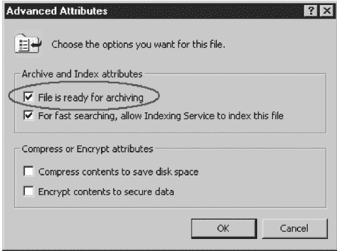

> **考试关注点**
> 完全备份会备份所有选定的文件，然后清除存档位。

执行完全备份时需要理解的重要一点是，它会备份你选择的所有文件（无论存档位是否已设置），然后清除存档位，以便操作系统和应用程序知道该文件已被备份。

#### 增量备份

增量备份只备份自上次增量备份或完全备份以来发生更改或新增的文件。它通过只备份设置了存档位（表示需要备份）的文件来实现这一点。这与完全备份不同，完全备份会备份任何选定的文件，因为完全备份不会读取存档位来决定是否备份文件——它只备份你指定要备份的内容。增量备份只会备份你选择的、已设置存档位的文件。

> **考试关注点**
> 增量备份会备份任何已更改的文件，然后清除存档位，这样下一次备份就不会再备份该文件（除非你执行完全备份）。

结合使用完全备份和增量备份非常有效，而且比每天运行完全备份更省时。许多公司会设置一个备份计划，在周五晚上执行完全备份，然后在一周内的每个晚上通过执行增量备份来仅备份更改内容。但是，要恢复数据，你将需要最后一次完全备份磁带以及自上次完全备份以来制作的每一个增量备份磁带。

增量备份会清除存档位，以表明该文件已被备份。如果你第二天执行额外的增量备份，同一个文件将不会被备份（除非它被更改），因为存档位未设置。使用增量备份时，你的恢复策略（称为恢复顺序）是先恢复完全备份，然后依次恢复自该完全备份以来的每个增量备份。这将确保你获得自完全备份以来累积的所有更改。

#### 差异备份

差异备份通过查找带有存档位的文件，来备份自上次完全备份以来发生更改或新增的文件。差异备份与增量备份的不同之处在于，差异备份在备份完成后不会清除存档位。这意味着如果你下次备份时再次执行差异备份，相同的文件（以及任何新文件）都会被备份。因此，每次差异备份都会包含自上次完全备份以来的所有更改。恢复顺序策略是先恢复最后一次完全备份，然后再恢复最后一次差异备份。

> **考试关注点**
> 差异备份会备份任何发生更改的文件，但不会清除文件的存档位。由于存档位未被清除，每次差异备份都将备份自上次完全备份以来所有被更改的文件。

差异备份和增量备份可能使恢复过程变得稍微复杂一些，因为你必须首先从完全备份中恢复，然后从增量或差异备份中恢复，以确保自上次完全备份以来发生更改的所有文件都被恢复。差异备份和增量备份之间的一个重要区别是：增量备份执行所需时间更少（因为你只获取自上次完全或增量备份以来的更改），但恢复所需时间更多（因为你必须恢复多个增量备份）。差异备份执行所需时间更多，但恢复所需时间更少。

如果你决定采用更简单但更耗时的方案，即每次都执行完全备份，那么你可以从最近一次的完全备份中恢复，并在一次操作中恢复所有文件。

> **考试关注点**
> 你可能会在考试中看到一两个关于不同类型备份的问题。请务必了解完全备份、增量备份和差异备份之间的区别，并熟悉每种场景下的恢复顺序。

#### 副本备份

副本备份类似于完全备份，但它不会清除存档位。这一点很重要，因为如果你运行这种类型的备份，副本备份不会干扰备份周期。当你决定在备份周期中途备份数据时，副本备份非常有用，例如，总部要求你将所有数据发送一份备份。你可以运行副本备份，同时知道它不会扰乱你常规的备份策略。


# 快照

许多组织使用虚拟化技术创建虚拟机（VMs），在网络上运行其服务器。使用虚拟化软件，你可以为虚拟机创建快照，这本质上是其状态和配置的快速备份。你可以在稍后时间快速恢复到该备份。恢复到快照的一个缺点是，你会丢失自该快照以来的所有更改，因此你必须确保真的想要这样做。

快照在与备份相关时，是磁盘或一组磁盘的某一时刻的副本。例如，像卷影复制服务（VSS），也称为卷影复制，这样的解决方案允许厂商对磁盘进行快照备份。当备份开始时，它备份快照，允许用户在备份进行时更改磁盘上的文件，因为它技术上是在备份快照。在备份运行时发生的对文件的任何更改都会被捕获并在事后应用。

## 调度备份

大多数网络管理员更愿意在备份操作执行时在家中度过深夜晚。那就是为什么他们安排备份操作，这样他们就不必在夜间在办公室启动它。大多数备份软件支持备份操作的调度，而这绝对是选择备份软件时需要寻找的功能之一。

在安排你的备份操作时，你需要创建一个备份计划。备份计划包含每次备份操作将备份的数据列表，以及发生的备份类型（增量、差异或完全）。你还应确保备份计划包含在此计划中。

例如，你可能会决定每周六凌晨 12 点对你的数据文件和电子邮件数据执行完全备份。在此备份计划中非常常见的是，对相同的数据文件和电子邮件服务器执行增量备份，并安排在每天凌晨 12 点进行。要恢复任何损坏的数据，你将恢复最近的完全备份，然后在其上应用最近的差异备份。这将使你的数据更新到最近差异备份的点。

在制定备份计划时，制定详细的计划，说明服务器上的哪些资源（例如文件夹、数据库或邮件存储）将被备份以及它们包含的内容。还要计划这些项目需要备份的频率。此备份计划将作为很好的文档，收录在你的“网络文档”书中，其中你保存网络图、防火墙规则、服务器配置等集合。

要在 Windows 系统上执行备份的权限，你需要是 Administrators 组或 Backup Operators 组的成员。你也可以分配给用户“备份文件和目录”用户权限，以便他们可以执行备份。

## EXERCISE 18-1

## 在 Windows Server 上备份和恢复数据

在此练习中，你学习如何使用 Windows 备份软件在 Windows Server 上备份文件，以及如何在文件被意外删除后恢复文件。务必查看随本书提供的在线资源中包含的此练习的视频。

- 1. 切换到 ServerA VM。在 Server Manager 中，通过选择 Manage | Add Roles and Features 安装 Windows Server Backup 功能。继续使用向导并安装 Windows Server Backup 功能。
- 2. 在安装 Windows Server Backup 软件后，确保仍在 Server Manager 中并选择 Tools | Windows Server Backup。
- 3. 在左侧选择 Local Backup。

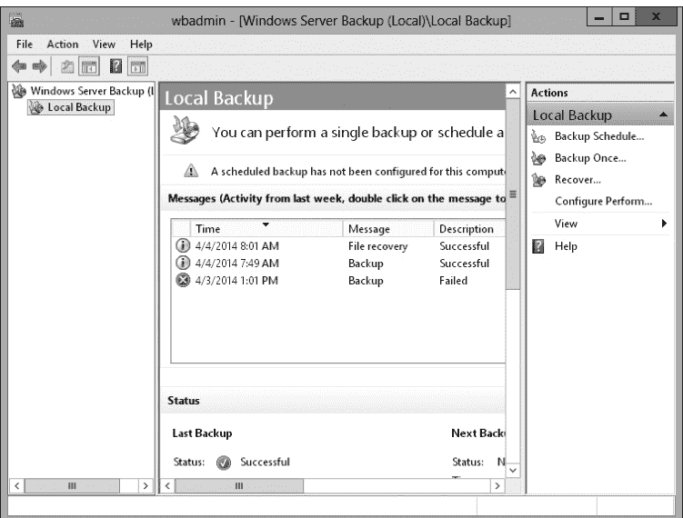

- 4. 要备份 LabFiles\PacketCaptures 文件夹，在右侧 Actions 窗格中选择 Backup Once 选项。
- 5. 选择 Different Options 以指定你的备份设置，然后单击 Next。
- 6. 选择 Custom 以选择你想要备份的文件，然后单击 Next。
- 7. 单击 Add Items 以添加要备份的项目。通过选择 + 号展开 C: 驱动器的内容，然后展开 LabFiles 文件夹。
- 8. 选择 PacketCaptures 文件夹旁边的复选框以备份 PacketCaptures 文件夹，然后单击 OK。
- 9. 单击 Next。选择 Local Drive 以备份到另一磁盘上的文件，然后单击 Next。
- 10. 单击 Backup 按钮执行备份。这应该只需要一分钟。

### 执行已删除文件的恢复

- 11. 双击 Computer | Drive C: | labfiles | PacketCaptures。
- 12. 在 PacketCaptures 文件夹中，通过右键单击文件并选择 Delete 删除名为 httptraffic.cap 的文件。
- 13. 单击 Yes 以确认你想要删除该文件。
- 14. 关闭所有窗口。
- 15. 要恢复已删除的文件，启动 Server Manager 然后选择 Tools | Windows Server Backup。
- 16. 在右侧 Actions 窗格中选择 Recover 链接。
- 17. 选择 This Server 以指定备份存储在你的本地服务器上，然后单击 Next。
- 18. 确保今天的日期被选为执行备份的日期，然后单击 Next。
- 19. 选择 Files and Folders 以从备份中恢复单个文件，然后单击 Next。
- 20. 在左侧，单击加号 (+) 展开备份的文件夹结构，在其中你将找到 PacketCaptures 文件夹。选择左侧的 PacketCaptures 文件夹以显示该文件夹中的文件。
- 21. 在右侧选择 HTTP Traffic.cap 文件以恢复该文件。
- 22. 单击 Next。
- 23. 在恢复选项中，选择 Original Location 以将文件恢复到其最初备份的位置。注意 ACL（权限）也将被恢复。单击 Next。
- 24. 单击 Recover 开始恢复操作。
- 25. 恢复操作完成后，单击 Close 然后关闭备份软件。验证文件现在是否存在于 C:\labfiles\PacketCaptures。

## 地理考虑

在规划备份和整体灾难恢复时，你有许多关于物理位置的地理考虑：

- **异地存储** 确保在发生火灾、洪水或地震等灾难时，将备份的副本存储在另一个位置。
- **距离考虑** 你希望异地备份足够近，以便在需要时可以快速获取，但同时它也应足够远，以至于不会受到影响你当前位置的任何灾难的影响。
- **位置选择** 确保选择一个可以从消防部门等紧急服务快速响应的站点。你还应确保该站点能从电力公司等公用事业服务获得快速响应。此外，审查周边区域并确保你不在洪水区或犯罪率高的地区。
- **法律影响** 在为你的站点和磁带备份选择物理位置时，确保了解该国家或州的任何法律，这些法律可能影响你的数据如何被访问或管理。
- **数据主权** 与前一点相关，确保了解谁拥有数据并对数据拥有完全的权利和权力。通过将数据存储在特定国家或州，你是否给予第三方访问数据的隐含权利？使用云存储时，你可能想要了解云提供商的服务器位于何处，并确保你的数据放置在你的国家内，以便你的国家法律管理该数据。

## CERTIFICATION OBJECTIVE 18.03

## 实现容错

为灾难做准备的一个重要部分是确保系统正常运行，包括在组件故障时。例如，公司会确保服务器至少有两个电源，以便如果一个电源故障，另一个电源可以继续供电。在本节中，你将了解容错和冗余的不同解决方案。


## 冗余简介

实施网络安全弹性的一大部分工作是在硬盘、网络设备和电源等不同资产上实现冗余。在本节中，你将了解可用于为这些资产添加冗余的技术，同时还会了解将复制技术作为添加冗余的一种方法。

添加冗余可确保资产不会出现单点故障。例如，确保服务器拥有多个电源，可以保证在电源方面不存在单点故障。

在创建冗余时，尤其是涉及数据和服务的冗余时，你需要确定是使用本地部署解决方案（即在你自己的物理网络上运行的解决方案）来实现冗余，还是使用基于云的解决方案。例如，你可以在本地部署电子邮件服务器，如果该服务器发生故障，可以使用云中托管的电子邮件服务。使用云解决方案的一大优点是，如果你想防范物理位置发生的灾难，就不必再准备备用站点。另请注意，如第 16 章所述，你可以将所有资源迁移到云端托管，并利用服务提供商提供的内置冗余。

## 磁盘冗余

首先要考虑添加冗余的组件是硬盘。你应实施冗余硬盘解决方案，以帮助防止服务器硬盘出现单点故障。考试需要了解的硬盘冗余解决方案主要有两种：

- **廉价磁盘冗余阵列（RAID）级别** 你可以使用 RAID 解决方案来帮助保护数据免受硬盘故障的影响。RAID 允许你创建使用多个硬盘来提供数据冗余的卷。例如，你可以创建一个称为镜像卷的 RAID 卷，将数据存储在两块物理磁盘上，以防其中一块出现故障。你将在本章后面了解 RAID 卷类型。

- **多路径** 为数据或磁盘添加冗余的另一种方法是使用多路径，也称为多路径 I/O。多路径会创建多条访问数据的路径，无论数据存储在哪里。例如，如果将数据存储在 SAN 上，你的服务器可能有多个连接到 SAN 的光纤通道控制器，而该 SAN 由多台交换机组成，因此存在多条访问 SAN 上数据的路径。

## 网络冗余

通过实施 RAID 等磁盘冗余解决方案来实现数据冗余非常重要，但网络组件也应具有冗余。

## 通过复制实现冗余

另一种添加冗余的技术是按固定间隔将数据从源复制到目标。以下是两种使用复制的常见技术：

- **存储区域网络（SAN）** 存储区域网络是一组通过高速链路连接的存储驱动器。你可以通过复制技术将一个 SAN 上的数据复制到另一个站点的 SAN 上，这被称为 SAN 到 SAN 复制。这可以确保如果一个站点发生灾难，数据仍存在于多个位置。

- **虚拟机（VM）** 你可以让一台服务器上运行的虚拟机复制到另一台服务器。VM 复制技术允许你控制当前运行的是哪一台虚拟机。这是确保虚拟机具备冗余的好方法。

> **考试重点**
> 对于 Security+ 考试，要了解磁盘冗余、网络冗余、电源冗余和复制的不同解决方案。尤其要重点关注 RAID、多路径、负载均衡器、NIC 组合、双电源和 UPS。

## 非持久性与多样性

Security+ 考试列出了与网络安全弹性相关的非持久性和多样性目标。根据定义，非持久性是指系统关闭或应用程序退出时数据会丢失。系统实现非持久性的方式如下：

- **恢复到已知状态** 冰点还原（Deep Freeze）等应用程序可用于将系统恢复到先前的状态。使用冰点还原时，管理员保存计算机的状态；当系统重新启动时，它会恢复到该已保存状态，因此所有更改都会丢失。这是学校计算机实验室中常见的应用程序。另一个示例是 Windows 系统还原功能，它可用于恢复到先前的状态。

- **最近一次的正确配置** 有些工具允许你恢复到上次已知的正确配置。例如，Windows 有一个启动选项，允许你恢复到系统上次登录时的配置。

- **Live 启动介质** Live 启动介质是一种可从 DVD 或 USB 驱动器启动的 Live 操作系统。例如 WinPE 磁盘或 Ubuntu 的 Live 版本，它们可让你启动到驻留在可移动介质上的操作系统。Live 介质允许你从 Live 操作系统运行工具，但在系统关闭后不会永久保存数据。

在实施上述任何冗余技术时，确保解决方案的多样性非常重要。多样性可以增强安全性：如果解决方案的一部分受到攻击并被攻破，同样的攻击不会在解决方案的下一部分中得逞。将多样性融入安全解决方案的方法有很多：

- **技术** 使用不同的技术。例如，你可以使用 NIC 组合为每台服务器的网卡添加冗余，使用群集为数据库服务提供高可用性，并在用于保存数据库文件的存储驱动器上使用 RAID。

- **供应商** 使用不同供应商的产品来增加多样性。一个很好的例子是防火墙——可以考虑在网络的不同层级使用不同供应商的防火墙产品。

- **加密** 每次实现使用不同的加密算法和不同的密钥；这样，即使加密被破解，破解方法也无法适用于每一次加密的使用。

- **控制** 组合使用不同类型的安全控制措施来保护你的资产。例如，在终端（工作站）上，你应该修补系统、使用防病毒/反恶意软件、使用基于主机的防火墙，并确保用户接受良好的计算和互联网使用习惯教育。这些控制措施中的每一项都能增强工作站的安全性。

## 了解 RAID

执行数据备份是一个好主意，而将备份副本存储在异地则更是明智之举，这有助于确保你能够从任何类型的灾难中恢复。仅仅依赖备份解决方案的一个问题是：如果服务器上的某个驱动器发生故障，用户将不得不等待你更换驱动器，然后恢复所有数据——这可能要花费数小时，具体取决于你要恢复的数据量。

为了避免在白天工作时间内更换驱动器并恢复数据，你可以利用 RAID（廉价磁盘冗余阵列）等容错解决方案，RAID 也称为独立磁盘冗余阵列。RAID 是一种跨驱动器复制数据的技术，这样，如果某个驱动器发生故障，解决方案中的其他驱动器仍可以提供数据。这样做的好处是，如果某个驱动器发生故障，你可以等到当天工作结束后再处理，因为你知道解决方案的冗余会确保不会丢失任何数据（RAID 0 除外）。

> **考试重点**
> 对于 Security+ 考试，要了解为了保护磁盘免受灾难影响，需要将磁盘配置为 RAID 解决方案。

RAID 有不同的类型，称为级别，每种级别以不同类型的冗余提供不同的优势。以下小节介绍不同网络操作系统支持的常见 RAID 级别。

### RAID 0

RAID 0 级别称为*条带化*或*条带卷*。在 RAID 0 中，使用多个磁盘创建一个卷；当数据保存到该卷时，数据会被拆分并分布到该卷的所有磁盘上。条带卷的优点是所有磁盘同时被写入，从而带来性能优势。例如，如果你将一个 12MB 的文件保存到 D: 驱动器，而 D: 驱动器是由四块磁盘组成的条带卷，我们可以这样概括保存操作：每块磁盘将保存 3MB 数据，所有磁盘同时工作来完成总计 12MB 的保存操作。如果只有一块磁盘来完成这 12MB 的保存操作，所需时间将是原来的四倍。

RAID 0 的缺点是不会发生数据复制；因此，如果卷中的某块硬盘发生故障，你就无法读取任何数据。RAID 0 纯粹是为了读写操作时的性能优势。图 18-2 显示了 RAID 0 配置示例。

> 作为一名 IT 专业人士，我经常创建虚拟机，并且希望这些虚拟机运行得尽可能快。我家里安装了 Windows 10 中的 Hyper-V，并创建了一个 RAID 0 卷来运行我所有的虚拟机。自从这样做之后，我的虚拟机运行速度快了五倍！

### 在 Windows 系统上配置 RAID 0

Windows 系统提供软件 RAID 功能，这意味着操作系统负责 RAID 卷的创建和管理。硬件 RAID 解决方案可以提供更好的性能，但成本也更高。

在开始创建容错卷之前，你必须在系统中安装多块硬盘，并留有可用于创建 RAID 卷的空间。

图 18-2 RAID 0 示意图

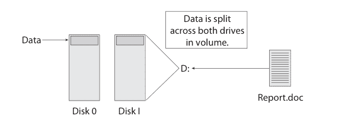


**图 18-3**

镜像卷会在两张磁盘上都保存数据的副本。

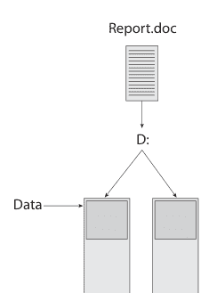

## 练习 18-3


### 在 Windows Server 上创建镜像卷

在此分步操作中，你将使用上一个练习中创建的两个动态磁盘，在 Windows Server 上创建一个镜像卷。请记住，镜像卷会将所有数据存储在该卷的两个成员（磁盘）上。

- 1. 登录 ServerA，然后启动计算机管理控制台。
- 2. 在计算机管理控制台中，选择左侧“存储”下的“磁盘管理”。
- 3. 右键单击磁盘 1 上的未分配空间区域，然后选择“新建镜像卷”。
- 4. 出现“新建镜像卷向导”。单击“下一步”。
- 5. 将磁盘 2 添加为镜像卷的选定磁盘，并在“选择磁盘空间量（MB）”框中键入 200。另请注意，该卷使用的总空间也是 200MB（而不是带区卷情况下的 400MB）。对于镜像卷，每块磁盘上有 200MB，但你只能存储 200MB——另外 200MB 用于在发生灾难时存储数据的副本。
- 6. 单击“下一步”。
- 7. 将 M 指定为驱动器号，并单击“下一步”。
- 8. 键入卷标 Mirrored，并选择“执行快速格式化”选项。单击“下一步”以格式化为 NTFS。
- 9. 单击“完成”。镜像卷即创建完成。请注意，磁盘管理中的图例会显示每种卷类型的颜色代码。

- 11. 单击“完成”；新的 RAID-5 卷已创建。请注意，R: 驱动器会显示多次，因为它由多个磁盘组成。
- 12. 关闭所有窗口。

如果其中一块磁盘发生故障，使用 RAID 5 卷时你仍然可以访问数据，但你可能需要更换故障磁盘。要从 RAID 5 的磁盘错误中恢复，你只需更换故障磁盘并重新生成卷，使故障磁盘上的数据在新添加的磁盘上创建。

> **考试要点**
> RAID 5 卷被称为带奇偶校验的带区化，因为这种卷类型将数据拆分到所有磁盘上，但每个条带会在其中一块磁盘上保存奇偶校验数据。当 RAID 5 卷中的某块磁盘发生故障时，奇偶校验信息用于计算丢失的数据。

## 认证目标 18.04

### 了解高可用性

了解拥有 RAID 阵列并不能确保你的用户能够访问数据，这一点很重要。例如，如果你有一台连接到 RAID 阵列的电子邮件服务器，如图 18-6 所示，请注意客户端是连接到电子邮件服务器以检索数据，而不是直接连接到 RAID 阵列。如果电子邮件服务器发生故障怎么办？尽管你将电子邮件数据存储在 RAID 阵列上，但用户仍无法访问这些数据，因为他们必须通过电子邮件服务器发出请求。

**图 18-6**

识别高可用性的需求

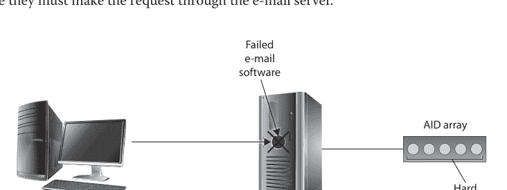

*高可用性*是指确保客户端始终能够访问所需的服务，无论是电子邮件服务器、数据库服务器还是 WAN 链路。要实现高可用性，你必须首先识别所有的单点故障，然后在这些区域创建冗余。以下是存在单点故障的一些关键领域：

- **服务器** 提供网络服务（如电子邮件或网站）的服务器是单点故障。可以使用群集或负载平衡来提供这些服务的高可用性。群集通常为维护数据的后端服务器（如数据库服务器）提供高可用性。负载平衡是为你的解决方案增加可扩展性（同时提供高可用性）的一种方式。例如，如果你在两台 Web 服务器之间对网站进行负载平衡，之后公司网站变得非常受欢迎，那么可扩展性就体现在你可以向负载平衡解决方案中添加更多服务器，使工作负载在负载平衡解决方案中的所有服务器之间分担。
- **硬盘** 硬盘存储我们宝贵的公司数据，是单点故障。你可以使用 RAID 为驱动器提供容错能力。
- **路由器和交换机等网络设备** 路由器和交换机是重要的网络硬件，使系统能够在网络上通信。你应该确保拥有多台交换机和路由器，并且这些设备之间存在多条通信路径，以确保容错能力。
- **WAN/Internet 链路** 为确保 Internet 或 WAN 的连接性，你应该购买多条链路。如果你依赖基于云的解决方案（无论是办公效率软件、虚拟机、存储还是备份），这一点尤其重要。
- **电源** 确保路由器、交换机和服务器等硬件具有多个电源，以提供电源容错。还要确保你有备用电源，如 UPS 或发电机，以提供一定程度的电源容错。

在本节中，你将了解用于创建高可用性解决方案的一些不同技术。

### 故障转移群集

确保高可用性的第一种常用技术是*故障转移群集*。使用故障转移群集时，你可以安装运行相同软件的多个服务器（称为*节点*）。两个或更多节点作为一个团队协同工作，其中一个节点充当活动节点，其他节点充当被动节点。当活动节点发生故障时，被动节点会联机接管工作负载。

**图 18-7**

查看故障转移群集

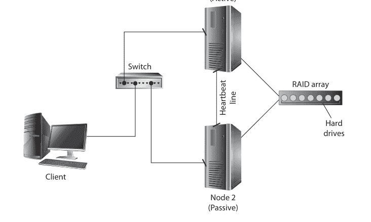

要使故障转移群集正常工作，你需要将某种形式的共享磁盘存储连接到群集中的所有节点，并通过 RAID 加以保护。然后，群集节点通过高速连接直接互连，该连接用作心跳线。心跳线定期在活动节点和被动节点之间传输信号；当被动节点未收到来自活动节点的信号时，说明活动节点必定不可用，被动节点就该接管了。图 18-7 显示了一个双节点群集，但请记住，大多数群集环境支持更多节点。

### 网络负载平衡

网络负载平衡是一种重要技术，旨在提高应用程序（如网站）的性能和可扩展性。例如，如果你发现网站越来越受欢迎，并且因大量请求而陷入困境，你可以将多个服务器安装到负载平衡阵列中。然后，客户端连接到分配给负载平衡阵列的 IP 地址（参见图 18-8 中的步骤 1），该阵列随后将客户端重定向到阵列中的一台可用服务器（参见图 18-8 中的步骤 2）。

**图 18-8**

查看网络负载平衡场景

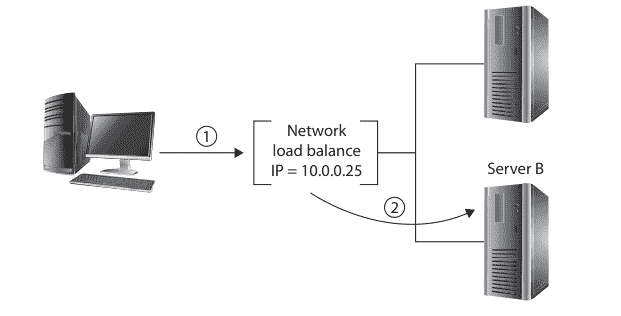

### 冗余硬件

确保高可用性的一个重要方面是在所有领域实现冗余，包括环境中的硬件。硬件不仅限于在某个驱动器发生故障时备有多块驱动器，还应包括以下方面的冗余：

- **服务器** 如果高可用性是一个考虑因素，请确保在群集或负载平衡解决方案中拥有冗余服务器。确保服务器具有冗余硬件组件，如冗余驱动器、网卡和电源。
- **WAN 链路** 高可用性解决方案要求 WAN 链路具备冗余。你可以从服务提供商处购买两条 WAN 链路，或者从不同的服务提供商处获取 WAN 链路，以防其中一条出现技术问题。
- **电源** 高可用性中一个被忽视的方面是，我们所依赖的所有技术都需要电力。你需要通过购买发电机作为备用电源，确保为组织及其资产提供冗余电力。

## 认证总结

在本章中，你了解了业务连续性规划和灾难恢复流程，例如实施备份和容错解决方案。在准备 Security+ 认证考试时，以下是本章需要记住的一些要点：

- 业务连续性计划始于管理层的支持，并包括业务影响评估，该评估用于识别关键业务功能以及这些功能可能面临的任何风险。


## 基于绩效的问题

15. 使用展品，将左侧的术语与其右侧的对应定义匹配。

RPO

MTTF

RTO

MTBF

MTTR

两次故障之间的时间

确定可接受的数据丢失量

设备在失效前的时长

恢复系统的时长

允许恢复业务功能的时间

## 自测答案

## 业务连续性和灾难恢复简介

1. ☑ B. 获得管理层支持来创建 BCP 至关重要，因为这会占用你大量时间和公司其他资源。 ☒ A、C 和 D 是错误的。以上均不代表创建 BCP 的第一步。

2. ☑ B、D 和 E。业务影响评估是 BCP 的风险管理部分，涉及识别关键业务功能、识别与功能相关的威胁以及确定公司在没有这些功能的情况下可以维持多久。 ☒ A 和 C 是错误的。这些不是在 BIA 期间执行的操作。

3. ☑ D。结构化演练涉及 BCP 委员会聚在一起审查 BCP。这有助于识别计划中的疏漏并确保每个人都了解自己的职责。
☒ A、B 和 C 是错误的。清单审查是指将 BCP 的副本发送给各部门单独审查。模拟测试是指实际测试计划的各个部分是否完整，而并行测试涉及通过在该站点启动系统来测试替代站点。

4. ☑ A。温备站点涉及站点可用且配备设备，但你需要恢复数据的最新副本。例如，电子邮件服务器可能存在，但你需要恢复电子邮件服务器数据的最新备份。
☒ B、C 和 D 是错误的。热备站点不需要恢复数据，因为它与主站点持续同步。冷备站点没有服务器和其他系统——它只是一个带少量家具的地点。没有备用站点这种说法。

5. ☑ A。 为了在驱动器故障时访问数据，你需要将驱动器配置为 RAID 解决方案。RAID 是一组协同工作以提供数据的驱动器。当组中一个驱动器故障时，其余驱动器提供缺失的数据。
☒ B、C 和 D 是错误的。服务器集群用于为电子邮件和数据库服务器等服务提供高可用性。负载均衡用于在多个设备或服务器之间分配工作负载，而虚拟化是在单台计算机上运行多个系统的方法。

6. ☑ C。 Tom 应该使用负载均衡将请求的工作负载分配到多个服务器上。
☒ A、B 和 D 是错误的。RAID 用于在数据上创建容错，而代理服务器用于提供客户端访问互联网的中心点。代理服务器可以记录其活动并控制他们可以访问的站点。虚拟化是在单台计算机上运行多个系统的方法。

7. ☑ D。恢复点目标是确定恢复策略中可接受的数据丢失量。
☒ A、B 和 C 是错误的。平均恢复时间（MTTR）是恢复所需的时间，而平均故障时间（MTTF）和平均故障间隔时间（MTBF）决定设备失效的时间。

8. ☑ B。继任计划是确定在灾难情况下组织的新的领导者。
☒ A、C 和 D 是错误的。业务影响分析是确定每个业务功能价值及其损失影响。业务连续性运营是确保在灾难事件中业务运营仍能继续，而灾难恢复是确保系统恢复。

## 备份和恢复数据：备份概念

9. ☑ C。增量备份负责备份已更改的内容并清除存档位。
☒ A、B 和 D 是错误的。完全备份备份所有选定数据然后清除存档位，而差异备份仅备份更改但不清除存档位。异地不是备份类型，而是备份副本在灾难情况下应存储的位置。

10. ☑ B。确保通过加密磁带上的数据或要求恢复操作时输入密码来保护你的磁带备份。
☒ A、C 和 D 是错误的。这些不代表与磁带相关的安全实践。磁带应存储在安全位置并受密码保护或加密。

## 实现容错

11. ☑ A。记住考试要点，RAID 允许你为与磁盘故障相关的灾难做好准备。
☒ B、C 和 D 是错误的。虽然备份可以帮助你为驱动器故障相关的灾难做好准备，但 RAID 是更好的答案，因为它允许持续访问数据。负载均衡用于 Web 服务器等服务，以通过多个服务器响应请求来使应用程序响应更快。集群是让多个节点运行服务，以便如果一个服务失败，另一个节点可以接管请求。

12. ☑ A。RAID 1 将数据从一个驱动器镜像到另一个驱动器。
☒ B、C 和 D 是错误的。RAID 5 是在所有驱动器上条带化数据，并写入奇偶校验信息，以便可以重新生成任何缺失数据。虽然本章未提及，但 RAID 3 以与 RAID 5 类似的方式工作，但奇偶校验信息写入到单个磁盘。RAID 0 是磁盘条带化，没有容错，但通过在多个磁盘上分割写操作来提高性能。

## 理解高可用性

13. ☑ B。负载均衡允许你将多个服务器作为一个单元进行分组，每个服务器都能处理请求。
☒ A、C 和 D 是错误的。集群允许你拥有多个服务器以主动/被动配置提供相同的服务——如果活动服务器失败，被动节点接管。RAID 5 是在所有驱动器上条带化数据，并写入奇偶校验信息，以便可以重新生成任何缺失数据。执行完全备份不会提供高可用性或提供任何性能优势——它只是允许你恢复丢失的数据。

14. ☑ A。集群允许你拥有多个服务器以主动/被动配置提供相同的服务——如果活动服务器失败，被动节点接管。
☒ B、C 和 D 是错误的。负载均衡允许你将多个服务器作为一个单元进行分组，每个服务器都能处理请求。RAID 5 是在所有驱动器上条带化数据，并写入奇偶校验信息，以便可以重新生成任何缺失数据。执行完全备份不会提供高可用性——它只是允许你恢复丢失的数据。

## 考试内部

## 理解监控系统类型

对于认证考试，请记住不同类型的监控系统。常见的监控系统类型有基于特征码、基于异常和基于启发式分析。

基于特征码的系统根据文件中特征码检测可疑活动，而基于异常的系统了解正常活动（基线），并将任何超出常态的情况视为可疑。基于启发式的系统根据制造商为设备编程的历史上导致安全问题的活动类型来识别可疑活动。基于启发式的入侵检测系统非常适合监控零日漏洞利用。有关这些入侵检测系统的更多信息，请参阅第 8 章。

请记住，基于异常的系统非常适合检测零日漏洞利用，因为它是未知的漏洞利用，而基于特征码的系统此时还不具备该漏洞利用的特征码。

基于异常的系统了解什么是正常活动（基线），然后将超出该正常活动的任何内容视为“可疑”活动。基于异常的监控系统通常根据使用系统的人员的行为来确定基线。这被称为基于行为的异常监控系统。

基于行为的异常系统的好处是，你不需要配置已知可疑活动的定义文件；系统会根据用户活动学习什么是正常的。基于行为的系统的缺点是，任何超出常态的情况都被视为可疑，这会导致大量误报（误报）。

在回顾入侵检测系统的概念时，我们还应回顾蜜罐的概念。蜜罐是一个假系统，设置用来诱骗攻击者进入该系统。蜜罐系统会被加固，使攻击者不容易进入，而在他们尝试入侵系统时，会有高水平的日志记录和审计来跟踪攻击者。

另请注意，你可以设置单个文件作为对攻击者有吸引力的资产，称为蜜文件。例如，你可以在系统桌面上放置一个名为 password.txt 的文件，以便当攻击者最终进入系统时，他们会看到此文件并打开它。你将对文本文件实施审计，以便知道何时被打开以及由谁打开。

## 考试提示

对于 Security+ 考试，请记住蜜罐和蜜文件的概念。


## 认证目标 19.02

### 监控工具

除了使用入侵检测系统之外，你还可以使用工具对系统进行手动监控。随着你对系统接触的增多，以及应对或排查潜在安全问题的需要，这些工具将变得越来越重要。

### 有用的系统命令

每个操作系统中都有许多命令用于帮助排查问题和处理安全事件。你在本书前面已经接触过其中一些命令，但我希望在这里复习它们，并补充一些新命令。

### Windows 命令

你可以使用许多 Windows 命令来监控系统活动。以下是一些常用命令，在监控 Windows 系统时，你应该练习并熟练掌握它们。

#### netstat

你应该熟悉的第一个命令是 netstat 命令。netstat 命令用于显示所有协议连接信息。例如，你可以使用 netstat -n 以系统和端口的数字格式（而不是友好名称）查看到达系统的所有 TCP 连接。你还应该定期使用 netstat -na -o 命令查看系统上所有正在监听的端口列表（-o 用于显示进程 ID，以便你知道是哪个程序打开了该端口）。以下命令对于查看 TCP 相关连接非常有用：

```
netstat -n
netstat -na -o
```

#### net session

Windows 的 net session 命令可用于显示通过 Windows 文件共享连接到你的系统的计算机。会话列表会显示连接到系统的客户端的 IP 地址，以及它们用于向系统进行身份验证的用户名。在下面的代码清单中，你可以看到有两台计算机连接到我的系统（10.0.0.2 和 10.0.0.3），并且它们都使用管理员账户进行了身份验证：

```
C:\>net session
Computer              User name              Client Type      Opens Idle time
-------------------------------------------------------------------------------
\\10.0.0.2            ADMINISTRATOR                         1 00:00:00
\\10.0.0.3            ADMINISTRATOR                         1 00:01:46
The command completed successfully.
C:\>
```

#### tasklist

我最喜欢的命令之一 tasklist 用于监控系统上运行的进程。当你使用前面提到的带 -o 选项的 netstat 命令时，你会获得打开端口的程序的进程 ID。你可以将该信息与 tasklist 命令配合使用，以找出该进程 ID 对应的 EXE 文件名。以下是 tasklist 输出的部分显示：

```
C:\Users\Administrator>tasklist
Image Name                     PID Session Name        Session#    Mem Usage
========================= ======== ================ =========== ===========
System Idle Process              0 Services                 0          24 K
System                           4 Services                 0          64 K
smss.exe                       308 Services                 0         968 K
csrss.exe                      500 Services                 0       4,460 K
wininit.exe                    576 Services                 0       4,924 K
csrss.exe                      584 Console                  1      10,996 K
services.exe                   640 Services                 0       9,376 K
winlogon.exe                   664 Console                  1       6,276 K
```

**实战经验**

> 几年前，在排查一台感染病毒的系统时，因为任务管理器程序已被病毒禁用，我不得不使用 tasklist 和 taskkill 命令来结束导致问题的进程。

#### taskkill

监控系统时，如果你注意到内存中运行着某个可能导致性能或安全问题的进程，可以使用 taskkill 命令结束该进程。下面展示了如何按进程 ID 号或可执行文件名终止进程：

```
C:\Users\Administrator>taskkill /IM notepad.exe /F
SUCCESS: The process "notepad.exe" with PID 3456 has been terminated.
```

如果不使用 /F 开关强制结束进程，系统会提示你保存应用程序中正在运行的文档所做的更改。如果你确定要结束进程，并且不想保存程序中可能存在的任何数据，可以使用 /F 开关强制结束程序。taskkill 命令中的 /IM 开关代表“映像名称”，也就是你想要终止的程序的名称。

#### whoami

如果你需要知道自己以什么身份登录到系统，可以使用 whoami 命令。该命令将显示当前登录的用户名。使用 whoami 命令时，可以使用 /groups 开关列出你所属的组，或者使用 /LOGONID 开关查看你账户的登录 ID；这两者在排查访问控制问题时都很有用。下面的代码清单显示我以 administrator 身份登录到名为 2008R2 的系统：

```
C:\>whoami
2008r2\administrator
C:\>whoami /LOGONID
S-1-5-5-0-3295383
```

#### net statistics

在 Windows 中，另一个很好的监控命令是 net statistics server 命令，你可以用它密切关注服务器上发生的情况。该命令将显示诸如已接受的会话数、密码违规次数（失败的登录尝试）、权限违规次数（因没有权限而访问失败）以及打印到系统的打印作业数等信息。

```
C:\>net statistics server
Server Statistics for \\2003SERVERA
Statistics since 3/26/2011 11:09 AM
Sessions accepted                 2
(Output cut for briefness)
System errors                     0
Permission violations             3
Password violations               16
Files accessed                    11
Communication devices accessed    0
Print jobs spooled                0
(Output cut for briefness)
The command completed successfully.
```

你还可以使用 net statistics workstation 命令查看有关系统上客户端软件的信息以及发出网络资源请求的次数。通过 net statistics workstation 命令，你可以查看网络上任何资源请求失败的信息。

**图 19-3** Linux 中的系统监视器

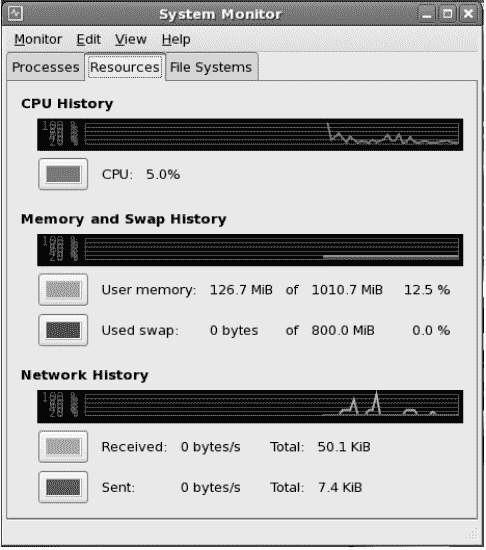

选择“系统”菜单 | “管理”，然后启动“系统监视器”。“系统监视器”有三个选项卡（见图 19-3）：

- **进程** “进程”选项卡显示正在运行的进程及其关联的进程 ID。你可以使用“结束进程”按钮终止进程。
- **资源** “资源”选项卡显示折线图，展示内存使用情况、处理器使用情况和网络活动的历史记录。
- **文件系统** “文件系统”选项卡显示可用的文件系统及相关设备。

### 协议分析器与嗅探器

协议分析器（或称网络嗅探器）是一种出色的网络监控工具，允许你捕获并检查网络流量。这两者通常是同一回事，只不过协议分析器可能针对特定协议，而网络嗅探器会分析所有网络流量，无论使用的是何种网络协议。

9. 在 Ethernet II 部分下面是协议信息。该网络流量使用的是什么第三层协议？__________________

10. 如果你在上一题中回答了“IP”，那就对了！如果你双击“Internet Protocol Version 4”部分，你将看到数据包源地址和目的地址中的第三层地址（IP 地址）是什么。

11. 填写以下信息：

    数据包发往哪里？__________________  
    数据包来自哪里？________________  

    *提示：查看源地址和目的地址。*

12. 你还可以看到 IP 用来传递此数据包的传输协议。在源 IP 地址上方三行，你可以看到 IP 使用 TCP（一种面向连接的第四层协议）来确保数据包到达目的地。

13. 如果你双击 IP 标题，将折叠 IP 的详细信息。我们来看一下此数据包的应用协议信息。你想查看在网页中输入的信用卡号。在“数据包详细信息”窗格中，双击“Hypertext Transfer Protocol”以展开详细的应用信息。

14. 选择 HTTP 的最后一条信息，即“File Data:”行。要查看你捕获的信用卡号，请查看屏幕底部的 ASCII 部分。找到 CCNumber 字段。注意信用卡号。

15. 信用卡号是多少？________________

16. 关闭 Wireshark。

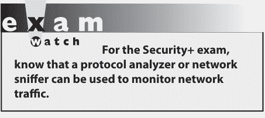

### 了解 Syslog

Syslog 是一种行业标准协议，允许任何支持 syslog 的系统、设备和应用将日志消息发送到中央 syslog 服务器，以便你可以集中查看和管理日志。你可以将 Syslog 配置在交换机、路由器、服务器、防火墙和入侵检测系统（IDS）上，将记录的事件发送到 syslog 服务器。这是一个很棒的功能！


syslog 具有不同类型的消息或条目，每种消息类型使用不同的日志级别。下表显示了 syslog 中常见的日志级别和消息：

| 日志级别 | 消息 |
|---|---|
| 0 | 紧急（系统不稳定） |
| 1 | 警报 |
| 2 | 严重 |
| 3 | 错误 |
| 4 | 警告 |
| 5 | 通知 |
| 6 | 信息 |
| 7 | 调试 |

数据通过 UDP 端口 514（用于未加密通信）或 TCP 端口 6514（用于带 TLS 的加密通信）从系统或设备发送到 syslog 服务器。信息一旦记录在 syslog 服务器上，你就可以在 syslog 服务器上集中查看所有系统和设备的日志，甚至可以筛选条目以查找特定事件。

在环境中配置 syslog 的高级步骤如下：

1. 安装 syslog 服务器。有一些免费的服务器，例如 Kiwi Syslog Server，你可以从互联网下载来测试 syslog 功能。
2. 配置系统、应用程序或网络设备，将事件转发到 syslog 服务器。
3. 在 syslog 服务器上查看日志。

假设你在一台 IP 地址为 10.0.0.5 的系统上安装了 Kiwi Syslog Server。如果你想将 Cisco 路由器配置为将所有错误级别（及更低级别）的事件转发到 syslog 服务器，你需要使用如下命令配置路由器：

```
R1>enable
R1#config term
R1(config)#logging host 10.0.0.5
R1(config)#logging trap 3
```

然后，你可以在 Cisco 设备上设置源接口，以控制每条日志消息的源 IP 地址：

```
R1(config)#logging source-interface Loopback0
```

- **情感分析**：监控系统可能具备执行情感分析的能力，即审查信息以判断该信息是正面的、负面的还是中性的。
- **安全监控**：监控工具应执行安全事件监控，这些事件通常来自不同系统的安全日志。
- **日志聚合**：如前所述，该工具应能够使用来自不同系统的不同类型日志，并将它们整合在一起进行完整分析。
- **日志收集器**：监控工具应具有日志收集器组件，使其能够从网络中的不同系统和设备收集日志。

有多种工具属于 SIEM 工具类别，例如 Splunk、Tripwire、EventLog Analyzer 和 SolarWinds。以下是安装 EventLog Analyzer 的高级步骤，你可以从 www.manageengine.com/products/eventlog/download.html?edi 下载 30 天试用版。与许多 SIEM 工具一样，EventLog Analyzer 内置了针对 HIPAA 和 ISO 27001 等各类法规要求的预构建报告。

1. 下载并运行安装程序。
2. 接受所有默认设置。安装结束时，选择以控制台模式启动 EventLog Analyzer 的选项。
3. 服务器启动后，你会进入 EventLog Analyzer 的 Web 界面，需要使用用户名 **admin** 和密码 **admin** 登录。
4. 登录后，你会进入仪表板，在这里可以看到来自服务器的不同类型事件的图表（参见图 19-4）。

**图 19-4** — EventLog Analyzer SIEM 工具

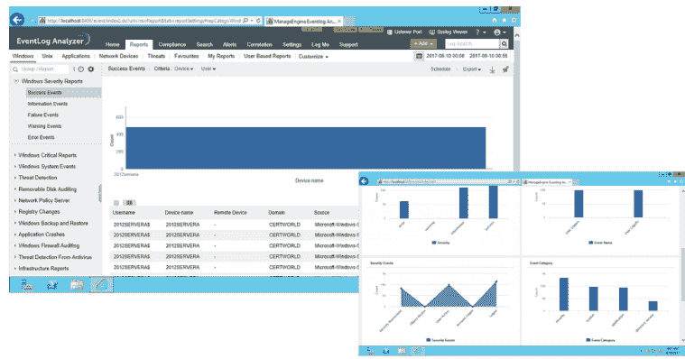

你可以通过单击管理页面顶部的 Reports 链接查看内置报告。有许多报告显示安全事件、威胁和防火墙审计等信息。请记住，这些报告显示的是来自所有系统和设备日志的数据；要向 EventLog Analyzer 添加设备，请单击右上角的绿色 Add 按钮。

## 使用 SOAR

在讨论帮助我们监控安全事件的企业解决方案时，我们还应该讨论 *安全编排、自动化和响应*（Security Orchestration, Automation, and Response）的概念，简称 SOAR。SOAR 不仅仅是一个监控工具；它更像是一个安全管理工具。借助 SOAR，你可以使用软件工具来简化和自动化安全运营，重点关注三个主要领域——威胁和漏洞管理、安全事件响应以及安全运营自动化。

企业可以使用 SOAR 从不同来源收集安全事件数据，检测安全威胁，然后自动响应威胁以采取某种形式的纠正措施。

## 认证目标 19.03：实现日志记录与审计

既然你已经了解了可用于监控系统的一些工具，下面我们来讨论审计和日志记录。作为安全专业人员，你需要确保评估系统和应用程序上已启用的审计和日志记录级别。以下是审计和日志记录之间区别的简要定义：

- **审计**：通常指出于安全目的希望监控系统或应用程序上的操作。例如，你可能希望审计系统上用户帐户的管理或应用程序中客户记录的删除。
- **日志记录**：通常指记录应用程序或系统中发生的所有活动。例如，你可以记录对网站的所有请求，并在之后查看日志。

### 了解审计

在任何环境中担任安全专业人员时，请确保所有关键系统和设备上已启用审计，并确定已配置的审计级别。至关重要的是，有人接受过如何查看审计日志的培训，并知道如何将其归档到安全位置，以备日后需要回溯。

配置审计有四个主要步骤：

1. 决定要审计哪些事件。
2. 决定你是否关心每个事件的成功或失败。
3. 配置审计。
4. 定期查看审计日志。

### 配置审计

配置审计的第一步是定义审计策略。在定义审计策略时，为操作系统中的特定事件启用审计。事件是系统内发生的事情，通常由用户触发。例如，登录或注销网络就是一个事件。访问文件夹也是一个事件。因此，你需要确定希望收到通知的事件——相信我，你需要对启用哪些事件非常挑剔！要记住的重要一点是，审计的事件越多，收集的信息就越多——而你不想收集不必要的信息，因为它可能掩盖重要的审计数据。

在 Windows 中，你可以通过单台系统的本地安全策略实施审计，也可以通过 Active Directory 中的组策略在多台系统间部署审计设置。要在 Windows 中配置审计，请选择以下工具之一来管理审计策略：

- **开始 | 管理工具 | 本地安全策略** — 在单台独立系统上实施审计。
- **开始 | 管理工具 | 域控制器安全策略** — 在网络中的所有域控制器上实施审计。
- **开始 | 管理工具 | 域安全策略** — 在整个 Active Directory 域中的所有系统上实施审计。

启动正确的管理工具后，你可以为许多事件启用审计（参见图 19-5），启用审计时，你需要决定是否关心此类事件的成功或失败。例如，你是否关心某人成功登录网络或无法登录网络？

**图 19-5** — 在 Windows Server 上配置审计策略

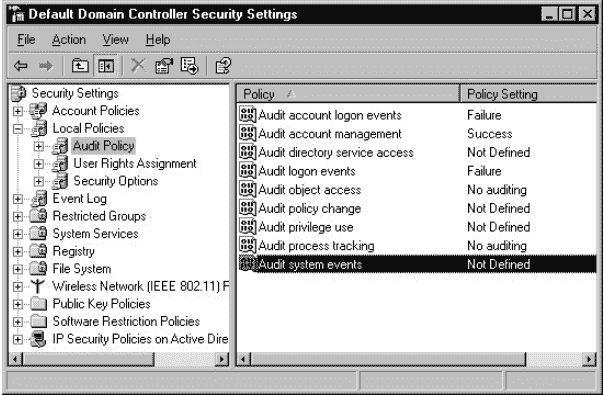

表 19-1 列出了 Windows 中各种可以启用成功或失败审计的事件。

### 查看审计日志

配置审计后，你将使用 Windows 事件查看器来监控已启用审计的安全相关事件。以下是在 Windows 事件查看器中可以查看的部分日志列表：

- **应用程序日志** – 存储 Windows 上运行的应用程序的错误和信息
- **系统日志** – 存储操作系统组件的错误、警告和信息，例如服务无法启动时
- **安全日志** – 存储审计信息和其他安全相关事件
- **DNS 日志** – 存储域控制器上 DNS 的错误和信息
- **硬件事件日志** – 存储有关系统硬件组件的信息
- **Windows PowerShell 日志** – 存储有关系统上 PowerShell 环境的信息和错误

启用审计后，你可以监视 Windows 事件查看器中的安全日志，因为所有审计数据都出现在那里。图 19-6 显示了 Windows Server 中的 Windows 事件查看器。在事件查看器中，你可以查看各种事件、保存内容


## 在 Windows 中实现审核

### EXERCISE 19-2

在本练习中，你将在 Windows 系统上实现审核。

- 1. 确保 Windows 10 VM、Linux VM 和 ServerA VM 正在运行。
- 2. 确保你正在使用 ServerA VM。要为所有域控制器启用审核，单击 开始 | 服务器管理器，然后选择 工具 | 组策略管理。
- 3. 进入组策略管理控制台后，在左侧展开 certworld.loc 森林，展开 Domains，然后展开 certworld.loc。你现在应该可以看到组策略对象文件夹。展开组策略对象文件夹，然后右键单击 默认域控制器策略 并选择 编辑。
- 4. 展开 计算机配置 | 策略 | Windows 设置 | 安全设置 | 本地策略，然后选择 审核策略。
- 5. 执行以下操作来配置审核：
  - a. 双击 审核账户登录事件 并选择 失败。
  - b. 双击 审核账户管理 并选择 成功。
  - c. 确保所有其他审核均已禁用。
- 6. 配置完审核后，可以关闭组策略管理编辑器窗口，然后关闭组策略管理控制台。
- 7. 启动 Windows 命令提示符并确保以管理员身份运行。
- 8. 输入 `gpupdate /force` 以强制策略刷新。
- 9. 尝试使用错误的用户名和密码登录系统。然后以管理员身份登录并从服务器管理器中的 工具 菜单启动 Active Directory 用户和计算机。
- 10. 使用 Active Directory 用户和计算机工具在 Active Directory 中创建一个新的用户账户。
- 11. 要查看审核数据，请切换到服务器管理器，然后选择 工具 | 事件查看器。
- 12. 查看安全日志中失败的登录记录（应带有锁图标）以及账户创建成功的记录。

## 理解日志记录

你不仅应在系统和企业内的任何关键应用程序上启用审核，还应调查所有系统和应用程序执行的日志记录级别。日志记录通常记录对特定服务或设备的访问，以及针对该服务或设备进行的任何活动。例如，FTP 服务通常具有显示谁获得了对 FTP 服务访问权限的日志，如图 19-9 所示。注意图中在 3 月 29 日 17:43，有人输入了管理员账户的密码，然后 myfile.txt 被下载到客户端 IP 地址 10.0.0.2。

**Figure 19-9** Looking at an FTP server log file

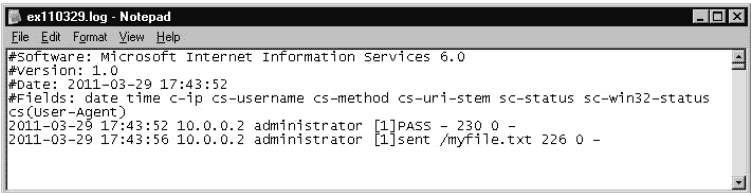

> **Exam Watch**
> Windows 中许多服务的日志文件存储在 `c:\windows\system32\logfiles` 文件夹中。你可以在这里找到 FTP、Web、邮件和其他日志文件。

FTP 服务不仅具有记录对 FTP 服务器访问的日志文件，而且大多数服务如防火墙服务和 Web 服务器也都有日志文件。以下代码列表显示了 IIS Web 服务器日志文件的内容。注意你可以查看请求的时间和日期、请求类型（GET 或 POST）、请求的<|message|> 和发出请求的客户端 IP 地址。行上的最后一项信息是用户代理，即用于发出请求的程序。注意为简洁起见，我已删减了输出中任何无关信息。

```
#Software: Microsoft Internet Information Services 6.0
#Version: 1.0
#Date: 2011-03-29 17:49:49
#Fields: date time cs-method cs-uri-stem s-port c-ip cs(User-Agent)
2011-03-29 17:49:49 GET /Default.htm 80 10.0.0.2 Mozilla...
2011-03-29 17:49:56 POST /process.asp 80 10.0.0.2 Mozilla...
2011-03-29 17:50:09 GET /deletecustomer.asp 80 10.0.0.2 Mozilla...
```

## 配置 Web 和 FTP 日志记录

调查你系统上运行的所有应用程序的日志记录级别至关重要——我使用 Web 服务器和 FTP 服务器作为此讨论的示例，但你应通过应用程序的配置来查看任何服务的日志记录。

在 IIS 中，你可以通过完成以下练习中的步骤来配置 Web 服务和 FTP 服务的日志记录。

### EXERCISE 19-3: Configuring Logging in IIS

在本练习中，你将验证 IIS 服务器的网站是否已配置日志记录。你将配置网站，但可以按照相同的步骤为 FTP 站点配置日志记录。

- 1. 确保 ServerA VM 正在运行并且已以管理员身份登录。
- 2. 在任务栏中单击 服务器管理器 图标。
- 3. 选择 工具 | Internet Information Services (IIS) 管理器。IIS 管理器显示。
- 4. 在左侧展开 ServerA 以查看代表你的网站和 FTP 站点的文件夹。
- 5. 在屏幕左侧 Sites 文件夹下选择 默认网站。双击右侧的 日志记录 图标以启用网站的日志记录。
- 6. 在 日志记录 屏幕中，注意右侧的操作窗格上有一个 禁用 链接。这可用于禁用网站的日志记录。由于你有 禁用 链接，这意味着日志记录默认已启用。单击 禁用 链接以禁用日志记录；注意链接变为 启用。由于我们希望日志记录启用，请选择 启用 链接。
- 7. 注意日志文件位置默认设置为 `%SystemDrive%\inetpub\logs\LogFiles` 文件夹。还要注意每天会创建一个新的日志文件（计划选项）。
- 8. 要选择在网站的每个访客日志文件中存储哪些字段，请在屏幕中间单击 选择字段 按钮以打开接下来显示的对话框。选中要存储在日志文件中的每个字段旁边的复选框。
- 9. 关闭所有对话框。

## 配置防火墙日志记录

如果启用 Windows 防火墙，你还可以配置它将拒绝的数据包记录到防火墙日志文件，该文件位于 `c:\windows\pfirewall.log`。启用防火墙后，你可以查看日志文件以查看尝试进入系统的计算机的 IP 地址。以下练习回顾了如何启用 Windows 防火墙并启用日志记录。

- 6. 关闭 私有网络设置 的 Windows 防火墙，但对 域网络设置 和 公共网络设置 保持启用。单击 确定。
- 7. 要允许 RDP 流量通过防火墙，请在左侧选择 通过 Windows 防火墙允许应用或功能 链接。
- 8. 在列表中向下滚动并找到 远程桌面。启用 远程桌面 的复选框，然后确保右侧的 域 和 公共 的复选框已选中。
- 9. 单击 确定。
- 10. 要启用丢弃数据包的日志记录，请在左侧选择 高级设置 链接。Windows 防火墙高级安全 对话框出现。
- 11. 右键单击对话框左上角找到的 Windows 防火墙高级安全 节点，然后选择 属性。
- 12. 在屏幕底部，单击 日志记录 部分中的 自定义 按钮。
- 13. 将 记录丢弃的数据包 选项设置为 是。

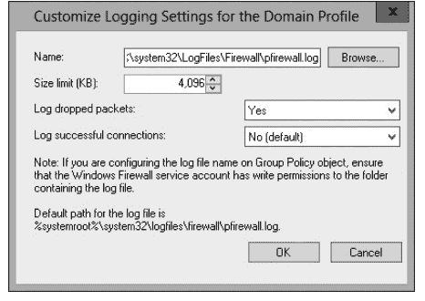

- 14. 单击 确定。请注意，你在 域配置文件 选项卡上进行了此更改，如果你想在公共网络上记录数据包，则需要对 公共配置文件 选项卡执行相同的操作。
- 15. 关闭所有窗口。

## 审核的热门区域

你必须在所有关键应用程序和设备上启用审核和日志记录。本章已查看了你可能考虑审核的服务的示例，但调查所有设备和软件的审核和日志记录功能至关重要。以下是网络上应启用审核或日志记录的其他区域的列表：

- **安全应用程序** 如果你有一个执行特定功能的 安全设备或应用程序，则务必查看该设备的审核功能。大多数软件和设备允许你审核谁有权访问该设备以及对该设备的任何管理更改。
- **DNS** 查看对 DNS 的更改审核，因为这是黑客会中毒以将客户端重定向到错误系统的区域。
- **性能** 性能问题可能是安全事件——例如，如果你注意到系统运行非常缓慢，它可能感染了病毒，或者黑客可能将其用作僵尸系统来执行其他处理。使用性能监视器来识别系统运行缓慢的区域。
- **访问** 如前所述，大多数设备和服务允许你记录谁获得了对系统的访问权限。这可以是关键信息，以帮助证明在企业中发生非法活动（如盗窃）时谁有权进入设施。
- **防火墙** 防火墙日志非常适合定期查看，因为它们会显示通过防火墙的流量，包括流量的源 IP 地址，或在防火墙处被丢弃的数据包以及原因。
- **防病毒** 查看防病毒软件的日志以确保更新正在进行。
- **代理服务器** 代理服务器日志可以提供有关谁浏览了互联网以及他们访问了哪些网站的详细信息。
- **无线接入点** 如果你在家或办公室使用无线路由器，你可以查看路由器上的日志以查看任何安全相关事件（见图 19-10）。你还可以启用日志记录以监控内部用户的互联网活动。
- **用户访问和权限审查** 定期确保审查所有人员在系统上的权限。这包括检查用户权限分配以及管理员组的成员资格。
- **存储和保留策略** 许多公司受法规约束，要求他们必须存储和保留某些时段的信息，例如文档和电子邮件。审查政策并确保所有员工都在遵守。


## 认证总结

在本章中你学习了监控系统的重要性以及可用于监控系统或网络上活动的不同工具。以下是关于监控的一些关键要点：

- 确保服务器和设备已为核心服务（如 Web 和 FTP）启用日志记录。
- 确保防火墙、代理服务器和无线接入点等设备已启用日志记录，以便监控这些设备上的活动。
- 在系统上配置审核，并定期评估审核选项，以确保它们未被网络管理员禁用。
- 在 Windows 系统上使用本地安全策略在独立系统上启用审核，但在 Active Directory 环境中对多个系统进行审核配置时使用组策略。
- Windows 中的性能监视器用于监控系统的健康状况，包括处理器和内存使用情况。
- 消息分析器/网络监视器和 Wireshark 是数据包嗅探器（或协议分析器）的示例，用于监控网络流量并识别与网络上运行的流量类型相关的任何安全问题。
- 你可以在 Windows 和 Linux 中使用许多命令行实用程序来帮助监控系统上的活动。

对本章介绍的材料有深入理解后，你在考试中不会遇到任何与监控相关的问题。不仅这里介绍的材料对考试很重要，而且在你通过考试后继续进行工作中的系统故障排除和监控时也很重要！


## 两分钟速览

### 监控简介

- 基于主机的入侵检测系统监控特定系统的活动，而基于网络的入侵检测系统监控网络范围内的活动。
- 基于签名的系统只能识别其被编程识别的签名的可疑活动，而基于异常的系统会识别任何偏离常态的活动。
- 基于异常的系统更容易出现误报，即“误报”，因为它们将任何偏离正常活动的行为都视为可疑。

7. Linux 中哪个命令会显示所有用户及其上次登录的时间？

- A. loglast
- B. last
- C. lastlog
- D. first

### 实现日志记录和审核

8. 当你在 Windows 中实现审核时，如果你想审核有人创建新用户账户时，会启用什么事件？

- A. Audit group management
- B. Audit user management
- C. Audit administrative tasks
- D. Audit account management

9. 你的经理要求你监控打印机访问。你会在审核策略中启用什么事件？

- A. Audit printer access
- B. Audit object access
- C. Audit account management
- D. Audit account logon

10. 你的经理来找你，要求你检查日志，看看 Bob 是否又在公司时间浏览 Facebook.com。你会检查什么日志？

- A. FTP log
- B. Web server log
- C. Firewall log
- D. Proxy log

## 自测答案

### 监控简介

- 1. ☑ B. 基于异常的监控系统根据任何超出常态且非来自签名数据库的流量来识别可疑流量。这意味着任何类型的攻击——无论是已知攻击还是未知攻击——都会被识别，因为它将是超出常态的流量。
- ☒ A, C, and D are incorrect. 因为基于签名的系统使用定义文件，所以它只能检测其被编程为检测的活动。基于主机的入侵检测系统监控单个系统的活动，而基于网络的入侵检测系统监控网络流量。

- 2. ☑ C. 基于异常的系统针对正常活动的基线进行编程，任何偏离常态的活动都被视为可疑。因此，它可以检测未知（零日）攻击。
- ☒ A, B, and D are incorrect. 基于异常的监控系统不使用签名数据库、日志文件或审核文件。

### 监控工具

- 3. ☑ D. netstat -na 命令用于查看系统上打开的端口列表。
- ☒ A, B, and C are incorrect. nbtstat 用于故障排除 NetBIOS over TCP/IP，而单独的 netstat 命令只会显示当前连接，而不会显示监听端口。

- 4. ☑ B. 你可以在 Windows 中使用 taskkill 命令终止进程，但如果你要通过进程 ID 终止进程，则必须使用 /PID 开关。
- ☒ A, C, and D are incorrect. kill 命令用于 Linux 终止进程。在此示例中，taskkill 命令需要 /PID 开关。

- 5. ☑ A. 在 Linux 中使用 ls 列出文件时，要查看文件的权限，请使用 -l 开关。
- ☒ B, C, and D are incorrect. ls 命令是列出文件的命令，但你需要 -l 开关来显示权限。

- 6. ☑ B. 如果你查看了系统，一切似乎正常且没有额外的进程在运行，那么问题可能是系统被流量过载。使用协议分析器或网络嗅探器将允许你查看流向系统的流量。
- ☒ A, C, and D are incorrect. 性能监视器和系统监视器用于监控系统的健康状况，而 tasklist 用于查看已运行的进程。

- 7. ☑ C. lastlog 命令显示 Linux 系统上的所有用户账户以及它们上次登录的时间。
- ☒ A, B, and D are incorrect. 这些命令都不会显示 Linux 系统上的所有用户账户以及它们上次登录的时间。

## 图 20-2

使用 LANguard 识别管理账户

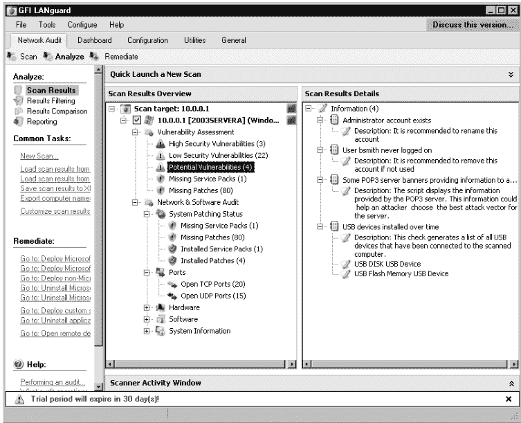

Security+ 考试期望你了解漏洞扫描的特征以及执行漏洞扫描时应考虑的事项：

- **被动测试安全控制** 知道执行漏洞扫描被视为被动测试系统的安全性，因为你实际上并非试图入侵系统或利用它。
- **识别漏洞** 漏洞扫描的目标是识别系统中的漏洞或弱点。例如，如果此系统未及时安装补丁，则被视为漏洞。
- **识别安全控制的缺失** 在执行漏洞评估时，你要查找是否有应使用但当前未使用的安全控制。例如，你可能会评估数据库服务器的安全性并注意到它未受防火墙保护。在这种情况下，你应报告该系统可以使用防火墙来控制与数据库服务器的通信。

## 图 20-3

使用 LANguard 识别缺失的补丁

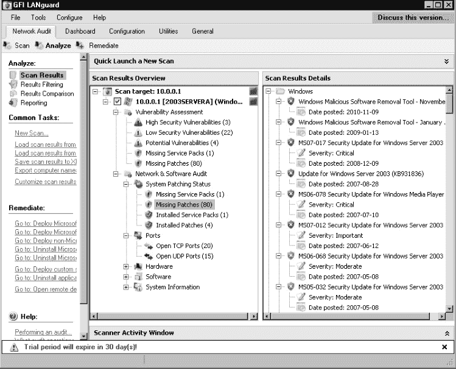

识别常见配置错误 在执行漏洞扫描时，你要检查系统的配置以确定可能导致安全问题的任何配置错误。例如，你可能会注意到服务器上的管理员账户未被重命名。

## 渗透测试

渗透测试是一种与漏洞评估完全不同的安全评估类型。在渗透测试中，测试人员使用常见的攻击方法来查看是否能够绕过系统的安全性。如果渗透测试人员无法通过使用常见漏洞利用来破坏系统，则系统通过测试。否则，如果系统被攻破，系统则未通过测试，渗透测试人员会报告发现情况以及如何保护系统。


Security+ 考试要求你了解渗透测试的特征。以下是渗透测试的特征和注意事项：

- **验证威胁是否存在** 通过渗透测试，你是在对系统执行实际攻击，因此如果你的模拟攻击成功，就没有比这更好的证明表明威胁确实存在。
- **绕过安全控制** 通过渗透测试，你是在对已得到保护的系统进行测试，因此渗透测试人员需要像黑客一样绕过这些安全控制。这将让你知道你的安全解决方案是否像在纸面上看起来那样有效。
- **主动测试安全控制** 请务必知道，渗透测试被视为主动测试系统的安全性，而漏洞扫描则是被动测试。
- **利用漏洞** 通过渗透测试，你是在主动利用系统的漏洞来查看系统是否安全。漏洞评估只是表明漏洞存在，但真正的测试是尝试利用漏洞来查看漏洞是否构成风险（渗透测试）。

> **Exam Watch**
>
> 记住考试要点，如果安全策略规定安全测试不能使用实时攻击或主动测试，那么你就需要远离渗透测试，转而考虑漏洞扫描。

## Legal Issues

作为执行安全评估的顾问，你需要警惕渗透测试，因为你实际上是在攻击系统——这是一种非法行为。重要的是要明白，未经授权访问任何系统都是非法的，即使目标是报告发现并帮助使系统更安全。作为渗透测试人员，至关重要的是你必须获得由公司签署授权的书面许可，该公司是你为其执行渗透测试的对象。这不是 IT 经理或网络管理员——应来自企业所有者或大型企业的管理人员。

你可能会发现高层管理并不太热衷于渗透测试，因为你实际上是在对生产系统执行实时攻击。确保在被要求执行测试时向管理人员说明渗透测试涉及的内容，以便他们可以决定是否希望执行测试。执行此类测试可能会在白天导致系统崩溃，因此请务必让他们知道。你可能会发现管理层希望采用漏洞评估的方向，因为它是一种更安全的评估安全的方法。

> **Exam Watch**
>
> 在执行任何形式的渗透测试之前，务必确保你有一份由律师起草的法律文件，声明你已获得执行此类测试的许可。确保要求你执行渗透测试的组织的高层管理人员已签署该文件。这被称为渗透测试授权。你还应在执行漏洞扫描之前获得授权。这被称为漏洞测试授权。
>
> 你也可以让管理层知道你将执行渗透测试，但不会故意对系统执行拒绝服务攻击，以免影响生产。明确你不会故意执行拒绝服务攻击，但由于攻击工具的性质，可能会出现意外的拒绝服务。让管理层知道你将测试攻击工具以期不执行拒绝服务，但你无法做出任何保证。底线：生产系统上可能存在一段软件，它对攻击做出负面反应，导致系统崩溃。

> **Inside the Exam**
>
> **Penetration Testing**
>
> 对于 Security+ 考试，请记住渗透测试被视为主动评估，因为你实际上是在尝试绕过系统的安全控制并入侵它。至关重要的是你必须获得高层管理层的许可才能执行评估，并且始终记住，虽然你可能无意造成拒绝服务攻击，但由于系统对黑客工具的响应方式，你可能最终会造成拒绝服务攻击。

## Assessment Techniques

现在你已经了解了一些流行的安全评估类型，我想谈谈执行评估所使用的一些技术。虽然渗透测试今天是一个流行的流行语，但重要的是你知道执行安全测试的其他方法。

### Baseline Reporting

基线报告涉及捕获系统的基线——系统在正常工作条件下的样子——然后将该基线与性能数据进行比较。基线报告通常用于涉及拒绝服务或恶意软件事件的安全事件中，系统性能未达到预期。

在评估系统时，查看系统的当前性能并将其与基线进行比较以确定问题所在。例如，你可能会发现服务器某天变慢了，当你查看性能监视器等工具中的性能数据时，你会看到 CPU 运行在 89% 的利用率——但你没有做任何超出常态的事情。你将其与基线进行比较，基线显示 CPU 使用率为 29%。这告诉你有东西占用了 CPU 时间，导致系统变慢。在此示例中，你可以使用性能监视器来帮助追踪使用所有 CPU 周期 的软件。

### Code Review

作为一名程序员，我不愿说，但大多数安全问题都是由于开发人员以不安全的方式创建应用程序造成的。例如，确保验证发送到应用程序的任何数据是安全编码的关键规则，因为如果你不这样做，黑客可能会执行 SQL 注入攻击或缓冲区溢出攻击。

花时间确保对内部开发的软件进行定期的代码审查。让专门的安全测试人员浏览开发人员编写的所有应用程序代码，并查找可能导致安全问题的代码错误。

> **Exam Watch**
>
> 对于你的考试，请记住术语 attack surface 指的是在系统上运行的软件和服务。

### Determining the Attack Surface

评估安全的另一种技术是确定系统的攻击面。攻击面是安装的所有软件和在系统上运行的服务。作为评估系统安全性的安全专业人员，至关重要的是你帮助组织通过建议他们从系统中删除不必要的软件和服务来减少系统的攻击面。

### Ring Architecture

评估系统或网络安全的另一种技术是查看系统的架构。例如，计算机处理器使用环形架构来运行软件（见图 20-4）。在较低环中运行的软件（环 0 为最低）比在较高环中运行的软件具有更多权限。环形架构的一部分是

- **Advisories and bulletins** 通知和安全公告可以发送给公众，以通知新的安全威胁。
- **Maneuvering** 机动是指战略性地移动以获得竞争优势。对于威胁管理，你应动态地制定策略以发现新威胁（例如，在网络的特定区域放置蜜罐以检测威胁）。

## Vulnerability Scans

在执行漏洞评估时，你可以使用漏洞扫描作为一种技术来自动化识别环境中漏洞的过程。本节确定了在执行漏洞扫描时应考虑的若干注意事项以及识别漏洞的不同方法。

### Considerations with Vulnerability Scans

在使用漏洞扫描程序自动化识别漏洞的过程时，你应牢记以下关键点：

- **Intrusive vs. nonintrusive** 重要的是要知道漏洞扫描被视为非侵入式扫描，因为你实际上不是在尝试入侵系统或利用它（渗透测试确实会尝试利用系统）。
- **Credentialed vs. noncredentialed** 在执行漏洞扫描时，你应确保以未经身份验证的用户（非凭据）身份执行一次扫描，以了解向网络未知人员公开了哪些信息。然后你应以管理员账户登录执行扫描，以便尽可能收集有关系统的信息。
- **False positives** 与任何类型的扫描一样，重要的是要留意误报——被报告为漏洞但实际上不是的情况。
- **False negatives** 误报可能被视为比误报更糟，因为它们是系统未检测到的发生的事件。关于漏洞扫描，误报是一个存在但未被漏洞扫描程序识别的漏洞。

### Types of Checks

如本章前面所述，漏洞扫描程序可以对系统执行多种不同的检查：

- **Configuration review** 漏洞扫描程序可以检查系统的配置，并向你报告任何应更改的易受攻击的设置。


5. 注意到有一个名为 CVE-2021-27070 的 CVE。 这个漏洞的描述是什么？ ________
6. 点击 CVE-2021-27070 的链接以查看该漏洞的详细信息。
7. 注意该漏洞的 ID（CVE-ID）为 CVE-2021-27070。 每个漏洞都有一个 ID 号来引用该漏洞。
8. 要查看该漏洞的 CVSS 严重性评级，请选择在国家漏洞数据库（NVD）中了解更多。
9. 注意该漏洞的 CVSS 基础分数： ___________
10. 这是低、中还是高严重性级别？ ___________
11. 关闭浏览器。

> **考试提示**
> 对于考试，请务必知道 CVSS 用于识别漏洞的严重性。 还要知道 CVE 是所有已知漏洞的公开列表，通常由漏洞扫描器引用以提供有关漏洞的详细信息。

## 认证目标 20.03：执行渗透测试

在执行渗透测试时，您是在模拟组织将从真正的攻击者那里经历的真实攻击。 这意味着您将建立一套常见的渗透测试工具包，这些工具是攻击者用来入侵系统、破解加密或窃听通信的程序。

### 渗透测试中使用的考虑因素和技术

在深入渗透测试的有趣部分，即使用执行渗透测试的工具之前，您需要了解许多考虑因素和技术。 在本节中，您将学习 Security+ 目标明确提及的许多渗透测试术语。

### 测试类型

在执行安全测试，特别是渗透测试时，请了解有不同类型的测试。 您可以执行以前称为黑盒测试、白盒测试或灰盒测试的测试。 以下概述了这三种测试之间的差异：

- **未知环境测试** 以前称为 *黑盒* 测试。 当执行未知环境测试时，或当聘请渗透测试员（渗透测试人员）执行测试时，目标是测试人员对组织或其网络配置没有任何信息。 测试人员必须充当黑客，自行发现组织及其配置的详细信息，然后模拟攻击。 由于测试人员在尝试入侵之前必须弄清楚组织拥有哪些资产，因此这种类型的测试需要花费最长的时间。
- **已知环境测试** 以前称为 *白盒* 测试。 在已知环境测试中，您（或您聘请来执行测试的顾问）会获得有关组织资产和配置的所有详细信息。 在这种类型的测试中，目标是查看系统是否可以被入侵。 尽管这种类型的测试比未知环境测试更快，但它并不能让测试人员了解某人发现有关组织的信息可能有多容易或多困难。
- **部分已知环境测试** 以前称为 *灰盒* 测试。 部分已知环境测试处于中间状态：测试人员会获得有关组织及其配置的一些详细信息，但只有有限的详细信息。 例如，测试人员可能会获得组织使用的 IP 地址列表，并且必须弄清楚这些 IP 地址上运行的是什么，然后模拟攻击。

> **考试提示**
> Security+ 考试目标使用 *已知、未知和部分已知环境测试* 术语，但我发现考试中仍有对黑盒、白盒和灰盒测试的引用。 出于这个原因，请为认证考试了解两套术语。 请记住，黑盒测试是测试人员未被提供网络设置的任何详细信息的情况，而在白盒测试中，测试人员会被提供环境的全部详细信息。

### 渗透测试概念

当您执行渗透测试时，您应该熟悉一些核心概念。 以下概念列表构成了 Security+ 目标确定的关键点，但这些并不是唯一需要了解的概念（PenTest+ 涵盖了执行渗透测试的更多细节）：

- **参与规则** 参与规则应在渗透测试的初始阶段设定。 它们是渗透测试的规则，例如应测试什么、何时进行测试以及谁可以与渗透测试团队进行通信。
- **横向移动** 横向移动是利用被入侵的系统来入侵网络上的另一个系统。 例如，在从一台服务器获取密码哈希后，渗透测试人员可能会尝试使用密码哈希连接到一个不脆弱的系统，这种技术称为传递哈希。
- **漏洞赏金** 漏洞赏金是对发现软件中的漏洞并向软件供应商报告该漏洞的人支付的补偿和认可。
- **枢轴** 枢轴是指测试人员入侵一台服务器，例如 Web 服务器，然后使用该系统访问与该系统连接的同一网络上的其他系统。 需要注意的是，渗透测试是一个漫长而冗长的过程，就像黑客攻击一样，可能需要一段时间才能攻击最终系统。

### 被动和主动侦察

在进行渗透测试时，您将执行被动和主动侦察，即通过不与目标系统通信（被动）或扫描目标系统（主动）来发现信息。 以下是在渗透测试期间发现资产的一些技术：

- **无人机** 您可以使用无人机飞越设施并拍摄土地和建筑物布局的视频片段。 这可以帮助您了解物理安全控制的弱点，例如了解围栏、警卫和出口的使用情况。
- **战争驾驶** 战争驾驶是一种无线网络攻击技术，攻击者使用无线扫描仪（如 Kismet）驾驶时发现无线网络及其特征，例如操作频道、频率和配置的安全协议。
- **战争飞行** 战争飞行是战争驾驶的一种形式，攻击者使用低空飞行的私人飞机扫描区域以寻找无线网络。 使用 Kismet 等无线扫描仪，攻击者飞至 1500 英尺以发现大量无线网络。
- **足迹** 正如您将在本章后面学到的，*足迹* 是侦察的另一个术语，即发现有关预期目标的信息。 您可以使用 Internet 资源被动地发现有关公司的信息，或使用扫描工具主动发现目标网络上运行的系统信息。

### OSINT

您可以在 Internet 上找到有关公司的丰富信息，例如电子邮件地址以及连接到 Internet 的服务器或设备。 使用开源情报（OSINT）工具，您可以轻松检索公司公开可用的信息。 Maltego 是 OSINT 工具的一个示例，它可以收集公司的电子邮件地址、文件、电话号码、DNS 记录、IP地址和资产的地理位置。

### 练习类型

在执行渗透测试时，您可以使用不同类型的测试。 您可能正在执行渗透测试以便尝试入侵公司资产（红队的目标），或者也许您的目标是查看防御团队（蓝队）是否能检测到攻击正在发生并阻止它。 以下是贵公司可能雇用的不同安全团队：

- **红队** 红队是采取系统化方法攻击系统并尝试绕过安全控制的网络安全团队。 他们是攻击者。
- **蓝队** 蓝队是负责检测攻击并通过阻止攻击来保护公司资产的网络安全团队。 他们是防御者。
- **白队** 网络安全中的白队是监督安全测试并记录红队和蓝队的进展并分配分数的团队。 白队还审查红队和蓝队创建的安全报告，以根据其准确性对它们进行评级。
- **紫队** 网络安全中的紫队是执行红队和蓝队两项职能的团队。

> **考试提示**
> 对于考试请记住，红队负责在安全测试期间对系统执行攻击（坏人），而蓝队负责检测攻击并防止入侵（好人）。

### 了解黑客过程

您通过遵循黑客过程来执行渗透测试，这是黑客在计划攻击组织时遵循的方法。 以下各节概述了黑客过程的阶段。


**图 20-5** 使用 whois 网站查找公司信息

**mheducation.com**

更新于 4 天前

**域名信息**

| 字段 | 值 |
|---|---|
| 域名 | mheducation.com |
| 注册商 | CSC Corporate Domains, Inc. |
| 注册日期 | 2000-06-08 |
| 到期日期 | 2018-06-08 |
| 更新日期 | 2017-06-04 |
| 状态 | clientTransferProhibited |
| 名称服务器 | pdns85.ultradns.biz<br>pdns85.ultradns.com<br>pdns85.ultradns.net<br>pdns85.ultradns.org |

**注册人联系信息**

| 字段 | 值 |
|---|---|
| 姓名 | 域名管理员 |
| 组织 | McGraw-Hill Global Education Holdings, LLC |
| 街道 | 2 Penn Plaza |
| 城市 | 纽约 |
| 州/省 | NY |
| 邮政编码 | 10121 |
| 国家 | 美国 |
| 电话 | +1.6094265291 |
| 传真 | +1.6094265291 |
| 电子邮件 | hostmaster@mheducation.com |

请注意，黑客攻击过程的 85% 都花在信息收集阶段以及收集可用于攻击的信息上。

**考试提示**

在信息收集阶段执行的侦察被称为被动侦察，因为黑客不接触组织的系统——黑客是从公开来源提取信息。

**考试提示**

在扫描和枚举阶段执行的侦察被称为主动侦察，因为黑客仍在收集信息，但通过与组织的系统进行通信来完成。

## 扫描与枚举

在信息收集阶段收集到 IP 地址后，黑客进入扫描阶段。此时黑客仍在进行侦察，但被认为是主动侦察，因为他们实际上正在向组织的系统发送流量。

扫描阶段的目标是通过找出系统上开放的端口号来了解系统上运行哪些服务。一旦黑客找出开放的端口号，他们就会对系统进行横幅抓取（banner grab），该操作会报告该端口上运行的软件版本。黑客想知道软件版本的原因是他们可以随后研究如何利用该软件。

为了找出系统上运行的服务，黑客会对系统进行端口扫描，以报告哪些端口是开放的。要进行端口扫描，黑客会使用像 nmap（命令行）这样的程序。例如，你可以使用 nmap -sT 10.0.0.1 对 10.0.0.1 系统进行端口扫描。图 20-6 显示了 nmap 命令的输出。稍后你将在“用于评估安全的工具”一节中了解更多关于端口扫描的内容。

**图 20-6** 使用 nmap 对系统执行端口扫描

```
bt ~ # nmap -sT 10.0.0.1
Starting Nmap 4.60 ( http://nmap.org ) at 2011-03-22 19:30 GMT
Interesting ports on 10.0.0.1:
Not shown: 1698 closed ports
PORT     STATE SERVICE
21/tcp   open  ftp
25/tcp   open  smtp
53/tcp   open  domain
80/tcp   open  http
88/tcp   open  kerberos-sec
110/tcp  open  pop3
135/tcp  open  msrpc
139/tcp  open  netbios-ssn
389/tcp  open  ldap
445/tcp  open  microsoft-ds
464/tcp  open  kpasswd5
593/tcp  open  http-rpc-epmap
636/tcp  open  ldapssl
1025/tcp open  NFS-or-IIS
1026/tcp open  LSA-or-nterm
3268/tcp open  globalcatLDAP
3269/tcp open  globalcatLDAPssl
MAC Address: 00:0C:29:4E:76:03 (VMware)
Nmap done: 1 IP address (1 host up) scanned in 15.442 seconds
bt ~ #
```

黑客完成端口扫描后，会进行横幅抓取。你可以使用 telnet 10.0.0.1 25 之类的命令，通过 telnet 连接到系统上的特定端口来进行横幅抓取。在此示例中，你连接到 10.0.0.1 系统上的 25 端口，系统会发回一条“欢迎”消息，显示该端口上运行的软件版本。请注意，在图 20-7 中，服务器在 TCP 80 端口上运行 IIS 6.0 版。

**图 20-7** 使用 nmap 查出端口上运行的软件版本

```
bt ~ # nmap -sV 10.0.0.1
Starting Nmap 4.60 ( http://nmap.org ) at 2011-03-22 19:33 GMT
Interesting ports on 10.0.0.1:
Not shown: 1697 closed ports
PORT     STATE SERVICE       VERSION
21/tcp   open  ftp           Microsoft ftpd
25/tcp   open  smtp          Microsoft ESMTP 6.0.3790.0
53/tcp   open  domain        Microsoft DNS
80/tcp   open  http          Microsoft IIS-webserver 6.0
88/tcp   open  kerberos-sec  Microsoft Windows kerberos-sec
110/tcp  open  pop3          Microsoft Windows 2003 POP3 Service 1.0
135/tcp  open  msrpc         Microsoft Windows RPC
139/tcp  open  netbios-ssn
389/tcp  open  ldap          Microsoft LDAP server
445/tcp  open  microsoft-ds  Microsoft Windows 2003 microsoft-ds
464/tcp  open  kpasswd5?
593/tcp  open  ncacn_http    Microsoft Windows RPC over HTTP 1.0
636/tcp  open  ssl/ldap      Microsoft LDAP server
1025/tcp open  msrpc         Microsoft Windows RPC
1026/tcp open  msrpc         Microsoft Windows RPC
3268/tcp open  ldap          Microsoft LDAP server
3269/tcp open  ssl/ldap      Microsoft LDAP server
3389/tcp open  ms-term-serv?
MAC Address: 00:0C:29:4E:76:03 (VMware)
Service Info: Host: 2003SERVERA.certworld.loc; OSs: Windows, Windows 2000
```

在黑客攻击过程的这一阶段，黑客还可能会尝试枚举系统，即收集更多关于系统的信息。黑客可能会尝试识别计算机名、用户名，甚至从系统中获取组列表。诸如 nmap 之类的工具可用于枚举系统。

网络映射软件也可用于识别已连接到网络的无效系统。这被称为流氓系统检测（rogue system detection）。

网络应用程序（如 Web 服务器、FTP 服务器，甚至启用了远程桌面的系统）都使用客户端连接的端口号。作为安全专业人员，你可以通过对那些开放相应端口的系统进行端口扫描，在网络中定位这些系统。端口扫描的结果会告诉你哪些系统上开放了哪些端口，这应该有助于你评估黑客可能以何种方式危害系统，因为每个应用程序都有不同的漏洞利用方式。

多年来，已经开发出不同类型的端口扫描。以下列表列出了几种主要的端口扫描类型：

- **TCP 连接扫描** TCP 连接扫描会与每个端口执行三次握手，以确定该端口是否开放。以下 nmap 命令演示如何对整个 192.168.2.0 网络执行 TCP 连接扫描：

    ```
    nmap -sT 192.168.2.0/24
    ```

- **SYN 扫描（半开）** 由于 TCP 连接扫描会执行完整的三次握手，因此会产生比必要更多的流量。你可以执行 SYN 扫描，也称为半开扫描或隐蔽扫描，因为它不完成完整的三次握手。扫描软件向端口发送 SYN 消息，如果目标系统回复 SYN-ACK，则丢弃连接。其原理是，既然收到了回复，那么该端口很可能已开放，因此无需发送三次握手的最终 ACK 消息。这种扫描也被称为隐蔽扫描，因为它产生的流量更少，希望避免被检测到，并且你不会完全打开到该端口的连接。以下命令演示如何使用 nmap 执行 SYN 扫描：

    ```
    nmap -sS 192.168.2.0/24
    ```

- **反向扫描** 反向扫描因其以与你预期相反的方式回应而得名。对于反向扫描，如果端口开放，则不发送回复；但如果端口关闭，则发送重置（RST）包（见图 20-8）。反向扫描的不同类型包括：空扫描（null scan），向端口发送一个未设置任何标志的数据包；XMAS 扫描，发送一个设置了 PSH、URG 和 FIN 标志的数据包。FIN 扫描发送一个仅设置了 FIN 标志的数据包。请注意，扫描的名称来自数据包中设置的标志。以下命令展示了 nmap 使用的 FIN 扫描和 XMAS 扫描：

    ```
    nmap -sF 192.168.2.0/24
    nmap -sX 192.168.2.0/24
    ```

请注意，反向扫描在 Windows 系统上不适用，因此会响应为没有端口开放。通常，在 Windows 网络上你会使用 SYN 扫描或 TCP 连接扫描。

**图 20-8** 反向扫描以你预期相反的方式回应。

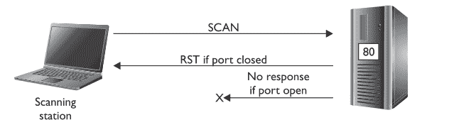


你还可以使用 **nmap** 进行横幅抓取（banner grabbing），它不仅能告诉你哪个端口是开放的，还能指出该端口上运行的软件版本。同样，这对黑客很有用，因为他们会据此知道该使用哪些漏洞利用手段来入侵系统。你可以使用以下 **nmap** 命令进行端口扫描，并找出端口上运行的软件版本：

```
nmap -sV 192.168.2.0/24
```

Nmap 是一个非常强大的程序，拥有许多选项。例如，你可以通过 **nmap** 使用 **-p** 参数来指定要扫描的端口，然后用逗号分隔列出端口。你还可以使用 **-g** 参数修改用于扫描的源端口，比如指定为 80（Web 服务器）或 53（DNS 服务器）（如果你愿意的话）。这将使扫描数据包看起来像是来自 Web 服务器或 DNS 服务器，而这些端口可能在被扫描系统的防火墙上是开放端口。你可以使用以下命令来定位网络中的远程桌面系统和 SQL 服务器，并修改扫描数据包的源端口，使其看起来像是来自 Web 服务器：

```
nmap -sS 192.168.2.0/24 -p 3389,1433 -g 80
```

如果你不喜欢命令行操作，也有许多基于 Windows 的端口扫描工具。其中一款流行的 Windows 端口扫描器是 SuperScan。SuperScan 很出色，因为它能进行 TCP 连接或 SYN 扫描，允许你修改要扫描的端口，并为你执行横幅抓取（找出端口上运行的软件版本）。请参考下面的练习，了解如何使用 SuperScan。

## 练习 20-3

### 使用端口扫描器

在本练习中，你将使用 **nmap** 对网络进行端口扫描，找出网络中各系统上开放的端口。

### 使用 nmap

在本部分练习中，你将使用 Kali Linux 对 10.0.0.0 网络进行一些端口扫描。

1. 确保 Windows Server、Windows 客户端和 Kali Linux 虚拟机均已启动。
2. 进入 Kali Linux 虚拟机，然后打开终端（命令提示符）。
3. 要对 ServerA 系统执行 TCP 连接扫描，请输入

```
nmap -sT 10.0.0.1
```


4. 要执行 TCP 连接扫描并指定扫描端口 21、25 和 80，请输入

```
nmap -sT 10.0.0.1 -p 21,25,80
```

5. 要执行 SYN 扫描并指定扫描端口 21、25 和 80，请输入

```
nmap -sS 10.0.0.1 -p 21,25,80
```

6. TCP 连接扫描和 SYN 扫描有什么区别？

7. 要对整个 10.0.0.0 网络执行 SYN 扫描，以查找任何运行远程桌面的机器，请输入

```
nmap -sS 10.0.0.0/8 -p 3389
```

8. 哪些系统启用了远程桌面？

## 漏洞扫描器

漏洞扫描器与端口扫描器有很大不同。漏洞扫描器会扫描系统以查找已知漏洞，然后报告已发现的问题。漏洞扫描器基于不断更新的漏洞数据库做出判断。当你进行扫描时，漏洞扫描器会将系统的补丁级别和配置与漏洞数据库进行比较，以查看你是否遵循了最佳实践（即是否存在漏洞）。

你可以使用许多软件中的任何一种来对系统或网络进行漏洞扫描。以下列出了一些流行的漏洞扫描器：

- **LANguard** LANguard 是 GFI 公司开发的商业产品，可扫描整个网络并报告缺失的补丁、开放的端口和系统配置错误。

- **Nessus** Nessus（参见图 20-9）是一款流行的漏洞扫描器，已经存在多年，可用于扫描网络，识别系统中的漏洞和缺失的补丁。

## 获取访问权限/初始利用

一旦黑客知道系统上运行哪些端口以及这些端口上运行的软件版本，他们就会研究如何利用该软件。令人惊讶的是，在热门产品上找到漏洞利用方法是多么容易——只需在 Google 上输入 exploit，然后加上你想要攻击的产品名称即可。

黑客可以使用任何攻击方式进行初始利用以获得系统访问权限，但如今获取系统访问权限的常用方法包括缓冲区溢出攻击和其他类型的注入攻击。

## 字符串数组

定义一个字符串数组（有时称为字符串数组）通常很有用。以下声明和初始化创建了一个包含四个字符串的数组：

```c
char *strArr[4] = {
    "first string",
    "second string",
    "third string",
    "fourth string"
};
```

该声明可解释为：strArr 是一个包含 4 个指向 char 的指针的数组。初始化将每个字符串字面量第一个字符的地址放入数组元素中：

```
strArr[0] -> "first string"
strArr[1] -> "second string"
strArr[2] -> "third string"
strArr[3] -> "fourth string"
```

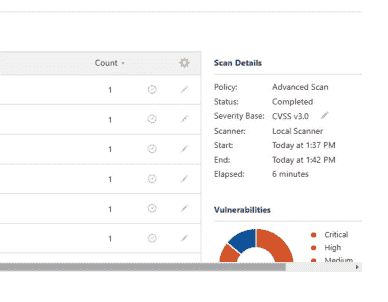

由于数组的每个元素都是一个指针，因此可以使用带指针或下标的 for 循环来打印这些字符串：

```c
for (i = 0; i < 4; i++)
    printf("%s\n", strArr[i]);
```

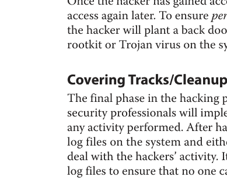

### 单个字符

可以使用方括号表示法访问字符串中的单个字符。由于 strArr[0] 是指向第一个字符串的指针，因此 strArr[0][0] 是第一个字符串的第一个字符：'f'。以下循环检查第二个字符串中的字符：

```c
#include <stdio.h>
int main() {
    char *strArr[4] = {"first string", "second string", "third string", "fourth string"};
    int i;

    for (i = 0; strArr[1][i] != '\0'; i++)
        printf("%c", strArr[1][i]);
    printf("\n");
    return 0;
}
```

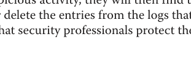

- **制定渗透测试计划** 一旦你拿到了签署好的文件，就要规划你将执行的攻击或测试类型。制定计划的目的是让你在方法上保持自律并遵循一套方法论，而不是随心所欲地攻击他人的网络。
- **测试渗透测试计划** 测试你将用于执行不同类型攻击的工具，确保它们能够正常工作，并观察它们在执行时是否会导致拒绝服务。
- **执行渗透测试** 此时，你已在客户现场，按照你的计划执行渗透测试。务必测试密码破解、无线破解和缓冲区溢出攻击。同时也要测试物理安全要素和社会工程学攻击。确保记录你做的每一件事，包括每个步骤的开始时间和结束时间。
- **创建发现报告** 测试完成后，创建一份关于你发现的报告。你不必包含所有活动的日志，但一定要随身携带，以备需要参考。你应该包含系统上成功和失败攻击的截图，以及如何改进安全性的建议。
- **提交报告结果** 在此阶段，你将再次与高层管理人员会面，汇报你的发现并给他们一份报告副本。确保客户签署完成评估的确认。
- **销毁报告的任何副本** 作为最后一步，确保你没有保留评估的额外副本，无论是纸质形式还是电子形式。

## 执行漏洞评估

除了渗透测试，你可以执行的另一种安全测试是漏洞评估。漏洞评估被认为是一种被动型评估，因为你并没有真正模拟对系统的攻击。通过漏洞评估，你旨在识别网络及其系统配置中的任何弱点，而对实际测试这些弱点以查看是否能入侵系统并不感兴趣。

当管理层要求你评估安全性，但对你将对系统运行黑客工具这一事实感到不安时，那么你应该进行漏洞评估。其主要好处是它是一种安全的评估类型，没有对系统造成拒绝服务的风险。

## 执行手动评估

在进行漏洞评估时，我建议首先对网络及其系统进行手动评估。通过手动评估，你基本上是在执行配置评估，核实网络、客户端、设备和服务器的配置。在此手动评估中，你将确保正在遵循最佳实践。


## 基本工具

各种安全测试工具和网站可以帮助你执行渗透测试。以下网站发布了不同产品的漏洞信息：

- www.securityfocus.com/
- https://packetstormsecurity.org/files/

已经开发出可用于执行渗透测试的工具。以下是网络上一些流行的渗透测试工具：

- **Kali Linux** Kali Linux 是一种特殊的 Linux 发行版，你可以从 www.kali.org 下载，操作系统中预装了许多安全工具。本节中提到的多数工具都已预装在 Kali Linux 中。Kali Linux 包含用于破解密码、破解无线加密以及进行被动测试（如 OSINT、DNS 分析和公司调查）的工具。Kali Linux 很酷的一点是，当你查看菜单系统时，软件按黑客过程的顺序组织（见图 20-10）。
- **Metasploit** 这是一套针对不同产品的漏洞利用工具集。你可以从 www.metasploit.com 了解更多关于 Metasploit 的信息并下载它。Metasploit 也已预装在 Kali Linux 中并可直接使用。

## 图 20-10

Kali Linux 是渗透测试人员的梦想，因为它预装了许多安全工具。

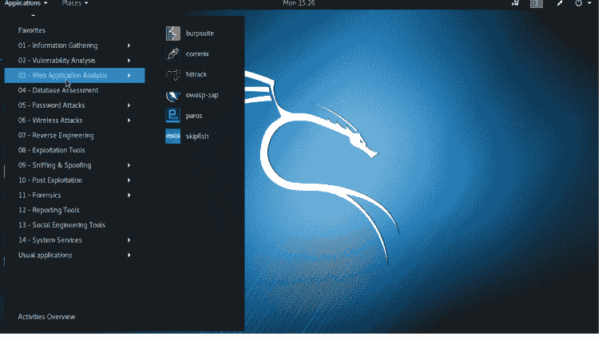

## 网络侦查与发现

渗透测试人员有许多工具可用于对公司进行侦查（画像）以及发现信息和系统。以下是渗透测试人员使用的一些常见侦查和发现工具。

### 发现工具

有一些工具用于发现网络上的系统、系统 IP 地址、网络连接，以及互联网上关于公司的公开信息。以下是考试需要了解的一系列发现工具。

- **tracert/traceroute** — 用于跟踪数据包在网络上的路径。当数据包到达路由器时，会发送响应，让您知道数据包经过了多少台路由器。示例用法是 **tracert www.gleneclarke.com**。
- **nslookup/dig** — DNS 查询工具；nslookup 在 Windows 和 Linux 系统上都很常见，而 dig 则可在 Linux 系统上找到。
- **ipconfig/ifconfig** — 分别用于显示 Windows 系统或 Linux 系统上的 TCP/IP 设置。
- **netstat** — 用于查看系统上打开的端口列表，或查看谁正在连接到该系统。要查看所有打开的端口，请使用 **netstat -na**。
- **theHarvester** — 一种 OSINT 工具，用于从公共互联网来源收集员工电子邮件地址、域名、服务器名称和系统上打开的端口。

### 探测器与扫描器

评估网络的一部分是定位正在运行的系统，运行系统上打开了哪些端口，以及可能存在的任何漏洞。以下是用于 ping 网络上的系统、进行端口扫描和漏洞扫描的工具。

- **ping/pathping** — ping 和 pathping 都用于测试与远程系统的连接性，但 pathping 会显示数据包经过的每一跳。示例用法是 **ping 192.168.1.1** 和 **pathping 192.168.1.1**。
- **hping** — Hping 是一种探测器，允许你自定义数据包，从而绕过防火墙。例如，如果某个系统阻止 ICMP 数据包，使你无法 ping 该系统，你可以使用 hping 并指定 TCP 协议以及你认为可能开放的端口，以便 ping 消息穿过防火墙。
- **IP 扫描器** — IP 扫描器用于对网络进行扫描，以检测哪些系统正在运行及其 IP 地址。

- **tail** 与 head 命令类似，但这条 Linux 命令用于在屏幕上打印最后十行。
- **cat** 用于在 Linux 中显示一个或多个文本文件的内容。
- **grep** 用于在文件中搜索特定字符串。
- **chmod** 用于更改文件的权限。
- **logger** 允许你向 /var/log/syslog 文件添加日志条目。

## Shell 和脚本环境

作为渗透测试人员，你可能会被要求创建自己的脚本来自动化渗透测试期间执行的任务。以下是一些测试人员使用的脚本环境。

- **SSH** 一种安全 shell 环境，用于通过安全通道远程访问系统。
- **PowerShell** Windows 中的脚本环境，可用于创建脚本来自动化常见任务。
- **Python** 另一种在安全领域非常流行的脚本环境。许多安全工具（如 sn1per）都是用于在渗透测试期间自动化任务的 Python 脚本。
- **OpenSSL** 一个安全库，应用程序可以使用它通过网络建立安全通信通道。

## 数据包捕获与重放

数据包捕获软件（或嗅探程序）的目的是*被动地*捕获网络上的通信流量，以便查看或分析该流量。在执行安全评估时使用嗅探器的目的是查看能否捕获网络上以明文发送的敏感信息。如果你发现密码和其他敏感信息出现在数据包捕获中，如图 20-11 所示，你应建议该组织对网络流量进行加密。

> **在职经验**
> 
> 多年前，我在一家大型全国性公司工作时，员工们被告知他们的电子邮件在网络上是加密的。然而，几年后我们发现我们的电子邮件实际上并未加密——服务器管理员以为他们启用了加密，但不知何故没有启用，而且从未验证过。我们之所以发现这一点，只是因为一些学习如何监控流量的培训师发现了公司经理正在传输的电子邮件。使用数据包嗅探器是验证数据在传输过程中确实经过加密的好方法。

## 图 20-11

数据包嗅探器可用于捕获网络上的机密信息。

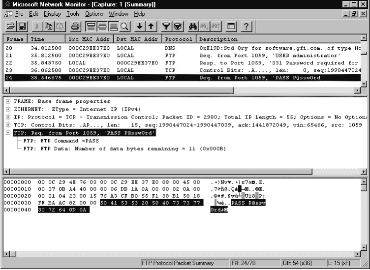

以下是一些可用于捕获网络数据包的常见工具：

- **Wireshark** 可能是最常用的数据包捕获工具，可从 wireshark.org 免费下载。你可以捕获网络上的数据包，对其过滤并分析，以确定网络上的活动。
- **tcpdump** 用于捕获流量的 Linux 命令。例如，你可以使用以下命令将捕获的数据包显示在屏幕上：`tcpdump -i eth0`，其中 `-i eth0` 是要从中捕获流量的接口。
- **tcpreplay** 用于在网络中重放已捕获流量的 Linux 命令。流量首先使用 tcpdump 捕获，然后可以通过 tcpreplay 在网络中重新发送。

## 其他常用工具

Security+ 考试目标还提到了一些你应了解的其他常用工具和框架：

- **漏洞利用框架** 对于渗透测试人员来说，一种常见的评估工具是漏洞利用框架，它包含许多用于利用不同产品缺陷的工具。常见的漏洞利用框架示例包括 Web 应用程序攻击与审计框架（w3af）和 Metasploit。
- **密码破解工具** 你可以找到各种密码破解工具。例如，你可以使用 John the Ripper、Medusa、Hydra 和 hashcat 等工具破解密码。所有这些工具都随 Kali Linux 一起提供。
- **数据清除** 你可以使用数据清除工具确保数据从驱动器中安全擦除。这是处理驱动器或将驱动器用作取证镜像目标时的一个重要步骤。

## 认证总结

在本章中，你学习了执行安全评估，并了解了两种主要的评估类型——渗透测试和漏洞评估。在备考 Security+ 考试时，以下是需要记住的一些关键点：

- 可以执行不同类型的评估，例如威胁评估、配置评估、漏洞扫描和渗透测试。
- 渗透测试被视为主动测试，因为你实际上在尝试入侵系统并绕过安全控制。漏洞评估是一种被动测试，仅识别系统配置方面的安全问题。
- 你可以使用 Kali Linux（以前称为 BackTrack）和 Metasploit 等工具进行渗透测试，还可以使用 John the Ripper 等密码破解工具。
- 你可以使用许多不同的技术来确定安全问题。你可以对公司创建的应用程序进行代码审查，对你创建的解决方案进行设计审查以确定其满足初始要求，或者对系统进行架构审查以确保其是安全的环境。
- 渗透测试应遵循黑客过程的步骤。
- 确保已起草一份法律文件，并由所有相关方签署，授权你执行渗透测试。
- 你可以使用多种工具执行评估，例如端口扫描器、网络嗅探器、漏洞扫描器、无线扫描器、无线破解器和蜜罐。

在深刻理解本章内容后，你将在考试中轻松应对安全评估问题。这里介绍的内容不仅对考试很重要，而且在你在考试中取得优异成绩并继续作为安全专业人员发展职业生涯后也很重要。


## 两分钟速览

### 了解评估类型

- 风险评估包括识别资产、识别针对这些资产的威胁、确定威胁的优先级，然后决定如何缓解这些威胁。
- 配置评估涉及检查系统的配置并识别存在安全问题的领域。这可以是手动漏洞评估的一部分。漏洞评估通常涉及运行软件来识别安全问题，例如缺失补丁和配置不当。
- 渗透测试是一种主动测试，测试人员尝试通过绕过安全控制来破坏系统。应起草并签署一份法律文件，授权你执行渗透测试。
- 未知环境测试，以前称为黑盒测试，是指你在不了解环境任何信息的情况下进行安全评估。已知环境测试，以前称为白盒测试，是指你在已获得配置和网络设置的所有详细信息的情况下进行评估。
- 你公司创建的任何应用程序都应执行代码审查。

### 执行安全评估

- 漏洞扫描是一种被动测试，用于识别系统中的漏洞，例如缺失补丁和配置不当。
- 执行漏洞扫描时，你应该同时进行凭据扫描和非凭据扫描。凭据扫描是指你对系统进行身份验证（通常以管理员身份）并尽可能多地收集信息。非凭据扫描是指你不登录，因此只能获取有限信息（黑客在无凭据时可能看到的信息）。
- 常见漏洞与披露（CVE）是不同操作系统和产品已公开披露漏洞的列表。
- 通用漏洞评分系统（CVSS）是用于报告漏洞严重程度的标准评分系统。

### 执行渗透测试

- 执行渗透测试时，你应该遵循黑客攻击过程的各个阶段——信息收集、扫描与枚举、获取访问权限、维持访问权限和清除痕迹。
- 执行渗透测试时，务必在初次会议中确定并设定预期。例如，了解在渗透测试期间是否允许拒绝服务攻击。

### 用于评估安全的工具

- 协议分析器/网络嗅探器用于捕获流量并查看网络上传送的数据包内容。
- 端口扫描器用于识别系统上开放的端口。这有助于你确定系统上运行的软件。请记住，系统上开放的端口愿意接受流量，因此你需要密切关注开放端口。
- 你可以使用无线扫描器来评估无线网络——例如，识别无线网络、其 SSID、信道以及所使用的加密类型。
- 蜜罐是一种已配置的系统，目的是将黑客从生产系统诱骗到蜜罐上。你在配置蜜罐时要考虑安全最佳实践，并确保配置高度审计和日志记录。蜜网是一个完整的网络，已被配置为将黑客从真实网络吸引开并记录活动。


## 自测

以下问题将帮助你评估对本章节内容的理解程度。如提示所述，有些问题可能有一个以上正确答案，因此请务必仔细阅读所有选项。

### 了解评估类型

1. 以下哪种测试类型被视为主动的安全测试方法？
   - A. 漏洞评估
   - B. 渗透测试
   - C. LANguard
   - D. 风险评估

7. 你的同事被要求对网络中的关键系统执行非侵入式评估。她正在对系统执行漏洞扫描，但发现无法获取太多相关信息。你会建议什么？
   - A. 执行非凭据扫描。
   - B. 执行凭据扫描。
   - C. 在系统上使用 Metasploit。
   - D. 对系统尝试密码攻击。

### 执行渗透测试

8. 以下哪个工具可以帮助你识别系统上运行的服务？
   - A. 蜜网
   - B. 嗅探器
   - C. 端口扫描器
   - D. 蜜罐

9. 你的经理刚刚听说一个针对 SQL 服务器的新漏洞利用，并希望在 192.168.2.0 网络上定位这些服务器。以下哪项可以实现这一目标？
   - A. ping -t 192.168.2.0
   - B. nmap -sS 192.168.2.0/24 -p 1433
   - C. dig www.gleneclarke.com
   - D. nmap -sS 192.168.2.0/24 -p 3389

10. 你的经理聘请了一位顾问执行渗透测试。她要求你不要向测试人员提供公司或配置的任何细节。她希望执行哪种类型的测试？
    - A. 已知环境
    - B. 未知环境
    - C. 部分已知环境
    - D. 互联网环境

11. 以下哪个是渗透测试工具集，预装了黑客工具供你在渗透测试期间使用？
    - A. LANguard
    - B. Nessus
    - C. Kali
    - D. nmap

### 实操题

17. 使用以下图示，将左侧的特征与右侧列出的扫描类型进行匹配。

- 侵入式
- 被动
- 绕过安全控制
- 主动
- 非侵入式
- 识别错误配置

- 漏洞扫描
- 渗透测试

## 自测答案

### 了解评估类型

1. ☑ B. 渗透测试被视为主动测试，因为你要对系统执行实际攻击并试图破坏安全控制。☒ A、C 和 D 不正确。漏洞扫描或漏洞评估被称为被动评估方法，因为你并未真正试图破坏系统的安全控制。LANguard 是漏洞扫描器的一个例子。风险评估也是被动的，因为你只是列出系统面临的威胁并找出如何缓解这些威胁。

2. ☑ D. 无论何时你的业务开发应用程序，你都应该执行代码审查，以确保应用程序中不存在不安全的代码。你要检查以确保开发人员验证输入并且不会为应用程序创建后门。☒ A、B 和 C 不正确。风险评估包括识别资产、针对这些资产的威胁，然后规划如何缓解这些威胁。威胁评估是风险评估（分析）的一部分。渗透测试是主动尝试绕过系统安全控制的行为。

### 用于评估安全的工具

13. ☑ A. 你会使用密码破解工具（如 John the Ripper）来破解密码。☒ B、C 和 D 不正确。Nmap（网络映射器）是一种端口扫描器，用于识别系统上开放的端口。LANguard 和 Nessus 是漏洞扫描器的例子。

14. ☑ D. 被动工具不会在系统上产生活动。在选项列表中，唯一不会在系统上产生活动的工具示例是网络嗅探器。☒ A、B 和 C 不正确。John the Ripper 是一种密码攻击工具，而 nmap 是端口扫描器，Metasploit 是用于主动利用系统的工具。所有这些都会在系统上产生活动，因此它们被视为主动工具。

15. ☑ A. 当你在进行渗透测试或评估密码复杂性时，John the Ripper 用于执行密码攻击。☒ B、C 和 D 不正确。Dig 和 nslookup 是 DNS 信息收集工具，而 nmap 是端口扫描器。

16. ☑ D. 蜜网是一组用于创建虚假网络以将攻击者诱骗到该网络的系统。目标是让黑客在蜜网上忙碌，同时你记录所有活动，并为自己争取时间检测黑客并防止他们破坏生产系统。☒ A、B 和 C 不正确。蜜罐是一个设置来吸引黑客的系统，并让黑客触发警报，从而通知管理员黑客的存在。你通常会将蜜罐放置在 DMZ（而不是你的局域网）中，但 DMZ 本身并不是蜜罐或蜜网。

### 实操题

17. 下图显示了正确答案。请注意，在真实考试中，你会遇到类似的问题，需要你将方框从一侧拖到另一侧。

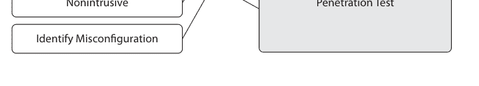


