# 第21章
# 事件响应
与计算机取证

# 认证目标

+   21.01   处理证据
+   21.02   收集数字证据
+   21.03   事件响应概览

+   ✓   两分钟练习
+   Q&A 自测

与计算机安全相关的一个热门话题是计算机取证与调查。计算机取证涉及从计算机、服务器或移动设备上捕获和分析证据。本章将向你介绍计算机取证，并帮助你准备 Security+ 考试中的相关题目。本章绝非旨在对计算机取证进行全面讨论，因为要让你掌握计算机取证调查员所需的概念和技能，需要一整本书的篇幅。

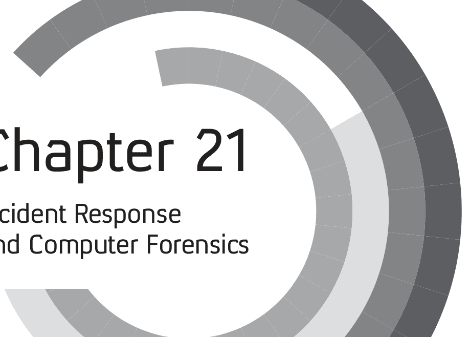

## 证据保全

在收集证据时，你不仅必须记录每一条证据并建立监管链，还必须确保采取措施保全（或保护）证据。证据应放置在安全的容器中，然后立即运送到安全的存储地点。

对于数字证据，你需要确保证据不受磁场损害，并防止静电放电（ESD）。ESD 是计算机芯片被损坏的常见原因，因此务必保护计算机组件。

确保证据存放在安全的柜子中，并且该柜子位于限制人员进出的安全区域内。你需要证明只有经过授权的人员才能接触证据。

> 证据应被记录并存放在安全的场所，只有少数人员能够接触证据。

## 记录你的步骤

到达现场后，记录所有步骤至关重要。务必对证据所在的区域拍照。例如，如果你负责从嫌疑人住所查获一台计算机，一定要在触碰任何东西之前，对该计算机所在的区域拍照。你也可以使用摄像机或屏幕录制软件来录制调查步骤的视频。如果没有软件录制步骤视频，务必对关键屏幕进行截图。

同时也要记录并拍摄连接到计算机的任何设备。例如，你可能会注意到一个外部驱动器连接到了系统。请务必不仅拍摄外部驱动器，还要拍摄计算机背面的连接器，以显示该驱动器已连接到计算机。

在对证据进行分析时，请务必记录你执行的每一步。如果发现了相关证据，关键在于你能够解释找到证据所采取的步骤，并且能够一遍又一遍地重现结果。

> 进行取证调查时，你必须记录所有步骤，以便能够解释你是如何找到证据的，并能够重现结果。

## 事件时间线

在拼凑证据时，你的目标是记录所发生事件的时间线。你可以通过分析时发现的痕迹上的时间戳来实现这一点。在分析证据（如驱动器镜像）时，请确保你的取证软件具备合并时间偏移的能力——用于应对你的取证工作站可能配置为与嫌疑人数据不同的时区这一情况。因为这可能会使时间发生偏差，大多数取证

## 调查报告

在分析证据期间，大多数取证软件允许你标记感兴趣的项目，并将它们添加到你可以生成的报告中。在进行调查时，至关重要的是同时规划调查报告，记录所有步骤并标记感兴趣的项目。报告应包含以下内容：

-   感兴趣的项目  你的报告应列出镜像中的任何感兴趣项目。这可能包括电子邮件、图片、视频和已删除的文件。
-   操作日志  一些取证软件会记录你在软件中执行的每个操作。这对于验证你所执行的操作非常有用。如果软件不记录你的操作，你将需要手动记录，以便能够解释你采取的步骤，并通过相同的步骤重新生成结果。
-   调查报告  报告应包含调查期间发现的证据摘要。例如，如果你恢复了一个包含潜在罪证内容的已删除文件，则应在报告中注明。

在进行调查时，记录所有活动以及每项活动的时间至关重要。记录你开始每项操作的时间以及耗时，对调查的成功至关重要。记录时间偏移是调查人员在执行调查时需要配置的一项重要设置。配置记录时间偏移涉及调查人员在取证软件中配置时区，使其与嫌疑人系统的时区匹配，从而确保证据中的所有时间戳信息准确无误。

## 在哪里寻找证据

在进行计算机取证调查时，了解在哪里可以找到证据以及了解易失性顺序至关重要。以下是在进行计算机调查时可能找到证据的位置列表：

- 内存/RAM  内存包含最近使用的信息。这可能包括文档内容，甚至最近使用的密码。这被视为易失性证据，因为信息在内存中只会停留很短时间。请确保手头有诸如 dd 或 FTK Imager 之类的工具，以便在需要时捕获内存内容。
- 交换文件/页面文件  在 Windows 系统中，信息会不断从 RAM 转储到 pagefile.sys 交换文件中。较新版本的 Windows（如 Windows 10）还有一个名为 swapfile.sys 的文件，也用于将内存内容交换到磁盘。在尝试查找易失性内存时，请务必查看交换文件。
- 硬盘  大多数调查涉及对硬盘驱动器（或多个驱动器）进行镜像，并查找存储在磁盘上注册表、电子邮件或文件系统中的证据。
- 硬盘
- 远程系统上的日志（网络）
- 光盘（DVD）

> 考试提示 对于 Security+ 考试，要知道你应该首先从易失性区域收集数据，然后再转向非易失性区域。这被称为易失性顺序——你应该按照易失性顺序收集数据。易失性顺序是：缓存、内存（RAM）、交换文件、硬盘、远程日志（网络），最后是光盘驱动器（DVD）。

## 使用的工具

各种工具可以帮助你执行计算机取证以及捕获和分析计算机证据。本节介绍一些用于获取和分析数字证据的常用工具。

## 采集工具

查获计算机后的第一步是获取驱动器的比特流副本（镜像），以便进行分析。重要的是，你使用的镜像软件在取证上是可靠的，也就是说，它已被证明不会以任何方式改变源驱动器，并且它逐个扇区地捕获磁盘上的数据，而不是逻辑地复制文件。作为安全措施，你应该始终将驱动器连接到写阻止器，以确保你不会对驱动器进行写入更改。

你可以用来获取镜像的一款免费软件是一套称为法证采集实用工具（FAU）的工具。FAU 可用于获取镜像，但它不提供任何分析证据的方法。让我们来看看一些可用于执行取证任务的程序。

安全擦除（Secure Wipe） 如果你打算将嫌疑人驱动器的内容复制到目标驱动器，则需要安全擦除目标驱动器。从法律角度来看，目标驱动器必须已经清理干净，以免污染嫌疑人驱动器的内容。FAU 包含一个安全擦除程序（wipe.exe），它会对你要安全擦除的目标驱动器进行三次写入，以确保驱动器上的先前数据被删除。以下语法用于在我的调查系统上安全擦除驱动器 E:，而图 21-5 显示了安全擦除操作的输出：

```
wipe \\.e:
```


## 图 21-5

在将位流副本发送到目标驱动器之前，一定要通过安全擦除的方式对目标驱动器进行净化。

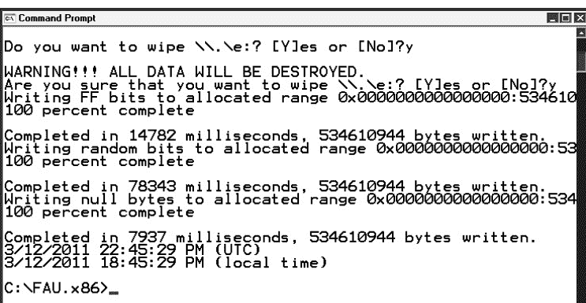

## 获取镜像

一旦你安全地擦除了任何目标驱动器，就可以开始获取嫌疑人驱动器的镜像。当你获取嫌疑人驱动器的镜像时，通常有几种方式可供选择：

- 磁盘到镜像：一种非常流行的调查方法，是将磁盘创建为镜像，并将镜像保存为镜像文件。
- 磁盘到磁盘：进行计算机取证的大型组织通常通过将一个磁盘以低级复制（扇区级别）的方式复制到另一个磁盘来获取证据。
- 镜像到磁盘：最后一种情形是取得从嫌疑人驱动器上获得的镜像文件，然后将其发送到磁盘，以便在目标磁盘上进行调查。

采用磁盘到镜像文件方法的好处在于，你无需准备备用磁盘即可获取镜像。很多时候，取证调查人员会将驱动器捕获到镜像文件中，然后在准备进行分析时，再将镜像发送到目标驱动器。在这种情况下，调查人员会在目标驱动器上进行分析——这样，嫌疑人的原始驱动器不会被触碰，初始镜像也不会在分析过程中被改动。对于 Linux 用户，有一个很酷的地方需要记住：Linux 能够直接挂载 dd 镜像文件进行只读分析！这意味着你无需其他软件即可进行分析。

如果你想使用 FAU 获取磁盘镜像，可以使用以下命令（dd 是一个用于获取镜像的命令行工具，if 表示“输入文件”，of 表示“输出文件”）：

```
dd.exe if=\\.\F: of=e:\Case20110203_Drive1.img conv=noerror -localwrt
```

## 练习 21-1

## 使用 FTK Imager 获取嫌疑人驱动器镜像

在本练习中，你将学习如何使用 FTK Imager 获取 USB 驱动器的镜像。请注意，你可以使用同样的步骤为普通硬盘创建镜像，但在本例中使用 USB 驱动器是因为它更小，花费的时间更少。

- 1. 从 https://accessdata.com/product-download/ftk-imager-version-4-5 下载 FTK Imager，然后安装。
- 2. 将一个 USB 闪存驱动器插入你的系统。
- 3. 启动 FTK Imager。
- 4. 若要获取驱动器镜像，请选择 File | Create Disk Image。
- 5. 系统会提示你选择要镜像的证据源类型，例如物理驱动器（整个磁盘）、逻辑驱动器（驱动器上的分区）、镜像文件、文件夹内容或 DVD。选择 Physical Drive，然后选择 Next。
- 6. 系统会显示系统上的驱动器列表。选择 USB 驱动器，然后选择 Finish。
- 7. 然后，你必须在 Image Destination 字段中指定要写入的镜像文件。选择 Add，选择 Raw (dd) 作为镜像类型，然后选择 Next。dd 镜像是许多取证工具都支持的标准镜像格式。
- 8. 接着，系统会要求你输入有关证据的信息。输入以下信息，然后选择 Next：
  - 案件编号：20210602_001
  - 证据编号：100
  - 唯一描述：嫌疑人的 USB 驱动器
  - 勘查人员：Bob Smith
  - 备注：嫌疑人的 USB 驱动器在办公桌最上层抽屉中发现
- 9. 使用以下信息作为镜像目标位置，然后选择 Finish：
  - 镜像目标文件夹：c:\forensicsimages
  - 镜像文件名：suspect_usb_drive.dd
  - 镜像分片大小（MB）：0（表示不拆分为多个镜像文件）
- 10. 选择 Start 开始创建 USB 驱动器的取证镜像（根据 USB 驱动器的大小，这可能需要一段时间）。
- 11. 镜像创建完成后关闭 FTK Imager。
- 12. 验证你可以在 Windows 的 c:\forensicsimages 文件夹中看到镜像文件。

5. 在左侧的“证据树”中展开镜像的内容。注意，你可以看到一个卷标为 USB_DRIVE [FAT32] 的卷。

6. 展开 USB_DRIVE 节点，然后突出显示 [root] 节点，该节点代表驱动器的根目录。

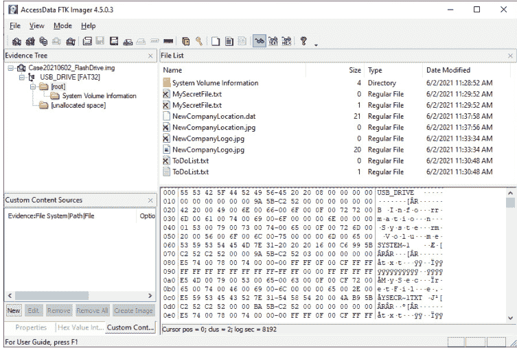

7. 已删除文件的图标上会显示一个红色的 X。该驱动器上已被删除且大小大于 0 字节的文件有哪些？

8. 选择文件大小为 1 的 MySecretFile.txt 文件。你应该可以在下方内置查看器中看到该已删除文件的内容。这个已删除文件中包含了什么？

9. 注意，有一个名为 NewCompanyLocation.jpg 的文件已被删除，但还存在一个名为 NewCompanyLocation.dat 的文件。选择 NewCompanyLocation.dat 文件，注意查看器将其显示为图形文件（嫌疑人重命名了该文件，以隐藏其图形文件的本质）。

10. 关闭 FTK Imager。

## 练习 21-4

## 使用 Autopsy 调查本地磁盘

在本练习中，你将使用 Autopsy 调查本地硬盘驱动器中的内容，查找访问过的网站和用户帐户等项目，并识别系统中的加密文件。

- 1. 从 https://www.autopsy.com/download/ 下载 Autopsy，并将其安装到你的系统中。
- 2. 安装 Autopsy 后，右键单击桌面上的 Autopsy 图标，选择“以管理员身份运行”（Run As Administrator）。在“用户帐户控制”对话框中，选择“是”以提升你的权限。
- 3. 选择 New Case，输入以下信息，然后选择 Next：
  - 20210603_Exer21-4
  - 保留所有其他选项不变。
- 4. 输入案件的以下可选信息，然后选择 Finish：
  - 编号：20210603_Exer21-4
  - 勘查人员姓名：Bob Smith
  - 电话：555-5555
  - 电子邮件：bobsmith@companyxyz.loc
- 5. 当系统询问是否添加数据源时，注意 Local Disk 已被选中。还要注意，你可以添加磁盘镜像（你在前面练习中创建的镜像）。在本练习中，我们将添加你的本地磁盘，因为它可以让你查看有关自己系统的信息。选择 Next。
- 6. 选择 Select Disk，然后选择安装了 Windows 的硬盘驱动器（在我的例子中，它是 Drive 0，容量为 447GB）。选择 OK。
- 7. 选择 Next。
- 8. Autopsy 需要对驱动器使用摄取模块。这些模块用于定位驱动器上的关键信息，例如访问过的网站。保留所有选中的模块，然后选择 Next。请注意，添加驱动器需要一些时间，因为摄取模块正在解析信息。
- 9. 将本地驱动器添加到 Autopsy 后，在左侧展开 Results，然后展开 Extracted Content。Autopsy 会在此处显示通常对调查人员有用的驱动器内容信息。
- 10. 选择 Encryption Suspected，查看硬盘驱动器上已加密文件的列表。
- 11. 选择 Installed Programs，查看系统上已安装程序的列表。
- 12. 选择 Operating System User Account，查看系统上的用户帐户列表。
- 13. 选择右侧的某个用户帐户，在右下方面板中查看有关该帐户的更多数据。
- 14. 在左侧选择 Recent Documents，查看嫌疑人最近访问的文件列表。注意，你可以选择一个文件来显示有关该文件的更多信息。

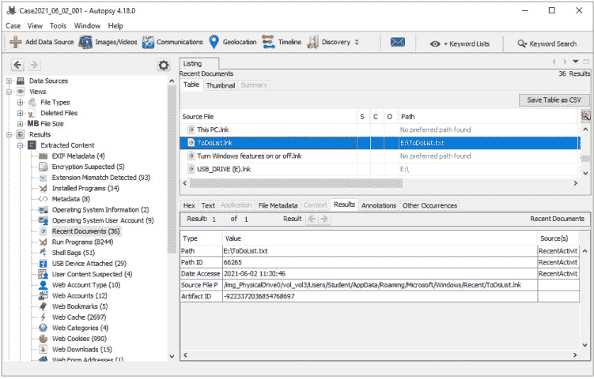

- 15. 选择 Web Account Type，查看嫌疑人登录过的网站列表。
- 16. 选择 Web Downloads，查看嫌疑人下载的文件列表。
- 17. 选择 Web Search，查看嫌疑人在互联网上搜索内容时输入的关键词列表。
- 18. 关闭 Autopsy。

你可以对系统进行实时分析。你也可以进行实时分析来检查内存内容，因为内存中也可能包含证据。

实时分析工具非常适合响应安全事件（例如感染恶意软件的系统），因为实时分析工具具有许多功能来显示系统的当前状态。实时分析工具还可以用于监控正在运行的进程；定位系统上的所有图形文件；以及查看 PST 文件、电子邮件密码、注册表和 Internet 历史记录等。

CAINE 就是一种可用于事件响应和计算机取证的实时分析工具。

## 十六进制编辑器

对于取证调查人员来说，另一个重要工具是十六进制编辑器。十六进制编辑器允许你查看文件或磁盘的底层内容。使用十六进制编辑器，你可以检查文件头，以确定所处理文件的类型，而不管文件扩展名是什么。WinHex 是一种常见的十六进制编辑器，也是你在 Security+ 考试中应该了解的工具。在图 21-9 中，你可以看到文件内容的第一部分（文件头）包含

图 21-9

使用十六进制编辑器查看文件头

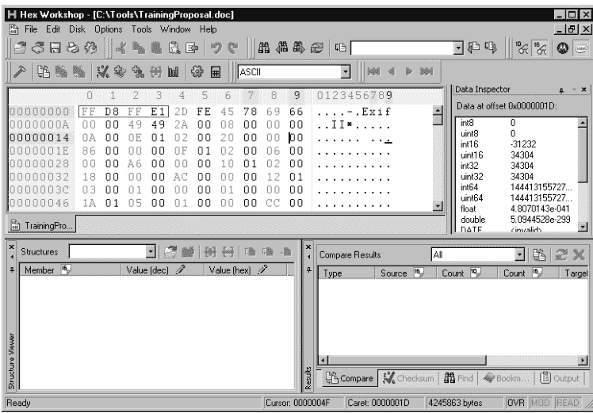


9. 查看该文件的十六进制数据时，注意文件以 FF D8 FF E0 开头。这是 .jpg 文件使用的文件头。这意味着 NewCompanyLocation.dat 实际上是一个 JPG 文件。

   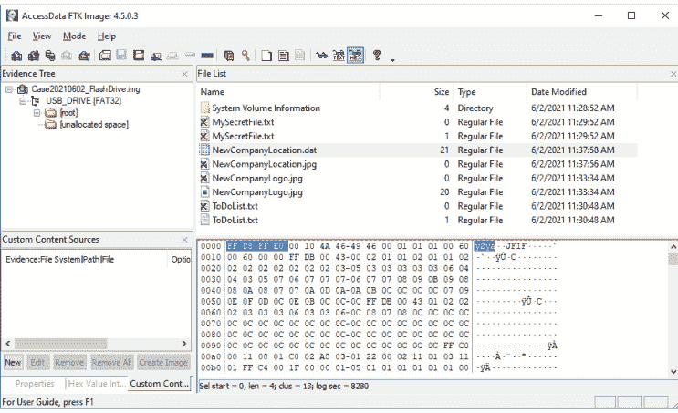

10. 关闭 FTK Imager。

## 移动设备取证

计算机取证中一个日益发展的领域是移动设备取证——即在移动设备（如手机、平板电脑或 Android、iPhone 等智能手机）上查找证据。存储在移动设备上的信息存储在不同的区域中。以下汇总了可以找到移动设备数据的常见区域：

- ROM 只读存储器存储移动设备的操作系统。

- EEPROM 电可擦可编程只读存储器包含移动设备的系统数据。这些数据存储在 EEPROM 中，以便服务提供商可以根据需要更新。

## 练习 21-6

### 执行手机取证

在本练习中，您将学习如何检索移动设备上 SIM 卡中的内容。本练习要求您的取证工作站连接有 SIM 卡读卡器，并且拥有手机 SIM 卡。您还需要下载一份 Paraben 的 SIM Card Seizure 软件。

1. 安装 SIM 卡读卡器，并确保 Windows 中已加载该读卡器的设备驱动程序。
2. 在手机上，取下背面的电池，取出 SIM 卡。
3. 将 SIM 卡放入读卡器中，然后启动 Paraben 的 SIM Card Seizure 软件。
4. 选择“文件 | 新建”以创建新案件。
5. 输入 20110228_001 作为案件文件名，然后点击“打开”。
6. 填写案件信息，然后点击“下一步”。

   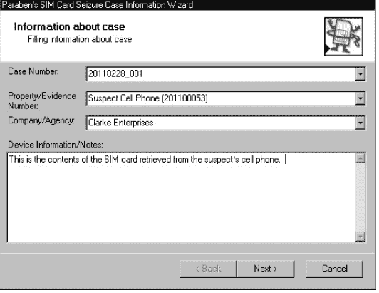

7. 填写您的联系人信息作为检查员信息，然后点击“下一步”。

   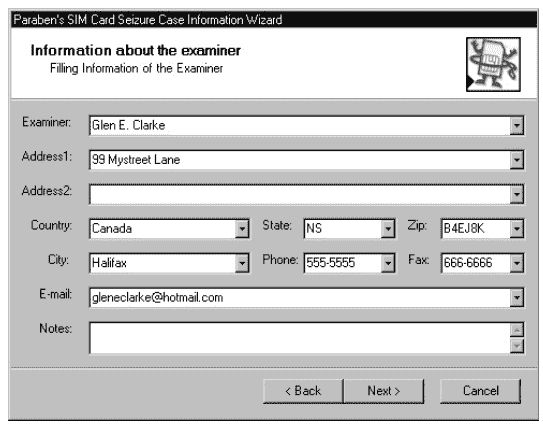

8. 在“摘要”屏幕上，点击“下一步”，然后点击“完成”。

9. 案件创建完成后，您可以通过选择“工具 | 数据采集”从 SIM 卡中获取证据。

   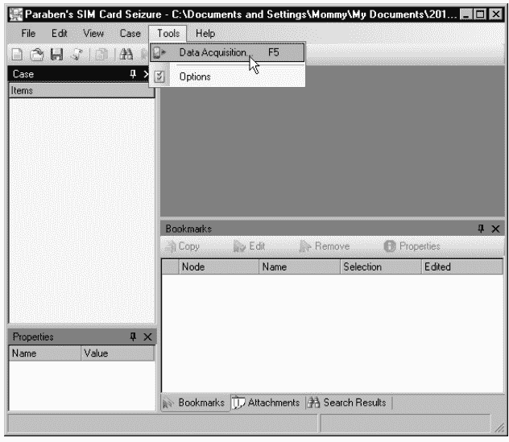

15. 在采集结果屏幕上，点击“下一步”，然后点击“完成”。
16. 在左侧的“项目”文件夹中，展开“SIM 短消息”，然后选择“接收的短信（未送达）”以查看未送达的短信。任何短信都应显示在右侧的“网格”区域中。

    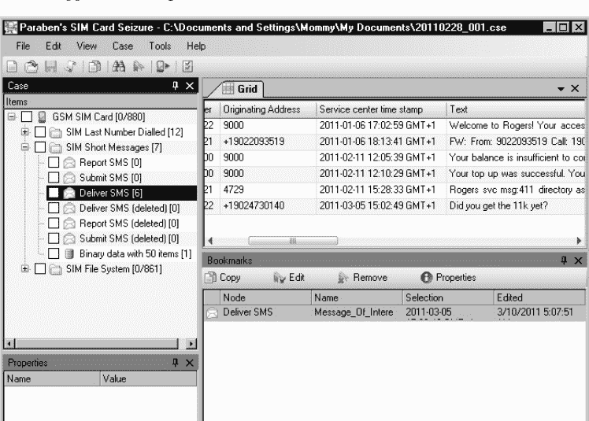

17. 在左侧的“项目”列表中，选择“接收的短信（已删除）”以查看嫌疑人试图删除的短信列表。

## 图像文件分析工具

在分析嫌疑人的系统或设备以查找证据时，您可能正在寻找图形文件等证据。如前所述，您可以在十六进制编辑器中通过查找文件头开头带有“FF D8 FF E0”或“FF D8 FF E1”的文件来定位图形文件（JPG）。分析图形文件时，请查看存储在图形文件中的元数据。如今大多数 JPG 文件都存储可交换图像文件格式（Exif）元数据，其中包含拍摄该照片的设备信息。例如，您可以查看所用相机的制造商和型号，以及日期和时间信息，如图 21-10 中的示例所示。

**图 21-10** 查看使用数码相机拍摄的照片中存储的 Exif 元数据

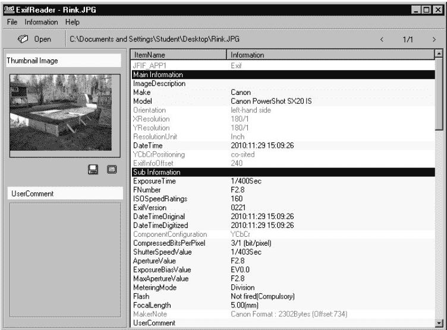

如果在犯罪现场查获了特定相机，这些信息也可能很有用。许多相机和手机还会存储元数据，例如拍摄照片地点的 GPS 坐标，这对调查可能非常有用。

*元数据*是关于文件以及文件如何形成的信息。如今许多程序都会将元数据与文件一起存储。如前所述，JPG 文件存储相机信息，而 Microsoft Office 文档中的元数据则指示文件的创建者是谁。PDF 也存储元数据，例如用于创建该 PDF 的软件的注册公司信息。

## 练习 21-7

### 查看 Exif 元数据

在本练习中，您将打开一张用数码相机拍摄的图像文件，以找出拍摄该照片所用相机的制造商和型号，以及拍摄日期和时间。

1. 从 https://exif-reader.en.softonic.com/ 下载并安装 Exif Reader。
2. 选择“文件 | 打开”以打开一张来自您的数码相机的照片。

- **法规/管辖权** 对于云中的数据，了解存储数据的服务器位于世界何处非常重要。对于大多数服务提供商，您可以指定数据的存储区域，以便了解适用于该数据的法规和法律。
- **数据泄露通知法律** 确保您与提供商签订的合同明确规定，一旦发现数据泄露，提供商应立即通知您，以便您能够遵守适用于您公司的数据泄露通知法律。

## 认证目标 21.03

### 了解事件响应

在本节中，您将了解事件响应以及事件响应团队的概念。Security+ 认证考试将测试您对如何在组织内响应安全事件的了解程度。

### 事件响应团队

为处理组织内安全事件所做的第一项准备工作是确保您已建立事件响应团队（也称为计算机事件响应团队，简称 CIRT）。事件响应团队负责了解如何处理组织内发生的安全事件，并及时纠正和记录安全问题。

第一步是组建团队。团队将由组织内具有不同技能组合的不同类型员工组成。以下简要列出了响应团队中通常出现的一些成员：

- **团队负责人** 团队负责人负责确保所有团队成员在发生安全事件时都了解自己的角色。团队负责人还负责与在特殊情况下可能召集的外部资源建立关系。
- **技术专家** 技术专家具备评估和识别安全事件规模的技术专长，并了解如何纠正问题。CIRT 可能拥有多名专注于不同领域的技术专家。例如，您可能拥有 Windows Server 专家、Linux 专家和 Cisco 专家。
- **文档专家** 文档专家了解如何记录整个响应过程，并负责在文档数据库中记录每起事件、问题原因以及解决方案。

### 事件响应流程

Security+ 考试期望您具体了解业务环境中发生安全事件时的响应流程。确保 CIRT 理解事件响应流程的不同阶段至关重要。
以下是事件响应流程的各个阶段：

- **准备** 第一步是通过组建 CIRT 并制定事件响应程序来为安全事件做好准备。务必让整个组织了解其响应安全事件的责任及其角色。
- **识别** 下一步是公司中有人识别出可能已发生安全事件。这可能包括用户发现其计算机反应异常，或员工发现 Web 服务器上的文件被替换等任何情况。

  一旦员工识别出安全事件，该员工需要立即通知 CIRT，CIRT 将派遣一名第一响应者。务必让员工知道应向谁报告安全事件，以便第一响应者能够立即处理该事件。第一响应者将判断是否确实发生了事件，以及该事件是否需要升级。
- **遏制** 第一响应者的主要目标之一是隔离安全事件，以防止其演变成更大的问题。例如，如果响应涉及病毒的事件，第一响应者应立即将系统从网络中断开，以防止病毒传播到网络上的其他系统。
- **根除** 一旦安全事件被识别并遏制，CIRT 将确定并执行根除引发事件的任何问题的步骤。这可以简单到部署防火墙或加强病毒防护。
- **恢复** 恢复阶段是指 CIRT 将系统恢复到安全事件发生之前的状态。这通常涉及使用恢复程序，这些程序是记录完善的资源，包含有关如何恢复系统的分步说明。
- **经验教训** 事件处理完毕后，CIRT 需要记录经验教训。此步骤使团队能够从全局角度审视问题，并回答“这里发生了什么，以及我们如何防止此类事件再次发生？”

> **考试提示**
> 请务必了解事件响应流程的各个阶段以及每个阶段执行的活动。请注意，遏制是在确认事件发生之后进行的，因为您希望尽快隔离事件。


## 第一响应者

如前所述，如果你是安全事件的第一响应者，你的首要目标是遏制事件。例如，如果你正在响应用户关于系统似乎运行缓慢的投诉，到达现场后发现可能是病毒导致，请断开系统与网络的连接（通过网络线从计算机上拔掉），以便病毒不会感染网络上的其他系统。与处理一台受感染的计算机相比，唯一更糟的情况是处理多台受感染的系统！

如果你发现网络上的系统正在向互联网复制蠕虫病毒，你可能需要关闭整个交换机，甚至断开与互联网的连接，以免病毒继续从你的网络向互联网复制传播。

> 考试观察
> 对于 Security+ 考试，要知道第一响应者应专注于遏制安全事件，使其不会演变成更大的问题。
> 
> 这可能涉及将被入侵的系统与网络断开，以防止安全事件在网络中蔓延。

## 损害与损失控制

Security+ 认证考试将测试你对损害与损失控制的知识。在损害与损失控制中，目标是评估安全事件期间的损害，然后尝试控制由安全事件造成的损失。

到达现场时要做的第一件事是评估安全事件的严重程度。向自己提出诸如“该事件仅影响一个系统还是多个网络系统？”之类的问题。

另一个目标是控制损失。控制安全事件损失的最佳方法是通过将被波及的系统或系统群从网络中断开来遏制事件。如果只有一个系统受影响，你可以简单地断开该系统与网络的连接；而如果整个部门的系统都受到影响，你可能需要关闭网络交换机，使网络连接不再可能发生。

## 演练

作为事件响应策略的一部分，参与不同类型的演练非常重要，这样在实际事件发生时你能够有备无患。你可以使用不同类型的演练来帮助员工为安全事件做好准备：

- 桌面推演  在桌面推演演练中，事件响应团队回顾事件发生时应遵循的响应程序。这有助于每个人了解事件发生时自己的职责。
- 走查  走查比桌面推演更详细，因为它给出一个安全事件场景，让事件响应团队讨论在该场景中应采取的步骤。
- 模拟演习  模拟演习是在模拟环境中进行的实际活动，以确保事件响应团队知道如何使用工具并执行响应事件所需的步骤。

> 考试观察
> 记住 Security+ 考试中不同类型的演练。注意，桌面推演涉及一次会议，会议中与事件响应团队讨论事件响应程序。

## 事件响应的策略和程序

组织应花时间制定事件响应计划，以便整个公司知道如何响应安全事件。除了建立事件响应团队和制定事件响应计划，你还应在涉及事件响应策略和程序时考虑以下组成部分：

- 利益相关者管理  了解谁是赞助事件响应项目的利益相关者，并理解他们在事件响应方面的目标。
- 沟通计划  制定沟通计划，以便了解组织内部应使用的沟通渠道。这包括与利益相关者沟通时使用的渠道。
- 灾难恢复计划（DRP）和业务连续性计划（BCP）  你在第18章学习了灾难恢复和业务连续性。务必要有完整的灾难恢复计划和业务连续性计划。
- 持续运作规划（COOP）  与业务连续性计划相关的是持续运作规划（COOP），该计划确保企业在紧急情况或灾难期间所有关键职能仍能运转。
- 保留策略  保留策略规定了组织内信息保留的时间，包括备份和数据的异地存储。

许多攻击框架可以帮助你确定如何回应攻击事件。以下是 Security+ 考试目标中提到的几个攻击框架：

- MITRE ATT&CK  MITRE 对抗性战术、技术和常识（ATT&CK）是一个框架，旨在概述攻击生命周期的各个阶段以及常见的目标平台。

## 考试内部

### 事件响应术语

除了理解事件响应团队、事件响应计划和事件响应过程等概念，你还应了解以下与事件响应相关的关键术语：

**第一响应者** 第一响应者是安全事件被识别后第一位响应的安全专业人员。第一响应者的主要目标就是遏制安全事件。

**恢复** 涉及安全事件的系统被视为已受损系统，在许多情况下，恢复涉及擦除硬盘驱动器、重新安装操作系统或重新映像，以及从最后一个良好的备份中恢复数据。

**报告** 应创建描述事件和教训的文档，以帮助教育其余安全团队和组织。

**隔离** 在安全事件解决之前，应将受损或受影响的系统从网络中移除。

**法律保留** *法律保留* 是将数据置于特殊保留状态的术语，以便用户在调查期间无法删除该数据。例如，Microsoft Exchange Server 允许管理员将邮箱置于法律保留状态，这样在搜索邮件作为证据时用户无法删除邮件。

**数据泄露** 当被视为敏感的数据被提供给不受信任的来源时，就会发生数据泄露。务必控制对信息的访问以及外部闪存驱动器的使用，以帮助防止组织中的数据泄露。

**损害与损失控制** 每个安全事件都需要确定损害程度并遏制事件，以控制与之相关的损失。

**战略情报/反情报收集** 安全团队的一项重要任务是持续监控并记录系统和网络上的活动，以便团队在安全事件发生时立刻察觉。持续监控是一个永无止境的过程，涉及监控资源访问、网络流量和安全日志中的事件。

**入侵分析钻石模型** 该威胁情报模型识别了攻击组件中对手、能力、基础设施和受害者之间的关系。

**网络杀伤链** 网络杀伤链由洛克希德·马丁公司开发，将攻击过程分解为七个阶段：侦察、武器化、投递、利用、安装、命令与控制，以及目标行动。

## 支持调查的数据来源

在执行调查或响应安全事件时，重要的是知道从哪里可以获得有助于事件响应的信息。以下是常见的帮助获取信息的位置：

- **漏洞扫描输出**  你可以对系统执行漏洞扫描并查看漏洞扫描结果，以识别可能使攻击得以发生的安全漏洞。对于考试，请记住每条漏洞报告的 CVSS 分数是漏洞严重程度的指示。例如，CVSS 分数为 3 的漏洞没有 CVSS 分数为 9 的漏洞严重（分数范围从 1 到 10）。
- **协议分析器输出**  你也可以使用协议分析器或数据包分析器来分析网络流量并寻找网络流量中的异常。
- **syslog/rsyslog/syslog-ng**  你可以使用 syslog 将来自多个来源的日志发送到中央 syslog 服务器。你可以在 Unix 类型系统上使用 rsyslog 将日志消息转发到 IP 网络。你可以使用 syslog-ng 的新 syslog 功能来实现扩展的 syslog 功能，例如基于内容的过滤。
- **journalctl**  你可以使用 journalctl（一种查询 journald 二进制日志数据的工具）使日志可读。
- **NXLog**  NXLog 是一种日志收集和功能增强工具，可在不同平台上运行。你可以使用它处理日志，以及将日志事件转发到其他系统。
- **带宽监视器**  你可以使用带宽监视器来识别带宽使用中的异常，从而识别潜在的网络攻击或网络中的恶意软件。
- **SIEM 仪表板**  你可以从安全信息和事件管理（SIEM）仪表板收集信息，这是一个使用传感器收集网络上设备和应用程序生成的安全事件和警报的中央工具。SIEM 系统将事件与安全趋势相关联，并允许你调整警报系统的灵敏度。

> 考试观察
> 对于 Security+ 考试，请记住调查事件时可以使用的不同信息来源。务必记住 CVSS 分数是 1 到 10 之间的值，每条漏洞都会报告该值，并表示漏洞的关键程度。


## NetFlow/sFlow

NetFlow 是思科路由器的一个功能，允许你收集并显示进入或离开接口的数据包。NetFlow 用于监控网络流量并识别潜在的入侵。虽然 NetFlow 是思科专有的网络监控工具，但 Internet Protocol Flow Information eXport（IPFIX）是许多厂商支持的 RFC 标准。sFlow 是一种行业标准协议，由许多网络设备和监控软件厂商支持，允许对数据包进行采样并连同接口计数器一起导出。

exam Watch 记住 NetFlow 与 IPFIX 之间的区别以备 Security+ 考试。NetFlow 是思科专有的监控流经路由器的流量的解决方案，而 IPFIX 是一个 RFC 标准。

## Mitigation Techniques as a Response to an Incident

Security+ 考试要求你了解应作为安全事件响应而实施的缓解技术。在本节中你将学习缓解安全事件的常见方法。

## Reconfigure Endpoint Security Solutions

如果你在安全事件期间发现客户端系统或服务器已被入侵，你应考虑实施以下策略以防止再次发生事件：

- **Application approved list** 作为你的安全策略的一部分，你应有一份允许在客户端系统和服务器上使用的授权应用程序清单。然后你应实施应用程序批准清单（以前称为应用程序白名单），仅允许这些应用程序。
- **Application blocklist/deny list** 你应实施应用程序阻止清单或拒绝清单以禁止特定应用程序运行。这以前称为应用程序黑名单。
- **Quarantine** 你应使用恶意软件保护软件的隔离功能来保护系统免受可疑软件的侵害。务必定期审查隔离区并删除任何感染文件。

## exam watch

为考试了解安全事件的常见缓解技术。你肯定会被考到这些！了解 MDM、分割、DLP、运行手册和操作手册的目的。

## CERTIFICATION SUMMARY

在本章中你学习了计算机取证和事件响应。这些是重要的话题和令人兴奋的领域，所以花点时间尝试本章提到的工具。以下是关于 Security+ 考试计算机取证的一些关键要点：

- 始终记住要在证据的副本上工作。切勿直接在嫌疑人的驱动器或 SIM 卡上进行调查。
- 实时获取的优点是可以捕获内存的内容并捕获加密驱动器的内容。实时获取会修改系统，因此在使用前应征得法律顾问的建议。静态获取是最常见的，它用于在通过写保护器将驱动器连接到取证工作站后获取嫌疑人驱动器的镜像。
- 确保你对嫌疑人的驱动器进行逐位复制，因为它不仅包含磁盘上的文件，还包含磁盘上的所有内容，包括已删除的文件。
- 在进行取证调查时，务必记录每一步，以防日后在法庭上需要说明你的所有操作。
- 确保你为所有证据准备一份保管链文件，追踪证据被扣押以来谁拥有过该证据。
- 如果你重复使用硬盘作为取证复制操作的目標驱动器，请在使用前通过安全擦除清理目標磁盘。
- 事件响应流程的阶段为准备、识别、遏制、根除、恢复和经验教训。
- 第一响应者的角色是评估和遏制安全事件，这通常涉及将事件涉及的系统或网络与剩余网络断开连接。

对本章所呈现材料的透彻理解将使你能够轻松回答 Security+ 认证考试中关于取证和事件响应的问题。


## TWO-MINUTE DRILL

## Working with Evidence

- 在扣押证据后，你需要获取证据的镜像，以便在副本上而不是原始嫌疑人驱动器上进行调查。
- 始终创建嫌疑人驱动器的逐位副本，按扇区复制驱动器。从证据副本工作将有助于你保存证据。
- 保管链是一份记录所有接触证据人员的文件，对调查的完整性至关重要。
- 确保你在扣押、获取和分析数字证据时记录所有步骤。

## Collecting Digital Evidence

- 如果认为可以进行实时获取，你可以使用 FTK Imager 等工具捕获内存内容。
- KFFs（已知文件过滤器）通过在数据库中保存已知文件哈希并将其用作参考，提供了一种过滤需要审查的文件的方法。
- 证据易失性的降序为缓存内存、RAM、交换文件/分页文件、硬盘、远程系统上的日志（网络）和光盘（如 DVD）。
- FAU 具有安全擦除工具（wipe.exe）和获取嫌疑人驱动器镜像的工具（dd.exe）。
- SIM 卡存储移动网络的路由信息和身份验证信息，但也可能存储联系人和短信。此信息可通过使用 SIM 卡读卡器和 Paraben 的 SIM Card Seizure 等程序检索。

## Looking at Incident Response

- 事件响应团队是为处理公司内部安全事件而组建并接受培训的。
- CIRT 由团队领导、技术专家、文档专家和法律顾问等成员组成。
- 第一响应者的目标是评估问题并遏制事件。

## SELF TEST

以下问题将帮助你衡量对本章材料理解的程度。如有说明，部分问题可能有多个正确答案，因此请务必仔细阅读所有答案选项。

## Working with Evidence

- 1. 企业调查通常是以下哪种情况的结果？
  A. 犯罪
  B. CIRT
  C. 政策违规
  D. 直接证据
- 2. 以下哪一项可能是证据未妥善维护而被法庭排除的原因？
  A. 安全策略
  B. CIRT
  C. 认证
  D. 保管链
- 3. 以下哪一项在整个调查过程中都是必需的？
  A. 与 CIRT 咨询
  B. 记录每一步
  C. 安全策略
  D. 法律顾问

## Collecting Digital Evidence

- 4. 你办公室的主管调查员正在寻找调查帮助。你俩都已确定需要获取的证据并计划了获取方法，包括来自计算机和手机的证据。你的下一步是什么？
  A. 扣押证据。
  B. 获取证据。
  C. 创建 CIRT。
  D. 关闭交换机电源。
- 5. 某案件的主管调查员表示她认为嫌疑人正在对需要扣押的计算机驱动器上的数据进行加密。你将考虑执行哪种类型的获取？
  A. RAW 获取
  B. 静态获取
  C. 实时获取
  D. 动态获取
- 6. 某案件的主管调查员表示必须确保你不修改嫌疑人的系统，因此你将对嫌疑人系统中的驱动器执行静态获取。在获取镜像的过程中应使用以下哪一项？
  A. 十六进制编辑器
  B. KFF
  C. 写保护器
  D. 哈希
- 7. 取证分析工具的哪项功能会过滤掉已知未被篡改的操作系统文件？
  A. KFC
  B. KFF
  C. 报告
  D. dd
- 8. 你正在进行内部企业调查并希望确保你按照易失性顺序捕获证据。以下哪一项代表正确的易失性顺序？
  A. DVD、RAM、交换文件、硬盘
  B. 硬盘、DVD、RAM、交换文件
  C. RAM、硬盘、交换文件、DVD
  D. RAM、交换文件、硬盘、DVD
- 9. 在重复使用目标驱动器为新案件获取嫌疑人驱动器的逐位副本之前，应做什么？
  A. 安全擦除目标驱动器。
  B. 对目标驱动器进行镜像。
  C. 删除目标驱动器上的所有文件。
  D. 格式化目标驱动器。


10. 你的经理拿着在办公室拍摄的不当的图形图像文件来找你。你的经理知道在过去六年里有五名员工为他们购买了相机。你能做些什么来缩小可能拍摄照片的员工范围？

+   A. 查看文件名。
+   B. 查看 Exif 元数据。
+   C. 查看文件扩展名。
+   D. 查看图片。

## 查看事件响应

11. 以下哪一项是第一响应者的目标？

+   A. 获取
+   B. 扣押
+   C. 遏制
+   D. 报告

12. Sean 是他公司的 CIRT 团队负责人。以下哪一项代表 Sean 在处理安全事件时的职责？

+   A. 创建嫌疑人驱动器的镜像。
+   B. 记录响应过程中的所有事件。
+   C. 向团队其他成员提供法律建议。
+   D. 确保所有团队成员了解事件响应的职责。

13. John 是事件响应团队的一员，也是第一响应者。John 响应了一起涉及系统病毒感染的安全事件。以下哪项行动 John 应该首先执行？

+   A. 记录系统的状态。
+   B. 将系统从网络断开。
+   C. 清点系统上的软件。
+   D. 对内存进行实时获取。

14. 你的一台包含常用访问数据的网络文件服务器已被入侵。经调查发现，黑客在系统上植入了特洛伊病毒以便日后获取访问权限。以下哪种事件响应程序应用于恢复系统？

+   A. 保留现有的操作系统分区，擦除数据分区，并从最近一次良好的备份中恢复数据。
+   B. 擦除操作系统分区，保留数据分区，并从最近一次良好的备份中恢复数据。
+   C. 擦除操作系统分区，保留数据分区，并且只恢复你怀疑已被入侵的数据。
+   D. 擦除系统上的驱动器，重新安装操作系统，并从最近一次良好的备份中恢复数据。

## 基于绩效的问题

15. 你是公司 XYZ 的安全官，正在创建事件响应计划。你正在制定其他安全官在事件发生时在用户系统上捕获证据的步骤。使用 1 到 6 的数字，将以下类型的证据按应捕获的顺序排列：

+   - ____ 远程系统上的日志（网络）
+   - ____ 交换文件/分页文件
+   - ____ 光盘（DVD）
+   - ____ 缓存内存
+   - ____ 硬盘
+   - ____ RAM

## 自测答案

## 处理证据

1. ☑ C. 企业调查通常是公司政策违规的结果。
☒ A、B 和 D 是不正确的。如果发生了犯罪，通常会引发涉及执法部门的公开调查。如果内部调查员注意到违反了法律，企业调查可能会变成公开调查。CIRT 是计算机事件响应团队的缩写，直接证据是一种能够证明案件事实的证据类型。

2. ☑ D. 证据保管链是列出处理过证据的人员清单。如果没有维护证据保管链，则证据的完整性以及调查的完整性就会丧失。
☒ A、B 和 C 是不正确的。没有这些要求就无法在法庭上成立案件。

3. ☑ B. 在调查过程中记录所有步骤至关重要。这包括在扣押证据前拍摄证据的照片并记录扣押、获取和分析证据期间采取的任何步骤。务必通过标记和记录每件证据来对证据进行清点。此外，为证据创建保管链。
☒ A、C 和 D 是不正确的。虽然建议设立具有法律顾问的 CIRT 以确保所有步骤在法律上是合理的，但这不是必需的。你也不需要有安全政策，但你绝对应该制定一份。

## 收集数字证据

4. ☑ A. 一旦你确定了需要获取的证据并计划了获取方法，下一步就是扣押证据——即将其占为己有。
☒ B、C 和 D 是不正确的。你在证据被扣押后才会获取证据（对其进行镜像），CIRT 应该已经就位。在此场景中没有必要关闭网络交换机。

5. ☑ C. 如果嫌疑人的系统在你到达时正在运行，并且你认为使用了驱动器加密，那么考虑进行实时获取，即在系统运行时对其进行镜像，以便在未加密时对内容进行镜像。
☒ A、B 和 D 是不正确的。静态获取是将驱动器从嫌疑人的系统中取出并连接到你的取证工作站以对其进行镜像。这可确保你不会修改证据。RAW 获取和动态获取不是取证术语。

6. ☑ C. 执行静态获取时，请务必使用写保护器将嫌疑人的驱动器连接到你的工作站。写保护器是一种不允许向连接的驱动器写入的设备。
☒ A、B 和 D 是不正确的。十六进制编辑器用于查看文件的内容，包括文件头。已知文件过滤器（KFF）包含可用于识别系统上知名文件的已知文件哈希值数据库。哈希是放置在证据上的校验和值，用于证明证据的完整性。

7. ☑ B. 已知文件过滤器（KFF）是取证分析工具（如 FTK）中的一项功能，可通过其哈希值过滤掉已知文件，例如操作系统文件。
☒ A、C 和 D 是不正确的。dd 是一个用于获取镜像的命令行工具，大多数取证分析工具都应有报告结果的方法。KFC 是一家快餐店！

8. ☑ D. 尽快从系统的易失性区域或设备中检索证据至关重要，因为证据可能会丢失。顺序是首先内存（RAM），交换文件，然后是硬盘，最后是光盘，如 CD-ROM 和 DVD。
☒ A、B 和 C 是不正确的。这些给出了易失性的错误顺序。顺序是内存（RAM）、交换文件，然后是硬盘，最后是光盘，如 CD-ROM 和 DVD。

9. ☑ A. 在重新使用驱动器获取证据之前，务必使用批准的程序安全擦除驱动器。
☒ B、C 和 D 是不正确的。在重新使用驱动器之前，必须安全擦除驱动器，而不是格式化或删除文件，因为这些方法不会从磁盘中删除原始数据。在此场景中，你不会对目标驱动器进行镜像，因为它是要作为源驱动器新镜像的目标。

10. ☑ B. 图形文件的 Exif 元数据可以提供诸如相机品牌和型号以及照片拍摄日期和时间等详细信息。如果你知道拍摄照片的相机品牌和型号，你可以查出哪些员工使用该品牌和型号。
☒ A、C 和 D 是不正确的。文件名或文件扩展名无法显示有关图片本身的任何细节。查看图片不会表明谁拍摄了照片。

## 查看事件响应

11. ☑ C. 作为第一响应者，你希望确保遏制安全事件，防止其成为更大的问题。例如，如果系统感染了病毒，你应该将系统从网络断开。
☒ A、B 和 D 是不正确的。作为第一响应者，你的重点不是扣押系统、对其实行镜像（获取）或报告——你的重点是遏制事件。

12. ☑ D. CIRT 团队负责人负责确保所有团队成员在事件发生时了解自己的职责。
☒ A、B 和 C 是不正确的。文档专员负责处理事件发生时的所有文档，而法律顾问将确保事件以合法的方式处理。技术专家可能会创建镜像以进行调查。

13. ☑ B. 作为第一响应者，遏制事件至关重要。在这种情况下，他的目标是确保病毒不会传播到网络上的其他系统。
☒ A、C 和 D 是不正确的。这些不是第一响应者执行的任务。

14. ☑ D. 任何时候系统被入侵，最好完全擦除驱动器并重新安装操作系统。然后创建你的数据分区并从最近一次良好的备份中恢复数据。
☒ A、B 和 C 是不正确的。任何时候系统被入侵，你都应始终完全重新安装或重新镜像系统，以确保系统上没有留下受损区域。

## 基于绩效的问题

15. 响应安全事件时，你应首先从最易失性的区域捕获证据。证据应收集的顺序如下：

+   - _5_ 远程系统上的日志（网络）
+   - _3_ 交换文件/分页文件
+   - _6_ 光盘（DVD）
+   - _1_ 缓存内存
+   - _4_ 硬盘
+   - _2_ RAM


