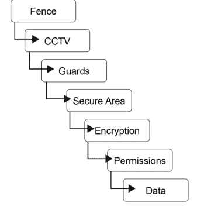
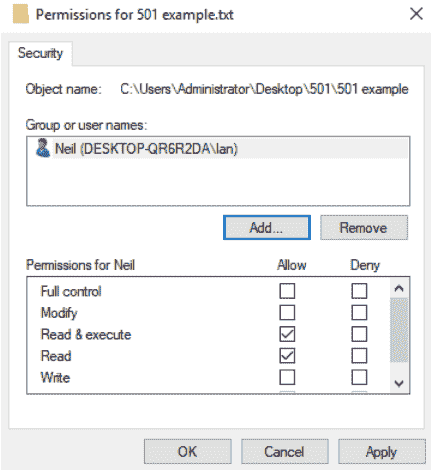
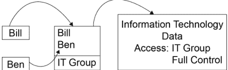
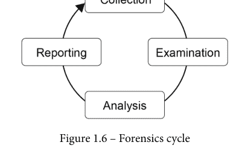
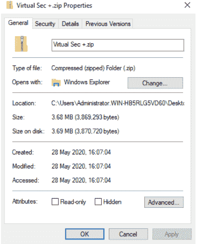

## 理解安全基础

在本章中，我们将研究一些安全基础知识，这些知识将帮助您识别系统中的安全威胁并缓解它们。随着网络犯罪日益增多，作为一名**信息技术（IT）**专业人士，首先理解这些基本概念至关重要。

在本章中，我们将涵盖以下主题：

- 安全基础
- 比较控制类型
- 物理安全控制
- 理解数字取证

让我们从了解安全基础开始。

- **完整性**：这意味着您知道数据未被更改或篡改。我们使用一种称为散列的技术，该技术将数据转换为称为散列或消息摘要的数值。当您怀疑发生更改时，您会将散列值与原始值进行比较。如果散列值已更改，则数据已被篡改。考试中涵盖的常见散列算法是**安全散列算法版本 1（SHA1）** 160 位和**消息摘要版本 5（MD5）** 128 位。SHA1 比 MD5 更安全；然而，MD5 更快。位数越高越安全，位数越低速度越快。
- **可用性**：可用性确保数据始终可用；一个例子是，如果您想购买一张机票，而系统返回错误消息说您无法购买。这可能会令人沮丧，因此，可用性很重要。可用性的示例包括**独立磁盘冗余阵列（RAID）**，它允许一个或两个磁盘发生故障，同时仍保持数据可用。另一个示例可能是故障转移群集。在这种情况下，两台服务器可以访问相同的数据，如果一台发生故障，另一台仍然可以提供数据、数据备份，或者调节关键服务器温度的**供暖、通风和空调（HVAC）**。在数据中心，如果温度过高，服务器将会关闭。

### 最小权限

**最小权限**是指只给某人执行其工作角色所需的最有限访问权限；这被称为*按需知情*原则。公司将制定最小权限策略，以便管理员知道如何管理它。

### 纵深防御模型

**纵深防御**是通过一系列保护层来保护公司数据的概念，这样如果一层失效，另一层已经到位以阻止攻击。我们从数据开始，然后对其进行加密以保护它：

- 数据存储在服务器上。
- 数据具有文件权限。
- 数据已加密。

- 数据存放在大楼的安全区域内。
- 大楼入口处有保安检查身份证明。
- 周边安装了闭路电视监控系统。
- 周边有一道高围栏。

让我们从入侵者的角度来看，尝试翻越围栏，看看他们需要绕过多少层防护：

图 1.2 – 纵深防御模型

现在让我们比较不同的控制类型。

### 比较控制类型

用于降低遭受攻击风险的安全控制措施种类繁多；三大类分别是管理性、操作性和技术性控制。我们将更详细地了解这些控制措施；你需要熟悉每一种控制措施以及它们各自的应用时机。让我们从三种主要控制措施开始。

#### 管理性控制

**管理性控制**由管理人员制定，用于创建组织政策和程序，以降低公司内部的风险。它们融入了监管框架，以确保公司合法合规。以下是管理性控制的示例：

- **年度风险评估：** 公司会有一份风险登记册，财务总监会查看所有与资金相关的风险，IT 经理会查看 IT 基础设施带来的所有风险。随着技术的变化和黑客手段的日益高明，风险可能会变得更大。每个部门都会识别自身的风险及风险处理方式，并将其放入风险登记册中。这些应每年审查一次。
- **渗透测试/漏洞扫描：** 漏洞扫描不具有侵入性，因为它只是检查漏洞；而渗透测试更具侵入性，因为它会深入计算机内部并可能利用漏洞。它可能导致系统意外崩溃。本书后面将进一步解释这些内容。

#### 操作性控制

操作性控制由公司人员在日常运营中执行。示例如下：

- **年度安全意识培训：** 这是一项年度活动，提醒你每天应该做些什么来确保公司安全：
  - *示例 1* – 一天工作结束时，你应该清理办公桌并将所有文件锁好。
  - *示例 2* – 员工和访客应始终佩戴身份徽章。如果没有佩戴，应受到质疑。
  - *示例 3* – 公司需要员工完成年度网络安全培训，因为风险日益增大。
- **变更管理：** 这是公司采用的一个流程，以确保所做的变更不会给公司带来任何安全风险。对一个部门的变更可能会影响另一个部门。**变更咨询委员会（CAB）** 协助确定变更的优先级；他们还会评估变更的财务收益，并可能为了公司的利益而接受或拒绝提议的变更。IT 发展迅速，我们的流程需要随之改变，以应对与新技术相关的潜在安全风险。
- **业务连续性计划：** 这是一种应急规划，通过识别任何可能导致公司无法维持运营的单点故障，在灾难发生时保持业务的持续运行。

#### 技术性控制

**技术性控制**是由 IT 团队实施的，用于降低业务风险的控制措施。

这些可能包括：

- **防火墙规则：** 防火墙通过 IP 地址、应用程序或协议阻止未经授权的网络访问。本书后面将深入介绍这些内容。
- **防病毒/防恶意软件：** 这是企业面临的最常见威胁，我们必须确保所有服务器和台式机都受到保护并保持最新状态。
- **屏幕保护程序：** 这些程序会在计算机空闲时将其注销，防止他人访问。
- **屏幕过滤器：** 这些过滤器可防止路过的人看到你屏幕上的数据。
- **入侵防御系统（IPS）/入侵检测系统（IDS）：** IDS 监控网络中的任何变化，IPS 则阻止攻击。如果你没有 IDS，IPS 也可以承担 IDS 的角色。这些内容将在*第 7 章*中更深入地介绍。

现在让我们看看其他控制类型，从威慑性控制到物理性控制，当我们试图从源头阻止攻击时。

#### 威慑性控制

**威慑性控制**可以是闭路电视和运动传感器。当有人走过建筑物时，运动传感器检测到他们，就会打开灯来威慑他们。一栋在显眼位置装有闭路电视摄像头并配有警告人们正在被录像的标志的建筑物，可能会起到威慑作用。

#### 检测性控制

**检测性控制**用于调查已经发生且需要调查的事件；这些可能包括：

- **闭路电视**记录事件发生的过程，从中你可以看到谁进入了某个房间，或者谁从建筑物后部的窗户爬了进来。闭路电视可以捕捉运动并提供不可否认性。
- **日志文件**是记录事件及其发生时间的文本文件；它们可以记录一段时间内的趋势和模式。例如，服务器、台式机和防火墙都有详细记录操作行为的事件日志。一旦你知道某个事件的时间和日期，就可以从各种日志文件中收集信息。这些日志可以存储在**一次写入多次读取（WORM）**驱动器中，以便可以读取但无法篡改。

#### 纠正性控制

**纠正性控制**是你从事件中恢复所采取的行动。你可能丢失了一个包含数据的硬盘；在这种情况下，你会从之前进行的备份中恢复数据。

**灭火系统**是另一种形式的纠正性控制。你的数据中心可能发生过火灾，摧毁了许多服务器，因此，当你购买替换服务器时，可能会安装氧气抑制系统，以切断火灾所需的氧气。这种方法使用氩气/氮气和二氧化碳来置换服务器机房中的氧气。

#### 补偿性控制

**补偿性控制**也可称为**替代性**或**辅助性控制**，可以在主要控制措施失效或不可用时替代使用。一旦主要控制措施失效，我们就需要辅助控制措施。这类似于你购物时身上有 100 美元现金——一旦现金花完，你就必须使用信用卡作为补偿性控制。

*示例：* 新员工入职时，应使用智能卡和 PIN 码登录。获得新智能卡可能需要 3–5 天，因此在等待期间，他们可以使用用户名和密码登录。

### 自主访问控制

**自主访问控制**类似于**新技术文件系统（NTFS）**文件权限，后者用于微软操作系统中。用户只被授予执行其工作所需的访问权限。它们有时被称为基于用户或以用户为中心。权限如下：

- **完全控制**：完全访问权限。
- **修改**：更改数据、读取、读取和执行。
- **读取和执行**：读取文件，如果文件内有程序则运行该程序。
- **列出文件夹内容**：展开文件夹以查看其中的子文件夹。
- **读取**：读取内容。
- **写入**：允许你写入该文件。
- **特殊权限**：允许精细访问；例如，它将上述每种权限进一步细分为更细的级别。
- **数据创建者/所有者**：创建非机密数据的人称为所有者，他们负责检查谁有权访问该数据。

下图显示了一个名为 *Ian* 的用户，他拥有**读取**和**读取和执行**权限：

图 1.3 – DAC 文件权限

### 基于规则的访问控制

在**基于规则的访问控制（RBAC）**中，规则应用于部门内的所有人，例如，承包商只能在上午8点至下午5点之间访问，而服务台人员只能访问他们工作所在的1号楼。它可以是基于时间的，也可以有某种限制，但适用于整个部门。

### 基于属性的访问控制

在**基于属性的访问控制（ABAC）**中，访问根据账户中的属性进行限制。约翰可能是高管，某些数据可能仅限具有高管属性的人访问。这是来自目录服务的用户属性，例如部门或位置。您可能希望为不同部门提供不同级别的控制。

### 基于组的访问控制

为了控制对数据的访问，可以将人员分组以简化访问。例如，如果有两个在IT部门工作的人需要访问IT数据。比方说，我们称他们为*比尔*和*本*。我们首先将他们放入IT组，然后授予该组对数据的访问权限：

图1.4 – 基于组的访问

另一个例子是，销售团队的成员可能通过基于组的访问完全控制销售数据，但您可能需要两名新员工只有读取权限。在这种情况下，您可以创建一个名为“新员工”的组，并仅授予该组内人员对数据的读取权限。

### 基于Linux的访问控制

在本节中，我们将研究Linux文件权限。尽管这些内容不在考试目标中，但它们经常出现在Security+考试中。

#### Linux文件权限（非SELinux）

Linux文件权限采用数字格式；**第一个数字**代表**所有者**，**第二个数字**代表**组**，**第三个数字**代表**所有其他**用户：

- a. 权限：
    - **所有者**：第一个数字
    - **组**：第二个数字
    - **所有其他用户**：第三个数字
- b. 数值：
    - **4**：读取
    - **2**：写入
    - **1**：执行

与Windows中用于执行应用程序的权限不同，Linux中的执行功能允许您查看或搜索。权限6表示读取和写入。值2表示写入，值7表示读取、写入和执行。一些示例如下：

- *示例1：如果我对文件A拥有764权限，则可以分解如下：*
    - a. **所有者**：读取、写入和执行
    - b. **组**：读取和写入
    - c. **所有其他用户**：读取

另一种设置权限的方式是使用字母值，如下所示：

- a. **R**：读取
- b. **W**：写入
- c. **X**：执行

使用字母值时，每组权限显示为三个破折号。三个实体的完全控制如下：

- a. **所有者完全控制**：rwx --- ---
- b. **组完全控制**：--- rwx ---
- c. **所有其他用户完全控制**：--- --- rwx

- *示例2：* 如果文件的访问级别为`rwx rwx rw-`，这意味着什么？
    - a. 所有者具有读取、写入和执行权限（完全控制）。
    - b. 组具有读取、写入和执行权限（完全控制）。
    - c. 所有其他用户只有读取和写入权限。

### 物理安全控制

物理安全控制旨在阻止未经授权访问公司或数据。物理安全控制很容易识别，因为您可以触摸到它们。让我们逐一了解。

#### 周边安全

在本节中，我们将了解不同类型的周边安全系统：

- **标识标牌：** 在任何人到达主入口之前，应有醒目的标牌警告他们正进入一个由武装警卫和警犬把守的安全区域。这用作威慑，以防止可能的入侵者。

- **围栏/大门：** 第一道防线应该是周边围栏，因为许多场所的开放性使其极易受到入侵者的攻击。可以通过使用由保安值守或配备感应读卡器的大门来控制场所的出入。您可以在建筑物前放置防撞柱，以防止汽车冲入入口。您甚至可能有不同的区域，例如研发部门，拥有自己的周边安全。

- **访问控制：** 大门口的武装警卫应检查进入者的身份。对于由内部部门担保的访客，应有一份访问控制列表。检查身份的警卫应位于单向钢化玻璃后面，以便访客无法看到门房内部。

- **访问控制前厅：** 进入建筑物的人打开一扇门进入一个空间（访问控制前厅），保安可以在允许其通过第二扇门进入场所之前确认他们的身份。

- **访客日志：** 基地或公司主入口的警卫会要求访客填写访客日志，然后提供某种形式的身份证明。

- **内部防护：** 您可以设置安全区域和安全围护结构；第一个例子是钢化玻璃容器或坚固的网罩，两者都带有锁以减少访问。您还可以采用受保护的布线分配系统；这看起来像金属杆，内部装有网络电缆。桌面上的屏幕过滤器可以防止他人读取屏幕内容。

- **导管：** 导管或布线分配系统将电缆置于内部。这可以保护电缆免受篡改或被啮齿动物啃咬。

> 提示
> 导管和布线分配系统保护从墙壁插座开始、穿过建筑物直至到达配线架的以太网电缆。

- **环境控制：** HVAC和灭火系统也属于安全控制。在数据中心或服务器机房中，需要保持温度凉爽，否则内部的服务器会过热并发生故障。他们使用一种称为冷热通道的技术来调节温度。

#### 设备保护

在本节中，我们将了解不同的设备保护系统：

- **线缆锁：** 这些锁用于笔记本电脑或平板电脑，以固定它们，防止被盗。

- **空气间隙：** 计算机脱离网络，没有有线或无线连接，以确保数据不被窃取。例如，研发部门的计算机，因为我们希望通过网络电缆防止对其访问。向空气间隙机器插入或移除数据的唯一方法是使用可移动介质（如USB驱动器）。

> 提示
> 空气间隙是一台隔离的计算机；提取数据的唯一方法是使用USB或CD ROM。

- **笔记本电脑保险箱：** 笔记本电脑和平板电脑价格昂贵，但它们保存的数据可能价值连城，因此有用于存放笔记本电脑和平板电脑的保险箱。

- **USB数据阻断器：** 该设备阻断USB设备上的数据引脚，从而防止黑客进行“果汁劫持”，即在公共区域充电时数据被窃取。

- **保险库：** 这是数据可以加密并存储在云中的地方，为您提供额外安全的存储区域。您可以在计算机上使用密码保险库来保护所有密码，但其安全性取决于保护它的主密码。

- **法拉第笼：** 这是一种金属结构，如用于养鸡的金属网。该笼子可防止无线或蜂窝电话在公司内部工作。这可以内置到用作安全区域的房间结构中。它们还可以防止任何形式的辐射从您的公司泄漏出去。

### 了解数字取证

警方在调查犯罪并需要寻找数字证据以确保定罪时，会使用数字取证。我们将研究基于计算机和网络的攻击。

2006年，NIST提出的取证流程19包含四个不同阶段：收集、检查、分析和报告。以下图表展示了这些阶段：

图1.6 – 取证周期

让我们逐一了解这些阶段：

- **收集：** 在此阶段，数据被检查，然后从其所在的介质中提取，并转换为可供取证工具检查的格式。
- **检查：** 在检查之前，数据将被哈希处理，然后使用相关的取证工具进行调查。检查结束后，数据将再次哈希，以确保检查人员或工具没有篡改数据。
- **分析：** 当所有取证数据收集完毕后，对其进行分析，然后转换为可用作证据的信息。
- **报告：** 编制一份报告，可用作物证以支持定罪。

提示
易失性顺序是指首先收集最易丢失的证据。在基于 Web 的攻击中，我们应该使用数据包嗅探器收集网络流量。

### 五分钟实操

打开计算机上的命令提示符，输入 netstat -an。现在你应该会看到监听端口和已建立的端口；数一数，并把数字记下来。运行 shutdown /r /t 0 命令立即重新启动计算机。重新登录后，打开命令提示符并运行 netstat -an；有什么不同？你会发现，你丢失了本可用作证据的信息。

### 证据收集

在本节中，我们将了解不同类型的证据收集：

- **电子发现**：在电子发现过程中，云服务提供商（CSP）可能会收到传票，以便我们能够收集、审查和解释位于硬盘、USB 驱动器和其他存储介质上的电子文档。
- **监管链**：监管链是数字取证中最关键的方面之一，确保证据已被收集且链条没有断裂。它从证据被收集、装袋、系紧并贴标签时开始，确保证据未被篡改。它列明了证据以及沿途经手人员。例如，在一次毒品突袭行动后，史密斯中士将 15 公斤非法物质交给了琼斯中士。然而，当它被交到物证室时，少了 1 公斤。在这种情况下，我们需要调查监管链。在这种情形下，琼斯中士应对损失负责。监管链的示例如下：

*示例 1 – 监管链文件缺失登记*：周一，系统管理员收集了 15 台笔记本电脑。第二天，系统管理员将它们交给了 IT 经理。周三，IT 总监将这 15 台笔记本电脑作为证据提交给法庭。法官查看监管链文件，发现 IT 经理和 IT 总监之间没有正式交接。由于缺少交接记录，法官希望调查监管链。

*示例 2 – 证据脱离侦探的保管*：联邦调查局逮捕了一名已知罪犯，收集了 43 块硬盘，并将它们装袋、贴标签，然后放入两个袋子中。他们逮捕了罪犯，乘飞机将他从亚利桑那州带到纽约。一名侦探与罪犯铐在一起，另一名侦探拎着两个袋子。

当他们到达值机柜台时，航空公司职员告诉他们，随身携带的行李超过了 8 公斤的限额，因此行李过重，需要托运。侦探照办了，但锁上了行李箱以防被盗。由于证据并非始终处于他们的实际保管之下，监管链就断裂了，因为航空公司工作人员有可能篡改证据。因此，他们无法向法庭证明证据的完整性始终未被破坏。

- **数据来源**：当监管链被正确执行，且提交给法庭的原始数据未被篡改时，就称为数据来源。

- **法律保留**：法律保留是保护可能用作证据的任何文档不被更改或销毁的过程。有时也称为诉讼保留。

*示例：* 死亡医生一直在给一家大医院里濒临死亡的患者开新药。一名审计员被派去调查是否存在违规行为，随后在审计之后，联邦调查局接到了通知。这位医生一直在与一家为试验提供药物的制药公司通信。联邦调查局不想惊动医生，于是让医院的 IT 团队将他的邮箱置于法律保留状态。当邮箱处于法律保留状态时，邮箱容量限制被取消；医生仍然可以收发电子邮件，但无法删除任何内容。这样，他就不会察觉到自己正在接受调查。

- **数据获取**：这是从设备（如 U 盘、相机和计算机）以及纸质数据（如信函和银行对账单）收集所有证据的过程。数据获取的第一步是收集易失性证据以确保其安全。数据必须装袋、贴标签并记录在证据日志中。

- **物证**：可以是日志文件、注册表配置单元、DNA、指纹或通常肉眼不可见的衣物纤维。

- **时间偏移**：当我们从计算机收集证据时，应记录时间偏移。这是区域时间，以便在跨国调查中，我们可以将它们按时间顺序排列——这称为时间归一化。

- **时间归一化**：这是指在多个时区收集证据后，使用一个共同时区（如 GMT）将其按有意义的顺序排列。

*示例：* 三个国家的警方试图确定数据在链条中的起始位置，以及随后经手数据的人。他们掌握以下关于数据首次创建时间的信息：

  a. **纽约**：创建于凌晨 3 点
  b. **伦敦**：创建于凌晨 4 点
  c. **柏林**：创建于凌晨 4 点 30 分

通过记录时间偏移，看起来数据似乎始于纽约，但如果应用时间归一化，当伦敦是凌晨 4 点时，纽约是前一天晚上 11 点，所以不可能是纽约。当柏林是凌晨 4 点 30 分时，伦敦才凌晨 3 点 30 分；因此，数据起源于柏林。在对数据收集的时间偏移应用时间归一化之前，这看起来是最有可能的。

- **时间戳**：每个文件都有时间戳，显示文件创建、最后修改和最后访问的时间：

图 1.7 – 时间戳

- **取证副本**：如果我们打算分析已获取的可移动设备上存储的数据，我们首先会制作一份取证副本，并保持原始数据完好无损。然后，我们将使用副本来分析数据，以保持原始数据不被更改，因为它需要以原始状态使用，并作为证据提交给法庭。在开始和结束时都会对数据进行哈希处理，以确认证据未被篡改。
- **捕获系统映像**：当警方从笔记本电脑和台式机中提取证据时，他们会获取完整的系统映像。原始映像保持完好，并对系统映像进行分析，以寻找任何犯罪活动的证据。系统映像将安装到另一台计算机上，并在开始和结束时进行哈希处理，以确认证据未被篡改。
- **固件**：固件有时被称为嵌入式软件，可能被攻击者进行逆向工程，因此我们必须将开发人员编写的源代码与当前使用的源代码进行比较。我们会聘请编码专家，使用一种称为回归测试的技术来比较这两类源代码。影响嵌入式软件的攻击类型可能包括根套件和后门。
- **快照**：如果证据来自虚拟机，则可以导出虚拟机快照以供调查。
- **截图**：你也可以截取桌面上的应用程序或病毒截图并将其作为证据。更好的方法是使用现代智能手机，它可以为证据添加地理标记。

> **提示**
> 你应该从笔记本电脑捕获系统映像，并从可移动驱动器制作取证副本。

- **计算哈希值**：当取证副本或系统映像被分析时，数据和应用程序会在调查开始时进行哈希处理。它可以用作校验和以确保完整性。最后，会再次进行哈希处理，并且应与原始哈希值匹配，以证明数据完整性。
- **网络流量和日志**：在调查基于 Web 或远程攻击时，我们应首先在停止攻击之前捕获易失性网络流量。这将帮助我们识别攻击源。此外，我们还应查看防火墙、NIPS、NIDS 以及任何相关服务器的不同日志文件。如果我们使用**安全信息事件管理（SIEM）**系统，这有助于整理这些条目，并对任何攻击提供清晰的视图。但是，如果病毒正在快速传播，我们会将其隔离。

*示例：* 贵公司采用三次尝试即锁定账户的策略。如果攻击者分别在三台不同的计算机上各尝试登录一次，每台计算机都不会将其识别为攻击，因为每台计算机只看到一次尝试，但 SIEM 系统会将这三次尝试识别为三次失败的登录，并实时提醒管理员。

> **提示：** 对于存在动态扩散型病毒的计算机，应立即将其移除，而不是收集网络流量。

- **视频捕获：** 闭路电视可以作为帮助识别攻击者及攻击发起时间的有效证据来源，这对抓捕嫌疑人至关重要。
- **访谈：** 警方也可能获取证人证言，以了解涉案人员情况，并可能使用照片拼图来协助抓捕。
- **保全：** 数据需要保持原始状态，以便在法庭上作为证据出示。因此我们会复制数据并分析副本，确保原始数据不被修改、保持原样。将最重要的证据副本放入 WORM 驱动器可以防止任何篡改，因为无法从 WORM 驱动器中删除数据。你也可以对存储驱动器进行写保护。
- **恢复：** 事件被清除后，我们可能需要从备份中恢复数据；更快的方法是使用热站，它已经运行且数据不超过 1 小时。如果原始硬件在事件中受损，我们可能还需要购买额外的硬件。
- **战略情报/反情报收集：** 这是不同政府之间交换网络犯罪分子数据的方式，以便合作降低威胁。遭受攻击的公司也可以尽可能多地记录信息，并请专业的第三方事件响应机构帮助其找到防止再次发生的方法。
- **主动日志记录：** 要跟踪事件，我们需要积极监控并主动记录日志文件中的模式变化或网络流量模式。安装提供实时监控的 SIEM 系统有助于汇总日志文件中的所有条目，确保不使用重复数据，从而获得真实全貌。可以在 SIEM 系统上设置基于特定触发器的警报，以便事件发生时立即通知我们。

### 云取证

在过去几年中，云计算和资源的使用量逐年增长。云取证与传统取证有着不同的需求。云服务提供商必须提供的一个主要方面是云中存储数据的安全性。

2012 年，Cloud Forensic Process 26 被创建，重点关注证据的有效性和可采性。其阶段如下：

- **阶段 A** – 确认云取证的目的。
- **阶段 B** – 确认云服务的类型。
- **阶段 C** – 确认云背后的技术类型。
- **阶段 D** – 确认用户角色，并与**云服务提供商（CSP）**协商，收集所需证据。

云服务由于其业务性质，会定期创建虚拟机然后销毁它们，这阻碍了取证证据的收集。取证团队需要向云提供商证明其收集证据的理由，并且必须依赖云提供商发送他们所需的正确证据。

#### 审计权条款

通过在供应链合同中插入审计权条款，审计员可以在不事先通知的情况下访问现场，检查承包商的账簿和记录，以确保承包商履行其合同义务。这将有助于识别以下问题：

- 商品有缺陷或质量低劣
- 货物短缺
- 货物未交付
- 回扣
- 向公司员工提供礼品和酬金
- 向经纪人和其他人支付佣金
- 声称已提供但并非需要的服务，如设备维修

### 法规与管辖权

云数据应存储在区域内，并具有数据主权。美国因联邦调查局在强制微软交出存储在爱尔兰的数据时遇到问题，于 2018 年出台了《CLOUD 法案》。2019 年，英国通过了《2019 年犯罪（海外生产令）法案》（COPOA），允许英国在刑事调查中获取存储在海外数据。2019 年，美英签署了一项数据共享协议，使两国执法机构能更快访问提供商（如社交媒体或网站托管）持有的证据。2016 年，美国和欧盟之间也签署了类似协议；然而，随着《通用数据保护条例》（GDPR）的出台，所有拥有欧盟消费者的美国网站都必须遵守 GDPR。

### 数据泄露通知/法律

如果发生数据泄露，公司可能因未能报告泄露而面临超过 1000 万英镑的罚款。欧盟使用 GDPR，数据泄露通知必须在 72 小时内报告。其他国家有自己的报告时限。

### 复习题

现在是时候检验你的知识了。回答这些问题，并在书末的“解决方案”部分对照答案：

1. CIA 三元组的三个组成部分是什么？
2. 为什么可能会在建筑物的外墙放置一台未启用的闭路电视摄像机？
3. 机密性是什么意思？
4. 如何控制人员对数据中心的访问？
5. 气隙的目的是什么？
6. 说出三大类控制措施。
7. 说出三种物理控制措施。
8. 事件发生后，在研究事件发生原因时会使用哪种类型的控制措施？
9. 如何知道数据的完整性是否完好？
10. 什么是纠正性控制措施？
11. 当你更改防火墙规则时，这属于哪种类型的控制措施？
12. 与 PIN 配合用于登录系统的是什么？
