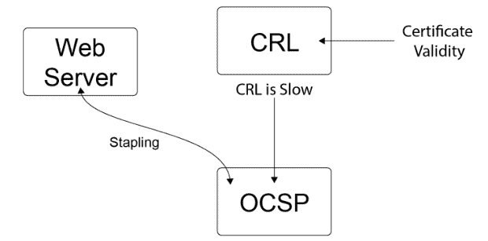
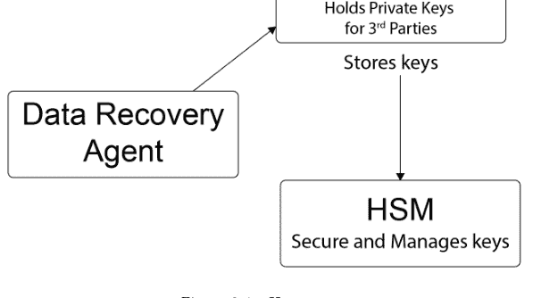
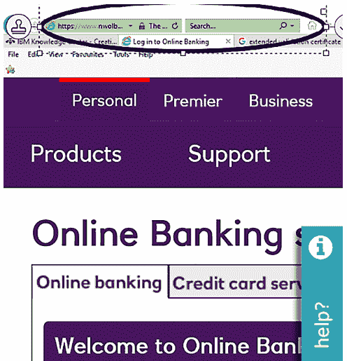
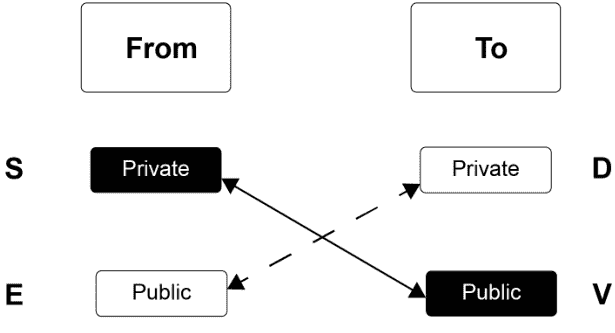
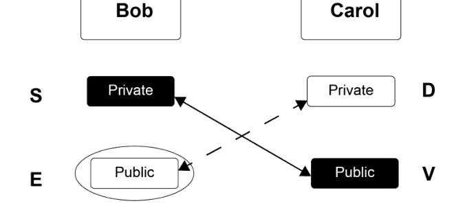
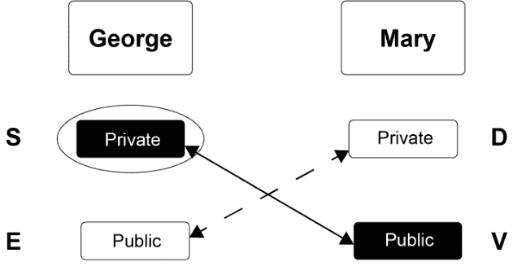
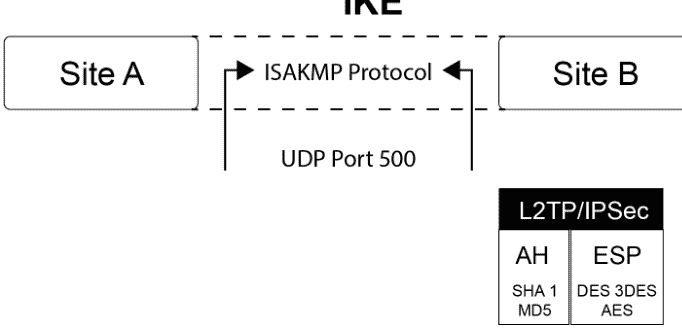
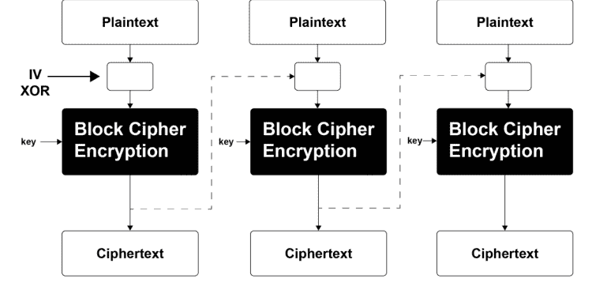
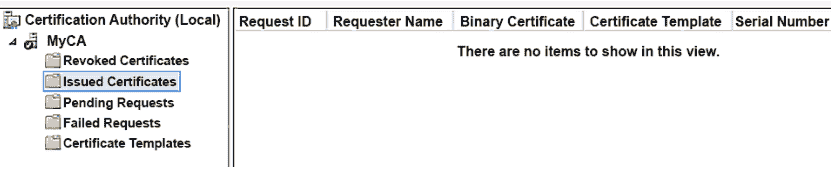

## 2 实施公钥基础设施

**公钥基础设施（PKI）** 是一种非对称加密，包含证书颁发机构以及支持颁发和管理证书的相关基础设施。证书既用于加密也用于认证，在本章中，我们将研究不同的加密类型以及证书的颁发和使用方式。这是学生最难理解的模块，因此我们着重将最难的部分变得简单易懂。如果你想在 Security+ 考试中取得成功，你必须彻底掌握本模块。

在本章中，我们将涉及以下主题：

- 公钥基础设施概念
- 非对称和对称加密
- 密码学算法及其特征
- 比较和对比密码学的基本概念

### 证书有效性

每次使用证书时，首先要做的必须是检查其有效性。下图显示了证书有效性验证过程：

图 2.3 – 证书有效性

有三个独立的流程你必须彻底掌握，如下所示：

- **证书吊销列表（CRL）：** 这是检查证书是否有效的第一阶段。如果证书无效，它将被输入 CRL。如果 X.509 证书在 CRL 中，则它不再有效，将不被接受。无论考试中的问题多么冷门，除非验证速度变慢或你正在寻找更快的查找方式，否则提供证书有效性的都是 CRL。无论何种场景，CRL 都是默认方式。
- **在线证书状态协议（OCSP）：** 只有在 CRL 变慢时，OCSP 才会发挥作用。它比 CRL 快得多，并且可以在非常繁忙的环境中减轻 CRL 的负载。
- **OCSP 装订/证书装订：** 证书装订，也称为 OCSP 装订，用于 Web 服务器绕过 CRL、使用 OCSP 来更快验证证书的情况。

> **提示：** 证书有效性只能通过 CRL 或 OCSP 验证。CRL 是默认方式，当需要更快验证时使用 OCSP。

### 证书管理概念

我们现在将探讨 PKI 环境中证书管理的不同方式，从请求新证书开始，到不同的证书格式结束。你必须彻底学习这些信息，因为这些方面在考试中会被重点考察：

- **证书签名请求 (CSR)**：这是请求新证书的过程。

- **密钥托管**：密钥托管为第三方保存私钥并将其存储在**硬件安全模块 (HSM)** 中，硬件安全模块是一种可以存储数字密钥的设备。它可能简单到一个外部硬盘：

图 2.4 – 密钥托管

- **硬件安全模块 (HSM)**：HSM 可以是连接到服务器的硬件设备，也可以是用于存储密钥的便携式设备。有关更多信息，请参阅前面的图表。

- **数据恢复代理 (DRA)**：如果用户因私钥损坏而无法访问其数据，DRA 将恢复数据。DRA 需要从密钥托管中获取私钥的副本。

- **证书**：主要有两种证书类型：*公钥* 和 *私钥*。公钥发送给第三方以加密数据，私钥解密数据。如果你把私钥想成你的银行卡，那就是你不会给出去的东西。公钥是与你的账户绑定的存款单。如果你在一个有 20 个人想往你的账户存入 20 美元的房间里，你会把存款单给他们。你总是会把公钥分发出去，因为当人们向你发送加密数据时，他们使用的是你的公钥进行加密。你总是使用收件人的公钥来加密数据。

> **提示**
> **数据恢复代理 (DRA)** 需要从密钥托管中获取私钥来恢复数据。

- **对象标识符 (OID)**：证书上的 OID 类似于银行券上的序列号。银行券通过其序列号来识别。证书通过其 OID 来识别。

- **证书格式**：有不同的证书格式（也称为 PKCS），如下所示：

| 证书类型 | 格式 | 文件扩展名 |
|---|---|---|
| 私钥 | P12 | .pfx |
| 公钥 | P7B | .cer |
| PEM | Base64 格式 | .pem |
| DER | PEM 的扩展 | .der |

图 2.5 – 证书格式和文件扩展名

### 证书类型

作为一名安全专业人员，你将负责购买新证书，因此，你必须彻底学习证书类型，以确保做出正确的采购。我们将从自签名证书开始，该证书可以与 Microsoft Exchange Server 或 Skype 等应用程序一起推出，并以扩展验证结束，扩展验证的证书具有较高的信任度：

- **自签名证书：** 自签名证书由使用它的同一实体签发。但是，它没有 CRL，无法验证或信任。它是内部证书最便宜的形式，可以放置在多个服务器上。
- **通配符：** 对于名为 `securityplus.training` 的域的通配符证书，通配符认证将为 `*.securityplus.training`，可用于该域和子域。例如，在 `securityplus.training` 域中，有两个名为 `web` 和 `mail` 的服务器。通配符认证为 `*.securityplus.training`，安装后，它将适用于这两个服务器的**完全限定域名 (FQDN)**——`web.securityplus.training` 和 `mail.securityplus.training`。通配符可用于同一域中的多个服务器。如果你想在一个证书上使用，例如面向公众的 Web 服务器，那么通配符是最便宜的选择。
- **域名验证：** **域名验证 (DV)** 证书是 X.509 证书，证明域名所有权。
- **主题备用名称 (SAN)：** SAN 证书可用于多个域名，例如 `abc.com` 或 `xyz.com`。你还可以将其他信息插入 SAN 证书中，例如 IP 地址。
- **代码签名：** 代码签名证书用于数字签名软件，以保证其真实性。
- **计算机/机器：** 计算机或机器证书用于在域内识别计算机。
- **用户：** 用户证书为用户使用的应用程序提供真实性。
- **扩展验证**：扩展验证证书在识别使用证书的实体方面提供更高的信任度。它通常用于金融领域。你可能在操作中见过它，URL 的背景会变成绿色，如以下屏幕截图所示：

图 2.6 – 扩展验证

申请扩展验证证书的公司需要提供有关公司的更详细信息。

> **提示**
> 通配符证书可以安装在多个面向公众的网站上作为更便宜的选择。自签名证书可以安装在面向内部的网站上作为更便宜的选择。

### 非对称和对称加密

使用证书的加密主要有两种类型：非对称和对称。我们需要彻底了解每一种。让我们先了解加密是什么，请记住，你是将明文更改为密文，以便信息无法被外部机构读取。

#### 加密解释

加密是我们将可以轻松阅读的明文转换为无法轻松阅读的密文，让我们看一些不同类型的加密。

- **替换密码**：公元前 44 年去世的 Julius Caesar 发明了第一个替换密码，他将字母表中的每个字母移动三个位置，一种或另一种方式。这样，他就可以使他的军事计划在被拦截时无法阅读。他忘记的是，当时大多数人根本不识字！这被称为 ROT 13，以十三字母旋转命名，现在被称为凯撒密码。例如，如果你取单词 ECHO 并将每个字母在字母序列中向右移动十三个位置，你将得到单词 RPUB——这对某人来说很难阅读。要解密，你需要回滚 13 个空格。

- **ROT 13**：ROT 13 是凯撒密码的一种变体。由于字母表中有 26 个字母，我们将字母旋转 13 次。ROT 13 的密钥如下：

| 字母 | A | B | C | D | E | F | G | H | I | J | K | L | M | N | O | P | Q | R | S | T | U | V | W | X | Y | Z |
| ROT 13 | N | O | P | Q | R | S | T | U | V | W | X | Y | Z | A | B | C | D | E | F | G | H | I | J | K | L | M |

图 2.7 – 凯撒密码 ROT 13 表

当收到消息 GVZR SBE GRN 时，我们将应用 ROT 13，但为了破译，我们不是向前移动 13 个位置，而是简单地向后移动 13 个位置，消息将变为 TIME FOR TEA。从前面的表中，选择顶部的一个字母，然后选择下面的相应 ROT 13 等价物，用于加密和解密。

有两种使用证书的加密类型：非对称和对称。让我们依次查看每一种：

- **对称加密**：对称加密仅使用一个密钥，被称为密钥。相同的密钥加密和解密数据。对称加密的危险在于，如果密钥被盗，攻击者就获得了王国的钥匙。使用对称加密的主要原因是它可以非常快速地加密大量数据。Security+ 考试不侧重于密钥交换，因为它只使用一个密钥，而是侧重于哪种对称密钥最快或最强，以及哪种用于加密大量数据。对称加密为 DES 56 位、3DES 168 位、AES 256 位、Twofish 128 位和 Blowfish 64 位。密钥越小，速度越快，但密钥越大，安全性越高。它还使用分组密码，其中数据以块传输，使其更快。考试可能会问哪种加密使用一个密钥，它将是对称加密之一，或者他们可能会问哪一个密钥最小，那就是 DES。如果他们问哪一个密钥最大，那就是 AES，可高达 256 位。

- **Diffie Hellman (DH)**：当对称数据在传输中时，它由 Diffie Hellman 保护，其主要目的是为对称数据通过创建一个安全隧道。它不加密数据，但创建了一个安全隧道。

- **非对称加密**：非对称加密使用两个密钥；私钥和公钥。如果你把私钥想成你的银行卡，你会保留它，永远不会给出去。如果你把公钥想成存款单，你会把它给任何人，只要他们往你的账户付款。如果你必须在远程服务器上安装一个密钥，它将始终是公钥，因为私钥始终保留。当你看到公钥基础设施 (PKI) 这个词时，它是非对称加密，完整的 CA 和中间机构。Security+ 考试非常彻底地测试私钥和公钥的使用。我创建了下面的图表来帮助你理解每个密钥的用途。请参阅下图 2.8。

加密的第一阶段是密钥交换。你始终保留自己的私钥，并将公钥分发给他人。加密时，你始终使用接收方的公钥：

图 2.8 – 密钥交换

在上图中，有两对不同的密钥对：黑色密钥对和白色密钥对。它们协同工作。记住：私钥是你的银行卡；你始终保留它，而公钥是你的存款单；你将其分发出去，以便人们可以向你的账户付款。发送数据的一方位于 **From（发件人）** 一侧，接收数据的一方位于 **To（收件人）** 一侧。记住这些标签的一个好方法是把左侧想象成 South-East（东南），把右侧想象成 Distinguished-Visitor（贵宾）。这些标签代表以下含义：

- **S**：签名（数字签名）
- **E**：加密
- **D**：解密
- **V**：验证

例如，Bob 想要加密数据并发送给 Carol。这是如何完成的？让我们看下面的图。我们可以看到 Bob 拥有黑色密钥对，Carol 拥有白色密钥对。在加密发生之前，首先要做的是交换公钥：

图 2.9 – 加密

在 Bob 一栏下，你可以看到他有自己的私钥（他将始终保留），以及 Carol 给他的公钥。在上图中，你可以看到标签 E，代表加密。因此，Bob 使用 Carol 的公钥加密数据。然后，在 Carol 一栏下，你可以看到字母 D，代表解密。因此，当加密数据到达时，Carol 使用白色密钥对的另一半，即私钥，来解密数据。

> **提示**
>
> 你的私钥，或者说密钥对，绝不会安装在另一台服务器上。你始终像保管银行卡一样保留私钥。你将公钥分发出去，或将其安装在另一台服务器上。

### 数字签名详解

当我们向某人发送电子邮件或文档时，它可能会在传输过程中被截获和篡改。你的电子邮件地址可能被伪造，有人可能以你的名义发送电子邮件，但无法保证完整性。我们使用自己的私钥对电子邮件或文档签名，并由我们的公钥进行验证。

数字签名的第一阶段是交换公钥，这与加密的原理相同。例如，George 想给 Mary 发送一封电子邮件，并希望确保它在传输过程中未被篡改：

图 2.10 – 数字签名

在*图 2.10*中，你可以看到 George 在向 Mary 发送电子邮件时将使用自己的私钥签名，然后 Mary 使用 George 已经给她的公钥进行验证。当电子邮件通过验证后，她就知道该电子邮件未被篡改。它可能被读取，但不会被篡改。

当人们被要求签署合同时，有时会使用第三方提供商，要求他们对合同进行数字签名。由于数字签名证明了签署人的身份，因此合同有效。

然后是抗抵赖性。当我完成数字签名时，我使用的是自己的私钥（我绝不应泄露）来签署电子邮件或文档，以证明它来自我。抗抵赖意味着我不能否认文档是我签署的。我不能说是别人做的。公元 6 世纪早期，亚瑟王会在羊皮纸卷轴上给骑士们发送消息，然后在卷轴上盖上自己的蜡封印章以证明消息来自他。现代生活中的数字签名也在做同样的事情；它证明消息来自谁。数字签名会对整个文档生成一个单向哈希，因此它也提供类似于哈希的完整性。

> **提示**
>
> 加密使用接收方的公钥，而数字签名使用发送方的私钥。

### 密码学算法及其特性

如果我们审视对称密钥和非对称密钥，它们使用的密码算法带有若干比特位——比特数越低，速度越快；比特数越高，强度越高、越安全。

例如，有两个人要完成一项挑战——他们是尤塞恩·博尔特，代表 DES，一种 56 位密钥；还有身穿盔甲的亚瑟王，代表 4,096 位的 RSA。挑战的第一部分是 100 米短跑，尤塞恩·博尔特获胜，而亚瑟王因盔甲的重量落后 90 米。第二部分是拳击比赛，尤塞恩不断击打亚瑟王，但亚瑟王在盔甲的保护下一直发笑。然后，亚瑟王出其不意地一拳击倒了尤塞恩。由于这项挑战是为慈善而举办，结果是平局，所以两人都很开心。

#### 对称算法

针对 Security+ 考试，你必须了解每种对称算法的特性，包括使用时机和密钥长度。让我们逐一了解这些特性：

- **高级加密标准（AES）：** AES 有三种密钥强度：128 位、192 位和 256 位。AES 常用于 L2TP/IPSec VPN。
- **数据加密标准（DES）：** DES 将数据分成 64 位块，但就考试而言，它被视为一种 56 位密钥，是对称算法中最快但最弱的。它可用于 L2TP/IPSec VPN，但弱于 AES。
- **三重 DES（3DES）：** 3DES 对 DES 密钥应用三次，据称是 168 位密钥。它可用于 L2TP/IPSec VPN，但弱于 AES。
- **Rivest Cipher 4（RC4）：** RC4 为 40 位，被 WEP 使用，被视为流密码。
- **Blowfish 和 Twofish：** Blowfish 是 64 位密钥，Twofish 是 128 位密钥，两者最初均为嵌入式系统的加密而设计。它们名称相似，如何记住哪个更快？很简单。我有一个池塘，里面有鱼，我和一个名叫汤姆的人比赛。我需要从池塘里抓到两条鱼，而他只需要向空中吹气。猜怎么着？他每次都赢。因此记住：Blowfish 比 Twofish 快。

#### 非对称算法

非对称算法使用 PKI 环境，因为它们使用两个密钥：私钥和公钥。现在让我们看看不同的非对称技术。

**Diffie-Hellman (DH)** 不加密数据。其主要目的是创建安全会话，以便对称加密数据可以在此会话中传输。DH 握手如下图所示：

图 2.11 – DH 握手

DH 创建用于**互联网密钥交换（IKE）**的密钥；它使用 UDP 端口 500 为 L2TP/IPSec VPN 建立安全会话。一旦安全隧道创建完成，对称加密数据便在该隧道中流动。

- **Rivest、Shamir 和 Adleman (RSA)：** RSA 以发明该算法的三位人士命名。这些密钥是最早的私钥和公钥对，长度从 1,024、2,048、3,072 和 4,096 位起。它们用于加密和数字签名。
- **数字签名算法 (DSA)：** DSA 密钥用于数字签名；长度从 512 位起，但其 1024 位和 2048 位密钥在进行数字签名时比 RSA 更快。
- **椭圆曲线密码学 (ECC)：** ECC 的密钥小巧且快速，用于小型移动设备中的加密。然而，AES-256 用于军用移动电话。它比其他加密方式的处理开销更少。
- **临时密钥：** 临时密钥是短生命周期密钥。它们用于单个会话，共有两种：
  - a. **Diffie-Hellman 临时密钥 (DHE)**
  - b. **椭圆曲线 Diffie-Hellman 临时密钥 (ECDHE)**
- **良好隐私 (PGP)：** PGP 用于两个用户之间建立非对称加密和数字签名。要使用 PGP，你需要一对私钥和公钥。使用 PGP 的第一阶段是交换密钥。
- **GnuPG：** GnuPG 是 OpenPGP 的免费版本；它也被称为 PGP。

> **提示**
>
> PGP 用于两个人之间的加密。S/MIME 用于两个人之间的数字签名。

### 对称与非对称的类比

如果我们将加密想象成打乒乓球，每个人都只有一只球拍，节奏极快，这类似于对称加密，因为它只使用一个密钥。然后，如果我们改变规则，给每位球员两只球拍，第一只球拍用来停球，第二只球拍用来回球，这样速度就会慢得多。加密也是如此；非对称加密更加安全，因为它有两个密钥，并使用 DH 这种非对称技术为对称数据建立安全隧道。对称加密使用分组密码，加密大块数据的速度远快于非对称技术。

### 轻量级密码学

随着新技术的出现，对标准化轻量级密码学的需求也应运而生。NIST 目前正寻求实现这一目标。目前在 CompTIA Security+ 考试中，我们将 ECC 用作小型设备的低功耗加密；唯一的例外是军用设备使用 AES-256。请阅读以下 URL 处关于轻量级密码学的 NIST 文章：https://csrc.nist.gov/projects/lightweight-cryptography

### 密码加盐

加盐是一种在密码哈希之前向其附加随机字符的技术。这会使密码更长；它类似于密钥拉伸（key stretching），并增加了暴力破解攻击所需的计算时间。

### 密码模式

密码模式有多种；大多数对称密钥使用块密码（block cipher），并且比非对称加密更快地加密大量数据。让我们逐一来看：

- **流密码：** 流密码是一种加密文本（以生成密文）的方法，其中加密密钥和算法一次一位地应用于数据流中的每个二进制位。它通常用于非对称加密。
- **块密码：** 块密码是先取一块数据然后进行加密；例如，一次可以加密 128 位数据。这是当今使用的方法，因为它比流密码快得多。除 RC4 外，对称加密都使用块密码。

### 流密码与块密码类比

我们有两个由四人组成的团队，任务是从一辆满载五吨彩虹糖的卡车上卸货，并将它们放到建筑物底层的一个房间里。

彩虹糖有盒装的，也有散装的。其中一个团队负责散装彩虹糖，需要将其装袋；另一辆卡车则装载盒装彩虹糖。显然，负责盒装彩虹糖的团队会获胜。流密码就像装袋彩虹糖，而块密码则像盒装彩虹糖。

### 操作模式

操作模式是密码实现加密的方式。让我们看看不同的模式：

- **初始化向量（IV）：** 这是一个用于数据加密的随机值，用作秘密密钥。这个数字（也称为**一次性随机数**）在任何会话中仅使用一次。IV 的长度通常与加密密钥或所用密码块的长度相当。有时，它也被称为起始变量。
- **密码块链接（CBC）：** CBC 将异或（XOR）运算添加到每个明文块，使用的密钥来自先前生成的密文块。第一个明文块有一个 IV，你先对其进行 XOR，然后加密该明文块。请参考以下图示：

图 2.13 – 密码块链接

在加密下一个明文块之前，需要将其与上一个加密块进行 XOR 运算。解密一个密文块时，你需要来自前一个密文块的 XOR 值。如果缺少任何块，则无法进行解密。

- **电子密码本（ECB）：** ECB 用密文块替换每个明文块。相同的明文将产生相同的密文。每个块与其他块相互独立。CBC 要安全得多。
- **伽罗瓦/计数器模式（GCM）：** 这是一种块密码操作模式，它使用二进制伽罗瓦域上的通用哈希来提供认证加密。它可以在硬件和软件中实现，以低成本、低延迟实现高速。
- **计数器模式（CTR）：** CTR 将块密码转换为流密码。它通过加密计数器连续值而非 IV 来生成下一个密钥流块。

> 提示
> 流密码一次加密一位

### 量子计算

传统计算机芯片使用比特存储数据，比特开启时值为 1，关闭时值为 0。量子计算使用量子比特，它们可以同时处于开启或关闭状态，或介于两者之间的某个状态。这被称为**叠加态**。

传统计算机要找到从 A 到 B 的路径，在任何时刻只能尝试一条路径，直到找到路径；而量子计算可以同时尝试所有路径。量子计算将使破解加密的速度大大加快。目前，谷歌已经制造了一台拥有 53 个量子比特的量子计算机，名为“悬铃木”（Sycamore），它在几分钟内完成了早期超级计算机需要 1 万年才能完成的计算。后量子计算时代可能会看到一台拥有大量量子比特的非常强大的计算机，利用秀尔算法（Shor's algorithm）来破解 PKI 技术。

### 区块链与公共账本

区块链最初是支撑比特币的技术，但其应用范围远不止于此。它是一个交易数字账本，数据以称为区块的批次存储，并分发到许多计算机。因此，如果你想篡改区块链，那是不可能的，因为你必须更改每台持有副本的计算机上的数据。正如人们所说，人多力量大。

区块链可用于存储金融、医疗或土地出售交易。这些数据与一个数据块链在一起，该数据块既包含该块的哈希，也包含前一个块的哈希。要在链上创建一个新区块，希望添加该区块的计算机需要解决一个密码学难题，并将解决方案发送给参与该区块链的其他计算机。这就是所谓的工作量证明。一旦网络上这些计算机验证通过，新区块就会被添加到链的末尾。如果链中的数据被修改，则会添加一个包含更改的新区块，并引用被修改的区块。由于数据由许多计算机保存，因此不可能进行欺诈交易，因为副本保存在多个地方。

区块链不使用银行和金融机构等中介。因此，当某人提供区块链中的数据时，该数据被认为是准确且可信的。例如，兄妹俩在一位亲属的遗嘱中获得了一栋房子，他们想确保自己是合法所有者。他们可以从房屋购买时起追踪区块链中的每笔交易，以及房屋被买卖的次数，以证明他们是合法所有者。

### 哈希与数据完整性

**哈希**是指使用算法对文档内部的数据进行哈希处理，例如**安全哈希算法版本 1（SHA1）**、SHA2、SHA3 和 MD5。这将文件内部的数据转换为一个长文本字符串，称为哈希值；这也被称为消息摘要。

当你对相同数据进行哈希时，如果你复制一个文件，因此有两个包含相同数据的文件，然后用相同的哈希算法对它们进行哈希，则总是会产生相同的哈希值。让我们看看以下关于哈希和数据完整性的示例：

- **验证完整性：** 在取证分析中，科学家在调查前先取一份数据副本。为了确保在调查期间没有篡改数据，他们会在开始前对数据进行哈希，然后在结束时将哈希与数据进行比较。如果哈希匹配，他们就知道数据的完整性未受影响。
- **单向函数：** 对于考试来说，哈希是一种单向函数，无法逆转。
- **数字签名：** 数字签名用于验证电子邮件的完整性，以便您知道它在传输过程中未被篡改。用于签署电子邮件的私有证书会创建一个单向哈希函数，当邮件到达目的地时，收件人已被给予一个公钥来验证其在传输过程中未被篡改。本书后面的内容会更深入地介绍这一点。
- **RIPEMD：** 这是一种 128 位哈希函数。RIPEMD 已被 RIPEMD-160、RIPEMD-256 和 RIPEMD-320 取代。对于考试，你需要知道它可以用于哈希数据。

### 密码学基本概念的比较与对照

在本节中，我们将概述密码学不同方面的用途。

#### 非对称 – PKI

非对称密钥从 CA 获取。如果你与外部实体销售产品或服务，那么你需要从公共 CA 获取 X509 证书；否则，你的内部证书将不被接受。

### 非对称 – 弱／已弃用的算法

SSL 现在应被弃用，因为它很弱；一个典型的攻击示例是 POODLE 攻击，这是一种利用 SSL 3.0 使用 CBC 模式的漏洞进行中间人攻击的方式。非对称算法不应使用强度为 2048 位或更低长度的密钥。然而，SSL VPN 是唯一使用 SSL 证书并可与旧客户端兼容的 VPN。

### 非对称 – 临时密钥

临时密钥是仅用于一次性会话的短生命周期密钥。临时密钥有两种类型：临时 Diffie-Hellman（DHE）和临时椭圆曲线 Diffie-Hellman（ECDHE）。其他用于非对称和对称加密的密钥则被称为静态密钥，因为它们的生命周期约为两年。

### 对称算法 – 工作模式

分组密码模式根据密钥将数据分成数据块，并对这些数据块进行加密——这使得大量数据的加密速度大大加快。

在 L2TP/IPSec VPN 隧道中，我们可以选择三种不同版本的对称加密。最弱的是 DES，其密钥长度为 56 位；其次是 3DES，密钥长度为 168 位。最安全的是 AES，其密钥长度可从 128 位到 256 位。请记住，对称加密只有一个密钥。它对于加密大量数据的速度要快得多，但在使用之前，需要借助非对称技术 DH 来创建一条安全隧道。

### 对称加密 – 流密码与分组密码

对称加密使用分组密码，即对数据块进行加密。密钥长度决定了数据块的大小。例如，如果使用 DES，那么只能加密 56 位的数据块；而 AES 可以加密多达 256 位的数据块。

非对称加密一次加密一位。因此，它比对称加密更慢，但也更安全，因为它使用更大的密钥长度，并且使用两个密钥：公钥和私钥。

### 对称加密 – 混淆

混淆通过将输入数据通过由对称加密的保密算法密钥创建的非线性表进行处理，从而大幅改变输入到输出的映射关系。

保密密钥是在对称加密中用于加密和解密消息的信息片段。

### 碰撞

如果使用相同的哈希算法对相同的数据或密码进行哈希处理，那么总会得到相同的哈希值。哈希通常用于存储密码或对文档进行数字签名。碰撞攻击是指攻击者试图匹配哈希值；如果哈希值匹配成功，则称为碰撞，这可能会导致系统受到危害。

### 隐写术

隐写术是指将一个文档、图像、音频文件或视频文件隐藏在另一个文档、图像、音频文件或视频文件中。被隐藏后的文档、图像或文件体积会变大，并且图像的分辨率会明显降低。

### 同态加密

同态加密允许会计师在数据仍处于加密状态时对其进行计算，并且可以用于存储在云中的数据。

### 扩散

扩散是一种技术：当你改变输入中的一个字符时，输出的多个位都会发生变化。

### 实现决策

在当今世界中，安全管理员需要审视公司的运营方式，以确保其更加安全。他们是否想要实施智能卡用于多因素认证？他们是否想要实施 VPN，以便远程用户能够安全地连接到公司？他们是否需要实施 DLP 模板，以确保敏感数据不能通过电子邮件从公司发出？

一旦确定了公司的愿景，安全团队就需要研究他们所需的算法。通常情况下，应该选择尽可能最强的算法。但是，我们需要确保服务器拥有足够的处理能力来应对任何密钥长度的增加。我们不应使用少于 2,048 位的密钥，因为这太不安全了。

### 密码学的常见使用场景

在 Security+ 考试中，“使用场景”仅仅指某种技术被使用的情形示例。我们现在来看一下不同密码技术被使用的示例。

#### 支持机密性

公司的数据无法用价格衡量，而这些数据的泄露可能会给公司带来严重危险。如果你的竞争对手窃取了你的机密，他们可能会抢先进入市场，而你则得不到应得的回报。为了防止数据被访问，我们会加密数据以阻止其被查看，并防止任何协议分析器读取数据包。当人们从远程位置访问公司网络时，他们应使用 L2TP/IPSec VPN 隧道，并采用 AES 作为加密方法，以在互联网上建立安全隧道，防止中间人攻击。加密可以与强制访问控制相结合，以确保数据安全并保持机密性。

#### 支持完整性

确保完整性有两个主要原因。第一个原因是，对存储在文件服务器上的数据进行哈希处理，以便我们能够证明数据是否被篡改。这也适用于警方扣押的笔记本电脑的法证检查——法证科学家可以在检查前对数据进行哈希处理，然后在检查结束时重新哈希，以证明他们没有篡改数据。哈希值应当匹配。另一种证明完整性的方法是使用你的私钥对电子邮件进行数字签名，以向收件人证明该邮件在传输过程中未被篡改。在此之前，你需要先将公钥发送给对方以验证邮件。这证明了电子邮件保持了其完整性，并且在传输过程中未被篡改。

#### 支持不可否认性

当你使用私钥对电子邮件进行数字签名时，你无法否认这是你发送的，因为私钥只有一个；这就是所谓的不可否认性。当两个独立方决定共同进行商业交易时，他们可能会使用第三方创建数字合同，但双方需要登录到合同存储的位置。一旦他们进行数字签名，合同就具有法律约束力。

#### 支持混淆

当公司存储其源代码时，他们会使用混淆技术使其晦涩难懂，以便任何窃取者都无法阅读。这也被称为“通过隐藏实现安全”，即你希望阻止第三方了解你的 IT 系统并识别系统中的任何弱点。混淆技术可以掩盖数据，我们可以使用 ROT13、XOR 或隐写术来混淆数据。

### 实践练习 1 – 构建证书服务器

要构建证书服务器，请执行以下步骤：

- 1. 登录到你的 2012/2016 域控制器，打开**服务器管理器**。

- 2. 选择**管理**，然后选择**添加角色和功能**。然后点击**下一步**三次。

- 3. 在**选择服务器角色**页面中，勾选顶部复选框**Active Directory 证书服务**。选择**添加功能**按钮。点击**下一步**三次。勾选 **CA** 复选框，然后点击**下一步**，再点击**安装**。这将需要几分钟时间。完成后，按**关闭**。

- 4. 在**服务器管理器**工具栏上，双击黄色三角形。这是一条通知。在后部署配置向导中，双击蓝色超链接，然后点击**配置 Active Directory 证书服务**。点击**下一步**，然后在角色服务向导中，勾选 **CA** 复选框。你需要等待几秒钟，直到**下一步**按钮变为可用状态。按**下一步**两次。在 **CA 类型**向导中，选择**根 CA**，然后点击**下一步**三次。在**此 CA 的公用名称**下的 CA 名称中，输入 MyCA，点击**下一步**三次，然后点击**配置**。配置完成后，按**关闭**。

- 5. 在**服务器管理器**工具栏上，按**工具**，然后选择 **CA**。展开左侧的 **MyCA**，然后展开**颁发的证书**，此处应为空白，因为尚未颁发任何证书。请参见以下截图：

图 2.14 – 证书服务器

### 实践练习 2 – 使用 EFS 加密数据和窃取证书

要使用 EFS 加密数据并窃取证书，请执行以下步骤：

- 1. 转到桌面。创建一个名为 `test` 的文件夹。
- 2. 在该文件夹中，创建一个名为 `data` 的文本文档。
- 3. 右键单击名为 `data` 的文本文档，然后选择**属性**。
- 4. 在**常规**选项卡上，单击**高级**，然后勾选**加密内容以保护数据**复选框。数据文件应变为绿色。这表示它已使用 EFS 加密。
- 5. 转到**开始**按钮，输入 `mmc`，然后选择带有红色手提箱的图标。
- 6. 应打开控制台 1。选择**文件 | 添加/删除管理单元**，选择**证书**，选择**添加**，单击**下一步**，然后**完成**。
- 7. 展开**证书 | 当前用户 | 个人**。您应该会看到一个 EFS 证书条目。
- 8. 右键单击该证书，选择**所有任务 | 导出**。
- 9. 将出现证书导出向导。单击**下一步**。在**导出私钥**页面上，选择**是，导出私钥**，然后按**下一步**。您将看到它是 P12 格式。单击**下一步**，勾选**密码**复选框，输入密码 `123` 两次，然后按**下一步**。在要导出的文件中，将其命名为 `PrivKey` 并保存到桌面。单击**下一步**，然后**完成**。
- 10. 应出现一个提示您导出成功的对话框。
- 11. 重复该练习，并将公钥导出为 `PubKey`。
- 12. 您应该会注意到桌面上的两个文件。公钥具有 `.cer` 扩展名，看起来像一个证书。私钥具有 `.pfx` 扩展名，看起来像一封信被插入信封中。

### 实践练习 3 – 吊销 EFS 证书

要吊销 EFS 证书，请执行以下步骤：

- 1. 转到**服务器管理器 | 工具**，然后选择**证书颁发机构**。
- 2. 展开**颁发的证书**，您应该会看到一个 EFS 证书。
- 3. 右键单击该证书并选择**所有任务**。
- 4. 吊销该证书。

您现在会注意到，它已从**颁发的证书**移动到**吊销的证书**。

### 复习题

现在来检验一下您的知识。请回答以下问题，然后对照书末*解决方案*部分中的答案进行检查：

- 1. CA 拥有什么类型的证书？
- 2. 如果您要在内部使用 CA，应该选择哪种类型的 CA？
- 3. 如果您想与第三方公司开展 B2B 业务或在网上销售产品，应该使用哪种类型的 CA？
- 4. 为什么在不使用时应该将 CA 离线？
- 5. PKI 使用什么类型的加密？
- 6. 谁签署 X509 证书？
- 7. 您可以使用什么来防止 CA 遭到入侵和颁发欺诈性证书？
- 8. 如果两个实体想要建立交叉认证，它们必须首先设置什么？
- 9. PGP 使用什么类型的信任模型？
- 10. 如何判断您的证书是否有效？
- 11. 如果 CRL 速度缓慢，您应该实施什么？
- 12. 解释证书装订/OCSP 装订。
- 13. 获取新证书的流程是什么？
- 14. 密钥托管的目的是什么？
- 15. HSM 的目的是什么？
- 16. DRA 的目的是什么，它需要什么才能有效完成其角色？
- 17. 如何识别每个证书？
- 18. 私钥证书采用什么格式（PKCS），其文件扩展名是什么？
- 19. 公钥证书采用什么格式（PKCS），其文件扩展名是什么？
- 20. PEM 证书是什么格式？
- 21. 什么类型的证书可用于同一域中的多台服务器？
- 22. 什么类型的证书可用于多个域？
- 23. 您应该对软件做什么来验证它是正版而非假冒副本？
- 24. X509 扩展验证的目的是什么？
- 25. 凯撒密码是什么类型的密码？如果它使用 ROT 4，它是如何工作的？
- 26. 什么是加密？其输入和输出分别称为什么？
- 27. 加密大量数据时应使用什么类型的加密？
- 28. Diffie-Hellman 的目的是什么？
- 29. 非对称加密的第一阶段是什么？
- 30. 如果 Carol 正在加密要发送给 Bob 的数据，他们每个人将使用什么密钥？
- 31. 如果 George 四年前使用旧 CAC 卡加密了数据，他能否使用新 CAC 卡解密这些数据？
- 32. 如果 Janet 正在对要发送给 John 的电子邮件进行数字签名，以证明它在传输过程中未被篡改，他们每个人将使用什么密钥？
- 33. 数字电子邮件签名提供哪两样东西？
- 34. 在智能手机上加密数据，您应该使用什么非对称加密算法？
- 35. 加密军用移动电话应该使用什么？
- 36. 说出两种密钥拉伸算法。
- 37. 解释密钥拉伸的工作原理。
- 38. 流密码模式和分组密码模式有什么区别？加密大数据块时应使用哪一种？
- 39. 如果没有所有的分组，密码分组链接（CBC）会发生什么？
- 40. 如果要确保数据的完整性，应该使用什么？说出两种算法。
- 41. 如果要确保数据的保护，应该使用什么？
- 42. 哈希是单向函数还是双向函数？它是可逆的吗？
- 43. SSL 3.0 (CBC) 容易受到哪种中间人攻击？
- 44. 定义临时 Diffie-Hellman (DHE) 和椭圆曲线临时 Diffie-Hellman (ECDHE)。
- 45. 使用 L2TP/IPSec VPN 隧道时，最强和最弱的加密方法分别是什么？
- 46. 用于确保计算机与服务器之间或计算机与另一台计算机之间通信安全的密钥叫什么？
- 47. 在笔记本电脑上保护静态数据，您应该怎么做？
- 48. 在平板电脑或智能手机上保护静态数据，您应该怎么做？
- 49. 在后端服务器上保护静态数据，您应该怎么做？
- 50. 在可移动设备（如 U 盘或移动硬盘）上保护静态数据，您应该怎么做？
- 51. 您可以使用哪些协议来保护传输中的数据？
- 52. 如何保护使用中的数据？
- 53. 混淆的目的是什么？
- 54. 完美前向保密的目的是什么？
- 55. 什么类型的攻击试图找到两个匹配的哈希值？
- 56. 彩虹表的用途是什么？
- 57. 解释隐写术的概念。
- 58. 数据丢失防护 (DLP) 的两个目的是什么？
- 59. 对密码加盐的目的是什么？
