## 3 调查身份与访问管理

控制对计算机系统的访问是任何安全专业人员的首要职责。我们将研究不同类型的访问控制，以便您能够为公司选择最佳解决方案，并在考试中针对给定场景选择最佳方法。

在本章中，我们将研究不同类型的身份验证，首先了解身份与访问管理概念。

本章将涵盖以下考试目标：

- 理解身份与访问管理概念
- 实施身份验证和授权解决方案
- 总结身份验证和授权设计概念
- 常见账户管理策略

### 理解身份与访问管理概念

IT 安全的首要领域之一是允许某人访问公司网络，以使用资源完成其工作。**身份与访问管理 (IAM)** 有四个关键要素：身份、身份验证、授权和记账。让我们按应有的顺序逐一介绍：

- **识别**：每个人都需要某种形式的身份标识来证明自己的身份；可以是用户名、智能卡或某种生物识别控制。该标识对于使用该身份形式的人来说必须是唯一的。
- **身份验证**：证明身份后的第二步是为该身份提供身份验证。这可以通过多种方式完成；例如，输入密码，或者如果您有智能卡，则需要输入**个人识别码 (PIN)**。
- **授权**：个人通过身份验证后，系统会根据其工作角色授予其访问级别。这也可以称为其对系统的权限级别。这基于其账户类型和组成员身份。
- **记账**：计算机系统维护用户登录和注销时间的日志，记账就是维护这些日志文件的过程。这可以是 Windows 桌面事件查看器中的安全日志，也可以是负责身份验证、授权和记账的 AAA 服务器上的数据库。这些示例包括 RADIUS、DIAMETER 或 TACACS+。本章稍后将更详细地介绍这些内容。

### 身份类型

**身份提供程序 (IdP)** 是能够验证所提交凭据的实体。身份标识可以是证书、令牌或用户名、密码等详细信息。云提供商使用 IdP，通过联合服务来验证用户身份。例如，他们会使用 SAML 将凭据传递给 IdP 以验证其身份。

**示例：** 用户使用来自 OKTA 等提供商的令牌进行身份验证。云提供商使用 SAML 将凭据传递回 OKTA，以验证用户的身份。


由于个人身份必须是唯一的，以下内容可用于评估个人身份：

- **用户名**：这是赋予用户的账户身份。
- **属性**：这是用户账户详细信息中拥有的唯一变量，例如员工ID。
- **智能卡**：一种信用卡大小的令牌，其芯片中嵌有证书；它与PIN结合使用。
- **证书**：这是一种数字证书，其中生成两个密钥：公钥和私钥。私钥用于身份验证。
- **令牌**：这是一种数字令牌，可以是用于联合服务的SAML令牌，也可以是**开放认证（OAuth）**使用的令牌。
- **SSH密钥**：这些通常由管理员用于对远程Linux服务器进行安全认证，而不是使用用户名和密码。首先，生成一个密钥对（私钥和公钥）。公钥存储在服务器上，私钥保留在管理员的桌面上。

**示例**：使用诸如OpenSSH之类的工具，在管理员桌面上使用`ssh-keygen -t RSA`命令生成RSA公钥和私钥对。下一步是使用`ssh-copy-id`登录服务器并复制公钥。该公钥会被添加到服务器上的授权密钥列表中。在复制过程中，管理员可能会被要求提供密码，随后密钥生成并复制过去。管理员将使用`ssh root@server`，用户将使用`username@server`来测试SSH密钥。

- **OpenSSL**：这是一个可用于创建和管理传输层安全（TLS）和安全套接字层（SSL）协议的套件。在下面的示例中，我们将创建一个RSA私钥。
- **创建私钥**：要为Linux服务器创建私钥，你需要运行以下命令：

    ```
    openssl genrsa -out rsa.private 4096
    ```

这将创建一个4096位的RSA私钥。

账户管理涵盖从员工入职时创建账户到其离职时禁用账户的整个过程。充分理解这些概念对于获得Security+认证至关重要。

### 账户类型

在Microsoft Active Directory环境中，系统中的每个用户都需要一个账户才能访问网络。用户账户有一个与账户关联的安全标识符（SID）。当我创建一个名为Ian的用户时，其SID可能是1-5-1-2345678-345678。当账户被删除时，SID也会被删除。

例如，IT团队的一名成员删除了一个名为Ian的用户账户。该账户的SID可能是1-5-1-2345678-345678，于是他迅速创建了另一个名为Ian的账户，但该账户无法访问资源，因为它的新SID是1-5-1-2345678-3499999。从左到右的第一部分标识域，其余部分是永远不会重复使用的序列号。

用户账户有多种类型，这些在Security+考试中是重点考察内容；你必须知道何时需要每种账户：

- **用户账户**：用户账户，也称为标准用户账户，没有真正的访问权限。它们无法安装软件——它们给用户对计算机系统的有限访问权限。用户账户有两种类型——本机账户和访问域账户。域是大量用户的另一个名称。
- **访客账户**：访客账户是一种遗留账户，旨在无需创建用户账户即可对单台计算机提供有限访问权限。它通常被禁用，因为它不再有用，而且一些管理员将其视为安全风险。
- **赞助访客账户**：赞助访客账户用于外部演讲者，他们可能在发表演讲时需要访问互联网。

**示例：** A公司邀请John Smith向公司员工发表关于新养老金计划的演讲。在演讲时，他想展示股票市场的最新股价。财务部门已要求IT部门让John Smith访问公司网络以使用互联网。IT主管决定最佳行动方案是创建一个赞助访客账户，让John能够使用公司的访客Wi-Fi。

> **提示**
> 应为客座演讲者分配赞助访客账户。

- **通用账户**：通用账户是制造商为从婴儿警报器到智能烤箱和智能电视等设备创建的默认管理账户。它们都有默认的用户名和密码。如果你在网上搜索你购买的设备，很容易找到用于破解该设备的凭据。随着网络犯罪日益增多，我们应该重命名默认账户名并更改密码。大多数购买物联网设备的人都不了解这些账户，因此容易受到攻击。

**示例**：婴儿监视器变得越来越先进，你可以通过网络浏览器在家里的其他地方看到和听到你的宝宝。当警方调查此类事件时，他们发现婴儿监视器可以通过默认用户账户和密码在儿童睡觉时对其进行拍摄。大多数父母都不知道这种可能性。

> **提示**
> 如果你不更改家用设备（即物联网）的默认用户名和密码，网络罪犯就有可能入侵你的家庭。这包括婴儿监视器、电视、烤箱和冰箱。

现在让我们来看不同类型的认证。

### 认证类型

认证有多种类型，在本节中，我们将介绍这些类型，首先从安全令牌和设备开始。我们先来看生物识别控制，然后是使用证书的身份管理。

#### 安全令牌和设备

不同类型的令牌有不同的时间限制。让我们看一下基于时间的一次性密码和基于HMAC的一次性密码之间的区别：

- **基于时间的一次性密码（TOTP）**：TOTP需要时间同步，因为密码需要在很短的时间内使用，通常为30到60秒。在下图中，我们可以看到发送到手机的TOTP。它也可以发送到类似于RSA SecurID令牌的设备。当你想要访问安全云存储或网上银行账户时，可以使用TOTP：

  

  请在30秒内使用

  图3.1 – TOTP

- **基于HMAC的一次性密码（HOTP）**：HOTP与TOTP类似，都是发布一次性密码。主要区别在于HOTP没有时间限制，但这密码只能使用一次。

接下来，我们将介绍基于证书的认证。

#### 基于证书的认证

基于证书的认证非常流行，因为它提供双因素认证，这使其比单因素认证（如用户名和密码）更安全。我们现在来看它的各种类型：

- **智能卡**：正如本书前面提到的，智能卡看起来像带有芯片的信用卡。证书位于芯片上，不会在使用中的计算机或笔记本电脑上留下任何痕迹（足迹）。
- **通用访问卡（CAC）**：CAC用于政府和军事人员，因为它提供认证和身份识别，卡上有用户的照片。它们类似于智能卡。CAC正面是用户及其军种（陆军、海军或空军）的照片，背面显示其血型和《日内瓦公约》类别。要查看CAC卡，请访问 https://www.cac.mil/Common-Access-Card/。
- **个人身份验证（PIV）**：这与CAC非常相似，但用于联邦机构而非军方。

现在让我们来看其他类型的认证。

#### 基于端口的认证

IEEE 802.1X是一种基于端口的认证协议，用于设备连接到交换机或用户向无线接入点进行认证时。认证通常通过证书完成。

> **提示**
> 使用生命周期较短的密码进行认证即为TOTP。


### 基于位置的身份验证

位置可以作为身份验证中的额外因素。地理围栏可用于建立一个区域，并可以确定你是否在该区域内，如果不在，则无法登录。这有助于防止来自外国的某人尝试登录你的系统时的欺诈行为，并且被许多云服务提供商使用。让我们来看一下其中的一些：

- **基于上下文的位置**：可用于阻止在已确定为允许区域之外进行的任何登录尝试。地理位置可以通过你的IP地址和你使用的ISP来跟踪你的位置。
- **智能手机位置服务**：可用于通过使用**全球定位系统（GPS）**来识别手机所在的位置，如果你不想被发现，应禁用位置服务。
- **不可能的旅行时间**：这是云服务提供商使用的安全功能，例如微软的Office 365套件，用于防止欺诈。如果某人位于多伦多，然后30分钟后被判定在拉斯维加斯，其登录尝试将被阻止。
- **风险登录**：这是云服务提供商使用的另一项安全功能，其中他们拥有每个用户使用的设备的数据库。当系统无法识别用于登录的设备时，会向用户发送电子邮件。只有在验证后，新设备的访问才会被允许。

### 杂项身份验证技术

每天都有不同的身份验证技术方法，我们将在这里介绍其中一些：

- **SMS**：用作安全性的额外层，用户经过身份验证后，会向用户的手机发送短信。然后他们输入代码并完成身份验证。通常使用时有时间限制。
- **令牌密钥**：令牌可以从接收一次性密码的硬件设备变化而来，该密码通常持续30到60秒，到用于通过读卡器进入建筑物的钥匙扣或卡。
- **推送通知**：当访问其系统的请求来自异常设备时，会向用户发送电子邮件；例如，如果我从朋友的笔记本电脑访问Dropbox。
- **电话呼叫**：当有人访问系统时，他们可能会收到电话呼叫作为额外的安全层。
- **JSON Web Token（JWT）**：JWT是一种互联网标准，服务器使用其私钥对令牌进行签名并发送给用户以证明其身份。它也可以用于数字签名文档和电子邮件。它被**开放授权（OAuth）**使用。例如，它可能通过HTTP头传递以证明用户的身份，有时称为声明。
- **静态代码**：这些代码会在一段时间后更改，如智能卡的PIN码。这些通常由宽带工程师使用。
- **Kerberos身份验证**：Kerberos使用**票据授予票据（TGT）**会话，从而产生可交换为会话票据以访问服务器（如Exchange服务器）的服务票据。我们也可以使用基于证书的身份验证，或者在云的情况下，使用条件访问来访问应用程序。

让我们现在学习如何在下一节中实现身份验证和授权解决方案。

### 实现身份验证和授权解决方案

在本节中，我们将查看可使用的不同类型的身份验证和授权解决方案。作为IT安全专业人员，你需要对这些解决方案有良好的了解。让我们先从身份验证管理开始。

#### 身份验证管理

有不同类型的身份验证管理，我们将依次查看这些：

- **密码密钥**：看起来像一个USB设备，并与你的密码协同工作以提供多因素身份验证。其示例是YubiKey。YubiKey是**联邦信息处理标准（FIPS）**140-2验证设备，提供最高级别的**身份验证保证级别3（AAL3）**，用于存储密码。
- **密码保险库**：密码保险库存储在设备本地，存储所有你的密码，因此你无需记住它们。密码保险库使用AES-256加密，因此使存储安全。保险库的安全性仅取决于用于保护保险库本身的主密码，通常采用多因素身份验证。

#### 身份验证、授权和记账（AAA）服务器

两个主要的AAA服务器是**远程身份验证拨入用户服务（RADIUS）**和**终端访问控制器访问控制系统加（TACACS+）**。这两个服务器都提供身份验证、授权和记账。让我们依次查看这些：

- **RADIUS服务器**：RADIUS服务器基于UDP，它对诸如**虚拟专用网络（VPN）**服务器、**远程访问服务（RAS）**服务器和802.1x身份验证交换机等服务器进行身份验证。每一个都被称为RADIUS客户端，即使它们本身是服务器。如果我有一个小型公司，我可以外包我的远程访问服务器并放置一个RADIUS服务器，该服务器将检查任何远程访问策略并通过联系Active Directory域控制器来验证是否允许身份验证。
- **RADIUS客户端**：RADIUS客户端是VPN服务器、RAS服务器和802.1x身份验证交换机。每个RADIUS客户端都需要一个有时被称为会话密钥或共享密钥的密钥才能加入RADIUS环境。RADIUS身份验证通过UDP端口1812通信。RADIUS记账使用UDP端口1813。
- **Diameter**：Diameter是RADIUS的更现代版本，工作在TCP上。对于考试，请记住Diameter是使用EAP的AAA服务器。
- **TACACS+**：这是Cisco AAA服务器，使用TCP并使用TCP端口49进行身份验证。

#### 远程访问身份验证

**虚拟专用网络（VPN）**允许远程工作的人，无论是在酒店房间还是家中，都可以通过互联网安全地连接到企业网络：

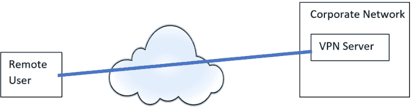

图3.2 – VPN

让我们现在来看远程访问服务：

- **远程访问服务（RAS）**：RAS是一种早于VPN的遗留协议。RAS客户端使用调制解调器和拨号网络使用电话线路。速度非常受限。
- **VPN/RAS身份验证**：VPN或RAS使用许多身份验证方法。我们将在此处查看这些：

  a. **密码身份验证协议（PAP）**：PAP应不惜一切代价避免，因为密码以明文传输，可以很容易被捕获。

  b. **挑战握手身份验证协议（CHAP）**：CHAP用于连接到RAS服务器，采用四阶段过程：

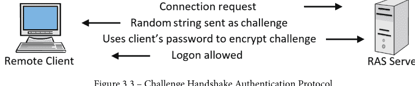

图3.3 – 挑战握手身份验证协议

让我们使用以下四个步骤来理解这一点：

1. 客户端向远程访问服务器发出连接请求。
2. RAS服务器回复一个挑战，即随机字符串。
3. 客户端使用其密码作为加密密钥来加密挑战。
4. RAS服务器使用为用户存储的密码加密原始挑战。如果两个值匹配，则客户端登录。

- **MS CHAP/MSCHAP版本2**：MS-CHAP/MS-CHAP已被MS-CHAP v2取代，可同时用于VPN和RAS。

让我们现在来看访问控制方案。

### 访问控制方案

访问控制的三个主要部分是识别个人、他们在输入密码或PIN时进行身份验证，然后是授权，即个人对不同数据的不同形式访问：

- **识别**：这类似于每个人都有自己的银行账户。账户由银行卡上的账户详细信息标识。在安全环境中，识别可能涉及拥有用户账户、智能卡或可能是指纹读取器——这是该个人的唯一标识。
- **身份验证**：一旦个人插入其识别方法，他们将被身份验证，例如通过输入密码或PIN。
- **授权**：这是你对选择数据的访问级别。你通常是某些组的成员；例如，销售经理可以访问销售组的数据，然后访问经理组的数据。你只会被授予执行工作所需的最低访问权限。这被称为最小权限。

**示例：** 在财务工作的人需要更高级别的安全许可，并且必须访问与在成品中派发订单的人不同的数据。

让我们现在来看特权访问管理。

#### 特权访问管理

**特权访问管理（PAM）**是一种解决方案，有助于保护域内的特权账户，防止传递哈希和权限提升等攻击。它还提供了谁在使用特权账户以及它们用于什么任务的可见性。PAM的设置如下：

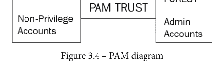

前述的ABC域将保存非特权账户，而堡垒林将保存管理员账户。堡垒林是一个具有非常高安全级别的远程林。堡垒林采用**仅限所需管理（JEA）**方法，通过给予管理员足够权限来执行特定任务。


Microsoft 使用 Windows PowerShell 生产了一套 JEA 工具包，以便每种类型的管理员在被允许执行的任务上拥有一定数量的权限。

公司将使用诸如 Identity Manager 之类的身份管理解决方案来保存每种类型的特权账户的各种策略。

**示例：** Fred 是 SQL 数据库管理员，他想要对 SQL 数据库进行更新。在下面的图表中，你可以看到他首先使用 **多因素身份验证 (MFA)** 登录到 **身份管理器 (IM)**。IM 查看其持有的与 Fred 账户相关的策略，并联系堡垒域，该域生成了一个管理员 Kerberos 票据，然后该票据用于向 Fred 提供对 SQL 数据库的管理员访问权限以执行管理员任务，见下图图 3.5：

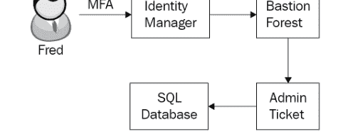

图 3.5 – 获取管理员权限

日常任务，例如访问互联网或发送电子邮件，不能获得管理员权限。

#### 强制访问控制

**强制访问控制 (MAC)** 基于数据的分类级别。

MAC 考虑的是他们可能对国家利益造成的损害程度。如下所示：

- **绝密**：最高级别，极其严重的损害
- **机密**：造成严重损害
- **保密**：造成损害
- **限制**：不期望的影响

**强制访问控制 (MAC)** 的示例如下：

| 数据类型 | 分类 |
|---|---|
| 核能项目 | 绝密 |
| 研究与开发 | 机密 |
| 进行中的法律问题 | 保密 |
| 政府工资单 | 限制 |

与对数据进行分类、存储和授予访问权限相关的不同角色如下：

- **所有者**：这是编写数据并确定分类的人。例如，如果他们正在编写一份机密文件，他们会将其定为该级别，不会更高。
- **管理员**：管理员是负责数据质量和标记的人。
- **保管人**：保管人是存储、管理和保护机密数据的人。他们可能会加密数据以保护它。
- **安全管理员**：安全管理员是在获得许可批准后授予对机密数据访问权限的人。

#### 自主访问控制

自主访问控制涉及 **新技术文件系统 (NTFS)** 文件权限，这些权限用于 Microsoft 操作系统。用户仅被授予执行其工作所需的访问权限。这些可以归类为基于用户或以用户为中心。

这些权限在以下屏幕截图中显示：

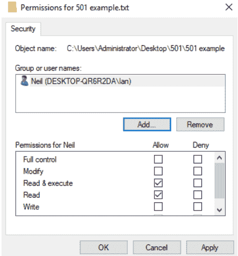

图 3.6 – DAC 权限

权限如下：

- **完全控制**：完全访问。
- **修改**：更改数据、读取和读取并执行。
- **读取和执行**：读取文件，如果其中包含程序则运行该程序。
- **列出文件夹内容**：展开文件夹以查看其中的子文件夹。
- **读取**：读取内容。
- **写入**：这允许你向文件写入。
- **特殊权限**：允许细粒度访问；例如，它将之前的每个权限细分为更细粒度的级别。
- **数据创建者/所有者**：创建未分类数据的人称为所有者，他们负责检查谁有权访问该数据。

最高权限为 777，所有者、组和其他人均具有完全控制权。最低权限为 644，所有者具有读写权限，组为只读，其他人也为只读。

另一种设置权限的方式是使用字母值，如下所示：

- a. R：读取
- b. W：写入
- c. X：执行

使用字母值时，每个权限集显示为三个破折号。

三个实体的完全控制如下：

- 所有者完全控制将显示为 rwx --- ---。
- 组完全控制 --- rwx ---。
- 用户完全控制 --- --- rwx。

你也可以在 Linux 中更改权限。如果文件 C 的权限为 654，我们希望更改这些权限以授予完全控制，我们将运行 chmod 777 File C 命令，这会将文件 C 的权限更改为完全控制。

#### 基于角色的访问控制

这是一个部门内的职责子集。例如，财务部门的两个人只负责零用现金。在 IT 术语中，这可能是只有 IT 团队中的两个人管理电子邮件服务器。

#### 基于规则的访问控制

在基于规则的访问控制 (RBAC) 中，一条规则适用于部门内的所有人员，例如，承包商只能在上午 8 点至下午 5 点之间访问，而帮助台人员只能访问他们的工作场所所在的 1 号楼。它可以基于时间或具有某种限制，但它适用于整个部门。

#### 基于属性的访问控制

在基于属性的访问控制 (ABAC) 中，访问是根据账户中的属性进行限制的。John 可能是高管，而某些数据可能仅限于具有高管属性的人。这是来自目录服务的用户属性，例如部门或位置。你可能希望为不同部门提供不同级别的控制。

#### 基于组的访问

当公司拥有大量用户时，很难为每个用户提供他们执行工作所需的资源访问权限。会创建组，并且它们将包含该部门中的所有用户。例如，销售组将包含所有在销售部门工作的人，并且该组将用于允许访问资源，例如打印机或文件结构。如果你决定使用基于组的访问控制，并且有新员工或实习生，你可能会为他们创建一个权限较低的另一个组。

例如，在一家大型公司中，25 名员工在市场营销部门工作，需要完全访问市场营销文件共享。下一周，他们将有三名新实习生入职，但他们只需要对同一共享的读取访问权限。因此，需要采取以下步骤：

- 创建一个名为 **marketing** 的全局组。所有 25 名员工都添加到该组中。该组被授予对数据的完全控制访问权限。
- 创建一个名为 **marketing interns** 的全局组。将三名实习生添加到该组中。该组被授予对数据的读取访问权限。

**示例：** 有两位人在 **信息技术 (IT)** 工作，需要访问 IT 数据。这两个人被称为 Bill 和 Ben，我们将他们添加到 IT 组中，该组反过来被授予对 IT 数据文件夹的完全控制访问权限。

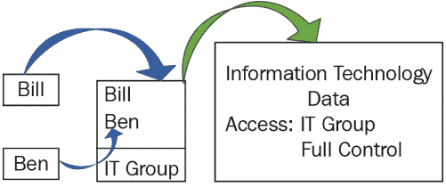

图 3.7 – 基于组的访问

### 总结身份验证和授权设计概念

我们将查看企业环境中使用的身份验证和授权设计概念。我们将查看目录服务、联合服务、生物识别和多因素身份验证。让我们逐一查看这些。

Active Directory 中的存储方式可以使用名为 **ADSI Edit** 的工具查看：

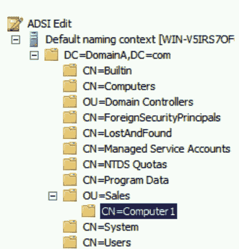

图 3.9 – ADSI Edit

LDAP 是负责存储 X.500 对象的 Active Directory 协议。当搜索 Active Directory 时，LDAP 提供所需的信息。LDAPS 是 LDAP 的安全版本。

以下是一些示例。

- **示例 1：** 如果我想知道 IT OU 中有多少人，我可以搜索 Active Directory。LDAP 提供搜索并返回回复，说明 IT 部门有 10 名成员。
- **示例 2：** 我正在 Active Directory 中搜索一个名为 Fred 的用户。同样，LDAP 找到该用户。如果你域中有 10,000 人，你会将他们放在不同的 OU 中以便更容易查找和管理他们。然而，如果你需要找某个人，这仍然会很困难。这就是为什么我们需要 LDAP 来执行搜索。它节省时间。

### Kerberos

Kerberos 身份验证使用票据、**更新序列号 (USN)**，并且带时间戳。获取服务票据的过程称为 **票据授予票据 (TGT)** 会话。所有服务器和计算机上的时间必须在 5 分钟之内；时间可以通过使用原子时钟等时间源进行同步。


如果 Kerberos 身份验证失败，这通常是因为用户的计算机或设备时钟与域控制器相差 5 分钟或以上。可以在您的局域网上放置一个网络时间协议（NTP）服务器，以使域计算机和服务器彼此保持同步。

TGT 会话是指用户将其凭据（用户名和密码，或可能是智能卡和 PIN）发送到域控制器，域控制器开始身份验证过程，并在确认后发送回一个有效期为 10 小时的服务票据。该服务票据是加密的且无法更改：

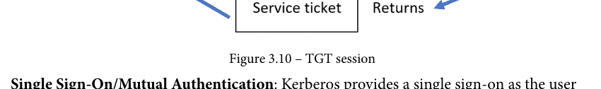

图 3.10 – TGT 会话

### 单点登录/相互身份验证

Kerberos 提供单点登录，因为用户只需登录一次。它随后使用其服务票据来证明其身份。这会与用户想要访问资源的服务器交换会话票据。在此示例中，用户将使用其服务票据与邮件服务器进行相互身份验证：

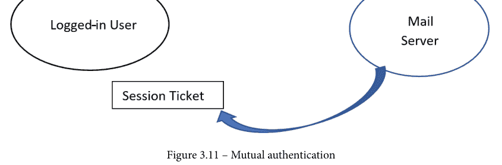

图 3.11 – 相互身份验证

上图显示已登录用户将其加密的 **服务票据** 与邮件服务器交换，邮件服务器作为回报通过返回 **会话票据** 提供相互身份验证。已登录用户检查会话票据的时间戳是否在域控制器时间戳的 5 分钟范围内。这意味着 Kerberos 可以完成相互身份验证。

> **重要说明**
>
> 您需要记住 Kerberos 是唯一使用票据的身份验证协议。它还可防止重放攻击，因为它使用 USN 编号和时间戳。它还可以防止传递哈希攻击，因为它将密码存储在名为 ntds.dit 的加密数据库中。

**NT LAN Manager (NTLM)：** NTLM 是一种遗留身份验证协议，它使用 MD4 哈希存储密码，该哈希非常容易破解。它容易受到传递哈希攻击。它最后在 1990 年代的生产环境中使用。Kerberos 可防止传递哈希攻击，因为它将密码存储在名为 ntds.dit 的加密数据库中。

### 传递信任

传递信任是指您有一个父域，也许还有一个或多个子域；这些被称为 **树**。请参阅以下图表：

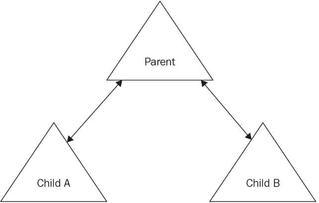

图 3.12 – 传递信任

在 **父域** 与每个子域之间是双向传递信任，资源可以双向共享。由于 **父域** 信任子域 A 和 B，因此可以说 **子域 A** 传递信任 **子域 B**，只要 **子域 B** 的管理员希望让 **子域 A** 的某人访问资源，反之亦然。将域想象成来自同一公司的员工。

> **提示**
>
> 当考试提到第三方对第三方身份验证时，这只能意味着联合服务。联合服务可以使用 cookie 进行身份验证。

### 联合服务

当两家不同公司希望在参与合资企业时相互进行身份验证时，就会使用联合服务。想象两家汽车制造商想要生产世界上最好的汽车发动机。两家公司都有发动机专家，但他们希望共同合作生产超级发动机。公司不想合并；它们希望保留自己的身份并拥有自己的管理。这些公司彼此之间被称为第三方。

这些公司中的每一个都将拥有自己的目录数据库，例如 Active Directory，其中仅包含其域中的用户。因此，正常的域身份验证将无法工作。现在让我们看看两个不同的域及其目录数据库：

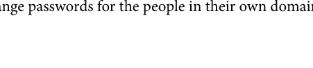

图 3.13 – 目录数据库

公司 A 在其目录服务中有三名用户 – 红先生、蓝先生和绿先生。公司 B 也有三名用户 – 橙先生、紫先生和黄先生。这意味着他们只能更改自己域中人员的密码。

一旦 **公司 B** 确认黄先生的扩展属性有效，**公司 A** 域控制器就会向黄先生的笔记本电脑发送一个 cookie。下次身份验证时将使用此 cookie。

> **提示**
>
> 当考试提到使用扩展属性进行身份验证时，这只能意味着联合服务。用于身份验证的 cookie 也属于联合服务。

### Shibboleth

Shibboleth 是一种使用 SAML 身份验证的开源联合服务产品。它将在小型联合服务环境中使用。Shibboleth 可以使用 cookie。

### 证明

这是身份提供者（IdP）提供的一种可以证明用户身份的机制。使用 OAuth 时，会提供令牌；使用 Kerberos 时，会提供票据。联合服务提供 cookie，基于证书的身份验证提供私钥。当我们尝试证明一段代码的真实性时，我们可以使用代码签名来证明它是原始代码。

### 单点登录（SSO）

SSO 用于域环境中。这是指某人登录到域，然后可以访问多个资源，例如文件或邮件服务器，而无需再次输入其凭据。将其想象成全包假期，您入住酒店，前台会给您一个手环，您在想消费食物和饮料时出示它。联合服务和 Kerberos（Microsoft 身份验证协议）都是 SSO 的良好示例。您只需登录一次即可访问所有资源，无需再次插入凭据。您需要在线才能使用 SSO；如果您离线，SSO 将无法工作。

### 基于互联网的开源身份验证

要访问基于 Web 的应用程序，您通常需要一个帐户才能登录。但是，应用程序托管公司不希望负责访问应用程序的帐户的创建和管理。他们使用 OAuth 来帮助他们实现这一点：

- **OAuth 2.0：** OAuth 2.0 提供授权以使第三方应用程序能够获得对 Web 服务的有限访问。
- **Open ID Connect：** Open ID Connect 使用 OAuth 允许用户登录到 Web 应用程序而无需管理用户帐户。它允许用户使用其 Google、Facebook 或 Twitter 帐户进行身份验证。例如，Airbnb 网站可让用户查找住宿，允许您使用 Google 或 Facebook 帐户注册。

### 生物识别

生物识别是一种使用个人特征进行身份验证的方法，例如使用指纹，因为每个人的指纹都非常不同。1892 年，阿根廷警探 Eduardo Alvarez 在针对 Francisca Rojas 的案件中做出了第一次指纹识别，Rojas 杀害了她的两个儿子并割喉自杀，试图将责任推给别人，但警探证明了她有罪。

我们现在来看看生物识别的类型：

- **指纹扫描仪：** 指纹扫描仪现在非常常见；例如，如果您去美国度假，过海关时需要将指纹放在扫描仪上。指纹扫描仪的另一个用途是当您设置 iPhone 时；您可以设置按主屏幕按钮登录而不是使用密码。参考以下屏幕截图：

让我们现在来看看一些常见的账户管理策略。

### 常见账户管理策略

为了确保顺利的账户管理，至关重要的是公司范围内的政策必须到位，并且公司内所有人都必须遵守，否则可能会导致混乱。让我们逐一查看这些策略。

#### 账户创建

跨国公司每年会生成数百个账户，需要有标准化的格式。这被称为标准命名约定。账户模板会被复制并根据新员工的详细信息进行修改。标准命名约定的一些示例如下：

- 名字，姓氏：*John.Smith*
- 姓氏，名字：*Smith.John*
- 名字首字母，姓氏：*J.Smith*

如果您有 *John Smith* 和 *Jack Smith*，您将有两个 *J Smith*。因此，您还可以使用中间首字母，*J A Smith*，或在末尾加上数字，*J Smith1*，使其唯一。

所有用户账户都需要唯一，以便每个人对其自己的账户负责。如果您在去喝咖啡时将计算机留在网络上登录状态，而有人使用您的账户删除数据，那么您将被追究责任。良好的做法是在您不在办公桌前时锁定屏幕以防止这种情况发生。

如果没有标准命名约定，账户将被不同地创建，并在您尝试在目录服务中查找用户时会造成混乱。

#### 员工调动部门

当员工在部门之间调动时，IT 团队通常会修改其账户以适应下一个部门；他们通常不会获得新账户。在 Security+ 考试中，当人员调动部门时，他们会获得新账户，旧账户保持活动状态直到被禁用。


### 禁用账户

IT团队有时会出于良好实践而禁用账户；让我们看看原因：

- **员工离职**：当有人离开公司时，一个好的做法是人力资源部门进行离职面谈，以了解其离职原因。最后一步是IT团队禁用其账户并重置密码。这些步骤保留了他们的电子邮件和证书设置，以便加密数据仍然可以被访问，但他们无法再访问网络。如果删除账户，就会失去所有这些。
- **长期缺勤**：当员工离开公司一个月或更长时间时，禁用账户以防止其被访问可能是明智的。员工可能是休产假/陪产假、被借调到另一家公司、参加长期课程，或者休间隔年去实现梦想。这意味着，在他们离开期间，账户不会被黑客入侵，并在返回后可以重新激活。
- **访客账户**：访客账户是为临时用户设计的，但很少使用；它们被禁用以防止被黑客入侵。

> 提示
> 当员工离开公司时，第一阶段是禁用账户而不是删除。你还需要重置密码，以便旧账户持有人无法使用该账户。

### 账户复核

账户复核是一个过程，审计员将审查所有用户账户。审计员将有一个矩阵，显示所有活动账户以及他们应该拥有的权限和访问权。如果审计员发现任何问题，他们会向管理层报告，管理层随后将编写新的账户策略，或通过变更管理对账户管理进行修改。对于考试而言，审计员应被视为告密者；他们不会采取任何行动，但会向管理层报告他们的发现。

### 账户维护

账户维护是确保账户按照标准命名约定创建，在员工刚离职时禁用，然后可能在30天后删除。

### 账户监控

如果你希望了解用户账户何时被授予新的权限集合，这只能通过主动监控账户来完成。这可以使用安全信息和事件管理（SIEM）系统自动完成，该系统会在系统发生变化时向你发出警报。通过用户账户审查你不会收到警报，因为审查之间可能相隔6-12个月——你可能需要立即知道。

> **提示**
> 如果你希望立即了解用户账户的变化，例如被授予更高权限，那么你需要主动账户监控，或者需要设置SIEM系统。

### 安全信息和事件管理

**安全信息和事件管理（SIEM）。** SIEM系统用于实时监控，可用于聚合、解析和规范化非标准日志格式；还可以过滤误报。SIEM系统无法提供正确信息的唯一情况是使用了错误的过滤器或扫描了错误的主机：

- **账户管理：** 在可能拥有超过50,000名用户的跨国公司中，必须制定账户管理策略，以便目录服务保持最新。让我们看看不同的账户管理工具和策略。可以对系统运行目录服务查询，以发现一段时间内未使用的账户。
- **账户过期：** 当公司在账户创建阶段雇用临时员工（如分包商）时，会启用过期日期。这是为了防止某人在合同到期后试图访问公司网络。一旦账户达到过期日期，账户将自动被禁用：

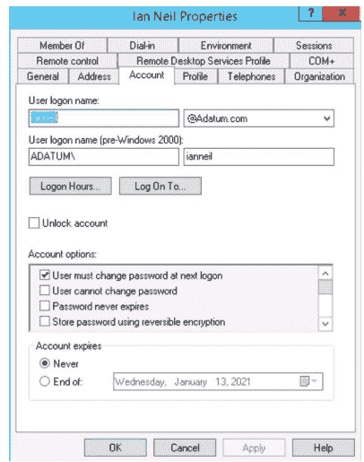

图3.21 – 账户过期

> 提示
> 如果一个人转到新部门，他们会获得一个新账户。如果他们的旧账户仍在使用，那么我们应该找一位审计员执行用户账户审查。

- **时间和日期限制**：为每个用户设置时间和日期限制，因为公司可能有许多不同的轮班模式，并且可能不希望员工在工作时间之外访问网络。下图显示员工可以在早上7点到下午6点之间访问网络。这可以防止用户在其他人都没在公司场所的凌晨3点进来窃取数据。

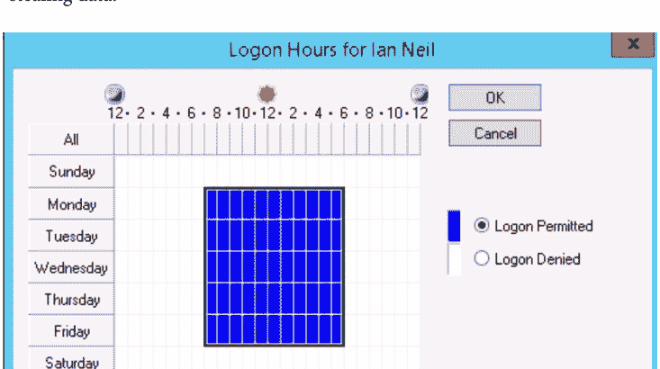

图3.22 – 时间和日期限制

**示例**：一家玩具工厂可能在繁忙的圣诞节前雇用大学生工作，有三个不同的轮班模式：上午6点至下午2点、下午2点至晚上10点以及晚上10点至上午6点。每个员工都会设置时间和日期限制，以便他们只能在轮班时间内登录。

- **账户锁定**：为防止字典和暴力攻击，强制执行账户锁定，允许输入密码尝试三次或五次。一旦超过次数，账户即被禁用。这可以防止黑客猜测账户密码。

提示
如果要对一组承包商设置时间限制，将使用RBAC。时间和日期限制只能用于个人。

- **复杂密码**：复杂密码（有时称为强密码）通过选择以下四个组中的三个来构成：
  a. **小写字母**：例如，a、b和c
  b. **大写字母**：例如，A、B和C
  c. **数字**：例如，1、2和3
  d. **编程中未使用的特殊字符**：例如，$和@
  如果我选择密码P@$$w0rd，那么它包含来自所有四个组的字符，但它会被很快破解，因为大多数密码破解器会将字母o替换为0，并将a替换为@符号。

- **使用可逆加密存储密码**：当用户需要使用其凭据访问旧版（旧式）应用程序时；因为应用程序以可逆加密方式存储它们，它们可能会以明文形式存储——这并不好。公司往往始终禁用此选项，因为它会带来安全风险。

- **账户锁定 – 阈值**：该设置决定在系统将你锁定之前，用户可以尝试密码的次数。公司通常将此值设置为三次或五次。下面的图3.24显示，三次尝试后用户将被锁定。

一旦被锁定，你的账户即被禁用：

| 策略 | 安全设置 |
| --- | --- |
| 账户锁定持续时间 | 30分钟 |
| 账户锁定阈值 | 3次无效登录尝试 |
| 在此之后重置账户锁定计数器 | 30分钟 |

图3.24 – 账户锁定

> 提示
> 彻底了解密码选项和密码攻击类型。

- **账户锁定 – 持续时间**：**账户锁定持续时间**和**在此之后重置账户锁定计数器**都不应启用。如果这些被禁用，被锁定的人将不得不联系安全管理员以重置密码。这样，管理员知道是谁一直忘记密码，并将持续监控他们。

### 密码恢复

人们有时会因忘记密码而被锁定。他们可以前往门户网站并选择**忘记密码**，然后填写个人详细信息，密码重置选项会通过短信或电子邮件向他们的手机发送验证码。

一些桌面操作系统允许你创建密码重置磁盘，以便将其保存到SD卡或USB驱动器；这在企业环境中通常不使用。

### 凭据管理

某人用来访问网络或应用程序的用户名和密码的详细信息称为凭据。用户有时会拥有多套凭据来访问其本地网络，以及他们的Facebook、Hotmail或Twitter账户。对其中任何两个账户使用相同的账户和密码都是严重的安全风险。Windows 10有一个凭据管理器，可以将凭据存储在两个类别中——通用凭据和Windows 10凭据。当你登录账户并勾选**记住密码**框时，这些详细信息可能会存储在凭据管理器中以进行整合。这可以用于访问Web门户的通用账户或Windows 10凭据：

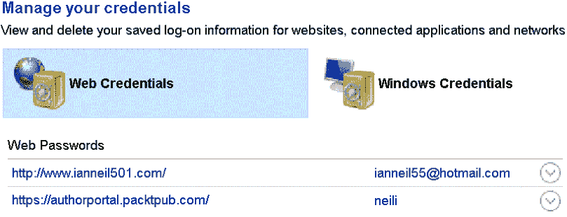

图3.25 – 凭据管理器

让我们在下一节中查看一个实践练习。


### 在野外开发

在狂野环境中构建和部署软件的实用指南。

- 拥抱不确定性和快速迭代
- 为失败而设计，优雅地恢复
- 观察一切，持续测量
- 自动化那些乏味但关键的部分
- 将人的判断留在决策回路中

> 野性不是令人恐惧的地方；它是一个学习、适应和茁壮成长的地方。

| 阶段 | 重点 | 关键指标 |
|-------|-------|------------|
| 发现 | 用户需求、约束 | 问题清晰度 |
| 原型 | 快速实验 | 获得反馈的时间 |
| 部署 | 安全发布 | 变更失败率 |
| 运营 | 可靠性 | MTTR |

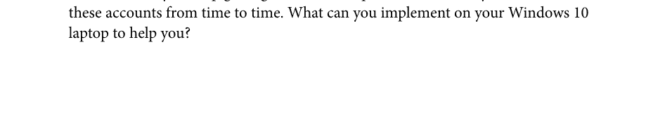
