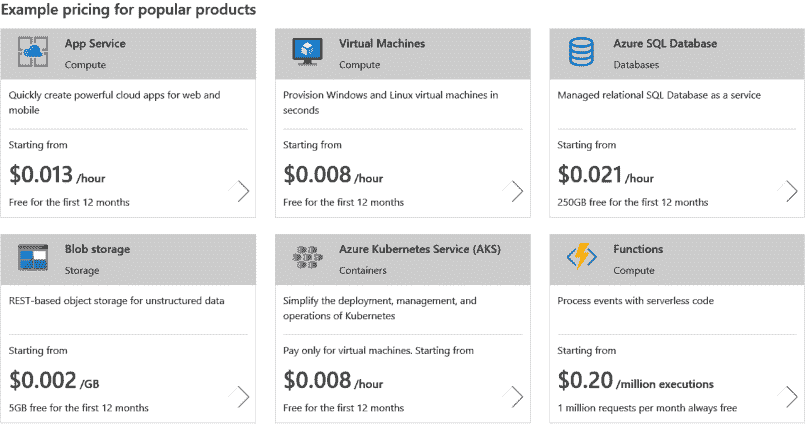
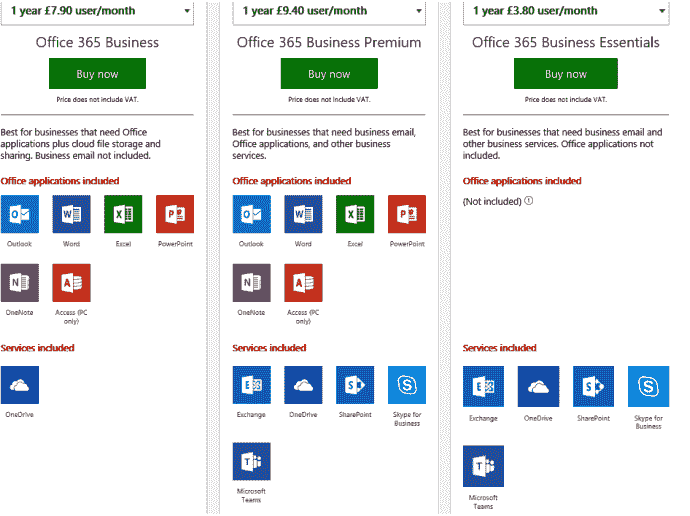
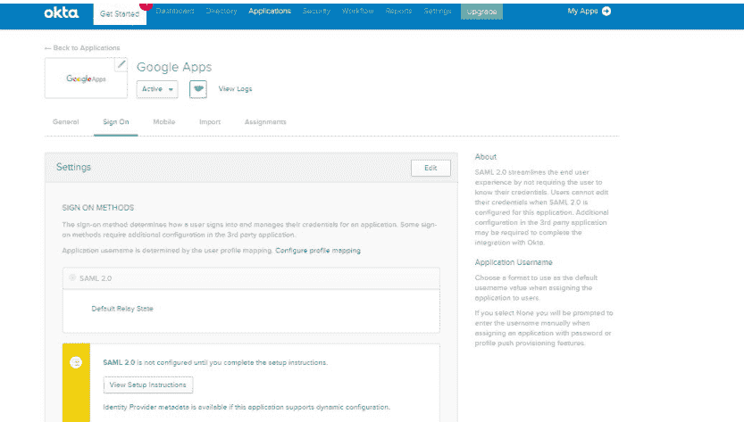
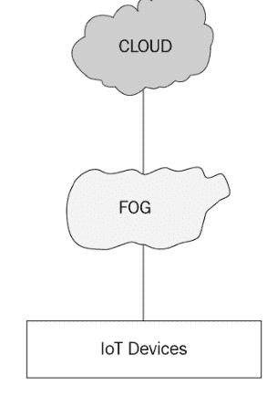
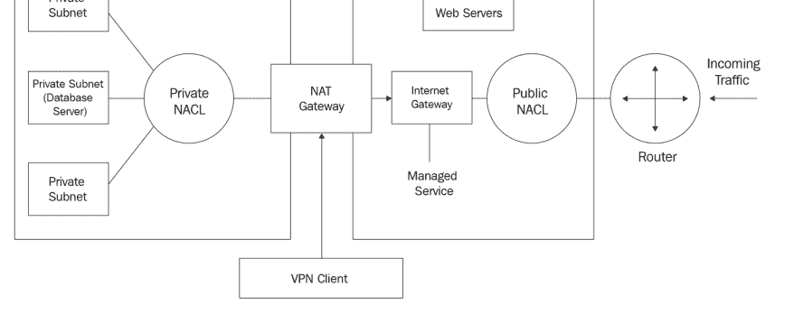
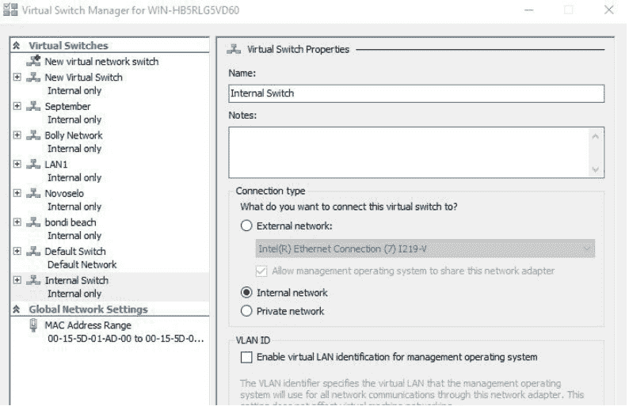

## 4

## 探索
## 虚拟化与
## 云概念

在当今世界，大多数企业要么使用虚拟化，因为它能让他们从灾难中非常快速地恢复，要么已经迁移到云端，以避免在设备和灾难恢复上花费大量资金。在本章中，我们将探讨云概念和虚拟化，并将其细分为以下主题：

- 云计算概述
- 实施不同的云部署模型
- 理解云计算概念
- 了解云存储
- 选择云安全控制
- 探索虚拟网络环境

- **可扩展性**：可扩展性是指公司在保持弹性基础设施的同时实现增长的能力。云使公司能够增长，而无需担心在此过程中需要支出资本。它使公司比那些需要在实体设施上投入更多资金的传统本地部署公司增长得更快。由于云具有弹性，它与实现可扩展性相辅相成。随着公司的发展，云提供商可以允许您租用更多资源。如果您在任何时候想要减少所需资源数量，云提供商也可以做到这一点。

*示例*：A公司是一家新成立的企业，一进入市场就发展迅猛；由于芝加哥和伦敦的销售额非常高，公司需要迅速扩张并在这些地区开设新办事处。通常，开设新站点需要投资10万美元购买IT设备，因此该公司转向CSP获取新设备。他们将在销售额达到足以投资购买房产之前租赁办公室。所有员工都将配备笔记本电脑和高速光纤宽带。网络基础设施将是基于云的，因此无需购买会减少其现金流量的物理服务器。即使提供了新设备，现金流量也得以维持。

- **无资本支出（CAPEX）**：当您将基础设施迁移到云端时，就没有资本支出；通常，IT资源的最长寿命为3到5年。随着技术的不断进步和硬件变得过时，这意味着他们可能每五年就需要找到$75–300,000美元来购买硬件。

*示例*：一家公司希望升级其台式机和服务器，硬件成本为250,000美元，五年后处置费为25,000美元。如果他们迁移到云端，每年将花费60,000美元。然而，他们不需要一次性拿出全部250,000美元，因为CSP将不断更新其硬件，使硬件永远不会过时。这也有助于公司保持更好的现金流，因为不需要资本支出。每年价格高出1.8%，这可以证明是合理的，因为不需要维护费用或灾难恢复站点，使其非常具有成本效益。CSP将维护和灾难恢复作为云计划的一部分来处理。

- **位置无关**：由于您通过浏览器访问云，它与位置无关，因此如果您的工作场所发生灾难，它可以提供更快的恢复。

*示例*：贵公司的一个办公室位于北加利福尼亚，最近被野火烧毁；但是，由于您的数据和基础设施基于云，只要您能访问互联网，就可以从另一个位置快速运营。如果您使用的是传统网络，基础设施将被烧毁，台式机将消失，可能需要一两周才能恢复运行状态。

- **数据区域存储**：云受到监管，因此一个国家的数据必须存储在该区域内，因为数据合规法律因地区而异。

- **无维护费用**：CSP提供持续维护，因此签署云合同时没有隐藏成本。

- **无需灾难恢复站点**：CSP提供其IT系统的99.999%可用性，因此，一旦您的数据在云端，就不需要灾难恢复站点，因为CSP将其作为合同的一部分提供。

> **考试提示**
> 
> 私有云 = 单租户
> 
> 公有云 = 多租户
> 
> 社区云 = 同行业，共享资源

### 实施不同的云部署模型

我们将首先了解不同的云模型及其特征。最常见的云模型是公有云，因此让我们从它开始：

- **公有云：** 这是最常见的模型，CSP向多个租户提供云服务。这就像在公寓楼里租公寓的众多人之一。就像在公有云中一样，没有一个租户拥有自己的公寓：

图4.1 – 公有云

**示例：** 一家小公司不想在IT系统上投资50,000美元，因此他们从云提供商那里购买云套餐，由云提供商托管他们和其他公司。这类似于某人从房东那里租下一栋楼中的一套公寓——你租用但并不拥有公寓。这是一个多租户环境，云提供商在同一台虚拟主机上托管多家公司。

- **私有云：** 私有云是指公司购买其所有硬件，或者云服务提供商（CSP）在与其它公司分离的服务器上托管它们。这使它们比其它云模型拥有更多控制权。它们通常自行托管云，因为不想与任何其他人共享资源，但同时其员工拥有云的所有移动优势。然而，较大的公司可能会让CSP提供所有资源，但它们不会与其他人托管在相同的环境中：它们将是隔离的。这类似于某人因为想要隐私而购买房屋。私有云需要与其它公司隔离，这就是为什么它被称为单租户：

图4.2 – 私有云

#### 基础设施即服务（IaaS）

当您想到网络基础设施时，您会想到台式机、服务器、防火墙、路由器和交换机——网络的硬件设备。当您购买这些设备时，它们具有默认出厂设置，需要重新配置这些设置。台式机是“裸机”，意思是没有安装操作系统。IaaS也是如此；您需要预配置这些设备、安装操作系统并维护补丁管理。请参见以下截图中的IaaS定价（截至本书写作时）：

图4.5 – Microsoft的IaaS产品（2018年7月）

> **考试提示**
> 
> 对于IaaS，您需要安装操作系统、配置并修补它。这是您拥有更多控制权的云服务。私有云是让您拥有更多控制权的云模型。

图 4.8 – Microsoft Office 365 – SaaS

> **考试提示**
> 
> SaaS 是一种无法修改的定制供应商应用程序，你以按使用付费的模式（即订阅方式）使用它，并且无法将任何应用程序或服务迁移到任何 SaaS 环境中。

#### 平台即服务（PaaS）

这为开发人员提供了创建应用程序的环境；一个例子是 Microsoft Azure。该平台提供了一组服务来支持应用程序的开发和运营，并将它们发布到 iOS、Android 设备以及 Windows 设备上。你可以在 PaaS 下迁移你的定制软件应用程序。Bespoke 意为定制。

#### 安全即服务（SECaaS）

SECaaS 提供身份和访问管理（IAM），该服务提供身份管理，允许人们随时随地安全地访问应用程序。以下截图显示了 Okta 为 Google Apps 提供安全的 Web 身份验证：

图 4.9 – 用于 Google Apps 的 Okta 安全即服务（SECaaS）

上图中的用户需要验证其身份，并已出示来自身份提供商（IdP）Okta 的 SAML 令牌。

#### 一切即服务（XaaS）

**一切即服务（XaaS）** 描述了其他众多可用的云服务，例如提供网络资源的**网络即服务（NaaS）**、**桌面即服务（DaaS）**、**备份即服务（BaaS）** 等等。随着新服务的出现，它们都将归入 XaaS 类别。

### 理解云计算概念

在本节中，我们将介绍 CompTIA Security+ 考试中可能出现的不同云计算概念。请确保你熟悉以下内容：

- **云服务提供商（CSP）：** CSP 是向客户转售云服务的实体。它们可以提供客户所需的基础设施、软件、虚拟机和其他服务。**托管云服务提供商（MCSP）** 也将接管你的云的日常运营，因为它们具备这样做的专业知识。
- **托管安全服务提供商（MSSP）：** MSSP 将为公司维护安全环境，包括企业防火墙、入侵预防和检测系统以及 SIEM 系统。他们拥有技术精湛的员工队伍，可以为企业消除这一烦恼。在 `https://wizardcyber.com/blog/managed-security-service-provider/` 上有一篇关于如何选择 MSSP 的文章。
- **雾计算：** 雾计算通过处理来自物联网设备的数据来补充云计算。它允许你在将数据提交到云之前对其进行分析。数据被放置在设备和云之间的位置。它将云计算带到更接近传感器的位置，并降低了数据在设备和云之间来回传输的成本。由于它对流量进行优先级排序，因此还减少了延迟，这对于生命支持系统可能非常重要。这可以帮助医疗保健应用程序更快地处理数据，因为它更接近设备，并且不需要在设备和云之间来回传输数据。

*示例：* 来自生命支持系统传感器的警报被发送到云端，然后再发送给临床医生，但借助更靠近传感器的雾计算，可以降低延迟，因为临床医生能更快速地收到警报：

图 4.10 – 雾计算

- **边缘计算：** 所有数据存储处理都在更靠近传感器的位置进行，而不是在数千里之外的数据中心服务器上进行。
- **瘦客户端：** 瘦客户端是一种资源有限、不足以运行应用程序的客户端。它连接到服务器，并在服务器的资源上处理应用程序。
- **容器：** 容器允许隔离应用程序及其文件和库，使它们不依赖于其他任何东西。它允许软件开发人员在各种环境中无缝部署应用程序。**平台即服务（PaaS）** 产品使用容器。
  *示例：* 微软版本的 Docker 在 Linux 上运行，但允许应用程序容器在 Linux、Windows 和 macOS 上运行。
- **微服务/API：** 这允许你定义单个服务，然后通过应用程序编程接口将它们连接起来。它们是松散耦合的，在创建应用程序时可以重用。
- **基础设施即代码**：这是指你使用配置文件而不是物理方法来管理计算机基础设施。这在云技术中非常普遍，使得设置计算机和部署补丁更加容易。这确保了每台计算机都具有相同的设置，这与手动设置计算机时可能出现的人为错误形成对比。一个例子是使用 PowerShell 设置你的基础设施，并使用**期望状态配置（DSC）** 来确保不会偏离所需设置。你可以使用 PowerShell 脚本创建和配置虚拟机，并配置防火墙和负载均衡器。让我们再看几个例子：
  a. **软件定义网络（SDN）**：传统网络通过硬件路由器路由数据包，并且是去中心化的；然而，在当今的网络中，人们正在使用虚拟化技术，包括云提供商。SDN 是指数据包通过控制器而不是传统路由器进行路由，从而提高了性能。它有三个不同的平面：控制平面负责流量优先级排序，数据平面负责交换和路由，管理平面负责监控流量。有关 SDN 的概述，请访问 `https://www.cisco.com/c/en_au/solutions/software-defined-networking/overview.html`。
  b. **软件定义可见性（SDV）**：这使你可以查看网络流量的使用情况。它可以收集和聚合网络流量数据，并为网络管理员提供良好的报告。
- **无服务器架构**：这是指你将使用后端即服务，由第三方供应商托管你的应用程序，采用基于你使用的计算时间的按需付费模式。你将向他们租用服务器或数据存储。
- **服务集成**：这是指将多个业务服务的提供与不同的 IT 服务相结合，并集成起来为企业提供单一解决方案。
- **资源策略**：这些策略规定了某人对数据或特定资源拥有何种访问级别。
- **中转网关**：这是一个网络枢纽，充当区域虚拟路由器，用于互连**虚拟私有云（VPC）** 和 VPN 连接。
- **虚拟化**：在云环境中，基础设施构建在虚拟环境之上。这些机器的存储通常来自**存储区域网络（SAN）**。本章末尾将解释虚拟化。在云中使用虚拟机的好处在于，你可以随时增减资源。你的云提供商只需几分钟就能启动额外的机器。快照可用于将虚拟机回滚到以前的配置。

### 选择云安全控制

为了确保云环境尽可能安全，需要实施许多控制措施。让我们来看其中一些控制措施。

#### 高可用性访问区域

在全局 Azure 环境中，有 Azure 区域。在每个区域内，都有高可用性区域。这些区域是物理位置，可能容纳两个或更多数据中心，并在其区域内提供高可用性。它们相互独立，拥有各自的网络。在每个网络内，它们都有自己的电力和**供暖、通风与空调（HVAC）** 系统，通过冷热通道调节自身的冷却。应用程序可以分布在多个区域中，这样即使一个区域发生故障，应用程序仍然可用。

#### 资源策略

这些策略规定了某人对特定资源拥有何种访问级别或可以执行哪些操作。这对于资源管理和审计至关重要。我们需要应用最小权限原则。

#### 机密管理

机密管理是管理数字身份验证以保护应用程序的过程。它可以被称为一个保管库，用于存储特权账户使用的密钥、令牌、密码和 SSH 密钥。它可以是一个经过重度加密的保管库，以保护这些项目。微软使用 RSA 2048 位密钥来保护 Azure 机密管理。

#### 集成与审计

集成是数据从输入到输出的处理过程。云审计员负责确保云提供商已实施的政策和控制措施得到采用。他们将测试这些控制措施和系统集成是否按预期工作。他们将是独立的第三方。其中一些控制措施可能包括以下内容：

- 加密级别
- 访问控制列表
- 特权账户使用

- 密码策略
- 防钓鱼保护
- 数据丢失防护控制

### 存储

存储在云存储中的数据必须具有高可用性，并且只有经过授权的人员才能访问这些数据，这一点至关重要。让我们来看看权限、加密、复制和高可用性：

- **权限：** 用户拥有存储身份，并被分配到具有不同权限的存储组。
- **加密：** 对于云存储，您可能需要多种类型的加密。由于数据量庞大，需要使用对称加密；通常使用 AES-256。微软对 blob 存储使用 RSA 2048。此外，还需要对传输中的数据（如 TLS 或 SSL）进行加密。微软使用**传输数据加密（TDE）**，通过 RSA 2048 或 3072 来访问云中的资源。
- **复制：** 复制是一种将数据立即从一个位置复制到另一个位置的方法。在云中，始终保留数据的多个副本以实现冗余，以防电源故障、硬件故障或飓风等环境灾难。数据不能存储在创建区域之外。复制有四种不同类型：
  a. **本地冗余存储（LRS）：** 数据的三个副本在单个物理位置复制。不适合高可用性。这是最便宜的解决方案，但如果断电，一切都会丢失。
  b. **区域冗余存储（ZRS）：** 数据在区域内的三个独立可用区之间复制。应使用在主区域；但如果灾难影响到该区域，您将无法访问数据。
  c. **地理冗余存储（GRS）：** 使用 LRS 将数据的三个副本复制到主区域的单个物理位置，然后将一个副本复制到辅助区域的单个位置。
  d. **地理区域冗余存储（GZRS）：** 数据在主区域内的三个独立可用区之间复制，然后将一个副本复制到辅助区域的单个位置。

- **高可用性：** 高可用性确保数据的副本存储在不同位置。例如，备份数据中心，如本章前面的*图 4.12*所示。通过使用 ZRS 使用具有三个不同可用区的存储区域，并复制到 GRS 和 GZRS 等其他辅助区域，也可以提供高可用性。

### 网络

在云环境中，必须确保网络和虚拟机免受任何攻击。在本节中，我们将介绍虚拟网络、公有和私有子网、分段以及 API 检查和集成。让我们逐一了解：

- **虚拟私有云（VPC）：** VPC 是由云资源组成的虚拟网络，其中一家公司的虚拟机与另一家公司的资源相隔离。这是 IaaS 的一部分。这些独立的 VPC 可以通过公有网络或私有网络或分段进行隔离。
- **公有和私有子网：** 我们的云环境需要划分为可直接访问互联网的公有子网，或必须通过 NAT 网关再经过互联网网关才能访问互联网的私有子网；参见下图。让我们先来看私有子网：

图 4.13 – 公有和私有子网

**私有子网：** 我们的 VPC 包含三个私有子网。每个子网都有自己的 CIDR IP 地址范围，并且不能直接连接到互联网。它们必须通过 NAT 网关，而 NAT 网关再使用互联网网关访问互联网。在每个子网中，必须将 IP 地址为 `0.0.0.0` 的默认路由指向互联网网关。如果路由表不知道将流量发送到哪里，它们会遵循默认路由。客户端虚拟机和数据库服务器将存储在私有子网中。私有子网将使用以下 IP 地址范围之一：

| IP 地址范围 |
|---|
| `10.0.0.0` |
| `172.16.x.x – 172.31.x.x` |
| `192.168.0.0` |

除 APIPA `169.254.x.x` 外，所有其他 IP 地址范围均为公有地址。私有子网将承载域基础结构，例如您不希望直接与互联网通信的域控制器、邮件服务器和数据库服务器。

**NAT 网关：** 这允许私有子网与其他云服务和互联网通信，但对互联网用户隐藏内部网络。NAT 网关具有用于私有子网的**网络访问控制列表（NACL）**。

**公有子网：** 公有子网上的资源可以直接连接到互联网。因此，面向公众的 Web 服务器将放置在此子网中。公有子网将具有用于与私有子网通信的 NAT 网关、互联网网关以及用于连接互联网的托管服务。

- **VPN 连接：** 要创建到 VPC 的安全连接，您可以使用 L2TP/IPsec 将 VPN 连接到 NAT 网关的公有接口。
- **分段：** 对于允许访问其他区域或允许其他区域访问的服务，其安全性由一套严格的规则控制这些流量。这些规则通过每个子网的 IP 地址范围来强制执行。在私有子网内，可以使用 VLAN 进行部门隔离。
- **API 检查和集成：** **表述性状态转移**（称为 **REST**）指的是一种编写 Web 服务 API 的新方式，使不同语言可以使用 HTTP 进行传输。

### 计算

这些是计算机有效运行所需的资源。让我们看看影响云计算的资源：

- **安全组：** 通过使用安全组模板分配计算安全组配置文件，该模板还指定云账户、资源位置和安全规则。
- **动态资源分配：** 这使用虚拟化技术，根据需求的增长或下降来升级和缩减云资源。
- **实例感知：** 我们必须监控虚拟机实例，以防止攻击者放置未托管的虚拟机，从而导致虚拟机蔓延并最终虚拟机逃逸。我们必须使用**网络入侵检测系统（NIDS）** 等工具来检测新实例，并且 IT 团队必须维护托管虚拟机列表。
- **VPC 端点：** 这允许您在 VPC 与另一个云服务之间创建私有连接，而无需经过互联网。
- **容器安全：** 这是安全工具和策略的实施，确保容器按预期工作。

### 解决方案

这些是保护云环境所需的服务。让我们逐一了解：

- **云访问安全代理（CASB）：** CASB 在本地环境和云之间强制执行公司策略。云中没有组策略。CASB 可以查看所有云客户端，并负责其安全和更新部署。
- **应用安全：** 这使用 Cloud WAF 和**运行时应用自我保护（RASP）** 等产品来防御零日攻击，相关内容见*第 9 章“识别威胁、攻击和漏洞”*。
- **下一代安全 Web 网关（SWG）：** SWG 充当反向代理、内容过滤器和内联 NIPS。一个例子是 Netskope，它通过先进的数据和威胁防护提供高级 Web 安全，具有以下功能：云安全、远程数据访问、托管云应用程序、监控和评估、控制云应用程序、可接受使用、抵御威胁以及随处保护数据。

更多详情请访问 `https://www.digitalmarketplace.service.gov.uk/g-cloud/services/986853436243688`。

**云环境中的防火墙注意事项：** 我们需要一个好的防火墙，是为了阻止入站流量并设置一道屏障，以保护内部云资源免受黑客或恶意软件的侵害。云防火墙往往是 Web 应用防火墙。2020 年最佳云防火墙是 CloudFlare 和 Amazon Cloud Service Firewall。排名前 20 的防火墙见 https://www.techradar.com/uk/best/cloud-firewall 。让我们来看看防火墙的注意事项。

a. **成本：** 以成本作为考虑因素的例子是 CloudFlare，它有一个功能有限的免费版本。在本书出版时，专业版为每月 20 美元，商业版为 200 美元，企业版为**价格另议（POA）**。每个套餐都有额外的功能，可以在该价格基础上添加。企业版解决方案适用于业务关键型应用的客户。

b. **网络分段需求：** 云环境采用零信任模型，每个人都需要提供自己的身份和位置才能访问云环境。防火墙控制对每个云区域和可用区的访问。

c. **OSI 互连层：** 网络防火墙工作在 OSI 第 3 层，控制 IP 流量，但大多数云防火墙是工作在 OSI 第 7 层的 Web 应用防火墙。

d. **云原生控制与第三方解决方案：** 诸如微软和 **Amazon Web Services（AWS）** 等供应商都有自己的工具，例如 **Azure Resource Manager（ARM）** 和 AWS Cloud Formation。这些工具使管理微软和 AWS 云资源变得容易。使用第三方工具则增加了更多的灵活性。

下一节，让我们探索不同的虚拟网络环境。

### 探索虚拟网络环境

虚拟网络在许多方面与物理网络非常相似，但就 Security+ 考试而言，我们必须了解虚拟化的概念。为了能够托管虚拟环境，我们必须在承载虚拟机的计算机上安装虚拟机监控程序（hypervisor）。虚拟机监控程序是运行在虚拟主机上的软件，它让主机能够运行虚拟机。有两种不同类型的虚拟机监控程序：

- **Type 1 虚拟机监控程序：** 这是一种企业版，可以安装在无操作系统的计算机（称为裸机）上。例如 VMWare ESX、微软的 Hyper-V 或 AWS 使用的 Zen。

- **虚拟交换机：** 虽然虚拟交换机可以像连接所有机器的交换机一样工作，但它也可以创建三种不同类型的网络：互联网、外部和私有。对于每个外部网络，主机都需要一块物理网卡。因此，如果你有两个外部网络，主机至少需要两块物理网卡。内部网络可以在此网络中创建 VLAN：

图 4.15 – 虚拟交换机

- **沙箱：** 沙箱是将应用程序放到它自己的虚拟机中进行修补和测试，或者因为它是危险的应用程序。你会希望这些应用程序与你的网络隔离。

- **虚拟机逃逸（VM Escape）：** 虚拟机逃逸是指攻击者获得虚拟机的访问权限，然后攻击承载所有虚拟机的主机、虚拟机监控程序，或其他虚拟机。

a. **虚拟机逃逸防护：** 防范虚拟机逃逸的最佳方法之一是确保虚拟机监控程序和所有虚拟机上的补丁始终保持最新。确保来宾权限较低。承载关键服务的服务器应具备冗余，并且不应放在单一主机上，这样如果一台主机受到攻击，服务仍然可用。我们还可以使用虚拟机迁移，以便在另一个位置保留另一个副本。我们还可以在每个虚拟机内放置 HIPS 以防范攻击。

### 复习题

现在是时候检验你的知识了。回答问题，然后对照书末*解答*部分中的答案：

1. 在云环境中，什么是弹性？
2. 在哪种云环境中，你需要安装软件然后更新补丁？
3. 哪种云模型不允许你迁移？
4. 使用公有云的主要好处是什么？
5. 什么是云单租户模型？
6. 什么是云多租户模型？
7. 描述社区云是如何运作的。
8. 在云环境中，谁负责硬件的灾难恢复？
9. 什么是**云访问安全代理（CASB）**？
10. 如果你拥有场所，并且整个 IT 基础设施都驻留在那里，这是什么模型？
11. 什么是混合云模型？
12. 哪类云服务处理身份管理？
13. 无盘虚拟主机将从哪里访问其存储？
14. 如果有一个位于 SAN 上的虚拟交换机，你会使用什么连接器来连接 VLAN？
15. SAN 使用什么类型的磁盘？
16. 容纳多个虚拟机的机器叫什么？
