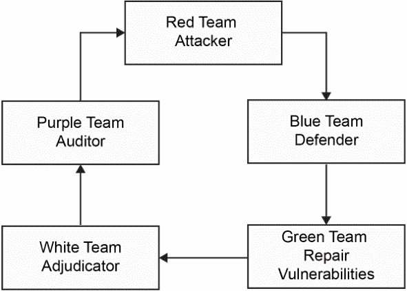
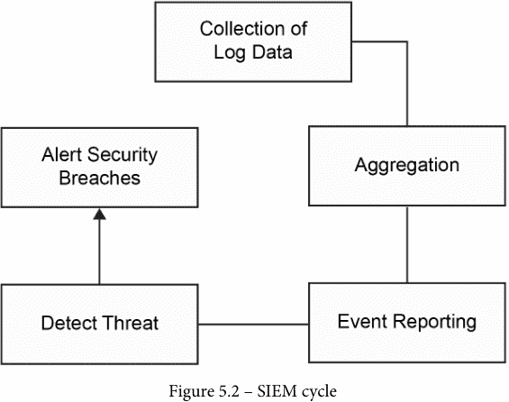
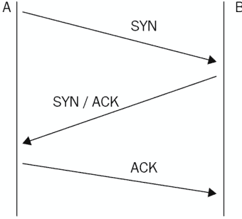
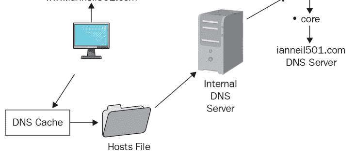

# 监控、扫描和渗透测试

安全专业人员最重要的职责之一是保护公司环境免受攻击，因此在本章中，我们将探讨监控、扫描和渗透测试。

在本章中，我们将涵盖以下主题：

- 渗透测试概念
- 被动与主动侦察
- 演练类型
- 漏洞扫描概念
- Syslog/安全信息和事件管理
- 威胁狩猎

## 渗透测试概念

渗透测试是一种侵入性测试，第三方被授权攻击公司网络以识别弱点。他们使用的侵入性测试可能会对您的系统造成损害。

渗透测试通常称为 pen-testing。渗透测试人员获得的信息量各不相同，包括：

- **黑盒：** 黑盒渗透测试人员在未知环境中工作，不会获得有关公司的任何信息。他们将进行初步利用，寻找漏洞。
- **灰盒：** 灰盒渗透测试人员在部分已知的环境中工作，因为他们会获得有限的内部信息。
- **白盒：** 白盒渗透测试人员在已知环境中工作。白盒渗透测试的目的之一是在沙箱中测试应用程序，以便在发布时没有任何漏洞。由于他们可以访问应用程序的源代码，他们对系统或应用程序了如指掌。

**示例：** 一名渗透测试人员即将进行渗透测试，但没有获得任何有关该系统的信息。当该测试人员到达公司时，IT 经理递给该测试人员一杯咖啡，然后将服务器 1 的本地管理员账户交给了该测试人员。这是什么类型的渗透测试？

**答案：** 这是灰盒测试，因为该测试人员获得了一些信息。

黑盒和白盒渗透测试人员都会使用一种称为模糊测试（fuzzing）的技术，通过向应用程序插入随机信息，观察应用程序是崩溃还是报编码错误。

### 交战规则（ROE）

在任何渗透测试开始之前，需要确定以下信息：

- **客户联系信息：** 公司内部授权渗透测试的人员的详细信息，包括其联系方式，以便定期向其通报测试进展。他们应同意开始渗透测试的时间和日期。
- **范围：** 测试类型（是黑盒、灰盒还是白盒），以及在发现漏洞时允许采取什么行动。例如，我们是通知客户漏洞，还是客户已允许我们将漏洞利用到极致？这可能是侵入性的。


- **踩点（Footprinting）**：踩点是黑客用来绘制整个网络地图的过程，包括员工、计算机、IP 地址、操作系统版本、开放端口、服务以及漏洞。他们会试图尽可能多地收集目标信息。
- **开源情报（OSINT）**：这是从公共领域合法收集的情报，例如社交媒体或互联网上的网站。它被用于执法和商业情报，以帮助识别攻击来源。它仅用于非敏感数据。

> **考试提示**
>
> 攻击者利用横向移动使安全团队更难发现他们。

现在，我们来看看下一节中的不同演练类型。

### 演练类型

团队演练与渗透测试类似，但它们会邀请友好的 IT 专业人员加入不同团队。这些团队分为红队、蓝队、绿队、白队和紫队。我们逐一来看：



以下是不同团队的简要概述：

- **红队：**红队模仿攻击者，试图在你公司内部发现漏洞。他们经常将社会工程学和钓鱼攻击作为攻击手段的一部分。
- **蓝队：**蓝队旨在发现公司内部的安全漏洞，并采取措施加以缓解，以确保公司安全。
- **白队：**白队根据给定信息组织并裁定网络安全演练。他们设定演练规则和演练细节。如果他们发现红队造成了严重漏洞，他们会立即停止演练。他们根据红队和绿队提供的信息，对蓝队的表现进行评分。他们审查有关准确性的报告，并确保所有应对措施都是合适的。
- **绿队：**绿队接受过攻击者训练，但保持防御姿态，其重点是尽快修复漏洞。
- **紫队：**紫队可以同时承担蓝队和红队的角色。通过结合这两个团队，他们可以发现威胁行为者的战术。这些人可能是审计员或外部顾问。

> **考试提示**
>
> 白队制定演练规则并裁定网络安全事件，确保报告准确且应对措施合适。

现在，我们将在下一节中介绍不同的漏洞扫描概念。

### 漏洞扫描概念

漏洞扫描器是一种被动扫描器，用于识别系统中的漏洞或弱点。例如，可能存在操作系统缺少更新、防病毒解决方案缺少更新，或存在账户漏洞。

漏洞扫描器无法追踪零日漏洞利用；这种漏洞利用尚未被识别，也没有可用的更新或修补程序。我们来看看漏洞扫描器可能产生的输出类型：

- **常见漏洞与暴露（CVE）：**麻省理工学院研究与工程（MITRE）是一家位于马萨诸塞州贝德福德的非营利性、政府资助组织，负责研究不同的攻击向量。他们制定了**常见漏洞与暴露（CVE）**列表，该列表关注计算机缺陷，并可识别受影响的平台。每个缺陷都有一个 ID。请访问以下网址了解更多信息：`https://www.cvedetails.com/`。
- **通用漏洞评分系统（CVSS）：**CVSS 内置于许多漏洞扫描器中，用于指示漏洞的严重程度。安全团队可以利用该输出来确定需要优先处理哪些漏洞。始终优先处理严重事件。评分和评级如下所示：

| 评级 | 分数 |
| --- | --- |
| 严重 | 9.0-10.0 |
| 高危 | 7.0-8.9 |
| 中危 | 4.0-6.9 |
| 低危 | 0.1-3.9 |

- **误报：**误报是指扫描器认为存在漏洞，但实际人工检查时漏洞并不存在。
- **漏报：**另一方面，漏报更加危险。系统存在漏洞，但扫描器未能检测到它。漏报的一个例子是零日漏洞利用正在攻击系统，却没有任何检测方法。
- **真阳性：**真阳性是指系统扫描结果与人工检查结果一致的情况。
- **日志审查：**漏洞扫描后，务必审查日志文件，这些文件会列出任何潜在漏洞。安全团队应确保立即处理这些漏洞。

> **考试提示**
>
> 在处理 CVSS 事件时，始终优先处理严重事件。

### Syslog/安全信息和事件管理

网络中的系统会在日志文件中产生大量信息，其中大部分与错误或潜在攻击有关。这需要一种实时解决方案来关联这些事件，以便立即提醒安全团队。我们来看看 SIEM 和 syslog 服务器所扮演的角色。

**安全信息和事件管理（SIEM）**被视为 IT 最佳实践，受监管行业使用它来满足安全和审计合规要求，例如 HIPAA、GDPR、SOX 和 PCI DSS。SIEM 通过关联、聚合、规范化标准和非标准日志格式来整合事件日志值，从而为 IT 团队提供支持；它还可以过滤掉误报。

SIEM 系统唯一无法提供正确信息的情况是使用了错误的过滤器或监控了错误的主机。在这些情况下，会产生误报。

**系统日志（Syslog）**协议服务器用于从多个来源收集数据，并将其存储在单一位置，例如事件日志数据库。可以过滤掉正常数据，从而减少保存的数据量。由于搜索变得更加容易，SIEM 可以从过滤后的数据中获益。syslog 服务器与 SIEM 系统之间的数据是加密的。

下图展示了 SIEM 系统的不同方面：



现在，我们来看看 SIEM 系统的不同方面：

- **日志收集器：**SIEM 内置日志收集工具，可以从 syslog 服务器和其他多台服务器收集信息。设备上会放置一个代理，它可以收集日志信息，将数据解析为更合理的结构，然后将其传递给 SIEM 服务器进行聚合。
- **日志聚合：**SIEM 系统可以关联并聚合事件，从而排除重复项，更好地理解网络中发生的事件，以帮助识别潜在攻击。
- **日志取证：**日志文件可用于为取证团队寻找证据，以帮助他们识别攻击。
- **事件报告：**SIEM 系统具有仪表板并收集报告，可以定期审查这些报告，以确保策略已执行且公司符合合规要求。它还会突出显示 SIEM 系统是否有效且运行正常。误报可能是由于使用了错误的输入过滤器或监控了错误的主机而产生的。
- **检测威胁：**SIEM 系统可以从事件中检测网络上的威胁，并立即将与这些威胁相关的信息转发给安全团队。
- **安全漏洞警报：**收到潜在威胁的检测结果后，安全团队会核实是否发生了安全漏洞。然后，他们将采取必要措施阻止安全漏洞并防止其再次发生。

我们来看看 SIEM 服务器还可以执行哪些其他功能：

- **实时监控：**SIEM 可以实时监控，因此一旦发现任何事件，就会立即向安全团队发出警报。这有助于保护你的工作环境。当有人被授予管理员权限时，它也会提醒安全团队。
- **时间同步：**SIEM 系统依赖于所有它所收集和关联数据的主机彼此同步。所有收集点之间的时间需要同步。可以使用**网络时间协议（NTP）**来实现这一点。否则，如果计算机时钟不同步，关联的事件可能无法按正确顺序排列。
- **数据包捕获：**SIEM 系统可以捕获数据包并对其进行分析，以便在威胁到达你的网络时立即识别出来。然后可以立即提醒安全团队。


- **数据输入**：SIEM 系统从各种来源收集海量数据。以下是一些示例：
- **用户行为分析（UBA）**：这是基于用户的交互行为，重点关注用户的身份以及他们在日常工作中通常会访问的数据。它会跟踪用户常用设备和经常访问的服务器。如果仅观察一个人的行为，可能不会发现攻击，但如果将 UBA 应用于整个公司，就能在潜在攻击者偏离正常模式时识别出他们。
- **情感分析**：消费者情感可以通过查看 Amazon、Twitter、LinkedIn 和 Facebook 来衡量，用户会在这些平台上通过插入表情符号、点赞或分享按钮来发表产品评论。营销公司可以分析这些数据，从而很好地了解消费者的感受，然后据此针对目标市场定制营销策略。同样，在网络安全领域，我们使用人工智能和机器学习来识别攻击。借助网络安全情感分析，我们监控社交媒体上的文章，并查看文本内容，以便分析文章背后的情感倾向。如果在一段时间内持续分析这些数据，我们就能充分了解用户对网络安全不同方面的态度。
- **安全监控**：这是一个实时保护和事件监控系统，它会关联多个来源的安全事件，识别入侵行为，并帮助安全团队阻止入侵。

| 入侵检测系统 | 桌面事件 |
| 防火墙日志 | 服务器事件 |
| 网络数据包 | 防病毒事件 |
| 应用服务器 | 数据库日志 |
| 交换机日志 | 路由器日志 |

在下一节中，我们将详细介绍**安全编排、自动化与响应（SOAR）**。

### 威胁狩猎

威胁狩猎是一种在您的网络内部主动寻找来自攻击者和恶意软件威胁的动态过程。根据 Security Intelligence 网站的数据，平均每个网络犯罪分子在您的网络内部可能潜伏 191 天才被发现。有关更多信息，请点击以下链接查看这篇文章：

https://securityintelligence.com/a-beginners-guide-to-threat-hunting/。

当您要开展威胁狩猎时，首先需要尽可能多地从开源情报、威胁情报源、安全通告和公告中获取信息，以确定您要寻找的目标。您还必须了解您的环境以及应用程序和进程之间如何相互交互，这样才能识别哪些是威胁，哪些不是。您必须采用攻击者的思维方式，寻找网络攻击的证据，同时也要从您的研究中寻找可能存在的漏洞，以便修复这些漏洞。

现在让我们来了解一下威胁狩猎的过程，以便更好地理解它。我们将讨论情报融合、威胁情报源、安全通告和公告。

- **情报融合：** 开源情报可以从互联网上的各个地方获得，例如供应商博客、研究人员以及诸如*Security Week*等网站。请访问此 URL 了解更多详细信息：`https://www.securityweek.com/virus-threats`。诸如*Crowdstrike*之类的公司会发布开源情报报告。请参阅其 2020 年报告，可在此处获取：`https://go.crowdstrike.com/crowdstrike-2020-overwatch-threat-hunting-report-thank-you.html`。通过这些资源，您将更好地了解当前的威胁以及您需要寻找的目标。
- **威胁情报源：** 开源威胁情报源提供最新信息。请查看*logz*网站上列出的最佳威胁情报源资源，网址如下：`https://logz.io/blog/open-source-threat-intelligence-feeds/`。
- **安全通告和公告：** 安全通告和安全公告就如何确保公司安全提供了良好的建议。安全通告通常由政府资助的机构发布。安全公告通常由供应商或私营公司发布。请通过以下链接查看 OPC 基金会发布的公告：`https://opcfoundation.org/SecurityBulletins/OPC%20Foundation%20Security%20Bulletin%20CVE-2017-12070.pdf`。

**示例：** 让我们来看两份安全通告，一份来自美国，另一份来自英国。
*网络安全与基础设施安全局*，隶属于*美国政府国土安全部*，会向公众通报威胁情况。这有助于您保护您的公司。请参阅*警报 (AA20-245A)*，网址为 https://us-cert.cisa.gov/ncas/alerts/aa20-245a。在英国，*国家网络安全中心*在以下网址列出了安全通告：https://www.ncsc.gov.uk/section/keep-up-to-date/reports-advisories。

- **机动：** 以军事为例，在战争中，一方会通过伪装攻击并迅速行动来获取对对手的优势，从而迂回机动战胜对方。那么，网络安全机动指的是公司通过伪装其系统来防御攻击，从而使攻击者难以成功渗透。在威胁狩猎中，执行防御性机动意味着了解潜在攻击者可能使用的攻击方法，以便您能在他们最意想不到的时刻进行拦截并破坏其攻击。

### 复习题

现在，是时候检验您的知识了。请回答以下问题，然后对照本书末尾*解决方案*部分中的答案进行检查：

- 1. 哪种渗透测试人员会被提供源代码？
- 2. 为什么共享账户会为监控带来问题？
- 3. 哪种渗透测试人员在测试前没有任何访问权限，但在最后一刻获得了桌面拓扑图？
- 4. 在渗透测试开始之前需要确定什么？
- 5. 在进行未通报的渗透测试时，测试人员如何知道内部安全团队是否已经发现了他？
- 6. 交战规则的适用范围是什么？
- 7. 如果渗透测试已向 IT 团队通报，那么他们在测试开始前应提供哪些与测试相关的信息？
- 8. 有凭据漏洞扫描和无凭据漏洞扫描的主要区别是什么？
- 9. 在渗透测试的哪个阶段，测试人员会将系统恢复到原始状态或告知 IT 团队需要修补的漏洞？
- 10. 什么是 OSINT？它合法吗？
- 11. 红队的目的是什么？
- 12. 蓝队的目的是什么？
- 13. 白队的目的是什么？
- 14. 紫队的目的是什么？
- 15. 在评估 CVSS 分数时，您应该首先处理哪些漏洞？
- 16. 描述一下误报。
- 17. 什么是真报？
- 18. 侵入式扫描和非侵入式扫描有什么区别？
- 19. 什么是回归测试，由谁来执行？
- 20. 何时执行动态分析？
- 21. 什么是 syslog 服务器，它的作用是什么？
- 22. 为什么 SIEM 服务器需要依赖其收集数据的所有服务器和设备之间的同步时钟？
- 23. 威胁狩猎的目的是什么？

### 协议简介

**协议**是指不同应用程序为交换数据而需要遵循的规则，应用程序可以通过它执行各种操作，例如在远程系统上运行命令、发送和接收电子邮件、从互联网下载文件等。每个应用程序都有一个专用的端口号用于通信。您可以把端口想象成电视频道：如果想看体育节目，就去体育频道；如果想看新闻，就去新闻频道。应用程序也是如此（如果想发送电子邮件，就使用电子邮件应用程序），它们每种通信模式都有一个不同的端口号。

端口有两种类型：**传输控制协议（TCP）**和**用户数据报协议（UDP）**。两者的主要区别在于，TCP 是面向连接的，因为它使用三次握手；而 UDP 更快但可靠性较低，因为它是无连接的。下图展示了三次握手过程：



图 6.1 – 三次握手

在三次握手中，发送的第一组数据包称为**SYN**包，发送主机通过它告知接收主机其下一个数据包的序号。接收主机发送一个**SYN/ACK**包，告知发送主机其下一个数据包是什么。**ACK**包对这两种数据包进行确认，然后开始发送数据。数据按块发送，当接收到数据时，会发送一个确认信息，告知发送主机继续发送更多数据包。当所有数据发送完毕后，通过三次握手确认所有数据完整无误，然后会话关闭。

在 UDP 会话中，由应用程序负责确保所有数据都已被接收，并且因为不使用三次握手，连接速度更快但可靠性更低。UDP 通常用于流媒体视频和在线游戏，这些场景对速度要求至关重要。


### 不安全的协议及其用例

在本节中，我们将详细了解各种*不安全的协议*。由于大多数协议使用 TCP 端口，本章只会提及 UDP 端口，因此你可以假设如果没有标明 UDP，那就是 TCP。我们将介绍这些不安全的协议及其用例：

| 不安全的协议 |  |  |  |
|---|---|---|---|
| 协议 | UDP | 端口 | 用途 |
| 文件传输协议 (FTP) |  | 21 | 文件传输 – 被动 FTP |
| Telnet |  | 23 | 在远程主机上运行命令 |
| 简单邮件传输协议 (SMTP) |  | 25 | 在邮件服务器之间传输邮件 |
| 域名系统 (DNS) | UDP | 53 | 主机名解析 |
|  |  | 53 | 区域传送 |
|  | UDP | 53 | 名称查询 |
| 动态主机配置协议 (DHCP) | UDP | 67/68 | 自动 IP 地址分配 |
| 简单文件传输协议 (TFTP) | UDP | 69 | 使用 UDP 进行文件传输 |
| 超文本传输协议 (HTTP) |  | 80 | 网页浏览器 |
| 邮局协议第 3 版 |  | 110 | 从邮件服务器拉取邮件，邮件服务器上不保留副本 |
| 网络时间协议 (NTP) |  | 123 | 时间同步 |
| NETBIOS | UDP | 137-139 | NETBIOS 到 IP 地址解析 |
| 互联网消息访问协议 (IMAP 4) |  | 143 | 从邮件服务器拉取邮件 |
| 简单网络管理协议 (SNMP) | UDP | 161 | 通知状态并为网络设备生成报告 |
| 轻量目录访问协议 (LDAP) |  | 389 | 存储 X500 对象，在目录服务中搜索用户、组和其他信息 |

让我们逐一了解：

- **FTP**：传输文件是一项常见功能。当我们购买电子书时，它可以立即下载到我们的桌面上。如果我希望将文件上传到 Web 服务器，我会使用端口 20 上的 FTP，但更常见的用途是使用端口 21 下载文件，这被称为**被动 FTP**。使用 FTP 的缺点是传输使用明文进行，因此数据包嗅探器可以查看信息。它可以用 SFTP 或 FTPS 等安全协议替代。
- **Telnet**：这是一种最早于 1973 年用于在路由器等设备上运行远程命令的协议。不幸的是，会话使用明文传输，因此不安全。如果你想知道名为 **Mail1** 的邮件服务器上的端口 25 是否开放，你可以运行 `telnet Mail1 25`。由于不安全，它已不再使用，但可能会被测试。SSH 是取代 Telnet 的安全协议。

**示例：** 以下是一条 LDAP 查询，用于查找名为 Ian Neil 的用户：

```
(&(objectCategory=person)(objectClass=user)(CN=Ian Neil))
```

所有传输都是明文，因此非常不安全。

电子邮件协议有多种类型；有些基于 Web，有些使用桌面上的 MAPI 客户端。让我们来看看不安全的版本：

- **SMTP**：用于在不同邮件服务器之间传输文件，并用于出站电子邮件。
- **邮局协议第 3 版（POP3）**：这是一种电子邮件客户端，从邮件服务器拉取电子邮件，但当电子邮件下载后，邮件服务器本身不会保留副本。它并不常用，但在 Security+ 考试中会考到。POP3 也有安全版本。
- **互联网消息访问协议第 4 版（IMAP4）**：一种邮件客户端，也从邮件服务器拉取电子邮件，但比 POP3 功能更多，因为邮件服务器上会保留邮件副本。它还可以提供任务、日历和日志功能。IMAP 也有安全版本。

**名称解析**有两种类型：主机名解析（最常见）和 NETBIOS（一种很少使用的传统名称解析）。

最常见的名称解析形式是主机名解析，其中 DNS（将主机名映射到 IP 地址的数据库）使用一个名为 hosts 文件的平面文件：

- **DNS**：这是一个层次化命名系统，将主机名解析为 IP 地址。我不需要知道实际的 IP 地址。如果我想访问微软网站，我知道需要在 Web 浏览器中输入 `www.microsoft.com`，它就会带我到达那里。如果在一个名为 `securityplus.training` 的域中有一个名为 Ian 的用户，那么主机名部分就是 Ian，**完全限定域名（FQDN）**将是 `ian.securityplus.training`。DNS 数据库的记录类型如下：
  a. **A：** IPv4 主机
  b. **AAAA：** IPv6 主机
  c. **CNAME：** 别名
  d. **MX：** 邮件服务器
  e. **SRV 记录：** 查找域控制器等服务

例如，假设用户想访问网站 ianneil501.com；要到达那里，他们会在 Web 浏览器中输入 www.ianneil501.com：



图 6.2 – DNS 名称解析

主机名解析采用严格的过程，无论对错，都会采用主机名的第一个条目——这是该过程的一个缺陷。在前面的示例中，DNS 缓存为空，因此它会继续检查本地计算机上的 hosts 文件，然后才是 DNS 服务器。

如果需要查看 DNS 缓存，你可以运行 `ipconfig / displaydns` 命令；如果想清除 DNS 缓存，可以运行 `ipconfig /flushdns` 命令。让我们从 DNS 缓存开始了解这个过程：

- a. **DNS 缓存**：存储最近解析的名称；攻击者会尝试通过插入不正确的条目来污染 DNS 缓存，将你引导到非法的替代服务器。DNSSEC 有助于防止 DNS 污染。
- b. **Hosts 文件**：这是一个平面文件，条目是手动插入的，从上到下读取。无论对错，始终采用第一个条目。hosts 文件的作用是，如果某个用户需要访问名为 Sneaky Beaky 的服务器，你可以在其本地 hosts 文件中添加一个 Sneaky Beaky 服务器的条目，从而允许该用户访问。如果将条目放在 DNS 服务器中，则任何人都可以找到该服务器。
- c. **DNS 服务器：** 通常只维护你的域的主机名。它需要通过互联网根服务器完成一个引用过程，根服务器用点表示。`nslookup` 命令用于验证 DNS 服务器持有的 DNS 条目。
- d. **根服务器：** 根服务器将请求转发到 `.com` 服务器，后者又将请求转发到 `iannel501.com` 域（在我们之前的示例中）的权威 DNS 服务器，然后该服务器回复网站的 IP 地址。
- e. **缓存回复：** 将名称解析的副本放入 DNS 缓存以供将来使用。

- **NETBIOS：** 这是 Microsoft 的旧式命名约定，具有平面命名空间，最多可有 15 个字符并包含一个服务标识符。每台计算机的名称在其数据库中都有三个单独的条目，该数据库称为 `WINS`，并且它使用一个名为 `LMHosts` 文件的平面文件。PC1 在 WINS 数据库中的条目如下：

  **PC1 <00>：** `<00>` 表示工作站服务。

  **PC2 <03>：** `<03>` 表示信使服务。

  **PC3 <20>：** `<20>` 表示服务器服务。

过去，当公司需要开会（例如销售会议）时，会设定一个日期，销售人员会保持日程空闲，提前一天晚上前往会议地点并预订酒店。这非常昂贵且耗时；如今，我们使用**视频会议**，每个人都可以参加会议，无需出行，并且可以更轻松地腾出日程，从而提高工作效率。在 Security+ 考试中，我们需要了解哪些协议用于此类视频会议：

- **实时传输协议（RTP）：** 一旦**会话发起协议（SIP）**建立了会话，RTP 就传输视频会议流量。RTP 可以被安全版本 SRTP 替代。
- **媒体网关：** 允许不同的视频和语音方法相互通信；例如，如果你使用 XMPP 网关，可以将 Jabber 客户端连接到 Skype 会话。

> **考试提示**
> 
> Kerberos 和 SIEM 系统都依赖 NTP 服务器来同步网络上各节点之间的时间。


### 安全协议及其用例

在本节中，我们将详细探讨各种*安全协议*及其用例。Security+ 考试要求你针对给定场景选择正确的安全协议，以确保你的环境安全。

由于大多数协议使用 TCP 端口，我将只提及 UDP 端口，因此你可以假设如果某处未标注 UDP，则为 TCP。我们来看一下这些安全协议及其用例：

| 协议 | UDP | 端口 | 用例 |
|---|---|---|---|
| 安全外壳（SSH） |  | 22 | 安全的远程访问 |
| 安全复制协议（SCP） |  | 22 | 安全复制到 UNIX/LINUX |
| SSH 文件传输协议（SFTP） |  | 22 | 安全的 FTP 下载 |
| DNSSEC | TCP/UDP | 53 | 安全的 DNS 流量 |
| Kerberos |  | 88 | 安全认证 |
| 简单网络管理协议第3版（SNMP v3） | UDP | 162 | 网络设备的安全状态和报告 |
| 轻型目录访问协议安全版（LDAPS） |  | 636 | 安全管理目录服务信息 |
| 超文本传输安全协议（HTTPS） |  | 443 | 安全的网页浏览 |
| 传输层安全（TLS）/安全套接字层（SSL） |  | 443 | 传输中的数据安全 |
| 互联网协议安全（IPSec） | UDP | 500 | VPN 或两台主机之间的安全会话 |
| 安全简单邮件传输协议（SMTPS） |  | 587 | 安全的 SMTP |
| 安全互联网消息访问协议（IMAP4） |  | 993 | 安全的 IMAP4 |
| 安全邮局协议第3版 |  | 995 | 安全的 POP3 |
| 安全/多用途互联网邮件扩展（S/MIME） |  | 993 | 加密或对电子邮件进行数字签名 |
| 文件传输协议安全版（FTPS） |  | 989/990 | 安全地下载大文件 |
| 远程桌面协议（RDP） |  | 3389 | Microsoft 远程访问 |
| 会话发起协议（SIP） |  | 5060/61 | 连接基于互联网的呼叫 |
| 安全实时协议（SRTP） |  | 5061 | 安全的语音流量 |

让我们逐一了解它们：

- **SSH：** 它的发明是为了取代 Telnet，以便可以安全地运行命令；当你需要远程访问网络设备时，通常会使用它。它可以作为命令行工具或在**图形用户界面（GUI）**中使用，但它不是基于浏览器的。
- **SCP：** 用于在 Linux 环境中的主机之间安全地传输文件。
- **SFTP：** 它允许我们对认证进行加密并安全地下载文件，以防止文件被篡改。由于它与 SSH 捆绑在一起，因此是安全的。
- **DNSSEC：** 为了防止有人获取 DNS 记录，引入了 DNSSEC 来保护 DNS 流量。每条 DNS 记录都经过数字签名，生成一个 RRSIG 记录以抵御攻击，从而保证记录有效且完整性得到维护。这可以防止 DNS 污染。

- **Kerberos：** Kerberos 是用于登录目录服务的认证系统，它使用票据进行认证。用户完成一个称为**票据授予票据（TGT）**会话的会话，并获得一张 10 小时的服务票据。当用户尝试访问电子邮件时，他们的计算机会用加密的服务票据交换一张会话票据，这意味着认证是相互且安全的。所有计算机必须将其时间同步到与域控制器时间相差 5 分钟以内。这取代了不安全的 NTLM 认证，并防止哈希传递攻击。

对目录服务对象的每次更新都会为该更改分配一个**更新序列号（USN）**。例如，如果一次更改的 USN 为 23，那么下一次更改的 USN 必须为 24，并且会盖上发生时间的时间戳，这被称为*带时间戳*。Kerberos 可以防止重放攻击，即先进行拦截，然后在稍后时间篡改并重放信息。在这种情况下，由于时间戳和 USN 失去顺序，流量会被拒绝。
- **SNMP v3：** SNMP v3 是 SNMP 的安全版本，因为它对数据包进行认证和加密。每个网络设备都安装了一个代理，并经过编程，当触发条件满足时，会通知 SNMP 管理控制台。SNMP 可以监控网络设备的状态，并在需要时提供报告。
- **LDAPS：** LDAP 用于与 Active Directory 通信，Active Directory 存储用户、计算机、打印机和用户密码等对象。Active Directory 还保存敏感信息；因此，必须保护这些信息免受攻击者窃取。获取 Active Directory 信息可能使攻击者创建管理凭据，给公司造成严重损害。

为了保护 LDAP 流量，我们可以使用 LDAPS，因为它使用 TLS 对流量进行加密和保护。这对每家公司来说都应该是强制性的。我们还应该使用最小权限原则。
- **HTTPS：** 它可以用来保护网页安全，但更常用于从网站进行购买时，你会被转到一个使用 HTTPS 的安全服务器，这样你的会话就是安全的，然后你就可以输入信用卡或借记卡详细信息。它还可以用于网络邮件和安全地填写网络表单。
- **TLS：** TLS 用于保护传输中的数据，是 SSL 的升级版本，用于加密互联网上的通信（如电子邮件或互联网传真）并安全地传输数据。它可以在 Web 浏览器中使用。
- **IPSec：** IPSec 可以与 L2TP/IPSec 一起使用来提供 VPN 会话。一个 IPSec 数据包分为两个独立部分：**认证头（AH）**和**封装安全载荷（ESP）**。

头部使用 SHA1（160 位）或 MD5（128 位）进行哈希处理，以确认数据包的完整性。封装安全载荷是数据，使用 DES（56 位）、3DES（168 位）或 AES（128、192 或 256 位）进行加密。这些是使用分组密码的对称加密，用于加密大量数据：

| 认证头（AH） | 封装安全载荷（ESP） |
|---|---|
| SHA 1, MD5 | DES – 56 位<br>3DES – 168 位<br>AES – 256 位 |

图 6.3 – IPSec 数据包

IPSec 可用于在网络上的两台主机之间创建安全会话，它有三种不同的模式：

a. **隧道模式：** 用于 L2TP/IPSec VPN，其中头部和载荷都会被加密。它通常用于外部。

b. **传输模式：** 用于内部网络中的两台服务器或主机之间，其中只有载荷被加密。

c. **始终在线模式：** 这是一种站点到站点 VPN，其作用类似于点对点连接。

> **考试提示**
> 
> IPSec 可以在隧道模式下与 L2TP/IPSec 一起使用，也可以在局域网中的服务器之间使用传输模式。

- **SMTPS：** 这是一种安全的 SMTP，它使用 TLS 进行加密。它使用 STARTTLS 命令来保护电子邮件。
- **IMAP 4：** 这是一种电子邮件客户端，可以管理任务和日记。
- **安全邮局协议第3版：** 这是一种传统电子邮件客户端，不会在邮件服务器上留下消息副本。
- **S/MIME：** 它使用**公钥基础设施（PKI）**来加密电子邮件或对电子邮件进行数字签名，以证明消息的完整性。它非常繁琐，因为需要每个用户与其他用户交换公钥，并且扩展性不太好。

- **FTPS：** 该协议用于安全地传输大文件，因为它使用 TLS 在下载文件之前建立安全隧道，这使其更快。FTPS 有两种不同的模式：
  a. **隐式模式：** 使用 TCP 端口 990 作为控制通道、998 作为数据通道来协商安全会话。
  b. **显式模式：** 这被称为 FTPES，客户端必须请求安全性；如果客户端不请求，会话将被拒绝。
- **RDP：** 这是一种 Microsoft 产品，允许你在 Windows 桌面或服务器上运行安全的远程访问会话。当你使用 RDP 设置远程访问时，获取会话的服务需要允许传入的远程会话访问，然后将用户放入远程桌面用户组。如果不执行这两个操作，它将无法工作。由于大多数路由器是 CISCO 产品，RDP 不能用于远程访问路由器或任何其他网络设备——只能用于 Microsoft 产品。
- **SIP：** 它允许互联网上的所有人以及使用 VoIP 的人通过计算机、平板电脑和智能手机进行通信。一个例子是秘书为老板接听 Skype 电话：SIP 允许他们把呼叫者置于等待状态，与老板通话，如果必要的话，再把呼叫转接过去。
- **SRTP：** 它用于保护视频会议流量的安全——通常使用 TCP 端口 5061。语音流量可以放在自己的 VLAN 中，以与其他网络隔离，从而保证带宽。

> **考试提示**
> 
> 你必须了解安全协议的用途及其相关端口。

### 其他用例及其协议

在本节中，我们将了解订阅服务、路由、交换和 Active Directory 的其他用例。


- **生成树协议（STP）**：当连接多个交换机时，你可能会有冗余路径，这会导致循环并产生广播流量。STP 有一种算法可将某些端口设置为转发、侦听或阻塞流量以防止循环。

### Active Directory（目录服务）及其协议

Microsoft 的 Active Directory 是一种非常常见的目录服务，我们将查看其使用的组件和协议：

- **LDAP**：在 Active Directory 中创建对象时，是通过完成向导来完成的，然后 LDAP 将它们存储为 X.500 对象。因此，它是 Active Directory 存储人员。例如，LDAP 就像一个卖鞋的店主。当货物到达时，鞋子会被卸下并存放在商店后面。当顾客到来且看不到想要的尺码时，他们会询问店主，店主会去仓库寻找鞋子。当系统管理员在 Active Directory 中打开向导并创建用户帐户时，LDAP 会创建并以 X.500 格式存储对象。如果管理员有 10,000 名用户并且需要查找某个用户，他们会使用搜索功能，LDAP 会返回搜索结果。
- **LDAPS**：LDAPS 执行与 LDAP 相同的功能；然而，LDAP 不安全，容易受到 LDAP 注入攻击，攻击者试图从目录服务中获取信息。使用 LDAPS 使用 SSL/TLS 对会话进行加密——这被称为 LDAP over SSL——使其安全。
- **Kerberos**：Kerberos 是用于登录 Active Directory 的身份验证系统，并使用票据进行身份验证。

### 复习问题

现在是时候检查你的知识了。回答问题，然后查看答案，可在本书末尾的解决方案部分找到：

1. 使用票据并防止重放攻击的身份验证协议是什么？
2. 描述 IPSec 隧道模式的工作方式。
3. 描述 IPSec 传输模式的工作方式。
4. 如果 IT 管理员使用 Telnet 在路由器上运行远程命令，可以用哪种安全协议替换它？
5. 路由器的用途是什么？
6. 交换机的用途是什么？
7. Spotify 是什么类型的服务？
8. 解释端口安全的工作原理。
9. 描述带有 802.1x 的托管交换机的工作方式。
10. 区别名称的三个部分是什么以及它们的顺序？
11. 你可以使用哪种协议来防止 DNS 欺骗？
12. 计算机可能无法从 DHCP 服务器接收 IP 地址的两个原因是什么？
13. 哪种类型的服务器对 SIEM 服务器和 Microsoft 域控制器都安装在其网络上会受益？
14. 如果两家公司租用了同一栋楼同一层的办公室，建筑管理员可以实施什么来将它们彼此隔离？
15. STP 的用途是什么？
16. 如果网络管理员想要收集网络设备的状态和报告，他们可以使用什么安全协议？
17. 如果网络管理员想要设置 VPN，他们可以使用什么最安全的协议？
18. 哪种安全协议可用于防止哈希传递攻击？
19. 哪种协议保护传输中的数据？
20. 哪种协议可用于在两个人之间数字签名电子邮件？
21. 哪种协议可用于保护视频会议？
22. 哪种协议允许用户将 Skype 会话挂起，与另一个人交谈，然后返回第一个来电者？
23. 系统管理员正在使用一个使用 TCP 端口 389 的协议管理目录服务。他们使用的是什么协议，可以使用什么协议安全地执行相同的任务？
24. 假设我使用 `nbtstat -n` 命令，输出显示以下内容：

    ```
    IAN <00>
    IAN <20>
    ```

    使用了什么命名约定以及显示的格式是什么？
25. 哪种协议可用于远程传输大文件？
