## 7 深入网络和安全概念

我们需要了解许多网络组件和拓扑（布局）以维护安全环境。我们将逐一查看这些内容。我们需要知道每个设备的配置方式以及在不同场景下最合适的设备。

在本章中，我们将介绍以下主题：

- 安装和配置网络组件
- 远程访问功能
- 安全网络架构概念
- 网络侦察和发现
- 取证工具
- IP 地址

### 安装和配置网络组件

有许多不同的网络组件，我们将逐一查看。对于 Security+ 考试，我们需要知道在不同场景下可以使用哪种设备，因此让我们先查看防止未经授权访问的防火墙，然后再查看其他设备。

#### 防火墙

防火墙可防止未经授权访问企业网络，在 Security+ 考试中，我们倾向于使用背靠背配置，如下所示：

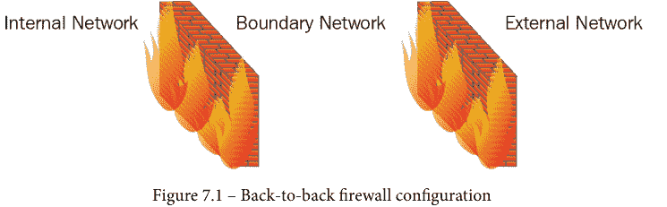

你可以看到这些防火墙都没有让流量通过它们；这是因为我们只需要打开所需的端口。如果右侧的防火墙被穿越，那么左侧的防火墙 hopefully 会防止访问内部网络，即 **局域网（LAN）**。为了使应用程序通过防火墙，我们必须为每个应用程序打开端口号。每个应用程序都有不同的端口号。如果你认为有人想看新闻，民主党人会在 21 频道观看 CNN，共和党人会在 29 频道观看 Fox News。每个电视节目都有不同的频道号。

如果我们想访问互联网上的网站，我们应该为 **超文本传输协议（HTTP）** 在 TCP 端口 80 上同时进行出站和入站例外。这是每个 Web 服务器用于通信的端口号，无论他们使用 Microsoft Edge、Google Chrome 还是 Firefox 都无关紧要。这些应用程序都使用 TCP 端口 80 进行 Web 流量。

端口的方向是出站，从内部网络发出到外部网络，或入站，从外部网络进入到内部网络。如果我们只打开端口 80 的出站端口，请求会发出，但传入的响应将被阻止。

防火墙的主要目的是防止未经授权访问网络。默认设置是阻止所有流量，按例外允许。有许多不同的防火墙：

- **基于主机的防火墙：** 这是内置于桌面操作系统的应用程序防火墙，例如 Windows 10 操作系统：

  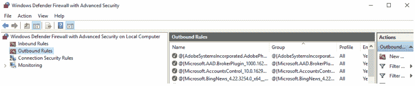

  图 7.2 – 基于主机的防火墙

  由于基于主机的防火墙是桌面上的应用程序，因此容易受到攻击。如果有人禁用运行 Windows 防火墙服务的服务，则防火墙将被禁用，计算机变得脆弱。以下屏幕截图显示防火墙服务处于 **正在运行** 状态：

  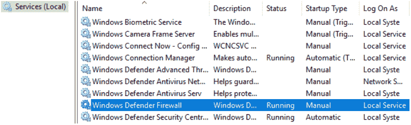

  图 7.3 – Windows 防火墙服务

- **基于网络的防火墙：** 这是保持网络安全的硬件设备。必须确保仅打开所需的端口。其中一种配置是背靠背配置，其中部署了两层防火墙（见图 7.1）。基于网络的防火墙放置在网络边缘以防止未经授权的访问。

- **有状态防火墙**：它深入检查应用程序及其流量以查看是否允许通过。例如，一个数据包到达并带有 `GET <webpage>` 命令，由于 GET 动词在 HTTP 中是查看网页的请求，因此允许流量通过。然而，如果 HTTP 动词使用 PUT 动词，这可能用于篡改网页，则会被阻止。如果使用 HEAD，它会尝试拉下网站头信息，也会被阻止。有状态防火墙知道每个数据包的大小，并会阻止大小不正确的流量。

- **无状态防火墙**：无状态防火墙也称为 *数据包过滤防火墙*。它只查看数据包是否被允许，从不深入查看数据包格式。

- **Web 应用防火墙（WAF）**：WAF 放置在 Web 服务器上，其作用是保护运行在 Web 服务器上的基于 Web 的应用程序。

- **统一威胁管理防火墙（UTM）**：UTM 是一种多用途防火墙：它执行恶意软件、内容和 URL 过滤。它被称为一体式安全设备。

- **下一代防火墙（NGFW）**：这是一种应用感知的防火墙，可用于本地和云环境。它具有云威胁情报和入侵防御系统的功能。 https://www.checkpoint.com/quantum/next-generation-firewall/

- **开源与专有**：开源防火墙是指厂商将许可证免费提供给任何人并允许访问源代码，尽管可能会要求可选捐赠。开源没有厂商支持。最好的开源防火墙之一是 pfSense，其详细信息可在以下网址找到： https://www.pfsense.org/。专有防火墙更昂贵但提供更好的保护和更多功能。有许多不同类型。其中最好的防火墙厂商之一是 **Check Point**，它拥有许多产品，价格取决于您的业务需求。他们还在购买前为您提供免费演示，可在以下网址找到： https://www.checkpoint.com/demos/

> **考试提示**
> 在排除防火墙问题时，请查看拒绝规则，因为它可能需要调整。确保 TCP 端口未标记为 UDP。


#### 网络地址转换网关

**网络地址转换（NAT）**是指来自私有内部 IP 地址的请求被转换为外部公共 IP 地址，从而隐藏内部网络以免受外部攻击（参见*图 7.4*）：

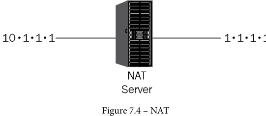

可以设置 NAT 来隐藏研发网络，因为竞争对手可能会试图窃取你的新想法并在你之前将其推向市场。NAT 可以设置在防火墙或 NAT 服务器上，也用于保护云 VPC。出于考试目的，NAT 隐藏内部网络。

#### 路由器

路由器是一种在设置主机时连接两个不同网络的设备；它被称为*默认网关*。它由你的公司使用，以便你访问其他网络——例如，互联网。它内置了路由表，因此它知道可以使用哪条路由来传输网络数据包。路由器相当于邮局的 IP 版本，负责在全球范围内投递信件，但传输的不是信件，而是 IP 数据包。如果它不知道将流量发送到哪里，就会使用默认路由，显示为 0.0.0.0。这通常指向你的 ISP。

**服务质量（QOS）**确保在网络带宽有限时，应用程序拥有其运行所需的带宽量。

#### 访问控制列表 – 网络设备

网络设备的**访问控制列表（ACL）**不得与文件和文件夹的 ACL 混淆；它们完全不同。两种使用 ACL 的网络设备是防火墙和路由器。ACL 通过使用端口号、应用程序名称或 IP 地址来阻止访问。当你安装新的防火墙或路由器时，没有任何规则，除了最后一条拒绝所有规则。路由器或防火墙的默认设置是阻止所有访问，直到通过配置允许规则为你想要允许通过的流量创建例外。如果没有允许规则，最后一条拒绝规则适用。这称为**隐式拒绝**。

**示例：** John 一直在网上购物并购买了一本电子书，但他无法下载。他使用 HTTP 访问了网站，然后使用 HTTPS 访问安全服务器进行购买，以保护他的信用卡详细信息。然而，当尝试下载电子书时，流量被防火墙阻止。ACL 允许 TCP 端口 80（HTTP）和 TCP 端口 443（HTTPS），但没有允许 FTP 使用 TCP 端口 21 的规则：

| Firewall or Router - ACL |  |  |
|---|---|---|
| Allow | TCP Port 80 | HTTP |
| Allow | TCP Port 443 | HTTPS |
| Allow | TCP Port 53 | DNS |
| Allow | UDP Port 53 | DNS |
| Last Rule | Deny All |  |

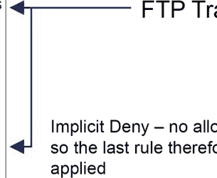

图 7.5 – 隐式拒绝

由于防火墙上没有允许 FTP 流量的规则，当 FTP 流量到达时，它会与允许规则进行检查，如果没有匹配的规则，就会落到最后一条规则，拒绝所有流量。这被称为隐式拒绝。虽然示例是防火墙，但路由器也使用 ACL。两个设备都在过滤传入流量。

#### 交换机

交换机是一种内部设备，用于连接 LAN 中的所有用户。交换机有一个列出 MAC 地址的表，也称为内容可寻址内存（CAM）表，列出连接到它的主机：


图 7.6 – 交换机

一旦交换机安装完毕，它就会建立路由表；每个主机都由其 MAC 地址标识。每个端口只能注册一个 MAC 地址。交换机仅将数据包传递给需要该数据包的主机。当连接到网络的用户多于交换机上的端口时，交换机可以堆叠：

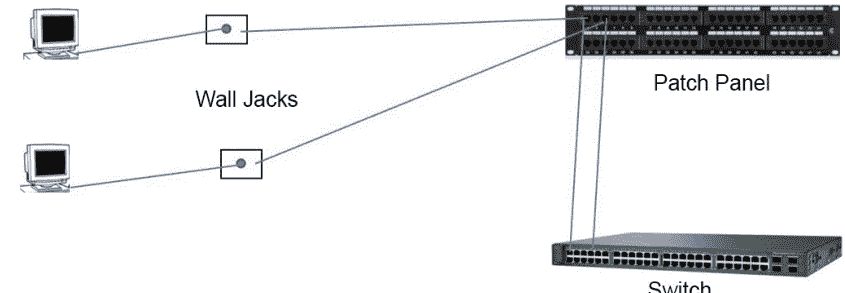

图 7.7 – 网络连接

一台计算机有一根以太网电缆插入墙上插孔，然后墙上插孔通过铺设在地板下或天花板上的电缆连接到配线架。用户看不到它们。从配线架有一根电缆进入交换机上的一个端口。以太网布线放置在管道内以保护电缆。插入墙上插孔的电缆非常容易。因此，网络管理员必须为交换机上的每个端口设置安全措施。

有两种类型，802.1x 和端口安全，以及可以配置的其他保护措施：

- **端口安全：** 当任何人，无论是否授权，将其以太网电缆插入墙上插孔时，交换机会允许所有流量。有了端口安全，端口将被关闭。这不是一个好的做法，因为你限制了交换机的功能。
- **802.1x：** 当网络管理员使用 802.1x 时，用户或设备在建立连接之前会通过证书进行身份验证。它将防止未经授权的设备连接并允许授权设备连接。802.1x 相对于端口安全的优势在于交换机上的端口均未被禁用，交换机具有完整功能。
- 其他如下：
  - **环路保护：** 当两个或多个交换机连接在一起时，它们可能会创建环路，从而产生广播风暴。我们需要使用**生成树协议（STP）**通过在某些端口上转发、监听或阻塞来防止这种情况发生。
  - **桥接协议数据单元（BPDU）：** 这些是包含有关 STP 信息的帧。BPDU 攻击会尝试伪造根桥，以便重新计算 STP。BPDU Guard 使 STP 能够阻止此类尝试。
  - **MAC 过滤：** 每个具有网络接口的设备，无论是有线还是无线，都有一个唯一的网络接口地址，称为**媒体访问控制（MAC）**地址。如果一个 MAC 地址被添加到 MAC 过滤列表中，那么所有其他希望使用无线接入点的设备必须被添加到 MAC 过滤列表中，否则将被阻止：

  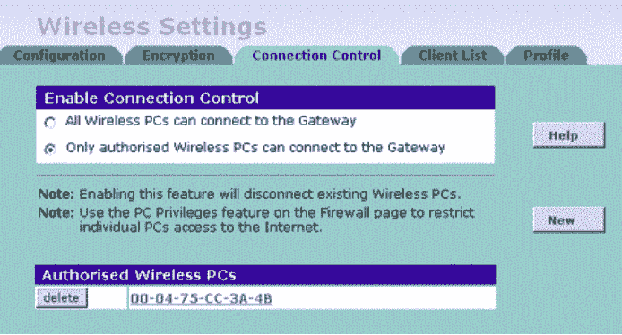

  图 7.8 – MAC 过滤

它有三个主要功能：URL 过滤、内容过滤和网页缓存：

- **URL 过滤：** 当用户访问网站时，他们会输入 URL，例如 `www.nfl.com`。公司可能不希望员工在工作时间访问 Facebook 或 Twitter，因此这些网站会被放置在默认阻止页面上。URL 过滤会检查默认阻止页面，查看是否有应被阻止的网站。你会收到警告，页面已被阻止，无法访问。此外，你的访问尝试将被记录。
- **内容过滤：** 查看所请求网页上的内容。它会根据设置的过滤器阻止请求。如果我们阻止赌博，那么尝试访问扑克或赛马投注网站的用户将被阻止。我们通常会阻止赌博或不适当的内容。
- **网页缓存：** 同一行业的大多数公司倾向于访问与其业务相关的某些网站，或在午餐时间查看体育成绩。每次他们访问互联网时，都会通过防火墙打开一个会话。这会使不安全的会话可见并消耗带宽。更安全的方法是使用代理服务器缓存页面，但他们需要确保缓存的频率能够保证内容的相关性。你永远不能缓存股市，因为价格每秒都在波动。

缓存的目的是减少使用的带宽，同时使网页访问更快，因为它们实际上是从其 LAN 获取内容。有不同类型的缓存：

- a. **主动缓存：** IT 团队设置作业来缓存网页；例如，他们在当地时间凌晨 3 点缓存 `www.nfl.com`，以确保其具有最新结果。
- b. **被动缓存：** 当请求新的网页时（只要它们未被过滤器阻止），页面将被获取并提交给请求主机，然后一份副本将被放入缓存。这样，第二次请求时，它将从缓存中检索。


#### 跳板服务器

跳板服务器（jump server），也称为跳板主机或跳板机，是一种加固主机，可用作中介设备或网关，供管理员随后连接到其他服务器进行远程管理。它只安装安全的远程访问工具。它可以用于通过 SSH 进入屏蔽子网或 Azure 公共网络。

#### 负载均衡器

网络负载均衡器是一种设备，当公司网络或 Web 服务器流量较高时使用。它可以用于控制对 Web 服务器、视频会议或电子邮件的访问。

如*图 7.13*所示，Web 流量从前端**虚拟 IP 地址（VIP）**进入负载均衡器，并被发送到服务器场中的某个 Web 服务器：

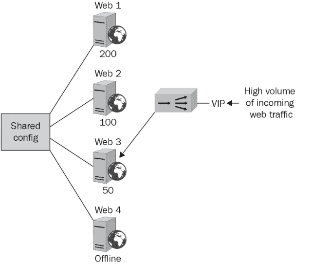

图 7.13 – 负载均衡器

现在，让我们来看一下负载均衡器的调度。

#### 负载均衡器调度

调度是负载均衡器分配负载的方式。让我们逐一了解这些选项：

- **利用率最低的主机：** 负载均衡器的优势在于，它知道服务器场中所有 Web 服务器的状态，并通过调度算法知道哪些 Web 服务器利用率最低。

**示例：** 负载均衡器（参见*图 7.13*）选择将请求发送到请求数最少（50）的 Web 3，而 Web 4 因当前离线而不会被考虑。用户请求三个不同的页面时，可能会从不同的 Web 服务器获得这些页面，但用户可能并不知道这一点，因为负载均衡器正在优化网页向用户的交付。

- **亲和性：** 当负载均衡器设置为**亲和性**时，它会根据请求者的 IP 地址将请求发送到同一台 Web 服务器。这也称为*持久性*或*粘性会话*，即负载均衡器在会话期间使用同一台服务器。

- **DNS 轮询：** 使用 DNS 轮询时，当请求到来时，负载均衡器会联系 DNS 服务器，并首先根据最低 IP 地址轮转请求。它会依次轮转 Web 1、Web 2 和 Web 3，然后通过轮转方式回到 Web 1 来继续该顺序：

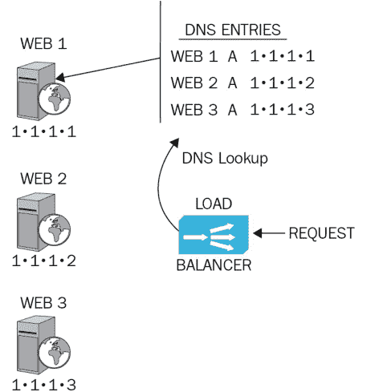

图 7.14 – DNS 轮询

接下来，我们将了解负载均衡器的配置。

#### 负载均衡器配置

设置负载均衡器的方法有很多种，我们将逐一介绍：

- **主动/主动（Active/Active）：** 使用主动/主动负载均衡器时，负载均衡器像阵列一样工作，由于它们都处于活动状态，因此会共同处理流量。它们会缓存请求。如果有人第二次回来查看某个网页，他们会得到处理其第一个请求的同一个负载均衡器。缺点是，由于它们接近满负荷运转，如果其中一个发生故障，负载均衡器看起来就会慢很多。这是因为一个负载均衡器要承担两个负载均衡器的工作量。

- **主动/被动（Active/Passive）：** 使用主动/被动负载均衡器时，你有一对负载均衡器。主动节点负责执行负载均衡任务，被动节点负责监听和监控主动节点。如果主动节点发生故障，被动节点将接管，从而提供冗余。

#### 远程访问功能

随着云技术和远程销售团队的日益普及，需要远程访问功能的员工也越来越多。在撰写本书时，由于 COVID-19 疫情，大多数公司都在使用远程访问在家办公。在本节中，让我们了解不同类型的远程访问技术。

有时，远程工作的人员需要访问公司网络以获取资源。远程访问主要有两种类型：使用调制解调器的老式远程访问服务器，以及更现代的**虚拟专用网络（VPN）**解决方案。让我们逐一了解：

- **远程访问服务器（RAS）：** 一种使用拨号网络的旧式服务器，由于需要支付与电话呼叫相同的费用，因此成本很高。服务器位于公司网络中，客户端安装了允许通信的软件。每一方都有一个调制解调器，可将计算机中的数字通信转换为可通过电话线传输的模拟通信。调制解调器的速度最高可达 56 Kbps——这使得通信非常缓慢。如果你使用拨号网络访问互联网，页面加载会非常缓慢，并且看起来像一张地图。这就是它被淘汰的原因。

- **虚拟专用网络（VPN）：** 它位于公司网络中，客户端有允许连接的软件，但它利用互联网；这使得使用成本更低。大多数酒店提供免费 Wi-Fi，会话可以免费使用。缺点是互联网是公共高速公路，需要使用安全隧道来抵御攻击。主要的隧道协议如下：
  a. **L2TP/IPSec：** 这是最安全的隧道协议，可以使用证书、Kerberos 身份验证或预共享密钥。L2TP/IPSec 同时提供安全隧道和身份验证。
  b. **安全套接字层（SSL）VPN：** 它可以在旧系统上运行，并使用 SSL 证书进行身份验证。
  c. **HTML 5 VPN：** 这是一种 VPN，与 SSL VPN 类似，因为它使用证书进行身份验证。它非常容易设置，只需要一个兼容 HTML5 的浏览器，例如 Opera、Edge、Firefox 或 Safari。这种 VPN 存在一些问题，因为它非常慢。

VPN 会创建一条跨越互联网的隧道，通常是从家中或远程站点到你的工作地点。我们需要看一下 L2TP/IPSec 隧道，它工作在 OSI 参考模型的第 3 层，其中 IPSec 用于加密数据。IPSec 数据包由两个不同的部分组成：

- **AH：** **认证头（AH）**由 SHA-1（160 位）或 MD5（128 位）哈希协议组成，可确保数据包头在传输过程中未被篡改。
- **ESP：** **封装安全载荷（ESP）**使用 DES（56 位）、3DES（168 位）或 AES（256 位）。这些都是对称加密协议，这意味着它们可以更快地传输数据。

#### IPSec

IPSec 可用于在客户端计算机和服务器之间创建安全会话。例如，你可能将财务数据放在财务服务器上。财务团队的所有成员都将在其台式机与财务服务器之间创建 IPSec 隧道。这将防止任何人使用数据包嗅探器从财务服务器或网络中任何会话窃取数据。这称为**IPSec 传输模式**。它只加密有效载荷。

IPSec 也可以作为 VPN 协议使用，作为 L2TP/IPSec 隧道协议的一部分，该协议被创建 VPN 解决方案的主要供应商使用，例如 Cisco、Microsoft、Sonic Wall 或 Check Point。这称为**IPSec 隧道模式**。它同时加密头部和有效载荷。

#### IPSec – 握手

IPSec 会话的第一阶段是创建安全隧道。这称为**安全关联**。在 Security+ 考试中，这被称为**互联网密钥交换（IKE）**。**Diffie Hellman** 用于在数据发送前建立安全隧道：

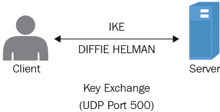

图 7.15 – 互联网密钥交换

IPSec 会话的 IKE 阶段通过 UDP 端口 500 使用 Diffie Hellman 来创建所谓的**快速模式**。这会创建一个安全会话，使数据可以流经其中。

第二阶段是使用 DES、3DES 或 AES 加密数据的阶段。AES 提供最安全的 VPN 会话，因为它使用 128、192 或 256 位。IPSec 有三种不同的模式：

- **隧道模式：** 隧道模式是指 IPSec 会话作为 L2TP/IPSec 隧道的一部分跨互联网使用。在隧道模式下，AH 和 ESP 都会被加密。
- **传输模式：** 传输模式是指在内网中通过客户端到服务器或服务器到服务器的通信创建 IPSec 隧道。在传输模式下，只有 ESP 会被加密。
- **始终开启模式：** 这是两个站点之间的低延迟点对点连接。

#### VPN 集中器

VPN 集中器的目的是在 IKE 阶段建立安全隧道。它需要创建完整的 IPSec 隧道。


#### 站点到站点 VPN

使用站点到站点 VPN，您有两个不同的站点——每个站点都有一个 VPN 服务器。它充当租用线路。站点到站点 VPN 可以像两个站点之间的点对点连接一样工作。会话被设置为**始终在线**，而不是按需拨号：

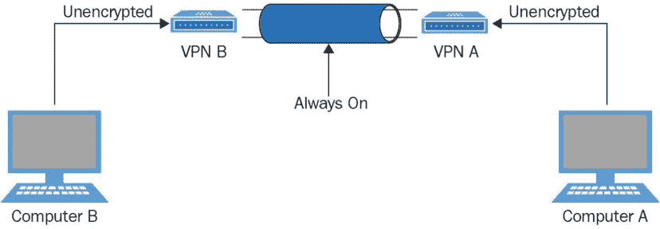

#### VPN 始终在线与按需

有两种主要的会话类型：

- 第一种是按需，远程工作人员从家里或远程位置发起 VPN 会话，当会话结束时，连接被断开。
- 第二种是设置站点到站点 VPN，会话被称为`always on`，即会话是永久的。它是站点之间的点对点连接。

#### SSL VPN

SSL VPN 是一种 VPN，可以通过使用 SSL 证书进行加密的 Web 浏览器使用。近来它已被**传输层安全性（TLS）**所取代，TLS 是 SSL 的更现代版本。在 Security+ 考试中，SSL VPN 通常用于不支持 L2TP/IPSec 且使用 SSL 证书的旧式 VPN。

> **考试提示**
> 
> SSL VPN 是唯一使用 SSL 证书的 VPN，并且只需要一个 Web 浏览器即可建立连接。SSL 证书也可以被更安全的 TLS 证书取代。

#### 拆分隧道

拆分隧道是指在一个安全的 VPN 会话已连接（即下图中显示的蓝色隧道）后，用户打开一个不安全的会话，这会让黑客通过该不安全会话进入并访问您公司的网络：

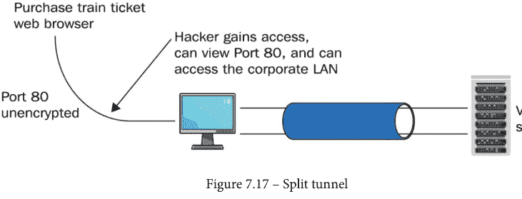

**示例：** John 将他的 L2TP/IPSec 会话连接到公司网络，然后他意识到明天需要一张火车票。他没有断开安全会话再去铁路网站，而是让会话保持连接。一旦他打开 Web 浏览器，他就通过 TCP 端口 80 使用 HTTP，这是不安全的。这意味着，在他打开浏览器的情况下，黑客可以访问他的桌面，并利用安全隧道访问公司网络。

> **考试提示**
> 
> VPN 应始终设置完整隧道。不应使用任何其他形式的隧道，例如拆分隧道。

#### 远程支持

我们将介绍不同类型的远程支持，而安全远程访问的“首选”版本是**安全外壳（SSH）**。我们首先来看 SSH：

- **SSH：** SSH 用于安全远程访问。它取代了以明文发送密码的 Telnet。在开始之前，您需要在网络设备或服务器上安装 SSH 密钥。首先，我们获取一个密钥对，并生成私钥和公钥。公钥存储在服务器上，私钥保留在管理员桌面上。SSH 可在命令行和**图形用户界面（GUI）**中使用。

**示例：** 使用 OpenSSH 等工具，`ssh-keygen -t RSA` 命令会在管理员桌面上生成 RSA 公钥和私钥对。下一步是使用 `ssh-copy-id` 命令登录服务器并复制公钥。该公钥会被添加到服务器上的授权密钥文件列表中。在复制过程中，管理员可能会被要求提供其凭据。如果您是第一次连接到主机，您将收到以下消息：

```
Number of key(s) added:1

Now try logging into the machine, with ssh 'username@<ip address>' and check to make sure that only the key(s) you wanted is added.
```

如果管理员是第一次登录，他将使用 `ssh-root@server` 命令。

- **PowerShell：** 远程支持的另一个版本是 Microsoft 的 PowerShell，它允许远程访问另一台机器。在远程目标上，我们将运行 PowerShell 命令 `Enable-PSRemoting -Force`。此命令将允许远程管理，然后我们将使用命令 `Enter-PSSession -ComputerName <hostname>`。PowerShell 可用于在网络中进行横向移动。

- **远程桌面协议（RDP）服务器：** RDP 允许您安全地连接到运行 Windows 操作系统的计算机。

- **跳板服务器：** 跳板服务器允许管理员建立连接，然后管理员再使用 SSH 或 RDP 进行远程管理。

### 安全网络架构概念

我们将探讨安全网络架构，首先从网络设备开始，即从软件定义网络开始。

### 软件定义网络

传统网络通过硬件路由器路由数据包，并且是分散的。然而，在当今的网络中，越来越多的人使用虚拟化，包括云提供商。**软件定义网络（SDN）**是通过控制器而不是传统路由器路由数据包，这提高了性能。

保护网络及其安全性对于保护公司资产至关重要。我们使用不同的区域和拓扑、网络分离和分段，并安装防火墙以防止未经授权访问网络。

首先，让我们看看不同的区域和拓扑。主要有三个区域：LAN、WAN 和屏蔽子网：

- **局域网（LAN）：** 一个具有极快链路和 Web 服务器的安全网络，称为*内联网*，保存仅限内部的信息，例如机密数据、制造价格表或内部表单库。
- **屏蔽子网：** LAN 和 WAN 之间的边界层，保存公司可能希望互联网用户访问的信息。您可以将电子邮件服务器放在屏蔽子网中，但绝不能放置域控制器。屏蔽子网内的 Web 服务器称为*外联网*，需要用户名和密码才能访问该站点。分销商可以使用它登录以获取新发布的价格表。屏蔽子网的其他名称包括非军事区（DMZ）或周边网络。
- **广域网（WAN）：** 对公众开放，不是一个安全的地方，因为它可以自由访问；WAN 中的 Web 服务器就是互联网。互联网就是 WAN 的一个例子，任何通过互联网传输的数据都需要加密。它覆盖非常大的地理区域，链路往往比 LAN 和屏蔽子网慢。

**示例：** 一家商店以 230 美元的价格出售名牌运动鞋。然而，店主通过在外联网服务器上放置订单从制造商处购买这些运动鞋。对外联网 Web 服务器的访问通过唯一的用户名和密码进行，商店购买运动鞋的价格为 125 美元，从而获得 105 美元的利润。在内联网上，Web 服务器上有这些运动鞋的制造价格，这些运动鞋在中国制造，每双仅需 5 美元：

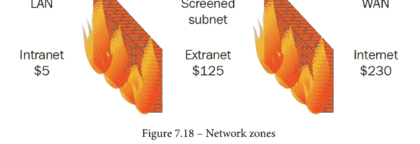

根据这些信息，您应该问自己三个简单的问题：

- 如果客户知道店主赚了 105 美元的利润，会发生什么？他们会想要折扣。
- 如果店主发现制造成本是 5 美元，会发生什么？他们也会想要折扣。
- 如果客户发现他们的名牌运动鞋制造价仅为 5 美元，会发生什么？他们可能会决定不购买，因为这些是伪装的廉价运动鞋，而且通过社交媒体，制造商将失去市场份额。

您可以看到为什么 LAN 中的数据需要安全，不能自由提供给公众；屏蔽子网可用于存储内部和外部使用都需要访问的数据。

### 网络分段

网络犯罪猖獗，是增长最快的犯罪产业。在当今世界，大多数企业相互连接并使用互联网。维护数据（包括研发数据）的安全性和完整性至关重要。我们需要能够在物理和虚拟层面隔离、分段或分离我们的网络。让我们看看我们有哪些选择：

- **物理分段/分离：** 如果我们有数据，例如电子邮件或 Web 服务器，我们希望人们（无论是客户还是我们的销售人员）能够从互联网访问，我们将通过将其放置在屏蔽子网（即边界层）中来将其与 LAN 进行物理分离，这样访问这些数据的用户就不需要进入我们安全的 LAN。您绝不应该将域控制器或数据库服务器放在屏蔽子网中。
- **气隙：** 另一种物理方法是在我们内部使用的一些系统之间创建气隙，以将机密系统与普通系统分开。向气隙机器写入数据或从中取出数据的唯一方法是使用可移动介质，例如 USB 或 DVD。
- **示例：** 一家公司设有研发（R&D）部门，在那里设计新产品。这些信息需要保密，以防止竞争对手窃取其知识产权。IT 团队确保没有网络连接，例如以太网或 WiFi。这就是气隙的一个例子。


- **逻辑隔离 – VLAN**：有时需要在局域网内创建一个独立的逻辑网络，以将一个部门与内部网络的其他部分分隔开来。连接所有内部计算机的设备称为交换机，但在交换机内部，我们可以创建一个**虚拟局域网（VLAN）**。如果你看图7.19，可以看到一个有两条独立VLAN的交换机：

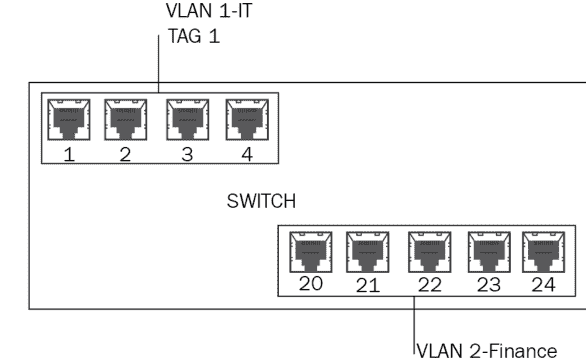

图7.19 – 两个VLAN

VLAN是通过使用交换机上的软件创建的，你可以将多个端口绑定在一起，作为一个独立的逻辑网络运行。如果你看图7.19，可以看到端口1-4被用来为IT部门创建一个VLAN，然后端口20-24被用来为财务部门创建另一个VLAN。虽然这两个部门都在同一台内部设备上，但创建VLAN将它们与其他VLAN和公司网络隔离开来。一个重要的因素是，设置了VLAN标签，这样当流量到达交换机时，它就知道该将其发送到哪里。

- **东西向流量**：这是指流量在数据中心内的服务器之间横向移动。南北向流量则在数据中心之外移动。

- **零信任**：零信任网络用于默认不授权任何流量的场景。这是一种公司策略。在访问资源之前，访问者必须先验证或确认自己的身份。云使用零信任。

- **虚拟化**：如果我们创建虚拟网络，就可以使用VLAN将该网络上的用户与同一虚拟网络上的其他用户隔离开。在一台虚拟主机上，我可以创建许多不同的隔离虚拟网络。虚拟化将在第4章“探索虚拟化与云概念”中介绍。

> **考试提示**
> 
> 基于启发式/异常的NIPS/NIDS能够检测新模式，并且比仅能处理已知变体的基于签名的系统高效得多。

### 工作模式

NIPS/NIDS的传感器有不同的工作模式：

- **内联：** NIPS将放置在防火墙上或非常靠近防火墙的位置，作为额外的安全层。当NIPS以内联模式设置时，流量会经过NIPS。这被称为*带内*。
- **被动：** 流量不经过NIPS。这种模式通常由NIDS使用，因为它检测本地网络中流量模式的变化。这被称为*带外*。传感器和收集器将警报转发给NIDS。

### 传感器/收集器

可以在你的网络上放置传感器/收集器，以提醒NIDS网络中流量模式的任何变化。如果你将传感器放置在网络的互联网一侧，它将扫描来自互联网的所有流量。

### 监控数据

当我们使用分析（即如何分析数据）来检查所提供的信息时，它是基于IPS/IDS内部设置的规则进行的。然而，没有系统是万无一失的。它们尽力而为，但有时会提供与预期不同的结果。有三种不同的类型：

- **误报：** NIDS/NIPS根据收集到的信息判断有攻击正在发生。然而，当网络管理员调查时，发现并没有攻击。他们不同意这一判断。
- **真阳性：** 当监控系统和人工检查都一致时，这被称为真阳性。
- **漏报：** NIDS/NIPS没有更新，攻击一直在发生，但未被检测到。

> **考试提示**
> 误报是虚假警报；而漏报则是在你受到攻击时未能检测到任何内容。

### 网络访问控制

如果你有一台Windows台式机或笔记本电脑，度假2-3周后回来，你的设备可能需要多次更新。

远程客户端通过身份验证后，**网络访问控制（NAC）**会检查所使用的设备是否已完全修补。参见图7.20：

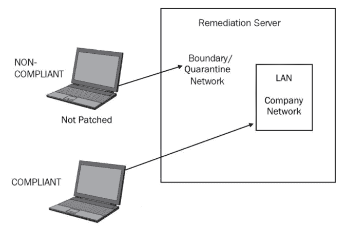

图7.20 – NAC

用户通过身份验证后，**健康权威（HAuth）**会根据客户端设备的注册表进行检查，以确保其已完全修补。已完全修补的机器被视为合规，并允许访问局域网。在上图中，底部的笔记本电脑是合规的。如果设备未完全修补，则被视为不合规，并被重定向到边界网络（也称为*隔离网络*），其中修复服务将为其提供缺失的更新。

NAC的组件如下：

- **主机健康检查：** HAuth检查接入设备的健康状况，以确保其已完全修补。
- **合规/不合规设备：** 已完全修补的设备是合规的，但缺少补丁的设备被视为不合规。
- **代理：** 每台设备都安装了代理，以便HAuth能够执行健康检查。两种类型的代理如下：
  - **常驻代理：** 代理安装在主机上。
  - **溶解代理：** 溶解代理被称为临时和无代理，为单次使用而安装。
- **修复服务器：** 该服务器位于边界网络或隔离网络上。当不合规机器连接到边界网络时，它可以从修复服务器获取缺失的更新。一旦设备完全修补，便允许其访问局域网。

### 域名系统

最常见的名称解析形式是主机名解析。它是一个主机名及其分配的IP地址的数据库。

**域名系统（DNS）**是一种分层命名系统，它接收主机名并将其解析为IP地址。这意味着我不需要知道要访问网站的实际IP地址。如果我想访问微软网站，我知道我需要在浏览器中输入`www.microsoft.com`，它就会把我带到那里。如果我有一个名为*Ian*的用户，位于域`iannel1501.com`中，主机名部分将是Ian，**完全限定域名（FQDN）**将是`ian.iannel1501.com`。DNS数据库中的记录如下：

- **A：** IPv4主机
- **AAAA：** IPv6主机
- **CNAME：** 别名
- **MX：** 邮件服务器
- **SRV记录：** 查找域控制器等服务
- 发件人策略框架（SPF）记录：这是DNS使用的一种文本（TXT）记录，用于防止垃圾邮件，并确认电子邮件确实来自其声称的域。
- 基于域的消息认证、报告与一致性（DMARC）记录：这是另一种DNS文本（TXT）记录，由互联网服务提供商（ISP）用于阻止恶意电子邮件，如网络钓鱼或鱼叉式网络钓鱼攻击。

**示例：** 用户想要访问`http://ianneil501.com`网站。为此，他们将按照*图7.21*在浏览器中输入`www.ianneil501.com`。主机名解析遵循严格的流程：

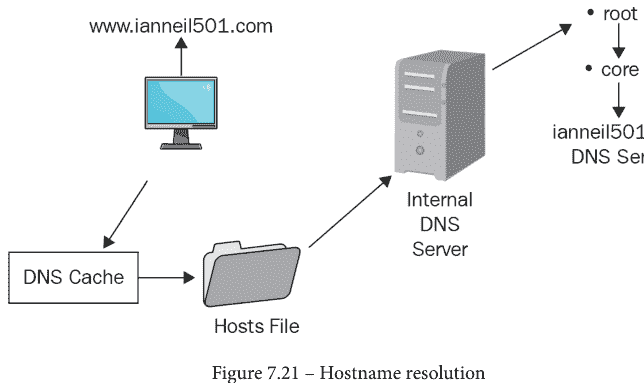

在*图7.21*中，主机名解析采用严格流程，并接受该主机名的第一个条目，无论其正确与否——这是该流程的一个缺陷。让我们从DNS缓存开始看这个流程：

- **DNS缓存：** DNS缓存存储最近解析的名称。如果DNS缓存为空，则会转到本地计算机上的主机文件。如果需要查看DNS缓存，可以运行`ipconfig /displaydns`命令；如果要清除DNS缓存，可以运行`ipconfig /flushdns`命令。
- **主机文件：** 这是一个平面文件，条目手动插入，从上到下读取。它接受第一个条目，无论对错。主机文件的作用是，如果某个用户需要访问名为**Sneaky Beaky**的服务器，你可以在其本地主机文件中添加该服务器的条目，使其能够访问。如果你将条目放入DNS服务器，那么任何人都可以找到该服务器。在前面的示例中，DNS缓存和主机文件都是空的，因此名称解析将转到DNS服务器，其IP地址位于本地计算机的网卡中。


+   - **域名服务器（DNS Server）：** 它通常只维护你域名的主机名，然后需要通过互联网的根服务器完成一个转介过程，根服务器用一个小数点（.）表示。
+   - **根服务器（Root Server）：** 根服务器随后将请求转介到 .com 服务器，后者再将请求转介到 ianneil501.com 域的权威 DNS 服务器，然后该服务器会用网站的 IP 地址进行应答。
+   - **缓存应答（Cache the Reply）：** 名称解析的副本会被放入 DNS 缓存中，以备将来使用。

#### DNS 投毒

当执行 DNS 解析时，首先检查的是本地机器上的 DNS 缓存。之后，会检查 hosts 文件，然后再检查 DNS 服务器。DNS 投毒是将恶意条目放入 DNS 缓存，将请求重定向到一个伪装成合法网站的欺诈网站（参见图 7.22）：

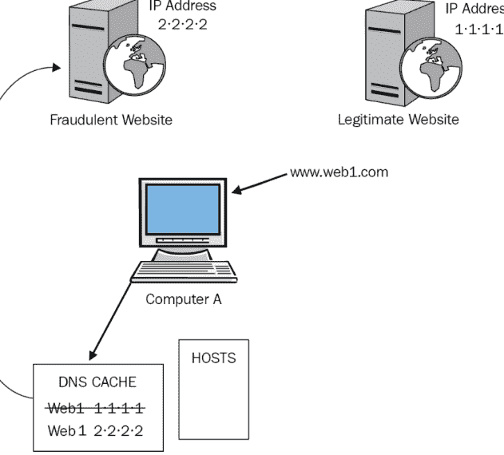

图 7.22 – DNS 投毒

如果我们观察*图 7.22*，**计算机 A** 已经访问过名为 **Web 1** 的合法网站，其正确的 IP 地址 `1.1.1.1` 已被放入其 DNS 缓存中。当执行 DNS 解析时，会先搜索 DNS 缓存，然后搜索 hosts 文件，最后搜索内部 DNS 服务器。

攻击者现已删除了 **Web 1** 的条目，并插入了他们自己用于 **Web 1** 的条目，IP 地址为 `2.2.2.2`。现在，当用户输入 `www.web1.com` URL 时，DNS 缓存中唯一的条目是 **Web 1 2.2.2.2**，用户会被重定向到一个看起来像合法网站的网站。当用户输入银行卡信息进行购买时，其账户会被清空。

#### DNSSEC

为了防止有人非法访问 DNS 记录，引入了 DNSSEC 来保护 DNS 流量。每条 DNS 记录都经过数字签名，生成一个 **RRSIG** 记录以防止攻击，确保记录有效且完整性得以保持。

#### DNS 黑洞

可以在防火墙上创建 DNS 黑名单，以便识别试图访问你网络的恶意流量。可以创建 DNS 黑洞，使其要么向攻击者返回虚假信息，要么将恶意流量转发到蜜罐或蜜网，从而保护你的网络免受攻击。

> **考试提示**
>
> DNSSEC 为每个主机生成一个 RRSIG 记录。DMARC 记录可阻止用于网络钓鱼或鱼叉式网络钓鱼的恶意电子邮件流量。

### 网络侦察与发现

安全专业人员每天都使用命令行工具进行网络发现和侦察。因此，对于 Security+ 考试，你必须熟悉它们，我为其中许多工具提供了截图。接下来我们将逐一了解何时使用它们：

+   - **踩点（Footprinting）：** 这是捕获你的网络流量并映射所有网络设备、协议和 IP 地址范围的过程，从而让攻击者了解你的网络布局情况。
+   - **指纹识别（Fingerprinting）：** 这是查看网络并尽可能多地收集信息的过程。它会识别主机及其操作系统、补丁级别版本，以及公司内部可被用作攻击向量的漏洞。Nmap 是执行指纹识别的良好工具。
+   - **互联网控制消息协议（ICMP）：** 当你使用命令行工具时，ICMP 会返回应答。因此，如果你在网络防火墙上阻止传入的 ICMP 连接，这些工具在外部都将无法工作。
+   - **Ping：** Ping 用于测试与另一台主机的连通性。在下面的截图中，你可以看到我们 ping 了主机名 ianneil501.com，并收到了四次应答。生存时间（TTL）最大为 128 秒；在本例中为 47 秒——请参见下面的截图：

```
C:\WINDOWS\system32>ping ianneil501.com

Pinging ianneil501.com [46.30.213.45] with 32 bytes of data:
Reply from 46.30.213.45: bytes=32 time=42ms TTL=47
Reply from 46.30.213.45: bytes=32 time=44ms TTL=47
Reply from 46.30.213.45: bytes=32 time=42ms TTL=47
Reply from 46.30.213.45: bytes=32 time=43ms TTL=47

Ping statistics for 46.30.213.45:
    Packets: Sent = 4, Received = 4, Lost = 0 (0% loss),
Approximate round trip times in milli-seconds:
    Minimum = 42ms, Maximum = 44ms, Average = 42ms
```

图 7.23 – Ping

+   - **连续 Ping（Continuous Ping）：** 连续 Ping 使用 `ping -t` 命令，用于诊断测试。通常，当我们无法连接时会运行 `ping -t`，一旦能够连接，我们就会收到应答。参见下面的截图：

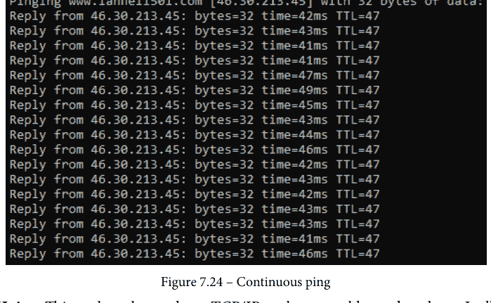

图 7.24 – 连续 Ping

+   - **Hping：** 该工具可用作 TCP/IP 数据包组装器和分析器。它允许你测试网络设备的安全性，如防火墙规则和开放端口，并分析网络流量，包括数据包格式和路由追踪（traceroute）。
+   - **Tracert/Traceroute（路由追踪）：** 这显示了从计算机到远程主机（例如网站）所经过的路由。它可以显示通过特定路由器时的延迟。这就像进入市中心的交通；越靠近市中心，交通越慢。它最多显示 30 跳的信息：

```
C:\WINDOWS\system32>tracert www.ianneil501.com
Tracing route to www.ianneil501.com [46.30.213.45]
over a maximum of 30 hops:

1    <1 ms    <1 ms    <1 ms  192.168.0.254
2    1 ms    1 ms    1 ms  209.134.31-62.static.virginmediabusiness.co.uk [62.31.134.209]
3    *        *        *     Request timed out.
4    20 ms   19 ms   17 ms  perr-core-2a-ae16-0.network.virginmedia.net [62.253.138.245]
5    *        *        *     Request timed out.
6    29 ms   26 ms   26 ms  86.85-254-62.static.virginmediabusiness.co.uk [62.254.85.86]
7    34 ms   33 ms   32 ms  ldn-b1-link.telia.net [213.248.84.25]
8    30 ms   27 ms   26 ms  ldn-bb4-link.telia.net [62.115.143.26]
9    42 ms   41 ms   37 ms  hbg-bb4-link.telia.net [62.115.122.160]
10   46 ms   42 ms   49 ms  kbn-bb4-link.telia.net [213.155.135.121]
11   53 ms   52 ms   45 ms  kbn-b3-link.telia.net [62.115.114.69]
12   43 ms   43 ms   43 ms  onecom-ic-307407-kbn-horskl-1.c.telia.net [62.115.47.242]
13   43 ms   42 ms   44 ms  ae1-200-dr3-cph3.pub.network.one.com [46.30.210.17]
14   43 ms   50 ms   43 ms  xe-0-2-0-200.ar1.pub.webpod1-cph3.one.com [46.30.210.31]
15   41 ms   41 ms   41 ms  webcluster46.webpod1-cph3.one.com [46.30.213.45]
```

图 7.25 – Tracert

+   - **Pathping：** 该工具同时具备 ping 数据包和 traceroute 的功能。它还会在路由追踪后计算统计信息，显示在途经的每个路由器上的数据包丢失情况：

```
0   WIN-H5R5LGV5D60.Domain.local [100.120.39.46]
1   100.120.39.1
2   r-1-43-234-77.ff.avast.com [77.234.43.1]
3   10.27.0.18
4   border4.ae15.avast-30.lon007.pnap.net [212.118.253.133]
5   core3.tge0-3-0-3-bbnet2.lon003.pnap.net [212.118.240.102]
6   107.6.86.150
7   173.231.129.66
8   195.66.226.81
9   a184-28-198-144.deploy.static.akamai technologies.com [184.28.198.144]

Computing statistics for 225 seconds...
        Source to Here   This Node/Link
Hop  RTT   Lost/Sent = Pct  Lost/Sent = Pct  Address
0                                   100.120.39.46
                                 0/ 100 = 0%
1   21ms   0/ 100 = 0%      0/ 100 = 0%      100.120.39.1
                                 0/ 100 = 0%
2   23ms   0/ 100 = 0%      0/ 100 = 0%      r-1-43-234-77.ff.avast.com [77.234.43.1]
                                 0/ 100 = 0%
3   ---    100/ 100 =100%   100/ 100 =100%   10.27.0.18
                                 0/ 100 = 0%
4   ---    100/ 100 =100%   100/ 100 =100%   border4.ae15.avast-30.lon007.pnap.net [212.118.253.133]
                                 0/ 100 = 0%
5   23ms   0/ 100 = 0%      0/ 100 = 0%      core3.tge0-3-0-3-bbnet2.lon003.pnap.net [212.118.240.102]
                                 0/ 100 = 0%
6   23ms   0/ 100 = 0%      0/ 100 = 0%      107.6.86.150
                                 0/ 100 = 0%
7   ---    100/ 100 =100%   100/ 100 =100%   173.231.129.66
                                 0/ 100 = 0%
8   ---    100/ 100 =100%   100/ 100 =100%   195.66.226.81
                                 0/ 100 = 0%
9   23ms   0/ 100 = 0%      0/ 100 = 0%      a184-28-198-144.deploy.static.akamai technologies.com [184.28.198.144]
```

图 7.26 – Pathping


- **Netstat**：Netstat 是 Windows 操作系统中内置的原生工具，用于查看已建立的连接和正在监听的端口。它还可以让你了解计算机上运行了哪些服务。如果重新启动计算机，所有已建立的端口都会消失。请参考以下截图：

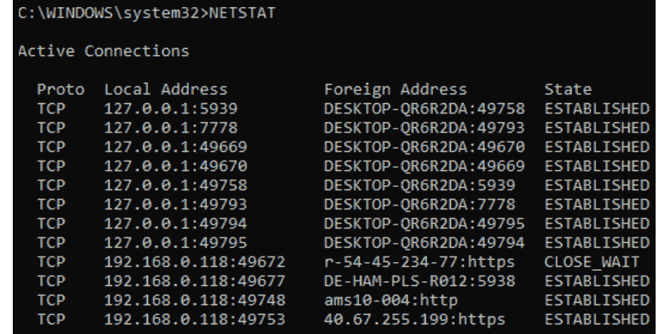

图 7.27 – Netstat

> **考试提示**
>
> Netstat 显示已建立和正在监听的端口，但如果重新启动计算机，已建立的连接会消失。

- **Nslookup**：Nslookup 是一种诊断工具，用于验证 DNS 服务器数据库中主机名的 IP 地址。我们还可以使用 `set type=MX` 命令，这会返回域内所有邮件服务器的 DNS 详细信息。请参见以下截图：

- **地址解析协议（ARP）**：ARP 用于将 IP 地址转换为 MAC 地址；`arp -a` 命令显示 ARP 缓存。攻击者可以使用 ARPSpoof、ARPoison 和 Ettercap 来毒化你的 ARP 缓存。这些工具可通过发送未经请求的 ARP 回复来创建 ARP 广播。请阅读 https://openmaniak.com/ettercap_arp.php 上的文章。我们可以通过使用 `arp -s` 向 ARP 缓存添加静态条目来防止 ARP 毒化，或者可以使用 Wireshark 捕获网络中的数据包来检测它：

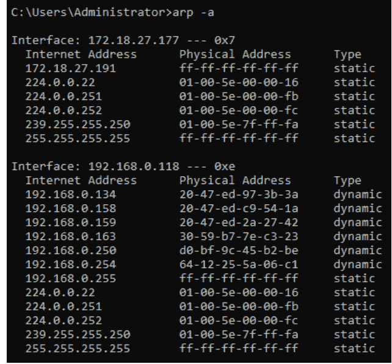

图 7.30 – ARP 缓存

- **ipconfig/ip/ifconfig**：这些命令显示 IP 配置。Windows 版本是 `ipconfig`，而 Unix/Linux 可以使用 `ifconfig`。

以下截图运行了 `ipconfig /displaydns` 命令，它显示计算机上的 DNS 缓存：

图 7.31 – DNS 缓存

- **ipconfig /flushdns**：此命令用于清除 DNS 缓存中的所有条目。请参见以下截图：

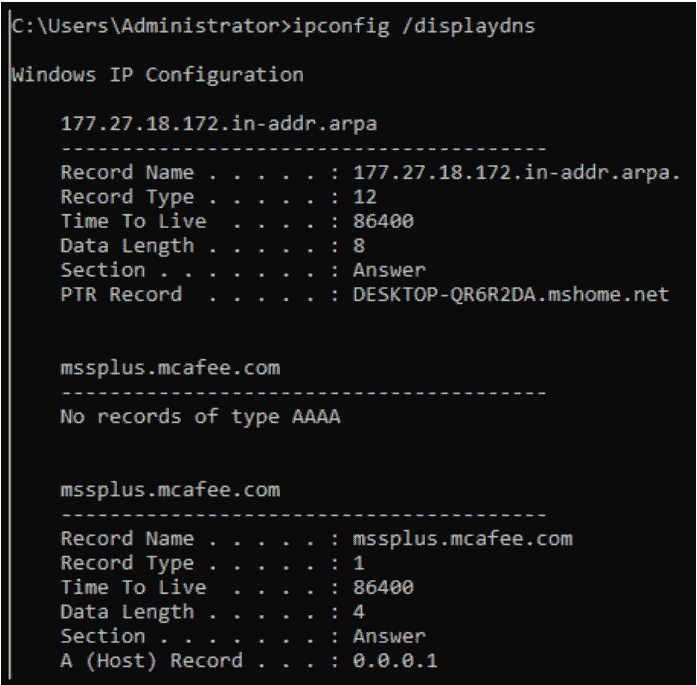

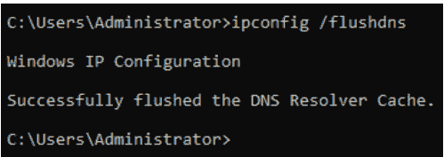

图 7.32 – 清除 DNS 缓存

- **tcpdump**：Linux/Unix 将其用作数据包嗅探命令。

`tcpdump -i eth0` 显示第一个以太网适配器的信息，如以下截图所示：

```text
#### tcpdump -i eth0
tcpdump: verbose output suppressed, use -v or -vv for full protocol decode
listening on eth0, link-type EN10MB (Ethernet), capture size 65535 bytes
11:33:31.976358 IP 172.16.25.126.ssh > 172.16.25.125.apwi-rxspooler: Flags [P.], seq 3500440357:3500440545, ack 3657268334, win 18760, length 196
11:33:31.976603 IP 172.16.25.125.apwi-rxspooler > 172.16.25.126.ssh: Flags [.], ack 196, win 64487, length 0
11:33:31.977243 ARP, Request who-has tecmint.com tell 172.16.25.126, length 28
11:33:31.977359 ARP, Reply tecmint.com is-at 00:14:5e:67:26:1d (oui Unknown), length 46
11:33:31.977367 IP 172.16.25.126.54807 > tecmint.com: 4240+ PTR? 125.25.16.172.in-addr.arpa. (44)
11:33:31.977599 IP tecmint.com > 172.16.25.126.54807: 4240 NXDomain 0/1/0 (121)
11:33:31.977742 IP 172.16.25.126.44519 > tecmint.com: 40988+ PTR? 126.25.16.172.in-addr.arpa. (44)
11:33:32.028747 IP 172.16.20.33.netbios-ns > 172.16.31.255.netbios-ns: NBT UDP PACKET(137): QUERY; REQUEST; BROADCAST
11:33:32.112045 IP 172.16.21.153.netbios-ns > 172.16.31.255.netbios-ns: NBT UDP PACKET(137): QUERY; REQUEST; BROADCAST
11:33:32.115606 IP 172.16.21.144.netbios-ns > 172.16.31.255.netbios-ns: NBT UDP PACKET(137): QUERY; REQUEST; BROADCAST
```

- **Nmap**：Nmap 是一款免费开源的网络映射器，可用于创建网络上所有设备的清单，也可用于横幅抓取。

- **Netcat**：Netcat（或 nc）是一个用于在 Linux/Unix 环境中显示网络连接的工具。在以下截图中，正在使用 `netcat -z` 命令扫描 78–80 端口，从这里可以看到端口 78 和 79 已关闭，但 HTTP 使用的端口 80 是打开的。`-v` 选项表示详细模式，会显示所有信息。请参考以下截图：

```text
$ netcat -z -v ianneil501.com 78-80

nc: connect to ianneil501.com port 78 (tcp) failed: connection refused
nc: connect to ianneil501.com port 79 (tcp) failed: connection refused

Connection to ianneil501.com port 80 (tcp/html) succeeded!
```

- **IP 扫描器**：以下截图显示了 Angry IP Scanner，它可以扫描给定范围内的所有 IP 地址。它会显示活动且响应的 IP 地址、活动但不响应的 IP 地址，以及不活动的 IP 地址。攻击者可能会使用一个不活动的 IP 地址来访问你的网络，因为他们知道该地址没有分配给任何人。

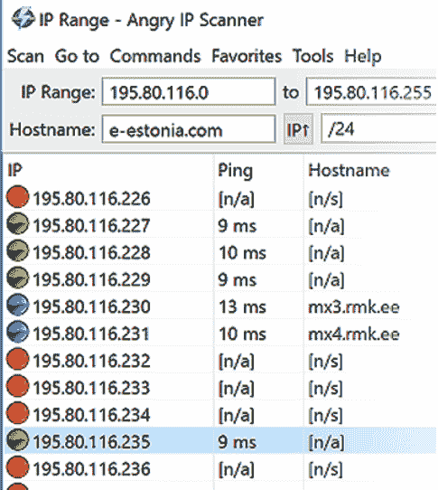

图 7.35 – Angry IP

- **Curl**：这是一个用于传输数据的命令行工具。它也可以用于横幅抓取；这会从 Web 服务器获取远程横幅信息。`-s` 表示静默模式，`-I` 获取 HTTP 头。

**示例**：`curl -s -I 192.168.24.21` 将获取 HTTP 头，输出可能如下所示：

```text
HTTP/1.1 200 OK
Date: Fri, 16 Oct 2020 17:30:12 GMT
Server: Apache/2.2.8 (Ubuntu) DAV/2
X-Powered-By: PHP/5.2.4-2ubuntu5.24
Content-Type: text/html
```

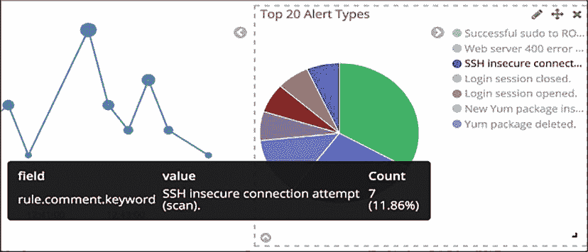

图 7.36 – HIDS 输出

- **防病毒/高级恶意软件工具**：有不少防病毒/反恶意软件工具会定期扫描计算机并生成报告。以下截图显示了已被隔离的病毒列表。AVG 免费防病毒软件已隔离了这四种病毒，使其无法造成任何损害：

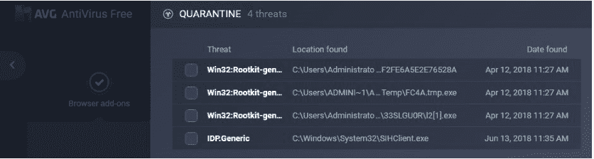

图 7.37 – 已隔离的病毒

- **文件完整性检查器**：微软有一个**系统文件检查器（SFC）**，它可以替换损坏的文件，用 system32 中压缩文件夹内的副本进行替换。您可以使用 `sfc /scannow` 命令运行它，如以下截图所示：

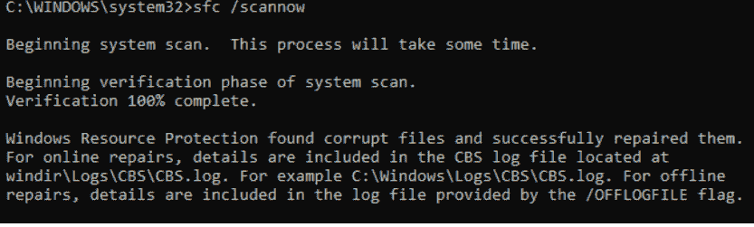

图 7.38 – 系统文件检查器

- **文件校验和完整性验证器（FCIV）**：这是微软的一个实用工具，可以检查系统文件的哈希值，以确保没有被人篡改。

- **文件处理**：在 Linux 环境中，你可能希望更深入地查看不同的文件，包括生成的日志文件。让我们看看管理员可以使用的一些手动工具，从 Cat 开始：

  - a. **连接（cat）**：Linux 中的 `cat` 命令可用于创建文件、查看文件，还可以将多个文件合并到另一个文件中。要创建一个名为 `rugbyfile` 的新文件，我们使用以下语法：

    ```text
    cat > rugbyfile
    ```

    您还可以使用以下语法将三个文件的内容合并到一个输出文件中：

    ```text
    cat file1.txt file2.txt file3.txt | sort > samplefile.txt
    ```

  - b. **Head**：Linux 中最重要的文件是 `/var/log/messages` 文件，它显示系统事件，如关机、重启。我们可以使用 head 命令检查该日志中的前 10 条消息，语法如下：

    ```text
    head /var/log/messages -n 10
    ```

**示例：** 公司里有人没有认真工作，一直在浏览网页，经理让你以安全管理员的身份收集证据。你认为协议分析器或数据包嗅探器是跟踪信息的最佳工具。你运行一次 Wireshark 会话，并捕获对 NFL 网站的访问。分析跟踪记录时，你注意到请求使用的是 HTTP GET 动词。这是对 www.nfl.com 上某个页面的请求。在以下截图中，我们查看的是一篇题为*乔什·多布斯和迈克·格伦农吸引交易兴趣*的文章。URL 是 `https://www.nfl.com/news/josh-dobbs-mike-glennon-drawing-trade-interest-0ap3000000952209`：

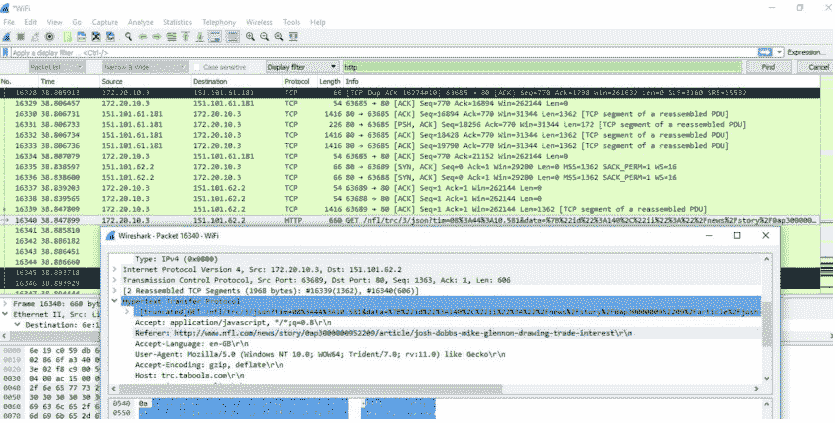

图 7.39 – 协议分析器

在 CompTIA Security+ 考试中，协议分析器也可以被称为*数据包嗅探器*。考试中还会使用商业名称，如 Wireshark 和 Tcpdump。

- **tcpreplay**：这是一个开源工具，可用于分析由 Wireshark 或 tcpdump 生成的 `.pcap` 文件，然后重放流量并将其发送到 NIPS，以查看它是否能检测到。


### 网络地址分配

自动分配 IP 地址的方法是使用一台 **动态主机配置协议（DHCP）** 服务器。该服务器拥有一个可分配给请求主机的 IP 地址数据库。整个过程分为四个阶段，称为 *D-O-R-A*。

#### IPv4 租用过程

IPv4 通过以下步骤执行租用过程：

1. **发现（Discover）**：客户端启动时，会发送广播来查找 DHCP 服务器，并通过将**介质访问控制（MAC）**地址插入广播包中来标识自己。
2. **提供（Offer）**：如果客户端有幸找到 DHCP 服务器，它随后会收到来自该 DHCP 服务器的提供报文。如果有两台 DHCP 服务器，它将收到两个提供报文。
3. **请求（Request）**：客户端向它希望从中获取地址的 DHCP 服务器进行回复。
4. **确认（Acknowledgment）**：来自 DHCP 服务器的最后一个数据包是确认报文，其中包含 IP 地址、子网掩码、默认网关和 DNS 地址。

要在命令行中释放并续租 IP 地址，可以运行 `ipconfig /release` 命令，然后运行 `ipconfig /renew` 命令。

#### IPv4 租用过程故障排除

DHCP 客户端并不总是能获得 IP 地址，可能是因为它无法连接到 DHCP 服务器。另一个原因是地址池已耗尽。在这种情况下，本地计算机会分配一个以 `169.254.x.x` 开头的**自动私有 IP 地址（APIPA）**。这是一个很好的故障排除辅助手段，因为它让网络工程师知道客户端无法联系到 DHCP 服务器。

发生这种情况的原因有很多，因此让我们来看看 DHCP 过程：

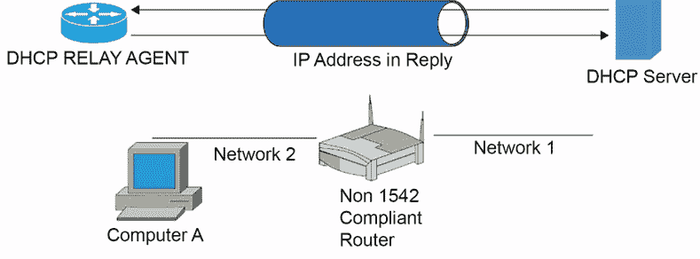

图 7.40 – 跨子网的 DHCP 过程

如果 DHCP 客户端位于另一个子网中，则可能会引发一些问题：

- **符合 RFC-1542 的路由器**：一种连接不同网络和子网的设备。DHCP 广播流量可以通过符合 RFC-1542 的路由器，但在图 7.40 中，该路由器并非符合 RFC-1542 的路由器，因此来自计算机 A 的广播流量无法到达 DHCP 服务器，并将分配一个 APIPA 地址，导致客户端无法获取网络资源。
- **开放端口**：如果路由器不是符合 RFC-1542 的路由器，你可以在路由器的 ACL 上设置允许规则，打开 UDP 端口 67 和 68；否则，DHCP 广播将受到隐式拒绝的影响。
- **DHCP 中继代理**：DHCP 中继代理中预先配置了 DHCP 服务器的 IP 地址，因此它使用单播而不是广播流量来联系服务器。DHCP 中继代理就像一组耳朵，侦听 DHCP 发现请求；然后它充当代理，从 DHCP 服务器获取 IP 地址并返回给请求的客户端。
- **DHCP 侦听**：DHCP 侦听可防止恶意 DHCP 服务器向网络上的主机分配 IP 地址。

> **考试提示**
> 如果无法从 DHCP 服务器获得 IP 地址，原因是网络连接问题或资源耗尽。发生这种情况时，你会得到一个以 169.254.x.x 开头的 APIPA 地址。

### IPv6 寻址

IPv6 地址采用冒号十六进制格式，由 8 个块组成，每块 4 位十六进制数字，构成 128 位地址。从左侧算起的前 64 位是路由或网络部分，后 64 位用于主机部分。使用 IPv6 会减少路由表中的条目数量，从而使路由更加高效。然而，不利的一面是，公司必须将其所有网络应用和设备转换为兼容 IPv6。

IPv6 地址有不同的范围，主要有以下四点：

- **公有地址（Public）**：公有地址与 IPv4 地址一样，可以在外部使用。它们左侧以 2001、2002 或 2003 开头。例如：2001:ABCD:0000:0000:0000:0000:1230:0ABC。
- **链路本地地址（Link Local）**：链路本地地址类似于 IPv4 的 APIPA 地址，限制在单个子网内，以 fe80 开头。
- **唯一本地地址（Unique Local）**：唯一本地地址有时也称为站点本地地址，限制在一个站点内，以 fc00 或 fd00 开头。站点由多个 IP 子网组成。
- **简化——移除前导零**：IPv6 地址可以通过删除前导零，并用双冒号替换若干个全零块来简化。以下是两个示例：

**示例 1**：我们有一个需要简化的 IPv6 地址：2001:ABCD:0000:0000:0000:0000:1230:0ABC。在本示例中，我们只删除前导零：

```
2001:ABCD:0000:0000:0000:0000:1230:0ABC
2001:ABCD::1230:ABC
```

你会注意到，我们用双冒号替换了四个全零块。我们需要数一下剩余的块；由于剩下四个，因此我们知道少了四个块。

**示例 2**：我们有一个需要简化的 IPv6 地址：2001:ABCD:0000:0000:ABCD:0000:1230:0ABC。在本示例中，我们只删除前导零：

```
2001:ABCD:0000:0000:ABCD:0000:1230:0ABC
2001:ABCD::ABCD:0:1230:ABC
```

你会注意到这里更棘手，因为有两处全零块；但我们会用双冒号替换第一处全零块，之后如果还有其他全零块，则将每一处替换为 `:0:`。在本示例中，我们只数到六个块，因此我们知道只有两个全零块。

> **考试提示**
> 云提供商通过为每个网络使用不同的 CIDR 块来为 VPC 分配 IP 地址。

### 复习题

现在，是时候检验你的知识了。回答以下问题，然后在书末的“解答”部分查看答案：

1. Web 应用防火墙的用途是什么？它通常部署在什么位置？
2. 什么是隐式拒绝（Implicit Deny）？它会影响哪两种设备？
3. 哪种防火墙可以执行内容过滤、URL 过滤和恶意软件检测？
4. 哪种网络设备可以连接两个网络？
5. 哪种内部设备可以连接同一网络上的用户？
6. 哪种设备可以隐藏内部网络，使其不被互联网上的黑客发现？
7. 内联 NIPS 的作用是什么？
8. 哪种类型的 IPS 可以保护虚拟机免受攻击？
9. 哪种类型的 IPS 部署在防火墙后面作为额外的安全层？
10. 如果网络上没有 NIDS，哪种设备可以被动监控网络流量？
11. 基于签名的 NIDS 和基于异常的 NIDS 有什么区别？
12. 位于内部网络上的被动设备是什么？
13. 如果你收到服务器 1 有病毒的警报，但检查服务器后并未发现病毒，这称为什么？
14. 如何防止有人将笔记本电脑插入候诊室中的端口，从而访问医疗中心的网络？
15. 如何防止有人将非法接入点（rogue access point）接入你的网络？

38. 跳板机（jump server）的用途是什么？
39. 什么是负载均衡的持久性（persistence）或亲和性（affinity）？
40. 以 active/active（双活）模式使用两个负载均衡器的缺点是什么？
41. 三个不同工作组在开放式办公室中工作，并且都连接到同一台物理交换机。如何将它们彼此隔离？
42. 东西向流量是如何运作的？
43. 什么是零信任网络？它可能用在什么地方？
44. 为什么有人会使用 Angry IP？
45. 什么时候可以使用 `curl` 或 nmap？
46. 什么情况下会有人使用 Harvester 工具？
47. 攻击者如何找到你的域名的 DNS 记录？
48. 为什么要使用 scanless 工具？
49. 可以使用哪些工具作为沙箱来分析文件是否包含恶意软件？
50. DHCP 侦听的目的是什么？
51. 收到 `169.254.1.1` 这个 APIPA 地址的两个主要原因是什么？


