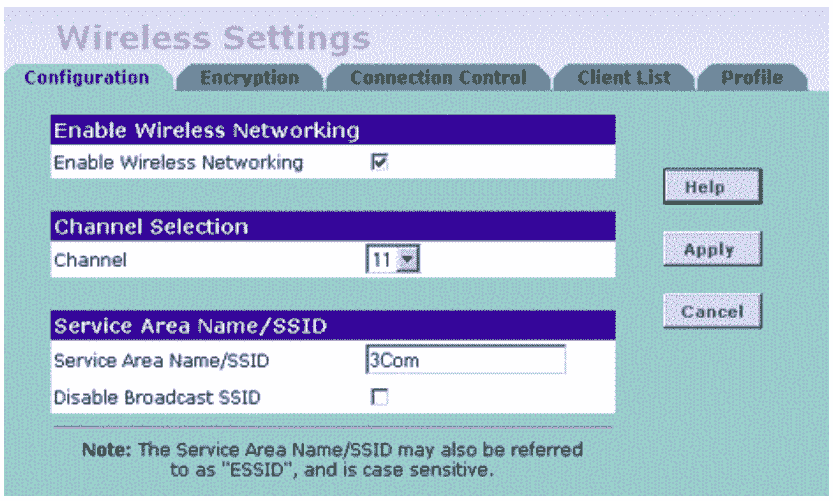
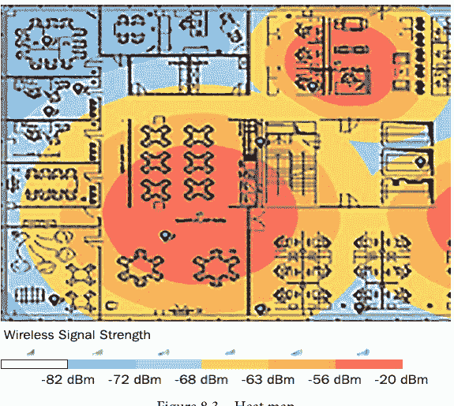

## 8 保护无线和移动解决方案

在过去5年中，在工作场所、酒店和咖啡厅中无线设备的使用越来越多。需求如此之高，以至于如果酒店不提供Wi-Fi，其预订量可能会下降。随着无线的普及，移动设备也在增加，从物联网、智能手机、平板电脑到笔记本电脑。当今的安全专业人员需要对移动设备和无线解决方案的安全有良好的基础知识。这就是我们将在本章中介绍的内容。

在本章中，我们将涵盖以下主题：

- 实施无线安全
- 理解安全的移动解决方案

### 实施无线安全

无线通信已成为日常生活的一部分，从使用手机上的4G/5G访问互联网，到走在路上使用蓝牙听音乐。然而，如果你的无线设备不安全，这可能导致数据丢失，甚至有人从你的银行账户窃取资金。

让我们首先看看不同类型的无线网络：

- **WLAN：** **无线局域网（WLAN）**是位于你的局域网中的企业内部无线网络。通常，在WLAN中，你会使用WPA2 Enterprise，即企业版无线网络，配合CCMP，这是最强的无线加密，因为它使用AES加密。
- **访客网络：** 访客无线网络是独立于WLAN的无线网络，访客可以在此访问互联网；它也可用于培训目的。员工也可以在午餐时间使用访客无线网络访问互联网。
- **基础设施：** 基础设施无线网络是设备通过**无线接入点（WAP）**连接到无线网络的网络。
- **Ad Hoc：** Ad Hoc网络是在没有WAP的情况下，在两个设备之间启用无线连接的网络。
- **无线扫描器/WiFi分析器：** 这些工具非常适合排查无线连接问题，并收集发往WAP的数据包中的信息。
- **无线入侵检测系统（WIDS）：** WIDS可以监视WLAN内的无线流量模式，并检测已加入网络的新主机。它可以提醒安全团队存在对无线网络的未授权访问。

> **考试提示**
> 访客无线网络允许访客访问互联网，员工也可以在午餐时间使用它。

在以下部分中，我们将了解WAP控制器。

#### 无线接入点控制器

无论你是家庭用户还是企业用户，你都需要设置WAP，为使用WAP的设备提供IP地址和互联网连接。让我们看看两种不同类型的控制器。

- **胖控制器：** 胖控制器是独立的WAP，类似于家庭使用的WAP。它有自己的DHCP地址池，无线网络的所有配置都安装在WAP上。
- **瘦控制器：** 瘦控制器允许单个控制器远程管理多个WAP；这在拥有相当多WAP的企业环境中非常理想。

> **考试提示**
> 瘦控制器用于远程管理多个WAP。

#### 保护WAP的访问安全

如果不使用加密，有一些简单的方法可以保护对WAP的访问：

- **默认用户名和密码：** 安装WAP时，它有一个默认用户名和密码，两者都设置为*admin或password*，均为小写。首先要做的步骤之一是更改这两项，然后设置加密方法。管理员密码被称为*主密码*，应通过加密加以保护。
- **禁用服务集标识符（SSID）：** 无线网络的名称称为SSID。SSID的默认设置名为*default*。首先要做的步骤之一是更改此项。你可以通过禁用SSID来保护无线网络，使其不被广播。在*图8.1*中，SSID仍然启用。管理员应选中**禁用SSID广播**旁边的复选框：

图8.1 – SSID已启用

- **发现禁用的SSID：** Wi-Fi分析器（有时称为无线嗅探器或无线扫描器）可以从发送到WAP的数据包中提取SSID。SSID去隐藏设备可以神奇地从WAP捕获SSID。为了保护WAP，我们必须使用加密。
- **MAC过滤：** 为了控制对WAP的访问，我们将**媒体访问控制（MAC）**地址插入MAC过滤中，然后只有那些已插入MAC地址的设备才被允许访问。MAC地址是每个设备都嵌入的唯一地址。想一想，为什么他们不叫它MAC添加，因为这基本上就是你在做的事情？

#### 无线信道

在Security+考试中，无线信道从*信道1*到*信道11*，设备放置应如下：

- **信道1：** 你的第一个无线设备
- **信道11：** 你的第二个无线设备
- **信道6：** 你的第三个无线设备

我们将设备信道尽可能远地分开，以防止相邻信道重叠和干扰。无线设备可能会受到电梯、婴儿监视器、无绳电话、金属货架和承重墙等的干扰。

#### 无线天线类型

WAP使用天线进行操作。有三种主要的天线类型：

- **全向天线：** 全向天线提供最大的覆盖范围，因为它们以360度发射。
- **定向天线：** 定向天线仅在一个方向上发射。因此，如果天线指向错误的方向，将无法连接到无线网络。

#### 无线覆盖

拥有无线网络的安全影响之一是确保无线网络具有覆盖范围。我们需要确保覆盖范围不超出公司边界，否则可能被黑客攻击。

让我们看看在设置无线网络之前需要考虑的选项：

- **站点勘测：** 在安装无线网络之前，我们需要完成站点勘测，以便识别可能对无线网络造成干扰的因素。如果我们安装了无线网络，但它无法正常工作或以低速运行，那么说明我们没有进行彻底的站点勘测。
- **WAP放置：** 许多东西可能干扰或阻止无线网络工作，这些包括承重墙、无绳电话、微波炉、电梯、金属框架、金属门和无线电波。
- **热图：** 热图显示你的无线覆盖范围。红色和橙色区域表示良好的覆盖，但蓝色区域表示覆盖较差。在灰度图像中，较深的灰色区域表示良好连接，而较浅的区域表示弱连接。

热图也可以用绿色表示覆盖较差，并帮助你识别信道重叠的位置。

- **低功率定向天线：** 如果无线网络超出公司网络的边界，则可能被黑客攻击或受到攻击。为了防止这些攻击，我们调低WAP的功率，这会减少无线网络覆盖的距离。
- **无线速度慢：** 如果无线网络的速度非常慢，我们可能离WAP太远，或者连接可能因下载大文件而过载。

> **考试提示**
> 
> 如果我新安装的WLAN不能完全正常工作，那么我们可能没有正确进行站点勘测或放置错误。

- **WPA2-WPS：** 当我们访问无线网络或游戏机时，我们可能会使用WPS，其中密码已存储，你只需按下按钮即可连接到无线网络。由于密码存储在本地，这可能成为暴力破解攻击的目标。

#### Wi-Fi保护接入版本3（WPA3）

现在让我们看看WPA3及其特性，它取代了WPA2。

**Wi-Fi保护接入版本3（WPA3）**于2018年发布，旨在解决WPA2中的弱点，并使用更强的256位Galois/Counter模式协议（GCMP-256）进行加密。有两个版本：*WPA3-个人版*，适用于家庭用户；*WPA3-企业版*，适用于企业用户。

让我们看看WPA3的一些特性：

- **受保护的管理帧（PMF）：** 这可以提供多播传输，并保护无线数据包免受**初始化向量（IV）**攻击，在这种攻击中，攻击者试图捕获加密密钥。
- **对等实体同时认证（SAE）：** SAE与WPA3-个人版一起使用，取代WPA2-PSK。SAE使用一种非常安全的Diffie-Hellman握手，称为蜻蜓（dragonfly），并防止暴力破解。它使用**完美前向保密（PFS）**，确保你的会话密钥不会被泄露，并通过频繁更改用于加密和解密的私钥和公钥来抵御离线攻击。
- **Wi-Fi Easy Connect（Wi-Fi轻松连接）：** 这使得连接物联网设备（如智能手机）变得非常容易，只需使用QR码即可。
- **WPA3-企业版：** WPA3有一个企业版本，支持256位AES，而WPA2仅支持128位，使其适用于政府和金融部门。它在初始握手时使用**椭圆曲线Diffie-Hellman临时（ECDHE）**。
- **WPA3-个人版：** 这使用SAE，这意味着用户可以使用更容易记住的密码。它还使用PFS，这意味着流量是安全的。
- **Wi-Fi增强开放：** 这是WPA2开放认证的增强版，它在开放认证中使用加密。它可以用于酒店、咖啡馆和机场等公共场所，无需密码，并且由于使用PMF，可以防止窃听。

### 无线强制门户

当你加入机场的无线网络时，你会连接到免费 Wi-Fi，但无法立刻访问互联网。网络会将你重定向到一个强制门户（Captive Portal），以便让你提供额外的身份验证信息，通常是通过电子邮件地址或你的 Facebook、Google 账户信息。你可能还需要同意他们的可接受使用政策（AUP）条款。你也可以选择支付他们的高级订阅费用，从而获得更快的连接。

### 无线攻击

与无线网络相关的攻击主要有三种类型：

- **邪恶双胞胎（Evil Twin）：** 邪恶双胞胎是另一个看起来像合法 WAP 的无线接入点，但没有安全性。它会发送带有合法 WAP SSID 的数据包，使主机误以为它正在连接合法 WAP。邪恶双胞胎还会使用另一种方法，即发起解除认证攻击，使主机误以为被合法 WAP 拒绝，从而转而连接到邪恶双胞胎。如果你能连接互联网但无法访问本地网络，那么你已连接到邪恶双胞胎。
- **无线解除关联攻击：** 这种攻击属于**拒绝服务（DoS）**攻击范畴。攻击者会向无线用户发送解除认证帧，使其与 WAP 的连接断开。
- **信号干扰（Jamming）：** 干扰无线信号属于违法行为，但可以通过使用更强的无线信号制造“噪声”，或购买干扰设备来实现。在美国，销售、购买或使用干扰设备均属违法。
- **流氓接入点（Rogue Access Point）：** 流氓接入点是指有额外的接入点接入你的企业网络，诱使用户连接它。可以通过安装 802.1X 受管交换机来防止这种情况，所有连接到网络的设备都必须经过身份验证。
- **初始化向量（IV）：** WEP 是最弱的无线加密方式，它使用 IV（初始化向量），即一个随机数，本应仅用于一次会话的加密。WEP 之所以最弱，是因为它会重用 IV；当攻击者捕获多个数据包时，就能识别出该值，从而捕获无线预共享密钥。

### 无线身份验证协议

无线身份验证协议有很多种：

- **可扩展身份验证协议（EAP）：** EAP 是一种允许点对点连接的身份验证框架。WAP 会发送身份验证信息，客户端使用这些信息，以确保只有彼此之间能够通信。EAP 有不同的类型，下面我们来看其中几种：
  - **受保护的可扩展身份验证协议（PEAP）：** PEAP 是 EAP 的一个版本，它封装并加密 EAP 数据，使其在 WLAN 中更加安全。
  - **EAP-FAST：** EAP-FAST 由思科开发，用于无线网络和点对点连接中执行会话身份验证。它取代了不安全的 LEAP。
  - **EAP-TLS：** EAP-TLS 是无线身份验证的安全版本，因为它需要 X.509 证书。该证书存储在终端上。
  - **EAP-TTLS：** EAP-TTLS 使用两个阶段：第一阶段通过创建隧道与服务器建立安全会话，该隧道使用对客户端透明的证书；随后使用 MS-CHAP 等协议完成会话。它旨在连接较旧的遗留系统。
- **IEEE 802.1X：** IEEE 802.1X 对用户是透明的，因为它使用证书进行身份验证，并可与 RADIUS 服务器结合用于企业网络。
- **RADIUS 联盟（RADIUS Federation）：** RADIUS 联盟是一种联合服务，通过使用 WAP 来获得网络访问权限。它与 RADIUS 服务器无关；这是考生的一种误解。他们以为 RADIUS 联盟与 RADIUS 身份验证有关，但实际上它只是一个标签。

**示例：** 两所不同大学决定在金融和数学领域开展合作。他们决定使用联合服务进行身份验证，这样当学生前往第三方大学并通过 WAP 连接网络时，就构成了 RADIUS 联盟。如果他们通过以太网线连接，那就只是普通的联合服务。

**示例 1：** 一名新员工将自己的移动设备带入公司，30 分钟内，其中一台文件服务器感染了病毒。安全团队将该病毒追溯到这台移动设备。怎样才能避免这种情况？很简单——入职政策没有得到正确执行；如果执行了，病毒在设备连接之前就会被清除。

**示例 2：** 销售团队的约翰一直使用自己的平板电脑进行 BYOD 办公。他刚中了国家彩票，决定离开公司。在离职流程中，他被要求将平板电脑恢复出厂设置，以确保数据被删除。约翰拒绝了，因为平板电脑上有他的个人数据和音乐文件。公司报警，指控他窃取公司数据。约翰告诉警察，这是他的个人设备，里面是他自己的数据，并出示了购买该设备的收据副本。警方对此无能为力，也无法进一步采取行动。公司只能起诉约翰，并证明这些数据属于公司。约翰现在正在环游世界，让公司更加头疼；他们无法起诉约翰，因为不知道他在哪个国家。如果当时他们使用了容器化技术，并在约翰离职时要求他交还存储卡，这种情况就根本不会发生。

### 选择自己的设备

**选择自己的设备（CYOD）** 避免了所有权问题，因为公司拥有的平板电脑、手机和笔记本电脑数量有限，这让支持它们比支持 BYOD 更容易。新员工入职时，只需从列表中选择一台设备。当员工离职时，设备会被收回，因为它们属于公司。可接受使用政策会规定，由于这些是企业所有的设备，因此只能存储公司数据。

### 企业所有、个人可用

**企业所有、个人可用（COPE）** 是指公司购买设备（如平板电脑、手机或笔记本电脑），并允许员工将其用于个人用途。对公司而言，这比 BYOD 好得多。不过，由于设备属于企业所有，IT 团队可以限制设备上运行的应用程序。一些国家/地区的法律禁止擦除个人设备。但对于 COPE，由于公司拥有该设备，如果设备丢失或被盗，公司完全有权远程擦除它。

> **考试提示**
> 
> 对于 CYOD 或 COPE，可选择的设备有限，这比可能涉及数千台设备的 BYOD 更容易支持。

### 移动设备管理概念

**移动设备管理（MDM）** 是一个管理控制台，允许安全管理员控制、保护并强制执行策略，以及在智能手机、平板电脑和其他终端设备上推送更新。你可以阻止智能手机发送短信或使用摄像头。它设置身份验证方法，包括密码长度。下面我们来看 MDM 的不同方面：

- **统一终端管理（UEM）：** 这提供对硬件（例如台式机、打印机、平板电脑、智能手机和物联网设备）的管理，确保它们得到修补，类似于**网络访问控制（NAC）**。它可以控制设备上运行的安全策略和应用程序，并能识别哪些设备已被越狱和获得 Root 权限，然后阻止它们。例如 Microsoft Intune。详细信息可参见 https://www.microsoft.com/en-gb/microsoft-365/enterprise-mobility-security/microsoft-intune。
- **移动应用程序管理（MAM）：** 这允许安全团队在应用程序分发给任何人员之前，先对其安全性进行约束。它控制对公司应用程序和数据的访问，并可限制数据从公司应用程序中被窃取。

移动设备非常小，极易被盗。因此，我们需要研究如何防止即使设备丢失或被盗，他人也能访问其中的数据。我们先介绍屏幕锁和密码，然后是生物识别，最后是上下文感知身份验证：

- **屏幕锁：** 当移动设备在一段时间内未被访问后，屏幕锁会被激活。锁定后，用户只有一定次数的机会输入 PIN，之后设备将被禁用。
- **密码和 PIN：** 有些移动设备（例如智能手机）极易被盗，而且可以放进口袋里隐藏。必须使用由六个或更多字符组成的强密码和 PIN。这样可以增加破解难度，并可能导致设备被禁用。

**示例：** iPhone 会给你 6 次登录尝试机会，之后登录将被禁用 1 分钟。如果第 7 次仍然失败，则会被锁定 5 分钟。如果继续输入错误的 PIN，锁定时间会越来越长，直到第 9 次尝试时被锁定 60 分钟。

> **考试提示**
>
> 移动设备需要屏幕锁定和强密码来保护它们。

- **生物识别：** 移动设备可以使用生物识别技术，如指纹或面部识别。苹果使用 Touch ID 或 Face ID，微软使用 Windows Hello。
- **上下文感知认证：** 上下文感知安全是基于位置的。它会检查认证请求来自哪个国家。如果你使用零信任模型，这一点极其重要。

**示例：** 玛丽是伦敦的一名财务总监，她正在使用上下文感知认证。要成功完成认证，用户必须是玛丽本人，时间必须是周一至周五的上午 9 点到下午 5 点，而且她必须身处伦敦。如果这些条件不全都满足，则认证失败。

### 设备管理

企业设备需要受到控制，这样员工就不能随意连接到应用商店并下载他们想要的任何应用程序。例如，在企业设备上允许游戏将会对生产力和安全性产生不利影响。我们现在来看一下下载管理、应用程序管理和内容管理及其特性，然后是远程擦除：

- **下载管理器：** 下载管理器控制连接到移动设备的连接数以及下载速度。
- **应用程序管理：** 应用程序管理使用白名单来控制允许安装到移动设备上的应用程序。
- **内容管理：** 内容管理以加密格式将业务数据存储在设备的安全区域中，以防受到攻击。它可防止机密或业务数据被共享给外部用户。
- **远程擦除：** 当移动设备丢失或被盗时，可以对其进行远程擦除。设备将恢复为出厂设置，数据将不再可用。

> **考试提示**
>
> 地理跟踪会告诉你被盗设备的位置。

### 设备保护

移动设备非常容易丢失或被偷，所以我们必须有某种方式来找到这些设备；我们来看一下地理围栏、地理定位和使用线缆锁之间的区别：

- **地理围栏：** 地理围栏使用**全球定位系统（GPS）**或 RFID 来定义地理边界。一旦设备被带出定义好的边界，安全团队便会收到警报。
- **地理定位：** 地理定位使用 GPS 提供移动设备的实际位置。当你丢失 iPad 后，你可以用 iPhone 来确定它的位置。如果你丢失或掉落设备，这会非常有用。
- **线缆锁：** 笔记本电脑和平板电脑上的线缆锁可防止它们被盗。当你走进电脑商店时，所有手机和平板电脑都用线缆锁固定以防盗窃。这也让顾客在购买前能够检查并操作设备。

> **考试提示**
>
> 地理围栏可防止移动设备被带出公司场所。

### 设备数据

为了保护存储在设备上的数据，我们应该实施**全盘加密（FDE）**。设备需要一个**可信平台模块（TPM）**芯片来存储加密密钥。

**示例：** 一名销售人员刚刚收到一台新的公司笔记本电脑，其操作系统已被加固。该设备使用 BitLocker 加密，整个驱动器都被加密，以保护存储于硬盘上的数据。在 Security+ 考试中，这被称为 FDE。

在 BYOD（自带设备）上将公司数据与个人数据分开非常重要。让我们来看两个实现这一目标的方法：

- **容器化：** 这使组织能够在 BYOD 设备（如手机或平板电脑）中安全地部署和管理企业内容。它安装了一张存储卡，业务数据可存储在其中。当设备被远程擦除时，存储卡上的数据仍然完好无损，因此保护了业务数据。它的另一个名称是存储分段。

**示例：** 如果你将自己的智能手机作为 BYOD 使用，但公司要求你将他们给你的业务数据与你的个人数据（例如你已存储在手机上的家人和朋友的照片）分开，最简单的做法是在手机上安装一张 SD 卡，用于存储公司数据。这会让你的数据移交变得非常容易；你只需弹出 SD 卡并将其交给公司即可。

### 移动设备强制与监控

移动设备附带了许多不同的工具和功能。作为安全专业人员，你需要了解它们带来的安全威胁。下面列出了一些安全专业人员应该精通的功能：

- **网络接入控制（NAC）：** 网络接入控制可确保连接到你的网络的移动设备在获得内部网络访问权限之前已完全修补并符合要求。远程用户由 VPN 或远程访问系统进行身份验证，然后健康检查机构检查设备是否已完全修补。如果未修补，则将其放入隔离网络，由修复服务器为其提供缺失的补丁。然后，它再连接到企业网络。
- **固件空中（OTA）更新：** 固件是安装在硬件设备上一个小型只读存储器芯片中的软件，用于控制设备上运行的硬件。供应商会定期推送固件 OTA 更新，以确保移动设备的安全。例如，移动设备供应商发送通知说有软件更新，其中就包括固件更新。
- **自定义固件——Android 获取 root 权限：** 下载自定义固件用于对你的移动设备进行 root。这意味着你将在该设备上获得更高级别的权限，并移除供应商的安全限制。

> **考试提示**
>
> Root 和越狱会移除移动设备上的供应商限制，以允许安装不受支持的软件。

- **运营商解锁：** 运营商解锁是指移动设备不再绑定到原始运营商。这允许你将设备与任何服务提供商一起使用，并安装第三方应用。
- **富通信服务（RCS）：** 这是对短信（SMS）的增强，用于 Facebook 和 WhatsApp 发送消息，让你可以看到已读回执。你还可以发送图片和视频。
- **GPS 标记：** 当你拍照时，GPS 标记会录入照片的拍摄地点。大多数现代智能手机默认会这样做。
- **支付方式：** 智能手机允许将信用卡信息存储在本地，这样手机就可以使用近场通信（NFC）进行非接触式支付。如果这是 BYOD 设备，则需要谨慎监控，因为有人可能带着公司信用卡离开公司并继续使用它。MDM（移动设备管理）可以通过在移动设备管理策略中禁用此工具来阻止支付功能。
- **Wi-Fi Direct/Ad Hoc：** Wi-Fi Direct 无线网络允许两个 Wi-Fi 设备之间直接连接，无需 WAP。它是单路径的，因此不能用于互联网共享。Ad Hoc 无线网络则是两个无线设备无需 WAP 即可连接，但它是多路径的，并且可以与他人共享互联网连接。
- **网络共享（Tethering）：** 网络共享是指将支持 GPS 的智能手机连接到其他移动设备以提供互联网访问。微软的 Windows 10 支持网络共享。它的危险之处在于，如果某人使用笔记本电脑连接公司网络，然后通过网络共享接入互联网，可能会导致“拆分隧道（split tunneling）”。在这种情况下，用户通过 VPN 与企业 LAN 建立了一个安全会话，然后打开一个不安全的 Web 浏览器会话，该会话可能被黑客攻击，从而为攻击者提供了进入你 LAN 安全会话的网关。MDM 必须确保这种情况不会发生。在进行网络共享时，为了确保安全，我们同一时间只能创建一个会话。
- **推送通知服务：** 可用于通知设备所有者收到了电子邮件或短信。例如，如果有人在你的 LinkedIn 账户中给你发送消息，推送通知会告诉你有一条新消息。

### 复习题

现在来检验一下你的知识。回答这些问题，然后在书末的“答案”部分核对你的答案：

- 1. 哪两类人群可能会使用访客无线网络？
- 2. 胖无线控制器和瘦无线控制器有什么区别？
- 3. 什么是 WAP 主密码？你会如何保护它？
- 4. Wi-Fi 分析仪可以执行哪两项任务？
- 5. MAC 过滤的用途是什么？
- 6. 为什么第一个 WAP 应放在信道 1，第二个 WAP 应放在信道 11，第三个 WAP 应放在信道 6？
- 7. 为什么工程师在安装无线网络之前要进行现场勘测？
- 8. 如果你身处一家使用开放认证的酒店，你会使用网上银行吗？如果不会，你会怎么做？
- 9. 哪种无线加密版本最弱？
- 10. 如果有朋友来你家做客，向你要无线密码，你给他们的是什么？
- 11. WPA2 最安全的版本是什么？
- 12. 使用 WPA3-Personal 时，什么取代了预共享密钥？
- 13. 使用 WPA3 无线时，什么取代了 WPA2 开放认证？
- 14. 最安全的无线版本是什么？
- 15. 如果使用 WPS，你如何访问无线网络？它容易受到哪种类型的攻击？
- 16. 无线网络使用强制门户的目的是什么？
- 17. WPA3 为物联网设备带来了哪些好处？
- 18. 如果要使用 EAP-TLS 进行无线认证，需要在终端上安装什么？
- 19. 如果用户在公司笔记本电脑上安装了盗版软件，他们违反了哪项安全策略？
- 20. 如果公司采用 CYOD 而不是 BYOD，一线支持团队会获得什么好处？
- 21. 如果你住在酒店，而酒店的 Wi-Fi 无法使用，你如何接入互联网？
- 22. 如果你的手机丢失或被盗，应该使用 MDM 做些什么？
- 23. 你应该做哪三件事来保护智能手机上存储的数据？
- 24. 如果一家公司已发生多起公司笔记本电脑被盗事件，你可以用什么措施来防止进一步被盗？
- 25. 如何在一部用作 BYOD 设备的手机上实现公司数据与个人数据的分离，从而轻松完成离职处理？
- 26. 使用 SE Android 的目的是什么？
- 27. 什么是无线短距离支付类型？
