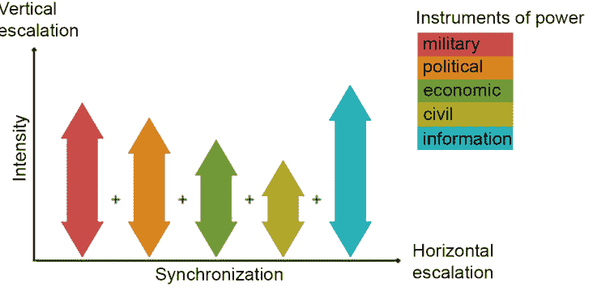
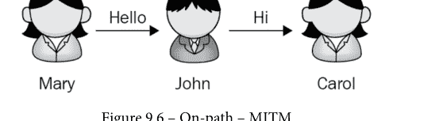
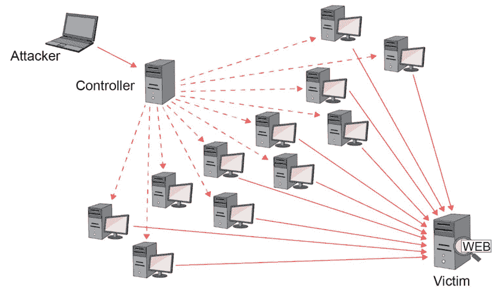
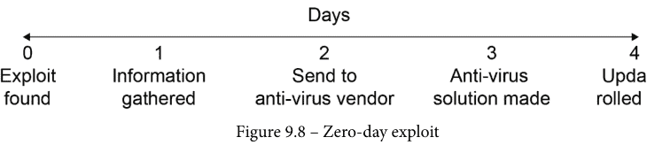
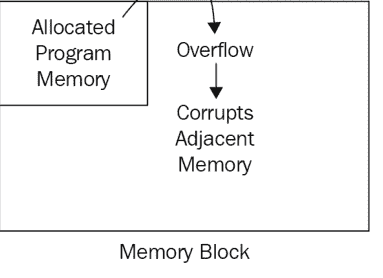

## 识别威胁、攻击和漏洞

作为安全专业人员，你必须充分了解公司可能遭受的各种类型的攻击。这些攻击既包括员工可能遇到的不同类型的恶意软件，也包括社会工程学攻击——攻击者会直接联系员工，试图利用他们个人的弱点。然后，我们将了解不同类型的威胁行为者及其特征。最后，我们将了解密码利用及其他高级攻击。

在本章中，我们将涵盖以下主题：

- 病毒与恶意软件攻击
- 社会工程学攻击
- 威胁行为者
- 高级攻击
- 各种类型漏洞的安全问题

让我们从病毒和恶意软件攻击开始。

### 病毒与恶意软件攻击

在当今世界，病毒和恶意软件无处不在。它们有许多不同的变体，我们将逐一介绍：

- **病毒：** 病毒是一种将自身嵌入另一个程序的程序，可通过多种方式执行，例如点击网页上的链接，或打开电子邮件附件。一旦被激活，它就会自我复制，从一台主机传播到另一台主机。
- **多态病毒：** 这种病毒在传播过程中会不断变异，因此很难被检测到。随着变异，其哈希值也会发生变化；如果文件扩展名已更改且该程序不在计算机上，则可能导致程序错误。
- **潜在不需要的程序（PUPs）：** 这些程序会随其他程序一起下载，往往会占用资源并导致计算机变慢。安装 *Malwarebytes* 会在这些程序被安装时发出警报。
- **无文件病毒：** 这种病毒在内存中运行，非常难以识别，因为它会寄生在其他程序、钓鱼攻击或应用程序（如 Word）上。*McAfee 行为分析* 可以防范这种病毒，它能检测到与合法软件同时执行的程序。
- **命令与控制恶意软件：** 这种恶意软件完全接管计算机，随后可用于窃取数据、重启或关闭计算机，或对网络发起**分布式拒绝服务（DDoS）**攻击。它可以通过钓鱼攻击或下载的恶意软件来发动。
- **勒索软件：** 勒索软件是指攻击者加密用户计算机上的文件，然后显示一个链接，索要钱财以解锁文件。在赎金支付之前，勒索软件会阻止对计算机的访问。勒索软件的另一个例子是，当你下载一个免费程序时，它声称你的计算机有问题，因此你需要购买该软件的完整版。这种情况相当隐蔽。

> **考试提示**
> 
> 请记住，经验法则是：如果必须花钱才能解决，那就是勒索软件。

- **特洛伊木马：** 特洛伊木马以嵌入到下载的程序中而闻名。它们试图利用 `system32.exe`，然后运行 DLL 文件来攻击操作系统内核——这是操作系统的管理部分。特洛伊木马会尝试查找密码信息，并设置一个 SMTP 引擎，使用随机端口将这些信息发送给攻击者。
- **远程访问特洛伊木马（RAT）：** RAT 是一种将登录信息发送给攻击者，从而使攻击者能够完全控制计算机的程序。
  - **示例：** *Gh0st RAT* 是一种最初由中国威胁行为者设计的特洛伊木马。用户点击链接后，一个名为 `server.exe` 的释放器程序会连同 `svchost.dll` 一起安装 Gh0st RAT，从而使攻击者能够控制计算机。然后，它可以记录按键、下载和上传文件，并运行网络摄像头和麦克风的数据流。
- **Rootkit：** Rootkit 是一种可以安装到系统 BIOS、固件或适配器卡中的程序；无论操作系统被重新安装多少次，它都会再次出现。Linux rootkit 使用 Bash shell 启动自身。
- **后门：** 后门是程序开发者创建的一段软件或一个计算机系统，以防有人将自己锁在程序之外；它们通常没有文档记录。攻击者利用后门访问系统。使用双因素认证或多因素认证可以防范后门。
- **逻辑炸弹：** 逻辑炸弹是一种由某个操作或在特定日期触发的病毒，例如 7 月 4 日或圣诞节。它可基于时间，也可通过运行 `.bat/cmd` 文件、脚本，或使用任务计划程序来触发。
- **键盘记录器：** 键盘记录器的主要目的是跟踪并记录按键操作。你可以在台式计算机背面插入一个非常小巧的 USB 驱动器来安装键盘记录器。
- **广告软件：** 广告软件是一种不受欢迎的程序，会不断弹出不需要的广告。阻止广告软件的一种方法是启用弹出窗口阻止程序。
- **间谍软件：** 间谍软件以拖慢计算机而著称，因为它会利用计算机的处理能力和 RAM 资源持续跟踪你在计算机上的操作，并将信息发送给第三方。好的间谍是隐蔽的并收集信息，间谍软件也不例外。
- **僵尸网络：** 僵尸（bot）是一种感染并控制计算机的程序。该名称源自 *robot*（机器人）和 *network*（网络）两个词。僵尸网络是为恶意目的而设置的僵尸程序集合，通常用于发起 DoS 攻击。

我们将在下一节中讨论社会工程学攻击。


### 社会工程攻击

社会工程攻击基于利用某人的个性弱点；它们可以被称作*黑客攻击人类*。社会工程攻击有多种类型。让我们逐一了解，从钓鱼邮件/鱼叉式钓鱼邮件开始：

- **钓鱼邮件：** 钓鱼邮件是不加区分地群发的电子邮件攻击，要求收件人填写附件中的表单（也许会说他们的银行账户出现问题）。这类表单会要求提供个人详细信息，这些信息日后可能被用于身份欺诈。这些邮件通常看起来像是来自合法机构，因此用户会被欺骗，按照邮件中的指示操作。
- **鱼叉式钓鱼**是一种针对特定人群的钓鱼攻击。
- **邮件头注入：** 攻击者会在电子邮件的主题行中添加信息，使其看起来像是邮件在到达前已经被邮件系统扫描过。这样，用户就会认为该邮件是安全的。他们可以在邮件标题中添加诸如“RE:”之类的字样，使其看起来像是一封回复邮件，或者使用“SCANNED BY MAIL SYSTEM”或“CLEARED”等字样。这样一来，用户就不太可能认为邮件可疑。邮件第一行可能会在页面中间显示一个标题“Scanned by Barracuda Sentinel”，下面一行写着“未发现病毒”。用户会认为这是安全邮件，从而放松警惕。
- **凭证窃取：** 这种攻击通常通过钓鱼邮件进行，邮件会声称你的账户某些信息有误，并提供一个超链接让你去解决。当你点击链接时，会看到一个伪造的登录网页。这样一来，你的账户信息就会被收集。他们想在暗网上出售你的登录信息。
- **捕鲸攻击：** 捕鲸攻击是一种电子邮件攻击，目标是**首席执行官（CEO）**或高级管理人员。CEO和高管们每天日程紧张，因此他们可能会快速处理那些*看起来*像是不起眼的小请求，以便继续处理下一项任务，结果却遭到攻击。
- **语音钓鱼：** 语音钓鱼攻击涉及使用VoIP电话、其他电话、调制解调器，或有人留下语音邮件来试图勒索信息。
- **短信钓鱼：** 这种攻击基本上就是钓鱼攻击，但使用的是短信文本消息。他们会要求你访问一个网站，或拨打一个实际上是高额收费电话的号码。

    **示例：** 你收到一条短信，说你的Facebook账户需要验证。当你点击链接时，系统会要求你提供密码，或者该网站会下载病毒。

- **假托：** 这种攻击是指攻击者编造一个场景，要求提供细节以确认某人的身份。这随后可能导致身份盗窃。

    **示例：** 有人假装是Netflix的工作人员，说你的账户上有可疑活动。他们要求你确认这是否是你本人所为，并请你确认账户详细信息。

- **诱导信息：** 这种攻击是指攻击者试图让你提供信息；例如，使用一个虚假陈述，希望你纠正该陈述。另一种方式是通过*奉承*。例如，他们称赞你以抬高你的自尊心，希望你得意忘形并透露更多信息。

    **示例：** 黑客想知道大楼某个区域有多少个运动传感器。攻击者对保安说：“*我敢打赌这栋楼的安保相当不错。我猜大堂里大约有四个运动探测器*”，保安说：“*你猜得很接近了，但实际上我们有七个*”

> **考试提示**
> 诱导信息是指攻击者说出一个陈述，希望你纠正他们，从而为他们提供准确的信息。

- **身份盗窃：** 这是指有人窃取你的**个人身份信息（PII）**来实施欺诈或接管你的某个账户。你不应该随意丢弃包含信息的物品，否则攻击者可能会进行垃圾箱搜寻。假托和钓鱼是收集你信息的其他方式。身份盗窃的类型包括：
  - 开设银行账户、申请贷款或办理信用卡
  - 获取护照或驾驶执照
  - 以你的名义订购商品
  - 接管你现有的账户
  - 签订手机合同
- **发票诈骗：** 这种诈骗是指犯罪分子获取真实发票的详细信息，并提交这些发票进行付款，但更改了银行账户信息。他们可能入侵会计的电子邮件账户，并设置其电子邮件转发到智能主机。然后，他们会在将发票发送给客户之前更改银行信息。当财务团队查看发票时，他们会查看采购订单、发票详细信息以及产品信息，但很少查看收款方的银行账户信息。
- **即时通讯垃圾信息（SPIM）/短信钓鱼：** 这是通过即时通讯或短信发送垃圾信息。短信钓鱼是使用短信文本消息来攻击某人。
- **尾随：** 尾随是指某人用其ID徽章打开门，然后另一个人趁门未关闭时跟着进入。如果先进门的人是一位中年男性，而尾随者是一位漂亮女士，这可能尤其有效。他们可能比较老派，会为女士扶着门。安全闸门可以防止这种情况。
- **搭便车：** 这与尾随类似，不同之处在于他们得到了员工的许可。他们可能假装是医院护工，以便员工允许其进入。这也可能表现为他们似乎正费力搬着一个大箱子，让员工帮忙扶着门，而他们则趁机进入。
- **冒充：** 冒充可能涉及某人穿上制服——例如交通管理员或警察的制服。想象一下，你正在街上开车，被一名警察拦下，他手里拿着一个看起来像测速枪的东西。另一种冒充形式是，有人假装是帮助台工作人员，向你询问你所在部门的信息，或者告诉你由于IT系统出现故障，你需要更改密码。
- **侦察：** 侦察有两种类型：*被动*和*主动*。*被动*侦察是指攻击者调查你的公司并收集将在以后阶段使用的信息。*主动*侦察是指攻击者与用户或其桌面进行交互。例如，如果某人有了你的用户名并试图重置密码，那么如果他们进入你的运行命令或修改你的注册表，那就是主动侦察。
- **舆论影响活动：** 这些活动是一种社会工程攻击，旨在影响世界各国的民众。主要有两种类型：*社交媒体*和*混合战争*。让我们逐一了解：
  - **社交媒体：** 在世界各地，社交媒体已被用来影响即将到来的选举中的选民。Facebook和Twitter在许多竞选活动中被广泛使用。
  - **混合战争：** 通常由国家行为体实施，通过军事、政治、经济或民事手段来影响一个国家的权力平衡，甚至可能开展传播虚假信息的活动。参考以下图示：

    

    *图9.2 – 混合战争*

    **示例：** 2014年5月，俄罗斯黑客组织*CyberBerkut*利用*乌克兰中央选举委员会*网络中的漏洞，以削弱选举的可信度。
- **垃圾箱搜寻：** 垃圾箱搜寻是指有人从你的垃圾桶中翻找垃圾，希望找到包含PII的信件，这些信息日后可用于实施欺诈。最好的防范方法是在丢弃所有包含PII的邮件前将其粉碎。
- **肩窥：** 肩窥是指有人站在使用电脑的人身后，以便看到敏感信息。另一个例子是，有人在使用ATM时，排在后面的人用智能手机拍摄交易过程。这种攻击很有效，因为受害者正专注于取钱，没有意识到自己正在被窥视。
- **恶作剧病毒警告：** 2002年的`jdbgmgr.exe`病毒恶作剧涉及一封垃圾邮件，该邮件建议电脑用户删除名为`jdbgmgr.exe`的文件，称其是一种看起来像一只可爱小熊的电脑病毒。这只小熊位于`system32`文件夹中，这意味着人们删除的是他们实际的系统文件。这就好比打开你的汽车引擎盖，拆掉所有火花塞和高压线。


- **水坑攻击**：同一行业的公司会访问非常相似的网站。因此，攻击者会识别出某一特定行业人群可能访问的网站，然后用病毒感染该网站。这种攻击很有效，因为目标人群往往已使用该网站多年，并且信任其内容。

- **域名欺骗（Pharming）**：这是一种 DNS 重定向攻击，要么是 DNS 缓存被投毒，要么是在你的 hosts 文件中放置了一条条目。受害者会被重定向到一个欺诈性网站。

- **权威（Authority）**：电子邮件可能由更高权威的人发出，例如 CEO 或人力资源经理，命令你填写一份可通过点击链接访问的表单。请看下面的电子邮件。这种攻击之所以有效，是因为没有人想违抗 CEO：

```text
From: Ian Neil (CEO)
To: All Staff
Subject: UPDATE YOUR FINANCIAL DETAILS
Dear All,
The finance team is moving to a new finance application and has told me that personnel within the company have not updated their bank details. You need to click on this link and update your details: http://update.details.wehackyou.com.
Failure to do so by the end of play today will result in disciplinary action against those individuals that do not comply.
Kind Regards,
Ian Neil
Chief Executive Officer
```

- **恐吓（Intimidation）**：恐吓攻击的一个例子是，有人冒充拥有较高权威的人，例如警察。然后他们威胁目标个人，告诉对方如果不按他们说的做，就会有麻烦。这种攻击之所以有效，是因为这类攻击的受害者会相信自己别无选择，只能照做。

**提示**
如果你的 CEO、高层管理人员或人力资源经理发来邮件，要求你填写表单或点击链接，这就是一种权威攻击。

- **紧迫性（Urgency）**：紧迫性攻击的一个例子是，有人来到接待台，要求立即放行进入。他们可能会针对新来的接待员，后者可能会慌乱并让他们进入。另一个很好的例子是，一名“消防员”要求在整栋楼烧毁之前进入服务器机房。这种攻击之所以有效，是因为接待员惊慌失措，以为真的发生了火灾。

> **提示**
> 让一名“消防员”进入你的服务器机房，就是一种紧迫性攻击。

- **稀缺性（Scarcity）**：这类攻击的一个例子是试图让你惊慌失措，从而做出草率的决定。例如，你想租一间酒店房间度周末；你和 10 个朋友选了一家酒店并登录网站，网页上用红色字体写着 *只剩一间房了！*。你买下了最后一间房，你的 10 个朋友也都买下了它；你猜怎么着？依然只剩一间房！

**示例**：一位私人秘书接到一个自称负责域名管理的人打来的电话，此时 CEO 正在参加会议。来电者告诉秘书，他们打电话是为了续费域名，并且必须在 30 分钟内完成，否则公司就会失去该域名。来电者称续费费用为 45 美元。秘书知道，如果没有域名，公司网站和电子邮件地址将无法运作。这种攻击之所以有效，是因为秘书不能在重要会议期间打扰 CEO，因此他们购买了域名续费服务。而实际上可能离续费日期还有 3 到 4 个月。

- **熟悉与信任（Familiarity and Trust）**：为了实施这类攻击，黑客会让自己与受害者熟络起来；他们经常带着一盒盒巧克力来访，最终赢得受害者的信任。到那时，他们就可以开始在公司内部逐步渗透，例如进入他们本不应进入的公司区域。这种攻击之所以有效，是因为他们已经成了“办公室里的一部分”，没有人会质疑他们的行为。

- **共识（Consensus）**：人们希望被同伴和同事接纳。攻击者可能会向某人索要一些信息，并声称上周已从一位同事那里获取过这些信息，现在只是需要更新一下。这种手法之所以奏效，是因为提供信息的人不希望被看作与团队其他成员行为不一致。有时，这也被称为 *社会认同（social proof）*。

接下来，我们将考察威胁行为者。

- **脚本小子（Script Kiddie）**：脚本小子是指不具备专家级技术知识、使用他们找到的现成脚本和代码来对你的公司发起攻击的人。他们的动机是希望被视为知名黑客并获得名气。他们在攻击对象上没有偏好；他们只是想要被人注意。他们会从暗网上购买工具。

- **国家级行为者（State Actors）**：国家级行为者是指对你的国家构成威胁的另一个国家；其动机是想要破坏你的国家。他们组织严密、技术高超、资金充足。例如外国政府。

- **高级持续性威胁（APT）**：APT 是一种试图从你的网络窃取数据的外部威胁，但他们会在网络中潜伏极长的时间。他们组织严密、资金充足、技术非常高超——这与国家级行为者的描述相同，只是他们会存在极长的时间。

- **犯罪集团（Criminal Syndicates）**：犯罪集团攻击公司主要是为了窃取金钱。他们要么勒索你支付赎金以取回数据，要么威胁将该信息公开，可能发布到互联网上或出售给你的竞争对手之一。他们的动机是获取财富。

- **内部威胁（Insider Threat）**：内部威胁是指心怀不满的员工，他们可能因未获晋升而感到被忽视，与公司的关系也因此恶化。他们也被称为 *恶意内部威胁*，是最难防范的，因为他们本来就在你的网络内部。

在本节中，我们讨论了不同类型的威胁行为者。现在，让我们在下一节中看看不同类型的高级攻击。

### 高级攻击

在本节中，我们将介绍高级攻击，首先从密码攻击的类型开始。

### 密码攻击

最常见的两种密码攻击分别是*字典*攻击和*暴力破解*攻击。让我们逐一了解：

- **字典攻击（Dictionary Attack）**：对于字典攻击，我们可以先使用《牛津英语词典》中的所有单词来尝试破解密码，但拼写错误的名称或包含 $ 或 % 等特殊字符的密码无法被破解，因为它们不会出现在词典中。

以下哪些密码可以被字典攻击破解？

+ a. `elasticity`
+ b. `el@ST1city`
+ c. `fred123`
+ d. `blueberry`

它可以破解 `elasticity` 和 `blueberry`，但 `el@ST1city` 包含数字和字典中没有的字符，因此它会失败。它也无法破解 `fred123`，因为其中包含数字。

示例：一位 IT 管理员在搜索安全日志时发现了以下条目。由于这些词可以在字典中找到且按字母顺序排列，因此这是一次字典攻击：

| 时间 | 用户 | 事件 | 密码 |
|---|---|---|---|
| 09:08:23 | fred | 登录：失败 | supercargo |
| 09:08:24 | ian | 登录：失败 | superclass |
| 09:08:25 | john | 登录：失败 | superclean |
| 09:08:27 | carol | 登录：失败 | superclear |
| 09:08:28 | mary | 登录：失败 | supercomputer |

图 9.3 – 字典攻击

- **暴力破解攻击（Brute-Force Attack）**：暴力破解攻击会遍历字母和字符的所有不同组合，最终破解给定密码。密码的长度可能会减慢这种攻击的速度，但它最终仍会被破解。这是速度最快的密码破解方式，能够破解所有不同组合。使用随机字符对密码进行加盐（salting）只会减慢暴力破解攻击的速度。暴力破解攻击有两种类型：

+ a. **在线模式**：攻击者必须使用与用户应用程序相同的登录界面。

+ b. **离线模式**：攻击者首先窃取密码文件，然后在离线状态下尝试破解每个用户的密码。这种方式无法被检测到，因此可以无限制地尝试破解密码。


| 时间 | 用户 | 事件 | 密码 |
| 09:08:23 | fred | 登录：失败 | password |
| 09:08:24 | ian | 登录：失败 | password |
| 09:08:25 | john | 登录：失败 | password |
| 09:08:27 | carol | 登录：失败 | password |
| 09:08:28 | mary | 登录：失败 | password |
| 09:08:23 | fred | 登录：失败 | letmein |
| 09:08:24 | ian | 登录：失败 | letmein |
| 09:08:25 | john | 登录：失败 | letmein |
| 09:08:27 | carol | 登录：失败 | letmein |
| 09:08:28 | mary | 登录：失败 | letmein |

图 9.5 – 密码喷洒

- **明文/未加密**：这些密码可以通过暴力攻击破解。
- **目录遍历**：攻击者通过遍历 Web 服务器的结构，从页面到页面移动，搜索登录详细信息即为目录遍历。已知其使用点点斜杠 (../) 来遍历目录结构，绕过 Web 服务器的根目录。格式 %2f 和 %2e%2e%2f 代表 ../。
  - 示例 1：Web 服务器的 URL 将包含 ../../../../etc/passwd – 该文件列出系统账户信息，包括用户 ID，且为纯文本。它应具有只读权限。
  - 示例 2：Web 服务器的 URL 将包含 ../../../../etc/shadow – 该文件列出用户的密码，它是一个加密文件。
  - 这也称为路径遍历。
- **账户锁定**：账户锁定是指用户在被锁定出系统前可以尝试输入密码的次数。如果我将账户锁定设置为三次尝试，它将在三次尝试后阻止字典攻击和暴力攻击。
- **最小字符数**：如果账户锁定不是一个选项，防止密码被破解的最佳方式是通过加盐或密钥拉伸，在密码后附加随机字符。这将阻止字典攻击，但只会减缓暴力攻击。

> **提示**
> 将账户锁定设置为较低的值将防止暴力攻击。

有两种使用人工智能的攻击类型：

- **机器学习的训练数据污染**：机器不是被编程来执行工作，而是可以被污染并被教导忽略某些攻击。这里使用机器学习来编程设备；不是为了检测某些形式的攻击。
- **机器学习算法的安全性**：机器学习可以帮助网络安全团队识别模式，从而帮助识别攻击。它们可以分析加密数据中的恶意模式以帮助识别攻击，而非解密数据。

### 在途攻击

在途攻击是拦截攻击，攻击者将自己置于两个实体之间，通常是 Web 浏览器和 Web 服务器之间。他们通常修改通信以收集信息或冒充另一方。以下部分列出了不同类型的在途攻击：

- **中间人攻击 (MITM)**：MITM 攻击是指攻击者拦截两个主机之间传输的流量，然后实时更改数据包中的信息。MITM 可以在两个主机之间注入虚假信息。参见图 9.6，其中 Mary 正在联系 Carol，但 John 是中间人并在对话来回传输时更改对话：

  

  图 9.6 – 在途 – MITM

  **示例**：当您连接到的远程主机已更改，或当您通过名称 ping 远程主机时返回不同的 IP 地址（这将是攻击者的地址）时，可以识别出 MITM 攻击。

- **浏览器中攻击 (MITB)**：MITB 攻击是指恶意插件或脚本已被下载且浏览器已被入侵。它像特洛伊木马一样运行，这意味着当您下次进行网上银行时，它会窃取您的网上银行详细信息。

- **重放攻击**：重放攻击是一种在途攻击，它拦截数据但在稍后日期重放它。Kerberos 可以防止这种情况，因为每个条目都有更新的序列号和时间戳。例如，当使用 Kerberos 身份验证的 Windows 网络上的两个主机之间进行通信时，数据正在传输，出现 USN 7，然后出现 USN 10。接收主机将意识到数据不正常。当 USN 8 或 USN 9 在第二天收到时，它们将被拒绝为顺序错误，从而防止重放攻击。

- **会话重放攻击**：当用户访问网站时，会在用户和 Web 服务器之间设置会话 ID。此信息可以存储在 cookie 中，并在用户与网站之间的流量中存在。攻击者可以窃取 cookie 或使用协议分析器并从 HTTP 数据包中捕获会话 ID。他们现在可以在访问网站时冒充用户。这可以通过使用加密的 HTTP 流量来防止，会话 ID 将在加密流量内部。

> **考试提示**
> 如果远程主机或其 IP 地址发生变化，这可能是 MITM 攻击的指标。

### 网络攻击

在本节中，我们将查看不同类型的网络攻击：

- **DoS 攻击**：DoS 攻击是指受害者机器或网络被另一主机发送的大量请求淹没，以至于无法供其他主机使用。常见的方法是使用 **SYN** 洪水攻击，其中三次握手的头两个部分发生，受害者保持会话等待永远不会到来的 ACK。

> **提示**
> DoS 网络攻击来自单个 IP 地址，而 DDoS 网络攻击则来自多个 IP 地址。

- **DDoS 攻击**：有不同类型的 DDoS 攻击，我们将查看 **网络**、**应用** 和 **运营技术 (OT)** 攻击。让我们依次查看这些：

  a. **网络**：DDoS 网络攻击是指建立一个僵尸网络来淹没受害者系统的大量流量以使其瘫痪。参考 *图 9.7*。状态防火墙或下一代防火墙可以通过阻止流量进入您的网络来防止网络 DDoS 攻击：

  

  图 9.7 – DDoS 攻击

  b. **应用**：这是 DDoS 试图淹没特定应用程序的地方，数据包数量称为 **每秒请求数 (rps)**。这是向应用程序发送特制数据包以使其无法应对该量的情况。

  c. **运营技术 (OT)**：这可以是控制视频监控中使用的设备的硬件或软件。过去，这些设备在隔离环境中作为闭路电视工作，但如今有互联的视频监控解决方案，这些解决方案现在正成为 DDoS 攻击的目标，以使其失效并使公司变得脆弱。

> **考试提示**
> Kerberos 通过使用更新的序列号和时间戳来防止重放攻击。

- **零日攻击**：零日攻击是指发现漏洞但当时没有解决方案来防止它，因此攻击者会继续攻击，除非您之前已采取基线。如果您查看 *图 9.8*，您将看到零日攻击的时间线：

  

  需要两天或更长时间才能有解决方案来防止它。任何防病毒程序、SIEM、NIDS 或 NIPS 都无法阻止零日攻击。这是因为供应商当天无法检测到它。供应商将等待更新。

- **枢轴**：这是攻击者通过易受攻击的主机获得网络访问权限的情况。然后它攻击关键服务器，例如域控制器或数据库服务器。在虚拟世界中，这被称为 **VM Escape**。

- **哈希传递攻击**：旧操作系统如 Windows NT 4.0 将密码本地存储并使用 MD4 进行哈希。攻击者过去使用彩虹表来完成哈希碰撞攻击，另一种选择是 hashcat 工具。您可以通过禁用 NTLM 来防止哈希传递攻击。NTLM 已被使用 Kerberos 身份验证的 Active Directory 取代，其中密码存储在加密数据中。启用 Kerberos 是防止哈希传递攻击的最佳方法。

> **重要说明**
> 零日病毒无法被任何安全设备追踪或发现，因为在发布补丁或更新之前可能需要长达 5 天的时间。


- **ARP投毒：** 地址解析协议（ARP）工作在OSI参考模型的第二层，使用**介质访问控制（MAC）**地址。ARP投毒是一种攻击，局域网中充斥着伪造的MAC地址，使它们能够与合法的IP地址关联。一旦发生这种情况，攻击者就可以窃取发送到这些IP地址的数据。这种情况只可能发生在局域网内。

  示例：下图显示了带有动态ARP应答的ARP缓存。在考试中，这被判定为ARP投毒：

| IP 地址 | 物理地址 | 类型 |
|---|---|---|
| 192.168.1.10 | 24-f5-a2-a9-1b-a7 | dynamic |
| 192.168.1.56 | 00-17-c8-67-7e-97 | dynamic |
| 192.168.1.80 | 4a-02-29-ed-03-82 | dynamic |
| 192.168.1.81 | 42-7f-4e-09-de-53 | dynamic |
| 192.168.1.84 | ec-b5-fa-19-75-3a | dynamic |
| 192.168.1.85 | 20-47-ed-97-3b-3a | dynamic |
| 192.168.1.87 | 90-02-18-90-f1-11 | dynamic |
| 192.168.1.96 | ac-04-0b-3f-84-4a | dynamic |
| 192.168.1.14 | 20-47-ed-e4-87-2a | dynamic |

图9.9 – ARP投毒

- 防止ARP投毒的最佳方法是使用 `arp -s` 将静态条目插入ARP缓存。ARP欺骗允许攻击者拦截网络上的数据帧、修改流量或阻止所有流量。

- **MAC欺骗攻击：** MAC欺骗是窃取另一台网络设备的MAC地址，然后利用该地址来获取网络访问权限；例如，使用MAC过滤的无线接入点。

- **MAC泛洪：** 攻击者用伪造的IP地址与端口的映射关系充斥交换机，以消耗交换机有限的内存。示例：以下输出显示了交换机上的IP地址、物理地址（也称为MAC地址）和端口号。可以看到它们都在使用同一个端口。每个端口应该只对应一个MAC地址；因此，这是一次MAC泛洪攻击。

| IP 地址 | 物理地址 | 端口号 |
|---|---|---|
| 192.168.1.10 | 24-f5-a2-a9-1b-a7 | SCM/4 |
| 192.168.1.56 | 00-17-c8-67-7e-97 | SCM/4 |
| 192.168.1.80 | 4a-02-29-ed-03-82 | SCM/4 |
| 192.168.1.81 | 42-7f-4e-09-de-53 | SCM/4 |
| 192.168.1.84 | ec-b5-fa-19-75-3a | SCM/4 |
| 192.168.1.85 | 20-47-ed-97-3b-3a | SCM/4 |
| 192.168.1.87 | 90-02-18-90-f1-11 | SCM/4 |
| 192.168.1.96 | ac-04-0b-3f-84-4a | SCM/4 |
| 192.168.1.14 | 20-47-ed-e4-87-2a | SCM/4 |

图9.10 – MAC泛洪

可以通过使用带有AAA服务器的802.1X受管交换机来防止这种情况。

- **MAC克隆/欺骗：** 当你想伪装成另一台设备时使用此技术，这样你就可以连接到网络设备或绕过强制门户的安全措施。

- **IP欺骗：** IP欺骗是使用伪造的IP地址来修改**互联网协议（IP）**数据包，以掩盖发送者的身份。这可以防止攻击者在实施恶意攻击时被追踪。

- **权限提升：** 权限提升攻击是指攻击者想要为自己授予超过其应有权限的更多权限。有了更高权限，他们将能够运行未经授权的代码或对IT基础设施进行更改。他们可能会尝试使用他人的账户访问Active Directory，并为自己分配更高权限。

**示例：** 管理员约翰在老板急召他进办公室时，将笔记本电脑无人看管地留在原地。普通用户玛丽打开约翰的笔记本电脑，点击目录服务的快捷方式，将自己加入管理员组。当约翰回来时，他并没有意识到发生了任何变化，因为他的笔记本电脑看起来和他离开时一模一样。

### 应用程序/编程攻击

编程攻击使用脚本或使预期的字符或整数过载。让我们逐一了解这些攻击：

- **SSL剥离：** 这是一种攻击，攻击者实施SSL降级攻击，设法绕过基于证书的保护，将会话转变为HTTP攻击。此时他们可以捕获信用卡号等数据。

- **资源耗尽：** 这是一种对应用程序的攻击，消耗所有可用的内存和CPU核心。也可能是DHCP服务器上的所有IP地址都已被分配。

- **动态链接库（DLL）注入：** 这是一种通过强制另一个进程加载DLL，从而在其地址空间内运行代码的技术。这会使应用程序的运行方式与其设计初衷不同。例如，你可以在另一个进程中安装恶意DLL。

- **跨站请求伪造（CSRF）：** 这被称为CSRF或XSRF。用户必须已通过Web服务器认证，然后点击链接、点赞或分享按钮执行操作。

  CSRF可用于购物、银行转账或更改密码。

  **示例：** 下图显示了一个人打算使用网上银行应用程序向Ian转账100美元。攻击者可以使用一个漏洞URL来改变交易，如下所示：

```
http://bank.com/transfer.do?acct=George&amount=100000
```

这将把付款改为向George的账户支付100,000美元。

另一个例子是一封诱使某人点击免费度假链接的电子邮件：

```
<a href="http://bank.com/transfer.do?acct=GEORGE&amount=1000">Free Holiday</a>
```

- **服务端请求伪造（SSRF）：** 服务端请求伪造会利用Web应用程序作为攻击媒介，从后端服务器创建数据包，使其看起来像是来自localhost（127.0.0.1）。该请求看起来像是来自服务器本身，并会尝试访问 /etc/passwd 文件的内容。防止这种攻击的最佳方法是创建一个合法域名或IP地址的白名单。这样它将阻止所有其他域名和IP地址。

- **跨站脚本（XSS）：** XSS是指用户将恶意代码注入到另一个用户的浏览器中。它同时使用HTML标签和JavaScript。以下是一个非常简单的服务端脚本，用于显示最新评论：

```
print "<html>"
print "Latest comment:"
print database.latestComment
print "</html>"
```

攻击者可以修改评论，插入用于脚本的HTML标签，如下所示：

```
<html>
Latest comment:
<script>    (Javascript code is placed here)    </script>
</html>
```

当用户在浏览器中加载页面时，就会启动JavaScript，然后攻击就会成功。下面是一些使用JavaScript的示例。

#### 示例1：JavaScript – 创建货币变量

JavaScript可以使用var命令，其意为**变量**。一个示例是设置一个货币变量，然后为其分配值300.00。如你所见，我们使用var作为变量，然后用money作为其标签。在下一行，我们使用money变量并赋予其值300.00：

```
<script type="text/javascript">
<!--
var money; money = 300.00;
//-->
</script>
```

#### 示例2：JavaScript – 设置每月的某一天

我们将使用JavaScript设置每月的某一天。你会注意到位于 `<html>` 标签之间的JavaScript代码： `<script>` 用于开始脚本，`</script>` 用于结束脚本。var命令在JavaScript中非常常见：

```
<!DOCTYPE html>
<html>
<body>
<p>Click the button to display the date after changing the day of the month. </p>
<button onclick="myFunction()">Try it</button>
<p id="demo"></p>
<script>
function myFunction() {
var d = new Date();
d.setDate(15);
document.getElementById("demo").innerHTML = d;
}
</script>
</body>
</html>
```

识别XSS攻击可以通过查找var命令以及带有`<html>`标签、`<script>`和`</script>`的变量。带有var的脚本很可能是JavaScript。这是一个非常流行的考试主题。

- **XML注入：** XML是一种与HTML类似的语言，用于Web数据。攻击者会试图操纵XML脚本以发起攻击。它与Java可互操作，XML注入攻击类似于上面的XSS。它还可用于替换脚本中的变量。

  **示例：** 等效的XML负载：

```
<?xml version="1.0" encoding="UTF-8"?>
<root><query>%3E%3Cscript%3Ealert(1,123)%3C/script%3E</query></root>
```

如果你查看第二行从`%3E%3Cscript%3E`到`script%3E`的部分，会发现数据被插入到XML脚本中，类似于XSS。你可以通过使用输入验证来防止XML注入攻击。


- **缓冲区溢出**：当程序试图在临时内存存储区域中存储超出其容量的数据时，就会发生缓冲区溢出。向相邻内存写入超出分配内存的数据可能破坏数据、使程序崩溃，或导致恶意代码执行，从而可能允许攻击者修改目标进程的地址空间：



内存块

图 9.11 – 缓冲区溢出

在此处的示例中，我们将设置一个最多为 64 个字符的缓冲区，然后使用字符串复制（strcpy）来复制数据字符串。数据字符串用于表示多个文本字符。出现的问题是，strcpy 可能提交无限数量的被复制字符。在此处的示例中，如果数据字符串长于 64 个字符，则会发生缓冲区溢出：

```
int fun (char data [256]) {
int i
char tmp [64]; strcpy (tmp, data);
}
```

缓冲区溢出可能导致内存泄漏，即应用程序消耗所有可用内存。

- **整数溢出**：整数溢出是一种当算术运算（如乘法或加法）的结果超过用于存储它的整数类型的最大大小时发生的状况。

- **SQL 注入攻击**：当你使用 SQL 数据库时，可以使用 Transact-SQL 对 SQL 数据库运行查询。例如，如果我想知道 SQL 数据库中有哪些客户，我可以运行以下 Transact-SQL 查询：`Select * from Customers`。这将显示 SQL 数据库中的所有客户。SQL 注入攻击是通过修改 SQL 命令，以 1=1 结束语句或在数据字段中放置撇号，从而从数据库中获取信息。由于一等于一，该语句为真，信息将被获取。

存储过程是一个预写的 SQL 脚本，可能会要求你提供过去 7 天内购买超过 1000 美元商品的所有客户列表。编写后，它被保存为名为 *ABC* 的存储过程。当我运行 ABC 存储过程时，它会给我所有需要的信息，攻击者无法修改其中的脚本。这是阻止 SQL 注入攻击的最佳方法。另一种方法是使用输入验证，但没有那么有效。

- **不当错误处理**：应用程序容易产生错误，而且应用程序本身不验证错误中返回的信息。Web 服务器托管应用程序，其中前端是 Web 服务器，后端是可以保存信用卡信息的 SQL 数据库。攻击者可以使用*模糊测试*，向应用程序发送随机输入，希望从错误中获得有用信息，例如服务器 IP 地址。他们还可以在 SQL 脚本中插入命令。为防止这种情况，我们可以使用输入验证，并且在 SQL 服务器中，可以使用称为*存储过程*的密封脚本，这比输入验证好得多。

- **输入验证**：输入验证是指通过网页或向导输入数据；两者都设置为只接受在最小值和最大值范围内且格式正确的数据。你是否曾经快速填写过网络表单，也许把邮编填到了另一个字段？这会导致表单出错，无法处理提交按钮。然后 Web 表单顶部会有一个红色列表，列出不正确的参数，每个参数旁边都有一个红色星号。更正条目后，表单将接受这些条目并提交。输入验证可以防止 SQL 注入、缓冲区溢出和整数溢出攻击。

> **考试提示**
> `strcpy` 可能会造成缓冲区溢出，因为它可能提交大量字符。

- **LDAP 注入攻击**：LDAP 过滤器请求目录服务信息——例如，如果你使用 `(cn=heather, ou=managers, dc=packtpub, dc=com)`。这将在 packtpub 域中搜索名为 Heather 的管理员用户。

攻击者可以创建 LDAP 过滤器来查询目录服务（如 Active Directory）以获取信息。

#### 示例 1：身份验证绕过

常见的 LDAP 注入攻击之一是身份验证绕过，攻击者可以使用如下 LDAP 过滤器：

```
(&(user=ID*)(userID*))(|(userID=*)(password=anything))
```

这将允许攻击者在没有有效用户名或密码的情况下获得访问权限。

#### 示例 2：检查某部门的用户

攻击者会尝试使用 LDAP 过滤器，例如下面的示例，试图判断是否存在一个名叫 Ian 且在销售部门工作的用户：

```
(&(userID=Ian Neil)department=sales(objectclass=user))
```

阻止 LDAP 注入攻击的最佳方法是使用阻止列表输入验证，阻止使用以下字符：

| ( | ) | & | * |
|---|---|---|---|
| < | > | + | ; |
| \ | / | (blank) | " or = |

如果这些字符作为输入出现，我们将“转义”它们。这意味着它们将被解释为数据而不是代码。

所有公司都应强制使用 LDAPS 来加密目录服务流量。关于 LDAPS 的更多信息，请参见*第 6 章*中的*安全协议及其用例*。我们还应该使用最小权限。

- **PowerShell**：PowerShell 可以在 Windows 环境中执行任务。每个命令称为 cmdlet，可以保存为扩展名为 `.ps1` 的脚本。PowerShell 由名词和动词组成；例如，`Get-Help` 会显示帮助命令。

如果我想查看计算机上正在运行哪些服务，可以运行 get-service 命令，它会显示所有正在运行的服务。参见图 9.12：

```
Windows PowerShell
Copyright (C) Microsoft Corporation. All rights reserved.

PS C:\Users\Administrator.WIN-HB5RLG5VD60> get-service

Status Name DisplayName
------ ---- -----------
Running AdobeARMservice Adobe Acrobat Update Service
Running AdobeUpdateService AdobeUpdateService
Running AGMService Adobe Genuine Monitor Service
Running AGSService Adobe Genuine Software Integrity Se...
Stopped AJRouter AllJoyn Router Service
Stopped ALG Application Layer Gateway Service
Stopped AppIDSvc Application Identity
Running Appinfo Application Information
Running AppMgmt Application Management
Stopped AppReadiness App Readiness
Stopped AppVClient Microsoft App-V Client
Running AppXSvc AppX Deployment Service (AppXSVC)
Stopped AssignedAccessM... AssignedAccessManager Service
Running AudioEndpointBu... Windows Audio Endpoint Builder
Running Audiosrv Windows Audio
Running AVG Antivirus AVG Antivirus
Running AVG Firewall AVG Firewall Service
Running AVG Tools AVG Tools
Running avgbIDSagent avgbIDSagent
Running AvgWscReporter AvgWscReporter
Stopped AxInstSV ActiveX Installer (AxInstSV)
Stopped BcastDVRUserSer... GameDVR and Broadcast User Service...
Stopped BDESVC BitLocker Drive Encryption Service
Running BFE Base Filtering Engine
```

图 9.12 – get-service 命令

#### 跨站脚本（XSS）

三聚体刺突（S）糖蛋白装饰在 SARS-CoV-2 病毒粒子表面，并通过与血管紧张素转换酶 2（ACE2）受体结合来介导宿主细胞进入。每个原体由一个负责受体结合的 N 端 S1 亚基和一个驱动膜融合的 C 端 S2 亚基组成。此处展示的闭合、融合前构象由顶端的原体间接触以及融合肽近端区域稳定。

关键结构域以颜色编码：N 端结构域（NTD）为蓝色，处于“向下”位置的受体结合结构域（RBD）为橙色，S2 亚基为绿色。为清晰起见，省略了膜锚和胞质尾。该模型使用冷冻电镜密度图（PDB：6VXX）生成，并使用 PyMOL 渲染。

- **NTD**：N 端结构域，参与糖结合
- **RBD（向下）**：处于非活性构象的受体结合结构域
- **S2**：融合机制，包括七肽重复区
- **HR1 / HR2**：介导六螺旋束形成的七肽重复序列

> > “刺突糖蛋白是中和抗体的主要靶标，也是当前大多数疫苗设计的基础。”

结构域组织：NTD（14–305）、RBD（319–541）、FP（788–806）、HR1（912–984）、HR2（1163–1213）、TM（1213–1237）、CT（1237–1273）。残基编号遵循去除信号肽的全长刺突蛋白。


### 劫持相关攻击

在本节中，我们将探讨攻击者劫持设备、Cookie 或软件的攻击方式。让我们逐一来看：

- **蓝牙劫持（Bluejacking）：** 蓝牙劫持是指攻击者控制手机等蓝牙设备。然后他们可以拨打电话和发送短信。
- **蓝牙窃取（Bluesnarfing）：** 同样是劫持蓝牙手机，但在这种情况下，攻击者会提取联系方式和任何敏感信息。

> **提示：** 输入验证可以防止 SQL 注入、缓冲区溢出和整数溢出攻击。

- **会话重放：** 当你访问网站时，你的桌面可能会将浏览信息存储在名为 Cookie 的文件中。这是一个安全风险，因为它可以用来识别你的身份。例如，当你第二次访问某网站时，网站顶部可能会显示 **上午好，史密斯先生**。如果有人复制了你的 Cookie 并将其放在自己的机器上，该网站也会将他们视为史密斯先生。这就是所谓的 **会话重放**。
- **域名劫持：** 域名劫持是指有人试图向互联网管理机构更改域名的注册信息，以便为其牟利而控制该域名。例如，攻击者设法重新注册了一家知名公司的域名，并能够访问原域名所属托管公司 *托管服务 A* 的控制面板。然后他们在 *托管服务 B* 购买了托管套餐，将所有文件从 *托管服务 A* 复制并移动到 *托管服务 B*。随后，他们将 DNS 记录指向 *托管服务 B*，在那里他们可以从那些相信自己正在与原公司交易的客户那里获取销售。
- **URL 劫持：** URL 劫持是指一个网站被错误地从搜索引擎结果中移除，并被另一个指向远程页面的网页所取代的过程。另一种形式是 **误植域名（Typosquatting）**。
- **URL 重定向：** 这是攻击者将你从合法网站重定向到欺诈网站的一种方式。如果你能够入侵该域名的控制面板，就可以实现这一点。通过保持软件更新、使用 Web 应用防火墙或使用自动化网站扫描器来发现漏洞，可以防止这种情况发生。
- **误植域名（Typosquatting）：** 当某人在浏览器中输入网站 URL 时，如果输入速度很快，可能会将网站名称中的两个字符互换。误植域名是指攻击者创建网站，通过互换字符将用户会话重定向到欺诈网站。这也被称为 **URL 劫持。**
- **点击劫持：** 点击劫持是一种恶意技术，诱骗 Web 用户点击图标或链接，其结果与用户所认为点击的内容不同，从而可能泄露机密信息或控制其计算机。攻击者建立一个恶意网站，将 Facebook 的 **点赞** 或 **分享** 按钮以不可见的方式嵌入到透明 iframe 中。当受害者在恶意网站内点击时，点击会被引导到不可见的 **点赞** 或 **分享** 按钮。

> **提示：** 存储过程可以防止 SQL 注入攻击，因为它是一个预先编写好的脚本，在执行时无法被更改。

### 驱动程序操纵

设备驱动程序允许 Windows 等操作系统与打印机等硬件设备通信。老练的攻击者可能会深入设备驱动并操纵它们，从而破坏你计算机上的安全性。他们还可能控制计算机的音频和视频，阻止你的防病毒软件运行，或者你的数据可能暴露给他人。驱动程序操纵主要有两种技术，如下所示：

- **垫片（Shimming）：** *垫片* 是一个小型库，它透明地拦截 API 调用并更改传入的参数。它们还可以用于在不同软件平台上运行程序，即使这些程序并非为该平台开发的。通常，它用于帮助第三方软件应用程序在操作系统上运行。
- **重构（Refactoring）：** 重构是更改应用程序代码以避免被防病毒软件检测到的过程，同时保留其攻击功能。

### 密码学攻击

密码学攻击有多种类型，我们现在逐一介绍。你需要为 Security+ 考试透彻了解这些内容。我们将从 *生日攻击* 开始，以 *密钥拉伸* 结束。

- **生日攻击：** 生日悖论指出，在随机聚集的 23 人中，有 50% 的几率两个人生日相同。如果我们以哈希形式存储密码，那么使用相同的哈希算法，所有相同的密码将产生相同的哈希。生日攻击寻找哈希中的冲突。如果发现两个哈希值相同，攻击者也就知道密码是相同的。
- **数字签名：** 数字签名容易受到生日攻击。
- **彩虹表：** 彩虹表是通过预先计算密码及其对应哈希值组成的列表。你可以从互联网上免费获取彩虹表。一些较大的彩虹表体积高达 690 GB。这些表加速了对已哈希密码的破解。
- **碰撞攻击：** 对密码学哈希的碰撞攻击试图找到两个产生相同哈希值的输入；这被称为 **哈希碰撞**。
- **密码加盐：** 密码加盐是指在密码进行哈希处理之前，将一组随机字符附加到密码上。这可以防止重复密码被存储，并防止彩虹表和碰撞攻击。这还会生成更长的密码，减缓暴力破解攻击。
- **密钥拉伸：** 密钥拉伸类似于密码加盐，即插入随机字符串以防止彩虹表和碰撞攻击。*Bcrypt* 和 *PBKDF2* 可用于密钥拉伸。例如，某公司的密码策略不要求使用复杂密码，因此遭受了许多攻击。为防止未来发生这种情况，他们使用 Bcrypt 对弱密码进行密钥拉伸，使其更难被破解。他们本可以同时引入复杂密码和密钥拉伸，以使密码更加安全。

### 各类漏洞的安全问题

如果安全团队不保护你的网络和计算机系统，那么这些系统可能容易受到攻击。在本节中，我们将了解如果不对环境进行安全保护可能存在哪些类型的漏洞。我们首先来看云与本地部署漏洞。

#### 云与本地部署漏洞

本地部署是指公司对所有风险和漏洞全权负责，并确保采取适当的物理措施来应对这些风险和漏洞并保护公司。他们会部署企业网络防火墙、NIPS 和 NIDS 来保护网络，并可能雇用保安以确保只有授权人员才能进入。在云环境中，云服务提供商（CSP）负责云的安全。在 IaaS 环境中，CSP 提供硬件及其安全性，但客户负责软件安装、配置和系统补丁管理。

#### 零日病毒

即使公司拥有有效的补丁管理系统，也可能遭受零日病毒攻击，因为在有效补丁发布之前，你的任何监控系统都无法检测到该病毒。之所以称之为零日，是因为它发生在第 0 天。供应商可能要到第 4 天才能捕获它并提供有效的解决方案。应使用启发式或基于异常的 NIDS 或 NIPS，以便检测新变种。

#### 弱配置

在你的环境中，所有设备都需要避免各种弱配置：

- **开放权限：** 在这种类型中，每个人对相同的数据都具有相同的访问级别。大多数管理员不熟悉云环境，也可能无意中为其数据设置了错误的权限。根据 Netskope 的 Cyber Intelligence 主管 Paolo Passeri 的说法，Amazon Web Services（AWS）S3 存储是最常见的犯罪现场。https://www.ceotodaymagazine.com/2020/02/heres-one-of-amazons-biggest-weak-spots/
- **不安全的根账户：** 在 Linux 环境中，根账户是有权访问所有命令和文件的管理员账户。一些开发人员将此账户用于开发目的，但根账户的安全性等同于其密码的安全性。如果密码较弱，则账户不安全。
- **错误：** 出于安全目的，创建应用程序时，将其设置为仅向用户显示一般性错误非常重要，以避免揭示编码错误中的潜在弱点。这就是安全编码实践如此至关重要的原因。


b. **缺乏供应商支持：** 存在一种风险：供应商中标过多合同，以至于没有足够的管理人员或员工来履行全部合同，导致自身资源过于分散。这意味着他们无法为合同投入足够的支持。

c. **供应链：** 公司将业务外包给承包商，而承包商又可能转包给第三方。这两方都是供应链的一部分。如果其中一方存在漏洞，就会给你带来风险。2013 年，Target 公司成为供应链攻击的受害者，其暖通空调（HVAC）系统的维护管理员账户被利用，从而侵入了公司网络。

- **外包代码开发：** 许多公司不具备编写代码的技能，而是依靠第三方来完成。如果是这种情况，你需要做的第一件事就是找到一家信誉良好的供应商。你应当考察该公司的声誉及其工作质量；否则，你可能会收到编写不当的代码，从而让公司暴露在风险之中。

- **数据存储：** 公司可能会将数据存储外包给第三方，例如云服务提供商。在这种情况下，你必须确保他们对数据的保护至少达到你当前使用的加密水准，确保你拥有安全的数据传输方式，并能监控谁有权访问数据。此外，还要确保云服务提供商内置恢复能力，这样即使存储区域发生故障，你的数据仍然可用。

- **补丁管理不当或薄弱：** 公司需要确保所有软件和应用程序都打上完整补丁，以缓解任何漏洞风险。最佳做法是建立所有计算机系统及其操作系统和应用程序的清单，以便补丁发布时，你知道哪些计算机需要更新。以下列表详细介绍了此类漏洞及其处理方法：

a. **操作系统：** 所有主机（尤其是服务器）都必须从供应商处及时获取最新补丁，以确保操作系统被完全修补；否则，如果攻击者获得了登录用户的权限，系统就可能遭受攻击。如果相关系统是服务器，用户因此是管理员，那么这一漏洞可能使攻击者创建隐藏的管理员账户。

b. **固件**：这是用于物联网设备、路由器和防火墙等嵌入式系统的底层软件。固件往往不会采用补丁管理，而是直接整体替换固件。因此，更新网络设备时，请务必下载一份配置副本，以防意外情况发生。如果网络防火墙未及时更新且被攻击者利用，你的整个网络都将易受攻击。计算机的 BIOS/UEFI 包含固件。如果该固件未得到修补，那么由于它控制着启动过程，整台台式机将容易遭受攻击。

a. **应用程序**：如果你的应用程序未完全打补丁，模糊测试等技术可能迫使应用程序出错并泄露重要信息——尤其是当它是 SQL 数据库时。

#### 遗留平台

遗留平台可能处于生命周期结束（EOL）状态，此时保修仍然有效，备件也仍可获取。但产品一旦达到服务寿命终止（EOSL）阶段，就意味着供应商已停止支持该平台，且由于平台已超过使用寿命，不再提供备件、维护或支持。较旧、过时的技术被称为遗留系统，不受供应商支持。与此同时，攻击方法变得越来越复杂，这使得遗留系统容易遭到攻击。Windows XP 就是这样一个例子。

#### 影响

当公司存在漏洞并因该漏洞而遭受攻击时，公司会受到影响，如下列所述：

- **数据丢失**：这是指数据被永久擦除——例如，服务器上的磁盘发生故障，且没有容错机制。也可能是恶意行为者窃取数据并删除所有副本，以便索要赎金。数据丢失也可能是意外造成的，比如员工未能妥善处理数据，误把它删掉。拥有良好的数据备份策略能降低这一风险。

- **数据外泄**：这是指攻击者清楚自己想要的数据，并有意将其从公司网络中取走。攻击者可能会扣留数据以索要赎金；如果数据属于知识产权，他们可能会将其卖给出价最高者。数据外泄会导致数据泄露。数据丢失防护（DLP）可以防止个人身份信息（PII）、敏感信息或具有独特模式匹配的数据被外泄。

- **数据泄露**：这是指无权查看数据的人读取了数据。这种情况可能是意外或故意的，并可能造成声誉损害。泄露的影响取决于数据是个人身份信息（PII）、受保护的健康信息（PHI）、私人数据还是知识产权。

- **监管罚款**：公司在遭受数据外泄或数据泄露后，必须通知监管机构；如果证明公司未能采取足够措施保护数据，监管机构可能会对其处以罚款。

### 复习题

现在该来检验一下你的知识了。回答下列问题，然后对照书末“参考答案”部分核对你的答案：

- 1. 如果你安装了一个免费软件程序，它分析你的计算机后发现了 40,000 个漏洞，并要求你购买完整版，这是什么类型的攻击？
- 2. 描述无文件病毒是如何运作的。
- 3. 攻击者如何实施凭据收集（credential harvesting）？
- 4. 攻击中如何利用冒充欺骗（pretexting）？
- 5. 发票欺诈是如何运作的？
- 6. 攻击者如何实施密码喷洒（password spraying）？
- 7. 攻击者如何利用恶意 USB 闪存盘？
- 8. 人工智能投毒（AI tainting）如何帮助攻击者？
- 9. 你去餐厅时，如何保护自己免受银行卡克隆（card cloning）攻击？
- 10. 什么是在途攻击（on-path attack）？
- 11. 为什么操作技术（operational technology）容易遭受攻击？
- 12. 请举一个加密恶意软件（crypto-malware）的例子。
- 13. 哪类恶意软件能自我复制，哪种病毒能自我传播？
- 14. 哪种类型的病毒会将 .dll 文件插入 SysWOW64 或 System32 文件夹？
- 15. 什么是远程访问木马（RAT）？
- 16. 哪种病毒攻击即使在 Windows 上重新安装操作系统，或在 Linux 上重新安装 Bash shell 后，仍会不断复发？
- 17. 逻辑炸弹病毒是如何工作的？

- 41. 什么是蓝牙劫持（bluejacking）？
- 42. 什么是蓝牙窃听（bluesnarfing）？
- 43. 你会使用 strcpy 工具进行哪种类型的攻击？
- 44. 什么是整数溢出（integer overflow）攻击？
- 45. 哪种类型的攻击会使用 1=1 这一短语？
- 46. 说出两种防止 SQL 注入攻击的方法。
- 47. 会话重放（session replay）是什么类型的攻击？
- 48. 如果你拼错了一个网站，但看起来仍然访问到了该网站，这是什么类型的攻击？
- 49. 什么类型的攻击会用到垫片（shimming）或重构（refactoring）？
- 50. 哪种类型的系统容易遭受生日攻击（birthday attack）？
- 51. 什么是彩虹表（rainbow tables）？
- 52. 如何存储密码以防止字典攻击（dictionary attack）？
- 53. 说出两种可用于密钥拉伸（key stretching）的工具。
- 54. 哪种密码攻击速度最快，且能破解任何密码？
- 55. 防止暴力破解（brute-force）攻击的唯一方法是什么？
- 56. 我们可以做些什么来减缓暴力破解攻击？
- 57. 哪种类型的身份验证最容易出错？
- 58. 什么是邪恶双子星（evil twin）攻击？
- 59. 如何防范恶意无线接入点（rogue WAP）的攻击？
- 60. 你正尝试使用互联网，但无线会话不断中断。这是什么类型的攻击？
- 61. 发动近场通信（NFC）攻击时，攻击者需要靠多近？
- 62. 什么是跳板攻击（pivoting）？


