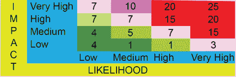
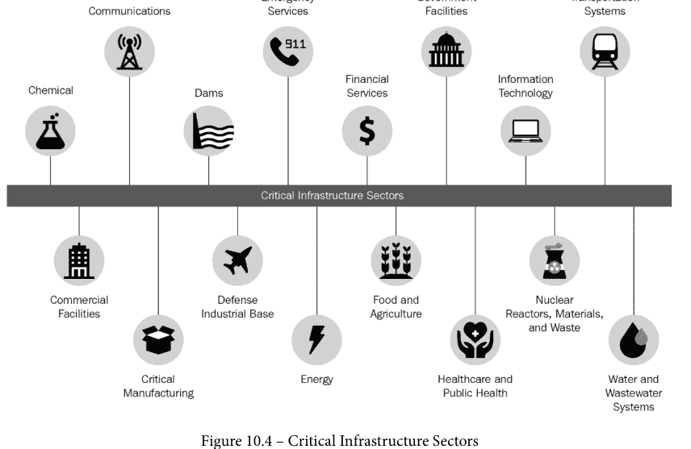
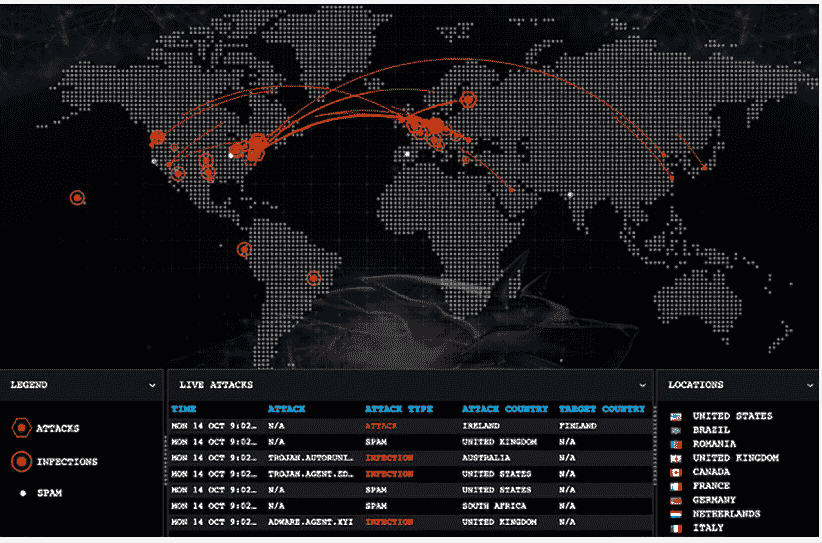
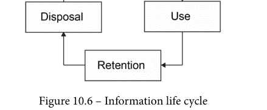

## 10 治理、风险与合规

作为安全专业人员，您需要认识到，识别和管理风险有助于保护公司环境免受各种类型的攻击。我们将探讨政策和监管框架在降低攻击成功风险方面的重要性。我们将研究不同的威胁、漏洞以及不同威胁行为者所扮演的角色。

本章分为以下几节：

- 风险管理流程与概念
- 威胁行为者、攻击向量与情报概念
- 政策对组织安全的重要性
- 法规、标准与框架
- 隐私与敏感数据概念

- **知识产权（IP）盗窃：** 知识产权盗窃可能窃取您的版权材料、商业机密和专利，从而导致收入损失。这些数据可能被用于其他国家，而在这些国家，您无法通过法律途径追回数据或寻求赔偿。我们应使用**数据丢失防护（DLP）**或文档管理系统来防范此类风险。
- **软件合规/许可：** 软件应仅从信誉良好的供应商处购买，以确保所购软件与订购内容完全一致。从其他地方购买的软件可能未经许可，这可能导致监管罚款，或者软件本身可能包含恶意软件并对您发起攻击。贵公司面临的风险之一，是员工可能使用超过所购买许可证数量的公司采购软件副本，有时用于个人用途。这称为许可证合规违规。

> **考试提示**
> 知识产权盗窃可能窃取您的专利、机密和版权材料，这些材料可能被带到您无法提起法律诉讼的国家。在那里，他们可以制造您的产品。

### 风险管理策略

在风险处理中，风险责任人（最适合对资产进行分类的人）会审视每一项风险；然后，风险责任人将决定采取何种最佳行动来降低公司面临的风险。该风险随后会被记入公司的风险登记册，以便进行监控。新风险应立即记录在风险登记册中，并且风险登记册应每6个月审查一次，因为风险与技术一样频繁变化。让我们来看看风险管理策略，从风险接受开始：

- **风险接受：** 这涉及评估风险，然后决定不采取任何行动，因为您认为风险发生的概率非常低或影响很小。例如，假设我在苏格兰有公司场地，有人报价每年1,000美元为建筑物投保地震险。我不会购买该保险，而会接受风险，因为苏格兰上次地震是在1986年，震级为2.0级，这意味着通常不会感觉到。
- **风险转移：** 风险转移是指您判断风险很大，并希望将责任转嫁给第三方。这可以是保险或将任何IT职能外包。例如，假设我购买了一辆汽车，并认为有人撞上这辆车的风险很高，于是我购买车险将风险转移给保险公司。汽车投保了，但我仍然是车主。如今，公司都在购买网络安全保险，以弥补网络攻击造成的财务损失、诉讼产生的法律费用，并支付聘请私家侦探追捕罪犯的费用。
- **风险规避：** 风险规避是指风险被认为过高，因此您决定不执行该任务。例如，假设您站在大峡谷边缘向下看，可以看到落差约为1,200英尺。您想不带降落伞跳下去，但常识告诉您，您很可能会死；因此，您决定采取风险规避策略，不跳下去，因为风险太高。
- **风险缓解：** 风险缓解是指您评估风险，并判断当前风险是否会导致财务损失、服务中断或易受攻击。例如，假设您早上离开家去上班——如果您不关门，就会有人进入您的房产并拿走一些财物。然后您采取风险缓解措施，关上门并锁好。另一个例子是，如果您为公司购买了50台新笔记本电脑，预装了软件，但没有防病毒软件。遇到病毒的风险很高；因此，您决定通过在所有笔记本电脑上安装防病毒软件来缓解风险。风险缓解是一种技术控制。

### 风险分析

风险分析是运用各种技术来分析风险，以便您全面了解公司可能面临的风险。让我们依次介绍其中的每一项，从风险登记册开始：

> **考试提示**
> 任何类型的保险，无论是汽车保险还是网络安全保险，都属于风险转移。

- **风险登记册：** 当我们审视公司的整体风险时，我们会使用风险登记册。这是公司可能面临的所有风险的清单。财务部门的风险将由财务总监评估，IT相关风险由IT经理负责审视。每个部门都可以识别资产、对其进行分类，并决定风险处理方法。财务总监和IT经理被称为*风险责任人*——他们对风险负责。风险登记册必须每年更新一次才能有效。下表显示了一个风险登记册示例：

| 序号 | 日期 | 责任人 | 描述 | 概率 | 影响 | 严重性 | 处理措施 | 应急措施 | 已采取的行动 |
|---|---|---|---|---|---|---|---|---|---|
| 1 | 01-05-2018 | IT经理 | 交换机丢失 | 低 | 高 | 高 | 转移。2小时修复SLA | 购买备用交换机 | 02-05-2018 |

图10.1 – 风险登记册

- **风险评估类型：** 有两种风险评估类型：*定性*和*定量*。让我们依次介绍：

  a. **定性风险分析：** 定性风险分析是将风险识别为高风险、中风险或低风险。这些词以单词“quality”的大部分字母开头。

  b. **定量风险分析：** 定量风险分析是查看高定性风险并为其赋予数值，以便将这些风险与成本相关联。这是通过将风险发生概率乘以影响来计算的。有时概率也称为可能性。这些词以单词“quantity”的大部分字母开头。

示例：我们将对某项风险及其概率进行1到9的评分，1表示低，9表示高。如果我们考虑丢失邮件服务器的影响，定性风险分析会认为影响很高，但丢失的概率会很低：

| 概率 | 影响 | 定量风险 |
|---|---|---|
| 3 | 6 | 18 |

图10.2 – 定量风险

- **风险矩阵/热力图：** 风险矩阵用于直观展示影响公司的风险。热力图显示情况的严重程度，最严重的风险以红色显示：

图10.3 – 风险矩阵

红色区域会对公司造成严重损害，粉红色仍表示高风险。浅粉色和绿色表示中等风险。深绿色和非常深的绿色表示低风险。在灰度图像中，数字越高，风险越高，数字越低，风险越低。这是向高级管理层展示风险分析结果的好方法。

- **风险控制评估：** 这是指公司检查其已实施的风险控制措施在技术不断变化的情况下是否仍然有效。
- **风险控制自我评估：** 这是公司所有员工决定召开会议或发放调查问卷的过程。管理层鼓励员工评估现有的风险控制措施，以便他们判断当前的风险控制是否充分，并向管理层反馈。这是一种自下而上的方法。
- **风险意识：** 这是让所有员工了解风险并激励他们承担审视风险的责任，并向管理层提出如何降低风险的建议的过程。
- **固有风险/剩余风险：** 固有风险是在实施任何风险缓解策略之前的原始风险。剩余风险是在您缓解风险之后剩余的风险量。请记住，您无法完全消除风险。
- **控制风险：** 这是指风险控制措施实施一段时间后对其进行衡量，以评估其是否仍然有效。

- **风险偏好**：这是公司愿意采取的风险缓解措施的程度，以便遵守现行法规并获得保护。影响风险态势的法规包括**欧盟《通用数据保护条例》（GDPR）、《萨班斯-奥克斯利法案》（SOX）、《健康保险携带和责任法案》（HIPAA）、支付卡行业（PCI）与数据安全标准（DSS）**等法规。

> **考试提示**
> 定性风险关注风险的严重程度——是高、中还是低？
> 定量风险是通过将概率（可能性）与影响相乘而获得的数值。

### 计算损失

以下概念可用于计算全年设备的实际损失，并可用于确定是否需要为设备损失购买额外保险：

- **单次损失预期（SLE）**：SLE 与单件物品的损失有关。例如，如果我的笔记本电脑价值 1,000 美元，而我在旅行时丢失了它，那么我的 SLE 就是 1,000 美元。
- **年化发生率（ARO）**：ARO 是指一件物品在一年内丢失的次数。如果一个 IT 团队一年丢失六台笔记本电脑，则 ARO 为六。
- **年化损失预期（ALE）**：ALE 的计算方法是将 SLE 乘以 ARO——在前面的例子中，我们有 $1,000 x 6 = $6,000。ALE 是一年内的总损失。

例如，假设一家跨国公司每年丢失 300 台笔记本电脑，这些笔记本电脑的价值为 850 美元；如果保险费为每月 21,250 美元，他们会购买保险来支付更换费用吗？答案是不会，因为更换它们的成本与保险费用相同。他们会承担明年不丢失 300 台笔记本电脑的风险。计算如下：

- a. ALE：SLE x ARO
- b. ALE：850 美元 x 300 = 225,000 美元
- c. 每月成本：225,000 美元 / 12 = 21,250 美元

> **考试提示**
> ALE = SLE x ARO
> ARO = ALE / SLE
> SLE = ALE / ARO

### 灾难

存在不同类型的灾难会对公司构成风险。让我们来看看这些灾难，从环境威胁开始：

- **环境威胁**：这种威胁基于环境因素，例如发生洪水、飓风或龙卷风的可能性。如果你住在佛罗里达州，飓风旺季是从八月中旬到十月。然而，如果你住在苏格兰，飓风非常罕见。佛罗里达州发生飓风的风险很高，而苏格兰的风险则极低。
- **人为威胁**：这是一种人类威胁——可能是恶意内部攻击，即员工故意删除数据，也可能只是某个不称职员工的无意删除。激光和炸弹也属于人为威胁。
- **内部威胁与外部威胁**：内部风险可能是洪水、断电，也可能是建筑物内部结构损坏。外部风险可能是威胁行为者或自然灾害，例如地震或飓风。

### 业务影响分析概念

**业务影响分析（BIA）**是调查灾难并计算销售损失、监管罚款和新设备采购成本的过程。BIA 着眼于灾难发生后的财务损失。让我们从单点故障开始了解 BIA 的概念：

- **单点故障**：单点故障是指任何可能导致公司无法继续运营的单一组件。这是 BIA 最关键的方面之一。

例如，一家报纸的关键任务职能是什么，其关键系统又是什么？报纸不仅通过销售产生收入，更重要的是通过出售报纸上的广告版面来产生收入。关键任务职能将是创建广告的程序，关键系统将是该程序所在的服务器、处理付款的数据库以及用于印刷报纸的系统。

- **现场风险评估**：这是对建筑工地可能发生的所有风险和危害的评估。可能包括化学品泄漏、停电、洪水、火灾和地震。工地失去其健康与安全证书也应被视为一种现场风险。

> **考试提示**
> 购买新系统时，MTBF 用于衡量系统的可靠性。你可能还需要寻找 MTTR 较低的系统，这样既可靠又能快速修复。

在下一节中，我们将探讨威胁行为者、攻击向量和情报概念。

### 威胁行为者、攻击向量与情报概念

让我们从威胁评估开始，了解威胁行为者、攻击向量和情报概念。

#### 威胁行为者

威胁评估帮助公司对其资产进行分类，然后检查该资产的漏洞。它将考察公司可能面临的所有威胁、威胁发生的概率以及威胁成功可能造成的潜在损失。

威胁行为者是可能攻击你公司的黑客或攻击者的另一种称呼；他们都有不同的属性。他们会从外部调查你的公司，在社交媒体和搜索引擎上寻找细节。安全公司会提供开源情报测试，并告知你在威胁行为者方面的漏洞。

现在让我们来看看威胁行为者的类型：

- **黑客**：黑客有三种不同类型。让我们逐一看看：
  - a. **黑帽黑客**：黑帽黑客不掌握任何信息，因为他们未经公司授权且心怀恶意。他们可能会发现漏洞并以此勒索公司钱财。
  - b. **灰帽黑客**：灰帽黑客从公司获得有限的信息，因为他们可能参与了漏洞赏金计划。他们可能拥有部分授权，也可能被称为道德黑客。
  - c. **白帽黑客**：白帽黑客是公司雇用的道德黑客，负责在应用程序发布前测试其缺陷和漏洞。他们拥有所需的所有信息，包括源代码。他们获得公司授权，并且是公司的受薪员工。
- **黑客行动主义者**：黑客行动主义者是一种外部威胁，他们会篡改你的网站或入侵你的计算机或网络。他们具有政治动机，追求社会变革。他们想通过获得媒体报道来提高公众对其事业的认识。
- **竞争对手**：竞争对手是与你公司同行业的另一家公司，试图窃取你的商业机密，破坏你的生产系统，以阻止你将产品推向市场。他们希望比你更早地将这些产品推向市场，从而占据更高的市场份额。
- **脚本小子**：脚本小子是指不具备高级技术知识、使用网上找来的脚本和代码攻击你公司的人。他们希望被视为知名黑客并因此出名。他们对攻击对象没有偏好，只想被人注意。他们会从暗网购买工具。
- **国家行为者**：国家行为者是指对你所在国家构成威胁的另一个国家；他们的动机是想要破坏你的国家。他们以技术高超、动机明确、组织严密、资金充足而闻名。他们可能会试图利用假新闻干预你的选举进程。
- **高级持续性威胁（APT）**：APT 是一种试图从你的网络窃取数据的外部威胁，但他们会持续存在极长的时间。他们以技术高超、动机明确、组织严密、资金充足而闻名。这与国家行为者非常相似，只是他们运作的时间要长得多。他们可能由外国政府资助。
- **影子IT**：这是指员工未经同意将自己的计算机和设备接入你的网络。他们可能会试图绕过你的网络安全措施，将个人设备连入网络，从而违反当前的安全策略。他们还可能窃取公司笔记本电脑，在未经同意的情况下连接你的网络。
- **犯罪集团**：犯罪集团以公司为目标，主要是为了窃取钱财。他们要么勒索你支付赎金以换取数据，要么威胁在社交媒体网站上发布公司的敏感数据。他们手下的人非常老练，其动机是获取财富。
- **内部威胁**：内部威胁是指心怀不满的员工，他们可能因晋升被忽视而与公司关系恶化。他们也被称为*恶意内部人员*威胁，并且是最难防范的，因为他们已经在你的网络内部。

> **考试提示**
> 影子IT是指有人将未授权设备接入你的网络，使其容易受到攻击。犯罪集团会威胁你，他们的动机是获取经济利益。

#### 攻击向量

攻击向量有几种不同类型。让我们逐一了解，从直接访问开始：

- **直接访问**：这是指攻击者物理上获得对你网络的访问权限，以便安装键盘记录器、恶意软件和监听设备，或进行跳板攻击。
- **无线**：无线网络是一个很好的攻击向量。攻击者可以通过发起**初始化向量（IV）**攻击或放置邪恶双子接入点或恶意接入点来利用它们。
- **电子邮件**：电子邮件是一个主要的攻击向量，攻击方式包括网络钓鱼、鱼叉式网络钓鱼，或者干脆将恶意负载附加到一封看似来自可靠来源的电子邮件上。
- **云**：攻击者可能会针对你的云服务提供商，以获取对你网络的访问权限。大多数云服务通过互联网访问，你需要确保公司到云端的连接是安全的，尤其是面向销售等移动办公用户的连接。攻击者只需利用一个人，就能攻击你的网络。

- **供应链：** 如果你的供应链将合同的一部分外包给其他承包商，这可能导致第三方攻击，因为攻击者可能有机会在其中谋得一份工作。他们还可能篡改你关键暖通空调系统，2013年塔吉特遭到维修暖通空调系统的公司攻击时，就发生了这种情况：https://www.cybereason.com/blog/what-are-supply-chain-attacks。Threat Post 称，所有攻击中有一半针对供应链；你可以阅读这篇文章：https://threatpost.com/half-all-attacks-supply-chain/143391/。
- **可移动介质：** 如果你不是从可靠供应商处获取软件，你可能会无意中购买到隐藏恶意软件的软件。可移动介质的另一个例子是，你可能会在公司入口处或接待区发现遗留的 USB。当你将其插入电脑以查找失主时，它可能会感染你的电脑，并可能使你遭受远程访问木马攻击。
- **社交媒体：** 在社交媒体上发布有关你公司的信息，可能会导致攻击者获取对其发动网络攻击有用的信息。攻击者可能会与你交朋友并发动水坑攻击，或是在社交媒体帖子中嵌入木马，这样当你阅读帖子时，就会下载木马，从而导致远程访问木马攻击。

> **考试提示**
> 供应链攻击已经成为公司面临的主要威胁。执行供应链维护的外部机构甚至可能在维护时植入漏洞利用程序。

### 威胁情报来源

在过去5年中，网络犯罪有所增加，因此出现了多种威胁情报来源，以便公司保护自己免受攻击。让我们来看一些此类资源；我们先从**开源情报（OSINT）**开始：

- **OSINT：** 这是从公共领域和互联网合法收集的情报。OSINT 有顾问愿有偿为公司提供服务。恶意软件信息共享平台威胁共享网站是一个 OSINT 提供商，可在 https://www.circl.lu/doc/misp/ 找到。OSINT 可用于执法和商业情报，帮助识别攻击来源。
- **封闭/专有情报：** 这是由商业公司收集的信息，由于他们花费资金收集信息，数据较为准确。你需要付费才能访问这些数据。
- **漏洞数据库：** **国家标准与技术研究院（NIST）** 是美国政府机构，提供国家漏洞数据库，其中包含**通用漏洞与披露（CVE）**，提供漏洞信息，并使用**通用漏洞评分系统（CVSS）**来显示每个漏洞的严重程度和影响级别。MITRE ATT&CK 框架是一个包含威胁行为者、其技术以及他们利用的漏洞的数据库。这有助于安全团队防范此类攻击。
- **公共/私营信息共享中心：** 这是商业机构和政府机构合作，为不同行业提供威胁评估的地方；见图10.4：

#### 图10.4 – 关键基础设施部门

美国国土安全部于2016年10月编写了一份关键基础设施指南。这是一个威胁评估框架，旨在帮助保护关键工业部门。

- **暗网：** 政府机构会搜索暗网寻找任何威胁，然后发布所发现的威胁信息。访问暗网是通过公告板而非搜索引擎，但当局通过贿赂暗网使用者来访问这些网站。使用暗网的攻击者通过使用TOR软件隐藏身份。**TOR** 代表**洋葱路由（The Onion Router）**。它是免费软件。TOR 路由就像一个洋葱，因为有成千上万层加密，用以隐藏攻击者的真实身份。这些层通过数千个网络中继流量，以避免被检测到。
- **失陷指标（IOC）：** 这些指标提供与 IT 安全社区中攻击相关的信息，包括与恶意软件相关的 IP 地址、文件哈希和 URL。由于数据来自已捕获的恶意软件，IOC 能让人很好地了解当前的威胁态势。
- **结构化威胁信息表达（STIX）/ 可信指标信息自动交换（TAXII）：** 这些是防止网络攻击的标准。STIX 由 MITRE 开发，是一种帮助分发网络威胁情报的格式。它定义了攻击方法，并分为18个领域对象，如攻击模式、活动、指标和应对措施。TAXII 与 STIX 配合使用，因为它是一种可以通过 HTTP 分发**网络威胁情报（CTI）**的应用程序。
- **自动化指标共享（AIS）：** 这提供了关于网络攻击的数据交换。该信息由美国联邦政府从州级向下到地方级共享，私营公司也可以参与此计划。STIX/TAXII 用于发送通知。

例如，假设 AIS 的一个参与者共享了有关攻击者恶意 IP 地址和电子邮件地址的信息；这将有助于防止该攻击者发动第二次攻击，因为其他参与者对该攻击者及其方法有了更多的认识。
- **预测分析：** 这通过使用机器学习过滤大数据（海量数据）来识别网络威胁模式，从而可以预测未来的攻击。

> **考试提示**
> 暗网依赖 TOR 软件避免被检测。

- **威胁地图：** 这些是实时网络攻击地图，显示实时攻击。此类地图有很多，来自 Bitdefender、Check Point、Norse map、Kaspersky 等。图10.5 展示了 Bitdefender 攻击地图：

图10.5 – Bitdefender 威胁地图

- **文件/代码仓库：** GitHub 于2008年推出，以便应用程序开发人员可以共享有关源代码的信息。维护者（通常是项目负责人）会评估保存在不同仓库中的不同版本的代码。开发人员可以共享他们有关漏洞及漏洞处理解决方案的个人文件。另一个来源是 `virustotal.com`，其中包含有关恶意软件签名和代码的信息。

> **考试提示**
> STIX 和 TAXII 通过 HTTP 分发 CTI 更新。

### 研究来源

还有其他各种威胁情报来源；让我们看一些，首先从供应商网站开始：

- **供应商网站：** 微软制作了其*Cyber Trust 博客*，思科制作了其*安全博客*和*RSS 源*。Sophos 制作了其*SophosLabs 威胁情报*，可在 https://www.sophos.com/en-us/medialibrary/PDFs/factsheets/OEM-solutions/sophos-threat-intelligence-dsna.pdf 找到。
- **漏洞源：** 漏洞源主要有三类：供应商、政府和私人来源。最好的源是*国土安全部 AIS 源*、*FBI InfoGuard 门户*、*SABS 内部风暴中心*和*Cisco Talos 情报组*；后者可在 https://blog.talosintelligence.com/ 找到。
- **会议：** 这是网络安全界人士跟上发展并与参与网络犯罪防护的人员建立联系的绝佳方式。这些活动参与度高，并由各种机构赞助。2016年1月，*SANS 威胁狩猎与事件响应峰会和培训*在伦敦举行，会议主题包括黑客工具、技术和漏洞利用，以及事件处理。第二场讲座是关于高级事件响应、威胁狩猎和数字取证。这些活动规模巨大，遍布全球，有助于提高行业专业人士的认知。
- **学术期刊：** 有许多发表网络安全论文的学术期刊。其中包括*《密码学杂志》（JOC）*和*《IEEE 安全与隐私》*。这些期刊大多数需要付费购买。
- **意见征求文件（RFC）：** RFC 由**互联网工程任务组（IETF）**创建，其目标是制定互联网标准。其中一些标准是建议性的，另一些则是强制性的；随着技术的发展，RFC 也在不断发展。一个很好的例子是*RFC1244*，即*《站点安全手册》*；这是为处理互联网安全问题提供指导的首次尝试。RFC 由各自领域的专家撰写。
- **本地行业团体：** 在英国，有一个名为*地方政府协会*的团体，其目标是为地方当局提供预防网络犯罪的良好实践指南。还有一些地方团体帮助人们举报网络犯罪。受害者可以向诸如*网络安全支持网络*等机构举报，该机构制作了欺诈日志以帮助举报网络犯罪，从而使我们能够抓获罪犯。

- **社交媒体分析**：社交媒体是研究网络犯罪的良好来源，因为许多人在博客上发表文章，从而可以对相关问题展开讨论。社交媒体还能让人们了解网络攻击，从而避免成为受害者。
- **威胁情报源**：这些威胁情报源由安全供应商提供，向人们提供关于恶意行为者的最新信息，例如他们的 IP 地址和恶意域名，从而保护公众免受侵害。
- **对手战术、技术与程序（TTP）**：这是关于对手及其使用的攻击方法、工具和技术的信息。一个良好的信息来源是 MITRE ATT&CK 框架，其中包含一个对手列表的电子表格，你可以深入了解相关细节。

在下一节中，我们将探讨政策对组织安全的重要性。

### 政策对组织安全的重要性

安全政策是保护你的环境免受网络犯罪分子侵害的有效方法。如果没有制定政策，我们就只能任由网络犯罪分子摆布。让我们看看有助于维护环境安全的政策，首先从人员政策开始，因为人员可能遭受多种类型的社会工程攻击。

### 人员

大多数网络犯罪漏洞都与针对员工的社会工程攻击有关。因此，我们将制定许多政策来减少攻击面。让我们看看其中一些政策，从入职流程开始：

- **入职政策**：公司可以允许员工采用**自带设备（BYOD）**政策，该流程的一部分是进行入职和离职管理。入职政策规定，任何设备都必须进行病毒检查，任何可能对公司网络造成损害的应用程序都应在设备获得网络访问权限之前移除。如果有人未能正确执行入职流程，公司可能会感染病毒。
- **离职政策**：当有人离开公司时，BYOD 设备上使用的业务数据需要在离职前删除。如果离职流程执行不当，前员工可能会带着其设备上的公司业务数据离开。

- **背景调查**：对新员工进行背景调查可能涉及查看犯罪记录、就业和教育经历，以及驾驶证和信用记录。这是为了确保个人在简历（CV）中所陈述的信息真实无误。对于与儿童打交道或处理财务工作的岗位，需要进行更严格的背景调查。
- **离职面谈**：离职面谈的目的是了解员工决定离开组织的原因；这可用于提高员工留存率。
- **岗位轮换**：岗位轮换有两个主要原因——第一，让所有员工都能接受公司内各个岗位的培训。员工可能每6个月更换一次部门；这样他们能获得更好的培训体验。第二个原因是，通过轮岗，新接手的人员可以发现任何盗窃或欺诈活动。
- **强制休假**：强制休假强制员工休假一周或更长时间，以此帮助发现员工是否参与了欺诈活动。当人们参与欺诈活动时，他们往往不会休很多假，以免欺诈行为被发现。这种情况在承担财务信托职责的岗位上尤为普遍，例如从事财务工作的人或有权授权信用卡付款的人。
- **最小权限政策**：该政策规定，应限制对数据的访问，员工应仅获得履行其职责所需的最低访问权限。在军事领域，这被称为*“需要知道”*原则：如果你不需要访问权限，那么你就无权访问。
- **清桌政策**：清桌政策（有时称为*“桌面清洁政策”*）是一种公司政策，规定员工应在每天结束时清空桌面上所有文件。这可以防止清洁人员或其他人阅读这些文件。
- **行为准则**：行为准则规定了员工在工作时应如何表现。不应存在欺凌、歧视或性骚扰。员工应为了公司利益而合作，即使他们来自不同的背景。即使其他员工的宗教信仰与自己的不同，或者自己不认同这些信仰，人们也应尊重和容忍。
- **不利行为**：不利行为是非法行为。《*公平工作法*》将多种行为定义为不利行为。例如威胁员工、在雇佣期间伤害员工，或歧视员工。

- **违反政策**：当员工或承包商不遵守他们已同意的政策或程序时，可能会导致纪律处分；如果情节严重，则会被立即解雇。这通常与行为有关。
- **社交媒体分析**：我们需要一项良好的公司政策来规范我们在社交媒体上发布的内容，以防止攻击者获取有用信息。
- **用户培训**：用户培训对于降低被网络犯罪分子利用的风险至关重要。（在下一节中，我们将探讨不同形式的用户培训，首先从培训方法的多样性开始。）

> **考试提示**
> 如果你在公司电脑上安装盗版软件，则违反了 AUP。

### 培训方法的多样性

由于不同类型的攻击在数量和复杂性上不断增加，公司必须提供多样化的用户安全培训和定期研讨会。用户培训对于降低被网络犯罪分子利用的风险至关重要，现在我们来看看不同类型的用户培训。让我们从夺旗赛（Capture the Flag）开始：

- **夺旗赛（Capture the Flag）**：在这些活动中，红队成员（扮演攻击者）进行基于漏洞利用的练习，蓝队成员（防御者）则处理需要应对的威胁。每位成员处理各自的练习，一次达成一个目标，直到实现总体目标（即“夺旗”）。此时，他们可以进入练习的下一个级别。在完成足够多的级别后，他们就有资格加入相应的团队。有关红队和蓝队的信息，请参阅第5章《*监控、扫描和渗透测试*》。夺旗赛用于提升员工队伍的技能。
- **网络钓鱼演练/模拟**：公司向员工发送钓鱼电子邮件，观察他们的反应。上当受骗的员工随后会接受有关网络钓鱼攻击的补救培训。
- **基于计算机的培训（CBT）/游戏化**：员工观看视频，并回答视频每个部分之后的问题，以确保他们理解培训内容。这是一种*游戏化*形式。
- **基于角色的培训**：公司开展安全意识培训，确保所有员工都获得了与其岗位角色相适应的充分培训。

> **考试提示**
> 夺旗赛练习有助于同时训练红队和蓝队成员。他们完成任务，每完成一次任务便提升一个级别。当所有训练完成时，即为“夺旗”。

### 第三方风险管理

公司会大量使用第三方来获得软件或服务，而由于我们无法控制这些第三方，我们需要对与这些公司的互动方式进行风险评估。让我们逐一审视这些互动，首先从供应链管理开始：

- **供应链**：你的供应链包含你所依赖的公司，这些公司提供你开展业务职能或生产待售产品所需的材料。假设你是一家笔记本电脑制造商，*A公司*提供电池，*B公司*提供电源。如果这两家公司中的任何一家出现电池或电源短缺，你就无法制造和销售笔记本电脑。供应链中的公司还可能是分包商，或承担不同类型的维护。参见本章前面“*攻击向量*”部分中的“*供应链*”。
- **供应商**：购买软件时，你必须确保软件来自信誉良好的供应商，因为如果供应商不可信，他们可能会在软件中安装恶意软件，例如远程访问木马或间谍软件。他们还可能内建后门。你越是集成单一供应商的产品，就越依赖他们。如果他们破产，你可能会变得易受攻击。
- **业务合作伙伴**：**业务合作协议（BPA）**用于两家希望参与商业合作以获利的公司之间。它规定了各方应出资多少、他们的权利与责任、企业日常运营的规则、决策者是谁以及利润如何分配。它还规定了合作的终止规则，可以是在特定时间点终止，也可以是在一方合作伙伴去世或离开时终止。
- **谅解备忘录（MOU）**：MOU 是两方或多方之间的正式协议。MOU 比君子协定更具约束力，双方必须愿意对彼此作出严肃承诺，但它们不具有法律约束力。

- **协议备忘录（MOA）**：MOA 与 MOU 类似，但作为法律文件，描述了协议的条款和细节。
- **保密协议（NDA）**：NDA 是员工或商业合作伙伴之间订立的具有法律约束力的合同，承诺未经适当授权不得向他人披露商业秘密。这样做的目的是防止商业秘密或专有信息被出售给竞争对手。
- **服务级别协议（SLA）**：SLA 是服务提供商与接受服务的公司之间的合同。该协议可以涉及在一定时间内进行修复或响应，并通过指标进行衡量。
- **测量系统分析（MSA）**：MSA 是通过收集统计数据来评估系统，以确保系统质量有效的流程。
- **生命周期终止（EOL）**：指供应商停止销售产品，替换零件和技术支持的可用性受到限制。保修仍然有效。
- **服务生命周期终止（EOSL）**：指供应商认为产品已达到其使用寿命的终点，可能是因为发布了新版本产品。他们将不再投入更多时间或资源来维护该产品。用户仍然可以使用该产品，但必须考虑到供应商将不再提供安全更新或技术支持。这意味着随着时间的推移，此类产品将变得脆弱，并对仍在使用它们的任何公司构成巨大的安全风险。

> **考试提示**
> 
> SLA 规定了供应商应对故障打印机等事件作出多快的响应。它使用指标进行衡量。

### 数据

数据是公司拥有的最重要资产之一，确保制定相关政策，使其按照 GDPR 或 HIPAA 等法规进行分类、处理、存储和处置，这一点非常重要。让我们看看需要考虑的数据方面，从分类开始：

- **分类**：这是为数据标记相关分类的过程，以便我们知道数据是绝密、秘密、机密还是敏感数据。分类决定了数据的处理方式。
- **治理**：数据治理是一种监督和管理，描述了从创建到销毁的数据处理过程中每个阶段应用的安全控制。这些程序详细说明了用于管理、存储和处置数据的流程，以确保合规。
- **保留**：公司不希望将数据保留超过必要的时间，因为这会减少其责任；但是，为保持合规，公司可能需要在数据失去用途后将其存档。一个例子是英国的医疗数据，需要保留 25 年。

### 凭证策略

必须安全保管凭证，以防止未经授权访问系统；因此，制定防止漏洞和未经授权访问的策略至关重要。让我们看看需要制定的策略，从与人员相关的策略开始：

- **人员**：人员账户可以使用共享账户，即客户服务团队的所有成员使用同一账户向客户发送电子邮件。这样做的缺点是您无法审计或监控单个用户。另一种人员账户是用户账户，应遵循最小权限原则。
- **第三方**：第三方凭证可以是云提供商或**安全即服务（SECaaS）**供应商提供的 SAML 令牌，由云提供商管理您的身份管理。如果进行远程管理，我们可以使用 SSH 密钥进行安全外壳连接，其中公钥安装在目标服务器上。
- **设备**：设备具有带默认密码设置的通用账户。购买设备后，您需要立即更改默认设置，因为这些设置已在网站上公布。请访问 https://cirt.net/passwords 查看这些密码。
- **服务账户**：服务账户用于运行杀毒软件等应用程序。它们可以作为具有与用户相同权限的本地服务账户运行。系统账户提供了更高权限级别，赋予您完全控制权。
- **管理员/根账户**：Linux 中的管理员和根账户需要受到保护，因为它们允许您安装软件、进行配置更改以及访问任何文件。这些账户应仅限于少数 IT 人员使用。安装新系统时，我们需要确保更改默认账户设置。Linux 中的根账户称为*超级用户*，不受限制；除非绝对必要，否则不应使用此账户。管理员应拥有两个账户：一个用于日常使用的普通用户账户，另一个用于管理职责的管理员账户。

### 组织策略

需要制定组织策略，以应对技术、风险或安全的变化，从而维护安全的工作环境。让我们看看其中一些策略，从变更管理开始：

- **变更管理**：当进行审计且报告显示现有的控制措施不够安全时，我们要么实施变更管理，要么制定新策略。新策略会改变整个流程，而变更管理则会修改现有流程。
- **变更控制**：变更控制是指有人请求管理者对现有控制实施变更。假设管理层希望了解变更的财务收益，以及在人工时间或货币价值方面将节省的成本。此类变更需要提交给**变更咨询委员会（CAB）**，以确保其对公司有利。
- **资产管理**：这是一个流程，公司拥有的每项资产都被标记并记录在资产登记册中。需要进行年度审计，以确保所有资产都得到核算。这也有助于识别网络上的未授权设备。

### 法规、标准和立法

制定法规、标准和立法以确保实现合规，其中大多数具有法律强制执行力。我们从这些法规和标准中推导出我们的策略，以确保合规并防止犯罪；如果公司不遵守这些法规，将被罚款。其他行业框架只是最佳实践，不具有法律强制执行力，但供应商不会支持任何未按照此类最佳实践设置的产品。在本节中，我们将介绍法规、标准和立法，然后介绍关键框架、基准和安全配置指南。让我们从**通用数据保护条例（GDPR）**开始：

- **通用数据保护条例（GDPR）**：欧盟（EU）的 GDPR 于 2018 年 5 月 25 日生效，作为数据保护法的框架。它由欧盟**信息专员办公室（ICO）**执行，保护个人对其数据隐私的权利，例如姓名、出生日期、照片、视频录像、电子邮件地址和电话号码。GDPR 旨在保护这些信息的收集、使用和存储。GDPR 规定，任何在其网站上向欧盟公民销售产品的人都必须遵守 GDPR，并且数据只能用于其预期用途。例如，购买完成后，未经用户同意，不应再存储信用卡详细信息。由于欧盟有 27 个国家，因此它被称为国际法规。
- **国家、地区或州法律**：在美国，有国家数据法律，例如，针对医疗数据的**健康保险携带与责任法案（HIPAA）**和针对金融服务的**格雷姆-里奇-比利雷法案（GLBA）**。各州往往有自己的个人数据法律，但大多数基于**联邦信息安全管理法案（FISMA）**，该法案保护政府信息和运营。
- **支付卡行业数据安全标准（PCI DSS）**：PCI DSS 涉及用于卡支付的数据的处理和存储。如需更多信息，请访问 `https://www.pcisecuritystandards.org/about_us/`。

> **考试提示**
> 
> GDPR 在维护个人隐私和权利的同时处理数据。它被认为是国际性的，因为它由拥有 27 个成员国的欧盟制定。

### 关键框架

一些关键框架已设计出来，大多由非营利组织设计，以帮助降低日益增长的网络犯罪水平和公司采用云所带来的风险。让我们从**互联网安全中心（CIS）**开始：

- **CIS**：这是一个非营利组织，发布有关网络安全最佳实践和威胁的信息，并拥有帮助强化环境和提供风险管理的工具。CIS 为不同操作系统提供基准，并提供帮助保护组织安全的控件。如需了解更多详情，请访问 `https://www.cisecurity.org/cybersecurity-tools/`。

- **NIST网络安全框架（CSF）：** NIST RMF/CSF旨在关注个人及其对网络安全构成的风险。它取代了NIST的**风险管理框架（RMF）**，旨在审视个人对政府机构构成的风险。CSF的信息可在`https://www.nist.gov/cyberframework`找到，RMF的信息可在`https://csrc.nist.gov/projects/risk-management/rmf-overview`找到。

- **国际标准化组织（ISO）：** ISO发布由专家内部协商一致的标准。这里列出的是信息系统的标准；我们先看27001：
  a. ISO **27001** – *信息安全管理体系*的安全技术：`https://www.iso.org/standard/54534.html`。
  b. ISO **27002** – *信息安全控制实践准则*。该标准旨在改进信息管理：`https://www.iso.org/standard/54533.html`。
  c. ISO **27701** – 27001/27002的扩展，涉及*隐私信息管理——要求与指南*：`https://www.iso.org/standard/71670.html`。
  d. ISO **31000** – 关于企业组织和一般管理的风险管理；信息可在其网站上找到：`https://www.iso.org/standard/65694.html`。

- **鉴证业务准则公告（SSAE）：** SSAE 18是一项审计标准，旨在提高**服务组织控制（SOC）**报告的质量和实用性。该标准适用于云提供商等大型组织，因为一份低端报告的成本约为15,000美元。

- **SOC类型2/3：** SOC报告用于帮助**注册会计师（CPA）**开展审计，以增强对您所提供服务的信心。这给利益相关者和潜在客户带来信心。让我们看一些SOC报告：
  a. **SOC类型2报告：** 这些报告涉及用户数据的安全性、处理和管理方面的内部控制，以确保数据保密并维护隐私。有两种类型：类型1涉及控制设计的适宜性，类型2涉及控制的有效性。

  这些报告的分发受到限制，因为它们提供了大量关于被审计公司的详细信息。

b. **SOC类型3报告：** 这些是通用报告，内容不那么详细，因此可以自由分发。有关SOC报告的更多信息，请访问https://www.aicpa.org/interestareas/frc/assuranceadvisoryservices/serviceorganization-smanagement.html。

> **考试提示**
> SSAE是SOC报告的审计标准。SOC类型1报告衡量您的安全性，SOC类型2报告涉及数据管理。这些报告访问受限，并且对每个云提供商都是强制性的。

- **云安全联盟：** **云安全联盟（CSA）**是一个非营利组织，提供各种资源来帮助**云服务提供商（CSP）**，例如在线培训、网络研讨会、社区讨论组和虚拟峰会。请访问以下网站了解更多信息：https://cloudsecurityalliance.org/online-resources/。让我们看看**云控制矩阵（CCM）**和CSA参考架构：

a. **CSA CCM：** 该矩阵旨在为云供应商和潜在云客户提供安全原则指南，以评估云提供商的整体风险：https://cloudsecurityalliance.org/research/working-groups/cloud-controls-matrix/。

b. **CSA参考架构：** 参考架构包含CSP的最佳安全实践。其网站将其使命描述为“*促进围绕安全可信云参考架构的最佳实践和方法的研究、开发和教育。*”它涉及不同的主题，如安全与风险、表示服务、应用服务、信息服务、**IT运营与支持（ITOS）**以及**业务运营与支持服务（BOSS）**。

> **考试提示**
> CSA CCM帮助潜在客户衡量CSP的整体风险。

在下一节中，我们将研究不同的隐私和敏感数据概念。

### 隐私与敏感数据概念

私有数据和敏感数据必须正确标注和处理，否则将对公司声誉产生不利影响，并可能导致监管罚款。让我们看看与数据相关的概念，从数据主权开始。

### 数据主权

已创建并转化为数字数据的数据受制于其创建所在公司的法律法规。即使出于备份相关原因，也不能将其移至另一个区域。这影响了云提供商和跨国公司，因为他们不能简单地将数据移动到他们想要的地方。让我们先看看法律影响，然后看地理考虑因素。

### 法律影响

数字数据受制于其创建所在地区的法律法规。创建数据的公司必须合规；例如，他们可能需要将医疗数据保留25年、财务数据保留5年、普通数据保留2年。

### 地理考虑因素

数据所在位置对灾难后的恢复阶段有重大影响，因此必须考虑这种影响。我们将研究距离、异地备份和位置选择。

- **距离：** 我们知道恢复最快的站点是热站，但如果热站距离200英里，请考虑将公司人员送到该站点的后勤安排。这可能需要几天时间来组织。
- **位置选择：** 热站的位置对于我们恢复数据和系统的速度至关重要。如果它非常远，并且某个区域遭遇停电或遭受飓风袭击，我们能否让该站点重新正常运行？这就是云会成为好选择的原因。
- **异地备份：** 当我们备份数据时，应将备份磁带存放在防火保险柜中，并将最新副本保存在异地，以防遭遇自然灾害。

### 隐私泄露的组织后果

如果公司发生数据泄露，可能会产生多种后果。让我们看看其中一些，从声誉损害开始：

- **声誉损害：** 当公司发生数据泄露且公众知晓时，可能导致品牌受损，因为公司失去了公众的尊重。这可能会减少销售额。
- **域名声誉：** 您的域名声誉取决于您发送的电子邮件类型。有人可能入侵您的网络并利用您的邮件服务器发送垃圾邮件，这会影响您的域名声誉，并可能导致其被列入黑名单。这意味着您无法发送或接收电子邮件。其症状会从能够向某些地址发送邮件但不能向其他地址发送开始，最终所有ISP都会停止您的所有邮件。您可以使用Google Postmaster工具检查您的域名声誉。
- **身份盗窃：** 如果持有的客户数据被窃取并用于身份盗窃，公司将因损害而被起诉。
- **罚款：** 数据泄露可能导致监管罚款。一个例子是欧盟GDPR，最高罚款为2000万欧元或公司年度全球营业额的4%，以较高者为准。
- **知识产权（IP）盗窃：** IP盗窃可能导致受版权保护的材料、商业秘密和专利被竞争对手窃取，从而造成收入损失。这些数据可能在无法通过法律途径收回数据的国家被使用。

> **考试提示**
> 如果公司发生数据泄露，且这些数据被用于身份盗窃，受影响的个人可能会起诉该公司。

### 泄露通知

国家法律法规规定了数据泄露应如何报告以及应向谁报告。数据泄露通常是指数据被窃取或发生意外泄露；这意味着当前实施的政策无效。如果某人访问了文件或数据库服务器，我们需要找到所使用的账户，以便删除它并防止进一步泄露。现在让我们看看发现泄露后需要采取的行动，从升级上报开始：

- **升级：** 任何数据泄露，无论大小，都应立即向首席执行官报告，因为公司日后可能会面临法律诉讼。如果公司未遵守法规，可能会面临罚款。
- **公众通知和披露：** 我们可能需要联系警察、监管机构、客户以及受泄露影响的任何个人。欧盟 GDPR 法律允许公司在 72 小时内通知相关人员。如果你身在英国，你必须遵守 1998 年《数据保护法》，该法为成文法，而在美国，如果是医疗数据，你必须遵守 HIPAA。

### 数据类型

数据有各种类型，我们需要了解每种类型及其特征；让我们从不同的数据分类开始。

#### 分类

风险管理的第一阶段是对资产进行分类，这决定了我们如何处理、访问、存储和销毁数据。我们现在将查看数据的不同分类，以便我们知道如何处理数据。让我们先从公开数据开始：

- **公开数据：** 这是任何人都可以获取的数据，例如昨天的新闻、到处分发的小册子或宣传册。任何人都可以访问此数据。
- **私人数据：** 私人数据是个体不愿披露的数据；它也可能被归类为敏感数据。
- **敏感数据：** 这是与个人相关的个人数据，例如性取向、政治、宗教、种族或健康相关数据：https://ec.europa.eu/info/law/law-topic/data-protection/reform/rules-business-and-organisations/legal-grounds-processing-data/sensitive-data/what-personal-data-considered-sensitive_en。
- **机密数据：** 研究与开发（R&D）和法律数据将被归类为机密数据；披露会给公司造成损害。这也可能被称为 classified 数据。
- **关键数据：** 这是公司不愿披露的数据；它也可能被归类并加密以防止他人读取。

- **令牌化：** 令牌化是指有意义的数据被随机生成的令牌替换，而原始数据保存在保险库中。这比加密更强，并且是无状态的，密钥也不存储在本地。
- **匿名化：** GDPR 第 26 条 recital 将匿名化数据定义为“以使数据主体无法被识别或不再可识别的方式使数据匿名化”。应删除、替换或扭曲诸如个人姓名等标识符。我们可以用它来保护 PII。例如，我们可以查看社会安全号码，但我们无法再识别它所属的个人，因为其姓名已被删除。
- **假名化：** 这是指数据被修改或被其他信息替换，因此如果要逆转该过程，则需要依赖于与原始数据分离的另一个数据源。欧盟 GDPR 第 4(5) 条规定，假名化过程是“以这样的方式处理个人数据，即在不使用额外信息的情况下，个人数据无法再归属于特定数据主体，前提是此类额外信息是单独保存的，并且受技术和组织措施的约束，以确保个人数据不会归属于已识别或可识别的自然人。”

> **考试提示**
>
> 数据屏蔽是指数据字段中仅保留部分数据。例如，信用卡可能显示为 **** **** **** 1234。令牌化优于加密，因为它用令牌替换数据，该令牌连接到原始数据存储的远程位置。

### 数据角色和职责

处理数据有不同的角色和职责，从创建数据的所有者到存储和控制数据的人员。让我们查看每个角色及其负责的领域。我们将从数据所有者开始：

- **数据所有者：** 数据所有者负责对数据进行分类并决定谁可以访问数据。
- **数据控制者：** 数据控制者负责确保收集的所有数据及其存储是合法的并符合合规法规。数据控制者负责调查数据泄露。
- **数据处理者：** 数据处理者代表数据控制者行事，确保数据的收集、存储和分析符合法规（GDPR 第 30 条）。
- **数据管理员：** 数据管理员负责数据质量、标记，并确保其按照当前法规和标准进行存储。
- **数据保管员/管理员：** 数据保管员存储和管理数据，确保其已加密并定期保留备份磁带。
- **数据保护官（DPO）：** 隐私法或数据保护法禁止披露或滥用有关私人的信息。根据 GDPR 第 37 条，数据保护官（DPO）是组织内的强制性任命。 第 39 条列出了 DPO 的任务：https://advisera.com/eugdpracademy/gdpr/tasks-of-the-data-protection-officer/。他们必须确保数据主体了解其权利，并且数据控制者根据法规履行其职责。DPO 的职责是确保 PII 数据的处理、使用、保留和处置符合国家法律和监管框架。

> **考试提示**
>
> 数据保护官确保遵守数据法规。

### 信息生命周期

信息生命周期包括数据的生命周期，从数据创建到数据销毁；见图 10.6：

图 10.6 – 信息生命周期

让我们查看每个阶段：

- 1. **创建：** 数据可能是由某人填写表格生成的。也可能是通过邮件发送收集的。
- 2. **使用：** 数据是使用最小权限原则访问的，并且仅用于其预期目的。
- 3. **保留：** 我们遵守数据保留政策，以便符合监管框架。我们可能需要存档数据多年。
- 4. **处置：** 在收集数据的事件过去后，我们必须使用最佳和最有效的数据清理方法，以确保没有数据残留。

> **考试提示**
>
> 数据所有者对数据进行分类；管理员确保质量并对其进行标记；保管员存储、保护和备份数据；管理员则为其提供访问权限。

### 影响评估

这就是你评估收集大量数据的风险并查看可降低该风险的工具的地方。

例如，假设你在一家医院工作，患者需要提供同意书以允许医生对其进行手术。你每周可能会收集 1,000 份此类表格，并可能决定使用 SharePoint 服务器来存储它们，以便集中存放，不会因文书错误而丢失。

### 协议条款

这是数据收集者与其数据被收集的个人之间的协议；它概述了收集数据的目的。

### 隐私声明

获得同意意味着，如果我允许你收集我的个人数据，你只能将其用于其预期目的。

例如，假设有人向你提供了他们的电子邮件和个人手机号码以设置其账户，以便他们可以购买商品。然后将这些详细信息发送给你的市场部门以针对该人就是非法的。

- 23. 为什么审计员会寻找可能导致整个计算机系统失败的单个项目？
- 24. 风险评估的第一阶段是什么？
- 25. 恶意软件信息共享项目提供哪种类型的威胁情报？
- 26. 贵公司已进行桌面演练，然后进行演练。刚刚执行了哪种类型的计划？
- 27. 为什么公司会引入清洁办公桌政策？
- 28. 为什么有人会使用网站 www.virustotal.com？
- 29. 如果有人自带笔记本电脑用于工作，除了入职政策外，还应引入什么其他政策？
- 30. 退出面谈的目的是什么？
- 31. MITRE ATT&CK 框架用于什么？
- 32. GDPR 的目的是什么？
- 33. 漏洞赏金计划的参与者可能会收到什么类型的信息？
- 34. 访问暗网的黑客使用什么工具来保持匿名？
- 35. 夺旗赛的目的是什么？
- 36. 风险规避的目的是什么？
- 37. 风险转移的目的是什么？
- 38. 谁使用 AIS 及其分发情况？
- 39. ISO 标准 27701 的目的是什么？
- 40. 行为规则是什么？
- 41. IOCs 的目的是什么？
- 42. 脚本小子的动机是什么？
- 43. 为什么公司会运行年度安全意识培训计划？
- 44. 如果你想卖掉你的车，并使用你的 Gmail 账户向公司所有员工发送电子邮件，会发生什么？
- 45. 为什么要为原材料的主要供应商之一进行风险评估？
- 46. BIA 背后的驱动力是什么？

47. RPO和RTO之间有什么关系？
48. 从MTTR中可以确定哪些信息？
49. 哪种类型的威胁行为者可能破坏公司的生产系统？
50. 哪种类型的威胁行为者会要求你付款，或威胁要在社交媒体上发布你持有的客户信息？
51. MTBF的目的是什么？
52. SSAE的目的是什么？
53. SLE的目的是什么？如何计算？
54. 我们如何计算ALE？
