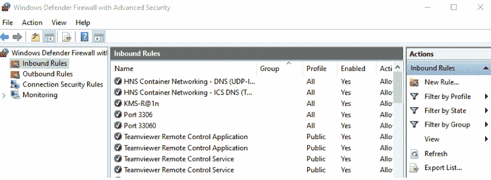
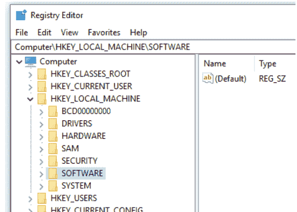
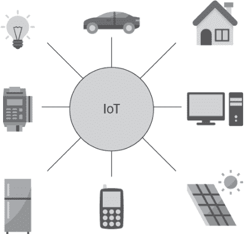
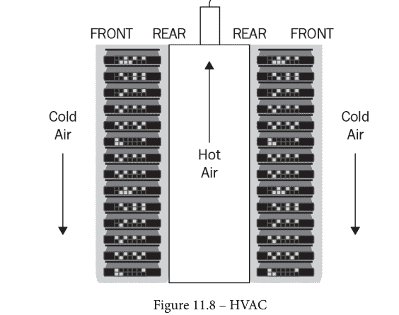
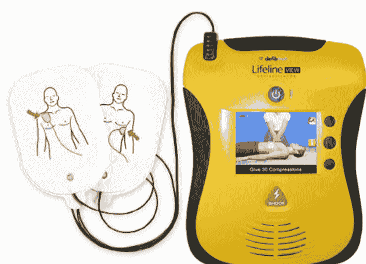
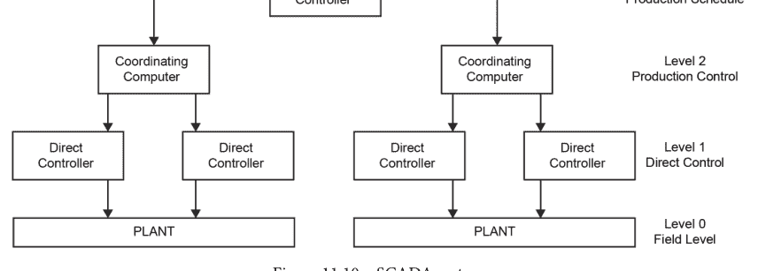
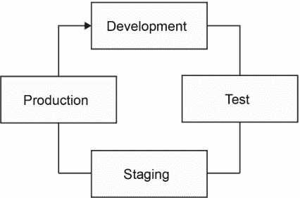

## 11 管理应用程序安全

网络安全团队处理的主要任务之一是管理公司内部使用的应用程序，以确保它们没有漏洞并已得到加固。在本章中，你将学习如何有效地部署和管理应用程序，并选择适当的开发生命周期。你将学习安全编码技术、质量控制和测试。让我们首先了解如何实施主机并确保它们在推出之前是安全的。

在本章中，我们将涵盖以下主题：

- 实施主机或应用程序安全
- 理解嵌入式和专用系统的安全影响
- 理解安全的应用程序开发、部署和自动化

### 端点保护

端点必须受到保护以防攻击。让我们逐一了解每种端点保护，首先是防病毒：

- **防病毒**：防病毒软件会监控正在访问的网站和正在下载的文件，以确保它们不受病毒或特洛伊木马的影响。大多数现代防病毒解决方案都能承担反恶意软件的职责。
- **反恶意软件**：反恶意软件扫描你的计算机以查找*广告软件*和*间谍软件*，并防止恶意软件运行。
- **端点检测与响应（EDR）**：EDR是一种优于防病毒或反恶意软件的高级解决方案。它是一个集中式控制台，持续监控计算机，并在检测到威胁时自动发出警报。它使用机器学习来检测威胁，并且可以检测无文件病毒。
- **数据丢失防护（DLP）**：可以设置端点DLP解决方案，以保护计算机上的数据免遭通过电子邮件或USB驱动器窃取。DLP还可以保护任何具有模式匹配的数据，例如PII信息或敏感数据。

  **示例：** 我有一个名为*新业务联系人*的文件，我想确保它不会被窃取。它没有模式匹配。但是，我可以使用DLP解决方案，选择该文件，系统会为该文件分配一个模式匹配。当有人试图通过电子邮件发送该文件时，它将被DLP系统阻止。

- **下一代防火墙（NGFW）**：NGFW不仅仅是传统防火墙。它可以通过执行深度数据包过滤来充当状态防火墙。它还可以检查应用程序流量以确保其合法，并使用白名单来确保只允许经批准的应用程序运行。它还可以充当入侵防御设备来抵御攻击，并且可以检查加密的SSL和HTTPS数据包。
- **主机入侵防御系统（HIPS）**：HIPS是一种可以安装在主机上以保护其免受攻击的软件程序。它分析计算机的行为，在日志文件和内存中寻找可疑行为，并采取适当措施防止恶意软件等攻击。
- **主机入侵检测系统（HIDS）**：就其本质而言，HIDS是一种被动设备，用于监控计算机系统行为的模式。HIDS使用一个包含计算机设置的数据库，包括注册表、关键系统文件、应用程序和组件。它的功能是向用户发出任何差异或攻击的警报。
- **基于主机的防火墙：** 基于主机的防火墙可用于防止对桌面的未授权访问，并可为经批准的应用程序设置允许规则。



图11.1 – 基于主机的防火墙

### 数据库

确保数据库安全非常重要，因为它们可能包含有关个人的PII信息或信用卡信息。让我们看看如何尽可能保持数据库安全，首先是存储过程：

- **存储过程：** SQL注入攻击会操纵SQL语句，然后通过插入1=1来结束它。与其编写Transact-SQL语句，我们可以将SQL脚本预先编写并保存在存储过程（例如ABC）中。这样可以防止对语句的操纵。然后我们将ABC插入Transact-SQL中，从而防止篡改。这与批处理文件的情况类似。检测SQL注入的另一种方法是检查数据字段中是否有撇号。
- **令牌化：** 令牌化被认为比加密更安全。当我们加密数据时，我们使用公钥，然后可以通过使用私钥解密数据或破解加密来逆转加密。这意味着攻击者可能破译数据。令牌化将敏感数据（如信用卡号）替换为随机数据。因此，它无法被逆转。请参阅*图11.2*以了解令牌化的过程：
- **加盐：** 在数据库中对密码进行加盐意味着我们获取存储在数据库中的密码，并添加随机数字以增加暴力攻击的计算时间。

### 应用程序安全

在当今世界，我们都相互连接，并使用越来越多的应用程序，这些应用程序可能成为攻击者的目标。因此，作为网络安全专业人士，我们需要确保加固这些应用程序以防止攻击。让我们看看可以实施哪些类型的保护，首先是输入验证：

- **输入验证：** 控制应用程序的输入对于确保无法对应用程序和数据库发起*缓冲区溢出*、*整数溢出*和*SQL注入*攻击至关重要。输入验证是指通过网页或向导输入数据。两者都设置为只接受在最小值和最大值范围内格式正确的数据。

  **示例：** 你是否曾经快速填写过网页表单，可能把邮政编码填到了另一个字段？这会导致表单出现错误，并且无法处理提交按钮。然后网页表单顶部会以红色列出错误参数，每个参数旁边都有一个红色星号。一旦你更正了条目，表单将接受并提交它们。

- **安全Cookie：** Cookie由Web浏览器使用，包含有关你的会话的信息，攻击者可以窃取它们以进行会话劫持攻击。我们可以在网站上设置安全标志，以确保仅在存在安全HTTPS会话时才下载Cookie。你可以在Java EE 6中通过将以下信息应用于web.xml文件来实现这一点。示例如下代码片段所示：

  ```
  <session-config>
  <cookie-config>
  <secure> 'true' </secure>
  </cookie-config>
  </session-config>
  ```

- **超文本传输协议（HTTP）头**：HTTP头用于在主机和Web服务器之间传输信息。攻击者可以执行*跨站脚本攻击*，因为它主要通过注入HTTP响应头来传递。可以通过输入**HTTP严格传输安全（HSTS）**头来防止这种情况：

  这意味着HSTS确保浏览器将忽略所有HTTP连接。

- **代码签名**：获取代码签名证书后，你可以对脚本和可执行文件进行数字签名，以验证其真实性并确认它们是正版的。
- **允许列表**：允许列表只允许明确允许的应用程序运行。这可以通过设置应用程序白名单来实现。pfSense等防火墙可以拥有允许列表。
- **阻止列表/拒绝列表**：阻止/拒绝列表通过使用黑名单来阻止被禁止的应用程序运行，从而防止明确阻止的应用程序被设置运行。pfSense等防火墙可以拥有阻止列表。
- **安全编码实践**：这是指创建软件的开发人员确保没有错误或缺陷，以便防止*缓冲区溢出*或*整数溢出*等攻击。
- **静态代码分析器**：当开发人员使用静态代码分析器时，代码不会在本地执行。相反，他们启动静态代码分析工具。然后源代码在该工具内运行，该工具会报告任何缺陷或弱点。
- **动态代码分析**：当开发人员使用动态分析时，代码在本地运行，然后他们使用一种称为*模糊测试*的技术，将随机输入插入应用程序以查看输出结果。白盒渗透测试人员在应用程序部署到生产环境之前，使用模糊测试来查看应用程序中的缺陷和弱点。
- **手动代码审查**：这是指开发人员逐行阅读代码，以确保代码编写正确且没有错误。这非常繁琐且耗时。

```
function requestHandler(req, res) {
  res.setHeader('Strict-Transport-Security','max-age=31536000; includeSubDomains; preload');
}
```

- **模糊测试：** 这就是我们将随机信息输入应用程序，观察应用程序是否崩溃、导致内存泄漏或返回错误信息。白盒渗透测试人员会在新应用程序发布前使用这种方法来修复潜在问题。黑盒测试人员则会使用模糊测试来发现应用程序的漏洞。这也被称为输入验证不当。

### 加固

我们需要确保对运行应用程序的设备以及应用程序本身进行加固，以应对日益增长的网络犯罪威胁。在本节中，我们将探讨不同类型的加固技术，这些技术一旦实施，将确保我们的设备和应用程序安全。我们将从开放端口和服务开始介绍：

- **开放端口和服务：** 应用程序使用的端口是连接的端点。每个应用程序或协议会使用不同的端口号，就像电视频道一样。如果你不切换到体育频道，就无法观看体育节目。同样，如果你没有使用正确的端口，就无法连接到应用程序。当你安装操作系统时，其中一些端口是开放的，因此你需要在基于主机的防火墙中关闭未使用的端口。在 Windows 计算机上，可以使用 netstat 命令查找开放端口。参考图 11.4，端口号在“本地地址”列中冒号后面。你可以使用 `netstat -ano` 命令来关闭未使用的端口：

```
C:\WINDOWS\system32>NETSTAT

Active Connections

Proto  Local Address          Foreign Address        State
TCP    127.0.0.1:5939         DESKTOP-QR6R2DA:49758  ESTABLISHED
TCP    127.0.0.1:7778         DESKTOP-QR6R2DA:49793  ESTABLISHED
TCP    127.0.0.1:49669        DESKTOP-QR6R2DA:49670  ESTABLISHED
TCP    127.0.0.1:49670        DESKTOP-QR6R2DA:49669  ESTABLISHED
TCP    127.0.0.1:49758        DESKTOP-QR6R2DA:5939   ESTABLISHED
TCP    127.0.0.1:49793        DESKTOP-QR6R2DA:7778   ESTABLISHED
TCP    127.0.0.1:49794        DESKTOP-QR6R2DA:49795  ESTABLISHED
TCP    127.0.0.1:49795        DESKTOP-QR6R2DA:49794  ESTABLISHED
TCP    192.168.0.118:49672    r-54-45-234-77:https   CLOSE_WAIT
TCP    192.168.0.118:49677    DE-HAM-PLS-R012:5938   ESTABLISHED
TCP    192.168.0.118:49748    ams10-004:http         ESTABLISHED
TCP    192.168.0.118:49753    40.67.255.199:https    ESTABLISHED
```

图 11.4 – Netstat

应用程序通过服务来运行。当你首次安装操作系统时，默认会运行许多服务，其中一些你可能永远不会用到。例如，telnet 服务会以明文形式允许远程访问你的计算机，因此我们需要禁用这些服务。在 Windows 计算机中，如果在 `run` 命令中输入 `services.msc`，就可以看到正在运行的服务，然后只需禁用那些你不使用的服务即可。

- **注册表（Registry）：** 注册表是计算机上所有设置的数据库，访问注册表可能使他人能够对计算机造成破坏。如果你在控制面板中进行更改，该更改会反映在注册表中。有一组设置称为*配置单元（hives）*，共有五个主要的配置单元键，它们以 `HKEY_` 开头。你可以在*图 11.5* 中看到这五个键，从 `HKEY_CLASSES_ROOT` 开始。你可以使用 `regedit` 命令访问注册表：



图 11.5 – 注册表

Docker 工具允许你将应用程序隔离到称为*容器*的独立空间中。现在注册表也可以隔离到一个单独的容器中，从而更加安全。

- **操作系统：** 要加固操作系统，操作系统必须安装最新的补丁和更新。订阅供应商的安全公告有助于在新补丁发布时获取更新。

### 硬件安全模块（HSM）

HSM 类似于 TPM 芯片，但它是可移动的。*密钥托管*使用 HSM 来存储和管理私钥，但较小的 HSM 可用于计算机。

### 沙箱

*沙箱*是指我们可以将应用程序安装在与我们网络隔离的虚拟机环境中，以便在将其投入生产环境之前进行修补、测试并确保其安全。我们可以在沙箱中研究危险的恶意软件。在 Linux 环境中，这被称为*Chroot 监狱*。

现在我们对主机和应用程序安全有了初步了解，接下来让我们了解嵌入式系统和专用系统的安全影响。

> **考试提示**
> 
> 使用 SED 保护丢失或被盗笔记本电脑上的数据。只有用户和供应商才能解密数据。

### 了解嵌入式系统和专用系统的安全影响

嵌入式系统在设备硬件中内置了软件。有些是可编程的，有些则不是。嵌入式系统常见于用于健康监测、汽车、医疗和家用产品的消费类产品中。下一节将给出一些示例。

### 物联网（IoT）

物联网由小型设备组成，例如 ATM、小型机器人和可穿戴技术，这些设备可以使用 IP 地址并连接到具有联网能力的设备。我们必须确保更改这些设备的默认用户名和密码，以防止有人入侵它们。从安全角度来看，维护物联网设备是一场噩梦，因为这些设备种类繁多。大多数物联网设备用户并不知道设备有默认用户名和密码，因此很容易受到攻击。购买后应立即更改默认设置。

让我们通过下图来看其中的一些设备：



图 11.6 – 物联网设备

上图中显示的设备将在以下各点中进行详细说明：

- **智能设备：** 智能设备（如智能电视或冰箱）可以连接到家中的网络并访问互联网。如果我们不更改默认用户名和密码，它们就容易受到攻击。这些设备的默认密码可以在 www.cirt.net 上找到。大多数家庭用户并不知道设备有密码，因此容易受到攻击。以智能冰箱为例，由于它直接连接互联网，主人可以在超市通过手机应用查看冰箱里有什么。
- **家庭自动化：** 家庭自动化系统将控制报警系统、照明、气候、娱乐、报警系统和厨房电器。由于大多数家庭自动化设备都直接连接互联网，因此它们容易受到攻击。

**示例：** Alexa 会存储其周围发生的所有对话。因此，如果你不定期删除语音历史记录，攻击者就可能获取这些对话。为了防止这种情况，你应该说“_Alexa，删除我今天说的话_”。由于设备带有摄像头，你需要注意放置的位置。你只需说“_Alexa，关闭摄像头_”，就可以关闭摄像头。你可以更改唤醒词，以防你有个叫 Alexis 的朋友，同时这也可以防止其他人向你的设备发出命令。

### 实时操作系统（RTOS）

RTOS 比台式机或服务器更可靠，因为 RTOS 通常用于实时应用程序，它们能立即处理数据，从而防止缓冲和缓冲区溢出。如果任务或进程未能在一定时间内完成，进程就会失败。RTOS 可用于军事系统，或用于在生产中使用机器人以确保进程快速完成的场景。

### 多功能打印机（MFPs）

MFP 是一种一体机设备，至少包含以下功能中的两种：打印机、扫描仪、传真或复印机。这些设备的共同弱点在于它们都有网络接口，并且可能通过该接口受到攻击。任何默认设置或密码都必须更改。

### 监控系统

监控系统可以查看摄像头、与摄像头前的人通话、自动控制灯光和设置警报，所有这些都可以通过智能手机完成。如今，监控系统往往已联网，用于企业或家庭的安全防护，其录像可用于法律证据。它们可能会受到来自互联网的攻击，攻击者可能会窃取其中包含的信息。因此，必须立即更改默认用户名和密码。

示例 1：当你正在工作时，监控系统提醒你有人按了门铃。你现在可以看到那个从门廊拿走包裹的人，你可以对他喊话，让他放下包裹，并将录像发送给警察。

示例 2：警察正在处理骚乱。警察穿着防暴装备，还有配备摄像系统的警车。这些系统将用于实时记录事件。录像可以实时传回事件指挥中心，在那里警察可以查看骚乱者中是否有人出现在内部警察系统中。

### 片上系统（SoC）

SoC 是微芯片上的一种集成电路，它将计算机的功能集成在小型微芯片上。生命支持设备使用 SoC。


### 供暖、通风与空调系统（HVAC）

HVAC 对于服务器机房和位于数据中心的服务器群非常重要，因为它们通过使用冷通道和热通道来调节温度，如图 11.8 所示：



图 11.8 – HVAC

冷通道是冷空气进入的地方，正对服务器的正面。服务器的背面彼此相对，它们将热空气推入热通道，热空气通过烟囱排出。HVAC 使用以下传感器为员工维持适宜的环境：

- **温度传感器**：当温度传感器检测到温度过高时，系统会注入更多冷空气。
- **CO2 传感器**：这些传感器测量空气中的 CO2 浓度，因为如果 CO2 水平过高，员工可能会头痛或昏昏欲睡。
- **湿度传感器**：这些传感器测量空气中的水分含量。如果空气中水分过多，可能导致冷凝和霉味。

如果温度过高，关键系统可能会失效；安全团队可以根据 HVAC 系统的使用记录了解办公室是否有人。如果 CO2 水平过高，员工可能会昏昏欲睡，极端情况下甚至可能死亡。

### 专用设备

专用设备是价格更高的定制设备，用于实现独特的目的。例如，有一种*人员落水*设备，可检测到有人落水。接下来我们将从医疗设备开始，逐一介绍这些设备：

- **医疗设备**：这些设备可包括用于测量医院给患者输液的输液设备。救护车会携带生命支持系统，例如*除颤器*，用于在患者刚刚发生心脏骤停时挽救生命。除颤器会安装 SoC（片上系统），因为它会发出使用说明；但如果检测到脉搏，则不会发送电击，如图 11.9 所示：



图 11.9 – 除颤器

- **Arduino**：这是一个开源的、可编程的微处理器/微控制器。这些开发板可以通过 USB 进行编程。它们能够读取输入，无论是传感器上的光线，还是诸如打开 LED、在线发布内容或启动电机等活动。它们可以使用 9 伏电池供电，并可用于控制电子元件。Arduino 有扩展板（shields），允许你为其添加无线或蓝牙功能，从而可以用来构建机器人。

### 监控与数据采集（SCADA）

SCADA 系统是由多个生产阶段组成的自动化控制系统。SCADA 系统的架构如下图所示：



SCADA 系统可用于以下方面：

- **能源**：用于发电，以及石油和天然气精炼厂使用。
- **设施**：用于建筑管理，通过供暖、通风与空调系统（HVAC）控制温度。
- **制造**：制造产品的所有组件，例如制造一台计算机。工厂的一个部分制造主板，另一个部分制造机箱。我们进口内存、声卡和显卡，所有这些都在生产部门组装。
- **物流**：当企业从戴尔批量订购台式机时，计算机、鼠标、键盘和显示器在不同地点生产。物流涉及收集所有这些部件并将其交付给客户。
- **工业**：这可能涉及将铁矿石等原材料转化为钢铁，或将原污水转化为干净的水。

**示例：**伊朗有一座铀浓缩设施，属于 SCADA 系统，但该设施遭到了震网（Stuxnet）病毒的攻击，该病毒攻击了离心机。震网病毒于 2007 年被发现，但许多人认为它在 2005 年就可能已经存在。铀浓缩是在生产环境中使用 SCADA 方法的一个例子。

### 工业控制系统

用于工业过程控制的多种控制系统和仪器仪表通常统称为**工业控制系统（ICS）**。它们用于水利、电信、医疗、化学品和制药、供水及水处理等领域。

### 通信注意事项

当今世界，移动设备有各种连接方式，我们需要能够针对特定场景选择最佳方案。让我们先来看蜂窝网络：

- **蜂窝网络**：平板电脑和手机使用 3G、4G 或 5G 连接到其运营商，而无需任何其他设备。蜂窝连接经过加密，可防止任何人看到谁在登录或窃取你的数据。蜂窝连接面临的问题是，如果附近没有基站且设备没有信号，它们将无法工作。
- **窄带**：这些是短距离无线应用，例如用于安全**射频识别（RFID）**或无钥匙车辆进入产品。
- **基带无线电**：用于通过射频传输音频信号，例如卡车司机使用特定频道与另一位卡车司机通话。
- **用户身份识别模块（SIM）卡**：这些是小型计算机芯片，包含允许你连接到电信运营商以拨打电话、发送短信或使用互联网的信息。
- **Zigbee**：这些芯片与微控制器和无线电集成在一起。它们由电池供电，因为成本低、功耗低。使用示例包括 Abode 智能安防系统、博世安防系统和霍尼韦尔恒温器。

### 理解安全的应用程序开发、部署与自动化

软件开发生命周期（SDLC）有两种主要模型。第一种是较旧的版本，称为瀑布模型（Waterfall），在该模型中，每个阶段完成之后下一个阶段才开始，这被称为级联模型。另一种更新、更快、更灵活的模型称为敏捷模型（Agile），它与 Scrum 类似，其中多个开发阶段可以同时进行。敏捷以客户为中心，项目的每个部分称为一个迭代（sprint），并分配有许多任务。如果有三个阶段，那么就有三个迭代。假设每个迭代有三个任务。当每个迭代中的所有任务都完成时，该迭代即完成，项目随之结束。当所有迭代都完成时，整个项目完成。

在应用程序投入生产环境之前，我们必须确保它们尽可能安全，以降低被外部机构攻击的风险。接下来我们将逐一讨论这些内容，首先从软件多样性开始。

#### 软件多样性

编译器将代码转换为二进制机器语言。软件多样性是指开发人员可以使用编译器对代码进行混淆，使攻击者无法对代码进行逆向工程，从而无法发现代码中的漏洞。应用程序编程接口（API）的创建是为了让系统能够通过编程相互通信。使用编译器混淆 API 方法将使攻击者更难对代码进行逆向工程。

#### 弹性

弹性是指在需要时增加资源的过程。云是一种按需付费模式，你的资源可以随时迅速增加。

#### 可扩展性

可扩展性是指应用程序能够在成本几乎不增加或没有增加的情况下，容纳比原计划更多的用户。

#### 环境

在设计应用程序时，我们需要一个安全的环境来进行开发、测试和预上线（staging），然后再将应用程序投入生产。该环境如*图 11.11*所示：



图 11.11 – 环境

让我们逐一介绍：

- **开发**：开发应用程序的第一阶段是为当前任务使用最安全的编程语言。开发过程中可能涉及不止一位应用程序开发人员。应用程序在完成之前会经历不同的版本，这些版本可以通过版本号进行跟踪。
- **测试**：开发人员将他们所有的工作集成到一个应用程序中，软件测试人员确保程序的功能满足规格要求。他们可能还会聘请一名安全编码自由职业者来进行回归测试，以确保应用程序适合投入生产。在此阶段，我们不考虑它对生产环境的影响，因为这是在预上线阶段完成的。
- **预上线**：这是我们在将应用程序部署到生产环境之前进行质量保证的阶段。我们在沙盒环境中使用真实数据测试新应用程序，以便将要使用该应用程序的最终用户确保其符合用途，并且他们需要的所有报告都可用。在此阶段，应用程序被批准为符合用途。产品的质量保证得以实现。
- **生产**：生产环境是应用程序正式上线的环境，最终用户会得到 IT 团队的支持。如果应用程序存在任何之前未发现的问题，最终用户将被要求尽可能多地提供反馈。


### 版本控制

所有编写的应用程序都使用版本控制，以便识别软件的较新和较旧版本。较新版本比较旧版本更安全，因为旧版本可能不受供应商支持，容易受到攻击。随着更新的创建，版本号增加，让您知道是否拥有最新的补丁。

### 完整性度量

我们测量应用程序完整性，以确保应用程序按预期执行，并符合数据行业标准和法规。在编写应用程序之前，第三方编码专家应进行回归测试，以确保代码中不存在缺陷。对应用程序本身进行测量，以确保它实现预期功能。我们测试安全功能是否安全，以及是否存在漏洞。任何异常情况都应迅速处理。

### 安全编码技术

虽然大多数从事网络或安全工作的人不是应用程序开发人员，但 CompTIA 已将安全编码引入教学大纲。本节需要理解，因此我们以最简单的方式编写：

-   **竞态条件**：这是两个不同线程的指令同时尝试访问同一数据的情况。开发人员编写应用程序时，本应将线程编程为按顺序访问数据。一个例子是，当某人查看文件属性时，另一个人同时访问该文件。这被称为检查时/使用时（TOCTOU）。访问该文件的人可能更改数据，并覆盖正在查看的数据。

**示例**：两个人购买超级碗决赛的门票，当他们到达体育场时，发现被分配了同一个座位。这对售票者来说利润丰厚，但对购票者来说是个糟糕的交易。

-   **指针/对象解引用**：指针是引用另一个对象的变量。此信息存储在内存中的地址中。如果你有一个变量“abc”，其值为变量/对象“xyz”的地址，那么“abc”就指向“xyz”。解引用是直接从内存地址访问对象。

-   **应用程序编程接口（API）注意事项**：应用程序编程接口允许访问应用程序或服务，或允许应用程序相互通信。当今世界，我们使用大量 Web 应用程序和物联网（IoT）设备。API 威胁包括注入恶意代码，如 XSS、SQL 注入或 DDoS。在用户身份验证期间，我们可以使用开放认证（OAuth）2.0，它使用令牌作为安全的身份验证方法。我们还需要检查用户权限，以限制他们可以访问的 API 功能。保护 Web 应用程序和 Web 服务器的一个好方法是使用 Web 应用程序防火墙（WAF）。OWASP 在以下 URL 列出了 2019 年十大 API 安全风险：https://owasp.org/www-project-api-security/。攻击者可以使用一种称为 shimming 的技术来操纵驱动程序或 API（通常用于为遗留应用程序创建 API）。

-   **正确的错误处理**：在开发 IT 系统时，我们希望发送给用户的错误信息非常简短且通用，这样攻击者几乎没有信息可用来发起进一步攻击。然而，我们希望记录有关错误的日志尽可能详细，以便安全管理员了解错误发生的原因。

-   **正确的输入验证**：输入验证通过使用向导或网页来控制，其中规定了以下内容：
    a. 是否为字母？
    b. 是否为数字？
    c. 是否为特定格式，如邮政编码或电话号码？
    d. 最小和最大字符数是多少？
    如果数据未以正确格式输入，则不会接受。网页上的输入验证会在页面顶部用红色列出错误条目。这可以防止 SQL 注入、整数溢出和缓冲区溢出攻击。

-   **存储过程**：存储过程是预先编写的 SQL 脚本，例如可能要求你列出过去 7 天内购买价格超过 1,000 美元商品的所有客户。编写后，它被保存为名为 ABC 的存储过程。当我运行 ABC 存储过程时，它会提供我需要的所有信息，攻击者将无法修改其中的脚本。

-   **混淆/伪装**：*混淆*是将源代码进行模糊化处理，使其看起来难以理解，即使被盗，也无法被理解。混淆会掩盖（伪装）源代码，使其无法被竞争对手理解。XOR 和 ROT 13 可用于屏蔽数据，隐写术可用于隐藏或伪装源代码。XOR 和 ROT13 解释如下：

**示例 1：异或（XOR）** 是布尔代数中的二元运算符。该运算符比较两个位，并返回一个位，两个相等的位结果为 0，两个不相等的位结果为 1。这与二进制相反。例如，我们将使用单词“tread”的 ASCII 格式，然后插入一个密钥以完成 XOR 操作。请参考下图：

|  | T | R | E | A | D |
|---|---|---|---|---|---|
| XOR（原始输入） | 01010100 | 01110010 | 01100101 | 01100001 | 01100100 |
| 密钥 | 01101000 | 01100101 | 01101100 | 01101100 | 01101111 |
| 输出 | 00111100 | 00010111 | 00001001 | 00001101 | 00001011 |

图 11.12 – XOR

从上述 XOR 可以看出，数据已被混淆。

**示例 2：** *ROT 13* 是 *凯撒* 密码的一种变体。由于字母表中有 26 个字母，我们将字母旋转 13 位。ROT 13 的关键如下：

| 字母 | A | B | C | D | E | F | G | H | I | J | K | L | M |
|---|---|---|---|---|---|---|---|---|---|---|---|---|---|
| ROT 13 | N | O | P | Q | R | S | T | U | V | W | X | Y | Z |
|  |  |  |  |  |  |  |  |  |  |  |  |  |  |
| 字母 | N | O | P | Q | R | S | T | U | V | W | X | Y | Z |
| ROT 13 | A | B | C | D | E | F | G | H | I | J | K | L | M |

图 11.13 – ROT 13

当收到消息 *GVZR SBE GRN* 时，我们会应用 ROT 13，但不是向前移动 13 位来解密，而是向后移动 13 位，消息即为 *TIME FOR TEA*。

-   **代码重用/死代码**：开发人员喜欢维护存储源代码的代码库。如果他们需要开发一个应用程序，可能会从旧代码开始，然后为新应用程序修改。死代码是永远不会执行的代码。它还会消耗资源，应被删除，因为它没有任何用途。

-   **内存管理**：开发人员在编写应用程序时，控制其可消耗的内存量非常重要，因为这会产生性能问题。内存泄漏是指编写的应用程序消耗的内存超过其需要，并且在一段时间内，会耗尽其他应用程序所需的内存。

-   **使用第三方库**：移动设备上的应用程序市场竞争激烈，一旦你购买了一个域名，就会有人给你发电子邮件，为你的业务提供移动应用程序的优惠交易。有许多第三方库包含大量代码，虽然它们可能并不完美，但这是让应用程序快速上市的方法。有许多适用于 Android 和 JavaScript 的第三方库越来越受欢迎。第三方库的某些部分可能不安全，存在风险。应将其视为安全风险。

-   **软件开发工具包（SDK）**：SDK 是供应商创建的一组软件开发工具，旨在使应用程序开发更轻松。

**示例**：微软提供 Windows 10 SDK，它提供最新的标头、库、元数据和工具，用于构建 Windows 10 应用。更多信息请访问 https://developer.microsoft.com/en-us/windows/downloads/windows-10-sdk/。

-   **数据泄露**：敏感数据通常会加密，以防止被攻击者窃取；这包括密码和信用卡详细信息。我们应限制分配给用户的数据量，并且还应使用输入验证和 DLP 来保护我们的数据。

-   **规范化**：每个数据库都有一个表列表，这些表被分解为行和列。在大型关系数据库中，数据可能存储在多个位置。规范化的目标是减少和消除冗余，使每个表的索引更少，并加快搜索速度。


**服务器端与客户端执行和验证**：网站代码要么作为服务器端代码运行，要么作为客户端代码运行。让我们逐一看看，先从服务器端代码开始：

a. **服务器端 – 又称后端**：服务器端验证是将用户输入发送到服务器，在服务器上进行验证，然后将响应发送回客户端。C# 和 .NET 等编程语言属于服务器端。数据库和域控制器被称为服务器端或后端服务器。它们位于局域网中。

b. **客户端 – 又称前端**：客户端验证在客户端本地完成，因此没有网络流量。JavaScript、VBScript 或 HTML5 属性等脚本语言用于浏览器端的此类验证。Web 服务器被称为客户端或前端，因为它们更靠近发出请求的客户端。它们通常位于屏蔽子网中。

客户端验证要快得多，但攻击者可以利用 JavaScript 绕过客户端。服务器端验证耗时更长，可以使用输入验证来检查输入是否有效，并阻止攻击者得逞。

### 开放式 Web 应用程序安全项目（OWASP）

**开放式 Web 应用程序安全项目（OWASP）** 是一个国际非营利组织，提供最新的 Web 应用程序安全关注点列表。他们依靠捐赠生存。他们的使命宣言是*通过开源倡议和社区教育来改进软件安全*。他们提供以下资源：

- 工具和资源
- 社区与网络
- 教育与培训

他们在世界各地举办研讨会，内容涉及 Web、云、移动设备、应用程序以及软件开发和维护的安全性。

20. 如果你是 Android 开发者，你可以从互联网上获取什么来帮助你的应用程序快速上市？
21. 度量启动（measured boot）的目的是什么？
22. 安全启动需要什么 – UEFI 还是 BIOS？
23. 如果 BitLocker 在启动时检查软件是否被篡改，这称为什么？
24. 端点检测与响应解决方案的目的是什么？
25. 为什么我们要使用指纹识别？
26. 哪种防火墙既可以作为入侵防御设备、有状态防火墙，又可以检查加密的 SSL 和 HTTPS 数据包？
27. 为什么令牌化被认为比加密更安全？
28. 安全 cookie 的目的是什么？
29. 使用 HSTS 的目的是什么？
30. 当开发人员想要分析正在运行的代码时，他们会使用哪种类型的代码分析器？
31. 使用 Docker 工具来保护你的注册表有什么好处？
32. 为什么网络安全团队要将公司笔记本电脑中的 SSD 硬盘更换为 Opal 硬盘？
33. 作为应用程序开发的一部分，您会在什么时候应用质量保证？
