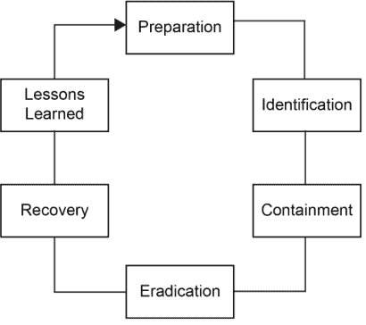
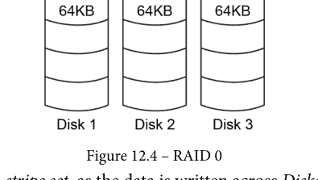
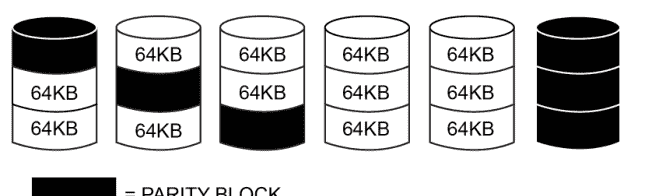
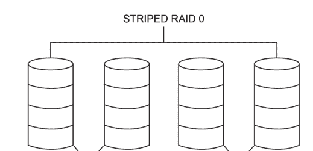
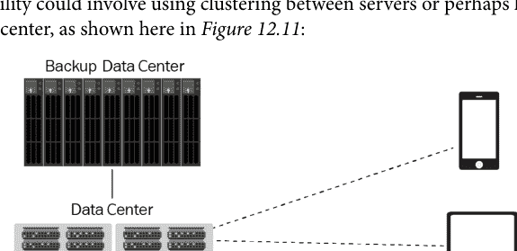

## 12

## 处理事件响应流程

为了保护企业免受灾难，我们必须拥有可靠的事件响应计划和流程。公司会面临许多不同类型的事件。例如，处理洪灾与处理服务器硬件故障完全不同。他们会制定许多计划，每个事件一个，员工了解自己在计划中的角色对于计划生效至关重要。该计划至少每年必须演练一次才能生效。让我们逐一看看，首先从事件响应流程开始。

本章将讨论事件响应，并分为以下要素：

- 事件响应流程
- 攻击框架
- 利用数据源支持调查
- 了解如何应用缓解技术或控制措施来保护环境
- 实施网络安全弹性

### 事件响应流程

在我们开始制定事件响应计划之前，我们需要有一个流程，我们将使用的流程如图 12.1 所示：



图 12.1 – 事件响应流程

事件响应流程必须按顺序执行，从阶段 1（准备阶段）开始。让我们按顺序看看这些阶段：

- **准备：** 准备阶段是编写和更新各种事件响应计划的地方。系统配置也会被记录。
- **识别：** 一旦事件发生，重要的是调用适当的事件响应计划，并通知利益相关者和该特定事件的事件响应团队。
- **遏制：** 在此阶段，我们将隔离相关计算机以防止攻击进一步蔓延，并收集易失性证据。我们将禁用攻击者使用的任何账户。
- **根除：** 在根除阶段，我们要摧毁事件的源头。例如，如果是病毒，我们希望将其移除。我们将删除病毒或受感染的文件，修补系统，并关闭不需要的服务以加固系统。
- **恢复：** 在恢复阶段，我们让公司回到可运营状态，希望能在**恢复点目标（RPO）**之内。例如，镜像机器、恢复数据，或在清理后将域控制器或受感染的机器重新上线。
- **经验教训：** 经验教训是一个调查阶段，我们汇总所有事实并计划防止将来再次发生。如果不执行此步骤，将导致再次发生。

**示例：** 一台域控制器感染了病毒。第一阶段是遏制，我们将其从网络中移除。下一阶段是根除，我们删除病毒并修补服务器。最后阶段是恢复，将干净的服务器重新上线。事件处理完毕并恢复运行后，我们进行经验教训总结，看看域控制器最初是如何感染病毒的，并防止再次发生。

### 响应与恢复控制

在灾难发生之前，应通过执行不同的灾难恢复演练或利用团队演练来测试灾难计划。对不同灾难的响应必须及时并适合该特定事件，这一点至关重要。随着技术的发展，计划和演练必须更新。团队演练已在本书前面介绍过，现在让我们看看不同的灾难恢复演练。

### 灾难恢复演练

你可以进行三种类型的演练，以确保你的公司为任何灾难做好准备。它们是结构化演练、桌面演练和模拟。让我们看看这三种：

- **桌面演练：** 桌面演练是一种基于纸面的假设性演练，所有各方围坐在桌子旁，讨论他们将如何应对灾难场景。
- **结构化演练：** 结构化演练是所有相关方实际进行模拟灾难的演练。例如进行消防演习，我们调动消防队，或进行军事演习或任务，其中执行许多不同场景。
- **模拟：** 白队组织并衡量对此事件的响应。模拟是基于灾难恢复计划某一部分给定场景的测试。红队和蓝队会了解场景及其角色，红队进攻，蓝队防御。这比结构化演练规模更小、速度更快。

### 攻击框架

已经开发了不同的攻击框架来帮助网络安全团队更好地为网络攻击做好准备。我们将研究三种不同的模型，让我们从 MITRE ATT&CK 框架开始。

#### MITRE ATT&CK 框架

MITRE 是一家美国政府赞助的公司，其目标是帮助防止网络攻击。他们开发了一个可供公众使用的在线框架，并提供了许多矩阵。他们提供有关对手及其攻击方法的信息。他们使用 ATT&CK 这个缩写来帮助你更好地理解攻击者使用的攻击向量。如果你访问 MITRE 网站 (https://attack.mitre.org)，你会发现一个庞大的电子表格，可用于查找对手、其攻击方法以及如何缓解这些攻击的信息。这有助于从网络安全团队到威胁猎手的所有人，所以让我们逐一看看。让我们看看这个缩写的分解：

- **对手（Adversarial）：** 这着眼于被分成不同组的潜在攻击者的行为。一个例子是 *APT28*，一个俄罗斯组织，据称干预了 2016 年美国大选，并于 2014 年对德国议会进行了为期 6 个月的活动。
- **战术（Tactics）：** 这是攻击实施的手段。我们可以查看网络钓鱼攻击，从中深入挖掘，它会解释网络钓鱼攻击是如何发起的。
- **技术（Techniques）：** 这些是对攻击如何发起的过程的分解。一个例子是路过式入侵（drive-by compromise），该技术针对用户的 Web 浏览器。请阅读以下链接中的文章：https://attack.mitre.org/techniques/T1189/。
- **公共知识（Common Knowledge）：** 这是与攻击者的战术和技术相关的文档，已在线提供给公众。


### 沟通计划

这是告知所有利益相关者事件的一种媒介，我们会使用PGP或S/MIME等加密手段，确保事件不会成为公开信息。应维护一份联系人列表，包括政府、警方、客户、供应商和内部员工。

### 灾难恢复计划

灾难的范围从自然灾害（如飓风和洪水）到硬件故障、恶意内部攻击和意外删除数据。灾难恢复计划的主要目标是让公司恢复运营并创造收入。我们需要识别最关键资产，并确保它们首先恢复运行。我们将定期进行灾难恢复演练，以获得执行该计划的经验。由于技术频繁变化，我们需要更新灾难恢复计划以适应这些变化。

### 业务连续性计划 (BCP)

这个计划名副其实。无论面临什么灾难，都要保持业务持续运行。我们需要完成业务影响分析，以识别单点故障，从而建立一定的冗余。我们的BCP中应包含供应商多样性。我们需要关注**恢复点目标 (RPO)**，以便确定在没有数据的情况下能运营多久，以及完成灾难恢复并恢复运营状态所需的时间。让我们看看BCP计划的四个阶段：

- **初步响应**：这决定了公司在灾难初期应如何行事。我们将通过召集IRP团队成员来启动该计划。
- **迁移**：在此阶段，我们应转移到备用热站或在家办公，以便业务能够继续运营。
- **恢复**：在此阶段，一旦我们完成迁移，将对损害程度和我们需采取的行动进行评估；例如，数据恢复、桌面重新镜像以及关键服务器的恢复。
  - **站点弹性**：恢复站点主要有三种类型：热站、冷站和温站。由于数据主权，恢复站点不能跨越国际边界。让我们逐一了解：
    - **热站**：该站点已投入运行，员工在数据复制后立即将其加载到系统中。这使得其维护成本最高，但恢复速度最快。我们也可以使用云提供商托管我们的热站，因为这样我们可以立即恢复运行，而不必前往热站。
    - **温站**：温站与热站类似，但数据由快递发送，可能比热站落后3-4小时。
    - **冷站**：冷站的维护成本最低，因为它只有电力和水，没有员工或设备，因此是最慢恢复运行的站点。它没有数据。
- **恢复原状**：将原始站点恢复到原来的状态，或寻找替代的永久性营业场所。

### 运营连续性规划 (COOP)

COOP由美国联邦政府制定。这是他们版本的**业务连续性计划 (BCP)**。它针对每种灾难类型，为政府制定相应流程，使其能够在资源有限的情况下开展工作，提供关键服务，直至事件得到缓解。

### 事件响应团队

当事件发生时，组建一个事件响应团队来处理该事件非常重要，该团队由以下角色成员组成：

- **事件响应经理**：负责总体指挥的高层管理人员。
- **安全分析师**：为事件提供技术支持。
- **IT审计员**：检查公司是否符合合规要求。
- **风险分析师**：评估风险的各个方面。
- **人力资源**：有时员工会涉及事件中。
- **法律顾问**：提供法律问题建议并做出决策。
- **公共关系**：与媒体沟通以减轻影响。

- **VoIP和呼叫管理器**：这些系统提供有关正在进行的呼叫及其来源设备的信息。它们还通过记录**平均意见得分 (MOS)**、抖动和信号丢失来衡量呼叫质量。每个呼叫都会被记录，您可以查看入站和出站呼叫、主叫方和被叫方。
- **会话发起协议 (SIP) 流量**：SIP用于基于互联网的呼叫，日志文件显示100个事件，称为*INVITE*，即连接发起，与响铃相关，然后是200 OK，随后是确认。如果用户无法连接其SIP呼叫，可以使用此日志文件进行故障排除。

### 日志管理器

以下日志管理器执行相同的基本功能。让我们逐一了解：

- **Syslog**：系统日志协议 (syslog) 被称为日志收集器，因为它从各种设备收集事件日志，然后将它们发送到中央syslog服务器。如果有人误删了日志文件，他们可以从syslog服务器获取副本。在Linux版本中，这些日志称为syslogd和syslog守护进程，它将日志文件存储在`/var/log/syslog`目录中。
- **Rsyslog**：这是一个高级syslog服务器。它被称为“火箭般快速”，因为它具有高性能。它获取数据，然后转换数据并将输出发送到诸如SIEM服务器之类的目的地。
- **Syslog-ng**：由*Balabit IT Security Ltd*开发，是适用于Unix和Linux系统的免费开源协议。

#### journalctl

*journald*以二进制格式收集和存储日志数据，*journalctl*能够以可读格式查询和显示这些日志。它用于Linux环境。

#### NXLog

这是一个开源日志管理工具，有助于识别Linux/Unix环境中的安全风险。

### 带宽监视器

这些工具可用于了解您的网络流量。它们可以监控流量模式的变化，识别网络中导致瓶颈的设备，并检测广播风暴和潜在的拒绝服务攻击。

### 元数据

元数据是提供有关其他数据的信息的数据。让我们看看不同类型的元数据，从电子邮件开始：

- **电子邮件**：电子邮件头包含有关电子邮件的详细信息。它显示来源、目的地以及通过电子邮件提供商到达收件人的路由。当收到钓鱼电子邮件时，可以使用这些信息来识别罪犯。
- **移动设备**：电信运营商保留有关电话呼叫的信息，包括已拨呼叫、已接呼叫、短信、互联网使用情况和位置信息。这些信息可在调查期间用作证据，可能导致定罪。

  **示例**：一位德国政客对*T-Mobile*提起诉讼，要求公布他们从其手机收集的移动电话元数据。他收到了35,830条记录——6个月的使用数据。他将这些数据交给了*ZEIT Online*，他们能够识别他每天的行踪、电话、短信和互联网使用情况。他证明了电信运营商可以利用这些数据来跟踪他的行踪。
- **网络**：网站元数据提供有关网站上创建的每个页面的信息，包括作者、创建日期、图像、视频和电子表格。
- **文件**：在进行调查时，文件元数据可用于跟踪信息，例如作者、创建日期、修改日期和文件大小。文件元数据不包括打印或复制数据。
- **照片**：当某人拍摄照片时，元数据可能包含地理标记，让您知道照片的拍摄位置。

元数据不显示复制了多少份或打印了多少次，并且您无法从已删除文件中获取元数据。


### 网络监控

以下产品可用于网络监控。让我们依次来看一下，从 NetFlow 开始：

- **NetFlow**：这是一款思科产品，用于监控网络流量，以便他们能够识别网络负载。这有助于您高效利用网络流量。在调查期间，它可以帮助识别网络流量的模式。
- **sFlow**：这是一款多厂商产品，可让您清晰地了解网络流量模式。这可以帮助识别恶意流量，以便我们保持网络安全。
- **IP 流信息导出（IPFIX）**：该产品可用于从节点本身捕获流量。然后可以将此数据导出到节点内的收集器中。
  - **示例**：IPFIX 可用于识别通过交换机传输的数据，并且可用于计费目的。它可以获取 IP 流信息并同时格式化数据并将其转发到收集器。

#### 协议分析器输出

诸如 *Wireshark* 之类的协议分析器可以捕获网络中传输的数据。执法部门已能够通过重放捕获的网络设备发送的视频流量来使用 Wireshark 进行取证。输出可以保存为数据包捕获文件（pcap）。协议分析器的其他名称是数据包嗅探器、Wireshark 或 tcpdump。

在下一节中，我们将学习如何应用缓解技术或控制措施来保护环境。

### 了解如何应用缓解技术或控制措施来保护环境

如果我们发现存在漏洞，我们需要采取行动来降低风险，因此让我们来看一下我们可以使用的一些技术或控制措施。

#### 重新配置端点安全解决方案

当技术发生变化或我们遭受数据泄露时，我们可能需要重新配置端点安全解决方案。我们将在以下各节中查看这些类型的配置，从应用程序批准列表开始。

#### 应用程序批准列表

我们可以使用应用程序白名单，其中列出已批准的应用程序。这意味着如果应用程序未列出，则无法启动。某些设备（如 pfSense）具有允许列表。出于 Security+ 考试的目的，如果我们想防止用户安装应用程序或防止恶意软件安装，我们将创建一个白名单。未经授权的应用程序和恶意软件都不会在白名单上，因此将被阻止安装。

#### 应用程序阻止列表/拒绝列表

我们可以将认为危险的应用程序列入黑名单，例如 Kali Linux。如果它在黑名单上，则完全禁止，无法将其放在白名单上。某些设备（如 pfSense 防火墙）具有阻止列表。我们需要应用程序的名称才能将其列入黑名单。

#### 隔离

如果我们发现某台设备感染了病毒，我们可以通过将其隔离来将其从网络中移除。我们还可以使用网络准入控制（NAC），以便未修补或存在漏洞的设备被放置在隔离网络中，修复服务器在允许其重新接入网络之前对系统应用补丁。使用 NAC 时，用户经过身份验证，然后检查设备是否已完全修补。

#### 配置管理

随着新攻击的出现和新技术的实施，我们可能需要进行一些配置更改以保护我们的环境。重要的是，我们在以下方面采取稳健的配置管理方法：

- **图表：** 网络安全人员、网络工程师和系统管理员都使用详细的图表来显示所有互连设备的关联关系。这样，他们就可以确保对已实施的安全措施具有可见性。他们使用热力图来显示无线网络的连接性。
- **标准命名约定：** 重要的是，网络上的所有设备都可以被识别为服务器、路由器、防火墙或打印机。我们可以通过使用标准命名约定来实现这一点。域控制器可以以 DC 为前缀开头，数据库可以以 SQL 为前缀。如果我们在网络上看到 DC1 和 DC2，我们可以将其识别为域控制器，而 SQL 1 和 SQL 2 可以被识别为数据库服务器。
- **资产管理：** 如果我们拥有最新的资产登记册，并结合不同资产的标准命名约定，我们就可以跟踪所有资产并确保它们得到核算并完全修补。安全管理员可以将资产管理登记册与可能被识别为网络上 rogue 设备的未知设备进行比较。
- **基线配置：** 非常重要，每种放置在网络上的设备类型都必须具有安全的基线配置。这可以通过为每种类型的设备准备不同的镜像来实现。在构建镜像时使用最小功能原则，确保仅安装所需的应用程序和服务。
- **防火墙规则：** 防火墙可用于阻止流量，我们可以使用 MDM 解决方案或组策略来更改端点设备的配置。
- **移动设备管理（MDM）：** MDM 解决方案可用于向移动设备推送配置更改。密码策略可能会更改，或者我们可能会删除在手机上使用摄像头的权限。MDM 解决方案将推送新的配置更改。
- **数据丢失防护（DLP）：** 信用卡信息离开公司或具有模式匹配的数据被窃取可能存在安全风险。我们可能会使用正则表达式来确保此数据不会通过电子邮件泄露。DLP 阻止离开我们环境的数据的良好示例是个人身份信息和敏感信息。
- **内容过滤器/URL 过滤器：** 我们可能会由于安全事件而更新代理服务器或 **统一威胁管理（UTM）** 防火墙上的内容过滤器。内容过滤器阻止目标网站；例如，赌博网站，而 URL 过滤器可防止端点访问遭受攻击的网站。
- **更新或吊销证书：** 如果端点报告了 *主机或信任错误*，这意味着我们存在证书问题。我们可能需要更新证书，因为它已过期，或吊销证书，因为它已被泄露。如果证书未安装在受信任的根证书颁发机构中，它也会生成主机或信任错误。

#### 隔离

我们可能需要对研究和开发端点进行物理隔离，以将其与网络隔离，防止网络攻击。它们没有无线、蓝牙或以太网连接。向物理隔离计算机添加或提取数据的唯一方法是使用可移动设备，例如 USB 驱动器。

#### 遏制

如果安全团队发现某个端点已被入侵并且可能感染了病毒，他们将对其进行遏制以阻止恶意软件传播。遏制的示例包括将受感染的机器从网络中移除或禁用已用于入侵网络的用户帐户。

#### 分段

我们可以在 BYOD 环境中使用容器化，在移动设备上添加存储卡以将个人数据和业务数据分开。它还可防止通过远程擦除设备来保护业务数据，因为只有移动设备会被重置，而存储卡不会。这也称为存储分段。我们可能需要对变得脆弱的设备进行分段，例如未修补的打印机且没有更新。我们可以将这些打印机放置在 VLAN 中。

#### 安全编排、自动化和响应（SOAR）

编排是运行多个自动化以执行复杂任务的过程。自动化是脚本化单个活动的流程。这些系统通过使用剧本和运行手册来识别来自多个来源的威胁。让我们依次来看一下：

- **运行手册：** 这些是包含事件信息和需要采取的必要操作的文件，以便人工 IT 团队可以采取行动阻止威胁。此信息可用于配置剧本。
- **剧本：** 剧本包含一组规则和操作，使 SOAR 能够识别事件并采取预防措施。随着技术的变化，这些可能需要修改以实现更好的决策。


在下一节中，我们将学习如何实施网络安全弹性。

### 实施网络安全弹性

企业内置冗余或容错能力非常重要，这样才能免受网络攻击。

### 冗余

冗余是指系统某一部分发生故障时，我们仍能维持系统运行的能力。它也可以称为容错。让我们从企业可能部署的不同冗余类型开始。我们将从磁盘开始，然后介绍地理分散。

#### 磁盘

服务器上的磁盘配置需要提供冗余，有时也称为*容错*。简而言之，这意味着如果一块或多块磁盘发生故障，数据仍然可用。存在不同的**独立磁盘冗余阵列（RAID）**级别，让我们逐一了解，从 RAID 0 开始：

- **RAID 0**：RAID 0 至少使用两块磁盘，最多使用 32 块磁盘；请参见*图 12.4*：



图 12.4 – RAID 0

这称为*条带集*，因为数据以 64 KB 条带的形式写入磁盘 1-3。如果一块磁盘发生故障，所有数据都将丢失，因此 RAID 0 不提供容错或冗余。RAID 0 的优点是读取速度更快，因此可用于代理服务器的缓存。

每块磁盘都有一个数值。例如，如果磁盘 3 发生故障，等式为 (7 + ? = 10)，答案为 3。如果我们再失去一块磁盘，即磁盘 1，等式将变为 (? + ? = 10)，你无法解出。如果同时失去两块磁盘，情况也是如此；奇偶校验无法重建缺失的数据。RAID 5 使用奇偶校验，让你能够快速访问数据，并且可以承受一块磁盘故障。

- **RAID 6**：RAID 6 至少需要四块磁盘，配置与 RAID 5 相同，但额外增加一块磁盘来保存另一份奇偶校验副本：



RAID 5 磁盘组可以承受丢失一块磁盘，数据仍然可用，因为它具有单一奇偶校验。RAID 6 磁盘组的好处在于它可以丢失两块磁盘，由于具有双重奇偶校验，仍然保持冗余。

- **RAID 10**：RAID 10 也称为 RAID 1+0。这是一种结合了镜像和条带化来保护数据的 RAID 配置。它先有一个镜像集，然后再进行条带化。只要每个镜像对中有一块磁盘正常工作，就可以检索数据：



从该图中，你可以看到左侧是 RAID 1，然后进行条带化，这意味着你可能失去整个数据集。

#### 电源

电源是任何计算机系统最关键的资源，我们必须具备冗余。让我们看看不同的类型，从不间断电源（UPS）开始。

- **不间断电源（UPS）**：UPS 基本上是一个备用电池设备，当计算机电源出现故障时，它便会启动。它的设计目的是让系统持续运行几分钟，以便服务器团队优雅地关闭服务器。它还可用于净化来自国家电网的电源，例如尖峰、浪涌和电压波动。这样可以保护服务器免受损坏。
- **发电机**：发电机是一种备用设备，由柴油、汽油、丙烷或天然气驱动。当国家电网的电力中断时，可以启动发电机为公司供电。医院通常配备多台发电机，以便在停电时保护重症监护室或手术室中的患者。
- **双电源**：大多数服务器都会配备双电源，这样如果一个电源单元发生故障，另一个电源可以维持服务器运行。
- **管理型电源分配单元（PDU）**：管理型 PDU 允许你远程连接和监控电源。PDU 将净化后的电力分配给多个关键网络资源，例如服务器、路由器、交换机和数据中心。

#### 复制

复制是一种在网络内即时传输数据和虚拟机的方法。我们首先来看存储区域网络（SAN），然后再看虚拟机：

- **存储区域网络**：SAN 是一种包含大量高速磁盘（如**固态硬盘（SSD）**）的硬件设备，并且由于拥有自己的网络而与局域网隔离：
  a. **主机总线适配器（HBA）**：SAN 最廉价的冗余形式是每个节点使用两个 HBA。这将为你提供两条独立的访问路径。
  b. **SAN 结构**：SAN 结构是服务器、存储、交换机和其他设备的集合。我们可以使用两个 SAN 结构，即*结构 1*和*结构 2*。这两个结构相互独立。我们可以让 SAN 节点将一个 HBA 连接到*结构 1*，将另一个 HBA 连接到*结构 2*，以提供冗余。

- **虚拟机复制**：虚拟机复制是指在另一台主机上保留虚拟机的备份副本，这样如果发生灾难，你仍然拥有冗余。

### 本地部署与云

在本章中，我们介绍了使用 RAID 的本地冗余，我们还可以考虑在云中托管我们的环境备份。我们可以在云中复制数据，这样如果发生灾难，我们可以快速切换到云。我们只需要互联网连接即可。

### 备份类型

备份数据一直是实现数据冗余的好方法，让我们逐一了解，从完整备份开始：

- **完整备份**：完整备份是对你所有数据的备份。然而，一些公司可能只能在周末备份所有数据，因此他们会在周中使用增量备份或差异备份。在考试中，这被视为*最快的物理备份*，但占用最多的存储空间。

- **增量备份**：增量备份会备份自上次完整备份或上次增量备份以来的数据。增量备份需要最初的完整备份，以及之后的所有增量备份。它比完整备份和差异备份占用更少的存储空间。

- **差异备份**：差异备份会备份自上次完整备份以来的数据。这样做的问题在于，如果我们在周初进行一次完整备份，然后每天进行差异备份，那么备份会逐日增大。差异备份总是需要两盘磁带：最初的完整备份和最新的差异备份。它比增量备份占用更多存储空间，但比完整备份少。

**示例：**我们将比较不同类型的备份。我们每天都会进行备份，但在周五遭遇了数据丢失，我们将看看需要多少盘磁带才能恢复数据。我们的完整备份为 50 GB 数据，每天会产生 5 GB 数据。你可以从*图 12.10*的表格中看到这一点。每种备份类型各需要多少盘磁带才能恢复你的数据？

- **每日复制**：这可以是任何一天数据的副本，但这是在计划好的磁带循环之外的额外操作。

- **网络附加存储（NAS）**：当你希望存储超过 5 TB 的数据，并且你的数据通过**通用命名约定（UNC）**路径而不是 SAN 使用的**逻辑单元号（LUN）**来访问时，可以使用 NAS 设备。当你开始存储空间不足时，这是一个不错的选择。
- **SAN 存储**：当你拥有大量存储需求时，SAN 是最好的解决方案。它非常适合 SQL 或电子邮件等数据库。你将拥有快速的连接。云提供商会将你所有的云数据存储在 SAN 上。在 SAN 上，有不同层级的存储：
  a. **第 0 层**：最适合数据库等高负载工作负载，速度最快。这些是非常昂贵且超快的磁盘。其中最流行的是固态硬盘（SSD）。
  b. **第 1 层**：处理高度易变、敏感的数据和关键任务存储。串行连接 SCSI（**SAS 15k**）
  c. **第 2 层**：不常访问的公司数据。串行连接 SCSI（**SAS 7.2k**）
  d. **第 3 层**：归档存储，长期保留。串行高级技术附件（SATA）。
- **云存储**：使用云存储来保存你的数据非常普遍，例如由 Apple 提供的 iCloud、由 Google 提供的 Google Drive、由 Microsoft 提供的 OneDrive，或由 Dropbox, Inc. 提供的 Dropbox。云存储的消费者版本允许你拥有有限的存储空间，但会通过按月订阅收费的方式向你出售商业版本或额外存储空间。
- **镜像**：与其从头开始重建桌面并花费数小时，你可以使用*ghost*等产品捕获镜像。这意味着你可以在大约 40 分钟内重新镜像一台桌面。
- **在线与离线**：当我们考虑在线备份与离线备份时，首先需要查看需要备份的数据量。对于离线存储，我们需要确保所有形式的备份介质都贴有标签；例如，如果使用磁带，我们需要确保其保存期限尚未过期，否则当我们去取备份时，磁带可能已损坏。在线备份的恢复速度快得多，而且无论白天还是黑夜随时可用。我们只需要一种连接方式即可访问。
- **异地存储**：如果我们正在备份介质，应该将一份副本保存在异地，以防火灾或洪水等自然灾害。我们需要确保异地存储的位置足够远，不依赖同一个电力供应商。


- **距离考量**：我们需要考虑数据的类型、数据的关键程度以及需要多快地恢复。我们还需要考虑行进距离，包括交通流量，以确保数据能在合理的时间内恢复。使用云提供商可能是一个很好的解决方案，因为他们能确保数据的可用性。数据位于异地且易于连接。

### 安全数据销毁

以最安全的方式处理数据以确保数据不会被窃取非常重要。我们将先讨论纸质数据的净化，然后讨论介质上的数据。

#### 纸质数据

处理数据时，按顺序最佳的方法如下：

- **焚烧**：焚烧纸张时，我们现场可能有焚化炉，也可能由第三方执行此任务并提供销毁证书。
- **制浆**：如果无法焚烧，制浆（将数据变成纸浆）是最佳选择。
- **粉碎**：这是第三种最佳的数据处理方式；横切式碎纸机效果最好。

#### 介质数据

处理存储在硬盘或 DVD/CD ROM 等介质上的数据时，最佳的数据处理方式如下：

- **粉碎**：你可以将金属硬盘粉碎成粉末，这是最佳方法。
- **砸碎**：即用大锤将其砸成小块。
- **消磁**：即向磁盘施加电荷。

上述所有方法都会使介质无法使用。如果你想重新使用介质，则需要选择擦除或格式化作为净化方法。

#### 第三方解决方案

一些中小型企业（SME）可能没有焚化炉或适当的设施来进行数据销毁。因此，它们与拥有安全数据销毁设施的第三方签订合同。数据销毁公司将提供销毁证明证书，以便中小型企业在受到监管机构审计时能够提供证明。

> **考试提示**
> 如果你想重复使用硬盘，则需要通过擦除或格式化来净化它。

### 非持久性

非持久性是指计算机系统损坏时，你可以将其回滚到先前的状态。让我们逐一了解这些方法，从*恢复到已知状态*开始：

- **恢复到已知状态：** 在 Windows 环境中，你可以将系统状态和系统设置保存到可移动介质。如果计算机损坏，你可以修复计算机，然后插入介质并恢复到系统状态数据。
- **上次已知的良好配置：** 这是指系统在你登录时记录了配置状态。可以在稍后阶段恢复到该状态。
  
  **示例：** 在 Windows 环境中，当你成功登录时，计算机的所有设置都会保存在一个克隆集（副本）中。如果操作系统无法启动，我们在重启计算机时按 F8 键并调用上次已知的良好配置。
- **实时启动介质：** 操作系统的副本被保存到 USB 闪存驱动器或 DVD 中。然后你可以从可移动介质启动。

### 高可用性

高可用性可能涉及服务器之间的集群，或者拥有备份数据中心，如图 12.11 所示：



图 12.11 – 数据中心高可用性

在图 12.11 中，你可以看到存储场的备份数据库。可扩展性是指你可以向解决方案添加额外节点。

### 恢复顺序

灾难发生后，我们必须关注使公司重新运营所需的服务。我们会将它们分为关键、重要或非必要，并首先努力让最关键的服务恢复运行。我们将从电力开始，然后是网络基础设施和关键服务器，然后在重新上线之前恢复数据。

### 多样性

公司需要在组织内部采用多样性，以便为任何灾难做好准备。让我们从技术开始了解多样性。

#### 技术多样性

这是指公司可能为其服务器使用多种类型的操作系统。有些可能运行 Windows Server，而另一些可能运行 Linux。这确保了即使其中一个操作系统容易受到攻击，公司仍然可以正常运作。你可能有一些 Web 服务器在 Windows 环境中使用互联网信息服务（IIS），而其他服务器可能使用运行在 Linux 操作系统上的 Apache。同样，如果一台 Web 服务器被利用，另一台可以保持公司的网络存在。

#### 供应商多样性

我们需要从不同的供应商处购买相同的技术，以防其中一家企业倒闭或面临失败。一个例子是从两家不同的公司购买宽带。这是因为宽带是企业的关键领域，如果一家供应商遭遇灾难，另一家将提供服务。

#### 加密多样性

这是指公司可以使用不同的算法来保护其数据。我们知道，对称加密（如 AES）被设计用于加密大量数据，因为它使用分组密码，但我们也知道它很弱，因为密钥尺寸很小。AES 只有 256 位，容易受到攻击。我们可能会决定通过使用 RSA 来保护数据，以实现多样性，因为 RSA 的密钥尺寸更大。另一个例子是，我们可以使用 RSA 4096 位密钥来加密金融交易。作为替代方案，我们可以使用区块链来保护金融交易，因为它使用公共账本，使金融欺诈更难实施。

- 17. UPS 的用途是什么？
- 18. 可以在 SAN 的节点上安装什么以提供冗余？
- 19. 为什么公司会为宽带使用两个不同的供应商？
- 20. 事件响应计划的目的是什么？
- 21. 说出事件的三种类别。
- 22. 说出处理事件所需的三种不同角色。
- 23. 当事件刚刚被报告时，帮助台应该做什么？
- 24. 事件响应演练的目的是什么？
- 25. 事件响应过程的第一个阶段是什么？该阶段会发生什么？
- 26. 事件响应过程的最后一个阶段是什么？
- 27. 如果事件响应过程的最后一个步骤没有执行，会发生什么？
- 28. 灾难恢复过程的遏制阶段会发生什么？
- 29. 灾难恢复过程的根除阶段会发生什么？
- 30. 灾难恢复过程的恢复阶段会发生什么？

3. 上周五，一群特许会计师访问了他们所在机构的网站，并遭到了恶意软件攻击。他们成为哪种攻击的受害者？

- a) 社会工程学
- b) 水坑攻击
- c) 远程访问木马
- d) 跨站脚本攻击

4. 网络安全分析师在公司 Web 服务器的一个日志文件中注意到以下信息：

```
GET http://www.website.com.br/get-files../../../../../etc/
passwd
```

分析师刚刚发现了什么类型的攻击？

- a) 横幅抓取
- b) CSRF
- c) XSS
- d) 目录遍历
- e) SSL 剥离

5. 以下哪个威胁情报源可能提供更准确的数据？

- a) OSINT
- b) 公共/私人信息共享中心
- c) 封闭/专有
- d) 威胁地图

6. 网络安全管理员想要向正在监控的日志文件中添加注释。哪个工具最适合此操作？

- a) Nmap
- b) Head
- c) Logger
- d) Tail

7. 网络安全分析师注意到保存财务数据的服务器上有一笔可疑交易。日志文件的输出显示如下：

Get http://yourbank.com/transfer.do?acctnum=087646958&amount+80000 HTTP 1.1
Get http://yourbank.com/transfer.do?acctnum=087646958&amount+200000 HTTP 1.1
Get http://yourbank.com/transfer.do?acctnum=087646958&amount+25000 HTTP 1.1
Get http://yourbank.com/transfer.do?acctnum=087646958&amount+10000 HTTP 1.1

分析师刚刚发现了什么类型的攻击？
a) 勒索软件
b) XSS
c) 社会工程学
d) CSRF

8. 网络安全团队遭到了一群来自互联网的黑客的攻击。网络安全团队希望找到该群体的所有电子邮件地址。哪个工具最适合此操作？
a) DMitry
b) The harvester
c) Curl
d) Logger

9. 以下哪些工具可用于横幅抓取？
a) Curl
b) Telnet
c) Nmap
d) netcat (nc)

10. 网络安全分析师刚刚读完安全公告的月度发布。他们现在开始搜索所有数据库服务器上的日志文件。他们正在完成什么任务？
a) 日志分析
b) 风险缓解
c) 漏洞测试
d) 威胁狩猎


15. 你是英国秘密服务的网络安全管理员。对于机密和绝密数据，你会使用哪种访问方法？
    - a) 你将使用 DAC，由数据的所有者授予访问权限。
    - b) 你将使用 MAC，由数据的保管人授予访问权限。
    - c) 你将使用 DAC，由安全管理员授予访问权限。
    - d) 你将使用 MAC，由安全管理员授予访问权限。

16. John 访问一个体育网站并收到以下错误：`THIS WEBSITE CANNOT BE TRUSTED.` 网站管理员需要采取哪两个行动来解决此错误？选择两个。
    - a) 请密钥托管机构存储他的私钥。
    - b) 确保网站使用有效的 SAN 证书。
    - c) 将根证书更新到客户端计算机的受信任根证书颁发机构存储中。
    - d) 验证服务器上的证书是否已过期。

17. 你是大型跨国公司的网络安全管理员，你阅读了一份安全公告，其中提到用于证书验证的 CRL 存在漏洞。当你测量响应时间时，似乎变慢了。你将实施以下哪一项以实现更快的验证？
    - a) 证书装订
    - b) 证书固定
    - c) OCSP
    - d) 密钥托管

18. 网络安全管理员发现攻击者使用一台受损主机作为平台，在公司网络深处发起攻击。以下哪一项最能描述这种攻击类型？
    - a) 会话重放
    - b) 主动侦察
    - c) 枢轴攻击
    - d) 虚拟机逃逸

19. 网络安全管理员注意到 SIEM 系统收集到的以下输出：Pinging Server 1 with 45,000 bytes of data:

```
Reply from 192.0.0.1: bytes=45000 time<1ms TTL=128
Reply from 192.0.0.1: bytes=45000 time<1ms TTL=128
Reply from 192.0.0.1: bytes=45000 time<1ms TTL=128
Reply from 192.0.0.1: bytes=45000 time<1ms TTL=128
```

检测到什么类型的攻击？
    - a) 整数溢出
    - b) 缓冲区溢出
    - c) XSS
    - d) SQL 注入

20. 在自动化过程中，以下哪一项用于通过应用程序识别故障，以便采取补救措施？选择最佳选项。
    - a) 持续验证
    - b) 持续监控
    - c) 持续集成
    - d) 持续开发

21. 一家大型公司正在考虑收购一家网络安全公司，并希望获得一份非常详细的关于安全控制的报告，特别是数据的处理，确保其保密性。大型公司希望阅读哪些报告，以便在是否购买做出良好决策？
    - a) ISO 27701
    - b) GDPR
    - c) SOC 2 报告
    - d) SOC 3 报告

22. 你是大型跨国公司的网络安全管理员，你最近已从数据字段中删除了信用卡详细信息。这些信息现在由支付提供商持有，支付提供商会向你返回一个序列号来替换数据。你刚刚实施了什么？
    - a) 令牌化
    - b) 混淆
    - c) 数据屏蔽
    - d) 加密

23. 网络管理员将设置一个 VPN，以确保头和有效载荷都被加密。安全分析师推荐了什么？
    - a) 隧道模式下的 IPSec
    - b) 分支隧道模式下的 IPSec
    - c) 传输模式下的 IPSec
    - d) 全隧道模式下的 IPSec

24. 你是大型跨国公司的首席执行官，正在考虑迁移到云端。以下哪一项将帮助你评估云服务提供商的整体风险？
    - a) CSA 参考架构
    - b) CSA CCM
    - c) NIST
    - d) CASB

25. 网络安全管理员将为公司开立风险登记册。风险登记册中将记录什么？
    - a) 残余风险
    - b) 风险描述、所有者和风险缓解策略
    - c) 年度风险审计报告
    - d) 以上所有

26. 审计员在去年的年度审计中建议立即对嵌入式设备进行修补。一年后，第二份审计提出了同样的建议，并指出上次审计的结果未被遵守。为什么补丁没有被执行？选择最可能的原因。
    - a) 审计建议已被忽略。
    - b) 公司不同意审计建议。
    - c) 供应商不再生产任何补丁，因为它已到生命周期结束。
    - d) 没有用于修补的接口。

27. IT 经理正在设计 BIA 计划，并计算灾难恢复系统中公司在没有数据的情况下可以运行的时间。在此之后，公司无法完全运行。他们在测量什么？
    - a) RTO
    - b) 单点故障
    - c) SLA
    - d) RPO
    - e) MTTR

28. 网络安全管理员想知道邮件服务器上运行哪些服务。他们最有可能使用哪两种工具？
    - a) NIDS
    - b) ipconfig
    - c) netstat
    - d) Nmap

29. 公司 A 即将升级所有 IT 系统，并一直在调查迁移到云端，因为 CSP 提供了硬件，所以没有资本支出。公司 A 仍希望控制云中的 IT 系统。哪种云模型最能满足公司 A 的需求？
    - a) 软件即服务 (SaaS)
    - b) 基础设施即服务 (IaaS)
    - c) 监控即服务 (MaaS)
    - d) 平台即服务 (PaaS)

30. 以下哪种 RAID 系统使用奇偶校验，最少有四个磁盘，并且提供最佳的弹性？
    - a) RAID 0
    - b) RAID 1
    - c) RAID 5
    - d) RAID 6

31. 数据所有者负责数据的分类并决定谁可以访问数据。谁负责确保数据的收集是合法的、存储是合法的，并且始终进行合规？选择最佳选择。
    - a) 数据保管人
    - b) 数据保护官
    - c) 数据控制者
    - d) 数据管理员

32. 你是网络安全管理员，IT 经理要求你收集服务器 1 上的易失性内存，因为它目前正在遭受网络攻击。以下哪两种易失性内存形式是最好的收集对象？
    - a) 安全启动
    - b) CPU 缓存
    - c) USB 闪存驱动器
    - d) ROM
    - e) RAM

33. 在 SDLC 的哪个阶段，计算机系统不再由原始供应商支持？
    - a) 沙箱
    - b) 停用系统
    - c) 资源耗尽
    - d) 系统蔓延

38. 以下哪一项将防止证书欺诈和 SSL 中间人攻击？
    - a) 证书固定
    - b) 输入验证
    - c) 证书装订
    - d) Kerberos

39. 安全团队已识别出未知漏洞并将其隔离。调查和测试它的最佳技术是什么？
    - a) 隐写术
    - b) 模糊测试
    - c) 沙箱
    - d) 容器化

40. 你是公司的网络安全管理员，IT 经理要求你向他们介绍 XML 身份验证方法。以下哪一项你应该告诉他们使用基于 XML 的身份验证？选择所有适用项。
    - a) TOTP
    - b) 联合服务
    - c) 智能卡
    - d) SSO
    - e) SAML

41. 攻击者试图针对高级高管或经理，但由于对方未接电话，只好留下语音邮件。进行了什么攻击？
    - a) 鲸鱼式钓鱼
    - b) 语音钓鱼
    - c) 钓鱼
    - d)  spear 钓鱼

42. 审计员一直在调查慈善机构被盗的资金，发现财务助理一直在挪用公款。财务助理是唯一处理财务、接收捐款和支付所有账单的人。以下哪一项是审计员可以推荐的最佳选项，以降低再次发生此情况的风险？
    - a) 哈希
    - b) 工作轮换
    - c) 职责分离
    - d) 强制休假
    - e) 加密

43. James 向 IT 帮助台提交了工单。他一直在篡改电脑的设置，现在无法再访问互联网。帮助台技术人员检查了他的桌面配置，设置与其他人相同。突然，另外三个人也报告说他们也无法连接到互联网。应首先检查哪种网络设备？
    - a) 交换机
    - b) 路由器
    - c) 集线器
    - d) 中继器

44. 贵公司正在爱尔兰戈尔韦开设一个新的数据中心。服务器场已在那里安装，现在一家建筑公司前来在入口处安装一个 6 英尺的单间门禁。安装这个单间门禁的两个主要原因是什么？
    - a) 防止盗窃
    - b) 防止尾随
    - c) 防止未经授权的人员进入数据中心
    - d) 允许更快地进入设施

45. 云服务提供商使用哪种信任模型？
    - a) 完全信任
    - b) 桥接信任
    - c) 网状信任
    - d) Zero Trust


### 46. 取证检查员在调查基于云的攻击时需要考虑哪两个因素？选择两项。

- a) 审计权条款
- b) 访问令牌
- c) 易失性证据
- d) 搜查令

### 47. 审计员刚完成了公司的风险评估，他们建议我们需要缓解部分风险。以下哪些是风险缓解的示例？

- a) 关闭笔记本电脑上的基于主机的防火墙
- b) 在新笔记本电脑上安装防病毒软件
- c) 为汽车投保火灾和盗窃险
- d) 将IT外包给另一家公司
- e) 决定不跳入大峡谷

### 48. 你在一家非常大的公司工作，公司经历了审计，审计员一直在关注你持有的数据量。审计员建议，一旦客户的购买完成，就不再保留客户的信用卡号码。审计员关注的是以下哪个概念？

- a) 令牌化
- b) 数据保留策略
- c) 数据最小化
- d) 匿名化

### 49. 以下哪项获得用户同意，仅为预期目的收集最少量的个人数据？

- a) GDPR
- b) 协议条款
- c) 隐私声明
- d) 影响评估

### 53. 审计员正在对SCADA网络进行年度检查，发现可编程逻辑控制器（PLC）自去年以来一直没有更新。经过进一步调查，发现制造这些PLC的公司已进入清算，使这些控制器成为生命周期终止系统。制造商目前正在寻找另一家公司来制造升级版的PLC。审计员应向管理层提出以下哪项建议，以在短期内缓解风险？

- a) 将PLC从制造基础设施中移除。
- b) 自行生产更新后的PLC固件。
- c) 建立SIEM系统，对SCADA系统进行实时监控。
- d) 将PLC放置在VLAN中。

### 54. 审计员对财务部门进行了检查，并建议存储财务数据的文件服务器和财务部门的台式机应使用IPsec来保护它们之间的会话。网络管理员将确保只有有效载荷被加密。安全分析师推荐了什么？

- a) 隧道模式下的IPsec
- b) 分流模式下的IPsec
- c) 传输模式下的IPsec
- d) IPsec站点到站点VPN

### 55. 公司无线网络运行非常缓慢，用户抱怨他们连接到公司网络时遇到问题，但可以连接到内部网络。网络管理员使用WiFi分析仪捕获了以下信息：

| 编号 | 时间 | 源 | 目的 | 协议 | 长度 | 信息 |
|---|---|---|---|---|---|---|
| 1001 | 12:01:23 | host2324 | 广播 | 802.11 | 38 | 解除认证，SN=655 FN=0 |
| 1002 | 12:01:53 | host2324 | 广播 | 802.11 | 39 | 解除认证，SN=655 FN=0 |
| 1003 | 12:02:26 | host2324 | 广播 | 802.11 | 38 | 解除认证，SN=655 FN=0 |

网络管理员发现了哪种类型的攻击？

- a) 邪恶双胞胎
- b) 会话重放
- c) MAC泛洪
- d) ARP投毒

### 3. 答案：b

**概念：** 水坑攻击使用一个知名且受信任的网站作为其攻击载体。

**错误答案：**

- a. 在社会工程学中，目标是人类而非网站。
- c. 使用远程访问木马，远程攻击者获取系统的登录凭据，然后登录系统。
- d. 在跨站脚本攻击中，恶意代码被注入受信任用户的Web会话，通常使用HTML标签和Javascript。

### 4. 答案：d

**概念：** 目录遍历是指攻击者遍历网站结构以查找账户信息。当你看到`../../`时，表示你在向下移动目录结构。攻击者在基于Linux的Web服务器上会查找存储在`/etc/shadow`文件中的用户名和密码。除了`../../`，还可能使用`..%2f..%2f`。

**错误答案：**

- a. 横幅抓取使用工具（包括telnet、curl、nmap和netcat）从Web服务器获取头部信息。
- b. CSRF指的是一种攻击类型，你在网站上点击链接，不知不觉中提交了一个Web请求，使攻击者能够从你那里窃取资金。
- c. 跨站脚本（XSS）是将恶意代码注入受信任用户的Web会话，通常使用HTML标签`<script>`和`</script>`以及（标签之间的）Javascript。
- e. 在SSL剥离中，SSL/TLS或HTTPS会话可能会被移除证书并变为HTTP会话。

### 5. 答案：c

**概念：** 封闭/专有威胁情报由生成报告的公司资助。制作报告会投入更多资金，并且由于该信息会出售给其他公司，它将提供更准确的信息。

**错误答案：**

- a. OSINT是向公众共享的信息，其准确性不如封闭/专有威胁情报。
- b. 这也是由公共和私营公司共享的信息，其准确性不如封闭/专有威胁情报。
- d. 威胁地图是向公众共享的信息，其准确性不如封闭/专有威胁情报。

### 6. 答案：c

**概念：** logger命令允许你将注释插入日志文件。

**错误答案：**

- a. Nmap用于横幅抓取或创建网络清单。
- b. head从日志文件顶部收集信息。如果你使用 head 10，它会返回日志文件的前10条记录。
- d. tail从日志文件底部收集信息。如果你使用 tail 10，它会返回日志文件的后10条记录。

### 7. 答案：d

**概念：** CSRF指的是一种攻击类型，你在网站上点击链接，不知不觉中提交了一个Web请求，使攻击者能够从你那里窃取资金。

**错误答案：**

- a. 没有勒索钱财的要求；因此不是勒索软件。
- b. 对于XSS，你应该看到HTML标签`<script>`和`</script>`，中间是Javascript。由于这些不存在，这不可能是正确答案。
- c. 社会工程学利用人类。本题中没有提到这一点。

### 8. 答案：b

**概念：** theHarvester允许你在Google等搜索引擎上搜索并整理公司的电子邮件地址。

**错误答案：**

- a. DMitry用于横幅抓取，且没有提及Web服务器。
- c. curl用于横幅抓取和传输数据。两者均未提及。
- d. logger用于在日志文件中插入注释，但本题中没有提到这一点。

### 9. 答案：a、b、c、d

**概念：** Telnet、curl、DMitry、nmap和nc都可以用于横幅抓取。

### 10. 答案：d

**概念：** 当发布新的安全更新时，威胁狩猎是搜索当前和历史日志以寻找攻击症状的过程。

**错误答案：**

- a. 使用日志分析时，你试图解读日志包含的内容。在这种情况下，我们只查找一个或两个特定事实；因此答案不是日志分析。
- b. 在风险缓解中，你采取技术措施来降低风险。由于在此场景中我们只是搜索信息，这不是正确的选择。
- c. 漏洞测试指使用扫描器搜索缺失的补丁。描述的场景并非如此。

### 11. 答案：b

**概念：** 如果是生命周期终止（end-of-life），供应商不会产生任何更新，但会出售他们仍然拥有的有限备件。他们会履行任何现有的保修。

**错误答案：**

- a. 遗留（Legacy）是指旧设备的术语。
- c. 服务生命周期终止是指供应商停止一切——所有服务和更新、所有备件销售、所有一切。
- d. 退役（Retired）不是正确的术语。


## 15. 答案：d

概念：MAC 被用作机密数据的访问方法，安全管理员负责在人员经过审查且访问权限合理后，授予用户对数据的访问权。

错误答案：

- a. 在 DAC 环境中，数据是未分类的。不过，由所有者授予访问权。这类似于 NTFS 数据。
- b. 在 MAC 环境中，数据是分类的。然而，保管人的角色是存储、管理和加密数据。他不授予对数据的访问权。
- c. 在 DAC 环境中，数据是未分类的。授予访问权的是所有者，而非安全管理员。

## 16. 答案：c 和 d

概念：证书需要有效且被计算机信任。主机错误或信任错误都是基于证书的错误。

错误答案：

- a. 密钥托管为第三方管理私钥，不负责处理任何证书错误。密钥托管可以将私钥存储在 HSM 中。
- b. SAN 证书允许在一个证书上存储多个域名。它无法解决信任错误。

## 17. 答案：c

概念：只有 CRL 和 OCSP 可以提供证书验证。通常情况下，如果 CRL 速度较慢，你会实施 OCSP。在这种情况下，如果你移除 CRL，就需要实施 OCSP。

错误答案：

- a. 使用证书装订时，Web 服务器绕过 CRL，直接访问 OCSP 以获得更快的验证。
- b. 证书固定可防止 CA 被入侵、证书欺诈和 SSL 中间人攻击。
- d. 密钥托管为第三方管理私钥，不负责处理任何证书错误。密钥托管可以将私钥存储在 HSM 中。

## 18. 答案：c

概念：横向移动涉及利用一个薄弱主机在网络中进一步发起攻击。在虚拟化中，这被称为虚拟机逃逸。

错误答案：

- a. 会话重放发生在攻击者窃取 Cookie 以冒充用户时。
- b. 主动侦察是一种攻击类型，攻击者访问系统并尝试使用运行命令或访问注册表。
- d. 虚拟机逃逸能够发起此类攻击，但发生在虚拟环境而非网络中。虚拟机逃逸是横向移动的虚拟版本。

## 19. 答案：b

概念：这显示了 45,000 字节的数据。本应为 32 字节。数据量过大，因此属于缓冲区溢出。

错误答案：

- a. 整数溢出是指所存储的数字过大。然而，在此实例中，使用的是过多的数据。
- c. XSS 是一种基于 Web 的攻击，使用 HTML 标签（`<script>`、`</script>`）和 Javascript。此示例使用命令行，因此不可能是 XSS。
- d. 在 SQL 注入中，`1=1` 被插入到 SQL 语句中，无法通过命令行执行。

## 20. 答案：b

概念：持续监控可以检测系统故障和任何安全漏洞，以便及时更新。

错误答案：

- a. 持续验证是测试应用程序以确保其适合用途的过程。
- c. 对于持续集成，多个软件开发人员会整合他们开发的代码。
- d. 持续部署是将新更新推送到生产环境的过程。

## 21. 答案：c

概念：SOC 2 报告会生成一份关于公司内部控制的非常详细的报告，涉及安全性、数据处理以及用户数据的处理，以确保数据的机密性和隐私性得到维护。

错误答案：

- a. ISO 27701 涉及隐私。
- b. GDPR 是欧盟关于居住在欧盟境内的用户的数据隐私、收集和处理的国际法规。
- d. SOC 3 报告不那么详细，且信息可免费向公众提供。

## 22. 答案：a

概念：令牌化将数据替换为令牌，该令牌链接到持有数据的支付提供商。这比加密更好，因为它是无状态的，而加密的密钥是本地保存的。

错误答案：

- b. 混淆用于隐藏源代码，使其在被窃取时不易被理解。
- c. 数据掩码是指仅显示部分数据。例如，如果你在网上保存信用卡号，只有最后 4 位数字保持可见。其余部分被掩码，以防止窃取此信息的人看到完整号码。
- d. 加密保护数据不被窃取，但不会将数据从数据字段中移除。

## 23. 答案：a

概念：IPSec 隧道模式用于 VPN 的外部，其中头部和有效载荷都被加密。

错误答案：

- b. 分流隧道会打开一个不安全的会话。因此存在安全风险。
- c. IP Sec 传输模式在内部使用，仅加密有效载荷。
- d. 不存在所谓的 IPSec 全隧道模式。

## 24. 答案：b

概念：云安全联盟云控制矩阵（CCM）：旨在为云供应商和潜在云客户提供安全原则指南，以评估云提供商的整体风险。

错误答案：

- a. CSA 参考架构为云服务提供商提供最佳安全实践。
- c. NIST 负责推动标准和技术的发展。
- d. CASB 负责云安全以及为云中使用的设备强制执行策略。

## 25. 答案：b

概念：风险登记册列出风险，每个风险都有一个负责人，负责人将决定接受、缓解、转移或规避该风险。

错误答案：

- a. 残余风险是风险缓解后仍存在的风险。
- c. 这是一份审计报告，分析你当前的风险策略以确保其仍然有效。
- d. 由于答案选项 a 和 c 已被排除，“以上所有”不适用。

## 26. 答案：c

概念：生命周期结束的系统不再受供应商支持，且不会提供任何补丁。

错误答案：

- a. 公司总是会执行审计师的建议。
- b. 如果公司不同意审计师的意见，他们会提出此事，而不是忽视这些建议。
- d. 公司绝不会使用无法打补丁的系统，因为它最终会变得易受攻击。

## 36. 答案：d

概念：DDoS 和 DoS 攻击 IT 系统的可用性，因为它们都以使系统瘫痪为目标。

错误答案：

- a. 鱼叉式网络钓鱼是通过电子邮件利用一组用户，试图获取他们的财务信息。
- b. 重放攻击是一种路径攻击，数据在稍后被重放。
- c. MITM 攻击是一种路径攻击，数据被更改并立即转发。

## 37. 答案：b

概念：RTO 意味着系统现已恢复运行。这也可以称为恢复到运行状态。

错误答案：

- a. 可接受的停机时间指的是 RPO，即公司在没有系统的情况下可以运作的时间范围。一旦达到 RPO，公司就无法有效运作。
- c. 可靠性度量是 MTBF，记录故障之间的时间。
- d. 平均修复时间是 MTTR。这通常衡量硬件设备的修复情况。

## 38. 答案：a

概念：证书固定可防止证书欺诈和 SSL 中间人攻击。

错误答案：

- b. 输入验证控制进入 Web 服务器或应用程序的数据输入格式。它可以防止整数溢出、缓冲区溢出，并且是防止 SQL 注入的第二佳选择。
- c. 使用证书装订时，Web 服务器绕过较慢的 CRL，转向较快的 OCSP 进行证书验证。
- d. Kerberos 是一种使用票据且依赖于时间的身份验证协议。

## 39. 答案：c

概念：沙箱是将应用程序放入一个隔离的虚拟机中进行测试、修补，或者因为该应用程序具有危险性。

错误答案：

- a. 隐写术是将一个音频或视频文件隐藏在另一个音频或视频文件中。
- b. 模糊测试向应用程序添加随机和无效输入，以评估任何编码错误。
- d. 容器化用于 BYOD 环境，将存储卡插入设备中单独存储业务数据。它可以保护数据免受远程擦除或设备故障的影响。

## 40. 答案：a、b 和 e

概念：SAML 是一种基于 XML 的身份验证类型，用于联合服务；TOTP 也是基于 XML 的。

错误答案：

- c. 智能卡是一种信用卡大小的令牌，包含证书，并与 PIN 码结合用于身份验证。
- d. 单点登录在用户通过身份验证后使用，以便他们无需重新输入凭据即可访问资源。

## 41. 答案：b

概念：该攻击是语音钓鱼，因为他使用了电话并留下了语音邮件。

错误答案：

- a. 捕鲸是针对 CEO 或高级管理人员的攻击，通常使用电子邮件。
- c. 网络钓鱼是针对随机目标的电子邮件攻击。
- d. 鱼叉式网络钓鱼是针对一组用户的有针对性的电子邮件攻击。

## 42. 答案：c

概念：职责分离防止一个人授权整个交易并防止欺诈。在职责分离下，一个人负责收款，另一个人负责授权付款。


### 45. 答案：d

**概念：** 云服务提供商采用零信任模型，要求每个人都必须证明自己的身份。

**错误答案：**

- a. 在 Security+ 考试大纲中不存在所谓的完全信任。
- b. 桥接信任是两个独立 PKI 环境之间的信任。
- c. 信任网用于 PGP 环境中的两个用户之间。

### 46. 答案：a、c

**概念：** 要从云服务提供商处获取易失性证据，你需要有审计权条款。易失性证据需要在消失之前收集，否则将不再可用。

**错误答案：**

- b. 访问令牌允许已认证的用户拥有一定级别的权限。
- d. 搜查令允许进入场所进行搜查，但与证据收集无关。

### 47. 答案：b

**概念：** 风险缓解涉及降低攻击或事件的风险。这些基本上属于技术控制。例如，安装防病毒软件以防止病毒攻击。

**错误答案：**

- a. 关闭主机上的防火墙会增加攻击风险。
- c. 无论何种类型的保险都属于风险转移。
- d. 外包 IT 业务也是风险转移的另一个例子。
- e. 决定不跳入大峡谷属于风险规避，因为受伤风险被认为过高。

### 48. 答案：c

**概念：** 数据最小化是指仅收集为实现某一目的所必需的数据，并且仅按合规要求保留所需的时间。

**错误答案：**

- a. 令牌化将数据替换为指向持有数据的支付提供商的令牌。
- b. 数据保留策略是关于数据保留多长时间，而不是保留多少数据。例如，美国医疗数据在最后一次记录后保留 6 年，或在死亡后保留 3 年。
- d. 匿名化是指从数据中移除 PII（个人身份信息），使得个人无法被识别。

### 49. 答案：c

**概念：** 隐私通知用于获得收集个人数据的同意，并且仅将数据用于预期目的。

**错误答案：**

- a. GDPR 是一项欧盟法规，涉及欧盟人员数据的隐私和处理。
- b. 协议条款由双方就合同或活动达成，具有法律强制力。
- d. 影响评估用于衡量某项活动的有效性。

### 50. 答案：d

**概念：** 多态病毒会发生变异，因此哈希值会改变。

**错误答案：**

- a. 病毒会传播，但其格式或哈希值不会改变。
- b. RAT 是一种由远程攻击者执行的恶意软件程序，不是病毒。
- c. 逻辑炸弹需要触发器，例如时间、脚本、批处理文件或计划任务。
