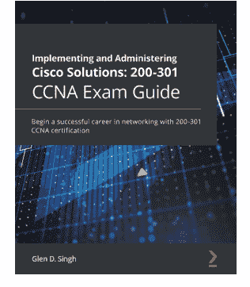
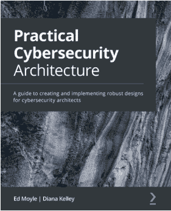

# 你可能喜欢的其他书籍

如果你喜欢这本书，你可能对 Packt 出版的其他这些书籍感兴趣：

## Implementing and Administering Cisco Solutions: 200-301 CCNA Exam Guide

Glen D. Singh

ISBN: 978-1-80020-809-4

- Understand the benefits of creating an optimal network
- Create and implement IP schemes in an enterprise network
- Design and implement virtual local area networks (VLANs)
- Administer dynamic routing protocols, network security, and automation
- Get to grips with various IP services that are essential to every network
- Discover how to troubleshoot networking devices

## Practical Cybersecurity Architecture

Ed Moyle, Diana Kelley

ISBN: 978-1-83898-992-7

- Explore ways to create your own architectures and analyze those from others
- Understand strategies for creating architectures for environments and applications
- Discover approaches to documentation using repeatable approaches and tools
- Delve into communication techniques for designs, goals, and requirements
- Focus on implementation strategies for designs that help reduce risk
- Become well-versed with methods to apply architectural discipline to your organization

## Leave a review - let other readers know what you think

Please share your thoughts on this book with others by leaving a review on the site that you bought it from. If you purchased the book from Amazon, please leave us an honest review on this book's Amazon page (you can do this via the following link: https://packt.link/r/9781800564244). This is vital so that other potential readers can see and use your unbiased opinion to make purchasing decisions, we can understand what our customers think about our products, and our authors can see your feedback on the title that they have worked with Packt to create. It will only take a few minutes of your time, but is valuable to other potential customers, our authors, and Packt. Thank you!
