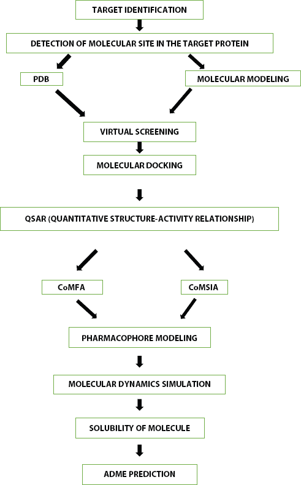
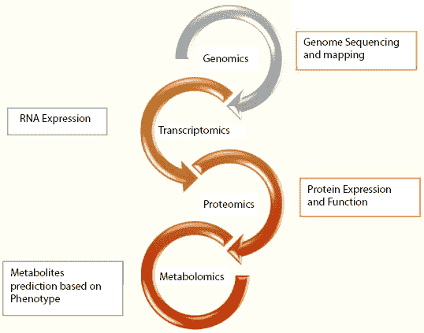
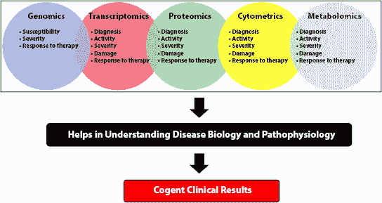
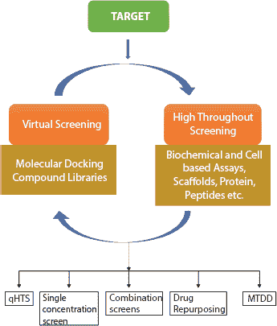
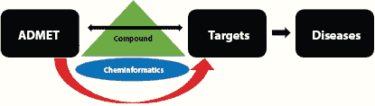

# 1 生物信息学作为药物设计的工具

**Rene Barbie Browne, Shiny C. Thomas and Jayanti Datta Roy\***  
*生物科学系，Assam Don Bosco 大学，Sonapur，Assam，印度*

> ***Abstract***
> 
> 药物发现是通过鉴定和验证疾病靶点并发现和开发可与其特定靶点相互作用的化学化合物的方法。该过程非常复杂且耗时，需要跨学科专业知识和创新方法。为克服困难和复杂性，采用了可减少时间和支出的 *in silico* 方法。本章阐述了生物信息学在药物设计中的重要性。它重点关注诸如 `AutoDock`、`LigPlot`、`FlexX` 等生物信息学工具以及许多其他软件，它们在药物的理性设计中发挥着重要作用。因此，本章的主要目标是概述生物信息学工具在药物设计中的重要性。
> 
> ***Keywords**:* `AutoDock`, `LigPlot`, `FleX`, `GenBank`, `SWISS-PROT`, `PDB`

## 1.1 引言

生物信息学是生命科学的一个跨学科领域，将生物学、计算机科学和信息技术融为一体 \[1\]。该领域包括广泛的学科领域。这些学科领域包括结构生物学、基因表达研究和基因组学。计算技术在分析与生物大分子相关的大规模信息方面发挥着重要作用 \[2\]。
生物信息学的主要目标旨在更好地理解活细胞及其在分子层面的功能。除了对基础基因组学和分子生物学研究至关重要外，生物信息学在生物技术和生物医学科学的许多领域发挥着关键作用 \[3\]。在这方面，生物信息学在新型药物设计中发挥着至关重要的作用。通过计算研究蛋白质与配体之间的相互作用，为快速鉴定新型合成药物提供了理性基础。有关蛋白质三维结构的信息使得设计分子变得更容易，使其能够以高亲和力和特异性结合到靶蛋白的受体位点。因此，与传统的试错方法相比，它显著减少了开发效力更高、副作用更少、毒性更低的药物所需的时间和成本。
该计算研究领域也减少了研究中动物的牺牲。如今，随着计算模拟和信息学方法的使用，潜在药物候选分子的数量正在增加。这些方法有助于减少药物发现过程中被牺牲的动物数量 \[5\]。通过有效利用现有知识，计算研究也有助于减少基础生物科学中所需的动物实验数量 \[6\]。
生物信息学工具现在被广泛用于开发新型药物，从而带来新的研究多样性。新药的发现和开发通常是一个非常复杂的过程，消耗大量时间和资源。因此，生物信息学设计工具技术现在被广泛使用，以提高新型合成药物的设计和开发效率 \[4\]。药物发现是通过鉴定和验证疾病靶点，然后设计可与该靶点相互作用的化学化合物的方法，从而抑制导致疾病进展的生物学反应。所有这些过程都可以通过各种计算工具和方法得到支持。一些在确定药物靶点期间需要观察的因素包括蛋白质和核苷酸序列、映射信息、功能预测以及蛋白质和基因表达数据。生物信息学工具有助于收集所有这些因素的信息，从而开发核酸序列、蛋白质序列和结构的初级和次级数据库。一些常用的数据库包括 `GenBank`、`SWISS-PROT`、`PDB`、`PIR`、`SCOP` 和 `CATH`。这些数据库已成为积累疾病靶点信息的不可或缺的工具。像 `PubChem` 和 `ChemFaces` 这样的数据库提供了已知类药物化合物的结构和生物学信息，有助于在研究领域中确定药物靶点以设计药物 \[7\]。这些数据库有助于节省研究人员的时间、金钱和精力。
使用生物信息学工具进行药物设计可大致分为两大类，*即*，

1. a) 基于结构的药物设计 (`SBDD`)
2. b) 基于配体的药物设计 (`LBDD`)

**a) 基于结构药物设计 (`SBDD`)：** 使用 `SBDD` 方法设计药物利用生物靶点的三维结构，该结构可通过 X 射线晶体学或 NMR 光谱技术获得 \[8\]。候选药物可以根据其与靶点的结合亲和力，利用生物靶点的结构信息进行预测。如果生物靶点/受体的结构不可用，则在这种情况下，可以使用同源建模预测结构。它通常需要靶蛋白的氨基酸序列，提交后可构建模型，可与相似同源蛋白（模板）的三维结构进行比较。为了了解所有测试化合物的相互作用或生物亲和力，对每个化合物进行分子对接至靶点的结合位点，预测它们之间的静电契合度。

## 1.1.2 配体为基础的药物设计 (LBDD)
在这种药物设计方法中，已知与靶点结合的小分子/化合物的结构信息。有助于构建药效团模型的化合物/配体具有与靶点活性位点结合所需的所有重要结构特征。该方法中使用最常见的技术是药效团建模和定量构效关系 (3D QSAR)。这些技术用于开发具有预测能力的模型，适用于先导化合物的发现和优化 \[9\]。结构相似的化合物也与其靶蛋白具有相同的生物学相互作用。

## 1.2 药物设计涉及的步骤
图 1.1 中的流程图用于概述使用 *基于计算机的* 方法进行药物设计所涉及的阶段。

**图 1.1** 基于计算机模拟方法在药物设计中的应用流程图。

### 1.2.1 靶蛋白/酶的识别
在设计新型合成药物之前，需要了解导致疾病的所有信号通路。新型药物需要在不干扰正常代谢的情况下设计成能够与靶蛋白相互作用。最传统的方法是用小分子阻断蛋白质的活性，该小分子可以作为候选药物。现在利用各种生物信息学软件对靶点进行虚拟筛选，以寻找能够结合并抑制蛋白质/酶的化合物。另一种策略是寻找其他能够通过结合形成复合物从而调节靶点活性的蛋白质，进而控制疾病。
* `PDB`: 蛋白质数据库 (`PDB`) 是关于包括核酸和蛋白质在内的生物大分子 3D 结构结构信息的存储库 ([`www.rcsb.org`](http://www.rcsb.org))。该数据库的主要功能是提供包括酵母、细菌、植物以及包括人类在内的其他动物的所有生物体的 3D 结构数据。诸如 X 射线晶体学、电子显微镜和核磁共振 (NMR) 波谱等技术有助于提取大分子 3D 结构的信息 \[10\]。
* `Swiss Target Prediction`: 它是一个网络服务器，可以根据与已知配体的相似性度量准确预测生物活性分子的靶点 \[11\]。在此网络服务器中，预测可以在五种不同的生物体中进行，并通过同源性进行预测映射。`SwissTargetPrediction` 服务器易于访问，并且无需注册即可免费使用 ([www.swisstargetprediction.ch](http://www.swisstargetprediction.ch))
* `SPPIDER`: `SPPIDER` 蛋白质界面识别是一个服务器，可以通过考虑具有解析 3D 结构的单条蛋白链来预测需要在推定蛋白质界面中的残基 \[12\]。它可以分析具有给定 3D 结构信息的蛋白质-蛋白质复合物，并可以识别相互接触的残基 ([`sppider.cchmc.org/`](http://sppider.cchmc.org/))。

### 1.2.2 靶蛋白中分子位点（活性位点）的检测
如果已知一种药物需要在特定蛋白质或核苷酸上的特定位点结合，那么它可以被专门设计以在该位点结合。这通常使用多种不同的技术通过计算来完成。传统上，主要方法是识别能够与导致疾病的特定分子位点相互作用的化合物。第二种方法是针对已知与疾病发生相关的各种分子位点测试特定化合物。然而，如果蛋白质靶点的 3D 结构不可用，则需要进行分子建模方法以构建结构以供进一步分析。
* `CASTp`: 蛋白质表面地形计算图谱 (`CASTp`) 是一个在线资源，用于定位、描绘和测量蛋白质 3D 结构上的凹形表面区域 \[13\]。它包括位于蛋白质表面上的口袋。该服务器可用于研究蛋白质的表面特征和功能区域。该服务器每天更新，可通过 [`cast.engr.uic.edu`](http://cast.engr.uic.edu) 访问
* `Active Site Prediction Server`: 蛋白质活性位点预测服务器有助于计算给定靶蛋白中的空腔。该服务器可通过 [`www.scfbio-iitd.res.in/dock/ActiveSite_new.jsp`](http://www.scfbio-iitd.res.in/dock/ActiveSite_new.jsp) 轻松访问。
* `3DLigandSite`: 它是一种自动化方法，可以预测配体结合位点。可以提交序列或蛋白质结构，一旦提交就会运行 `Phyre` 来预测结构。然后该结构可用于搜索结构库以识别具有结合配体的同源结构。然后将这些配体叠加到蛋白质结构上以预测配体结合位点 \[14\]。可通过 [`www.sbg.bio.ic.ac.uk/3dligandsite`](http://www.sbg.bio.ic.ac.uk/3dligandsite) 访问。

### 1.2.3 分子建模
当靶点的期望结构不可用时，实验测定结构变得困难。在这种情况下，从已有数据和序列设计蛋白质结构变得必要。在药物设计中，蛋白质-配体结合起着重要作用。因此，拥有蛋白质的 3D 结构很重要。蛋白质的 3D 结构在名为 `PDB` 的广泛使用的数据库中进行搜索，该数据库为所有已知的蛋白质 3D 结构提供存储库 \[15\]。X 射线晶体学和 NMR 波谱是两种在实验上测定蛋白质 3D 结构的重要技术。这可以使用 *基于计算机的* 方法进行，该方法提供了一种用于蛋白质建模的“基于同源性的建模”方法，也称为分子建模。它是一种重要的计算技术，有助于设计新型化合物的结构。它在各种生物途径的研究中发挥着重要作用，包括蛋白质折叠和稳定性、酶催化、新蛋白质的鉴定以及其他大分子 \[16\]。该方法基于序列相似性，即“序列相似的蛋白质具有相似的结构”。生成的模型通常具有超过 30% 的模板显著序列 \[17\]。这是一种准确的方法，使研究人员能够获得经过验证的结构，该结构在进一步验证后可能作为药物使用。因此，虚拟筛选是必要的，已成为药物发现过程的重要组成部分 \[18\]。最常见的建模软件及其描述已在 表 1.1 中显示。分子建模涉及的一些重要步骤如下：
1. a) 模板识别和序列比对：模板识别是同源建模的开始步骤。为了识别未知蛋白质的同源序列，可以将未知序列与结构已知并已鉴定的已有序列进行搜索。可以通过相似性搜索来识别同源序列，该搜索可以使用序列比对程序（如 `BLAST`（基本局部比对搜索工具））进行。
2. b) 模型构建：构建模型所涉及的一些方法包括空间限制、刚体组装、片段匹配和人工进化。

### 1.2.3.1 精化建模
模型精化涉及氨基酸残基的添加、删除和替换，其中包括环建模和侧链建模。这种建模基于分子动力学模拟、遗传算法和蒙特卡洛方法。`AMBER`、`CHARMM22`和`MM3`是用于建模结构能量最小化的常用力场。

#### 1.2.3.1.1 环建模
在同源蛋白质序列中，可变部分蛋白质中氨基酸残基的插入和替换被称为环。

#### 1.2.3.1.2 侧链建模
它涉及在蛋白质骨架结构上替换侧链。该替换通过均方根偏差（`RMSD`）值进行分析。

### 1.2.3.2 建模蛋白结构的验证
同源建模后获得的蛋白质结构需要进行验证以检查建模的准确性。这可以使用诸如`WHATCHECK`、`WHAT IF`、`VADAR`和`PROCHECK`之类的网络服务器来执行。

### 1.2.3.3 小分子数据库
在药物发现中筛选化合物以识别新型和类药性质可以使用诸如`NCBI`、`PubChem`和`ChEMBL`之类的小分子数据库进行 [19]。

**表 1.1** 通常用于蛋白质建模的建模软件列表以表格形式表示。

| 序号 | 软件名称 | 描述 | 参考文献 |
|---|---|---|---|
| 1 | `MODELLER` | 它涉及靶蛋白三维结构的同源建模。 | [20] |
| 2 | `UCSF Chimera` | 它有助于分子结构的可视化和分析。 | [21] |
| 3 | `SWISS PDB VIEWER` | 它允许分析和建模蛋白质。 | [22] |
| 4 | `Geno3D` | 它是蛋白质分子建模的自动网络服务器。 | [23] |
| 5 | `SWISS MODEL` | 可以执行蛋白质结构的自动化比较建模。 | [24] |
| 6 | `CCP4` | 它有助于大分子结构测定。 | [25] |
| 7 | `Abalone` | 它是一个建模程序，涉及生物聚合物的分子动力学。 | [26] |
| 8 | `Tinker` | 它执行分子力学和动力学，并具有生物聚合物的一些独特功能。 | [27] |

#### `MODELLER`
它是一个计算机程序，用于建模蛋白质及其复合物的三维结构。该程序是同源建模中最常用的程序。为了构建，需要提供将与已知结构建模的比对序列 [27]。该程序随后将轻松构建/建立一个没有氢原子的模型（[`salilab.org/modeller/`](http://salilab.org/modeller/)）。

#### `SWISS PDB VIEWER`
Swiss PDB Viewer 是一个免费的分子图形程序，可帮助我们同时评估各种蛋白质。蛋白质可以相互叠加以推断结构比对并比较其活性位点 [28]。该程序可通过 [`spdbv.vital-it.ch/`](http://spdbv.vital-it.ch/) 轻松访问。

#### `SWISS MODEL`
它是一个完全自动化的蛋白质结构同源建模服务器。可以通过 ExPASy 网络服务器或 Swiss PDB Viewer 轻松获得。其主要目的是建模蛋白质并使其对所有生命科学研究人员更易于使用 [29]。可通过 [`swissmodel.expasy.org`](http://swissmodel.expasy.org) 访问。

### 1.2.4 虚拟筛选
虚拟筛选是一种用于药物设计的 *计算机模拟的* 方法。它们涉及使用化学数据库识别活性化合物。它有助于识别可能作为先导化合物发挥作用的化合物的结构，对药物靶点具有最大亲和力 [30]。药物靶点可以是蛋白质或酶。虚拟筛选方法主要分为两种类型：基于结构的和基于配体的。在基于结构的虚拟筛选，分子对接研究有助于对化学库中存在的配体/化合物进行靶蛋白筛选。对接过程通常基于化合物与其靶点的功能评分和结合强度。虚拟筛选使用计算程序自动评估大量化合物库 [31]。这是一种准确的方法，使研究人员能够获得经过验证的结构，该结构在进一步验证后可能用作药物。因此，虚拟筛选是必要的，已成为药物发现过程的重要组成部分 [18]。

#### `MTiOpenScreen`
该方法涉及小分子对接和虚拟筛选。筛选可以在一次运行中完成，可达不同数据库中多达 5,000 个小分子。运行也可以多达 10,000 个分子，这些分子是从 MTiOpenScreen 提供的 15,000 个准备对接的化合物中挑选出来的。网络服务器可从 [`bioserv.rpbs.univ-parisdiderot.fr/services/MTiOpenScreen/`](http://bioserv.rpbs.univ-parisdiderot.fr/services/MTiOpenScreen/) 获得。

#### `ICM-VLS`
ICM 虚拟配体筛选 (`VLS`) 是内部坐标对接方法与复杂的全局优化方案的结合。其准确性和快速势能导致了一种高效的虚拟筛选方法，其中配体完全且持续灵活。可通过 [`www.molsoft.com/vls.html`](http://www.molsoft.com/vls.html) 访问。

### 1.2.5 分子对接
分子对接是一种计算机模拟方法，可在原子水平上预测靶蛋白与配体的结合亲和力。分子对接研究最重要的目标是预测蛋白-配体的结合构象并估计其相互作用。它也是虚拟筛选程序的主要工具之一，其中多个化合物的库与一个药物靶点进行“对接”，返回最佳命中。在对接之前，识别配体将结合的靶蛋白活性位点是首先需要执行的重要步骤。这可以使用诸如 `Q-SiteFinder`、`LigA Site`、`Meta Pocket` 和 `CASTp` 之类的程序来执行 [32]。对接过程在不预测活性位点的情况下进行分子对接研究被称为“盲对接” [33]。这里，表 1.2 和 1.3 显示了一些最常见的分子对接软件程序及其规格。

#### `AutoDock`
它是一个用于预测配体和蛋白质（生物大分子靶点）相互作用的自动化程序。随着生物分子研究的最新进展，X 射线晶体学有助于提供蛋白质和核酸等复杂生物分子的结构信息。结构可以被获取/下载，并可作为控制人类、动物和植物疾病和紊乱的新药物分子的靶点，以及理解生物学的根本方面 [41]。可从 [`www.scripps.edu/olson/forli/autodock_flex_rings.html`](http://www.scripps.edu/olson/forli/autodock_flex_rings.html) 下载（访问日期 12.12.16）。

#### `GOLD`
配体对接的遗传优化是一种遗传算法，可提供柔性配体和具有柔性羟基的蛋白质的对接。该软件使用基于剑桥结构数据库中发现的有利构象的评分函数。`GOLD` 的速度及其预测的可靠性取决于对遗传算法参数不同值的控制。它为蛋白质和配体提供可靠的结果（[`www.ccdc.cam.ac.uk/Solutions/GoldSuite/Pages/GOLD.aspx`](http://www.ccdc.cam.ac.uk/Solutions/GoldSuite/Pages/GOLD.aspx)）（访问日期 20.12.16）。

**表 1.2** 分子对接软件列表以表格形式表示。

| 序号 | 软件名称 | 描述 | 参考文献 |
|---|---|---|---|

| 序号 | 工具 | 描述 | 参考文献 |
|---|---|---|---|
| 1 | AutoDock | 它对柔性配体与大分子进行自动对接。 | \[34\] |
| 2 | DockVision | 它执行蒙特卡洛、遗传算法和数据库筛选对接算法。 | \[35, 36\] |
| 3 | GOLD | 它有助于识别活性靶分子的正确结合模式。 | \[37\] |
| 4 | Docking Server | 它为蛋白质和配体的分子对接提供基于网络的界面。 | \[38\] |
| 5 | SwissDock | 它是通过 ExPASy 访问的蛋白质配体服务器。 | \[39\] |
| 6 | CombiBUILD | 它是一种基于结构的药物设计程序，有助于组合库的设计。 | \[37\] |
| 7 | QM Polarized Ligand Docking | 它执行 Schrodinger Suit 中 Glide 和 Q-Site 应用的功能。 | \[40\] |
| 8 | Docking Server | 它提供基于网络的易于使用的界面，用于蛋白质和配体的分子对接。 | \[34\] |
| 10 | Click2Drug | 它是通过 ExPASy 访问的蛋白质配体服务器。 | [`http://www.click2drug.org/`](http://www.click2drug.org/) |

**表 1.3** 分子对接工具的列表以表格形式表示。

| 工具 | 简要描述及用途 |
|---|---|
| BLAST | 基本局部比对搜索工具；用于 DNA 和蛋白质的测序。 |
| RasMol | 光栅分子工具；用于 RNA/DNA 和蛋白质的分子可视化。 |
| Discovery studio | 软件；用于建模和模拟。 |
| Pub Med | 免费搜索引擎；用于搜索医学和生命科学相关内容。 |
| PDB | 蛋白质数据库；用于收集与大分子相关信息。 |
| Chem Draw | 它们是 Chem Office 程序的一部分，用于绘制化学分子。 |
| Marvin Sketch | 这些是高级化学编辑器，用于绘制化学结构和反应。 |
| PubChem | 数据库；用于收集化学化合物的结构和理化性质信息。 |
| AutoDock | 软件；用于分子对接。 |

### 1.2.6 QSAR (定量构效关系)

它是一种统计方法，试图将分子的物理和化学性质与其生物活性之间的关系相关联。QSAR 可以在无需使用 *in vitro* 或 *in vivo* 进行实验的情况下，从结构预测分子性质。该方法节省时间和资源 \[39\]。常用描述符有可旋转键数 `LogP` 和分子量（`MW`）。该方法用于先导优化，这是药物发现中最重要的步骤。用于基于配体药物设计 (LBDD) 的 3D QSAR 中的两种技术是比较分子场分析 (CoMFA) 和比较分子相似性指数分析 (CoMSIA)。根据数据维度，许多 QSAR 方法从 1D QSAR 到 6D QSAR 不等。

#### 1.2.6.1 CoMFA (比较分子场分析)

它被归类为 3D QSAR 计算技术，其中在研究中纳入了实验活性（`KI` 或 `IC 50` 的对数单位）和分子的 3D 结构。对于这项研究，首先选择一组具有不同取代基的生物活性化合物衍生物。然后将所有这些化合物分配为 30% 测试集和 70% 训练集。对于 QSAR 性能，有多种软件可用。CoMFA 分析中的一个重要方面是它需要一个共同的子结构，在所有分子中具有良好的对齐和相同的构象。

#### 1.2.6.2 CoMSIA (比较分子相似性指数分析)

它是一种更先进的 CoMFA 方法，限制更少。在这种方法中，SEAL 相似性方法被用作描述符。该方法中使用的一些描述符是空间位阻、电静电、疏水性和氢键。在配体结合区域，不利区域或有利区域由生成的轮廓指示。Sybyl-X 2.0 和 E-Dragon 是用于 QSAR 研究的软件。

* **OCHEM：** 它是一个基于网络的平台，旨在自动化和简化 QSAR 建模所需的典型步骤。它执行典型建模工作流程的所有步骤，并提供在建模过程中使用这些数据的设施。它可通过 [`https://ochem.eu/home/show.do`](http://ochem.eu/home/show.do) 访问。
* **Discovery Studio：** 该软件有助于分析分子结构/序列并对其建模。它提供用于执行基本数据分析的工具，包括编辑和查看数据的功能。它是一个免费查看器，可用于打开 Discovery Studio 中由其他软件生成的数据。它可从 [`https://www.3dsbiovia.com/products/collaborative-science/bio-via-discovery-studio/visualization-download.php`](http://www.3dsbiovia.com/products/collaborative-science/bio-via-discovery-studio/visualization-download.php) 下载。

### 1.2.7 药效团模型

这是一种强大的方法，可以根据活性化合物和非活性化合物轻松对一组分子/配体进行分类。它们提供了一组分子特征，这对于触发生物反应的配体的大分子识别至关重要。药效团中建模的一些基本特征是芳香性、疏水性、氢键受体 (HBA)、氢键供体 (HBD) 以及阴离子和阳离子残基。药效团建模的两种主要类型是基于结构的建模和基于配体的建模。

基于结构的药效团建模依赖于从 PDB 获得的蛋白质的 3D 结构。这些结构在 PDB 中由 X 射线晶体学技术和/或 NMR 光谱技术提供。在缺乏蛋白质 3D 结构的情况下，进行基于配体的药效团建模。用于药效团建模的一些软件有 HypoGen、HipHop、DISCO 和 PHASE。

* **PHASE：** 它是 LBDD 和 SBDD 的用户友好型药效团建模解决方案。它利用 Schrödinger 的独特 e-Pharmacophores 技术从蛋白质-配体复合物和 apo 蛋白中创建假设。它可通过 [`https://www.schrodinger.com`](http://www.schrodinger.com) › phase 访问。

### 1.2.8 分子溶解度

一旦完成上述步骤，就检查候选化合物是否水溶性或易溶于脂质，这将影响其进入细胞。药物进入细胞并与靶点结合的能力是一个重要因素，将决定其效力。

* **SwissADME：** 该网络工具可以分析分子的成药性和药代动力学。它评估小分子的亲和性，以便计算一个或多个小分子的理化性质。它可轻松通过 [`http://www.swissadme.ch/index.php`](http://www.swissadme.ch/index.php) 访问。

### 1.2.9 分子动力学模拟

这是一种计算方法，涉及求解牛顿运动方程以考察生物大分子的动态性。它提供了关于蛋白质和核酸的波动和构象变化的全面信息。它有助于理解蛋白-配体复合物或单个蛋白的稳定性。具有理想结合亲和力的蛋白-配体复合物的对接通常会进行 MD 模拟。蛋白质拓扑结构最初使用 `GROMACS` 或 `LEAP` 程序通过标准参数获得。在线服务器 `PRODRG` 程序用于生成配体拓扑 \[42\]。它允许研究在各种细胞生命过程中不同大分子之间发生的相互作用，并分析活体系统中发生的生物过程。`GROMACS` 是最常用的 MD 模拟软件之一 \[43\]。它产生轨迹文件，其中包含模拟过程中每个原子上发生的每一次构象变化的信息。它为研究人员提供了研究蛋白质以及蛋白结合复合物的稳定性和能量最小化的平台。如 `NAMD`、`GROMACS`、`CHARMM` 和 `AMBER` 等软件包用于分子动力学模拟 \[44\]。

* `GROMACS`: 它是最常用的分子动力学模拟软件之一。输入文件采用 `PDB` 格式，然后生成轨迹文件，其中包含模拟过程中每个原子上发生的每一次构象变化的信息。它需要多个命令来处理该软件。使用该软件，研究人员能够研究蛋白质以及蛋白结合复合物的稳定性和能量最小化。它可以从 [`www.gromacs.org`](http://www.gromacs.org) 下载。

### 1.2.10 ADME 预测
它在药物发现过程中发挥着重要作用。具有不良药代动力学和毒性预测的大多数药物在临床试验中失败。毒性和分子性质是药物中的重要性质，其预测有助于确定药物在临床试验期间的积极性或消极性。该预测方法遵循 Lipinski 五规则 \[45\]。Lipinski 五规则规定 `HBAs` 必须小于 10，`HBDs` 必须小于 5，配体的 `MW` 不得超过 500 道尔顿；可旋转键的数量应小于 10，且 `milogP` 值必须小于五。Lipinski 规则接受有一次违背的化合物，满足这些规则的化合物对人类可口服。如 `PreADMET`、`VolSurf`、`admet-SAR`、`QikProp`、`PASS` 和 `Molinspiration` 等软件用于 ADME 预测 \[46, 47\]。

* `MOLINSPIRATION`: 它提供了一系列化学信息学软件和工具，支持分子的操作和处理。它还包括 SD 文件转换、`SMILES`、分子片段化、互变异构体的创建，以及计算 `QSAR` 所需的分子性质、药物建模和设计、高质量分子描绘，以及支持子结构和相似性搜索的分子数据库工具。`Molinspiration` 用户友好，可轻松访问 [`www.molinspiration.com/`](http://www.molinspiration.com/)。

## 1.3 药物设计各步骤中使用的各种软件
生物信息学工具提供有关潜在靶点的信息，包括核苷酸和蛋白质测序信息、蛋白质和基因表达数据、功能预测、通路信息、映射信息、疾病关联、结构信息和分类分布等。这有助于减少表征不同靶点所需的时间、精力和金钱。因此，生物信息学领域已成为药物发现流程的重要组成部分，在验证药物靶点方面发挥着至关重要的作用。表 1.4 说明了一些最常用的药物设计软件及其描述。

**表 1.4** 药物设计各步骤中使用的软件列表以表格形式表示。

| **序号** || **软件名称** || **描述** |
| --- | --- | --- |
| 1 || `DDDPlus` || 它有助于溶解和崩解研究。 |
| 2 || `GastroPlus` || 体内和体外的各种制剂的相关性。 |
| 3 || `MapCheck` || 它有助于比较剂量或通量测量。 |
| 4 || `AutoDock` || 它们有助于评估配体-蛋白相互作用。 |
| 5 || `Schrodinger` || 它们执行配体-受体对接。 |
| 6 || `GOLD` || 它们执行蛋白-配体对接。 |
| 7 || `BioSuite` || 它执行基因组分析和序列分析。 |
| 8 || `Maestro` || 它涉及分子建模分析。 |
| 9 || `ArgusLab` || 它们执行分子对接计算并提供分子建模软件包。 |
| 10 || `GRAMM` || 蛋白-蛋白对接和蛋白-配体对接。 |
| 11 || `SYBYL-X Suite` || 它涉及分子建模和基于配体的设计。 |
| 12 || `Sanjeevini` || 它可以预测蛋白-配体结合亲和力。 |
| 13 || `PASS` || 它可以创建和分析 SAR 模型。 |
| 14 || `AMIDE (A Medical Image Data Examiner)` || 它们在分子成像中提供医学图像分析。 |
| 15 || `Discovery Studio® Visualizer` || 它有助于查看和分析蛋白质数据。 |
| 16 || `Imaging Software SCGE-Pro` || 它们执行细胞遗传学和 DNA 损伤分析。 |
| 17 || `Xenogen Living Image Software` || 它涉及体内成像显示和分析。 |
| 18 || `GeneSpring` || 它可以识别样本集中的变异并用于样本中的校正方法。 |
| 19 || `QSARPro` || 它涉及蛋白-蛋白相互作用研究。 |
| 20 || `REST 2009 Software` || 它们执行基因表达数据分析。 |
| 21 || `EthoWatcher` || 它执行行为分析。 |
| 22 || `MARS (Multimodal Animal Rotation System)` || 它可以进行动物活动追踪、酶活性以及纳米颗粒追踪和递送研究。 |

## 1.4 应用
生物信息学在定义和分类人类基因组序列的核苷酸组成方面发挥着重要作用。该领域有助于识别和分析大量生物药物靶点，从而大大增加潜在药物的可能性。该方法提供了预测新药物靶点的策略和算法，并存储和控制可用的药物靶点信息。由于生物信息学在药物发现中的应用，开发新药的年度支出已减少。它们在根据基因结构或蛋白质中氨基酸序列的相似性或差异性确定物种变异方面发挥着主要作用。序列相似性水平也可以使用生物信息学分析工具确定。生物信息学技术主要应用于药物发现的两个不同阶段。第一是提取有趣的信息。第二是寻找重要基因和蛋白质，从而加快药物发现过程。

由于生物信息学，各种生物的基因组测序成为可能。迄今为止，已有近百种生物的基因组通过生物信息学工具被绘制出来 \[48\]。这些生物的数据库日益增长，因为每天都会有关于某种生物的新信息。生物信息学和基因组学已被制药行业用于药物靶点和药物发现。设计和开发药物的可能性源于在生物信息学工具的帮助下对分子生物学的理解。近年来，生物信息学使研究人员更容易在 *in vitro* 环境中靶向分子。新开发化合物的筛选现在可以针对蛋白质分子或基因修饰细胞进行，从而获得高效结果。这种药物开发方式使在生物体中识别疾病的过程变得更容易。

已开展了多项研究，突出了生物信息学工具在药物设计中的作用和应用。其中一些如下。

2013 年，对从八种 *Carica papaya* 中分离出的化合物抗登革活性进行了评估 \[49\]。该研究针对登革热 2 型病毒（DENV-2）的 NS2B-NS3 蛋白酶进行。在这项研究中，使用了 admetSAR 来筛选从 *Carica papaya* 中提取的化合物的 ADMET 性质 \[49\]。

2014 年，进行了分子动力学研究以评估蛋白-配体复合物和单个蛋白的稳定性。该研究还针对大肠杆菌中 A 类β-内酰胺酶的双突变体（toho-1-R274N/R276N）和三突变体（toho-1-E166A/R274N/R276N）系统，以及肺炎克雷伯菌中的点突变体（SHV-E166A）进行了研究 \[50\]。

2014 年，使用 CoMFA 和 CoMSIA 分析研究了作用于烯酰-酰基载体蛋白还原酶的吡咯肼衍生物的潜在抗分枝杆菌活性 \[51\]。

2016 年，Malathi 和 Ramaiah 进行了基于结构的虚拟筛选，以分析对表达 OXA-10 ESBL 的 *P. aeruginosa* 具有潜力的抑制剂。这是在 ZINC 数据库中数百万种化合物中进行的。对于这项研究，使用了 Molinspiration 工具。该工具用于根据 Lipinski 五规则筛选亚胺培南类似物 \[52\]。

2016 年，对头孢他啶耐药的耐甲氧西林 *Staphylococcus aureus* (MRSA) 的青霉素结合蛋白 2a (PBP2a) 的新型抑制剂的鉴定用于虚拟筛选，使用了 Dock Blaster 服务器 \[53\]。

*Acinetobacter baumannii* (*A. baumannii*) 是一种与医院感染相关的革兰氏阴性小杆菌，已对所有已知抗生素类别产生耐药性。这些感染曾用碳青霉烯类抗生素如亚胺培南和美罗培南治疗。据报道，*A. baumannii* 因分泌碳青霉烯水解类 D β-内酰胺酶（CHDLs）而对亚胺培南产生耐药性。2016 年进行了一项研究，以寻找 OXA-143 和 OXA-231（D224A）CHDLs 表达的 *A. baumannii* 中亚胺培南耐药的可能机制。这是通过分子对接和动力学模拟研究进行的。

Malathi *et al*., 于 2016 年通过实施分子对接和动力学研究，对 OXA-143 和 OXA-231（D224A）CHDLs 表达的 *A. baumannii* 中亚胺培南耐药的可能机制进行了研究。他们的研究显示，OXA-143 CHDL-亚胺培南复合物的结合亲和力优于 OXA-231（D224A）CHDL-亚胺培南复合物。他们的结果还表明，与 OXA-243 相比，OXA-143 与亚胺培南的结合亲和力更强。因此，他们可以得出结论，这种机制可能是 OXA-143 表达的 *A. baumannii* 菌株亚胺培南耐药的可能原因 \[54\]。

2017 年，Suganya *et al*. 研究了抗血脂异常特性。该特性针对植物化合物对 HMG-CoA 还原酶进行了研究。进行了分子动力学研究以分析芸香苷-HMG CoA 复合物的稳定性。观察到所得图显示了表儿茶素-HMG CoA 复合物的稳定性，而非游离 HMG CoA \[55\]。

2018 年，Kist *et al*. 进行了基于配体的药效团搜索，以研究哺乳动物或机械性雷帕霉素靶蛋白（mTOR）的非 ATP 竞争性抑制剂。

为了设计模型，使用 ZINCPharmer 平台生成了蛋白模型和配体模型的空间排列。

这是通过雷帕霉素的 C19、C5、C21、C45、C43 和 C49 等残基的疏水相互作用实现的。因此产生了八种活性更好的新型抑制剂 \[56\]。

## 1.5 Conclusion

生物信息学领域在设计新型合成药物中发挥着关键作用。生物信息学为克服药物发现和开发中的成本和时间提供了巨大支持。利用生物信息学可以获得与药物相关的广泛软件和数据库，从而有助于药物设计目的。对于药物设计，本章讨论的工具在改进药物开发中发挥着重要作用。利用生物信息学工具设计药物，可以构建有前景的药物候选物，从而为药物发现领域带来改善的希望。

## References

1\. Younus W., M., Ganie, N.A., Rani, S., Mehraj, S., M.R., Baqual, M.F., Sahaf, K.A., Malik, F.A., Dar, K.A., 生物信息学在生命科学各个领域的进展与应用. *Int. J. Fauna Biol. Stud*., 5, 2, 03–10, 2018.

2\. Luscombe, N.M., Greenbaum, D., Gerstein, M., 什么是生物信息学？领域的一个拟议定义和概述. *Methods Inf. Med*., 40, 4, 346–58, 2001.

3\. Kumar, A. and Chordia, N., 生物信息学在生物技术中的作用. *Res. Rev. Biosci*., 12, 1, 116, 2017.

4\. Sliwoski, G., Kothiwale, S., Meiler, J., Lowe Jr., E.W., 药物发现中的计算方法. *Pharmacol. Rev. Jan*, 66, 1, 334–395, 2014.

5\. Raia, J. and Kaushikb, K., 通过动物实验的替代设计减少生物医学科学与研究中的动物牺牲. *Saudi Pharm. J*., 26, 6, 896–902, 2018.

6\. Kwong, P.D., Chuang, G.Y., DeKosky, B.J., Gindin, T., Georgiev, I.S., Lemmin, T., Schramm, C.A., Sheng, Z., Soto, C., Yang, A.S., Mascola, J.R., Shapiro, L., 抗体组学：理解 HIV-1 B 细胞免疫的生物信息学技术. *Immunol. Rev*., 275, 108–128, 2017.

7\. Kim, S., Thiessen, P.A., Bolton, E.E., Chen, J., Fu, G., Gindulyte, A., Bryant, S.H., PubChem 物质和化合物数据库. *Nucleic Acids Res*., 44, D1202–1213, 2016.

8\. Leach, A.R. and Harren, J., *基于结构的药物发现*, Springer, Berlin, 2007.

9\. Hughes, J.P., Rees, S., Kalindjian, S.B., Philpott, K.L., 早期药物发现的原则. *Br. J. Pharmacol*., 162, 6, 1239–1249, 2011.

10\. Dutta, S., Burkhardt, K., Young, J., Swaminathan, G.J., Matsuura, T., Henrick, K., Nakamura, H., Berman, H.M., 世界蛋白质数据银行的数据存放与注释. *Mol. Biotechnol*., 42, 1, 1–13, 2009.

11\. Gfeller, D., Grosdidier, A., Wirth, M., Daina, A., Michielin, O., Zoete, V., SwissTargetPrediction：活性小分子靶点预测的网络服务器. *Nucleic Acids Res*., 42, Web Server issue, W32–8, 2014.

12\. Porollo, J.M., 基于预测的蛋白质-蛋白质相互作用指纹. *Proteins: Struct. Funct. Bioinf*., 66, 630–45, 2007.

13\. Andrew Binkowski, T., Naghibzadeh, S., Liang, J., CASTp：蛋白质表面地形计算图谱. *Nucleic Acids Res*., 1, 31, 13, 3352–3355, 2007.

# 参考文献

14\. Wass, M.N., Kelley, L.A., Sternberg, M.J.E., 3DLigandSite：利用相似结构预测配体结合位点。 *核酸研究*., 7 月 1 日, 38, Web Server 专刊, W469–W473, 2010.

15\. Berman, H.M., Westbrook, J., Feng, Z., Gilliland, G., Bhat, T.N., Weissig, H., Bourne, P.E., 蛋白质数据银行。 *核酸研究*., 28, 235–242, 2000.

16\. Ramachandran, K.I., Deepa, G., Namboori, K., *计算化学与分子建模原理与应用*, Springer-Verlag GmbH, Berlin, 2008.

17\. Cavasotto, C.N. and Phatak, S.S., 药物发现中的同源建模：当前趋势与应用。 *今日药物发现*, 676–683, 2009.

18\. Malcolm, J.M., Zhaowen, L., Xuliang, J., 药物发现中的虚拟筛选, in: *药物发现研究. 后基因组时代的新前沿*, pp. 63–88, 2007.

19\. Kim, S., Thiessen, P.A., Bolton, E.E., Chen, J., Fu, G., Gindulyte, A., Bryant, S.H., PubChem 物质和化合物数据库。 *核酸研究*., 44, D1202–1213, 2016.

20\. Eswar, N., Marti-Renom, M.A., Webb, B., Madhusudhan, M.S., Eramian, D. *et al*., 使用 MODELLER 进行比较蛋白质结构建模。 *生物信息学当前议定书*., 15, 5.6.1–5.6.30, 2006.

21\. Lin, J., Okada, K., Raytchev, M., Smith, M.C., Nicastro, D., 动力蛋白功程的结构机制。 *自然细胞生物学*., 16, 479–485, 2014.

22\. Johansson, M.U., Zoete, V., Michielin, O., Guex, N., 使用 DeepView/Swiss-PdbViewer 定义和搜索结构基序。 *BMC 生物信息学*., 13, 173, 2012.

23\. Combet, C., Jambon, M., Deléage, G., Geourjon, C., Geno3D：蛋白质的自动比较分子建模。 *生物信息学*, 18, 213–214, 2002.

24\. Schwede, T., Kopp, J., Guex, N., Peitsch, M.C., SWISS-MODEL：自动蛋白质同源建模服务器。 *核酸研究*., 31, 13, 3381–3385, 2003.

25\. Winn, M.D., Ballard, C.C., Cowtan, K.D., Dodson, E.J., Emsley, P. *et al*., CCP4 程序包概述及最新进展。 *晶体学报 D 生物晶体学*., 67, 235–242, 2011.

26\. Qureshi, R.H. and Noman, B., SZABIST., Abalone、Bio designer 和 Fold it 是否是艾滋病病毒蛋白质结构预测的最佳软件？ *独立研究与计算杂志*., 9, 2, 36–43, 2011.

27\. Rackers, J.A., Wang, Z., Lu, C., Laury, M.L., Lagardère, L., Schnieders, M.J., Schnieders, M.J., Tinker 8：分子设计软件工具。 *化学理论与计算杂志*., 14, 10, 5273–5289, 2018.

28\. Eswar, N., Webb, B., Marti-Renom, M.A., Madhusudhan, M.S., Eramian, D., Shen, M.-y., Pieper, U., Sali, A., 使用 Modeller 进行比较蛋白质结构建模。 *生物信息学当前议定书*., 15, 1, 5.6.1–5.6.30, 2006.

29\. Kaplan, W. and Littlejohn, T.G., Swiss-PDB Viewer (Deep View)。 *简明生物信息学*., 2, 2, 195–7, 2001.

30\. Rester, U., 从虚拟到现实 - 先导发现和先导优化中的虚拟筛选：药物化学视角。 *药物发现与开发当前观点*., 11, 559–568, 2008.

31\. Walters, W.P., Stahl, M.T., Murcko, M.A., 虚拟筛选 - 概述。 *今日药物发现*, 3, 160–178, 1998.

32\. Laurie, A.T. and Jackson, R.M., Q-SiteFinder：基于能量预测蛋白质-配体结合位点的方法。 *生物信息学*, 21, 1908–1916, 2005.

33\. Malathi, K., Anbarasu, A., Ramaiah, S., 药用稻 karungkavuni 中的乙基异异秋水仙碱抑制大肠杆菌二氢叶酸合成酶：分子对接与动力学研究。 *印度药学科学杂志*., 78, 780–788, 2016.

34\. Forli, S., Huey, R., Pique, M.E., Sanner, M., Goodsell, D.S., Olson, A.J., 使用 AutoDock 程序包进行计算蛋白质-配体对接和虚拟药物筛选。 *自然协议*., 11, 5, 905–919, 2016.

35\. Hart, T.N. and Read, R.J., 多起点蒙特卡洛对接方法。 *蛋白质*, 13, 206–22, 1992.

36\. Hart, T.N., Ness, S.R., Read, R.J., CASP2 挑战研究对接程序的批判性评估。 *蛋白质*, Suppl 1, 29, 205–9, 1997.

37\. Pagadala, N.S., Syed, K., Tuszynski, J., 分子对接软件：综述。 *生物物理评论*., 9, 2, 91–102, 2017.

38\. Bikadi, Z. and Hazai, E., 将 PM6 半经验方法应用于蛋白质建模可提高 AutoDock 对接精度。 *化学信息学杂志*., 1, 15, 2009.

39\. Grosdidier, A., Zoete, V., Michielin, O., SwissDock，基于 EADock DSS 的蛋白质-小分子对接网络服务。 *核酸研究*., 39, Web Server 专刊, W270–W277, 2011.

40\. Singh, K.D. and Muthusamy, K., 咪唑系列作为双 AT1 和 ETA 受体拮抗剂的分子建模、量子极化配体对接和基于结构的 3D-QSAR 分析。 *中国药理学报*., 34, 12, 1592–1606, 2013.

41\. Rizvi, S.M.D., Shakil, S., Haneef, M., 执行对接的简单点击协议：为非生物信息学家简化 Autodock 4.2。 *Excli 杂志*., 12, 831–857, 2013.

42\. Schuttelkopf, A.W. and van Aalten, D.M., PRODRG：蛋白质-配体复合物高通量晶体学工具。 *晶体学报 第 D 部分：生物晶体学*., 60, 1355–1363, 2004.

43\. Alder, B.J. and Wainwright, T.E., 分子动力学研究 I. 一般方法。 *化学物理杂志*., 27, 1208, 1957.

44\. Van der Spoel, D., Lindahl, E., Hess, B., Groenhof, G., Mark, A.E., Berendsen, H.J., GROMACS：快速、灵活且免费。 *计算化学杂志*., 26, 1701–1718, 2005.

45\. Gimenez, B.G., Santos, M.S., Ferrarini, M., Fernandes, J.P., 五规则下畅销药的评估。 *药学*, 65, 148–152, 2010.

46\. Cheng, F., Li, W., Zhou, Y., Shen, J., Wu, Z., Liu, G., Tang, Y., AdmetSAR：化学 ADMET 特性评估的综合来源和免费工具。 *化学信息与建模杂志*., 52, 3099–3105, 2012.

47\. Lagunin, A., Stepanchikova, A., Filimonov, D., Poroikov, V., PASS：生物活性物质活性谱预测。 *生物信息学*, 16, 747–748, 2000.

48\. Mychaleckyj, J.C., 基因组图谱统计与生物信息学。 *分子生物学方法*., 404, 461–488, 2007.

49\. Senthilvel, P., Lavanya, P., Kalavathi Murugan, K., Swetha, R., Anitha, P. *et al*., *番木瓜* 黄酮抑制 NS2B-NS3 蛋白酶并阻止登革热 2 病毒组装。 *生物信息*., 9, 18, 889–895, 2013.

50\. Kumar, K.M., Lavanya, P., Anbarasu, A., Ramaiah, S., A 类 β-内酰胺酶 E166A 点突变、R274N/R276N 双突变和 E166A/R274N/R276N 三突变形式的分子动力学和分子对接研究。 *生物分子结构与动力学杂志*., 32, 12, 1953–1968, 2014.

51\. Joshi, S.D., More, U.A., Dixit, S.R., Korat, H.H., Aminabhavi, T.M., Badiger, A.M., 作为抗结核剂的一些新型吡咯衍生物的合成、表征、生物活性及 3D-QSAR 研究。 *医学化学研究*., 23, 3, 1123–1147, 2013.

52\. Malathi, K. and Ramaiah, S., 分子对接和分子动力学研究用于鉴定铜绿假单胞菌 OXA-10 扩展谱 β-内酰胺酶非水解抑制剂。 *细胞生物化学与生物物理*., 74, 2, 141–55, 2016.

53\. Lavanya, P., Ramaiah, S., Anbarasu, A., 分子对接与动力学研究用于筛选针对耐头孢他啶 MRSA 的强效抗葡萄球菌化合物。 *细胞生物化学杂志*., 117, 2, 542–8, 2016.

54\. Malathi, K., Anbarasu, A., Ramaiah, S., 探索鲍曼不动杆菌表达碳青霉烯水解类 D β-内酰胺酶 OXA-143 及其变体 OXA-231 (D224A) 中亚胺培南耐药机制：一种 *计算机模拟* 方法。 *计算生物学与化学*., 67, 1–8, 2017.

55\. Baskaran, G., Salvamani, S., Ahmad, S.A., Shaharuddin, N.A., Pattiram, P.D., Shukor, M.Y., 作为高胆固醇血症治疗的 Basella alba 叶提取物的 HMG-CoA 还原酶抑制活性及植物成分研究。 *药物设计、开发与治疗*., 14, 9, 509–17, 2014.

56\. Kist, R., Timmers, L.F.S.M., Caceres, R.A., 寻找潜在的 mTOR 抑制剂：基于配体的药物设计、雷帕霉素结合位点的对接和分子动力学研究。*J. Mol. Graph Model*., 80, 251–263, 2018.

1.  \**通讯作者*: jayanti.roy@dbuniversity.ac.in

# 2 药物发现的新策略

**Vivek Chavda^(1), Yogita Thalkari^(2)\* and Swati Marwadi^(3)**

^(*1*)*制剂与蛋白质表征实验室，Dr. Reddys Laboratory，海得拉巴，印度*

^(*2*)*分析研究与开发实验室，Lupin Research Park，浦那，印度*

^(*3*)*制剂与蛋白质表征实验室，Lupin Research Park，浦那，印度*

## Abstract
药物发现所涉及的程序错综复杂、繁琐且耗费成本，需要多学科的专业知识和创造性的方法。计算药物发现过程是加快和简化药物发现和改进过程的成功技术。由于天然大分子和小分子数据的可获得性大幅增加，计算药物发现的相关性已被扩展并广泛应用于药物发现和进一步开发工作流程的几乎每个阶段，包括目标识别和验证、先导发现和开发以及临床前试验。在过去几十年中，计算药物发现策略，例如分子对接、药效团建模和映射、再设计、分子相似性计算和序列基于的虚拟筛选，已得到极大改进。在本节中，我们回顾了这些重要的计算方法、平台以及该领域中的成功应用。

## Keywords
药物发现，计算方法，高通量筛选，虚拟筛选，组学技术，等等。

## 2.1 Introduction
药物发现涉及从合理的靶点选择到其批准以及批准后的变化的整个过程。虽然完整的药物发现工作流程（药物发现）在大型制药企业中主要实施，但学术界的早期发现中心旨在识别可作为研究靶点或途径的工具的测试分子。尽管私营部门和学术部门的最终目标存在差异，但相同的[content]
56\. Kist, R., Timmers, L.F.S.M., Caceres, R.A., 寻找潜在的 mTOR 抑制剂：基于配体的药物设计、雷帕霉素结合位点的对接和分子动力学研究。*J. Mol. Graph Model*., 80, 251–263, 2018.

1.  \**通讯作者*: jayanti.roy@dbuniversity.ac.in

# 2 药物发现的新策略

**Vivek Chavda^(1), Yogita Thalkari^(2)\* and Swati Marwadi^(3)**

^(*1*)*制剂与蛋白质表征实验室，Dr. Reddys Laboratory，海得拉巴，印度*

^(*2*)*分析研究与开发实验室，Lupin Research Park，浦那，印度*

^(*3*)*制剂与蛋白质表征实验室，Lupin Research Park，浦那，印度*

## Abstract
药物发现所涉及的程序错综复杂、繁琐且耗费成本，需要多学科的专业知识和创造性的方法。计算药物发现过程是加快和简化药物披露和改进过程的成功技术。由于天然大分子和小原子数据的可获得性大幅增加，计算药物发现的相关性已被扩展并广泛应用于药物发现和进一步发展工作流程的几乎每个阶段，包括目标识别和验证、先导发现和改进以及临床前试验。在过去几十年中，计算药物发现策略，例如原子对接、药效团建模和映射、再设计、亚原子相似性计算和序列基于的虚拟筛选，已得到极大改进。在本节中，我们回顾了这些重要的计算策略、阶段以及该领域中的有效应用。

## Keywords
药物发现，计算方法，高通量筛选，虚拟筛选，组学技术，等等。

## 2.1 Introduction
药物发现涉及从合理的靶点选择到其批准以及批准后的变化的一系列过程。虽然完整的药物发现工作流程（药物发现）在大型制药企业中主要实施，但学术界（学术界）的早期发现中心旨在识别可作为研究靶点或途径的工具的测试分子。尽管私营部门和学术部门的最终目标存在差异，但相同的[content]
56\. Kist, R., Timmers, L.F.S.M., Caceres, R.A., 寻找潜在的 mTOR 抑制剂：基于配体的药物设计、雷帕霉素结合位点的对接和分子动力学研究。*J. Mol. Graph Model*., 80, 251–263, 2018.

1.  \**通讯作者*: jayanti.roy@dbuniversity.ac.in

# 2 药物发现的新策略

**Vivek Chavda^(1), Yogita Thalkari^(2)\* and Swati Marwadi^(3)**

^(*1*)*制剂与蛋白质表征实验室，Dr. Reddys Laboratory，海得拉巴，印度*

^(*2*)*分析研究与开发实验室，Lupin Research Park，浦那，印度*

^(*3*)*制剂与蛋白质表征实验室，Lupin Research Park，浦那，印度*

## Abstract
药物发现所涉及的程序错综复杂、繁琐且耗费成本，需要多学科的专业知识和创造性的方法。计算药物发现过程是加快和简化药物披露和改进过程的成功技术。由于天然大分子和小原子数据的可获得性大幅增加，计算药物发现的相关性已被扩展并广泛应用于药物发现和进一步发展工作流程的几乎每个阶段，包括目标识别和验证、先导发现和改进以及临床前试验。在过去几十年中，计算药物发现策略，例如原子对接、药效团建模和映射、再设计、亚原子相似性计算和序列基于的虚拟筛选，已得到极大改进。在本节中，我们回顾了这些重要的计算策略、阶段以及该领域中的有效应用。

## Keywords
药物发现，计算方法，高通量筛选，虚拟筛选，组学技术，等等。

## 2.1 Introduction
药物发现涉及从合理的靶点选择到其批准以及批准后的变化的一系列过程。虽然完整的药物发现工作流程（药物发现）在大型制药企业中主要实施，但学术界（学术界）的早期发现中心旨在识别可作为研究靶点或途径的工具的测试分子。尽管私营部门和学术部门的最终目标存在差异，但相同的[content]
56\. Kist, R., Timmers, L.F.S.M., Caceres, R.A., 寻找潜在的 mTOR 抑制剂：基于配体的药物设计、雷帕霉素结合位点的对接和分子动力学研究。*J. Mol. Graph Model*., 80, 251–263, 2018.

1.  \**通讯作者*: jayanti.roy@dbuniversity.ac.in

# 2 药物发现的新策略

**Vivek Chavda^(1), Yogita Thalkari^(2)\* and Swati Marwadi^(3)**

^(*1*)*制剂与蛋白质表征实验室，Dr. Reddys Laboratory，海得拉巴，印度*

^(*2*)*分析研究与开发实验室，Lupin Research Park，浦那，印度*

^(*3*)*制剂与蛋白质表征实验室，Lupin Research Park，浦那，印度*

## Abstract
药物发现所涉及的程序错综复杂、繁琐且耗费成本，需要多学科的专业知识和创造性的方法。计算药物发现过程是加快和简化药物披露和改进过程的成功技术。由于天然大分子和小原子数据的可获得性大幅增加，计算药物发现的相关性已被扩展并广泛应用于药物发现和进一步发展工作流程的几乎每个阶段，包括目标识别和验证、先导发现和改进以及临床前试验。在过去几十年中，计算药物发现策略，例如原子对接、药效团建模和映射、再设计、亚原子相似性计算和序列基于的虚拟筛选，已得到极大改进。在本节中，我们回顾了这些重要的计算策略、阶段以及该领域中的有效应用。

## Keywords
药物发现，计算方法，高通量筛选，虚拟筛选，组学技术，等等。

## 2.1 Introduction
药物发现涉及从合理的靶点选择到其批准以及批准后的变化的一系列过程。虽然完整的药物发现工作流程（药物发现）在大型制药企业中主要实施，但学术界（学术界）的早期发现中心旨在识别可作为研究靶点或途径的工具的测试分子。尽管私营部门和学术部门的最终目标存在差异，但相同的[content]
56\. Kist, R., Timmers, L.F.S.M., Caceres, R.A., 寻找潜在的 mTOR 抑制剂：基于配体的药物设计、雷帕霉素结合位点的对接和分子动力学研究。*J. Mol. Graph Model*., 80, 251–263, 2018.

1.  \**通讯作者*: jayanti.roy@dbuniversity.ac.in

# 2 药物发现的新策略

**Vivek Chavda^(1), Yogita Thalkari^(2)\* and Swati Marwadi^(3)**

^(*1*)*制剂与蛋白质表征实验室，Dr. Reddys Laboratory，海得拉巴，印度*

^(*2*)*分析研究与开发实验室，Lupin Research Park，浦那，印度*

^(*3*)*制剂与蛋白质表征实验室，Lupin Research Park，浦那，印度*

## Abstract
药物发现所涉及的程序错综复杂、繁琐且耗费成本，需要多学科的专业知识和创造性的方法。计算药物发现过程是加快和简化药物披露和改进过程的成功技术。由于天然大分子和小原子数据的可获得性大幅增加，计算药物发现的相关性已被扩展并广泛应用于药物发现和进一步发展工作流程的几乎每个阶段，包括目标识别和验证、先导发现和改进以及临床前试验。在过去几十年中，计算药物发现策略，例如原子对接、药效团建模和映射、再设计、亚原子相似性计算和序列基于的虚拟筛选，已得到极大改进。在本节中，我们回顾了这些重要的计算策略、阶段以及该领域中的有效应用。

## Keywords
药物发现，计算方法，高通量筛选，虚拟筛选，组学技术，等等。

## 2.1 Introduction
药物发现涉及从合理的靶点选择到其批准以及批准后的变化的一系列过程。虽然完整的药物发现工作流程（药物发现）在大型制药企业中主要实施，但学术界（学术界）的早期发现中心旨在识别可作为研究靶点或途径的工具的测试分子。尽管私营部门和学术部门的最终目标存在差异，但相同的[content]
56\. Kist, R., Timmers, L.F.S.M., Caceres, R.A., 寻找潜在的 mTOR 抑制剂：基于配体的药物设计、雷帕霉素结合位点的对接和分子动力学研究。*J. Mol. Graph Model*., 80, 251–263, 2018.

1.  \**通讯作者*: jayanti.roy@dbuniversity.ac.in

# 2 药物发现的新策略

**Vivek Chavda^(1), Yogita Thalkari^(2)\* and Swati Marwadi^(3)**

^(*1*)*制剂与蛋白质表征实验室，Dr. Reddys Laboratory，海得拉巴，印度*

^(*2*)*分析研究与开发实验室，Lupin Research Park，浦那，印度*

^(*3*)*制剂与蛋白质表征实验室，Lupin Research Park，浦那，印度*

## Abstract
药物发现所涉及的程序错综复杂、繁琐且耗费成本，需要多学科的专业知识和创造性的方法。计算药物发现过程是加快和简化药物披露和改进过程的成功技术。由于天然大分子和小原子数据的可获得性大幅增加，计算药物发现的相关性已被扩展并广泛应用于药物发现和进一步发展工作流程的几乎每个阶段，包括目标识别和验证、先导发现和改进以及临床前试验。在过去几十年中，计算药物发现策略，例如原子对接、药效团建模和映射、再设计、亚原子相似性计算和序列基于的虚拟筛选，已得到极大改进。在本节中，我们回顾了这些重要的计算策略、阶段以及该领域中的有效应用。

## Keywords
药物发现，计算方法，高通量筛选，虚拟筛选，组学技术，等等。

## 2.1 Introduction
药物发现涉及从合理的靶点选择到其批准以及批准后的变化的一系列过程。虽然完整的药物发现工作流程（药物发现）在大型制药企业中主要实施，但学术界（学术界）的早期发现中心旨在识别可作为研究靶点或途径的工具的测试分子。尽管私营部门和学术部门的最终目标存在差异，但相同的[content]
56\. Kist, R., Timmers, L.F.S.M., Caceres, R.A., 寻找潜在的 mTOR 抑制剂：基于配体的药物设计、雷帕霉素结合位点的对接和分子动力学研究。*J. Mol. Graph Model*., 80, 251–263, 2018.

1.  \**通讯作者*: jayanti.roy@dbuniversity.ac.in

# 2 药物发现的新策略

**Vivek Chavda^(1), Yogita Thalkari^(2)\* and Swati Marwadi^(3)**

^(*1*)*制剂与蛋白质表征实验室，Dr. Reddys Laboratory，海得拉巴，印度*

^(*2*)*分析研究与开发实验室，Lupin Research Park，浦那，印度*

^(*3*)*制剂与蛋白质表征实验室，Lupin Research Park，浦那，印度*

## Abstract
药物发现所涉及的程序错综复杂、繁琐且耗费成本，需要多学科的专业知识和创造性的方法。计算药物发现过程是加快和简化药物披露和改进过程的成功技术。由于天然大分子和小原子数据的可获得性大幅增加，计算药物发现的相关性已被扩展并广泛应用于药物发现和进一步发展工作流程的几乎每个阶段，包括目标识别和验证、先导发现和改进以及临床前试验。在过去几十年中，计算药物发现策略，例如原子对接、药效团建模和映射、再设计、亚原子相似性计算和序列基于的虚拟筛选，已得到极大改进。在本节中，我们回顾了这些重要的计算策略、阶段以及该领域中的有效应用。

## Keywords
药物发现，计算方法，高通量筛选，虚拟筛选，组学技术，等等。

## 2.1 Introduction
药物发现涉及从合理的靶点选择到其批准以及批准后的变化的一系列过程。虽然完整的药物发现工作流程（药物发现）在大型制药企业中主要实施，但学术界的早期发现中心旨在识别可作为研究靶点或途径的工具的测试分子。无论私营部门和学术部门的最终目标有何不同，类似的基本标准都定义了早期药物发现过程中的最佳实践。一个有效的早期发现项目建立在利用与所研究生物系统具有实际相关性的多样化生化和细胞学指标进行稳健的目标定义和验证之上 \[1\]。

被鉴定为靶点或命中物的分子会经历广泛的骨架优化，并在 *in vitro* 和动物模型中对其靶点特异性作用和脱靶效应进行表征 \[1, 2\]。在先导识别过程中，来自筛选活动的活性分子会通过高度严格的化学研究以及吸收、分布、代谢和排泄（ADME）过滤器等药代动力学和药效学研究，而探针发现则涉及有限的药物化学优化 \[2\]。

探针发现的目的是鉴定在所研究靶点背景下具有亚微摩尔活性和合理选择性的分子。从探针发现中鉴定的分子可作为先导识别和优化研究的起始骨架。药物结构设计并非完全依赖于计算机建模方法和大数据中的生物信息学方法，因为这些方法是有用且稳定的工具，但我们不能完全依赖于此。

同样，生物制药，特别是治疗性抗体，是一类日益重要的药物类别，用于提高这些蛋白类治疗药物的亲和力、选择性和稳定性的计算技术也增加了生物制品在治疗市场中的主导地位。

药物开发和发现的程序包括使用细胞学测定和动物模型的临床前研究以及在人群中进行的初始临床试验以及行政批准。

现代药物发现过程包括靶点的识别和筛选、其科学和开发，以提高亲和力、选择性（以减少副作用的可能性）、有效性/强度、代谢稳定性（以延长半衰期）和口服生物利用度。所有这些改进过程通常在临床试验开始前进行，以便获得期望的治疗效果。

## 2.2 Road Toward Advancement
生物信息学分析可以加快药物靶点识别和药物候选物筛选和完善过程，并且也有助于识别不良后果 \[2, 3\]。高通量筛选信息，例如基因组、表观基因组、基因组设计、顺式组、转录组、蛋白质组和核糖体分析信息，都为基于先进机制的药物发现和药物再利用做出了重要贡献 \[3, 4\]。

蛋白质和 RNA 结构的积累，以及同源建模和蛋白质结构模拟的改进，结合小分子和代谢物的庞大结构数据库，为更合理的蛋白-配体对接测试和更具启发性的虚拟筛选铺平了道路。在本章中，我们介绍了推动这些高通量信息收集的合理结构，概括了挖掘这些信息在药物发现中的效用和能力，概述了信息和挖掘这些信息的软件中的一些固有局限，强调了改进对这些不同类型信息分析的新方法，并突出了通常使用的软件和数据库，以支持药物发现过程。新型药物发现中的生物信息学家利用高通量原子信息（图 2.1）具有与副作用携带者（患者、动物疾病模型、疾病细胞系等）和正常对照之间的相关性。

此类比较的关键目标如下 \[1–5\]：

1. 将副作用与遗传突变、表观遗传改变以及调节基因表达的其他自然因素联系起来。
2. 选择和识别可恢复细胞功能或消除功能失调细胞（例如癌细胞）的药物靶点。
3. 预测、改进或重建可作用于药物靶点以实现预期治疗效果并限制不良反应的治疗。
4. 评估对环境健康的影响和药物抗性的潜力。

图 2.1 用于生物信息学的[content]
56\. Kist, R., Timmers, L.F.S.M., Caceres, R.A., 寻找潜在的 mTOR 抑制剂：基于配体的药物设计、雷帕霉素结合位点的对接和分子动力学研究。*J. Mol. Graph Model*., 80, 251–263, 2018.

1.  \**通讯作者*: jayanti.roy@dbuniversity.ac.in

# 2 药物发现的新策略

**Vivek Chavda^(1), Yogita Thalkari^(2)\* and Swati Marwadi^(3)**

^(*1*)*制剂与蛋白质表征实验室，Dr. Reddys Laboratory，海得拉巴，印度*

^(*2*)*分析研究与开发实验室，Lupin Research Park，浦那，印度*

^(*3*)*制剂与蛋白质表征实验室，Lupin Research Park，浦那，印度*

## Abstract
药物发现程序复杂、繁琐且成本高，需要多学科专业知识和创新方法。计算药物发现是加速和简化药物发现与改进的成功技术。随着天然大分子和小分子数据的可获得性大幅增加，计算药物发现的相关性得到扩展，并广泛应用于药物发现及后续开发的几乎每个阶段，包括靶点识别与验证、先导发现与改进、临床前试验。过去几十年，计算药物发现策略如分子对接、药效团建模与映射、再设计、分子相似性计算和序列基于的虚拟筛选得到极大改进。本节回顾了这些重要计算策略、平台及该领域的有效应用。

## Keywords
药物发现，计算方法，高通量筛选，虚拟筛选，组学技术，等等。

## 2.1 Introduction
药物发现涵盖从合理靶点选择到批准及批准后变更的整个过程。完整的药物发现工作流程主要在大药企实施，学术界的早期发现则旨在识别可作为研究靶点或通路工具的测试分子。尽管私营与学术部门的最终目标不同，早期药物发现的最佳实践由相似的基本标准定义。有效的早期发现项目依赖于利用与研究生物系统具有实际相关性的多样化生化与细胞指标进行稳健的目标定义与验证 \[1\]。

被鉴定为靶点或命中的分子需进行广泛骨架优化，并在 *in vitro* 和动物模型中表征其靶点特异性作用及脱靶效应 \[1, 2\]。筛选活动中获得的活性分子在先导识别中需通过严格的化学研究及 ADME 等药代动力学药效学筛选，而探针发现仅涉及有限的药物化学优化 \[2\]。

探针发现旨在鉴定在研究靶点背景下具有亚微摩尔活性和合理选择性的分子。探针发现获得的分子可作为先导识别与优化的起始骨架。药物结构设计并非完全依赖计算机建模和大数据生物信息学，这些工具虽有用且稳定，但不能完全依赖。

同样，生物制药特别是治疗性抗体是日益重要的药物类别，用于提高这些蛋白类治疗药亲和力、选择性和稳定性的计算技术也推动了生物制品在治疗市场的 dominance。

药物开发与发现包括使用细胞测定和动物模型的临床前研究、人体初始临床试验及行政审批。

现代药物发现包括靶点识别与筛选、其科学及开发，以提高亲和力、选择性以减少副作用、效能/强度、代谢稳定性以延长半衰期、口服生物利用度。这些改进通常在临床试验开始前完成，以获得期望的治疗效果。

## 2.2 Road Toward Advancement
生物信息学分析可加速药物靶点识别和候选物筛选完善，并有助于识别不良后果 \[2, 3\]。高通量筛选信息如基因组、表观基因组、基因组结构、顺式组、转录组、蛋白质组和核糖体分析信息，均对基于机制的药物发现和药物再利用做出重要贡献 \[3, 4\]。

蛋白质和 RNA 结构的积累、同源建模和蛋白质结构模拟的改进，结合小分子和代谢物的庞大结构数据库，为更合理的蛋白-配体对接和更具启发性的虚拟筛选铺平道路。本章介绍推动这些高通量信息收集的合理结构，概括挖掘这些信息在药物发现中的效用与能力，概述信息及软件挖掘中的固有局限，强调改进分析这些不同类型信息的新方法，并突出通常使用的软件和数据库以支持药物发现过程。新型药物发现的生物信息学家利用高通量原子信息（图 2.1），其与副作用携带者（患者、动物疾病模型、疾病细胞系等）和正常对照相关。

此类比较的关键目标如下 \[1–5\]：

1. 将副作用与遗传突变、表观遗传改变及调节基因表达的其他自然因素联系起来。
2. 选择和识别可恢复细胞功能或消除功能失调细胞如癌细胞的药物靶点。
3. 预测、改进或重建可作用于药物靶点以实现预期治疗效果并限制不良反应的治疗。
4. 评估对环境健康的影响和药物抗性的潜力。

图 2.1 用于生物信息学的高通量数据。`images/fig2-1.jpg`

**图 2.1** 用于生物信息学的高通量数据。

无论转化研究的[content]
56\. Kist, R., Timmers, L.F.S.M., Caceres, R.A., 寻找潜在的 mTOR 抑制剂：基于配体的药物设计、雷帕霉素结合位点的对接和分子动力学研究。*J. Mol. Graph Model*., 80, 251–263, 2018.

1.  \**通讯作者*: jayanti.roy@dbuniversity.ac.in

# 2 药物发现的新策略

**Vivek Chavda^(1), Yogita Thalkari^(2)\* and Swati Marwadi^(3)**

^(*1*)*制剂与蛋白质表征实验室，Dr. Reddys Laboratory，海得拉巴，印度*

^(*2*)*分析研究与开发实验室，Lupin Research Park，浦那，印度*

^(*3*)*制剂与蛋白质表征实验室，Lupin Research Park，浦那，印度*

## Abstract
药物发现程序复杂、繁琐且成本高，需要多学科专业知识和创新方法。计算药物发现是加速和简化药物发现与改进的成功技术。随着天然大分子和小分子数据的可获得性大幅增加，计算药物发现的相关性得到扩展，并广泛应用于药物发现及后续开发的几乎每个阶段，包括靶点识别与验证、先导发现与改进、临床前试验。过去几十年，计算药物发现策略如分子对接、药效团建模与映射、再设计、分子相似性计算和序列基于的虚拟筛选得到极大改进。本节回顾了这些重要计算策略、平台及该领域的有效应用。

## Keywords
药物发现，计算方法，高通量筛选，虚拟筛选，组学技术，等等。

## 2.1 Introduction
药物发现涵盖从合理靶点选择到批准及批准后变更的整个过程。完整的药物发现工作流程主要在大药企实施，学术界的早期发现则旨在识别可作为研究靶点或通路工具的测试分子。无论私营与学术部门的最终目标有何不同，早期药物发现的最佳实践由相似的基本标准定义。有效的早期发现项目依赖于利用与研究生物系统具有实际相关性的多样化生化与细胞指标进行稳健的目标定义与验证 \[1\]。

被鉴定为靶点或命中的分子需进行广泛骨架优化，并在 *in vitro* 和动物模型中表征其靶点特异性作用及脱靶效应 \[1, 2\]。筛选活动中获得的活性分子在先导识别中需通过严格的化学研究及 ADME 等药代动力学药效学筛选，而探针发现仅涉及有限的药物化学优化 \[2\]。

探针发现旨在鉴定在研究靶点背景下具有亚微摩尔活性和合理选择性的分子。探针发现获得的分子可作为先导识别与优化的起始骨架。药物结构设计并非完全依赖计算机建模和大数据生物信息学，这些工具虽有用且稳定，但不能完全依赖。

同样，生物制药特别是治疗性抗体是日益重要的药物类别，用于提高这些蛋白类治疗药亲和力、选择性和稳定性的计算技术也推动了生物制品在治疗市场的 dominance。

药物开发与发现包括使用细胞测定和动物模型的临床前研究、人体初始临床试验及行政审批。

现代药物发现包括靶点识别与筛选、其科学及开发，以提高亲和力、选择性以减少副作用、效能/强度、代谢稳定性以延长半衰期、口服生物利用度。这些改进通常在临床试验开始前完成，以获得期望的治疗效果。

## 2.2 Road Toward Advancement
生物信息学分析可加速药物靶点识别和候选物筛选完善，并有助于识别不良后果 \[2, 3\]。高通量筛选信息如基因组、表观基因组、基因组结构、顺式组、转录组、蛋白质组和核糖体分析信息，均对基于机制的药物发现和药物再利用做出重要贡献 \[3, 4\]。

蛋白质和 RNA 结构的积累、同源建模和蛋白质结构模拟的改进，结合小分子和代谢物的庞大结构数据库，为更合理的蛋白-配体对接和更具启发性的虚拟筛选铺平道路。本章介绍推动这些高通量信息收集的合理结构，概括挖掘这些信息在药物发现中的效用与能力，概述信息及软件挖掘中的固有局限，强调改进分析这些不同类型信息的新方法，并突出通常使用的软件和数据库以支持药物发现过程。新型药物发现的生物信息学家利用高通量原子信息（图 2.1），其与副作用携带者（患者、动物疾病模型、疾病细胞系等）和正常对照相关。

此类比较的关键目标如下 \[1–5\]：

1. 将副作用与遗传突变、表观遗传改变及调节基因表达的其他自然因素联系起来。
2. 选择和识别可恢复细胞功能或消除功能失调细胞如癌细胞的药物靶点。
3. 预测、改进或重建可作用于药物靶点以实现预期治疗效果并限制不良反应的治疗。
4. 评估对环境健康的影响和药物抗性的潜力。

图 2.1 用于生物信息学的高通量数据。`images/fig2-1.jpg`

**图 2.1** 用于生物信息学的高通量数据。

无论转化研究的[content]
56\. Kist, R., Timmers, L.F.S.M., Caceres, R.A., 寻找潜在的 mTOR 抑制剂：基于配体的药物设计、雷帕霉素结合位点的对接和分子动力学研究。*J. Mol. Graph Model*., 80, 251–263, 2018.

1.  \**通讯作者*: jayanti.roy@dbuniversity.ac.in

# 2 药物发现的新策略

**Vivek Chavda^(1), Yogita Thalkari^(2)\* and Swati Marwadi^(3)**

^(*1*)*制剂与蛋白质表征实验室，Dr. Reddys Laboratory，海得拉巴，印度*

^(*2*)*分析研究与开发实验室，Lupin Research Park，浦那，印度*

^(*3*)*制剂与蛋白质表征实验室，Lupin Research Park，浦那，印度*

## Abstract
药物发现程序复杂、繁琐且成本高，需要多学科专业知识和创新方法。计算药物发现是加速和简化药物发现与改进的成功技术。随着天然大分子和小分子数据的可获得性大幅增加，计算药物发现的相关性得到扩展，并广泛应用于药物发现及后续开发的几乎每个阶段，包括靶点识别与验证、先导发现与改进、临床前试验。过去几十年，计算药物发现策略如分子对接、药效团建模与映射、再设计、分子相似性计算和序列基于的虚拟筛选得到极大改进。本节回顾了这些重要计算策略、平台及该领域的有效应用。

## Keywords
药物发现，计算方法，高通量筛选，虚拟筛选，组学技术，等等。

## 2.1 Introduction
药物发现涵盖从合理靶点选择到批准及批准后变更的整个过程。完整的药物发现工作流程主要在大药企实施，学术界的早期发现则旨在识别可作为研究靶点或通路工具的测试分子。无论私营与学术部门的最终目标有何不同，早期药物发现的最佳实践由相似的基本标准定义。有效的早期发现项目依赖于利用与研究生物系统具有实际相关性的多样化生化与细胞指标进行稳健的目标定义与验证 \[1\]。

被鉴定为靶点或命中的分子需进行广泛骨架优化，并在 *in vitro* 和动物模型中表征其靶点特异性作用及脱靶效应 \[1, 2\]。筛选活动中获得的活性分子在先导识别中需通过严格的化学研究及 ADME 等药代动力学药效学筛选，而探针发现仅涉及有限的药物化学优化 \[2\]。

探针发现旨在鉴定在研究靶点背景下具有亚微摩尔活性和合理选择性的分子。探针发现获得的分子可作为先导识别与优化的起始骨架。药物结构设计并非完全依赖计算机建模和大数据生物信息学，这些工具虽有用且稳定，但不能完全依赖。

同样，生物制药特别是治疗性抗体是日益重要的药物类别，用于提高这些蛋白类治疗药亲和力、选择性和稳定性的计算技术也推动了生物制品在治疗市场的 dominance。

药物开发与发现包括使用细胞测定和动物模型的临床前研究、人体初始临床试验及行政审批。

现代药物发现包括靶点识别与筛选、其科学及开发，以提高亲和力、选择性以减少副作用、效能/强度、代谢稳定性以延长半衰期、口服生物利用度。这些改进通常在临床试验开始前完成，以获得期望的治疗效果。

## 2.2 Road Toward Advancement
生物信息学分析可加速药物靶点识别和候选物筛选完善，并有助于识别不良后果 \[2, 3\]。高通量筛选信息如基因组、表观基因组、基因组结构、顺式组、转录组、蛋白质组和核糖体分析信息，均对基于机制的药物发现和药物再利用做出重要贡献 \[3, 4\]。

蛋白质和 RNA 结构的积累、同源建模和蛋白质结构模拟的改进，结合小分子和代谢物的庞大结构数据库，为更合理的蛋白-配体对接和更具启发性的虚拟筛选铺平道路。本章介绍推动这些高通量信息收集的合理结构，概括挖掘这些信息在药物发现中的效用与能力，概述信息及软件挖掘中的固有局限，强调改进分析这些不同类型信息的新方法，并突出通常使用的软件和数据库以支持药物发现过程。新型药物发现的生物信息学家利用高通量原子信息（图 2.1），其与副作用携带者（患者、动物疾病模型、疾病细胞系等）和正常对照相关。

此类比较的关键目标如下 \[1–5\]：

1. 将副作用与遗传突变、表观遗传改变及调节基因表达的其他自然因素联系起来。
2. 选择和识别可恢复细胞功能或消除功能失调细胞如癌细胞的药物靶点。
3. 预测、改进或重建可作用于药物靶点以实现预期治疗效果并限制不良反应的治疗。
4. 评估对环境健康的影响和药物抗性的潜力。

图 2.1 用于生物信息学的高通量数据。`images/fig2-1.jpg`

**图 2.1** 用于生物信息学的高通量数据。

无论转化研究的[content]
56\. Kist, R., Timmers, L.F.S.M., Caceres, R.A., 寻找潜在的 mTOR 抑制剂：基于配体的药物设计、雷帕霉素结合位点的对接和分子动力学研究。*J. Mol. Graph Model*., 80, 251–263, 2018.

1.  \**通讯作者*: jayanti.roy@dbuniversity.ac.in

# 2 药物发现的新策略

**Vivek Chavda^(1), Yogita Thalkari^(2)\* and Swati Marwadi^(3)**

^(*1*)*制剂与蛋白质表征实验室，Dr. Reddys Laboratory，海得拉巴，印度*

^(*2*)*分析研究与开发实验室，Lupin Research Park，浦那，印度*

^(*3*)*制剂与蛋白质表征实验室，Lupin Research Park，浦那，印度*

## Abstract
药物发现程序复杂、繁琐且成本高，需要多学科专业知识和创新方法。计算药物发现是加速和简化药物发现与改进的成功技术。随着天然大分子和小分子数据的可获得性大幅增加，计算药物发现的相关性得到扩展，并广泛应用于药物发现及后续开发的几乎每个阶段，包括靶点识别与验证、先导发现与改进、临床前试验。过去几十年，计算药物发现策略如分子对接、药效团建模与映射、再设计、分子相似性计算和序列基于的虚拟筛选得到极大改进。本节回顾了这些重要计算策略、平台及该领域的有效应用。

## Keywords
药物发现，计算方法，高通量筛选，虚拟筛选，组学技术，等等。

## 2.1 Introduction
药物发现涵盖从合理靶点选择到批准及批准后变更的整个过程。完整的药物发现工作流程主要在大药企实施，学术界的早期发现则旨在识别可作为研究靶点或通路工具的测试分子。无论私营与学术部门的最终目标有何不同，早期药物发现的最佳实践由相似的基本标准定义。有效的早期发现项目依赖于利用与研究生物系统具有实际相关性的多样化生化与细胞指标进行稳健的目标定义与验证 \[1\]。

被鉴定为靶点或命中的分子需进行广泛骨架优化，并在 *in vitro* 和动物模型中表征其靶点特异性作用及脱靶效应 \[1, 2\]。筛选活动中获得的活性分子在先导识别中需通过严格的化学研究及 ADME 等药代动力学药效学筛选，而探针发现仅涉及有限的药物化学优化 \[2\]。

探针发现旨在鉴定在研究靶点背景下具有亚微摩尔活性和合理选择性的分子。探针发现获得的分子可作为先导识别与优化的起始骨架。药物结构设计并非完全依赖计算机建模和大数据生物信息学，这些工具虽有用且稳定，但不能完全依赖。

同样，生物制药特别是治疗性抗体是日益重要的药物类别，用于提高这些蛋白类治疗药亲和力、选择性和稳定性的计算技术也推动了生物制品在治疗市场的 dominance。

药物开发与发现包括使用细胞测定和动物模型的临床前研究、人体初始临床试验及行政审批。

现代药物发现包括靶点识别与筛选、其科学及开发，以提高亲和力、选择性以减少副作用、效能/强度、代谢稳定性以延长半衰期、口服生物利用度。这些改进通常在临床试验开始前完成，以获得期望的治疗效果。

## 2.2 Road Toward Advancement
生物信息学分析可加速药物靶点识别和候选物筛选完善，并有助于识别不良后果 \[2, 3\]。高通量筛选信息如基因组、表观基因组、基因组结构、顺式组、转录组、蛋白质组和核糖体分析信息，均对基于机制的药物发现和药物再利用做出重要贡献 \[3, 4\]。

蛋白质和 RNA 结构的积累、同源建模和蛋白质结构模拟的改进，结合小分子和代谢物的庞大结构数据库，为更合理的蛋白-配体对接和更具启发性的虚拟筛选铺平道路。本章介绍推动这些高通量信息收集的合理结构，概括挖掘这些信息在药物发现中的效用与能力，概述信息及软件挖掘中的固有局限，强调改进分析这些不同类型信息的新方法，并突出通常使用的软件和数据库以支持药物发现过程。新型药物发现的生物信息学家利用高通量原子信息（图 2.1），其与副作用携带者（患者、动物疾病模型、疾病细胞系等）和正常对照相关。

此类比较的关键目标如下 \[1–5\]：

1. 将副作用与遗传突变、表观遗传改变及调节基因表达的其他自然因素联系起来。
2. 选择和识别可恢复细胞功能或消除功能失调细胞如癌细胞的药物靶点。
3. 预测、改进或重建可作用于药物靶点以实现预期治疗效果并限制不良反应的治疗。
4. 评估对环境健康的影响和药物抗性的潜力。

图 2.1 用于生物信息学的高通量数据。`images/fig2-1.jpg`

**图 2.1** 用于生物信息学的高通量数据。

无论转化研究的目的是新型药物发现还是其他，两端点均需通过基础或临床研究确定靶点或通路。疾病亚原子水平系统的研究揭示了与感染进展和转移相关的靶点 \[4, 5\]。

目标范围涵盖蛋白质、蛋白质和基因的分子水平变化，以及基因组编码区或非编码区位点的多态性，或转录或翻译后修饰改变过程。在目标范围的一端，靶点的功能表征在基本的单因素疾病中通常更清晰，这些疾病由一个致病等位基因描述，并且调控该单一基因或因子在理论上会提高有效针对该问题的可能性。在目标范围的另一端，在复杂的多因素问题中表征一个目标是非常具有挑战性的 \[4–6\]。

复杂疾病，包括癌症、神经退行性疾病和 2 型糖尿病，大多是异质性的，并且具有可变表型，这些表型源于风险因素，而风险因素是遗传、年龄、性别以及饮食或生活方式选择的功能。鉴别复杂疾病特异性靶点的困难源于信号通路之间的细胞串扰以及相互作用网络，导致功能冗余和其他代偿机制 \[3, 5\]。

随着行业不断努力提高其在药物/药物发现方面的能力和预测能力，以提供更安全、更有效的药物，目标数据需要非常精确以提供所需的后期安全性和有效性已变得极其明显。获取对感兴趣靶点更全面数据的意义不容低估。当靶点可以通过遗传学以及实验手段进行调节时，被认为具有成药性。靶点的调节应引发可量化的反应，从而在靶点与疾病进展或发展之间建立牢固、明确的联系 \[1–6\]。靶点识别策略的领域已被广泛评估。

因此，疾病或发病机制中的靶点可以通过使用成簇规律间隔短回文重复序列（`CRISPR-Cas9`）、转录激活因子样效应核酸酶（`TALENs`）和锌指核酸酶（`ZFNs`）、RNA 干扰或 microRNA 对细胞或动物模型生物进行遗传操控来验证。靶点的化学验证可使用已知化合物或可用抗体进行。识别具有与靶点有效结合高潜力的分子的可能性需要可靠的靶点验证数据，并有助于总体风险评估。设计相关实验体系的成功需要对靶点在正常和致病状态下进行表征：序列和结构、功能或结构冗余、相关异构体的描述、翻译后修饰、亚细胞分布以及 mRNA 和蛋白质在各组织中的表达水平、其半衰期和调控 \[1–4\]。

靶点去卷积也可以通过质谱热稳定性蛋白组学（`CETSA`）或药物存在或不存在下的部分富集策略进行，随后进行遗传验证。

最近，靶点识别也可以从提取和整合来自各种数据集的重要信息中获得支持。

广泛的研究和临床观察多年以来提供了大量“组学”数据集，这可能在靶点和药物发现中发挥基础作用。跨组学数据库的相关整合有望促进疾病中靶点的更全面模型构建。高通量基因组学、转录组学、表观基因组学、蛋白质组学和代谢组学可以帮助建立稳健的基因/蛋白质变异关联，并有助于生物标志物的发现 \[7\]。最终，源自可靠相关数据集的模型可能有助于识别合适的患者人群并为疾病的诊断、预防或治疗界定重要的临床终点。

## 2.3 方法学

一些潜在的程序和阶段集中于计算药物发现（`Drug Discovery`）和开发，已被创建和发展。在本节中，涉及靶点验证、基于对接的虚拟筛选、符合性测试、评分能力、原子相似性计算、虚拟库构建和序列基于的药物设计的一些方法和阶段被提炼、整合和总结。这些方面相互关联，任何方面的改进都可能惠及其他方面。

### 2.3.1 靶点识别

作为药物发现流程的主要阶段，从大量候选大分子中识别药物靶点既重要又具有挑战性。目前重要的靶点识别工具是基因组学和蛋白质组学方法，它们繁琐且耗时。因此，为补充实验技术，已开发了包括反向对接和药效团映射在内的计算工具和平台 \[2, 3\]。

`TarFisDock` 是一个利用反向对接系统识别潜在靶点的网络服务器，用于寻找给定小分子可能结合的所有蛋白质。`TarFisDock` 的开发依赖于常用的对接程序 `DOCK`（版本 4.0）。该平台由用 `PHP` 和 `HTML` 编写的[content]
目标范围涵盖蛋白质、蛋白质和基因的分子水平变化，以及基因组编码区或非编码区位点的多态性，或转录或翻译后修饰改变过程。在目标范围的一端，靶点的功能表征在基本的单因素疾病中通常更清晰，这些疾病由一个致病等位基因描述，并且调控该单一基因或因子在理论上会提高有效针对该问题的可能性。在目标范围的另一端，在复杂的多因素问题中表征一个目标是非常具有挑战性的 \[4–6\]。

复杂疾病，包括癌症、神经退行性疾病和 2 型糖尿病，大多是异质性的，并且具有可变表型，这些表型源于风险因素，而风险因素是遗传、年龄、性别以及饮食或生活方式选择的功能。鉴别复杂疾病特异性靶点的困难源于信号通路之间的细胞串扰以及相互作用网络，导致功能冗余和其他代偿机制 \[3, 5\]。

随着行业不断努力提高其在药物/药物发现方面的能力和预测能力，以提供更安全、更有效的药物，目标数据需要非常精确以提供所需的后期安全性和有效性已变得极其明显。获取对感兴趣靶点更全面数据的意义不容低估。当靶点可以通过遗传学以及实验手段进行调节时，被认为具有成药性。靶点的调节应引发可量化的反应，从而在靶点与疾病进展或发展之间建立牢固、明确的联系 \[1–6\]。靶点识别策略的领域已被广泛评估。

因此，疾病或发病机制中的靶点可以通过使用成簇规律间隔短回文重复序列（`CRISPR-Cas9`）、转录激活因子样效应核酸酶（`TALENs`）和锌指核酸酶（`ZFNs`）、RNA 干扰或 microRNA 对细胞或动物模型生物进行遗传操控来验证。靶点的化学验证可使用已知化合物或可用抗体进行。识别具有与靶点有效结合高潜力的分子的可能性需要可靠的靶点验证数据，并有助于总体风险评估。设计相关实验体系的成功需要对靶点在正常和致病状态下进行表征：序列和结构、功能或结构冗余、相关异构体的描述、翻译后修饰、亚细胞分布以及 mRNA 和蛋白质在各组织中的表达水平、其半衰期和调控 \[1–4\]。

靶点去卷积也可以通过质谱热稳定性蛋白组学（`CETSA`）或药物存在或不存在下的部分富集策略进行，随后进行遗传验证。

最近，靶点识别也可以从提取和整合来自各种数据集的重要信息中获得支持。

广泛的研究和临床观察多年以来提供了大量“组学”数据集，这可能在靶点和药物发现中发挥基础作用。跨组学数据库的相关整合有望促进疾病中靶点的更全面模型构建。高通量基因组学、转录组学、表观基因组学、蛋白质组学和代谢组学可以帮助建立稳健的基因/蛋白质变异关联，并有助于生物标志物的发现 \[7\]。最终，源自可靠相关数据集的模型可能有助于识别合适的患者人群并为疾病的诊断、预防或治疗界定重要的临床终点。

## 2.3 方法学

一些潜在的程序和阶段集中于计算药物发现（`Drug Discovery`）和开发，已被创建和发展。在本节中，涉及靶点验证、基于对接的虚拟筛选、符合性测试、评分能力、原子相似性计算、虚拟库构建和序列基于的药物设计的一些方法和阶段被提炼、整合和总结。这些方面相互关联，任何方面的改进都可能惠及其他方面。

### 2.3.1 靶点识别

作为药物发现流程的主要阶段，从大量候选大分子中识别药物靶点既重要又具有挑战性。目前重要的靶点识别工具是基因组学和蛋白质组学方法，它们繁琐且耗时。因此，为补充实验技术，已开发了包括反向对接和药效团映射在内的计算工具和平台 \[2, 3\]。

`TarFisDock` 是一个利用反向对接系统识别潜在靶点的网络服务器，用于寻找给定小分子可能结合的所有蛋白质。`TarFisDock` 的开发依赖于常用的对接程序 `DOCK`（版本 4.0）。该平台由用 `PHP` 和 `HTML` 编写的前端网络界面组成，以 `MySQL` 作为数据库系统。`DOCK` 用作反向对接的后端工具 \[1–3\]。

`TarFisDock` 的优势显而易见；它可以是识别具有已知生物活性的化合物、近期分离的天然产物或药理机制未知的现有药物潜在靶点的重要工具。此外，该平台还能够发现可能导致药物毒性和不良反应的潜在靶点，这有助于预测药物候选物的 `off-target` 效应。

事实上，研究表明 `off-target` 效应在很大程度上导致了靶点开发中较高的淘汰率。此外，`TarFisDock` 可提供构建药物靶点网络的重要信息，以便以更系统的方式研究药物靶点相互作用。该方法的可靠性已在维生素 E 和 `4H-tamoxifen` 上通过识别其推定的结合蛋白进行了测试。

结果显示 `TarFisDock` 可预测一半的报道对应靶点。然而，该方法仍存在某些局限性 \[1–5\]：

1. 蛋白质条目不足以覆盖所有疾病相关基因组的信息。
2. 对接策略中未考虑蛋白质的柔性。
3. 评分函数原本设计用于评估小分子，可能不足以评估反向对接。

为 `TarFisDock` 开发了一个网络开放的潜在药物靶点数据库（`PDTD`）。该数据库目前包含超过 1,100 个蛋白条目，其 3D 结构来自 `Protein Data Bank`。这些蛋白质的总体信息是从文献和若干在线数据库中提取的，例如 `TTD`、`Drug Bank` 和 `Thomson Pharma`。该数据库包含超过 830 个潜在药物靶点的多样化信息，每个药物靶点在 `PDB` 和 `MOL` 格式中均有结构。

相关疾病、有机功能和相关信号通路的数据也已收集。所有靶点均按其功能及其相关疾病进行分类。`PDTD` 具有关键词搜索功能，可用于参数，例如 `PDB ID`、`objective name` 和 `ailment name`。作为一个广泛且独特的药物靶点档案，它可用于 *计算机模拟* 靶点识别、虚拟筛选以及现有药物副作用的发现 \[2–4\]。

靶点识别中的另一个重要问题是找到潜在靶点与小分子探针之间的最佳结合模式。除了反向对接策略外，药效团建模和映射也可用于确定理想的相互作用模式。药效团模型是分子与特定靶点受体相互作用所必需特征的空间排列。`Pharm Mapper` 是首个在线工具，利用“反向”药效团映射方法来预测任意小分子的潜在药物靶点。然而，`Pharm Mapper` 服务器需要足够数量的可用药效团模型来描述已知配体在结合位点处的结合模式。因此，开发了一个大型内部药效团模型数据库，并附有其靶点信息（`Pharm Target DB`）。靶蛋白与小分子复合物的结构被有意从 `Drug Bank`、`Binding DB`、`PDB Bind` 和 `PDTD` 数据库中提取，并基于这些复杂结构创建了超过 7,000 个药效团模型（涵盖超过 1,500 个药物靶点的数据）。

采用三角形哈希（`TriHash`）和遗传算法（`GA`）优化的连续组合来识别最适合任务的药效团。得益于高效且稳健的三角形哈希映射技术，`Pharm Mapper` 在计算上高效且可进行高通量筛选。该算法高度自动化，界面易于使用。对于有经验的用户，控制速度和精度的可选参数以及候选靶点子集可以自由定制。该程序的重要限制是药效团数据库仅包含具有与配体共结晶的 `PDB` 结构的药物靶点。然而，随着保存在 `PDB` 中的结构数量增加，`Pharm Target DB` 会定期更新。

### 2.3.2 基于对接的虚拟筛选
基于分子对接的虚拟筛选已成为 `SBDD` 中最广泛使用的技术之一。任何对接策略的基本标准是对接准确性、评分精度和计算效率，这些标准主要受构象搜索技术的影响。分子对接是一个典型的优化问题；因此，很难获得全局最优解。大多数对接程序中的构象优化策略只能处理单一目标，例如结合能量、形状互补性或化学互补性。这种方法对于解决实际问题并不有效，实际问题通常涉及多个目标。因此，迫切需要一种涉及多个目标的优化算法，从而在配体和大分子之间产生更合理和稳健的结合模式。

一种新开发的对接程序 `GAsDock` 利用基于熵的多群体 `GA` 来优化小分子与大分子受体之间的结合构象。数据熵被用于 `GA` 的优化中，并使用收缩空间作为收敛基础，确保 `GAsDock` 能够快速且稳定地收敛。将已知抑制剂对接至胸苷激酶（`TK`）和 `HIV-1` 逆转录酶 `RT` 的结合口袋的验证测试表明，`GAsDock` 比其他对接程序例如 `GOLD`、`FlexX`、`DOCK`、`Surflex` 和 `Glide` 更精确。为了提高该程序的精度和速度，已建立了一种改进的自适应遗传算法，以支持灵活的对接方法。

一些先进的方法，例如多群体遗传系统、具有自适应的基于熵的搜索策略和半精确评估，被引入到该算法中。另一种循环图也被用于与这些策略结合，以加速优化和组装过程，使该策略比旧方法快得多。此外，还开发了两套多目标优化（`MO`）方法，称为 `MOSFOM`（`Multi-Objective Scoring Function Optimization Methodology`），它们同时考虑能量评分和接触评分。`MOSFOM` 主要强调一种新的方法来获得最合理的结合构象并提高命中率，而非精确预测结合自由能。

### 2.3.3 构象采样
药物结构阐明和优化的基本部分之一是了解决定分子物理和生物学性质的小分子的生物活性构象。许多药物发现策略，例如分子对接、药效团构建和匹配、3D 数据库搜索、`3D-QSAR` 和分子相似性分析，都包括一个构象采样系统来产生结合口袋中小分子的构象，以及一个评分阶段来对这些构象进行排序。实用的构象集合应确保构象在能量上合理，并在适当的时间内覆盖构象空间。其他高级标准，例如药效团和结合口袋映射，也已用于测试构象，使构象生成过程成为多目标优化过程 \[1–3\]。

一种名为 `Cyndi` 的高效构象生成策略已被开发，该策略依赖于多目标进化算法（`MOEA`）。利用多个目标来控制能量可达性以及几何多样性，`Cyndi` 能够在几乎恒定的时间内搜索构象空间，并检查帕累托前沿，在该前沿能量和多样性特征都得到优化。构象被编码为具有可旋转键二面角扭转信息数据的 `GA` 个体；`VDW` 和扭转能量项是使用 `Tripos` 力场在能量空间中分离生成构象的两个特定目标 \[2–5\]。`Cyndi` 确保生成的构象集合同时满足多个标准，例如低能量和几何多样性，而非仅关注单一标准。最近，`Cyndi` 已更新以整合 `MMFF` 力场，以便更客观地评估构象能量。

对 `Cyndi` 和集成在 `Maestro V7.5`（`Schrodinger Inc`）中的 `MacroModel` 进行了比较研究，重点关注构象空间采样深度与构象成本之间的平衡，具体取决于所使用的计算方法。`MacroModel` 在恢复生物活性构象方面的表现与 `Cyndi` 相似，而就构象采样效率而言，`Cyndi` 在最短时间内找到生物活性构象方面表现更好。

### 2.3.4 评分函数

评分能力是虚拟筛选中的基本组成部分。一种重要的评分策略是基于信息统计的评分技术，它通常从实验确定的蛋白-配体复合物中提取统计数据，并利用玻尔兹曼定律将分子对倾向转化为距离依赖的成对概率。平均力 `PMF` 评分函数的优点是可以将统计数据转化为自由能而无需了解结合亲和力，因此预计具有更普遍的适用性。该方法经验上平衡了许多对结合产生相反贡献的因素，例如溶剂化效应、构象熵和相互作用焓。下面介绍了几个在这些领域取得优异成果的方法。

一个针对激酶家族特异的 `PMF` 评分函数名为 `kinase-PMF`，它利用来自 `PDB` 数据库的 872 个激酶复合物数据集来评估 `ATP` 靶向激酶抑制剂的结合。该评分函数继承了 `PMF0443` 的函数形式和原子类型。与其他八种常用评分策略相比，`kinase-PMF` 在区分阳性化合物与诱饵以及晶体构象方面具有最高的成功率。因此，该方法可以帮助研究人员在激酶抑制剂开发中筛选和优化命中化合物。

一种改进的 `PMF` 评分函数名为 `KScore`，它依赖于多个不同的训练集和一个新定义的原子类型方案，该方案使用 23 个重新定义的配体原子类型、17 个蛋白质原子类型和 28 个为核酸新引入的原子类型。与当前 `PMF` 势能如 `PMF99` 和 `PMF04` 相比，`KScore` 中使用的各种原子类型的成对势能得到了显著改善，尤其是在反映实验现象方面，包括相互作用距离以及氢键、静电相互作用、VDW 相互作用、阳离子-π相互作用和芳香堆积的特征。`KScore` 是从一系列化合物中识别强命中物的有力工具，可应用于大规模虚拟筛选。此外，通过改变原子类型方案和不同的训练集，还可以实现进一步改进。`KScore` 已集成到之前提到的分子对接程序 `GAsDock` 中。基于 `PMF` 的概念和形式以及一种新颖的迭代方法，开发了一种基于信息统计的评分函数名为 `IPMF`。该评分函数将额外的实验结合偏好数据作为补充信息纳入数据库，以补充通常使用的结构数据。

所使用的迭代策略是提取 `3D` 结构数据和结合亲和力数据以产生“改进”的基于信息统计模型。`IPMF` 的性能通过对 219 个蛋白-配体复合物的多样化集合进行评分并将结果与七种常用评分函数进行对比来评估。因此，`IPMF` 评分在活性预测测试中表现最佳。此外，在重新排序结合构象时，`IPMF` 也显示出相对于其他评估的基于信息统计评分函数的轻微改善。这些结果表明，额外的结合偏好数据可用于开发评分函数以及提高其预测结合亲和力的能力。

`IPMF` 方法提供了一个明确的方案来将结合数据引入到常见的统计势能中，这可能适用于其他基于信息统计的评分函数。

### 2.3.5 分子相似性方法

作为结构-活性关系 `SAR` 和结构聚类分析的基础，分子相似性是 `LBDD` 中的重要概念。基于相似性的虚拟筛选和分子排序被视为药物化学中最强大的工具之一，并在多种情况下得到成功应用。相似性搜索程序通常可根据是否考虑 `3D` 构象数据分为 `2D` 和 `3D` 相似性。`2D` 相似性方法对于快速描绘邻近化合物是高效的。然而，由于不同的 `2D` 相似性定义针对数据不同部分，可能会对相同查询给出不同的命中。该方法也倾向于找到接近的结构类似物而非新型骨架命中。相比之下，`3D` 相似性方法通常考虑 `3D` 构象的各个方面，包括药效团、分子形状和分子场。`3D` 方法可被有利地用于实现骨架跃迁以识别新型化合物。

基于药效团匹配方法，该方法曾用作之前提到的 `PharmMapper Server` 的引擎，开发了一种名为 `SHAFTS` (`SHApe-FeaTure Similarity`) 的方法用于快速 `3D` 分子相似性计算。该方法采用分子形状与由药效团特征注释的有色或标记化学基团的混合相似性度量进行 `3D` 计算和排序，以便结合药效团匹配和体积相似性方法的优势。三元组哈希方法用于快速计算分子对齐构象。混合相似性由形状密度重叠和药效团特征拟合质量组成，用于对齐模式的评分和排序。与其他配体基于方法相比，`SHAFTS` 在已知活性物和化学类型的整体和早期富集方面均实现了卓越性能。`SHAFTS` 已集成到 `ChemMapper Server` 中（未发表结果）。球谐函数 `SH` 是一组对称球面函数，可轻松表示封闭曲面如分子表面的状态。`SH` 展开理论已成功应用于虚拟筛选、蛋白-配体识别、结合口袋建模、分子形状相似性等。`SHeMS` 是一种源自 `SH` 展开的新颖分子形状相似性比较方法。在该方法中，`SH` 展开系数被加权以计算相似性，从而使一般和详细特征对最终评分产生明显贡献。此外，用于优化的参考集可由用户设计，这允许进行系统特异性和定制化比较。对有用诱饵目录 `DUD` 数据库和主成分分析 `PCA` 的回顾性 VS 实验表明，`SHeMS` 相对于原始 `SH` (`OSH`) 和超快速形状识别 `USR` 方法提供了显著改善的性能。

### 2.3.6 虚拟库构建

再次，`de novo` 药物设计旨在化学填充靶标大分子的结合位点。该过程的基本挑战之一是为给定靶标选择最有可能成为新药物先导物组成部分的片段集合。包括聚焦库、定向库和初级筛选库在内的虚拟库构建已被提出作为克服这一挑战的一种方法。另一个挑战是建立合理的库选择标准。为解决此问题，靶标相似性和结构多样性已被引入库构建中，以减小构建库的规模并提高筛选效率。

集中型文库专注于一个特定目标，并基于先导化合物或药效团，而聚焦型文库旨在针对明确靶点寻找药物先导物。另一种富有成效的方法吸收了集中型和聚焦型文库的优点，并结合了基于对接的虚拟筛选和药物相似性分析的进展，被建立起来以构建、优化和评估集中型文库。一种名为 LD1.0 的软件包利用新方法成功开发。构建模块从给定的片段数据库中选择以创建一系列虚拟文库。虚拟文库随后由基于文库的遗传算法进行优化，并在确定的标准基础上进行评估，例如对接能量、分子多样性和药物相似性。遗传算法保留得分较高的文库并创建新文库以形成集中型文库的下一代。当终止条件满足时，遗传算法优化结束。

### 2.3.7 基于序列的药物设计

大多数蛋白质的 3D 结构尚未解析，且大量蛋白质没有已知的配体。在这种情况下，既不能使用基于结构的策略也不能使用基于配体的技术来指导发现和开发。因此，迫切需要一种无需 3D 或配体数据即可预测配体-蛋白相互作用（LPIs）的方法。最近，基于支持向量机（SVM）方法的配体-蛋白相互作用 LPI 的基于序列的药物设计模型被开发出来，完全基于蛋白质的一级序列和小分子的基本特征。该模型使用来自 Binding Database 的 626 种蛋白质和超过 10,000 种活性化合物之间的 15,000 个 LPIs 进行训练。在该模型的验证试验中，仅利用靶点的序列就发现了针对四个药理学重要靶点的九种新型活性化合物。这是首个成功的基于序列的药物设计战役的案例。

## 2.4 组学技术的作用

目前，当前制药企业正面临不可持续的项目失败，尽管投资显著增加，但由于发现管道减弱、研发重点快速增长、预算增加、监管申报体系和费用不断扩大，并预见未来药物市场存在显著缺口。从概念到商业化的药物发现过程缓慢而漫长，加剧了不断扩大的危机。目前可用于预测临床转化的动物模型过于简单、高度还原主义，因此不适合目的。目前，疟疾、结核病和 HIV 等多种疾病产生了耐药性，导致持续损失率不断上升的灾难性后果。组学应用的转变提供了强大的技术资源，以进一步扩展我们对人类疾病复杂性的理解。

这些科学的“信息丰富”产出的标准化、分析和全面检查确实具有挑战性。如果要实现可靠且有用的、可转化的推断，则迫切需要重新关注通过理解固有的生物学、方法学、技术和诊断因素来提高可重复性。个体组学科学——基因组学、转录组学、蛋白质组学和代谢组学——具有可互补进行交叉验证的独特优势，共同可能使真正必要的系统科学视角得以实现，以了解疾病的基本病理过程。如果要扭转当前的不利趋势，则必须实现研发重点从速度向质量的转变。组学技术是知情制药研发的重要组成部分，其在研发中的作用将继续增长。仍有挑战需要解决才能充分利用组学技术，特别是用于治疗复杂疾病，例如神经系统和自身免疫性疾病（图 2.2 和 2.3）。

**图 2.2** 药物发现中的综合组学。

**图 2.3** 临床生物学中综合组学的作用。

仅举几个例子。如何建立组学信息标准以减少实验室间变异性并增强对特别定义疾病亚型的信任，以帮助临床试验的设计？如何在病理状况和个体疾病的临床表型中转化性地联系组学信息？如何整合不同层次的组学数据和表型描述，包括疾病的病理生物标志物、药物治疗的药效学反应？如何将组学信息与神经或精神疾病的大脑图像或认知评分联系起来？计算和统计方法无疑将继续发挥作用。展望未来，定量系统药理学可能有助于弥合差距。预计由组学数据描述的分子机制和由临床试验/分析揭示的生理/病理机制将被定量整合以指导研发。

随着生物医学技术的进步，组学技术应与新技术相结合。疾病芯片的进展指日可待。疾病芯片是一种新型活体疾病模型，可用于在疾病自然史过程中捕捉疾病的病理特征并联系组学特征和临床表型。结合转录组学、蛋白质组学、microRNA 和翻译后修饰数据的检测，疾病芯片技术可以揭示疾病的分子病因，识别药物靶点，最重要的是揭示药物在系统中的反应（有效性和安全性）。阿尔茨海默病是疾病芯片可以发挥重要作用的范例。在家族性阿尔茨海默病中，已鉴定出 β-淀粉样蛋白前体蛋白基因的若干遗传改变。可能，利用遗传操控诱导细胞的特定改变并制造特定的疾病芯片并非不可行。不出所料，3D 阿尔茨海默病“脑芯片”将增强我们确定其病因相关分子机制的能力，并发现新型治疗产品以预防其发病并/或遏制其进展。

## 2.5 高通量筛选及其工具

# 高通量筛选 (HTS) 与转化研究

高通量筛选 (HTS) 是转化研究的基础赋能创新，其终点可以是药物发现或探针发现。新药发现过程的最终目的是一个特殊过程，导致识别出具有成为上市药物潜力的药物候选物（图 2.4）。新药发现既昂贵又耗时，需要整合来自不同专业团队的专业知识，将候选有效分子推向市场可能需要长达 15 年 \[1, 2\]。尽管在研发 (R&D) 和执行规范上投入数百万美元，药物发现和开发对于大型制药企业来说仍然是一个极其风险的过程。风险源于临床试验失败，原因是缺乏药物靶点结合、靶点与疾病之间缺乏关联，以及终点和患者选择不足。其他风险包括专利到期和仿制药竞争，因长期健康问题导致的药物停用，以及在更大、遗传多样性更高的群体中疗效不佳 \[1–4\]。真正的药物发现所涉及的重大费用、风险和长周期与学术界更短的项目里程碑和有限的研究预算并不相符。对这一观点的显著例外包括从事全面早期和临床前药物发现研究项目的学术实验室。转化研究的第二个终点，即探针发现，在学术环境中是一个更合适的选择。探针发现可以被视为一种中等短期化合物识别程序，其中候选分子被用作解析感兴趣的生物过程或通路的工具。探针发现程序适用于在有限预算内工作，其短期成果由探针发现出版物和新靶点提交来定义。探针发现也适合学术界追求的广泛靶点和生物系统，而这些系统往往不考虑商业投资回报价值。

## 图 2.4 药物发现中的筛选方法

**图 2.4** 药物发现中的筛选方法。

## 筛选验证和文库测试

当分析者满足筛选的预设统计接受标准（例如，信号窗口、不一致系数、可重复性、Z’因子、一致性等）时，该测试首先用于筛选一小批训练化合物集（~2,000–10,000），以检查测试是否表现良好。测试化合物组合可因筛选机构而异，或可由靶点类别决定。验证或测试文库可包含代表更大化合物集中存在的骨架的多样小分子，可能包括多种已知生物活性物质，其中包括至少有一个已知分子靶点的化合物，并可能包括激酶或磷酸酶抑制剂或细胞周期、蛋白酶体等的抑制剂。验证筛选的数据针对 Z’ 分数、信号一致性、命中率、假阳性出现频率和测试干扰化合物等多个参数进行评估。

## 高通量筛选与定量 HTS

当测试通过所有验证筛选参数后，将对更大规模的化合物组合进行至少一个浓度的筛选。初筛可在单一浓度下进行，也可在定量 HTS 组 (qHTS) 中以 6–8 个浓度进行（图 2.4）。qHTS 虽然成本和时间更高，但有助于为每种测试化合物生成剂量反应曲线。qHTS 组还能减少假阳性命中的选择。混合筛选是另一种筛选方法，其中协同化合物组合是通过将感兴趣的化合物或药物的单一或不同浓度与来自聚焦文库的其他药物、生物活性物质或多样性平台组合来识别的。混合筛选也可用于药物再利用项目，其中临床标准治疗被用于筛选美国食品药品监督管理局 (FDA) 批准的多种药物组合，以识别用于新适应症或改善现有标准治疗有效性的更强协同药物组合 \[1–5\]。新组合可能有助于识别至少两种针对多因素疾病的药物并改善护理质量。除了湿实验 HTS 活动外，还可进行虚拟筛选来选择主要命中物。如果筛选模型得到 X 射线晶体结构支持的结合区域或与配体共晶模型支持，则通过虚拟筛选鉴定命中的确定性会增加。缺乏晶体结构数据来表征理论低能量模型，使得从虚拟筛选识别真正阳性更加困难。与依赖实际可用化合物文库的 HTS 不同，虚拟筛选可以从数据库中获取大量更大的化合物组合。微不足道的合成平台可能表现出结合的非特异性，并可调节提供功能区域和结合位点的若干靶点，这些位点跨越靶点家族。药物或多药理学对多个靶点的调控被用于药物重新定位筛选，有助于识别上市药物的新适应症。通过实验和 *in silico* 方法识别上市药物的新活性非常适合学术发现项目的范围，因为上市药物的安全性、风险特征、规格和药理学已得到确立。针对某一靶点使用至少两种 FDA 批准的药物组合可能改善疗效，特别是如果这些组合针对疾病状态下被激活或抑制的通路之间的串扰 \[1–3\]。

## 多靶点药物发现 (MTDD)

多靶点药物发现 (MTDD) 筛选的另一种形式包括识别在同一组织或细胞区室中对至少两个靶点具有活性的单一化合物。在这种筛选方法中，从针对某一靶点的初筛中识别出的命中化合物被用于第二相关靶点，以识别对两个靶点均具有活性的骨架。实验性和虚拟 *in silico* 方法均可用于设计筛选，以识别对多个感兴趣靶点具有活性的化合物。若干基于理性设计的结构、基于计算的对接和虚拟筛选方法可用于识别具有多种功能的药物。预测化学化合物与其他潜在生物靶点之间的相互作用需要挖掘“组学”数据集、利用 X 射线晶体结构或模型进行分子对接、基于配体的定量结构-活性关系 (QSAR) 对小分子多维指纹的相似性预测，以及已显示可容纳跨蛋白质家族缺乏序列相似性的已知药物的结合口袋亚腔。基于多药理学的筛选可以帮助选择具有更高有效性和更低毒性的分子。

创新技术的出现，例如正在进行的逆转录酶聚合酶链式反应（`RT-PCR`）和 `cDNA` 微阵列，标志着生物体系研究进入另一个时期。在免疫生物学中，这些进展已开始影响对传染性疾病、炎症过程和免疫细胞功能的调查。然而，缺乏用于本地和伴侣动物的遗传试剂阻碍了新技术在这些系统研究中的广泛应用。我们最近描述了 `cDNA` 微阵列在研究牛类免疫生物学方面的改进。尽管在揭示与牛免疫现象相关的基因方面非常出色，但这些资源受到限制，因为缺乏已知在小鼠和人类等其他物种的免疫反应中发挥作用的基因。为解决这一不足，我们利用生物信息学和高通量 `RT-PCR` 的结合，制作了代表超过 270 个牛类基因的扩增子，其在不同物种中的直系同源基因已知参与免疫反应。

扩增的基因片段是从代表未刺激或刀豆蛋白 A（`ConA`）刺激的外周血单核细胞（`PBMCs`）分离的 RNA 的 `cDNA` 中制备的。总共，从代表未刺激牛 `PBMC` RNA 的 `cDNA` 或代表 `ConA` 刺激牛 `PBMC` RNA 的 `cDNA` 中扩增了 276 个基因。

已创建了一个网络可访问资源（[`http://gowhite.ans.msu.edu/public_php/gd-bovine-immunology.php`](http://gowhite.ans.msu.edu/public_php/gd-bovine-immunology.php)）以协助传播这一新资源。该网络可访问资源包含基因名称、用于扩增每个片段的正向和反向引物、预期产物大小以及基因是在未刺激的 `PBMCs` 中发现还是仅在 `ConA` 刺激的 `PBMCs` 中发现的信息。基因名称显示为指向 Gene Bank 页面的超链接，这些页面代表用于生成每对引物的牛基因或表达序列标签（`EST`）。

## 2.6 化学信息学

药物发现过程有七个阶段：疾病/疾病确定、靶点假设、先导化合物识别（筛选）、先导优化、临床前开发以及临床开发和药基因组学改进 \[6\]。通常，这些步骤是依次完成的，如果其中一个步骤缓慢，就会阻碍整个过程（`Figure 2.5`）。为了创建具有极佳化学多样性的化合物库，开发并应用了一系列用于多样性分析的结构处理技术。这些计算方法属于化学信息学的一部分。1990 年后，开发了许多与化学多样性相关的方法，例如结构描述符计算、结构相似性计算、分类计算、增强的化合物选择和库计数。然而，这些多样性分析方法提供的帮助有限。从这些人工多样化的库中发现了更多命中，但大部分命中并未导致新药物的产生 \[2, 4, 6\]。

`Figure 2.5` 化学信息学在药物发现中。

因此，药物样化合物的制备和筛选过程受到质疑。随着人类基因组项目的完成，通过基因组学和现代分子科学产生了许多新的药物发现靶点 \[1\]。当前的现实是，制药药物发现行业面临众多靶点，但结构信息有限。目前在先导物识别中看到过多的命中，从而阻碍了先导优化。为了获得更多靶点结构数据，已研究了高通量蛋白质结晶。然而，许多靶点是膜蛋白，很难获得这些蛋白的结构数据。因此，先导优化仍然是最真实的瓶颈。此外，我们了解到，约 40% 的所有开发候选物因吸收、分布、代谢、排泄和毒性（“`ADMET`”）问题而失败。这种新的药物发现技术在以下方面对化学信息学提出了挑战 \[6\]：（1）化学信息学应能够在更短的时间内从大规模原始 `HTS` 数据库中提取信息，以及（2）化学信息学应能够提供高效的 `in silico` 工具来预测 `ADMET` 属性。这通常非常困难。化学信息学在过去十年中在多样性分析、SAR 和虚拟筛选方面取得了许多成就。它也被认为在从数据挖掘到药物发现的以下领域中很有帮助。

### 2.6.1 探索性数据分析

该阶段的目的在于推导特征（描述符）、选择相关特征（与生物活性相关的描述符），并系统地识别特征之间的关系。

### 2.6.2 示例发现

该阶段利用不同的多变量分类技术、线性和非线性回归技术、专家系统方法和人工智能技术来发现模式，这些模式可以以极大的细节解释数据。

### 2.6.3 模式解释

任何结果都应对科学专家或研究人员有意义。一些数据挖掘结果对物理学家来说是直接的，例如拓扑数据。然而，来自统计方法或人工智能策略的结果可能很难让物理学家理解。因此，需要去卷积或信息感知技术来解释动态模式，例如神经网络结构，以便科学专家可以采取化学行动。

### 2.6.4 新技术

新技术，例如 `SVMs`，正在最近的科学应用中出现。`SVM` 是判别方法之一。该方法消除了其他推理方法（如神经网络和决策树）中遇到的许多问题（例如局部最小值、不稳健的结果和过多的参数设置）。然而，将 `SVM` 应用于化学信息学仍需要更多研究。

## 2.7 结论与未来展望

通过学术项目生成的化学探针可以为靶点生物学和可转化性提供有价值的信息。美国国立卫生研究院分子图书馆计划在探针发现方面做出了重大贡献，并针对大量靶点开发了 375 种探针。学术药物发现联盟（ADCC）列出了全球 149 个药物发现中心。虽然一些筛选中心专注于特定疾病或能力，但绝大多数筛选设施都在广泛的靶点和疾病上开展工作。筛选中心在筛选资源规模（化合物库、先进设备以及平台检测技术和能力）以及大学药物发现基础设施支持程度方面存在差异。学术发现项目在中后期发现阶段推进的程度在很大程度上取决于资源以及建立跨学科合作的兴趣。获得用于药物化学优化、ADME、药代动力学和药效学、制剂和毒理学研究的资金是大多数学术项目的主要瓶颈。如果已鉴定的分子在工业界进入后期药物开发阶段，则学术界最具盈利潜力的分子才会出现。大约 24%的 FDA 认可的药物发现项目在 1998 年至 2007 年间被认为源于大学创造性许可向生物技术和制药组织转让。学术药物发现项目不仅限于学术研究，还将先进的分析方法引入了传统的药物发现流程。实验设计和计算方法的重大变化以及先进仪器的使用导致学术和工业药物发现项目发生重大变化。利用计算策略，强效先导化合物可在数周内获得。寻找新的化学元素推动了高质量数据集和库的开发，这些数据集和库可以针对亚原子多样性或与现有候选物的相似性进行优化。此外，由于技术日益强大，分散式计算在大型虚拟筛选中的流行度日益增加。

尽管计算药物发现方法具有巨大潜力，但不应以黑箱方式依赖计算技术，应警惕垃圾进垃圾出（GIGO）现象。*in silico* 部分通常涉及对潜在候选物的虚拟筛选，随后使用高通量仪器检查少数潜在候选物的药理效应，但该过程并不能替代潜在的 *in vivo* 评价。未来，尽管现有技术的精确度和有效性在不断提高，但计算药物发现领域最显著的趋势将是计算科学与科学相结合，并与化学信息学和生物信息学相结合，从而形成一个被称为药学信息学的新领域。在人类基因组和各种病原体基因组完成的基础上，将做出巨大努力来理解基因产物的作用，以便利用其功能，这将对发现新的药物靶点提供极大帮助。包括靶点识别在内的计算策略将变得更具吸引力，设计的小分子也将被广泛用作功能研究的探针。

## References
1\. Augen, J., 信息技术在药物发现过程中的演变作用。 *Drug Discovery Today*, 7, 315–323, 2002.
2\. Hecht, P., 高通量筛选：以信息驱动化学击败几率。 *Curr. Drug Discovery*, 7(8), 21–24, 2002 Jan.
3\. Xu, J. and Stevenson, J., 药物相似性指数：衡量药物相似化合物及其多样性的新方法。 *J. Chem. Inf. Comput. Sci*., 40, 1177–1187, 2000.
4\. Matter, H., Baringhaus, K.-H., Naumann, T., Klabunde, T., Pirard, B., 针对药物相似化合物库理性设计的计算方法。 *Comb. Chem. High Throughput Screen*., 4, 453–475, 2001.
5\. Wikel, J.H. and Higgs, R.E., 分子多样性分析在高通量筛选中的应用。 *J. Biomol. Screen*., 2, 65–67, 1997.
6\. Engel, T., 化学信息学基础概述。 *J. Chem. Inf. Model*., 2267–2277, 2006. Varnek, A. and Baskin, I., 化学信息学作为理论化学学科。 *Mol. Inf*., 30, 1, 20–32, 2011.
7\. Nirmalan, N., Hanison, J., Matthews, H., “组学”指导的药物和生物标志物发现：机遇、挑战和未来展望。 *Proteomes*, 4, 3, 28, 2016 Sep.
1. \**Corresponding author*: yogitathalkari@gmail.com
