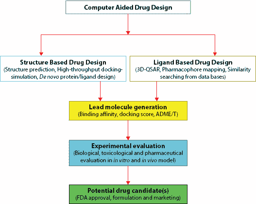
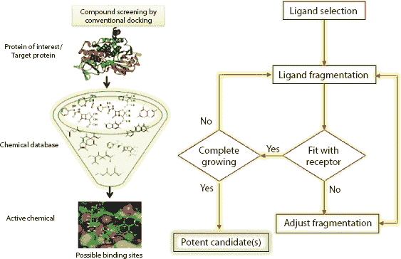
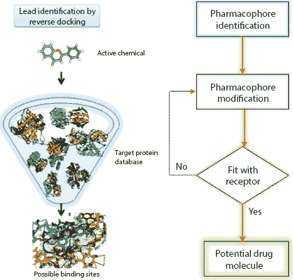
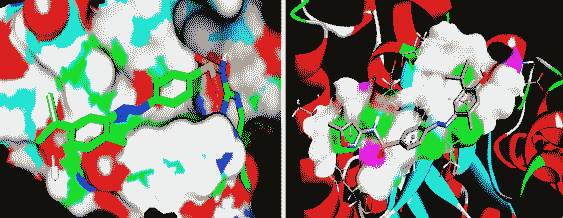

# 3 Role of Bioinformatics in Early Drug Discovery: An Overview and Perspective

**Shasank S. Swain\* and Tahziba Hussain**

*Division of Microbiology and NCDs, ICMR-Regional Medical Research Centre, Chandrasekharpur, Bhubaneswar, Odisha, India*

## Abstract
今天，医学对于人类远离由多种致病细菌、病毒、真菌以及一些生活方式相关健康障碍或非传染性疾病如糖尿病和癌症等引起的疾病至关重要，包括多种自身免疫性疾病。因此，创新药物化学家、药理学家和制药公司不断推出多种药物，以对抗新出现的菌株/血清型/疾病。经过广泛使用和病原体内的遗传变异，每种药物在针对特定疾病时都只在短时间内保持活性。因此，新药的开发是一个持续的过程。但从最初创新到上市的新药开发事件是一个复杂、耗时且资源消耗的过程。此时，生物信息学或计算机辅助药物设计（CADD）工具是当前药物发现中备受青睐的平台之一。通过成本效益高的高通量筛选、靶点识别和先导优化过程对生物活性的虚拟兼理论评估，指导并缩短了现有的药物开发模块。生物信息学技术的连续增长被广泛认为将引领新药开发平台。总体而言，这是早期药物发现中有用的不同生物信息学工具的系统信息。毫无疑问，单个生物信息学工具和数据库为简化早期药物发现提供了生物、化学和毒理学信息。

## Keywords
计算机辅助药物设计，高通量筛选，生物信息学，化学信息学工具

## 3.1 Introduction
药物是一种化学或天然或半合成物质，已被用于通过抑制疾病相关酶/途径来控制疾病。目前，针对任何疾病开发或鉴定潜在先导药物分子是一个挑战 \[1–4\]。当前的药物发现始于靶点特异性，应具有活性、低毒性、平衡的药代动力学以及吸收、分布、代谢、排泄/毒性（ADME/T）性质 \[5–7\]。在靶向疾病之前，我们需要识别病因、症状、生物学机制以及如有可用的医学数据表。事实上，药物发现是一个复杂、长期、逐步验证的程序，具有显著的商业交易。从药物发现的历史来看，任何药物分子的传统试错验证方法都是一个耗时过程，与高风险和低产出相关联 \[5, 8\]。

19 世纪，药物发现是一种偶然的产物和天赐的资产。抗感染剂青霉素是由亚历山大·弗莱明爵士于 1928 年在伦敦圣玛丽医院进行流感病毒实验期间做出的革命性发现 \[9, 10\]。然而，传统的药物发现是当前药物发现之母。安东尼·范·列文虎克在 17 世纪发现显微镜，罗伯特·胡克于 1665 年发现细胞，约瑟夫·普利斯特里于 1772 年报道首个麻醉剂一氧化二氮 (`NO[2]`)，皮埃尔·约瑟夫·佩勒蒂埃和约瑟夫·比安奈梅·卡文图于 1820 年发现首个抗疟剂奎宁，约翰·克林奇博士的首个天花疫苗以及 1800 年首次从血液样本中报道疟原虫，詹姆斯·布兰德尔于 1818 年进行首次成功的人类输血，夏尔·亨利·勒鲁于 1829 年发现强效抗炎药阿司匹林，豪梅·费兰·克鲁亚于 1884 年研制霍乱疫苗，威廉·伦琴于 1895 年发现 `X-rays` 以及 1932 年格哈德·多马克发现首个合成抗菌药普鲁托西林等，都是一些合适的且备受赞赏的科学发现范例。因此，当前的药物发现受到了上述发现的影响并以其为坚实基础 \[3, 9, 11, 12\]。

目前，现代组合药物化学的专业知识与多种成功的制药发现相关，这些发现以针对多种致命疾病的新型药物/疗法形式出现 \[13, 14\]。例如，直到 19 世纪中后期才注意到活性植物化学物质水杨酸可转化为上市药物阿司匹林，用于止痛和抗炎。同样，计算工具并非制药行业和药物发现的新模式。甚至“理性药物设计 (`RDD`)”一词已在 20 世纪 80 年代初引入，随后计算化学、蛋白质晶体学和分子生物学逐渐被纳入药物发现。因此，今天，先进的计算生物学和化学通过生物信息学、化学信息学和多组学数据集工具形成理想形态，并在正在进行的药物开发模块中减少时间和资源方面发挥重要作用 \[15–17\]。

## 3.2 生物信息学与药物发现

近几十年来，由于药物鉴定、筛选方面的技术困难；特别是由于新引入药物候选物的毒性和药物递送问题导致临床试验显著失败，几家制药公司部分减少了其在抗生素/药物开发方面的研发投入 \[18, 19\]。然而，生物信息学分析和耗时验证过程的先进浪潮为当前药物发现开辟了新的方向，有利于制药公司。简而言之，传统的事后诸葛方法被称为“`forward pharmacology`”，与大量可成药和不可成药候选物的验证相关，而先进的 `RDD` 方法被称为“`reverse pharmacology`”，选择一些特定的可成药候选物并遵循系统性和靶点特异性方法 \[17, 20, 21\]。

通常，病原体可以通过激活与疾病传播相关的特定途径相关的致病酶，在宿主体内建立其生存系统。因此，对此类酶的现有医疗记录和基因组学-蛋白质组学信息的分析对于选择任何潜在药物靶点至关重要。另一方面，潜在的药物候选物始终是通过生物信息学工具基于对靶向酶的坚实结合亲和力来选择的 \[15, 17, 22\]。通过生物信息学在早期阶段淘汰不需要/不合适的药物候选物，可减少时间和资源，从而加速药物开发模块。因此，酶/蛋白质和配体或药物候选物的三维 (`3D`) 结构是计算机辅助药物发现 (`CADD`) 的更重要组成部分。总体而言，广泛的基于计算的药物发现分为两种类型，即基于结构的药物设计 (`SBDD`) 和基于配体的药物设计 (`LBDD`)，具有特定优势 (Figure 3.1)。

`Figure 3.1` 计算机辅助药物发现的示意图。

### 3.2.1 基于结构的药物设计 (`SBDD`)

完善的程序和技术可用于药物设计的每个阶段，并指导实现预期目标 \[17, 20, 23, 24\]。此外，通过生物信息学工具，当前结构生物学的进步揭示了多种疾病信息用于药物开发。蛋白质数据库 (`PDB`) 是蛋白质、酶和 DNA 作为药物靶点的 `NMR`、`X-ray` 和 `cryo-EM` 晶体学 `3D` 结构的庞大开放可访问来源，用于任何研究应用。然而，上述用于 `3D` 结构预测的晶体学方法成本更高且无法预测特定蛋白质结构。同时，称为“`homology modeling`”和“`de novo` protein modeling”的生物信息学方法生成复杂的理论蛋白质 `3D` 模型以加速药物筛选程序。然而，整合膜蛋白药物靶点的适当建模和分析仍然是计算生物学或生物信息学的挑战 \[25, 26\]。

简而言之，`SBDD` 是计算药物发现中用于从一系列化学实体/药物候选物中选择针对特定/期望的与疾病相关的靶蛋白/酶/DNA 的有效抑制剂的方法之一 \[27, 28\] (Figure 3.2)。潜在的化学实体或先导药物是通过称为“`molecular docking`”或“`virtual screening`”的计算平台，基于与靶蛋白的分子相互作用或结合亲和力或对接评分（kcal/mol）来选择的。主要，配体功效、结合类型和位点以及蛋白-配体之间的结合距离是选择任何潜在先导药物候选物时使用的关键参数。此外，配体修饰也是一种替代技术，用于克服不稳定相互作用或增强生物效力或降低药物候选物的毒性特征，称为 `lead optimization` \[29, 30\]。总体而言，目前使用的 `virtual screening` 和 `molecular docking` 模拟能够在最少的时间和资源内定位有效的药物候选物，以加速开发模块 \[28, 31–33\]。

`Figure 3.2` 基于结构的药物设计的示意图。

### 3.2.2 基于配体的药物设计 (`LBDD`)

同样，`LBDD`也是一种基于已知配体针对未知靶点的间接药物设计方法 \[34, 35\] (图 3.3)。`LBDD`药物开发平台主要是一种可优先采用的方法，用于药物再利用发现，以在任何新出现/流行病时期最大限度地减少药物需求。探索已知药物候选物的未知效力是正在进行的药物发现中的理想平台。相同的配体相互作用、配体效价和相互作用类型是选择 `LBDD` 平台中多功能化学实体的理想参数。该方法的优势在于可以利用具有某些现有数据的特定已知配体来针对其他疾病/用途使用。尽管如此，在 `SBDD` 情况下，选择未知配体可能会在毒性/副作用验证阶段增加更高的失败风险，即使与我们感兴趣的靶点有最显著的相互作用。多样化的定量构效关系 (`QSAR`) 和药效团建模对于在 `LBDD` 中提高所选候选物的效力和功效至关重要 \[36, 37\]。因此，基于虚拟平台的 `SBDD` 和 `LBDD` 兼具优势兼劣势，但具有成本效益，需要针对特定目的进行适当利用。

**图 3.3** 配体基于药物设计的示意呈现。

## 3.3 早期药物发现中的生物信息学工具

今天，先进的机器学习和人工智能技术在很大程度上模拟生物系统，并提供更可靠的早期药物发现结果。另一方面，在体评估后，毒性和 `ADME/T` 特征是最常见的原因兼障碍，导致大多数新引入的药物候选物在临床试验中失败。在此阶段，高通量计算筛选和在临床前阶段预测可能的毒性和 `ADME/T` 特性在药物发现中更具优势 \[29, 38\]。因此，`CADD` 或计算工具具有成本效益、节省时间和用户友好性 \[39\]。

### 3.3.1 可能的生物活性预测工具

生物活性被定义为任何化学实体/物质改变生物系统自然过程的能力 \[40\]。物质/药物可能对两种或多种生物靶点或疾病具有活性，同时在不同特性上发挥作用。例如，一线抗分枝杆菌药物利福平（Rifampicin）用于直接观察治疗、短程疗法（`DOTS`）中对抗 *Mycobacterium tuberculosis*，以及在多药疗法（`MDT`）中与不同物质以不同剂量协同作用对抗 *M. leprae*。材料的生物活性通过实验方法证明，根据目标进行测定，且活性通过能够在没有不良反应情况下改变/控制疾病状态的元素的浓度/数量来计算。

目前，计算工具和软件可以预测化学实体的可能生物活性。例如，广泛使用的物质活性谱预测（`PASS`）工具能够根据化合物的结构组成或公式估计几种可能的生物活性谱，其“预测平均准确度”约为 95%。`PASS` 预测是基于约 260,000 种具有已知生物活性的化合物的构效关系（`SAR`）知识设计的 \[41\]。根据 `PASS` 预测，当 `Pa` 值 `Pa > 0.7` 时，化学结构很可能在实验模型中表现出良好的生物活性。相比之下，`Pa` 值在 `0.5 < Pa < 0.7` 之间的化学物质活性会明显较低。另则，当 `Pa` 值 `Pa < 0.5` 时，该化合物在任何实验模型中都不会有活性。`PASS` 程序能够以合理的准确度预测约 400 种分子水平的生物活性，以识别未知化合物的潜在靶点 \[41\]。

同样，分子对接是验证化学物质通过与靶酶的分子相互作用而产生的生物活性的关键方法 \[42\]。对接的概念是基于锁钥理论原理发展的。在对接研究期间，靶酶与任何小化学实体之间的相互作用会产生一个能量值（称为对接评分），并作为该化学实体对靶点的生物活性的指标。根据对接软件 `AutoDock Vina`，对接评分以负号表示，负值越大表示效力越高。有多个免费和付费的软件/工具可用于对接和模拟研究（表 3.1）。基于对接的虚拟筛选通过药物与靶酶之间的固有结合亲和力指导药物设计的某些重要方面，这有助于在最少的时间和资源内加速先导分子的优化 \[1, 31\] (图 3.4)。分子对接已应用于过去二十年，并比传统方法更轻松地发现了多种潜在药物分子 \[43\]。因此，它在早期选择活性化学物质进行临床验证中发挥着重要作用。

分子动力学（`MD`）模拟已在 `CADD` 中用于检查预生成环境中对接复合物的分子间稳定性 \[31\]。此外，热力学积分和自由能微扰方法是对蛋白-配体复合物稳定性的更准确分析，但对于大型复杂生物分子识别仍相当有限 \[29, 33\]。如今，`MD` 模拟方法已成为 `CADD` 中的常规实践，用于精确分析与受体-药物识别相关的热力学和动力学，以及结构柔韧性和熵效应 \[31\]。总体而言，一些 `MD` 分析因软件而异，因为每个软件都是基于特定的算法和力场建立的。目前，`GROMACS` 是初学者最可靠且可自由获取的软件之一。事实上，编程实践/计算编码知识在计算平台中至关重要，尤其是在 `MD` 模拟期间。

**表 3.1** 一些广泛且可自由获取的分子对接工具和软件列表。

| **工具名称** || **简要描述** || **网络信息** |

| --- | --- | --- |

| `AutoDock` and `AutoDock Vina` || 基于 Lamarckian 遗传算法和自由能评分函数的蛋白-配体相互作用分子对接。 || [`autodock.scripps.edu/`](http://autodock.scripps.edu/)  

[`vina.scripps.edu/download.html`](http://vina.scripps.edu/download.html) |

| `ArgusLab` || 一个用户友好的分子建模、对接和量子分析软件 || [`www.arguslab.com/arguslab.com/ArgusLab.html`](http://www.arguslab.com/arguslab.com/ArgusLab.html) |

| `DOCK Blaster` || 尤其是针对 `ZINC` 数据中呈现的化学化合物与任何生物靶标结构进行对接研究 || [`blaster.docking.org/`](http://blaster.docking.org/) |

| `BSP-SLIM` || 特别适用于低分辨率蛋白结构与任何药物候选物的盲分子对接平台 || [`zhanglab.ccmb.med.umich.edu/BSP-SLIM/`](http://zhanglab.ccmb.med.umich.edu/BSP-SLIM/) |

| `HADDOCK` || 一种用于生物分子复合物的信息驱动柔性对接方法 || [`haddock.science.uu.nl/`](http://haddock.science.uu.nl/) |

| `Hex` and `Hex Server` || 一个快速、活跃且功能强大的可视化对接服务器，用于蛋白-蛋白研究 || [`hexserver.loria.fr/`](http://hexserver.loria.fr/) |

| `iGEMDOCK` || 用于识别先导化合物和理解配体结合机制的友好型对接服务器 || [`gemdock.life.nctu.edu.tw/dock/igemdock.php`](http://gemdock.life.nctu.edu.tw/dock/igemdock.php) |
| `PatchDock` || 基于算法的蛋白质、DNA、肽和药物对接研究 || [`bioinfo3d.cs.tau.ac.il/PatchDock/php.php`](http://bioinfo3d.cs.tau.ac.il/PatchDock/php.php) |
| `SwissDock` || 用于预测分子-配体相互作用的基于网络的对接服务器 || [`www.swissdock.ch/`](http://www.swissdock.ch/) |
| `ZDOCK` || 用于蛋白质-蛋白质研究的交互式对接预测工具 || [`zdock.umassmed.edu/`](http://zdock.umassmed.edu/) |

**图 3.4** 蛋白质-配体相互作用可视化的示意图，使用两种不同的软件 `PyMOL` 和 `BIOVIO-DVS`。

### 3.3.2 可能的理化性质和类药性验证工具

多种强效药物候选物因缺乏药物适用性特征而在临床试验中被淘汰，例如低生物利用度、高毒性、药代动力学不良或药物-药物相互作用。因此，所有平衡形式被认为是药物能力或类药性特征 \[44\]。`CADD` 一直专注于基于理想类药性特征和对靶蛋白的强结合亲和力，对潜在先导化学实体进行搜寻和筛选。在 1990–2010 年间，早期阶段的药物能力预测是不可能的，且 FDA 药物批准率也显著下降 \[45, 46\]。通过计算工具预测可能的药物特征，可减少耗时且昂贵的 *体外* 和 *体内* 实验，以排除不需要的药物候选物。

溶解度、稳定性、药代动力学和 `ADME/T` 特征是药物能力决定因素 \[47, 48\]。Lipinski 五规则 (`RO5`) 或 Pfizer 规则在分析中考虑分子量 (`MW`)、氢键受体数 (`H-BA`)、氢键供体数 (`H-BD`) 和辛醇/水分配系数 (`ClogP`) 值。`RO5` 参数在统计和实验上也直接影响药代动力学特征和 `ADME/T` 性质 \[44\]。根据 `RO5`，预期化学物质的 `MW` 必须 ≤ 500 g/mol，`H-BD` ≤ 5，`H-BA` ≤ 10，且 `ClogP` ≤ 5。如果化合物违反两条或以上规则，则可能对人体无口服活性。因此，`RO5` 标准化是正在进行的计算药物开发平台中的常规分析。

如下所述，大多数上市药物已通过/遵守 `RO5` 原则，因为它是在合成前在计算上验证所设计化学物质类药性的预定义流程，并受制于药理学验证。因此，预测新化学实体的类药性值是现有药物在世界药物索引文件中放置的统计输出。今天，`Molspiration` ([`www.molinspiration.com/`](http://www.molinspiration.com/))、`MolSoft` ([`www.molsoft.com/`](http://www.molsoft.com/)) 和 `SwissADME` ([`www.swissadme.ch/`](http://www.swissadme.ch/)) 是广泛使用的用户友好工具，可通过上传新设计的化学结构或使用简化分子输入行条目系统 (`SMILE`) 记号进行类药性预测，根据工具 (表 3.2)。

**表 3.2** 列出一些广泛且免费使用的理化性质、毒性和 ADMET-药代动力学特征预测工具。

| **工具名称** || **简要描述** || **网络信息** |
| --- | --- | --- |
| `admetSAR` || 通过结构相似性搜索 `QSAR` 模型进行 `ADME/T` 轮廓预测 || [`lmmd.ecust.edu.cn/admetsar2`](http://lmmd.ecust.edu.cn/admetsar2) |
| `Lazar` || 用于预测所需化学物质毒性、致死剂量和推荐剂量的基于 `QSRA` 的框架 || [`lazar.in-silico.de`](http://lazar.in-silico.de) |
| `Molinspiration` || 用于化学实体的理化性质、生物活性预测的基于片段的虚拟筛选平台 || [`www.molinspiration.com/`](http://www.molinspiration.com/) |
| `MolSoft` || 用于化学物质的高速度分子性质和类药性评分计算工具 || [`www.molsoft.com/`](http://www.molsoft.com/) |
| `OECD Toolbox` || 用于预测多个终点以及参考研究的实验数据 || [`toolbox.oasis-lmc.org`](http://toolbox.oasis-lmc.org) |
| `OSIRIS-property explore` || 对化学物质溶解度、毒性理化性质的预测 || [`www.organicchemistry.org/prog/peo/`](http://www.organicchemistry.org/prog/peo/) |
| `PreADMET` || 它是基于训练集数据的类药性、`ADME/T` 和毒性预测工具 || [`preadmet.bmdrc.kr/`](http://preadmet.bmdrc.kr/) |
| `ProTox-II` || 欢迎使用 ProTox-II，用于预测小分子毒性的虚拟实验室 || [`tox.charite.de/protox\_II/`](http://tox.charite.de/protox_II/) |
| `ToxiM` || 用于预测分子溶解度、毒性特征的机器学习方法 || [`metagenomics.iiserb.ac.in/ToxiM/index.html`](http://metagenomics.iiserb.ac.in/ToxiM/index.html) |
| `Swiss-ADME` || 对任何化学实体的 ADMET-药代动力学、生物利用度和类药性性质的预测 || [`www.swissadme.ch/`](http://www.swissadme.ch/) |

### 3.3.3 可能的毒性和 ADME/T 特征预测工具

与毒性相关的不良反应继续挑战任何新引入的药物候选物通过临床试验评估阶段成为上市药物 \[45, 46\]。此外，制药公司基于业务概况，其在临床试验中引入药物的成功与否直接成正比。因此，在临床前阶段更早识别安全问题是一个巨大优势，其中 *计算机模拟* 毒性预测发挥关键作用 \[33, 34\]。使用先进的高通量算法、人工智能技术、多组学临床数据集可提高计算毒性预测的质量和效能，这对制药行业在临床前阶段剔除不需要的有毒化学物质更有益。

若干训练集数据库，名称为 `ACuteTox` ([`www.acutetox.eu/`](http://www.acutetox.eu/))、`Open PHACTS` ([`www.openphactsfoundation.org/`](http://www.openphactsfoundation.org/))、`OpenTox` ([`www.opentox.net/`](http://www.opentox.net/))、`ToxBank` ([`www.toxbank.net/`](http://www.toxbank.net/))、`RepDose` ([`repdose.item.fraunhofer.de/`](http://repdose.item.fraunhofer.de/))、`RISCTOX:` ([`risctox.istas.net/en/`](http://risctox.istas.net/en/)) 和 `TOXNET` ([`toxnet.nlm.nih.gov/`](http://toxnet.nlm.nih.gov/))，汇集了大量临床事实并可免费用于任何研究指导。上述参考数据库的主要目标是提高毒性预测的可靠性，减少实验毒理学测试，并为实验研究选择更安全的化学物质用于药物开发 \[23, 30, 49\]。若干工具已在公共领域可用，可基于所提供的训练数据预测可能的毒性 (表 3.2)。

然而，通过计算工具对期望的药物候选物的毒性预测是一项繁重的工作，因为所有毒理学特性都与通过 `ADME/T` 轮廓相关的多个生理过程相关。生物系统也因小鼠、大鼠、猪、大鼠、蝙蝠、猴子和人类而有所不同；因此，预测准确的毒性特征始终是一项昂贵且耗时的程序。同时，整个药物递送验证系统，例如药代动力学（`PK`）、药效学（`PD`）、半衰期（`T½`）、药物-药物相互作用和药物排泄特征，在药物验证期间被 `ADME/T` 视为关键参数。示例工具是 `ADMETlab` ([`admet.scbdd.com/calcpre/index/`](http://admet.scbdd.com/calcpre/index/))，`admetSAR` ([`lmmd.ecust.edu.cn/admetsar2`](http://lmmd.ecust.edu.cn/admetsar2))，`PreADMET` ([`preadmet.bmdrc.kr/`](http://preadmet.bmdrc.kr/))，`SwissADME` ([`www.swissadme.ch/`](http://www.swissadme.ch/))，和 `vNN` ([`vnnadmet.bhsai.org/`](http://vnnadmet.bhsai.org/))。确实，还有一些商业的、易于使用/更用户友好/可靠的计算工具/软件可用于分子对接、毒性预测、药物相似性评分、毒性以及药代动力学特征预测。然而，像 `AutoDock` 这样的免费软件用于分子对接，`GROMACS` 用于 `MD` 模拟，`PyMOL` 用于分子相互作用可视化，`PASS` 用于生物活性预测，`Molsoft` 用于药物相似性评分预测，`ProTox` 用于毒性预测，以及 `SwissADME` 用于 `ADME/T` 轮廓评估，另一方面，`PDB` 用于相关 3D 蛋白质结构信息，`DrugBank` 和 `PubChem` 用于药物/化学结构信息，以及 `KEGG` 数据库用于参考通路映射，是全球最广泛可使用/可评估的几种免费生物信息学工具/软件和数据库。

## 3.4 Future Directions With Bioinformatics Tool

研究人员或科学家始终旨在针对并鉴定出安全、高效的化合物，其药代动力学特征完美，以便在相关的药物发现领域转化为合理的市场药物。在过去二十年中，传统方法“一种靶点一种方法”是药物发现中昂贵、耗时的做法 \[50, 51\]。目前使用的综合方法利用文献、疾病、靶点、化合物、机制和参数的信息，结合先进的计算专业知识，是开发合适药物候选物的更全面和整体的方法论 \[32, 34, 50, 52\]。计算工具承诺不断获取、规范并简化传统的药物发现方法。此外，来自 `PDB`、`NCBI`、`UniProtKB`、`PubChem`、`ZINC`、`KEGG` 和 `PubChem Drug Bank` 的大量可自由获取的数据集，以及来自文献数据库的先前研究/医学信息，即 `PubMed`、`Scopus`、`Sci-Hub`，在早期药物发现中发挥着至关重要的作用 \[29, 32, 53, 54\]。

然而，*体外*筛选用于抗病疗效的化学物质可能由于缺乏药物相似性特征/评分而在临床试验阶段失败。在 FDA 批准上市药物之前，即使为药物候选物投资 >2.6 billion 美元，最大数量的在研药物也在临床试验的不同阶段被淘汰 \[45, 46, 55\]。高通量筛选（`HTS`）筛选是从化学物质库中确定活性药物分子的替代方法，具有较高的上市药物可能性 \[33\]。然而，`HTS` 仍然昂贵且需要大量资源，这些资源在学术环境中通常无法获得。在先进的计算工具或 `CADD` 与 `HTS` 之后，它现在被转化为虚拟筛选或虚拟捷径，成为制药领域更强大、更具活力的工具。因此，为了在临床前阶段节省选择强效先导药物分子或避免不需要的药物分子的资源和时间。今天，`CADD` 工具不仅在制药公司中使用，而且在每个学术机构中都很流行，以减少生产性产出期间昂贵的实验分析 \[17, 34\]。`CADD` 程序指导预测药物开发模块中的可能副作用、生物利用度和相关关键临床参数。随后，在现代基因组时代，来自组织、DNA、蛋白质和整个生物体的足够数量的多层次生物和化学数据集的组合将有助于通过先进的计算机器学习假设、工具和算法预测最接近的结果 \[21, 23, 28, 30\]。

将药物化学与生物信息学工具相结合已彻底改变了当前的药物发现，使其能够在最短的时间和资源内设计或筛选先导药物 \[1, 13, 14\]。结合起来，“MedChem-BioChem”模型提供了药物发现的专业环境，具有高度的科学异质性，并以令人信服的方式改善现代药物发现平台。这是从转录组分析、蛋白质表达和靶酶的多组学网络特征揭示疾病之间联系的药物发现新时代。多项研究证实，计算方法随后进行实验评估已有效地用于鉴定新型治疗剂 \[1, 31, 35\]。在实施不同的计算工具以获得丰硕成果之前，需要分析该方法，因为每种技术都有其适用范围和局限性。因此，我们不能仅依赖计算输出来避免原始假设和研究。计算方法用于找出药物与疾病之间的一些可能线索或联系。将大量化学、生物和临床数据与计算假设预测相结合具有挑战性。例如，有时计算预测的新型化合物无法在实验室中合成，并且无法表现出显著的 *体外* 和 *体内* 研究 \[56, 57\]。因此，实验评估是验证计算预测的唯一且主要方法之一。找出药物、靶点和疾病之间的更多联系是计算化学家或生物学家简化当前药物发现方法的首要关注点 \[6, 17, 28, 49, 58\]。

## 3.5 Conclusion

今天，几种先进的分子技术以及耗时测定被引入，以取代传统的试错方法，用于分离、选择和验证强效治疗剂以进行早期诊断和控制。确实，`CADD` 特指基于计算化学、预测的对接构象以及通过 `SBDD` 或 `LBDD` 方法针对靶疾病的强分子结合亲和力-稳定性来发现生物活性先导化学/可成药剂。相关预表征的活性、功能和机制加速了药物发现程序。此外，“系统药理学”是一种创新的药物研究模型，其中配体和蛋白质信息被结合以生成新型药物分子。逐步地，`MD` 模拟和量子力学研究最常用于研究在预定义环境中不同时间间隔下蛋白质-配体复合物之间的微小构象变化。总体而言，`CADD` 方法可以通过当前药物发现中的系统化且优化的过程减少时间和资源；然而，潜在药物始终基于实验（*体外* 和 *体内*）结果获得批准。因此，生物信息学是增值虚拟特性，可加快当前药物发现程序，从初步阶段设计更安全、更有效的药物。

## Acknowledgements

ICMR 青年科学家研究计划支持本工作（FTS No. 3128113/No.R.12014/14/2017-HR），由印度政府新德里印度医学研究理事会卫生研究部授予 Dr. S. S. Swain。

## 参考文献
1\. Swain, S.S., Paidesetty, S.K., Padhy, R.N., 利用磺胺甲噁唑与单环萜类化合物开发抗菌缀合物：基于系统药物化学的计算方法. *Comput. Methods Programs Biomed*., 140, 185, 2017.
2\. Atanasov, A.G., Waltenberger, B., Pferschy-Wenzig, E.M., Linder, T., Wawrosch, C., Uhrin, P., Temml, V., Wang, L., Schwaiger, S., Heiss, E.H., Rollinger, J.M., Schuster, D., Breuss, J.M., Bochkov, V., Mihovilovic, M.D., Kopp, B., Bauer, R., Dirsch, V.M., Stuppner, H., 植物来源药理活性天然产物的发现与再供应：综述. *Biotechnol. Adv*., 33, 1582, 2015.
3\. Arrowsmith, J., 变革的十年. *Nat. Rev. Drug Discovery*, 11, 17, 2012.
4\. Brodniewicz, T. and Grynkiewicz, G., 临床前药物开发. *Acta Pol. Pharm*., 67, 578, 2010.
5\. Gajdács, M., 理想抗生素的概念：对药物设计的影响. *Molecules*, 24, E892, 2019.
6\. Elebring, T., Gill, A., Plowright, A.T., 当前药物发现中最重要的方法是什么：做正确的事情还是正确地做事？ *Drug Discovery Today*, 17, 1166, 2012.
7\. Swinney, D.C. and Anthony, J., 新药是如何被发现的？ *Nat. Rev. Drug Discovery*, 10, 507, 2011.
8\. Mohs, R.C. and Greig, N.H., 药物发现与开发：基础生物学研究的作用. *Alzheimers Dement (N Y)*, 3, 651, 2017.
9\. Hutchings, M., Truman, A., Wilkinson, B., 抗生素：过去、现在与未来. *Curr. Opin. Microbiol*., 51, 72, 2019.
10\. Tan, S.Y. and Tatsumura, Y., 亚历山大·弗莱明（1881–1955）：青霉素的发现者. *Singapore Med. J*., 56, 366, 2015.
11\. Schuhmacher, A., Gassmann, O., Hinder, M., 研究型制药公司研发模式的变革. *J. Transl. Med*., 14, 105, 2016.
12\. Patwardhan, B. and Mashelkar, R.A., 受传统医学启发的药物发现方法：可以 *Ayurveda* 指引未来吗？ *Drug Discovery Today*, 14, 804, 2009.
13\. Campbell, I.B., Macdonald, S.J.F., Procopiou, P.A., 大型制药企业药物发现中的药物化学：过去、现在与未来. *Drug Discovery Today*, 23, 219, 2018.
14\. Itoh, Y. and Suzuki, T., 在有机化学帮助下进行“药物”发现. *Yakugaku Zasshi*, 137, 283, 2017.
15\. Romano, J.D. and Tatonetti, N.P., 天然产物药物发现中的信息学与计算方法：综述与展望. *Front. Genet*., 10, 368, 2019.
16\. Hasin, Y., Seldin, M., Lusis, A., 疾病的多组学方法. *Genome Biol*., 18, 83, 2017.
17\. Macalino, S.J., Gosu, V., Hong, S., Choi, S., 计算机辅助药物设计在现代药物发现中的作用. *Arch. Pharm. Res*., 38, 1686, 2015.
18\. Simpkin, V.L., Renwick, M.J., Kelly, R., Mossialos, E., 激励抗生素药物发现与开发创新：进展、挑战与下一步. *J. Antibiot. (Tokyo)*, 70, 1087, 2017.
19\. Taylor, D., 制药行业与药物开发的未来, 载于：*环境中的药物*, 第 1–33 页, Environmental Science and Technology, 2015.
20\. Lage, O.M., Ramos, M.C., Calisto, R., Almeida, E., Vasconcelos, V., Vicente, F., 针对特定人类疾病药物发现的当前筛选方法. *Mar. Drugs*, 16, E279, 2018.
21\. Zhou, J., Li, Q., Wu, M., Chen, C., Cen, S., 多药理学药物理性设计进展. *Curr. Pharm. Des*., 22, 3182, 2016.
22\. Aparoy, P., Reddy, K.K., Reddanna, P., 新型 5-LOX 抑制剂开发中的结构与配体基于药物设计策略. *Curr. Med. Chem*., 19, 3763, 2012.
23\. Patel, C.N., Kumar, S.P., Rawal, R.M., Patel, D.P., Gonzalez, F.J., Pandya, H.A., 用于药物发现的多参数器官毒性预测模型. *Toxicol. Mech. Methods*., 30, 159, 2020.
24\. Xia, X., 生物信息学与药物发现. *Curr. Top. Med. Chem*., 17, 1709, 2017.
25\. Yin, H. and Flynn, A.D., 靶向膜蛋白相互作用. *Annu. Rev. Biomed. Eng*., 18, 51, 2016.
26\. Arinaminpathy, Y., Khurana, E., Engelman, D.M., Gerstein, M.B., 膜蛋白的计算分析：最大的药物靶点类别. *Drug Discovery Today*, 14, 1130, 2009.
27\. Rawson, S., Bisson, C., Hurdiss, D.L., Fazal, A., McPhillie, M.J., Sedelnikova, S.E., Baker, P.J., Rice, D.W., Muench, S.P., 通过冷冻电镜阐明不同酶抑制剂抑制效力的结构基础. *Proc. Natl. Acad. Sci. U.S.A*., 115, 1795, 2018.
28\. Lionta, E., Spyrou, G., Vassilatis, D.K., Cournia, Z., 基于结构的虚拟筛选用于药物发现：原理、应用与最新进展. *Curr. Top. Med. Chem*., 14, 1923, 2014.
29\. Sliwoski, G., Kothiwale, S., Meiler, J., Lowe, E.W., Jr, 药物发现中的计算方法. *Pharmacol. Rev*., 66, 334, 2013.
30\. Hughes, J.P., Rees, S., Kalindjian, S.B., Philpott, K.L., 早期药物发现原理. *Br. J. Pharmacol*., 162, 1239, 2011.
31\. Swain, S.S., Paidesetty, S.K., Dehury, B., Sahoo, J., Chaitanya, S.V., Mahapatra, N., Hussain, T., Padhy, R.N., 分子对接与模拟研究用于合成多药疗法中新型抗麻风药的替代二苯砜衍生物. *J. Cell. Biochem*., 119, 9838, 2018.
32\. Leelananda, S.P. and Lindert, S., 药物发现中的计算方法. *Beilstein J. Org. Chem*., 12, 2694, 2016.
33\. Ge, H., Wang, Y., Li, C., Chen, N., Xie, Y., Xu, M., He, Y., Gu, X., Wu, R., Gu, Q., Zeng, L., Xu, J., 基于分子动力学的虚拟筛选：高性能计算加速药物发现过程. *J. Chem. Inf. Model*., 53, 2757, 2013.
34\. Yu, W. and MacKerell, A.D., Jr., 计算机辅助药物设计方法. *Methods Mol. Biol*., 1520, 85, 2017.
35\. Aparoy, P., Reddy, K.K., Reddanna, P., 新型 5-LOX 抑制剂开发中的结构与配体基于药物设计策略. *Curr. Med. Chem*., 19, 3763, 2012.
36\. Baig, M.H., Ahmad, K., Rabbani, G., Danishuddin, M., Choi, I., 计算机辅助药物设计及其在神经退行性疾病潜在药物开发中的应用. *Curr. Neuropharmacol*., 16, 740, 2018.
37\. Shim, J. and Mackerell, A.D., Jr., 基于计算配体的理性设计：构象采样和力场在模型开发中的作用. *MedChemComm*, 2, 356, 2011.
38\. Nantasenamat, C. and Prachayasittikul, V., 最大化计算工具以实现成功发现. *Expert. Opin. Drug Discovery*, 10, 321, 2015.
39\. Roy, A., 学术界的早期探针与药物发现：简评. *High Throughput*, 7, pii:E4, 2018, doi: 10.3390/ht7010004.
40\. Schenone, M., Dančík, V., Wagner, B.K., Clemons, P.A., 化学生物学与药物发现中的靶点鉴定与作用机制. *Nat. Chem. Biol*., 9, 232, 2013.
41\. Khurana, E., Devane, R.H., Dal Peraro, M., Klein, M.L., 药物与流感 A 病毒膜结合四聚体 M2 肽束结合的计算研究. *Biochim. Biophys. Acta*, 1808, 530, 2011.
42\. Meng, X.Y., Zhang, H.X., Mezei, M., Cui, M., 分子对接：基于结构的药物发现的有力方法. *Curr. Comput. Aided Drug Des*., 7, 146, 2011.
43\. Jorgensen, W.L., 计算在药物发现中的多重作用. *Science*, 303, 1813, 2004.
44\. Benet, L.Z., Hosey, C.M., Ursu, O., Oprea, T.I., BDDCS、五规则与成药性. *Adv. Drug Delivery Rev*., 101, 89, 2016.
45\. Drago, T., Cahill, K., Grealy, A., Lucey, K., Mahmoud, M., 制药公司内部研究与许可交易回顾. *Adv. J. Soc. Sci*., 8, 77, 2021.

46. Takebe, T., Imai, R., Ono, S., 源自美国学术界的药物发现与开发的现状：工业与学术合作对药物发现与开发的影响。 *Clin. Transl. Sci*., 11, 597, 2018.
47. Tian, S., Wang, J., Li, Y., Li, D., Xu, L., Hou, T., 在制药研究中 *计算机模拟* 药物相似性预测的应用。 *Adv. Drug Delivery Rev*., 86, 2, 2015.
48. Lipinski, C.A., 铅类和药物样化合物：五规则革命。 *Drug Discovery Today Technol*., 1, 337, 2004.
49. Russell, R.B. and Eggleston, D.S., 结构在生物学和药物发现中的新角色。 *Nat. Struct. Biol*., 7, 928, 2000.
50. Earm, K. and Earm, Y.E., 在药物发现与开发失败时代的整合方法。 *Integr. Med. Res*., 3, 211, 2014.
51. Cressey, D., 传统药物发现模式亟待改革。 *Nature*, 471, 17, 2011.
52. Yang, S.Y., 药效团建模及其在药物发现中的应用：挑战与最新进展。 *Drug Discovery Today*, 15, 444, 2010.
53. Zheng, S., Dharssi, S., Wu, M., Li, J., Lu, Z., 用于药物发现的文本挖掘。 *Methods Mol. Biol*., 1939, 231, 2019.
54. Agarwal, P. and Searls, D.B., 支持药物发现的文献挖掘。 *Brief. Bioinform*., 9, 479, 2008.
55. Schuhmacher, A., Gassmann, O., Hinder, M., 基于研究的制药公司中不断变化的研发模式。 *J. Transl. Med*., 14, 105, 2016.
56. Kügler, P., Rast, G., Guth, B.D., 人诱导多能干细胞来源的心肌细胞特定类型中搏动间隔与复极持续时间关系 *体外和* 计算实验的比较。 *PLoS One*, 14, e0221763, 2019, doi: 10.1371/journal. pone.0221763.
57. Banerjee, P., Siramshetty, V.B., Drwal, M.N., Preissner, R., 预测新化学结构 *体外* 效应的计算方法。 *J. Cheminform*., 29, 8, 2016.
58. Grootendorst, P., 我们应如何支持制药创新？ *Expert Rev. Pharmacoecon. Outcomes Res*., 9, 313, 2009.
1. **通讯作者*: swain.shasanksekhar86@gmail.com
