# 4 生物信息学中数据挖掘的作用

**Vivek P. Chavda^(1)\*, Amit Sorathiya^(2), Disha Valu^(3) and Swati Marwadi^(4)**

^(*1*)*药剂学系，L.M. 药学院，艾哈迈达巴德，印度*
^(*2*)*配方与开发部，Sun Pharma Advanced Research Centre，瓦多达拉，印度*
^(*3*)*分析开发部，Orbicular Pharmaceutical Ltd，海得拉巴，印度*
^(*4*)*生物技术系，Sinhgad 工程学院，浦那，印度*

> ***摘要***
> 近日，在信息科学领域一个极具挑战性的术语是数据挖掘，它包括提取大量数据。数据挖掘在利用不同的软件技术从数据库中预先存在的数据中获取不同数据模式以获得基于知识的信息方面非常有用且有趣。数据挖掘似乎最适合生物信息学，因为生物信息学是数据的丰富，尽管在分子层面上人类存在的进化阶段缺乏。
> 尽管如此，从不同数据库收集信息在信息科学中非常有帮助且信息丰富，而信息科学受存储在库中的数据的多个不同方面影响。这些库涉及与科学相关领域的相关持久数据。此外，它还包括多样性、计数、维度等各种因素。后来，管理和访问对数据发现最有用的数据并不那么容易，因为它需要对该数据周围的知识体系进行连贯的科学技能和深刻的洞察。生物数据库的汇编也很困难。在信息科学中访问数据库并开发研究分子水平生物系统的新技术的最有效方法包括从其他相关数据库中提取原始数据，其进一步评估已成为信息科学中更重要和关键的概念。
> ***关键词**:* 数据挖掘, 蛋白组学, DNA, RNA, 基因表达, 分析, 等。

## 4.1 引言
数据科学是从海量数据中提取有用信息，从而识别出新鲜且可理解的数据模型和模式 \[1\]。生物信息学是计算机辅助科学，旨在管理海量基因组数据，它结合了计算机科学存储、分析并利用来自生物数据（如分子、序列、基因表达和途径）的信息来解决多个遗传难题的能力 \[2\]。在数据挖掘（DM）中提供有关生物数据快速扩展来源的一些重要细节的改进方法将发挥至关重要的作用 \[3\]。DM 是在海量数据中发现新的有趣配置和相关性的基础科学。它被定义为“通过挖掘存储在仓库中的大量数据来寻找有意义的新关系、模式和趋势的过程” \[4\]。知识发现数据库（KDD）有时用于 DM。这些过程是未来研究的血液，也是技术范式的驱动力。它是当务之急，不断演进以识别科学和技术已产生的数据中存在的隐藏知识的可能性 \[5\]。
DM 方法为生物信息学铺平了未来发展道路，并提供了适当的工具，可在分子层面对数据进行深入洞察以识别模式并围绕其构建算法。生物信息数据库的广泛范围为开发新型 KDD 方法创造了挑战和机遇 \[6, 7\]。生物数据处理将有利于在较短时间内识别适当靶点并围绕已识别靶点生成治疗方法。整个人类基因组，即每个人类细胞内的完整遗传信息集，现在已被确定 \[8\]。理解这些遗传指令有望使科学家更好地理解疾病及其治愈的本质，识别生长和衰老等生物过程的潜在机制，并清楚地追踪我们的进化及其与其他物种的关系 \[9\]。研究人员与他们寻求的知识之间存在的主要障碍是可用数据的庞大数量。这从 GenBank 储存库中碱基对和 DNA 序列数量的快速增加中可见一斑 \[10\]。

## 4.2 数据挖掘方法/技术
DM 技术选择在所开展研究背景、所识别问题的复杂性和业务类型方面至关重要。各种 DM 技术已汇总在 图 4.1 中，并且通常采用通用平台方法以确保整个过程的准确性和成本效益。

### 4.2.1 分类

#### 4.2.1.1 统计技术

数据挖掘的统计技术是数学的一个分支，主要处理数据的收集和描述 \[11\]。尽管如此，许多数据科学家仍反对将其视为数据挖掘技术。但它仍然有助于确定所评估数据的模式，并可在其周围构建预测模型 \[12\]。因此，数据分析师应具备有关不同统计技术的一些知识。在当今世界，人们必须处理大量数据并从中提取重要模式。统计分析的应用见 图 4.2，而不同的数据收集方法则总结在 图 4.3 中。

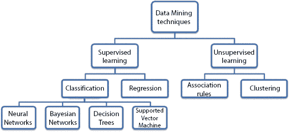

**图 4.1** 数据挖掘技术。

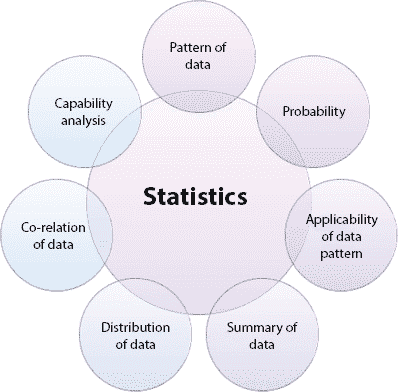

**图 4.2** 数据挖掘中统计的应用。

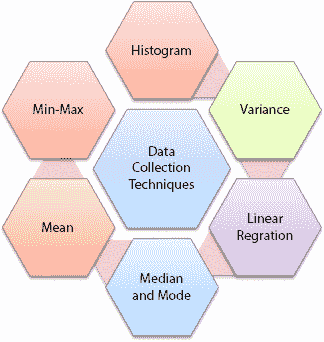

**图 4.3** 数据收集技术。

对于数据分析，统计是理解和评估数据的必备要素。统计将帮助科学家通过数据可视化在数据挖掘过程中识别数据模式。这将进一步帮助检测噪声，然后优化并识别出数据术语中的重要发现。

#### 4.2.1.2 聚类技术

聚类技术（分割）是数据挖掘最古老的技术之一，其中性质相似的数据被视为一个簇。这有助于理解数据之间的差异和相似性，并且是数据挖掘非常准确的方法 \[13\]。当需要在同类数据之间进行模式识别以得出有意义的结论时，它似乎非常有用。例如，保险公司可以根据其收入、年龄、保单性质和索赔类型对消费者进行分组。数据挖掘过程中使用了不同类型的聚类方法（图 4.4）。

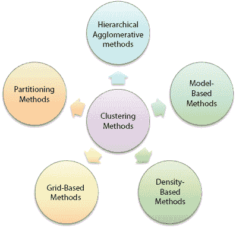

**图 4.4** 聚类方法类型。

#### 4.2.1.3 可视化

数据可视化是数据挖掘的主要和最常见的方法，应用于数据挖掘过程的开始阶段 \[14\]。如今有许多研究正在进行，以产生数据库的有趣投影，这被称为投影追踪。数据可视化是非常有用的工具，它可以提供所分析数据的整体概览，并帮助科学家剔除不适合进一步处理的数据。它对于识别隐藏模式同样有用 \[12\]。

#### 4.2.1.4 归纳决策树技术

顾名思义，决策树技术具有树状结构，可以生成预测模型 \[15\]。在此技术中，待评估的数据将被分类为树的分支，而树的叶子被视为与该特定分类相关的数据集的分区。该技术可用于探索分析、数据预处理和预测工作 \[16\]。数据被分类为具有某些相似预测信息的段或分支。仔细观察可以发现，它具有将问题陈述与期望结果相关联的良好潜力；因此，它被统计学家广泛用于预测性数据分析以及数据预处理。

该技术中第一步也是最重要的一步是生长树。生长树的基本原理取决于在树的每个分支上找到最佳提问。决策树在以下任何一种情况下停止生长。

1. a) 如果段仅包含一条记录
2. b) 所有记录都具有相同的特征
3. c) 生长不足以进行进一步的分割

CART 代表分类与回归树，是一种数据探索和预测算法，以更复杂的方式选择问题。它尝试所有问题，然后选择一个最佳问题来将数据分割成两个或多个段。确定段后，它会分别对每个新段提出问题。另一种流行的决策树技术是 CHAID（卡方自动交互检测器）。它与 CART 相似，但有一点不同。CART 有助于选择最佳问题，而 CHAID 有助于选择分割 \[17\]。

#### 4.2.1.5 神经网络

神经网络是当今个人使用的另一种重要方法。在数据挖掘技术的早期阶段，这种方法最常用。神经网络非常用户友好，因为它是一个顺序过程，不要求科学家在生成数据的领域具备技术专长 \[18, 19\]。

一组相互连接的神经元构成神经网络。可以形成单层或多层。网络的架构称为神经元及其相互连接的创建。神经网络有各种各样的模型，每个模型都有其自身的优点和缺点。神经网络模型中有不同的架构，这些架构使用不同的学习过程。神经网络是一种非常可靠的预测建模方法。但即使对于专家来说，也并不容易理解。它产生非常复杂的模型，很难完全理解。因此，公司正在寻求新的解决方案来掌握神经网络方法（NNM）。

已经提出了两种可能性 \[20\]。第一种方法是将神经网络打包成完整的解决方案，使其可用于单一应用。第二种方法与专业咨询服务有关。在许多类型的应用中，神经网络已被使用 \[15\]。

#### 4.2.1.6 关联规则技术

它是数据挖掘中识别数据集中隐藏模式的技术，通过它可以找到感兴趣的变量。甚至还可以找出任何特定变量的出现频率 \[21\]。不同类型的关联规则如图 图 4.5 所示。它将给出特定问题的相同规则的频率和正确性。

该规则技术扩展到两步过程。第一步：查找所有定期或重复出现的数据集。第二步：随着时间的推移，它从不断出现的数据集中创建强关联规则。

#### 4.2.1.7 分类

在所有数据挖掘技术中，它是最常见和最广泛使用的技术，特别用于从大型数据集中生成模型（图 4.6）。此外，该技术的另一个优点是获取有关数据和元数据（关于数据的数据）的重要信息。如果仔细评估，它与聚类分析技术非常相似，但这里它利用决策树或神经网络系统。该技术包括两个主要过程，即学习和分类 \[16, 22\]。

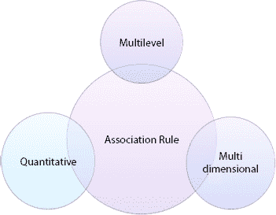

**图 4.5** 关联规则类型。

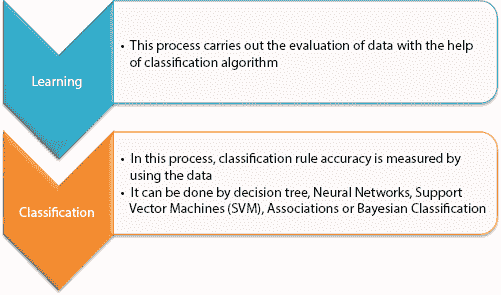

**图 4.6** 分类技术。

## 4.3 DNA 数据分析

DNA、RNA 和蛋白质是生命科学的三个重要要素；它们奠定了所有生物的基础 [23]。大量研究人员正在共同努力解释生命的本质，并且已进行了大量研究来定义结构与其性质之间的相互作用 [24]。对于微生物学家来说，核酸分子序列中编码的信息很重要，因为它不仅将遗传信息从一代传到下一代，而且还影响转录和翻译活性 [25]。如果不收集和处理此类 DNA 序列，就无法进行生命科学起源的研究，这涉及确定 DNA 链中四种氮碱基的确切顺序和比例：腺嘌呤、胸腺嘧啶、鸟嘌呤和胞嘧啶 [26]。

生命科学研究领域最有趣的进展是利用重组 DNA 技术分离大量存在的 DNA 片段并鉴定生物活性物质，这是分子生物学领域最具优势的方面。大型 DNA 分子可使用限制性内切酶以有序的方式分裂成多个小片段 [16]。重组 DNA 技术还有助于限制性片段独立混合物的纯化和分类，最重要的是，进行 DNA 测序至少需要三个步骤：克隆、测序和分析。在 DNA 测序中，主要有两种技术：Maxam-Gilbert 测序（也称为化学测序）和链终止法（也称为 Sanger 测序）。前一种方法将放射性标记应用于 DNA 的 5' 端，并通过化学过程在特定碱基处产生后续断裂 [27, 28]。以反映放射性标记 DNA 片段的暗带形式，自显影技术有助于生成序列或片段链。另一方面，Sanger 机制需要修饰的二脱氧核苷三磷酸 (ddNTPs)。

尽管使用计算机进行数据分析具有明显的优势，但仍然存在弱点（图 4.7）。尽管该领域所谓的科技进步，但它也存在某些缺点，这些缺点已在 图 4.8 中进行了总结。

**图 4.7** DNA 序列数据分析的重要性。

**图 4.8** 下一代测序数据分析的缺点。

## 4.4 RNA 数据分析
当我们谈论 RNA 测序 (RNA-Seq) 时，它主要与细胞的转录组相关。这主要通过虚拟筛选和高通量筛选方法完成 [29]。与之前的 Sanger 测序和基于微阵列的技术相比，它为 RNA 数据提供了良好的分辨率和更大的数据覆盖范围。这些数据对于鉴定新型转录本、鉴定可变剪接基因以及检测等位基因特异性表达非常有用 [30, 31]。该领域最近的进展，如 RNA 工作流程、样本制备文库和数据分析套件，已使科学家能够获得功能性转录本和转录过程 [32]。RNA-Seq 可用于估算不同 RNA 群体，包括完整的 RNA、前体 mRNA 和非编码 RNA，包括某些 microRNA 和长链 ncRNA，除多腺苷酸化信使 RNA (mRNA) 转录本外。高通量方法目前主要使用，具有一些额外的好处，例如对转录组的复杂和动态存在有更深入的了解 [33, 34]。利用如此先进的技术，现在可以阐明不同的生理和病理条件。在新映射技术的帮助下，更长的读长成为现实。由于延长读长可以跨越多个外显子-外显子连接处，随着更长读长中编码的额外信息，对替代异构体的识别和定量可以显著改善。很快，人们将看到在临床诊断方面的相同应用的扩展，如癌症筛查、妊娠甚至个性化医疗 [35, 36]。

## 4.5 蛋白质数据分析
由于技术、仪器、分子生物学和生物信息学的进步，现在可以分析细胞成分的整个单元，如基因组、转录组以及最近的蛋白质组 [37]。随着进步，现在可以监测与分化、凋亡、疾病和其他重要生物学修饰相关的人体组织蛋白质组的变化 [38]。OMICS 技术的蛋白质组学分支主要用于阐明蛋白质结构、其功能、相互作用和翻译后修饰。当我们将这些数据与基因组学进行比较时，它是 100 倍复杂和动态，这导致了蛋白质组学挑战的巨大性和迄今为止非常有限的进展 [39]。蛋白质组学技术的不同方面的发展可以从作者相对广泛的蛋白质组学经验以及其他人的蛋白质组学报告中体现出来。为了增加鉴定和定量蛋白质的总体数量，任何蛋白质谱技术都需要采用多种互补方法。可以采用多种方法来提高不同样本中表达蛋白质定量结果的有效性 [40]。为了增加对由生物学效应引起的定量差异的理解，多方法策略比单一实验方法更受青睐 [41]。

尽管每项研究中报道的鉴定蛋白质数量可能从数百到数千不等，用于谱分析如此多蛋白质所需的时间和材料的重要性也不容忽视 [42]。可以看到两方面的演变，即通过不同模式的质谱分析以及蛋白质组学方法来领先于时代，但仍需要更好的平台化方法来实现同样的目标 [43]。在初始阶段，一个平台可以在其中存放任何仪器上的任何原始数据文件格式并将其转换为用于初步光谱分析的通用文件格式将极具价值。此外，还需要一个良好的报告模块用于数据的统计评估 [44]。这两者的结合必将给我们带来期望的结果。

## 4.6 生物医学数据分析

随着结构生物信息学、分子生物学和生物医学领域药物基因组学研究的进步，产生了前所未有的大量数据。简而言之，生物医学数据可在多种子领域中获得。其主要部分是与基因表达、DNA 序列和蛋白质一级结构相关的数据 \[27\]。除此之外，高通量测序方法和 cDNA 微阵列技术的加入提高了数据生成及其分析的效率。虚拟筛选也是该研究工具箱中的一颗新星。有许多算法可用于处理序列的分支、检查相似性并剔除其中的弱候选者，从 DNA 序列中分离蛋白质编码区与非编码区，预测蛋白质结构及功能，并重建其潜在的进化历史 \[45\]。DNA 序列由四个组分组成，即腺嘌呤（A）、胞嘧啶（C）、鸟嘌呤（G）和胸腺嘧啶（T），它们指定了生命的代码。同样地，谈到蛋白质的一级结构时，它主要来源于 20 种氨基酸。这些氨基酸将被用于 DNA 序列的基因编码。另一方面，基因表达数据将有助于了解细胞在特定条件下的表达谱及其调控 \[46\]。如果建立一个良好的数据库并配备合适的软件，该领域的研究可以加速。

## 4.7 结论与未来展望

生物信息学和 DM 是同一枚硬币的两面。如果我们考虑其中一面，即生物信息学，它拥有海量数据但缺乏在分子水平上组织此类数据的理论，这些空白由硬币的另一面即 DM 填补。然而，生物信息学中的 DM 主要受数据异质性的影响，有时难以获得高质量的输出。不仅如此，数据整合以及执行所需专业知识水平也是令人担忧的问题。它有助于基因的鉴定、转录过程、蛋白质功能阐明、功能基序检测等。除此之外，它对特定疾病的诊断、预后和治疗优化也很有用。它还具有检测相互作用、排序生成的数据库和预测蛋白质亚细胞定位的潜力。如果谈论其未来，那肯定是光明的。迫切需要一种高效的评分算法，能够全面高效地执行所有数据堆积。

## 参考文献

1\. Hayashi, C., 什么是数据科学？基本概念与启发性示例。In: *数据科学、分类及相关方法*。Hayashi, C., Yajima, K., Bock, H.-H., Ohsumi, N., Tanaka, Y., Baba, Y. (eds.)。分类、数据分析与知识组织研究, pp. 40–51, Springer, 日本, 1998.

2\. Grothaus, G.A., Mufti, A., Murali, T., 双聚类的自动布局与可视化。*Algorithms Mol. Biol*., 1, 15, 2006.

3\. Murzin, A.G., Brenner, S.E., Hubbard, T., Chothia, C., SCOP：用于序列和结构研究的蛋白质结构分类数据库。*J. Mol. Biol*., 247, 536–540, 1995.

4\. Greiner, L., *什么是数据分析与数据挖掘？*, [`www.dbta.com/Editorial/Trends-and-Applications/What-is-Data-Analysis-and-Data-Mining-73503.aspx`](http://www.dbta.com/Editorial/Trends-and-Applications/What-is-Data-Analysis-and-Data-Mining-73503.aspx), 2019. Jan 7, 2011.

5\. Hwang, W., Cho, Y.R., Zhang, A., Ramanathan, M., 用于蛋白质-蛋白质相互作用网络的新型功能模块检测算法。*Algorithms Mol. Biol*., 1, 24, 2006.

6\. Fayyad, U., Haussler, D., Stolorz, P., 挖掘科学数据。*Commun. ACM*, 39, 51–57, 1996.

7\. Han, J. and Kamber, M., *数据挖掘：概念与技术*, 2nd Ed., Morgan Kaufmann, 2006.

8\. Mount, D.W., *生物信息学 – 序列与基因组分析*, Cold Spring Harbor Laboratory Press, New York, 2001.

9\. Li, J., Wong, L., Yang, Q., *生物信息学中的数据挖掘*, IEEE Intelligent System, IEEE Computer Society, 2005.

10\. Edwards, D., Hansen, D., Stajich, J.E., DNA 序列数据库。In: *生物信息学*, Edwards, D., Stajich, J., Hansen, D. (eds). Springer, New York, NY, 2009. [`doi.org/10.1007/978-0-387-92738-1\_1`](http://doi.org/10.1007/978-0-387-92738-1_1).

11\. Tang, H. and Kim, S., *生物信息学：挖掘高通量基因组学实验的海量数据，生物数据分析：一种软计算方法*, S. Bandyopadhyay (Ed.), Indian Statistical Institute, India, 2007.

12\. Guillet, F., *数据挖掘中的质量度量*, 1st ed., Springer, Berlin, 2007.

13\. Tramontano, A., *生物信息学导论*, 1st ed., Chapman & Hall/CRC, London, 2007.

14\. Larose, D. and Larose, C., *从数据中发现知识：数据挖掘导论*, 1st ed., Wiley Publication, 2014.

15\. Zhang, Y. and Rajapakse, C.J., *生物信息学中的机器学习*, Wiley, 456, 2008.

16\. Han, and Kamber, *数据挖掘概念与技术*, Morgan Kaufmann Publishers, 2006.

17\. Lever, J., Krzywinski, M., Altman, 模型选择与过拟合。*N. Nat. Methods*, 13, 703–704, 2016.

18\. Lancashire, L.J., Lemetre, C., Ball, G.R., 生物信息学中人工神经网络导论——在癌症研究中复杂微阵列和质谱数据集的应用。*Brief. Bioinform*., 10, 3, 315–29, 2009.

19\. Yang, Q., 数据挖掘与生物信息学：若干挑战, 2012, [`www.cse.ust.hk/~qyang`](http://www.cse.ust.hk/~qyang) (访问日期：2019 年 11 月 25 日).

20\. [`www.educba.com/data-mining-techniques/`](http://www.educba.com/data-mining-techniques/).

21\. Baxevanis, A.D., Petsko, G.A., Stein, L.D., Stormo, G.D. (Eds.), *生物信息学当前协议*, Wiley, 2007.

22\. Hand, D.J., Mannila, H., Smyth, P., *数据挖掘原理*, MIT Press, p. 578, 2001.

23\. Adams, M.D., Kerlavage, A.R., Fleischmann, R.D., Fuldner, R.A., Bult, C.J., Lee, N.H., Kirkness, E.F., Weinstock, K.G., Gocayne, J.D., White, O. *et al*., 基于 8300 万核苷酸 cDNA 序列的人类基因多样性和表达模式的初步评估。*Nature*, 377, 3–174, 1995.

24\. Cristianini, N. and Hahn, M., *计算基因组学导论*, Cambridge University Press, 2006.

25\. Abbott, A., 线虫 C. elegans 基因组序列：研究生物学的平台。The C. elegans Sequencing Consortium. *Science*, 282, 2012–2018, 1998.

26\. Velculescu, V.E., Zhang, L., Vogelstein, B., Kinzler, K.W., 基因表达的序列分析。*Science*, 270, 484–487, 1995.

27\. Abecasis, G.R., Cherny, S.S., Cookson, W.O., Cardon, L.R., Merlin——利用稀疏基因流树对密集遗传图进行快速分析。*Nat. Genet*., 30, 97–101, 2002.

28\. Adams, M.D., Kelley, J.M., Gocayne, J.D., Dubnick, M., Polymeropoulos, M.H., Xiao, H., Merril, C.R., Wu, A., Olde, B., Moreno, R.F. *et al*., 互补 DNA 测序：表达序列标签与人类基因组计划。*Science*, 252, 1651–1656, 1991.

29\. Auer, P.L. and Doerge, R.W., RNA 测序数据的统计设计与分析。*Genetics*, 185, 405–416, 2010.

30\. Battle, A., Mostafavi, S., Zhu, X., Potash, J.B., Weissman, M.M., McCormick, C., Haudenschild, C.D., Beckman, K.B., Shi, J., Mei, R. *et al*., 通过对 922 个个体的 RNA 测序表征转录组多样性的遗传基础。*Genome Res*., 24, 14–24, 2013.

31\. Blencowe, B.J., Ahmad, S., Lee, L.J., 当前一代高通量测序：加深对哺乳动物转录组的认识。*Genes Dev*., 23, 1379–1386, 2009.

32. Brennecke, P., Anders, S., Kim, J.K., Kolodziejczyk, A.A., Zhang, X., Proserpio, V., Baying, B., Benes, V., Teichmann, S.A., Marioni, J.C. *等*., 考虑单细胞 RNA-seq 实验中的技术噪声。 *Nat. Methods*, 10, 1093–1095, 2013.
33. Crick, F., 分子生物学中心法则。 *Nature*, 227, 561–563, 1970.
34. Zeng, W. and Mortazavi, A., 功能测序分析的技术考虑。 *Nat. Immunol*., 13, 802–807, 2012.
35. Wang, Z., Gerstein, M., Snyder, M., RNA-Seq：转录组学的革命性工具。 *Nat. Rev. Genet*., 10, 57–63, 2009.
36. Rudloff, U., Bhanot, U., Gerald, W., Klimstra, D.S., Jarnagin, W.R., Brennan, M.F., Allen, P.J., 人胰腺癌组织生物样本库：*体外*采集时间对 RNA 质量的影响。 *Ann. Surg. Oncol*., 17, 2229–2236, 2010.
37. Wodak, S.J. and Janin, J., 蛋白质-蛋白质相互作用的计算机分析。 *J. Mol. Biol*., 124, 2, 323–42, 1978.
38. Lee, K., 使用全局优化和经验势的蛋白质-蛋白质对接计算研究。 *Int. J. Mol. Sci*., 9, 65–77, 2008.
39. Abbott, A., 后基因组时代的挑战：学习解读蛋白质合成模式。 *Nature*, 402, 715–720, 1999.
40. Aebersold, R., Rist, B., Gygi, S.P., 定量蛋白质组分析：方法与应用。 *Ann. N. Y. Acad. Sci*., 919, 33–47, 2000.
41. Yates, J.R., III, 质谱蛋白质结构分析。 *Methods Enzymol*., 271, 351–377, 1996.
42. Aebersold, R., 蛋白质和蛋白质组研究的质谱之旅。 *J. Am. Soc. Mass. Spectrom*., 14, 685–695, 2003b.
43. Bischoff, R. and Luider, T.M., 蛋白质和肽类疾病标志物发现的方法学进展。 *J. Chromatogr. B Analyt. Technol. Biomed. Life Sci*., 803, 27–40, 2004.
44. MacBeath, G. and Schreiber, S.L., 将蛋白质打印为微阵列用于高通量功能测定。 *Science*, 289, 1760–1763, 2000.
45. Watson, J.D., Hopkins, N.H., Roberts, J.W. *等*., *基因分子生物学*, 4th edn., Benjamin-Cummings, Menlo Park, CA, 1987.
46. Aluru, S. (Ed.), *计算分子生物学手册*, Chapman & Hall/CRC Press, 2006.
1. ^**通讯作者*: Vivek7chavda@gmail.com

# 5
# *计算机模拟* 蛋白质设计与虚拟筛选

**Vivek P. Chavda^(3), Zeel Patel^(1)\*, Yashti Parmar^(2) and Disha Chavda^(4)**

^(*1*)*机电系，Sheridan 工程学院，多伦多，加拿大*
^(*2*)*药理学与药物系，潍坊医学院，山东，中国*
^(*3*)*制剂与开发，Dr. Reddy’s 实验室（生物技术部），海得拉巴，印度*
^(*4*)*分析开发，Orbicular 制药有限公司，海得拉巴，印度*

> ***摘要***
>
> 如果我们回顾过去十年，分子生物学和计算设计领域取得了众多成就，使蛋白质的功能修饰成为现实。到目前为止的旅程非常漫长，并且从基于结构的虚拟筛选（SBVS）开始受到珍视，该筛选在药物发现早期阶段用于寻找诱变实际原因，甚至改善蛋白质纯度和质量。基于对接的虚拟筛选目前使用最广泛，其次是高通量筛选。虚拟筛选基本上是在药物发现早期阶段用于考虑所需蛋白质功能进行序列选择的筛选工具。这些技术进步降低了药物发现的成本，同时在蛋白质设计部分带来了巨大的速度和控制，使人工蛋白质工程进入了进化阶段。用于*计算机模拟*蛋白质设计的软件包已为学术用途而开发。
>
> ***关键词**:* 蛋白质设计，对接，*计算机模拟*，虚拟筛选，高通量筛选

## 5.1 引言

基于蛋白质的药物设计从虚拟筛选（VS）开始，到商业化结束，是一个非常复杂且耗时（10–15 年）的过程；在此期间，它还花费约$1–3 billion。 由于大量蛋白质数据的可用性和学术研究，出现了大量信息，这缩短了蛋白质设计靶点识别的路径 \[1\]。 计算（*计算机模拟*）方法已发展到数据库搜索、活性关系、药效团、同源模型和分子建模变得方便易行的程度。 初始的 VS 要么基于配体，要么基于结构（图 5.1）。

先导化合物鉴定在早期优化阶段至关重要，其中正在探索各种优化工具（图 5.2）。 *计算机模拟*药物发现提供了丰富的机会，有助于优先考虑靶点和化合物以进行*体外*和*体内*验证。 机器人技术正在同步发展，机器学习为基于蛋白质晶体学的评估铺平了道路，该评估有时被称为结构生物信息学 \[2\]。 如今，在发现早期，蛋白质-蛋白质相互作用抑制剂也被纳入考虑。

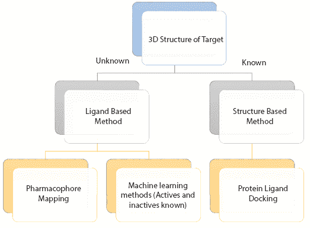
**图 5.1** 虚拟筛选方法。
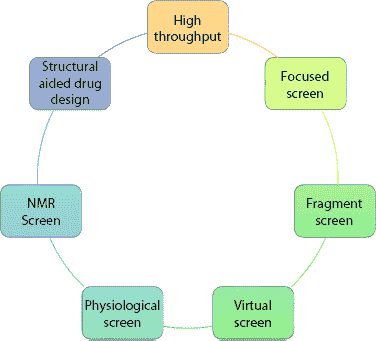
**图 5.2** 筛选策略。

当我们考虑小分子行业时，他们已采用基于化学文库的高通量筛选（HTS）作为识别新先导化合物的一种手段。 尽管 HTS 成本高且耗时，但它是 VS 之后的先导优化过程评估的第二线方法 \[3\]。 利用计算方法的基于结构的药物设计（SBDD）是解决同一目的的另一种选择 \[4\]。 基于结构的药物发现（SBDD）为快速且经济高效的先导发现和优化提供了有吸引力的利基市场（图 5.3） \[5\]。 VS 有不同的方法，如基于结构的 VS（SBVS）、基于配体的 VS 和基于片段的 VS。 将计算方法与蛋白质靶点的三维结构信息相结合，可以轻松揭示配体-蛋白质结合所涉及的潜在分子相互作用，从而以原子水平细节解释实验结果。 基于结构的药物设计包括 VS 但不包括 HTS。 在 VS 中，靶点的筛选是对已有的类药化合物文库进行的 \[6\]。 被发现有前景的化合物将进一步进行实验评估。 当谈到从头药物设计方法时，新分子是利用受体的三维结构进行构建的 \[5\]。

计算机辅助药物发现的命中率高于 HTS \[7–9\]。 当我们具体谈论基于蛋白质的药物设计时，显然不能否认*计算机模拟*方法的作用 \[10–12\]。 X 射线晶体学和核磁共振波谱学在计算药物设计中的应用阐明了靶点与配体的相互作用 \[13, 14\]。 SBVS 已在新药物发现项目中取得坚实成功，其中基于对接的 VS（DBVS）无疑是实践中最广泛应用的一种 \[15, 16\]。

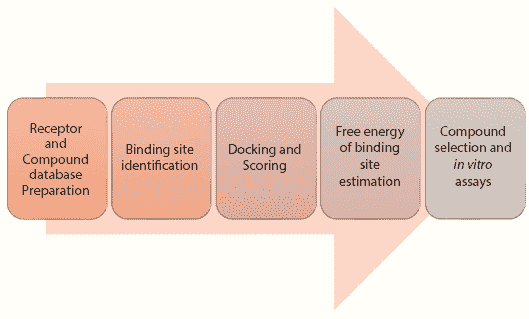
**图 5.3** 基于结构的虚拟筛选工作流程。

## 5.2 虚拟筛选过程

这些是用于筛选新型生物制品以及小分子的节省时间的工具。药物再利用最明显的工具是 `HTS` 及其计算孪生体：`VS`。对于生物活性筛选，这些是必备工具 \[17\]。这些工具的主要目标是从数百万候选物中筛选出感兴趣的化合物 \[18\]。当我们审视这一点时，看起来很简单，但这是一个非常耗时的过程，其中还进行了一些计算筛选以去除一些不需要的反应性候选物（图 5.4）\[19\]。

**图 5.4** 高通量筛选路线图。

“五规则” (`Ro5`) 主要特别适用于小分子合成的情况，其中设计空间由 `ClogP`（辛醇/水分配系数）、分子量、`HDO`（氢键供体数）和 `HAC`（氢键受体数）定义。化学和药物数据库在 `Ro5` 空间中的性质分布已被很好地表征 \[17, 20\]。简而言之，通过 `VS` 可以以无与伦比的成本效益和效率识别真实的高亲和力配体 \[21\]。使用三维或 `SBVS` 的自动化蛋白质对接为尽早将新型蛋白质治疗药物推向现实世界铺平了道路 \[22\]。通过这些工具在特定结合位点上优化分子非常容易。`SBVS` 在后勤上异常高效，节省了大量劳动力和资源。这种机器人筛选的最大优势之一是只需分析选定的蛋白质分子以评估其疗效和结合能力 \[23\]。如今，机器学习与 `VS` 的结合在生物技术行业预测蛋白质结构方面获得了大量发展势头 \[24\]。Song 等人定义了一种集成学习算法“`imDC`”用于预测结合蛋白 \[25\]。Lin *et al*. 定义了一种最先进的策略，通过合并 `K`-means、静态选择策略和集成前向顺序选择来依次对蛋白质折叠进行分类，其准确率为 74.21% \[26\]。

**表 5.1** 筛选模式类型 \[27\].

| **筛选模式** || **每天测试的样本数** || **示例** |
| --- | --- | --- |
| 低通量筛选 || 1–500 || 动物模型，CYP 介导代谢测定与 LC/MS/MS 结合 |
| --- | --- | --- |
| 中通量筛选 || 500–10,000 || 荧光细胞显微成像测定，测定耗氧酶催化活性的测定 |
| 高通量筛选 || 10,000–100,000 || 荧光酶抑制测定，荧光素酶报告基因测定 |
| 超高通量筛选 || ≥100,000 || β-内酰胺酶细胞报告基因测定，5-HT2C 受体编辑定量测定 |

由药物警戒和 `VS` 推动的药物再定位在某种程度上可能为候选物选择提供了正确的路径，同时缩小了临床试验研究组 \[23\]。在计算机辅助药物设计的大旗下，`VS` 因其低成本和节省时间的模块而如今被探索。不同类型的筛选模式在 表 5.1 中有解释。在这里，大多数情况下，`HTS` 与 `VS` 垂直方向结合使用。

### 5.2.1 虚拟筛选之前
在开始在 `VS` 平台上工作之前，收集知识并理解 Reals、Tangibles 和 Virtual 方面的知识非常重要 \[28\]。Virtuals 和 Tangibles 的最大集合由 `ChemNavigator` 数据库表示 \[29\]。`Genedata Biologics®` 是一种首创的工作流系统，可提高生物制品发现过程的效率 \[30\]。清理集合（图 5.5）是在开始实际筛选过程之前必须执行的一项非常繁琐且需要技巧的任务。

### 5.2.2 虚拟筛选的一般流程
`VS` 只是基于计算机的筛选过程，旨在减少考虑蛋白质结合和疗效的筛选分子数量，以便将良好的先导化合物推向现实世界。`VS` 过程的工作流程如 图 5.6 所示。

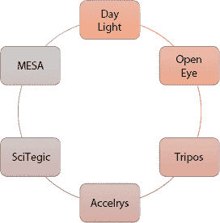

**图 5.5** 用于从集合中清除垃圾的软件。

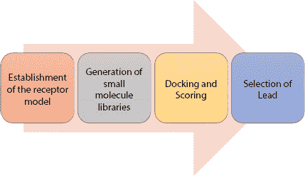

**图 5.6** 虚拟筛选过程的工作流程。

#### 5.2.2.1 步骤 1（受体模型的建立）
获得大分子结构和结合位点描述是建立受体模型的两个最重要因素；这是基于结构的 `VS` 成功与否的关键。典型的 `PDB` 结构文件，如果仔细观察，由重原子、配体、水分子、辅因子、激活剂和蛋白质亚基组成。这里缺少的信息如电荷密度、键级以及拓扑层次。端基酰胺基团和天冬酰胺残基可能排列错误，因为 X 射线结构无法明确区分 O 和 NH2 基团。离子化也是需要与立体因素一起考虑和评估的因素之一。这种结构相关问题可以通过使用软件 \[31, 32\] (`PROPKA`, `H++`, `SPORES`) 确定氨基酸的质子化状态，然后进行基于软件 (`PDB2PQR`) 的氢键优化 \[33\] 来解决。

除上述因素外，在分子对接过程中还应考虑残基封端、金属离子效应、缺失侧链等。此外，需要决定是否将水分子保留在结合位点中或将其移除 \[34\]。在结合位点未知或存在别构调节剂的情况下，解决方案可通过静态方法 (`SiteMap`, `FTMap`, `Fpocket`, `MDpocket`, `QsiteFinder`, `MED-SUMO`, 和 `SiteHound-web`)、动态方法 (`MDMix`, `SILCS`, 和 `MixMD`)、混合方法 (`FTFlex`) 以及基于非均匀溶剂化理论 [`JAWS`, `WaterMap`, `WATMD` (Novartis), `3D-RISM`, 和 `SZMAP`] \[34\] 得到。

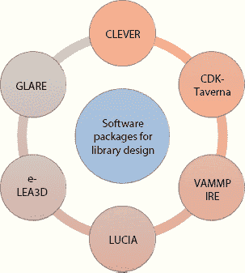

**图 5.7** 用于库设计的软件包。

#### 5.2.2.2 步骤 2（小分子库的生成）
下一个目标是将二维蛋白质结构转换为三维结构，这通常由转换程序完成 \[35\]。获得蛋白质三维结构后，通过添加氢原子和电荷对其进行修改，以便为对接过程做好准备（图 5.7）\[8\]。“`Protein Preparation Wizard`” 用于生成用于 `SBVS` 的多种蛋白质结构库，例如 `WebPDB` \[34, 36\]。

#### 5.2.2.3 步骤 3（分子对接）

分子对接如其名所示主要用于检查靶点与其对应物在结合过程的原子水平相互作用的近岸分子机制 \[37\]。对接是一个两步过程，包括蛋白质构象（其位置和取向）的优化以及结合位点/亲和力。采样方法主要与构象部分相关，而评分与结合相关（图 5.8 和 5.9）。分子的构象属性及其与受体的相互作用可通过对接算法进行评估。对接效率可进一步提高，如果结合位点表征良好且其信息易于获取 \[38\]。作为一种演化路径，对接在早期始于费舍尔的刚性锁钥理论，到“诱导契合”理论，指出蛋白质的活性位点在配体与蛋白质相互作用时不断被配体相互作用重塑 \[39, 40\]。

![图 5.8 结合位点检测程序 \[38, 41–43\].](images/fig5-8.jpg)

**图 5.8** 结合位点检测程序 \[38, 41–43\]。

如今，局部移动蒙特卡洛（`LMMC`）方法被用作柔性受体对接问题的潜在解决方案 \[44\]。评分函数的目的是以快速高效的方式获取高亲和力候选物。评分函数纯粹基于假设，因为没有计算蛋白质与配体之间的结合亲和力（图 5.8 和 5.9）。评分函数可分为基于力场、经验性和基于知识的评分函数 \[45\]。

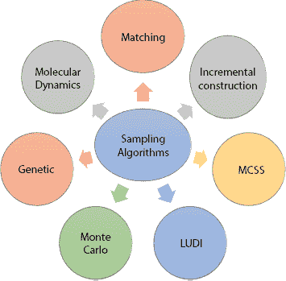

**图 5.9** 分子对接的采样算法。

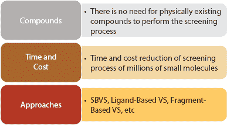

**图 5.10** 虚拟筛选过程相对于 HTS 的优势。

#### 5.2.2.4 Step 4 (先导蛋白化合物的选择)

一旦分子对接完成，下一步就是 *先导蛋白化合物的选择*。这是一项由专业人员进行的对生成数据的严格分析，以判断更合适的候选物并精简研究结果。此分析和后处理的目的是尽可能准确地评估蛋白质-配体结合自由能。生成的复合候选集被分类，误差结果被区分 \[46\]。评分函数对于先导物鉴定至关重要，因为有时评分函数的错误选择将无法提供关于效应器功能和足够构象数据的有力信息。它还可能导致错误的构象选择、关于空间位阻、扭曲酰胺、E/Z 酯、不完美的氢键网络以及基于形状互补性的构象的不合适的配体构想 \[47\]。虚拟筛选的优势总结于 图 5.10。

## 5.3 机器学习与评分函数

机器学习技术是通过评分函数优化和嫁接预测模型的最佳工具。对于评分模式的衍生化，它通常考虑配体-靶点结合相互作用以及溶剂化和熵效应。此外，诸如神经网络（`NNs`）、支持向量机（`SVMs`）和随机森林（`RF`）等机器学习技术能够解释配体-靶点结合所涉及的各种相互作用之间的非线性依赖关系。它是结合亲和力估计的经典技术之一。

*计算机模拟* 人类大脑微观组织的基于 `NN` 的模拟是 Durrant 和 McCammon 的评分函数思想 \[48\]。为了获取与配体-靶点相互作用相关的信息，输入层定义了 194 个神经元。Kinnings *et al*. 使用 `SVM` 进行评分，发现了与 *Mycobacterium tuberculosis* 相关的抑制剂，其中他们直接从 `eHiTS` 的内置评分函数中获得单个能量项 \[49\]。Amini *et al*. 使用归纳逻辑算法和支持向量嫁接了系统特异性评分函数 \[50\]。Tang *et al*. 使用热力学原理设计了 `PHOENIX` 评分函数，将结合自由能（`ΔG`）、焓（`ΔH`）和熵变（`TΔS`）映射为描述符 \[51\]。

Li 和同事开发了靶点特异性评分，而不是使用配体-靶点原子对的发生次数作为几何描述符来生成评分函数 \[52\]。`SVM` 基本上由 135 个氨基酸组成，其（`SVM-SP`）的有效性已在表皮生长因子受体上得到证明，其中产生了三个新颖的命中。Ballester 和 Mitchell 设计了 `RF` 评分，其围绕配体-蛋白质原子配对使用一组描述符进行工作 \[53\]。在所有 16 个可用的评分函数中，`RF` 评分被证明是最好的，尽管它仅考虑原子序数而不考虑距离依赖性 \[54\]。

## 5.4 结论与未来展望

蛋白质分子的发现是一个非常耗时且昂贵的过程。药物发现中最广泛使用的 *计算机模拟* 方法包括对接和用于 VS 的基于配体的方法。在理想世界中，计算预测将为潜在候选物给出正确答案，药物发现因此会更好。不幸的是，情况并非如此，成功概率要低得多；然而，这些方法本身通常比单独的 HTS 更有效，可以作为一种有用的工具来集中实验工作并导致活性物筛选富集。开展药物发现项目的人必须理解这一点；否则，他们就会忽视一种可能强大的创意生成方法。机器学习评分函数对于相互作用和效应器功能优化非常有帮助。仍需对拓扑部分进行更多工作，以及熟练掌握翻译后修饰、侧链优化等。

## 参考文献

1\. Hughes, J.P. *et al*., 早期药物发现的原则。 *Br. J. Pharmacol*., 162, 1239–1249, 2011.

2\. Chandra, N., Anand, P., Yeturu, K., 结构生物信息学：从蛋白质结构中推导出生物学见解。 *Interdiscip. Sci*., 2, 4, 347–66, 2010.

3\. Reddy, A.S., Pati, S.P., Kumar, P.P., Pradeep, H.N., Sastry, G.N., 药物发现中的虚拟筛选 - 计算视角。 *Curr. Protein Pept. Sci*., 8, 4, 329–351, 2007.

4\. Lavecchia, A. and Di Giovanni, C., 药物发现中的虚拟筛选策略：批判性综述。 *Curr. Med. Chem*., 20, 23, 2839–2860, 2013.

5\. Jorgensen, W.L., 计算在药物发现中的多重作用。 *Science*, 303, 5665, 1813–1818, 2004.

6\. Ripphausen, P., Nisius, B., Peltason, L., Bajorath Jr., Quo vadis, 虚拟筛选？前瞻性应用的全面调查。 *J. Med. Chem*., 53, 24, 8461–8467, 2010.

7\. Benod, C., Carlsson, J., Uthayaruban, R., Hwang, P., Irwin, J.J., Doak, A.K., Shoichet, B.K., Sablin, E.P., Fletterick, R.J., 基于结构的核受体 LRH-1 拮抗剂发现。 *J. Biol. Chem*., 288, 27, 19830–19844, 2013.

8\. Cheng, T., Li, Q., Zhou, Z., Wang, Y., Bryant, S.H., 药物发现的结构基于虚拟筛选：以问题为中心的综述。 *AAPS J*., 14, 1, 133–141, 2012.

9\. Clark, D.E., 虚拟筛选为药物发现做了什么？ *Expert Opin. Drug Discovery*, 3, 841–851, 2008.

# 参考文献

10\. Heifetz, A., Barker, O., Verquin, G., Wimmer, N., Meutermans, W., Pal, S., Law, R.J., Whittaker, M., 利用基于糖的文库对抗肥胖：通过一种新的计算-VAST 方法探索 GPCR 结合位点发现新型 MCH-1R 拮抗剂。 *J. Chem. Inf. Model*., 53, 5, 1084–1099, 2013.

11\. chröder, J., Klinger, A., Oellien, F., Marhöfer, R.J., Duszenko, M., Selzer, P.M., 基于对接的共价结合配体虚拟筛选：一种正交先导发现方法。 *J. Med. Chem*., 56, 4, 1478–1490, 2013.

12\. Kolb, P., Rosenbaum, D.M., Irwin, J.J., Fung, J.J., Kobilka, B.K., Shoichet, B.K., 基于结构的β2-肾上腺素受体配体发现。 *Proc. Natl. Acad. Sci. U.S.A*., 106, 16, 6843–6848, 2009.

13\. Villoutreix, B.O., Eudes, R., Miteva, M.A., 基于结构的虚拟配体筛选：近期成功案例。 *Comb. Chem. High Throughput Screen*., 12, 10, 1000–1016, 2009.

14\. Ghosh, S., Nie, A., An, J., Huang, Z., 用于药物发现的化学文库基于结构的虚拟筛选。 *Curr. Opin. Chem. Biol*., 10, 3, 194–202, 2006.

15\. Seifert, M.H.J. and Lang, M., 成功虚拟筛选的关键因素。 *Mini Rev. Med. Chem*., 8, 63–72, 2007.

16\. Tuccinardi, T., 基于对接的虚拟筛选：最新进展。 *Comb. Chem. High Throughput Screen*., 12, 3, 303–314, 2009.

17\. Mestres, J., 虚拟筛选：高通量筛选的真正补充。 *Biochem. Soc. Trans*., 30, 797–799, 2002.

18\. Bologa, C.G., Olah, M.M., Oprea, T.I., 用于化合物获取或虚拟筛选的化学数据库准备, 载于： *分子生物学方法*, R.S. Larson (编), 页 375–384, Humana Press Inc., Totowa, NJ, 2018.

19\. Oprea, T., 先导结构搜索：我们是否在寻找合适的性质？ *J. Comput.-Aided Mol. Des*., 16, 325–334, 2002.

20\. Lipinski, C.A. *等*., 用于药物发现和开发环境中估算溶解度和渗透性的实验和计算方法。 *Adv. Drug Deliv. Rev*., 23, 3–25, 1997.

21\. Hattotuwagama, C.K., Davies, M.N., Flower, D.R., 受体-配体结合位点和虚拟筛选。 *Curr. Med. Chem*., 13, 1283–1304, 2006.

22\. McInnes, C., 药物发现中的虚拟筛选策略。 *Curr. Opin. Chem. Biol*., 11, 494–502, 2007.

23\. Flower, D.R., 药物警戒、药物再利用和虚拟筛选。 *J. Pharmacovigil*., 1, 1, 1–3, 2013.

24\. Bilsland, A.E., Pugliese, A., Liu, Y., 通过使用人工神经网络的衰老靶向虚拟筛选鉴定选择性 G1 期苯并咪唑酮抑制剂。 *Neoplasia*, 17, 9, 704–715, 2015.

25\. Song L, L.D., Zeng, X., Guo, L., nDNA-prot: 基于不平衡分类的 DNA 结合蛋白鉴定。 *BMC Bioinform*., 15, 1, 10, 2014.

26\. Lin, C., Zou, Y., Qin, J., 使用新型集成分类器进行蛋白质折叠的层次分类。 *PLoS One*, 8, 2, e56499, 2013.

27\. Szymański, P., Markowicz, M., Mikiciuk-Olasik, E., 药物发现中高通量筛选的适应——毒理学筛选试验。 *Int. J. Mol. Sci*., 13, 427–452, 2012.

28\. Hann, M.M. and Oprea, T.I., 在药物研究中追求先导相似性概念。 *Curr. Opin. Chem. Biol*., 8, 255–263, 2004.

29\. iResearch^™ Library, ChemNavigator, Inc., (访问日期；2021 年 2 月 20 日) [www.chemnavigator.com/cnc/products/IRL.asp](http://www.chemnavigator.com/cnc/products/IRL.asp).

30\. Genedata Biologics, Transform Biopharma Discovery, (访问日期；2021 年 2 月 20 日), [`www.genedata.com/products/biologics/`](http://www.genedata.com/products/biologics/).

31\. Li, H., Robertson, A.D., Jensen, J.H., 蛋白质 pKa 值的快速经验预测与合理化。 *Proteins*, 61, 4, 704–721, 2005.

32\. Anandakrishnan, R., Aguilar, B., Onufriev, A.V., Onufriev, A.V., H++ 3.0：自动化 pK 预测和生物分子结构准备用于原子分子建模和模拟。 *Nucleic Acids Res*., 40, W537-41–W541, 2012.

33\. Dolinsky, T.J., Czodrowski, P., Li, H., Nielsen, J.E., Jensen, J.H., Klebe, G., Baker, N.A., PDB2PQR：扩展和升级生物分子结构用于分子模拟的自动化准备。 *Nucleic Acids Res*., 35, Web Server issue, W522–5, 2007.

34\. Lionta, E. *等*., 用于药物发现的基于结构的虚拟筛选：原理、应用和最新进展。 *Curr. Top. Med. Chem*., 14, 16, 1923–1938, 2014.

35\. Lavecchia, A. and Di Giovanni, C., 药物发现中的虚拟筛选策略：批判性综述。 *Curr. Med. Chem*., 20, 23, 2839–2860, 2013.

36\. Kovalenko, A., 用于分子液体和固液界面的三维 RISM 理论, 载于：F. Hirata and P.G. Mezey (编), 360, 卷 24, 页 169–275, Kluwer Academic Publishers, Dordrecht, 2003.

37\. McConkey, B.J., Sobolev, V., Edelman, M., 配体-蛋白对接中当前方法的性能。 *Curr. Sci*., 83, 845–855, 2002.

38\. Goodford, P.J., 确定生物重要大分子上能量有利结合位点的计算程序。 *J. Med. Chem*., 28, **7**, 849–857, 1985.

39\. Fischer, E., 构型对酶作用的影响。 *Ber. Dtsch. Chem. Ges*., 27, 2985–2993, 1894.

40\. Koshland, D.E., Jr., 酶作用中结构与功能的相关性。 *Science*, 142, 1533–1541, 1963.

41\. Levitt, D.G. and Banaszak, L.J., POCKET：一种用于识别和显示蛋白质空腔及其周围氨基酸的计算机图形学方法。 *J. Mol. Graphics*, 10, 4, 229–234, 1992.

42\. Glaser, F., Morris, R.J., Najmanovich, R.J., Laskowski, R.A., Thornton, J.M., 一种在蛋白质结构中定位配体结合口袋的方法。 *Proteins*, 62, 2, 479–488, 2006.

43\. Mezei, M., 一种绘制大分子地形的新方法。 *J. Mol. Graph. Model*., 21, 5, 463–472, 2003.

44\. Xuan-Yu, M. *等*., 分子对接：基于结构药物发现的有力方法。 *Curr. Comput. Aided Drug Des*., 7, 2, 146–157, 2011.

45\. Kitchen, D.B., Decornez, H., Furr, J.R., Bajorath, J., 药物发现虚拟筛选中的对接与评分：方法与应用。 *Nat. Rev. Drug Discovery*, 3, 11, 935–949, 2004.

46\. Moitessier, N., Englebienne, P., Lee, D., Lawandi, J., Corbeil, C.R., 迈向通用、快速且高度准确的对接/评分方法的发展：任重道远。 *Br. J. Pharmacol*., 153, Suppl 1, S7–26, 2008.

47\. Athanasiadis, E., Cournia, Z., Spyrou, G., ChemBioServer：用于药物发现中化学化合物过滤、聚类和可视化的基于 Web 的流程。 *Bioinformatics*, 28, 22, 3002–3003, 2012.

48\. Durrant, J.D. and McCammon, J.A., NNScore：一种基于神经网络的蛋白质-配体复合物表征评分函数。 *J. Chem. Inf. Model*., 50, 10, 1865–1871, 2010.

49\. Kinnings, S.L., Liu, N., Tonge, P.J., Jackson, R.M., Xie, L., Bourne, P.E., 一种基于机器学习改进对接评分函数的方法及其在药物再利用中的应用。 *J. Chem. Inf. Model*., 51, 2, 408–419, 2011.

50\. Tang, Y.T. and Marshall, G.R., PHOENIX：利用高分辨率晶体结构和量热测量推导的亲和力预测评分函数。 *J. Chem. Inf. Model*., 51, 2, 214–228, 2011.

51\. Deng, W., Breneman, C., Embrechts, M.J., 利用新型几何描述符和机器学习方法预测蛋白质-配体结合亲和力。 *J. Chem. Inf. Comput. Sci*., 44, 2, 699–703, 2004.

52\. Li, L., Khanna, M., Jo, I., Wang, F., Ashpole, N.M., Hudmon, A. *等*., 基于结构的虚拟筛选中的靶点特异性支持向量机评分：计算验证、激酶的*体外*测试以及对肺癌细胞增殖的影响。 *J. Chem. Inf. Model*., 51, 4, 755–759, 2011.

53\. Ballester, P.J. and Mitchell, J.B.O., 利用分子对接预测蛋白质-配体结合亲和力的机器学习方法。 *生物信息学*, 26, 9, 1169–1175, 2010.

54\. Cheng, T., Li, X., Li, Y., Liu, Z., Wang, R., 对多样化测试集上评分函数的比较评估。 *J. Chem. Inf. Model*., 49, 4, 1079–1093, 2009.

1.  \**通讯作者*: Patelzeel1394@gmail.com
