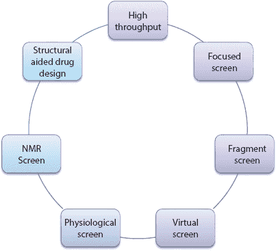
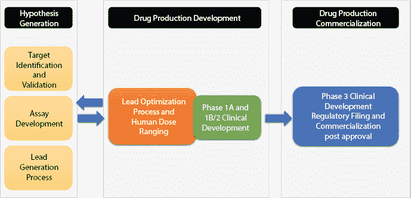
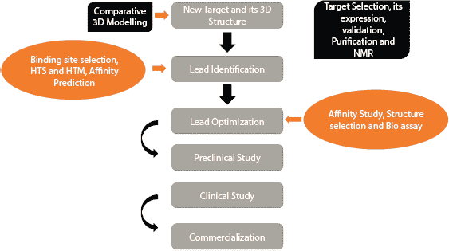
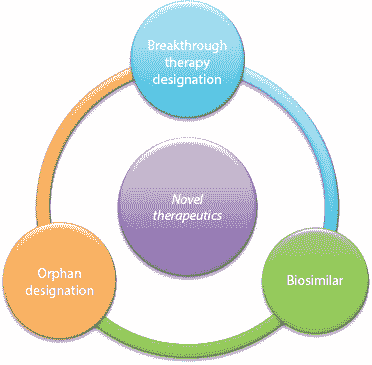
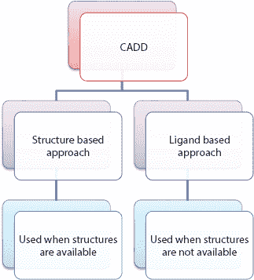
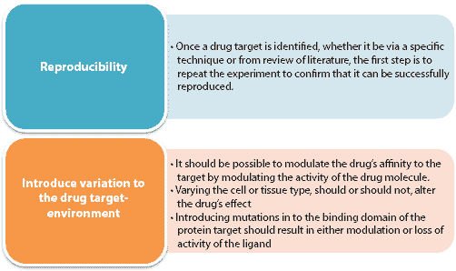
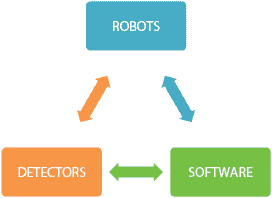
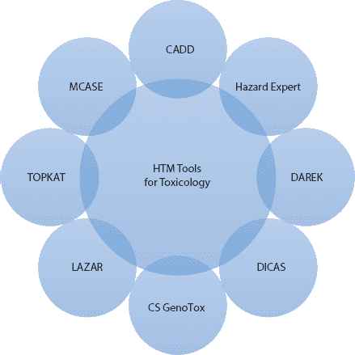

# 6 基于生物信息学平台的药物设计新方法

**Vivek Chavda^(2†), Soham Sheta^(1\*), Divyesh Changani^(3) and Disha Chavda^(4)**

^(*1*)*制剂与开发，Zydus Cadila，艾哈迈达巴德，印度*
^(*2*)*药剂学系，L.M. 学院药学院，艾哈迈达巴德，印度*
^(*3*)*法规事务（生物制品），Mylan Laboratories Ltd.，海得拉巴，印度*
^(*4*)*分析开发，Orbicular Pharmaceutical Ltd.，海得拉巴，印度*

> ***摘要***
> 当前生物制品时代具有充足的增长潜力。超过 1,600 种生物制品正在评估中，其中超过 250 种已获批准药物，还有更多药物处于研发管线中。许多基因组在生物信息学工具的帮助下已被绘制图谱。此类进展推动了转录组和蛋白质工程层面的研究。寻找新的可行蛋白药物的旅程始于靶点/先导化合物的虚拟筛选，对其进行优化并使其具有商业可行性。一种称为理性药物设计的方法现已与计算机辅助药物设计整合在分子对接之下。计算机辅助药物设计也称为 *in silico* 方法，正进一步细分为基于配体和基于结构的筛选。如今，基于配体（药效团）和基于结构（分子对接）的筛选已合并为一个平台，该平台涉及寻找新的靶点发现以获得有希望的先导化合物。本章涵盖了药物设计的当前方法及其在药物发现过程中的相互关系。
>
> ***关键词***: 平台化方法, 基因, 先导化合物, 计算机辅助药物发现

## 6.1 引言

1982 年美国 FDA（美国食品药品监督管理局）批准礼来公司的 Humulin^®（胰岛素）作为首个重组治疗蛋白，是生物技术的一个里程碑 \[1\]。之后，生物药物开发取得了许多里程碑。由于未满足的医疗需求，此后发现了许多复杂的生物制品。列举如下，产品从早期的传统替代蛋白（胰岛素）到较近期的复杂结构抗体（用于炎症性疾病的阿达木单抗和英夫利昔单抗）、寡核苷酸、融合蛋白（依那西普和英夫利昔单抗）以及基因构建体 \[2\]。尽管存在开发、科学和技术挑战，许多生物制品仍被推出 \[3, 4\]。治疗蛋白的开发是一项艰难的任务，因为可能产生抗药抗体（ADAs） \[5\]。有时，针对靶蛋白的中和抗体可能会改变其药代动力学 \[6\]。此外，ADAs 的产生倾向于中和内源性蛋白，从而可能导致内源性物质缺乏，对患者有害 \[7\]。在重组激素（促红细胞生成素和血小板生成素）治疗中观察到这种情况，其中 ADAs 中和了患者体内产生的蛋白。需要现代化的治疗方法和先进的蛋白质工程技术来防止对治疗蛋白产生抗体，这提高了许多患者的疗效并导致更好的治疗依从性 \[8\]。在过去 30 至 40 年中，开发靶向蛋白治疗的需求不断增加，从而推动了单克隆抗体（mAbs）的发展，尤其用于癌症和免疫性疾病，例如乳腺癌药物曲妥珠单抗（赫赛汀） \[9\]。mAbs 主要用作诊断药物，作为生化及分子生物学中的实验室工具。战略思维发生了转变，由于对生物制品认识的不断增加、其独特特征带来的益处（例如高特异性、无固有变异性、批间差异低、半衰期长和安全性）以及生产和纯化方面的先进技术 \[10\]。临床领域的科研正为提高人民健康水平而不懈努力。癌症、免疫性疾病、肝炎和 HIV 等慢性疾病呈快速增长趋势，导致高发病率和死亡率 \[11, 12\]。生物信息学工具和蛋白质工程技术是药物开发项目的关键要素。为确认治疗疗效并检查药代动力学特征，需进行临床试验。这是一个复杂且资本密集的过程，需要制药行业投入巨额资金 \[13\]。它始于潜在药物候选物的识别，对该候选物进行安全性、疗效、选择性和稳定性优化（图 6.1） \[14\]。随后是三个阶段，即临床前研究、临床研究，最后但并非最不重要的上市后监测。生物信息学工具在药物发现、药物开发和临床开发中占有重要地位。生物信息学是一个交叉学科，开发并使用方法和计算机软件来理解生物数据 \[15\]。它结合生物学、信息技术、计算机科学、统计学和数学来解读生物数据。它利用信息学来理解健康与疾病，并有助于获得有关健康与疾病的新知识 \[16\]。
它使临床试验期间的数据管理更加容易。此外，临床研究中尖端技术如分子对接、蛋白质组学和定量构效关系（QSAR）使得流程更加迅速和简便。EasyTrial、CloudLIMS、MakroCare、EdeTek 和 CTMS 等软件用于临床试验的顺利开展。电子数据采集（EDC）是数字化保存临床数据的方式之一。EDC 取代了传统的基于文件的采集方法，以简化患者数据并使药物/器械更快上市。电子病例报告表（eCRF，例如 Ennov eCRF）在临床试验数据管理中也发挥了主要作用。它汇集并整理来自电子和纸质平台的各种数据，并以非常轻松的方式允许研究患者数据。Siebel CTMS 等软件用于临床数据管理和数据的统计分析 \[17, 18\]。在药物上市后，药物开发过程的一个重要组成部分，药物的安全性可通过 EasySafteyTM、Lifesafety^® 等药物安全软件进行监测。本章后面，读者将对计算生物学和生物信息学在药物发现与开发、成品制剂设计和临床研究中的多因素应用有深入了解。

**图 6.1** 药物发现过程中靶点的筛选策略。

## 6.2 基于平台的方法与监管视角

不可阻挡的进展已在生物技术和医学领域发生，其旅程仍在新型发展路径上继续（图 6.2）。但同时，要求所开发的此类新型产品对患者而言应安全、有效且经济。监管机构应确保并评估先前提及的此类益处 \[19\]。美国 FDA 提出了许多加速药物审评项目，如快速通道认定、加速批准、优先审评认定以及突破性疗法认定（BTD）。对于快速通道认定，药物应显示其疗效以满足未满足的医疗需求，且其适应症应为严重疾病 \[20\]。对于加速批准，药物应用于严重疾病；其应比传统疗法具有更多优势并应具有有益效果。

除非且直到该药物在安全性、治疗、预防或疾病诊断方面有增加的证据，否则该药物将被考虑优先审评。食品药品管理局安全与创新法案（FDASIA）于 2012 年出台。FDASIA 为 FDA 提供了名为 BTD 的新颖且动态的工具。候选选择过程基于结果，该结果必须对患有严重或慢性疾病（如癌症和免疫性疾病）的患者相比传统疗法有显著改善 \[21\]。

BTD 项目已导致先进医学的更快创新和审评。治疗性蛋白的制造和生产需要最先进的设施，因为其过程高度复杂。例如，典型的蛋白药物制造包括培养物开发、发酵、蛋白质的提取或回收、浓缩和纯化、最终制剂、干燥和包装 \[22–25\]。由于其结构非常复杂且精细，关键工艺步骤的数量比小分子更高。蛋白治疗的例子包括抗体-药物偶联物、血液凝血因子、Fc 融合蛋白、干扰素、酶和白细胞介素 \[26\]。目前有多种生物技术被用于增加先进治疗性蛋白药物的半衰期、选择性和功能性，以及提高其大规模可行性以使其具有商业可行性 \[26, 27\]。例如，包括 Fc 融合、白蛋白融合和 PEGylation 在内的蛋白修饰方法的缀合目前被用于延长药物的半衰期，这对于接受因子或激素替代疗法的患者尤其重要，以提高患者依从性 \[28–31\]。对于药物靶向，新型方法是抗体-药物偶联物，从而限制细胞毒性药物的不良反应。考虑到当前市场情况，基于平台的方法是生物制品药物发现的高度有效实践（图 6.3）。

**图 6.2** 药物发现过程概述。

通过蛋白工程对蛋白质进行功能修饰可以利用蛋白质的特定功能。例如，通过工程策略改变蛋白质的糖基化模式可能会导致蛋白质配体结合特性、功能以及产生的相应治疗效果的改变（图 6.4）\[32, 33\]。

未来，蛋白工程将被深刻地重新塑造，这将催生出许多具有不断变化的世代的蛋白疗法。

**图 6.3** 基于平台的药物开发过程。

**图 6.4** 新型生物治疗药物开发途径。

同时，它增加了对免疫原性风险评估和缓解的新技术的需求 \[34, 35\]。蛋白工程在初级序列之外考虑密码子优化、构象优化和侧链修饰，以改善蛋白质合成并增加蛋白质产量 \[36–38\]。

最后，先进的计算和实验方法在蛋白工程方面的集合以及易于获得的平台技术为开发更安全、更有效且更符合患者依从性的蛋白疗法提供了新的机会 \[26\]。

## 6.3 生物信息学工具与计算机辅助药物设计

计算机辅助药物设计（CADD）是通过计算机模拟发现辅助的计算机建模。它是使用计算电子学以理性、清晰的方式进行药物设计的方法之一。有两种类型的设计，即 1) 基于结构的和 2) 基于配体的药物设计（图 6.5）。基于结构的药物设计通常用于利用分子对接开发新型生物制品，而小分子通常使用基于配体的方法设计。

**图 6.5** CADD 的分支。

CADD 的主要核心是通过减少资本支出获得合适的分子。它包括以下内容 \[39\]：

1.  1) 用于药物靶点鉴定和验证的系统化方法的应用。
2.  2) 效应功能评估。
3.  3) 用于获得更好产量的密码子优化。
4.  4) 生成关于配体和靶点（如受体）的新生化信息数据库，以识别和优化偶然的药物制剂。
5.  5) 制作新的软件和工具以建立药物的 ADME（吸收、分布、代谢和排泄）特性。
6.  6) 用于检测进入的疗效较低的药物候选物的方法，这些候选物更可能在临床研究阶段失败。

除了减少资本支出和时间外，使用 CADD 还有许多原因 \[40\]。许多分子在开发的初始阶段甚至在临床试验期间失败。为了筛选初始分子，开发了计算方法（*in silico*）\[41\]。

已开发出多种软件用于蛋白质结构和功能的表征，以识别相互作用的化合物和活性位点残基并研究蛋白质-化合物相互作用，这最终可能导致新药的鉴定 \[42\]。3D 蛋白质结构可使用同源建模预测，而分子对接则用于预测蛋白质相互作用。对接蛋白的首选取向是整体能量最小的取向。CADD 为各种疾病潜在药物的鉴定提供了有吸引力的利基 \[43\]。

## 6.4 靶点鉴定

鉴定精确的药物受体或靶点是药物发现过程的重要组成部分 \[44, 45\]。它包括获得生化知识以及特定疾病或病症的知识，如靶点的氨基酸序列鉴定、表达和代谢物 \[46\]。靶点鉴定过程基本上旨在鉴定受体的结合靶点以成为有力的生物制品（图 6.6）。只有在特定疾病的特定药物靶点或受体被发现并理解后，药物开发过程才会进展。在生物技术和信息技术工具的帮助下，现在可以在较短的时间内并以较少的支出找到针对广泛靶点的潜在生物制品 \[47\]。

![图 6.6 有前景的药物靶点的特性 \[48\]。](images/fig6-6.jpg)

**图 6.6** 有前景的药物靶点的特性 \[48\]。

在当前生物治疗靶点识别的设置中，有许多数据分析工具可供使用，这些工具将加快流程。对于已鉴定分子的代谢谱鉴定，使用 HMDB（人类代谢组数据库），该数据库可精确提供人类代谢组数据，而对于蛋白质结构预测，则探索 PDB（蛋白质数据银行）并发现其高效。除此之外，通路分析、KEGG（基因与基因组百科全书）、Gene Ontology、PantherDB、Reactome 和 Biocarta 是热门选择。还有像 PharmGKB 用于药理基因组学数据、Protein Atlas 用于蛋白质表达信息、CTD（比较毒理基因组学数据库）和 T3DB（靶点-毒素数据库）用于毒性数据库，以及 ChEMBL 和 Pubchem 用于化学基因组学数据的数据库和软件被广泛使用 \[39\]。

## 6.5 靶点验证

生物技术和信息技术越来越多地被用于通过使用各种计算机工程工具从数据库和实验数据集中获取的信息提供功能性智能来支持靶点验证 \[39\]。当来自广泛范围的数据库和实验数据集的信息被结合时，这些方法的预测能力达到顶峰 \[49\]。本章的目的是突出并讨论该快速增长领域中可用的关键方法，以帮助选择合适的生物信息学工具和数据库 \[50\]。靶点验证是一个资本需求大且成本高昂的过程。数据过滤和统计的使用将简化细胞水平的靶点验证过程 \[51\]。另一方面，当存在 80–100 个感兴趣的随机网络时，像 Cytoscape2.6.3 这样的网络插件将有助于网络验证。网络验证也是药物发现过程中的关键要素之一。RNAi 和 CRISPR-Cas9 是基因组验证方法的例子，这对于鉴定基因功能和/或基因调控网络很有用 \[52\]。数据是该过程的血液；它可能是免费的，有时也是付费的。某些医疗记录和临床试验数据将有助于确定药物给药后的个体间变异性（图 6.7）。有一些靶点的疾病病理学作用尚不清楚，可以针对其设计有效的治疗替代方案 \[51, 53, 54\]。

**图 6.7** 靶点验证步骤。

候选分子的作用和作用方式以及其如何治愈潜在疾病可以通过生物信息学工具的使用轻松解码。这将使靶点验证过程更具说服力且快速。将密集的生化、遗传和动物研究整合到生物信息学中将作为药物设计和药物发现过程的助推工具 \[55\]。有像靶点相互作用、意义逆转和蛋白质组学方法这样的方法，利用小干扰 RNA（siRNAs）和 *in vivo* 验证，主要用于靶点验证。

## 6.6 先导物识别与优化

一旦特定蛋白质靶点被鉴定并验证，然后它必须通过先导物识别过程，在该过程中对其生物学和药理学活性以及效应功能进行评估。高通量筛选（HTS）使用尖端技术来识别先导分子，是当前药物发现的实践 \[56\]。超高通量筛选（UHTS）每天可筛选多达 100,000 个实验 \[57–59\]。Tag-lite^® 技术可用于研究基于细胞的结合实验，利用该技术可评估均相和非放射性配体结合 \[60, 61\]。除此之外，名为 IntelliCyt^® HTFC 筛选的系统具有相同的特点。可使用非粘附细胞或珠粒以 96 或 384 孔格式进行高产流式细胞术。该技术响应性高、范围广，允许使用少量细胞或珠粒 \[62\]。样品可通过 Bravo 液体处理仪（Agilent）或 Multitrap^™（GE Healthcare）进行纯化，但目前成本较高 \[63\]。随着药物和靶点的复杂性增加，标签-free 技术可能在常规标记技术中发挥支持作用。各种无标记技术的列表包括来自 Roche 的 xCELLigence（它使用精密设计的微升板，板中含有金微电极，可通过电导抗读数无创监测培养细胞的活力。）和基于 Corning Epic^® 系统的光波导技术的来自 Perkin Elmer 的 Enspire^® \[63–65\]。此类技术用于生物制品筛选的适用性应得到检验，需要时间和评估。对于新一代单克隆抗体的评估，亲和力是候选选择该类单克隆抗体所需标准。传统上，使用如 BiaCore（基于表面等离子体共振）等技术可测量相对较小的抗体候选物组（<10）。然而，最先进的高通量技术 Octet RED System（ForteBio）的引入导致了大量基于亲和力的抗体筛选 \[66, 67\]。在对药物候选物的疗效、选择性和效力进行优化后，下一步是检查其药代动力学特性 \[68\]。如果分子在毒性和致突变性方面是安全的，那么它就成为先导分子的优先选择 \[69\]。分析技术的组合用于化合物的结构解析，即 FIA/DI-MS、MALDI-FT-MS、DI-NMR、HPLC-UV/MS、HPLC-NMR、SFC-MS 和 ESI-FT-ICR-MS。MolMind 结合 *in silico* 和实验室方法。在该平台中，遗传算法有助于指导机器人合成系统。此外，化学和生物筛选用于获得具有所需药代动力学和药效学特性的分子 \[70\]。

## 6.7 高通量方法（HTM）

新的高通量技术为新靶点的生成、选择和优化提供了福音 \[71\]。随着人工智能和机器人系统的发展（图 6.8），现在每天可以处理“n”数量的化合物（大约每天 100,000 个化合物）。组学分支如基因组学、转录组学、蛋白质组学和代谢组学已与高通量靶点验证方法一起应用，以获得潜在的蛋白质候选物 \[72\]。存在潜在生物靶点的库，其中潜在生物制品分子的库通过自动化筛选过程、使用大数据分析和有限体积生物测定进行评估 \[73\]。

**图 6.8** 高通量方法（HTM）的分支。

药物靶点（基因）验证通常通过蛋白质组学分析、转基因敲除、基于 siRNA 的方法、反义技术和适配体阐明，然后与 HTS 关联，其中 HTM 如 NMR、DNA 微阵列和 DNA 芯片 LC/MS 被应用于进一步评估 \[74, 75\]。实时逆转录聚合酶链反应（RT-PCR）和 cDNA 微阵列等技术的使用为生物系统的研究开创了新时代。用于靶点鉴定的技术有荧光共振能量转移（FRET）和均相时间分辨荧光（HTRF） \[76\]。有各种 *in silico* 模型可用于药物候选物的毒理学评估（图 6.9） \[77\]。

此外，一种更灵敏的初级 HTS 方法，能够筛选粗制样品，是非常理想的。在初始筛选过程中，所使用的蛋白库并非纯化的成分，而是包括细菌裂解物或提取物，或杂交瘤上清液。细菌制剂和杂交瘤上清液中的成分会干扰 HTS 性能，导致灵敏度和准确性下降 \[78\]。有些情况下需要纯化的抗体进行生物分析评价，尤其是细胞-based 测定，这会导致药物发现过程延迟或受阻。IgG 重格式化，即基本是将噬菌体展示的抗体片段重格式化为全长 IgG，被用于解决相同目的 \[79\]。

**图 6.9** 用于毒理学评价的 HTM 工具。

## 6.8 结论与未来展望

在过去三十多年里，药物发现和开发的重点已逐渐从小分子、结构明确的化学分子转向大分子、复杂的分子实体——治疗性生物制品 \[79\]。生物制品领域本质上是无止境的。2019 年畅销的十大分子中，有 8 个是生物制品；这意味着在临床上它已证明了其潜力。越来越多的制药企业开始从事生物制品及其对应物生物类似药的开发。分子工程领域在过去十年中注意到了一项革命性趋势，从 HTS 到利用分子对接的虚拟筛选。由于这些制剂本质上更复杂且动态，非临床安全性评价是必须且具有挑战性的，常常出现意外的安全问题，这需要付出大量努力来理解和监测。生物治疗现在在对抗癌症、糖尿病和自身免疫性疾病方面发挥着日益重要的作用。细胞和基因治疗产品的近期进入为生物制品打开了大门，使其能够涉足遗传性疾病、再生治疗和个体化医学等复杂领域 \[80, 81\]。在未来，新型生物治疗将继续通过满足严重疾病的医疗需求来改善我们的生活质量。由于分子对接的可用性，靶点的筛选现在变得容易了。在这些领域仍有许多工作要做，尤其是翻译后修饰、构象稳定性和侧链设计的预测 \[80\]。人们普遍认为，更好的疾病靶点对于开发更有效的疗法、提高研发效率、提升成功率和降低成本至关重要 \[82\]。推动药物发现的另一种方法依赖于开发更灵敏、更准确的测定方法，以简化并加快该过程。此外，一种能够对制剂进行指纹分析的更灵敏的初级高通量筛选 (HTS) 是非常理想的。靶向胞内分子一直是生物制品的长期挑战 \[78\]。当我们考虑此类生物制品的治疗困难时，就会出现两个因素：高分子量和高结构复杂性。这会阻碍它们与细胞靶点的相互作用，因为它们无法穿过细胞膜，有时也无法进行胞内蛋白-蛋白相互作用 (PPIs)。我们希望下一代生物制品能够克服此类缺陷 \[83\]。另一个未来挑战是靶向中枢神经系统 (CNS) 和血脑屏障 (BBB)。最后，抗体-药物偶联物及其相关对象领域由于多种技术趋势而成为一个利基治疗领域。

## 参考文献

1\. Andrews, L. *et al*., 生物药物开发的快照：挑战与机遇. *Hum. Exp. Toxicol*., 34, 12, 1279–1285, 2015.

2\. Morrow, T., 界定差异：是什么使生物制品独一无二. *Biotechnol. Healthc*., 1, 4, 28–29, 2004.

3\. Alshekhlee, A., Basiri, K., Miles, J.D., Ahmad, S.A., Katirji, B., 与肿瘤坏死因子-α拮抗剂相关的慢性炎症性脱髓鞘性多神经病变. *Muscle Nerve*, 41, 723–727, 2010.

4\. Antony, G.K. and Dudek, A.Z., 癌症治疗中的白细胞介素 2. *Curr. Med. Chem*., 17, 3297–3302, 2010.

5\. Hwang, W.Y.K. and Foote, J., 工程化抗体的免疫原性. *Methods*, 36, 3–10, 2005.

6\. Vultaggio, A., Nencini, F., Pratesi, S., Petroni, G., Maggi, E., Matucci, A., 抗药抗体反应的表现：超敏反应和输注反应. *J. Interf. Cytok. Res*., 34, 12, 946–952, 2014.

7\. Radstake, T., Svenson, M., Eijsbouts, A.M., van den Hoogen, F.H.J., Enevold, C., van Riel, P.L.C.M., Bendtzen, K., 类风湿关节炎中抗英夫利昔单抗和阿达木单抗抗体的形成与功能性药物水平和临床反应高度相关. *Ann. Rheumatol. Dis*., 68, 11, 1739–1745, 2009.

8\. Tovey, M.G., 生物制药使用相关的免疫原性及其他问题. *Ther. Adv. Drug Saf*., 2, 3, 113–128, 2011.

9\. Wolbink, G.J., Aarden, L.A., Dijkmans, B., 处理生物制品的免疫原性：评估和临床相关性. *Curr. Opin. Rheumatol*., 21, 3, 211–215, 2009.

10\. Alkhalfioui, F., Magnin, T., Wagner, R., 从纯化的 GPCR 到药物发现：基于蛋白质的方法学的潜力. *Curr. Opin. Pharmacol*., 9, 629–635, 2009.

11\. Alqahtani, S., Mohamed, L.A., Kaddoumi, A., 预测药物吸收和代谢的实验模型. *Expert Opin. Drug Metab. Toxicol*., 9, 1241–1254, 2013.

12\. Lee, K., Silva, E.A., Mooney, D.J., 基于生长因子递送的组织工程：一般方法及最新进展综述. *J. R. Soc. Interface*, 8, 153–170, 2011.

13\. Dawson, J.I. and Oreffo, R.O., 弥合再生鸿沟：骨组织工程中的干细胞、生物材料和临床转化. *Arch. Biochem. Biophys*., 473, 124–131, 2008.

14\. teenholdt, C., Bendtzen, K., Brynskov, J., Thomsen, O.E., Ainsworth, M.A., 克罗恩病中优化英夫利昔单抗治疗失败时通过不同测定法测量药物和抗药抗体临床意义：随机对照试验的术后分析. *Am. J. Gastroenterol*., 109, 7, 1055–1064, 2014.

15\. Gill, S.K. *et al*., 生物信息学工具和软件在临床研究发展中的新兴作用. *Perspect. Clin. Res*., 7, 3, 115–122, 2016.

16\. Mohs, R.C. and Greigb, N.G., 药物发现与开发：基础生物学研究的作用. *Alzheimers Dement.: Trans. Res. & Clin. Interventions*, 3, 4, 651–657, 2017.

17\. US FDA, *用于临床研究的计算机化系统行业指南*, U.S. Department of Health and Human Services Food and Drug Administration Office of the Commissioner (OC), May 2007. 可从以下获取：[`www.fda.gov/media/70970/download`](http://www.fda.gov/media/70970/download). 于 2021 年 5 月 5 日访问.

18\. Shah, J. *et al*., 骨科手术中注册和临床试验的电子数据采集：开源系统与商业系统. *Clin. Orthop. Relat. Res*.^®, 468, 10, 2664–2671, 2010.

19\. U.S. Department of Health & Human Services, Food and Drug Administration, *常见问题：突破性疗法*, U.S. Food and Drug Administration, April 2nd 2021.

20\. Kepplinger, E.E., 新药产品的 FDA 加速批准机制. *Biotechnol. Law Rep*., 34, 1, 15–37, 2015.

21\. Food and Drug Administration, *突破性疗法*, U.S. Food and Drug Administration, April 1st 2018. 可从以下获取：[`www.fda.gov/patients/fast-track-breakthrough-therapy-accelerated-approval-priorityreview/breakthrough-therapy`](http://www.fda.gov/patients/fast-track-breakthrough-therapy-accelerated-approval-priorityreview/breakthrough-therapy). 于 2021 年 5 月 5 日访问.

# 参考文献

22\. Bandaranayake, A.D. and Almo, S.C., 哺乳动物蛋白生产的最新进展。 *FEBS Lett*., 588, 2, 253–260, 2014.

23\. Butler, M. and Meneses-Acosta, A., 哺乳动物细胞生物制药生产支持技术的最新进展。 *Appl. Microbiol. Biotechnol*., 96, 4, 885–894, 2012.

24\. Zhu, J., 用于生物制药生产的哺乳动物细胞蛋白表达。 *Biotechnol. Adv*., 30, 5, 1158–1170, 2012.

25\. Cipriano, D., Burnham, M., Hughes, J.V., 用于治疗蛋白病毒清除的各种加工步骤的有效性：常用步骤的数据库分析。 *Methods Mol. Biol*., 899, 277–292, 2012.

26\. Sauna, Z.E., Alexaki, A., Katagiri, N.H., (治疗蛋白)药物开发的最新进展。版本 1。 *F1000Res*., 6, 113, 2017.

27\. Turecek, P.L., Bossard, M.J., Schoetens, F. *et al*., 生物制药的 PEG 化：已批准药物的化学和非临床安全信息的综述。 *J. Pharm. Sci*., 105, 2, 460–475, 2016.

28\. Casi, G. and Neri, D., 抗体-药物偶联物：基本概念、示例和未来展望。 *J. Control. Release*, 161, 2, 422–428. 10, 2012.

29\. Levin, D., Golding, B., Strome, S.E. *et al*., Fc 融合作为平台技术：调节免疫原性的潜力。 *Trends Biotechnol*., 33, 1, 27–34, 2015.

30\. Rath, T., Baker, K., Dumont, J.A. *et al*., Fc 融合蛋白和 FcRn：更持久、更有效的治疗剂的结构见解。 *Crit. Rev. Biotechnol*., 35, 2, 235–254, 2015.

31\. Andersen, J.T., Pehrson, R., Tolmachev, V. *et al*., 通过使用最小白蛋白结合结构域间接靶向新生儿 Fc 受体(FcRn)延长半衰期。 *J. Biol. Chem*., 286, 7, 5234–5241, 2011.

32\. Jefferis, R., 糖基化作为改善抗体类治疗剂的策略。 *Nat. Rev. Drug Discovery*, 8, 8, 226–234, 2009.

33\. Costa, A.R., Rodrigues, M.E., Henriques, M. *et al*., 糖基化：治疗蛋白生产过程中的影响、控制和改进。 *Crit. Rev. Biotechnol*., 34, 4, 281–299, 2014.

34\. Shankar, G., Pendley, C., Stein, K.E., 针对生物药物抗体免疫反应的风险为基础的生物分析策略。 *Nat. Biotechnol*., 25, 5, 555–561, 2007.

35\. Yin, L., Chen, X., Vicini, P. *et al*., 治疗蛋白产品免疫原性的治疗结果、评估、风险因素和缓解措施。 *Cell. Immunol*., 295, 2, 118–126, 2015.

36\. Maertens, B., Spriestersbach, A., von Groll, U. *et al*., 基因优化机制：多基因研究显示在大肠杆菌中表达全长人蛋白的高成功率。 *Protein Sci*., 19, 7, 1312–1326, 2010.

37\. Mauro, V.P. and Chappell, S.A., 人类治疗剂中密码子优化的批判性分析。 *Trends Mol. Med*., 20, 11, 604–613, 2014.

38\. Sauna, Z.E. and Kimchi-Sarfaty, C., 理解同义突变对人类疾病的贡献。 *Nat. Rev. Genet*., 12, 10, 683–691, 2011.

39\. Kumar, A. and Chordia, N., 药物发现中的生物信息学。 *SciFed J. Protein Sci*., 12, 1, 116, 2017.

40\. Terstappen, G.C. and Reggiani, A., 药物发现中的计算机模拟研究。 *Trends Pharmacol. Sci*., 22, 23–26, 2001.

41\. Vu, L.A., Quyen, P.T.A., Huong, N.T., 计算机辅助药物设计：先导药物发现的前景。 *IJESI*, 4, 60–70, 2015.

42\. Schneider, G. and Fechner, U., 基于计算机的类药分子从头设计。 *Nat. Rev. Drug Discovery*, 4, 649–663, 2005.

43\. Gore, M. and Desai, N.S., 计算机辅助药物设计。 *Methods Mol. Biol*., 1168, 313–321, 2014.

44\. Arfken, G., *物理学家的数学方法*, 3rd, pp. 428–436, Academic Press, Orlando, 1985.

45\. Yu, W., Lakkaraju, S., Raman, E.P., MacKerell, A., Jr, 受配体竞争性饱和(SILCS)辅助的药效团建模。 *J. Comput. Aided Mol. Des*., 28, 491–507, 2014.

46\. Schneider, G. and Fechner, U., 基于计算机的类药分子从头设计。 *Nat. Rev. Drug Discovery*, 4, 649–663, 2005.

47\. Yu, W., Guvench, O., MacKerell, A.D., 蛋白质-蛋白质相互作用抑制剂设计的计算方法, in: *理解和利用蛋白质-蛋白质相互作用作为药物靶点*, G. Zinzalla (Ed.), pp. 99–102, Future Science Ltd, London, UK, 2013.

48\. Gashaw, I., Ellinghaus, P., Sommer, A., Asadullah, K., 什么造就一个好的药物靶点？ *Drug Discovery Today*, 17, S24–S30, 2012.

49\. Wermuth, C., Aldous, D., Raboisson, P., Rognan, D., *药物化学实践*, 4th ed., Elsevier ltd, pp. 45–70, 2015.

50\. Lindsay, M.A., 靶点发现。 *Nat. Rev. Drug Discovery*, 2, 831–838, 2003.

51\. Croston, G., 基于靶点的发现的效用。 *Expert Opin. Drug Discovery*, 12, 5, 427–429, 2017.

52\. Jain, K., 靶点验证中的 RNAi 和 siRNA。 *Drug Discovery Today*, 9, 7, 307–309, 2004.

53\. Moffat, J., Vincent, F., Lee, J., Eder, J., Prunotto, M., 表型药物发现的机会与挑战：行业视角。 *Nat. Rev. Drug Discovery*, 16, 8, 531–543, 2017.

54\. Gashaw, I., Ellinghaus, P., Sommer, A., Asadullah, K., 什么造就一个好的药物靶点？ *Drug Discovery Today*, 17, S24–S30, 2012.

55\. Blake, R.A., 药物发现中的靶点验证。 *Methods Mol. Biol*., 356, 367–77, 2007.

56\. Vedani, A., Dobler, M., Lill, M.A., 计算机预测药物毒性的挑战。 *Basic Clin. Pharmacol. Toxicol*., 99, 195–208, 2006.

57\. Ekins, S., 使用 MetaCore 和 MetaDrug 平台进行系统 ADME/Tox 网络分析的算法。 *Xenobiotica*, 36, 877–901, 2006.

58\. Koh, H.L., Yau, W.P., Ong, P.S., Hegde, A., 药物发现现代药物分析的当前趋势。 *Drug Discovery Today*, 8, 889–897, 2003.

59\. Hillisch, A., 基于蛋白质结构的药物设计：应用、局限性和未来发展。 *Chem. Cent. J*., 2, Suppl 1, S15, 2008.

60\. Zwier, J.M., Roux, T., Cottet, M., Durroux, T., Douzon, S., Bdioui, S., Gregor, N., Bourrier, M., Oueslati, N., Nicolas, L. *et al*., 使用 tag-lite^®技术的荧光配体结合替代方法。 *J. Biomol. Screening*, 15, 1248–1259, 2010.

61\. Yan, H., Gu, W., Yang, J., Bi, V., Shen, Y., Lee, E., Winters, K.A., Komorowski, R., Zhang, C., Patel, J.J. *et al*., 拮抗胰高血糖素受体的全人源单克隆抗体改善小鼠和猴子的葡萄糖稳态。 *Pharmacol. Ther*., 329, 102–111, 2009.

62\. Black, C.B., Duesing, T.B., Trinkle, L.S., Dunlay, T.R., 使用高通量流式细胞术的细胞基筛选。 *Assay Drug Dev. Technol*., 9, 13–20, 2011.

63\. Cariuk, P., Gardener, M.J., Vaughan, T.J., 生物制品筛选技术的演变。 *Pharmaceuticals (Basel)*, 6, 5, 681–688, 2013.

64\. Asphahani, F. and Zhang, M., 用于药物筛选和毒素检测的细胞阻抗生物传感器。 *Analyst*, 132, 835–841, 2007.

65\. Lee, P.H., Gao, A., van Staden, C., Ly, J., Salon, J., Xu, A., Fang, Y., Verkleeren, R., 动态质量再分布技术在重组和内源性表达 g 蛋白偶联 0 受体药理学研究中的评估。 *Assay Drug Dev. Technol*., 6, 83–94, 2008.

66\. Karlsson, R., Michaelsson, A., Mattsson, L., 利用新型生物传感器分析系统对单克隆抗体-抗原相互作用的动力学分析。 *J. Immunol. Methods*, 145, 229–240, 1991.

67\. Abdiche, Y., Malashock, D., Pinkerton, A., Pons, J., 使用平行实时无标记生物传感器 Octet 测定蛋白相互作用的动力学和亲和力。 *Anal. Biochem*., 377, 209–217, 2008.

68\. Martis, E.A., Radhakrishnan, R., Badve, R.R., 高通量筛选：药物发现的命中物和先导物——概述。 *J. Appl. Pharm. Sci*., 1, 2–10, 2011.

69\. Gribbon, P. and Sewing, A., 高通量药物发现：我们能从 HTS 中期待什么？ *Drug Discovery Today*, 10, 17–22, 2005.

70. Weber, L., 多组分反应和进化化学。 *Drug Discovery Today*, 7, 143–147, 2002.
71. Martis, E.A., Radhakrishnan, R., Badve, R.R., 高通量筛选：药物发现的命中物和先导物概述。 *J. Appl. Pharm. Sci*., 1, 2–10, 2011.
72. Fara, D.C., Oprea, T., Prossnitz, E.R., Bologa, C.G., Edwards, B.S., Sklar, L.A., 虚拟筛选与物理筛选的整合。 *Drug Discovery Today*, 3, 337–385, 2006.
73. Mayr, L.M. and Bojanic, D., 高通量筛选的新趋势。 *Curr. Opin. Pharmacol*., 9, 5, 580–588, 2009.
74. Mayr, L.M. and Fuerst, P., 高通量筛选的未来。 *J. Biomol. Screening*, 13, 443–448, 2008.
75. Hubbell, J.A., 生物材料科学和高通量筛选。 *Nat. Biotechnol*., 22, 828–829, 2004.
76. Armstrong, J.W., 药物发现高通量筛选方法的综述。 *Am. Biotechnol. Lab*., 17, 26–28, 1999.
77. Olasik, E.M. and Marcowikz, M., 药物发现中高通量筛选的适应——毒理学筛选试验。 *Int. J. Mol. Sci*., 13, 1, 427–452, 2012.
78. Smith, A.J., 治疗性抗体发现的新视野：与小分子治疗剂相比的机会与挑战。 *J. Biomol. Screening*, 20, 4, 437–453, 2015. Web.
79. Challner, C.A. and Branch, E., 下一代生物治疗在发现与开发中的挑战， *Pharma's Almanac*, May 29th 2018. 可从以下获取： [`www.pharmasalmanac.com/articles/challenges-for-next-generation-biological-therapeutics-discovery-and-development#:~:text=There%20are%20several%20limitations%20embedded,be%20introduced%20between%20each%20step`](http://www.pharmasalmanac.com/articles/challenges-for-next-generation-biological-therapeutics-discovery-and-development#:~:text=There%20are%20several%20limitations%20embedded,be%20introduced%20between%20each%20step)。 访问于 2021 年 5 月 9 日。
80. Altevogt, B.M., Davis, M., Pankevich, D.E., Norris, S.M. (Eds.), *改善和加速神经系统疾病治疗开发：研讨会摘要*, pp. 30–42, National Academies Press, February 6th 2014.
81. Schuhmacher, A., Gassmann, O., Hinder, M., 基于研究的制药公司研发模式的变革。 *J. Transl. Med*., 14, 1, 105, 2016. Web.
82. Fan, F., *生物药物发现：生产抗体药物候选物的步骤*, GeneScript Webinar, 2014, 可从以下获取： [`www.genscript.com/gsfiles/techfiles/GenScript_Biologics_Webinar.pdf`](http://www.genscript.com/gsfiles/techfiles/GenScript_Biologics_Webinar.pdf)。
83. *使用 IntelliCyt 的 iQue Screener 进行更好的抗体筛选*, IntelliCyt, Doc Number 11600.C, 2014. 可从以下获取： [`slidelegend.com/download/better-antibody-screening-using-intellicyts-ique-screener_5a1bcbd51723dde0275d1509.html`](http://www.genscript.com/gsfiles/techfiles/GenScript_Biologics_Webinar.pdf)。
1. **通讯作者*: sohamsheta@gmail.com
2. †*通讯作者*: Vivek7chavda@gmail.com

# 7

# 生物信息学及其应用领域

**Ragini Bhardwaj^(1), Mohit Sharma^(2,3) and Nikhil Agrawal^(4)***

^(*1*)*生物科学系，巴纳斯塔利·维迪亚皮斯大学，托克，拉贾斯坦邦，印度*
^(*2*)*分子医学研究生院，华沙医科大学，华沙，波兰*
^(*3*)*雅盖隆大学马尔波尔斯基生物技术中心，克拉科夫，波兰*
^(*4*)*健康科学学院，夸祖鲁-纳塔尔大学，德班，南非*

> ***摘要***
>
> 生物信息学是一门基于计算机的科学，处理与生物领域相关的数据。其在生物学领域的多种应用使其成为生物科学中最重要的学科之一。生物信息学技术在生物技术、微生物基因组学、医学相关领域、农业基因治疗等不同领域具有广泛的应用。生物信息学促进了我们对基本生物过程以及许多遗传疾病的治疗和预防的理解。现代生物学及相关科学越来越依赖于生物信息学。生物信息学技术如分子动力学模拟（MD）有助于在分子水平上理解蛋白质结构。这是不可能通过其他任何手段来理解的。因此，生物信息学在未来科学技术的发展中展现出极佳的潜力。
>
> ***关键词***: 微生物基因组应用，医学，基因治疗，农业

## 7.1 引言

# 生物信息学

生物信息学利用计算机和统计技术对生物数据进行分析。在生物信息学中，计算机算法被用于加速相关生物数据的分析。生物信息学涉及多个学科，例如生物化学、生物物理学、遗传学生物技术、结构生物学、药物基因组学、微生物学、数学、统计学和计算机科学。生物信息学涉及以非常有序的方式汇编和存储由全球不同研究实验室和公司产生的生物数据。它包括对各种生物数据的分析，包括蛋白质结构域、蛋白质结构和核苷酸序列 \[1–2\]。它还涉及开发新算法以建立不同生物数据集成员之间的关系。生物信息学增强了我们对不同植物、动物和人类的知识和理解，这些新知识可应用于医学领域。生物信息学有助于不同科学领域的数据整合和交叉链接，例如将质谱与蛋白质建模进行交叉链接。自基因组学出现以来，已产生大量与 DNA 测序相关的数据，包括人类基因组计划。与此同时，出现了名为转录组学的领域，其重点是研究特定生物体或组织在特定时间点的不同信使 RNA 的表达水平。生物信息学的不同技术有助于分析上述领域产生的大量数据。RNA-seq 领域允许我们进行诸如 SNP 鉴定、RNA 编辑和差异基因表达分析等分析。蛋白质组学涉及对蛋白质的详细研究，包括其表达、结构、功能和相互作用的分析。上述不同领域产生的数据称为生物数据。生物数据的信息单元涉及三种重要分子：DNA、RNA 和蛋白质。我们可以从这些分子中获得大量信息。就 DNA 而言，研究包括序列分析、突变、多态性研究、调控区域鉴定、基因组注释、基因发现和比较基因组学。就 RNA 而言，研究包括剪接变体、组织表达水平、微阵列、单基因分析和序列 contigs。最后，就蛋白质结构和功能预测而言，研究包括配体对接、蛋白质-蛋白质相互作用、蛋白质表达和系统发育分析。这些分子的研究已成为信息学与现代生物学之间的接口。生物信息学涉及计算算法和软件工具的发现、扩展和实施，这些工具有助于我们增强对这些生物分子行为的了解。生物信息学在农业中也很重要；在像印度这样的发展中国家，它在农业中发挥着重要作用，可用于提高营养含量、提高产量并获得抗病性。在制药领域，生物信息学有助于减少不同分析和药物发现的时间和成本问题 \[3–7\]。生物信息学的用途有三方面：（1）以允许研究人员访问信息并在产生时输入新结果的方式收集和组织数据；（2）开发以所需方式分析这些数据的工具；（3）使用这些工具分析这些数据并以生物学上有意义的方式理解结果。利用生物信息学，我们可以对所有可用数据进行全局分析。生物实验室的实验结果将被存储到生物信息学数据库中，然后可以使用不同的计算技术和工具对这些数据进行分析。数据可以从序列、结构、功能、进化、途径等方面进行分析。分析结果随后将与生物数据和实验结果进行比较。生物数据库包含以下数据。（1）DNA 序列、蛋白质序列、大分子结构、基因组序列等的集合。DNA 序列字符串由四个碱基字母 A、T、C 和 G 组成，其中包含基因。（2）蛋白质序列只是一组 20 种氨基酸字母。最复杂的信息形式是大分子结构数据。（3）基因组序列信息是原始 DNA 序列的集合，范围从 160 万个碱基到 30 亿个碱基 \[8–11\]。

与此庞大生物数据的组织相关的问题。首先，大多数数据可以根据生物学相似性归为一组，例如，基因可以根据其功能、途径等归为一组。因此，管理这些数据的[content]
# 生物信息学

生物信息学利用计算机和统计技术对生物数据进行分析。在生物信息学中，计算机算法被用于加速相关生物数据的分析。生物信息学涉及多个学科，例如生物化学、生物物理学、遗传学生物技术、结构生物学、药物基因组学、微生物学、数学、统计学和计算机科学。生物信息学涉及以非常有序的方式汇编和存储由全球不同研究实验室和公司产生的生物数据。它包括对各种生物数据的分析，包括蛋白质结构域、蛋白质结构和核苷酸序列 \[1–2\]。它还涉及开发新算法以建立不同生物数据集成员之间的关系。生物信息学增强了我们对不同植物、动物和人类的知识和理解，这些新知识可应用于医学领域。生物信息学有助于不同科学领域的数据整合和交叉链接，例如将质谱与蛋白质建模进行交叉链接。自基因组学出现以来，已产生大量与 DNA 测序相关的数据，包括人类基因组计划。与此同时，出现了名为转录组学的领域，其重点是研究特定生物体或组织在特定时间点的不同信使 RNA 的表达水平。生物信息学的不同技术有助于分析上述领域产生的大量数据。RNA-seq 领域允许我们进行诸如 SNP 鉴定、RNA 编辑和差异基因表达分析等分析。蛋白质组学涉及对蛋白质的详细研究，包括其表达、结构、功能和相互作用的分析。上述不同领域产生的数据称为生物数据。生物数据的信息单元涉及三种重要分子：DNA、RNA 和蛋白质。我们可以从这些分子中获得大量信息。就 DNA 而言，研究包括序列分析、突变、多态性研究、调控区域鉴定、基因组注释、基因发现和比较基因组学。就 RNA 而言，研究包括剪接变体、组织表达水平、微阵列、单基因分析和序列 contigs。最后，就蛋白质结构和功能预测而言，研究包括配体对接、蛋白质-蛋白质相互作用、蛋白质表达和系统发育分析。这些分子的研究已成为信息学与现代生物学之间的接口。生物信息学涉及计算算法和软件工具的发现、扩展和实施，这些工具有助于我们增强对这些生物分子行为的了解。生物信息学在农业中也很重要；在像印度这样的发展中国家，它在农业中发挥着重要作用，可用于提高营养含量、提高产量并获得抗病性。在制药领域，生物信息学有助于减少不同分析和药物发现的时间和成本问题 \[3–7\]。生物信息学的用途有三方面：（1）以允许研究人员访问信息并在产生时输入新结果的方式收集和组织数据；（2）开发以所需方式分析这些数据的工具；（3）使用这些工具分析这些数据并以生物学上有意义的方式理解结果。利用生物信息学，我们可以对所有可用数据进行全局分析。生物实验室的实验结果将被存储到生物信息学数据库中，然后可以使用不同的计算技术和工具对这些数据进行分析。数据可以从序列、结构、功能、进化、途径等方面进行分析。分析结果随后将与生物数据和实验结果进行比较。生物数据库包含以下数据。（1）DNA 序列、蛋白质序列、大分子结构、基因组序列等的集合。DNA 序列字符串由四个碱基字母 A、T、C 和 G 组成，其中包含基因。（2）蛋白质序列只是一组 20 种氨基酸字母。最复杂的信息形式是大分子结构数据。（3）基因组序列信息是原始 DNA 序列的集合，范围从 160 万个碱基到 30 亿个碱基 \[8–11\]。

与此庞大生物数据的组织相关的问题。首先，大多数数据可以根据生物学相似性归为一组，例如，基因可以根据其功能、途径等归为一组。因此，管理这些数据的[content]
# 生物信息学

生物信息学利用计算机和统计技术对生物数据进行分析。在生物信息学中，计算机算法被用于加速相关生物数据的分析。生物信息学涉及多个学科，例如生物化学、生物物理学、遗传学生物技术、结构生物学、药物基因组学、微生物学、数学、统计学和计算机科学。生物信息学涉及以非常有序的方式汇编和存储由全球不同研究实验室和公司产生的生物数据。它包括对各种生物数据的分析，包括蛋白质结构域、蛋白质结构和核苷酸序列 \[1–2\]。它还涉及开发新算法以建立不同生物数据集成员之间的关系。生物信息学增强了我们对不同植物、动物和人类的知识和理解，这些新知识可应用于医学领域。生物信息学有助于不同科学领域的数据整合和交叉链接，例如将质谱与蛋白质建模进行交叉链接。自基因组学出现以来，已产生大量与 DNA 测序相关的数据，包括人类基因组计划。与此同时，出现了名为转录组学的领域，其重点是研究特定生物体或组织在特定时间点的不同信使 RNA 的表达水平。生物信息学的不同技术有助于分析上述领域产生的大量数据。RNA-seq 领域允许我们进行诸如 SNP 鉴定、RNA 编辑和差异基因表达分析等分析。蛋白质组学涉及对蛋白质的详细研究，包括其表达、结构、功能和相互作用的分析。上述不同领域产生的数据称为生物数据。生物数据的信息单元涉及三种重要分子：DNA、RNA 和蛋白质。我们可以从这些分子中获得大量信息。就 DNA 而言，研究包括序列分析、突变、多态性研究、调控区域鉴定、基因组注释、基因发现和比较基因组学。就 RNA 而言，研究包括剪接变体、组织表达水平、微阵列、单基因分析和序列 contigs。最后，就蛋白质结构和功能预测而言，研究包括配体对接、蛋白质-蛋白质相互作用、蛋白质表达和系统发育分析。这些分子的研究已成为信息学与现代生物学之间的接口。生物信息学涉及计算算法和软件工具的发现、扩展和实施，这些工具有助于我们增强对这些生物分子行为的了解。生物信息学在农业中也很重要；在像印度这样的发展中国家，它在农业中发挥着重要作用，可用于提高营养含量、提高产量并获得抗病性。在制药领域，生物信息学有助于减少不同分析和药物发现的时间和成本问题 \[3–7\]。生物信息学的用途有三方面：（1）以允许研究人员访问信息并在产生时输入新结果的方式收集和组织数据；（2）开发以所需方式分析这些数据的工具；（3）使用这些工具分析这些数据并以生物学上有意义的方式理解结果。利用生物信息学，我们可以对所有可用数据进行全局分析。生物实验室的实验结果将被存储到生物信息学数据库中，然后可以使用不同的计算技术和工具对这些数据进行分析。数据可以从序列、结构、功能、进化、途径等方面进行分析。分析结果随后将与生物数据和实验结果进行比较。生物数据库包含以下数据。（1）DNA 序列、蛋白质序列、大分子结构、基因组序列等的集合。DNA 序列字符串由四个碱基字母 A、T、C 和 G 组成，其中包含基因。（2）蛋白质序列只是一组 20 种氨基酸字母。最复杂的信息形式是大分子结构数据。（3）基因组序列信息是原始 DNA 序列的集合，范围从 160 万个碱基到 30 亿个碱基 \[8–11\]。

与此庞大生物数据的组织相关的问题。首先，大多数数据可以根据生物学相似性归为一组，例如，基因可以根据其功能、途径等归为一组。因此，管理这些数据的[content]
# 生物信息学

生物信息学利用计算机和统计技术对生物数据进行分析。在生物信息学中，计算机算法被用于加速相关生物数据的分析。生物信息学涉及多个学科，例如生物化学、生物物理学、遗传学生物技术、结构生物学、药物基因组学、微生物学、数学、统计学和计算机科学。生物信息学涉及以非常有序的方式汇编和存储由全球不同研究实验室和公司产生的生物数据。它包括对各种生物数据的分析，包括蛋白质结构域、蛋白质结构和核苷酸序列 \[1–2\]。它还涉及开发新算法以建立不同生物数据集成员之间的关系。生物信息学增强了我们对不同植物、动物和人类的知识和理解，这些新知识可应用于医学领域。生物信息学有助于不同科学领域的数据整合和交叉链接，例如将质谱与蛋白质建模进行交叉链接。自基因组学出现以来，已产生大量与 DNA 测序相关的数据，包括人类基因组计划。与此同时，出现了名为转录组学的领域，其重点是研究特定生物体或组织在特定时间点的不同信使 RNA 的表达水平。生物信息学的不同技术有助于分析上述领域产生的大量数据。RNA-seq 领域允许我们进行诸如 SNP 鉴定、RNA 编辑和差异基因表达分析等分析。蛋白质组学涉及对蛋白质的详细研究，包括其表达、结构、功能和相互作用的分析。上述不同领域产生的数据称为生物数据。生物数据的信息单元涉及三种重要分子：DNA、RNA 和蛋白质。我们可以从这些分子中获得大量信息。就 DNA 而言，研究包括序列分析、突变、多态性研究、调控区域鉴定、基因组注释、基因发现和比较基因组学。就 RNA 而言，研究包括剪接变体、组织表达水平、微阵列、单基因分析和序列 contigs。最后，就蛋白质结构和功能预测而言，研究包括配体对接、蛋白质-蛋白质相互作用、蛋白质表达和系统发育分析。这些分子的研究已成为信息学与现代生物学之间的接口。生物信息学涉及计算算法和软件工具的发现、扩展和实施，这些工具有助于我们增强对这些生物分子行为的了解。生物信息学在农业中也很重要；在像印度这样的发展中国家，它在农业中发挥着重要作用，可用于提高营养含量、提高产量并获得抗病性。在制药领域，生物信息学有助于减少不同分析和药物发现的时间和成本问题 \[3–7\]。生物信息学的用途有三方面：（1）以允许研究人员访问信息并在产生时输入新结果的方式收集和组织数据；（2）开发以所需方式分析这些数据的工具；（3）使用这些工具分析这些数据并以生物学上有意义的方式理解结果。利用生物信息学，我们可以对所有可用数据进行全局分析。生物实验室的实验结果将被存储到生物信息学数据库中，然后可以使用不同的计算技术和工具对这些数据进行分析。数据可以从序列、结构、功能、进化、途径等方面进行分析。分析结果随后将与生物数据和实验结果进行比较。生物数据库包含以下数据。（1）DNA 序列、蛋白质序列、大分子结构、基因组序列等的集合。DNA 序列字符串由四个碱基字母 A、T、C 和 G 组成，其中包含基因。（2）蛋白质序列只是一组 20 种氨基酸字母。最复杂的信息形式是大分子结构数据。（3）基因组序列信息是原始 DNA 序列的集合，范围从 160 万个碱基到 30 亿个碱基 \[8–11\]。

与此庞大生物数据的组织相关的问题。首先，大多数数据可以根据生物学相似性归为一组，例如，基因可以根据其功能、途径等归为一组。因此，管理这些数据的[content]
# 生物信息学

生物信息学利用计算机和统计技术对生物数据进行分析。在生物信息学中，计算机算法被用于加速相关生物数据的分析。生物信息学涉及多个学科，例如生物化学、生物物理学、遗传学生物技术、结构生物学、药物基因组学、微生物学、数学、统计学和计算机科学。生物信息学涉及以非常有序的方式汇编和存储由全球不同研究实验室和公司产生的生物数据。它包括对各种生物数据的分析，包括蛋白质结构域、蛋白质结构和核苷酸序列 \[1–2\]。它还涉及开发新算法以建立不同生物数据集成员之间的关系。生物信息学增强了我们对不同植物、动物和人类的知识和理解，这些新知识可应用于医学领域。生物信息学有助于不同科学领域的数据整合和交叉链接，例如将质谱与蛋白质建模进行交叉链接。自基因组学出现以来，已产生大量与 DNA 测序相关的数据，包括人类基因组计划。与此同时，出现了名为转录组学的领域，其重点是研究特定生物体或组织在特定时间点的不同信使 RNA 的表达水平。生物信息学的不同技术有助于分析上述领域产生的大量数据。RNA-seq 领域允许我们进行诸如 SNP 鉴定、RNA 编辑和差异基因表达分析等分析。蛋白质组学涉及对蛋白质的详细研究，包括其表达、结构、功能和相互作用的分析。上述不同领域产生的数据称为生物数据。生物数据的信息单元涉及三种重要分子：DNA、RNA 和蛋白质。我们可以从这些分子中获得大量信息。就 DNA 而言，研究包括序列分析、突变、多态性研究、调控区域鉴定、基因组注释、基因发现和比较基因组学。就 RNA 而言，研究包括剪接变体、组织表达水平、微阵列、单基因分析和序列 contigs。最后，就蛋白质结构和功能预测而言，研究包括配体对接、蛋白质-蛋白质相互作用、蛋白质表达和系统发育分析。这些分子的研究已成为信息学与现代生物学之间的接口。生物信息学涉及计算算法和软件工具的发现、扩展和实施，这些工具有助于我们增强对这些生物分子行为的了解。生物信息学在农业中也很重要；在像印度这样的发展中国家，它在农业中发挥着重要作用，可用于提高营养含量、提高产量并获得抗病性。在制药领域，生物信息学有助于减少不同分析和药物发现的时间和成本问题 \[3–7\]。生物信息学的用途有三方面：（1）以允许研究人员访问信息并在产生时输入新结果的方式收集和组织数据；（2）开发以所需方式分析这些数据的工具；（3）使用这些工具分析这些数据并以生物学上有意义的方式理解结果。利用生物信息学，我们可以对所有可用数据进行全局分析。生物实验室的实验结果将被存储到生物信息学数据库中，然后可以使用不同的计算技术和工具对这些数据进行分析。数据可以从序列、结构、功能、进化、途径等方面进行分析。分析结果随后将与生物数据和实验结果进行比较。生物数据库包含以下数据。（1）DNA 序列、蛋白质序列、大分子结构、基因组序列等的集合。DNA 序列字符串由四个碱基字母 A、T、C 和 G 组成，其中包含基因。（2）蛋白质序列只是一组 20 种氨基酸字母。最复杂的信息形式是大分子结构数据。（3）基因组序列信息是原始 DNA 序列的集合，范围从 160 万个碱基到 30 亿个碱基 \[8–11\]。

与此庞大生物数据的组织相关的问题。首先，大多数数据可以根据生物学相似性归为一组，例如，基因可以根据其功能、途径等归为一组。因此，管理这些数据的[content]
主要方面是开发一种方法来获取这些生物分子之间的相似性并识别相关者。有不同的数据库可用于根据其携带的信息将这些数据存入。每个数据库包含不同类型的数据。数据库的示例有（1）蛋白质序列数据库，（2）核苷酸序列数据库，和（3）结构数据库。因此，根据数据类型，这些可以存储在不同的数据库中。数据库中存储的信息如果不进行分析就毫无意义。可以使用这些数据集进行不同类型的分析。原始 DNA 序列数据可以分析以找到 DNA 序列的编码区和非编码区（内含子和外显子）。蛋白质序列可以使用生物信息学算法进行比较。也可以对蛋白质序列进行多序列比对以识别相似区域 \[12–16\]。

序列的注释和编码是解释整个基因组的方式。蛋白质之间的关系、不同基因的生物学途径以及基因产物细节是生物信息学的核心研究领域。基因表达水平是了解细胞产生的蛋白质和 mRNA 的一种方式。这项研究的主要应用是在人类疾病诊断领域。生物信息学算法可以找到不同基因和蛋白质之间的共有序列。基因表达研究试图解决与基因表达相关的问题 \[17–19\]。

## 7.2 生物信息学综述

生物信息学是一个多学科领域，开发方法和软件工具来考虑生物数据。生物信息学结合计算机科学、数学、统计学和工程来研究和处理生物数据。1951 年 - 肽测序（Frederick Sanger）。1965 年 - RNA 测序（Robert Holley）。1970 年 - 生物信息学一词由 Paulin Hogewey 和 Ben Hesper 提出。1977 年 - DNA 测序（Frederick Sanger）。1990 年 - 人类基因组计划启动（预计持续 15 年）并于 2003 年 - 人类基因组计划完成（表 7.1） \[20–22\]。

生物信息学领域在现代世界中有许多实际用途（图 7.1）。这些包括农业、分子医学、微生物基因组应用、动物和比较研究。生物信息学被用于各种数据的解释和分析，包括核苷酸和氨基酸序列、蛋白质结构和蛋白质结构域。以及新算法和统计工具的扩展，有助于建立不同生物分子数据库之间的关系。生物信息学还涉及有助于在基因序列中定位基因、预测蛋白质结构、聚类蛋白质结构和序列的工具。在基因治疗中，突变可通过下一代测序技术在异质样本中轻松检测和量化。因此，可以提供一种具有成本效益的精准医疗，即在正确的时间以正确的剂量为正确的患者提供正确的药物。生物信息学技术如数据挖掘用于更快地分析和解释数据，从而降低药物发现的成本和时间。通过序列检查进行基因鉴定和剪接位点预测可使突变易于纠正。这在导致癌症的突变分析中被广泛使用。

**表 7.1** 生物信息学里程碑 \[22\].

| 1856 & 1863 || 孟德尔的遗传规律 |
| --- | --- |
| 1953 || 沃森和克里克的 DNA 双螺旋模型 |
| 1955 || DNA 测序 |
| 1955 || F. Sanger 首次蛋白质测序 |
| 1972 || Paul Berg 使用连接酶首次构建重组 DNA 分子 |
| 1973 || 蛋白质数据库公布 |
| 1977 || Herbert Boyer 和 Stanley Cohen 的 rDNA 技术 |
| 1981 || 579 个人类基因已被绘制，绘制者为 Marvin Carruthers 和 Leory Hood |
| 1988 || NCBI 成立 |
| 1990 || S. Karatin 和 Altahul 的 BLAST 程序 |
| 1991 || 人类基因组计划 |

![图 7.1 六步中的生物信息学应用 \[23, 24\].](images/fig7-1.jpg)

**图 7.1** 六步中的生物信息学应用 \[23, 24\].

二氧化碳排放量的增加被认为有助于全球气候变化。降低大气二氧化碳（CO2）水平的一种方法是识别利用 CO2 作为唯一能量来源的生物体并研究其基因表达，这将有助于识别其他以 CO2 作为主要能量来源的生物体。生物信息学有助于创建这些微生物的基因组数据库，并提供对其基因表达的见解。生物信息学还用于 DNA 微阵列分析，该分析为我们提供了物种基因组中每个基因的转录细节，并进一步允许我们比较物种间的基因表达 \[25, 26\]。生物信息学的一个重要用途是在计算进化生物学中，即功能基因组学、比较基因组学和系统生物学被研究的以数据为驱动的生物学 \[25–29\]。

我们使用生物信息学分为六个步骤：（1）存储生物信息（数据库），（2）比较基因序列，（3）预测未知基因/蛋白质的功能，（4）查找基因的已知功能，（5）与其他研究人员比较数据，以及（6）为其他研究人员汇编和分发数据 \[23, 24\]。

## 7.3 生物信息学在不同领域的应用

生物信息学在不同领域有许多应用，包括生物学、生物技术、微生物基因组应用、重新测序、比较分析、基因组组装、个性化医学、预防医学、废物清理等。生物信息学的目标是将核心和工具与周边学科联系起来。每个应用学科都需要工具和数据操作。利用生物信息学，我们可以以有利于我们工作目标的方式处理和存储信息。在创建模型中对这些信息的操作使生物信息学成为现代科学不可或缺的一部分（图 7.2）\[29, 30\]。

### 7.3.1 微生物基因组应用

微生物无处不在，即它们是普遍存在的。它们能够在极端温度、寒冷、辐射、盐分、酸性、压力和 pH 等恶劣条件下生存并表现出适应性。因此，研究微生物的遗传物质可以帮助从非常基础的层面了解它们的本质。并且进一步鉴定赋予它们在极端条件下生存的独特能力的基因将有助于设计更有效的抑制剂 \[31–33\]。生物信息学使用以下提及的方法来理解微生物。

![图 7.2 不同领域中的生物信息学应用 \[34\].](images/fig7-2.jpg)

**图 7.2** 不同领域中的生物信息学应用 \[34\].

**基因组组装：** 由于数据量巨大，基因组组装是所有分析中最复杂的计算分析之一。在基因组组装中，组装程序为正在进一步测序的基因组的每个染色体产生 contigs。但由于基因组的复杂特性，在理想条件下会导致基因组出现间隙。一些组装挑战包括基因组在不同位置存在重复序列，并且在多个拷贝中经常以不同长度出现。例如，散布重复和串联重复在人类 DNA 中非常常见。这些重复引起的最常见错误是滑链错配、序列比对错误等 \[35, 36\]。

**比较分析：** 在比较分析中，科学家使用各种生物信息学工具来比较不同物种的基因组序列。通过仔细比较描述各种生物体的特征，包括生物体的基因组，研究人员可以确定相似性和差异的区域。这些信息可以帮助科学家了解基因的结构和功能，这非常重要——识别多年前就已保守的 DNA 序列。因此，这是理解基因组的重要一步。它有助于识别对生命至关重要的基因。简而言之，基因组信号在许多物种中调控基因功能。此外，它还有助于我们进一步研究与特定疾病相关的基因，这可能导致生产更有效的药物 \[37–40\]。

**进化研究：** 在进化遗传学研究中，MEGA 软件是最常用的。首先，它计算基因序列比对的成对距离。然后它从生命的三个域（真核生物、细菌和古菌）构建系统发育树。之后，它分析基因 duplication 并估计进化概率 \[41\]。

**抗生素抗性：** 抗生素抗性是食品安全和全球健康面临的最大问题之一。因此，科学家一直在研究某些细菌的基因组，如 *Enterococcus faecalis*，这是医院患者细菌感染的主要来源。科学家发现了一个毒力区域，它由多个抗生素抗性基因组成，可能有助于细菌从无害的肠道细菌转变为威胁性的攻击者，即致病性岛，这可以为检测致病菌株提供有用的标记，并有助于建立控制措施以防止世界范围内感染的增加 \[42, 43\]。

**废物清理：** 一些细菌和微生物具有修复受损 DNA 和染色体小片段的潜力，通过分离集中区域的受损片段。一些生物负责污水处理（例如，*C. cresentus*）。一些细菌负责环境清理。在生物信息学中，我们研究这些细菌的基因和蛋白质 \[44\]。

### 生物技术
生物信息学具有许多应用，使其成为所有学科中如此独特的学科。生物信息学在生物技术领域有许多应用，包括基因组测序、基因功能的鉴定、预测 3D 结构建模、基因组启动子编码区的预测以及基因的鉴定。没有使用生物信息学，处理和解释这些基因是不可想象的 \[45\]。

### 气候变化研究
生物信息学在过去几年中在一定程度上对控制气候变化发挥了重要作用。二氧化碳水平日复一日地增加，这主要是由于使用化石燃料作为能源，从而导致全球气候变化。为了降低大气二氧化碳水平，美国能源部启动了一个项目，该项目利用生物信息学研究以二氧化碳作为其唯一碳源的微生物基因组 \[46–48\]。

### 替代能源
生物信息学也可以用于研究能够从不同自然来源产生能量的微生物基因组。最近，科学家正在研究 *Chlorobium tepidum* 的基因组，该微生物可以从光中产生能量。它将为生产替代能源做出巨大贡献 \[49, 50\]。

### 微生物法医分析
法医领域的生物信息学基于统计和技术进步，例如 DNA 微阵列测序和机器学习算法。它针对 DNA 样本的假设性制定，决定证据相似单元的最小群体，并确定测试结果的统计意义。科学家使用其基因组工具来区分一种微生物的菌株与密切相关的菌株 \[51–53\]。

### 7.3.2 分子医学
每种疾病都有遗传成分，任何类型的基因改变都会导致特定类型的疾病。幸运的是，科学家已经测序了完整的人类基因组，因此我们可以轻松识别与基因直接相关的疾病，并且可以非常容易地理解疾病的分子基础 \[54–56\]。

#### 个性化医学
个性化医学是一种医疗保健方法，其中治疗针对个体患者量身定制。将个体基因与参考 DNA 进行比较。这揭示了患者可能拥有的任何特定遗传突变。这可以确定个体对特定疾病的易感性。一些药物未能进入市场，因为它们在患者 DNA 中存在序列变异而对患者产生不良影响 \[57, 58\]。

#### 预防医学
预防医学是医疗保健提供者在患者一生中的重要组成部分。它是医学的一个分支，涉及疾病的预防以及良好健康和医疗实践的维护。预防措施，例如改变生活方式或在可能成功阶段的初始阶段进行治疗，可能导致我们在与疾病斗争中取得巨大进展 \[59–63\]。

#### 基因治疗
A、T、G 和 C 核苷酸用于基因治疗技术，以为严重疾病患者开发持久的治疗方法。基因是 DNA 的片段，指导细胞产生在体内执行广泛功能的蛋白质。许多疾病具有遗传基础，这意味着突变基因提供错误指令，导致细胞产生异常蛋白质，进而导致各种疾病。因此，基因治疗是一种通过改变个人基因的表达来治疗甚至预防疾病的方法 \[64–66\]。

### 7.3.3 农业
在农业中，生物信息学可以提高食品的营养质量并培育能够适应贫瘠土壤生长条件的作物。生物信息学工具可用于比较不同生物体中基因的数量、位置和生化功能。农业中使用的生物信息学工具包括以下内容 \[67–71\]。

#### 单基因分析
这涉及分析并比较不同物种的遗传物质并研究基因的功能、遗传疾病的机制和物种进化。各种生物信息学工具用于比较不同生命形式中若干基因、其位置及其生化功能 \[71–74\]。

#### 序列比对
序列比对分为两种，第一种是成对比对，例如 `BLAST` 和 `FASTA`，第二种是多重比对，例如 `PSI-BLAST` \[75–78\]。

#### 分子技术
有几种工具专门用于服务分子生物学家，设计高效的 `PCR` 和引物设计，这些工具可免费获得 \[79, 80\]。

#### 作物改良
生物信息学技术广泛用于作物改良，它们不仅有助于提高整体作物产量，还有助于提高作物的营养质量。生物信息学工具有助于对基因、蛋白质和表型进行合理注释。各种工具可用于识别基因、学习生理学以及研究比较基因组学和表达谱。因此，生物信息学的最终目标是将大规模数据整合以了解各种发育过程中所涉及的分子机制 \[81–83\]。

#### 抗虫性
能够管理多种危险害虫的生物体的基因被转移到所需植物中。这种新植物可以抵抗昆虫的攻击。通过使用不同的生物信息学工具，可以分析具有抗虫性状的基因。这可能有助于减少杀虫剂的使用，从而可能提高作物的营养质量。例如，*Bacillus thuringiensis* 的基因被转移到棉花、玉米和马铃薯中。一些毒素基因也已被基因工程改造到几种作物中 \[84, 85\]。

#### 抗旱品种的开发
可以鉴定出特定品种的基因，这些基因负责在极端高温等恶劣条件下存活，然后将其转移到另一种作物中。后来，这种新作物能够在极端高温下存活，或者可以进一步作为耐旱品种种植 \[85–88\]。

## 7.4 结论
生物信息学在农业、医学和微生物基因组等领域有不同的应用。采用生物信息学工具使科学家和研究人员能够比以前更快、更高效地工作。

## References
1\. Fenstermacher, D., 生物信息学导论. *J. Am. Soc. Inform. Sci. Tech*., *56*, 5, 440–446, 2005.

2\. Chen C., Huang H., Wu C.H., 蛋白质生物信息学数据库和资源. In: Wu C., Arighi C., Ross K. (eds) 蛋白质生物信息学. 分子生物学方法, vol. 1558, Humana Press, New York, NY, 2017. [`doi.org/10.1007/978-1-4939-6783-4\_1`](http://doi.org/10.1007/978-1-4939-6783-4_1).

3\. Sinchaikul, S., Sookkheo, B., Topanuruk, S., Juan, H.-F., Phutrakul, S., Chen, S.-T., Bacillus sp. 的生物信息学、功能基因组学和蛋白质组学研究. *J. Chromatogr. B*, *771*, 1-2, 261–287, 2002.

4\. Ji, F. and Sadreyev, R.I., RNA-seq: 基础生物信息学分析. *Curr. Protoc. Mol. Biol*., *124*, 1, e68, 2018.

5\. Blueggel, M., Chamrad, D., Meyer, H.E., 蛋白质组学的生物信息学. *Curr. Pharm. Biotechnol*., *5*, 1, 79–88, 2004.

6\. Xue, J., Zhao, S., Liang, Y., Hou, C., Wang, J., 生物信息学及其在农业中的应用, in: *International Conference on Computer and Computing Technologies in Agriculture*, pp. 977–982, Springer, 2007.

7\. Shah, V.A., Rathod, D.N., Basuri, T., Modi, V.S., Parmar, I.J., 生物信息学在药物产品设计中的应用：综述. *World J. Pharm. Phar. Sci*., *4*, 477–493, 2015.

# 参考文献

8\. Mehmood, M.A., Sehar, U., Ahmad, N., 生物信息学工具在生命科学不同领域的应用。 *J. Data Min. Genomics Proteomics*, *5*, 2, 1, 2014.

9\. Bilotta, M., Tradigo, G., Veltri, P., 生物信息学数据模型、表示与存储，载于： *Encyclopedia of Bioinformatics and Computational Biology: ABC of Bioinformatics*，p. 110, 2018.

10\. Berman, H.M., Bhat, T.N., Bourne, P.E., Feng, Z., Gilliland, G., Weissig, H., Westbrook, J., 蛋白质数据库与结构基因组学的挑战。 *Nat. Struct. Biol*., *7*, 11, 957–959, 2000.

11\. Lander, E.S., Linton, L.M., Birren, B., Nusbaum, C., Zody, M.C., Baldwin, J., Devon, K., Dewar, K., Doyle, M., FitzHugh, W., 人类基因组的初始测序和分析。 International Human Genome Sequencing Consortium. *Nature*, 409, 860–921, 2001. [`doi.org/10.1038/35057062`](http://doi.org/10.1038/35057062).

12\. Gill, P., Fereday, L., Morling, N., Schneider, P.M., DNA 数据库的演变——欧洲新 STR 位点的建议。 *Forensic Sci. Int*., *156*, 2-3, 242–244, 2006.

13\. Pearson W.R. 使用 FASTA 程序搜索蛋白质和 DNA 序列数据库。载于： Computer Analysis of Sequence Data. Methods in Molecular Biology, vol. 25, Springer, Totowa, NJ, 1994. [`doi.org/10.1385/0-89603-276-0:365`](http://doi.org/10.1385/0-89603-276-0:365).

14\. Apweiler, R., Bairoch, A., Wu, C.H., 蛋白质序列数据库。 *Curr. Opin. Chem. Biol*., *8*, 1, 76–80, 2004.

15\. Nakamura, Y., Gojobori, T., Ikemura, T., 从国际 DNA 序列数据库汇总的密码子使用：2000 年状况。 *Nucleic Acids Res*., *28*, 1, 292–292, 2000.

16\. Pearson, W.R., 搜索蛋白质序列数据库方法的比较。 *Protein Sci*., *4*, 6, 1145–1160, 1995.

17\. Ye, Y. and Doak, T.G., 用于基因组和宏基因组的生物通路重建/推断的简约性方法。 *PloS Comput. Biol*., *5*, 8, e1000465, 2009.

18\. Creighton, C.J., Nagaraja, A.K., Hanash, S.M., Matzuk, M.M., Gunaratne, P.H., 一种将基因表达谱结果与公共 microRNA 靶点预测数据库关联的生物信息学工具。 *Rna*, *14*, 11, 2290–2296, 2008.

19\. Wasserman, W.W. and Sandelin, A., 用于调控元件识别的应用生物信息学。 *Nat. Rev. Genet*., *5*, 4, 276–287, 2004.

20\. Gobalan, K. and John, A., 生物信息学在基因组学和蛋白质组学中的应用。 *J. Adv. Appl. Sci. Res*., *1*, 3, 29–42, 2016.

21\. Collins, F.S. and McKusick, V.A., 人类基因组计划对医学科学的影响。 *Jama*, *285*, 5, 540–544, 2001.

22\. Attwood, T.K., Gisel, A., Eriksson, N.-E., Bongcam-Rudloff, E., 概念、历史里程碑以及生物信息学在现代生物学中的核心地位：欧洲视角，载于： *Bioinformatics-trends and methodologies*，vol. 1, 2011.

23\. Hernández-Domínguez, E.M., Castillo-Ortega, L.S., García-Esquivel, Y., Virginia Mandujano-González, V., Díaz-Godínez, G. and Álvarez-Cervantes, J. (October 22nd 2019). 生物信息学作为蛋白质结构和进化分析的工具， Computational Biology and Chemistry, Payam Behzadi and Nicola Bernabò, IntechOpen, DOI: 10.5772/intechopen.89594. Available from: [`www.intechopen.com/chapters/69666`](http://www.intechopen.com/chapters/69666).

24\. Rehm, B., 用于 DNA/蛋白质序列分析、基因功能注释和蛋白质分类的生物信息学工具。 *Appl. Microbiol. Biotechnol*., *57*, 5, 579–592, 2001.

25\. Madhukar N.S., Elemento O. 从基因组测序预测药物反应的生物信息学方法。载于： von Stechow L. (eds.) Cancer Systems Biology. Methods in Molecular Biology, vol. 1711, Humana Press, New York, NY, 2018. [`doi.org/10.1007/978-1-4939-7493-1\_14`](http://doi.org/10.1007/978-1-4939-7493-1_14).

26\. Sobhy, H., 搜索全蛋白质组数据中功能基序的生物信息学流程：痘病毒的案例研究。 *Virus Genes*, *53*, 2, 173–178, 2017.

27\. Carriço, J., Rossi, M., Moran-Gilad, J., Van Domselaar, G., Ramirez, M., 面向非生物信息学家的微生物生物信息学入门。 *Clin. Microbiol. Infect*., *24*, 4, 342–349, 2018.

28\. Wu, D., Rice, C.M. & Wang, X. 癌症生物信息学：系统临床医学的一种新方法。 *BMC Bioinformatics*, 13, 71, 2012. [`doi.org/10.1186/1471-2105-13-71`](http://doi.org/10.1186/1471-2105-13-71).

29\. Sinha, S., 生物信息学在气候变化研究中的作用。 *J. Sci*., *1*, 1–8, 2015.

30\. de Carvalho, L., Borelli, G., Camargo, A., de Assis, M., de Ferraz, S., Fiamenghi, M., José, J., Mofatto, L., Nagamatsu, S., Persinoti, G., 应用于生物技术的生物信息学：面向生物能源研究的综述。 *Biomass Bioenergy*, *123*, 195–224, 2019.

31\. Rampelotto, P.H., 微生物对极端环境条件的抗性及其对天体生物学的贡献。 *Sustainability*, *2*, 6, 1602–1623, 2010.

32\. Bansal, A.K., 微生物生物技术中的生物信息学——简短综述。 *Microb. Cell Fact*., *4*, 1, 1–11, 2005.

33\. Zhaurova, K. 其他生物的基因组：DNA 条形码和宏基因组学。 *Nat. Edu*., 1, 1, 2008, 2008, [`www.nature.com/scitable/topicpage/genomes-of-other-organisms-dna-barcoding-and-662/`](http://www.nature.com/scitable/topicpage/genomes-of-other-organisms-dna-barcoding-and-662/).

34\. Korobeynikov, A. and Lapidus, A., 第三届国际会议生物信息学从算法到应用（BiATA 2019）。 *BMC Bioinf*., *20*, Suppl 17, 516, 2019.

35\. Pop, M., 基因组组装重生：近期计算挑战。 *Briefings Bioinf*., *10*, 4, 354–366, 2009.

36\. Levinson, G. and Gutman, G.A., 滑移链错配：DNA 序列进化的主要机制。 *Mol. Biol. Evol*., *4*, 3, 203–221, 1987.

37\. Bellgard, M., Ye, J., Gojobori, T., Appels, R., 谷物基因组比较分析中的生物信息学挑战——概述。 *Funct. Integr. Genomics*, *4*, 1, 1–11, 2004.

38\. Bernt, M., Braband, A., Middendorf, M., Misof, B., Rota-Stabelli, O., Stadler, P.F., 动物线粒体基因组序列比较分析的生物信息学方法。 *Mol. Phylogenet. Evol*., *69*, 2, 320–327, 2013.

39\. Cheng, J., Zeng, X., Ren, G., Liu, Z., CGAP：叶绿体基因组比较分析的新综合平台。 *BMC Bioinf*., *14*, 1, 1–8, 2013.

40\. Davis, J.J., Wattam, A.R., Aziz, R.K., Brettin, T., Butler, R., Butler, R.M., Chlenski, P., Conrad, N., Dickerman, A., Dietrich, E.M., PATRIC 生物信息学资源中心：扩展数据和分析能力。 *Nucleic Acids Res*., *48*, D1, D606–D612, 2020.

41\. Kumar, S., Nei, M., Dudley, J., Tamura, K., MEGA：用于 DNA 和蛋白质序列进化分析的生物学家中心软件。 *Briefings Bioinf*., *9*, 4, 299–306, 2008.

42\. Ndagi, U., Falaki, A.A., Abdullahi, M., Lawal, M.M., Soliman, M.E., 抗生素抗性：基于生物信息学的理解作为药物设计的策略。 *RSC Adv*., *10*, 31, 18451–18468, 2020.

43\. Dozmorov, M. G., Kyker, K. D., Saban, R., Shankar, N., Baghdayan, A. S., Centola, M. B., & Hurst, R. E. 系统生物学方法绘制人类尿路上皮细胞对粪肠球菌感染的反应。载于 BMC bioinformatics, Vol. 8, No. 7, pp. 1-15, BioMed Central 2007, December.

44\. Umadevi, S., Emmanuel, A., Ayyasamy, P., Rajakumar, S., 废物管理中的计算方法：特别强调微生物降解。 *Res. Rev. J. Ecol. Environ. Sci*., 22–27, 2015 [`www.rroij.com/open-access/computational-approaches-in-waste-management-specialemphasis-inmicrobial-degradation.pdf`](http://www.rroij.com/open-access/computational-approaches-in-waste-management-specialemphasis-inmicrobial-degradation.pdf).

45\. Kumar, A. and Chordia, N., 生物信息学在生物技术中的作用。 *Res. Rev. Biosci*., *12*, 1, 1–6, 2017.

# 参考文献

46\. Drell, D., 美国能源部微生物细胞项目：生物学的一次 180 度范式转变。 *Omics: J. Integr. Biol*., *6*, 1, 3–9, 2002.

47\. Batley, J. and Edwards, D., 基因组学和生物信息学在变化气候下加速作物改良的应用。 *Curr. Opin. Plant Biol*., *30*, 78–81, 2016.

48\. Kumar, G.R. and Chowdhary, N., 生物技术和生物信息学方法增强生物氢生产：综述。 *Renew. Sustain. Energy Rev*., *56*, 1194–1206, 2016.

49\. Dahiya, B.P. and Lata, M., 生物信息学对医学、微生物基因组和农业的影响。 *J. Pharmacogn. Phytochem*., *6*, 1938–1942, 1938.

50\. Gupta, O. and Rani, S., 生物信息学应用与工具：概述。 *CiiT-Int. J. Biom. Bioinf*., *3*, 3, 107–110, 2010.

51\. Bianchi, L. and Liò, P., 法医、DNA 与生物信息学。 *Briefings Bioinf*., *8*, 2, 117–128, 2007.

52\. Liu, Y.-Y. and Harbison, S., 法医 DNA 分析生物信息学方法的综述。 *Forensic Sci. Int.: Genet*., *33*, 117–128, 2018.

53\. Muntaha, S.T., Hasnain, M.J.U., Khan, W.A., Rafiq, F., Pervez, M.T., 生物信息学在法医科学中的作用。 *FUUAST J. Biol*., *8*, 1, 133–138, 2018.

54\. Altman, R.B., 支持分子医学的生物信息学。 *Proc. AMIA Symp., American Medical Informatics Association*, 53, 1998. [`www.ncbi.nlm.nih.gov/pmc/articles/PMC2232090/`](http://www.ncbi.nlm.nih.gov/pmc/articles/PMC2232090/).

55\. Ostrowski, J. and Wyrwicz, L.S., 在分子医学转化研究中整合基因组学、蛋白质组学和生物信息学。 *Expert Rev. Mol. Diagn*., *9*, 6, 623–630, 2009.

56\. Teufel, A., Krupp, M., Weinmann, A., Galle, P.R., 基因组生物医学研究中的当前生物信息学工具。 *Int. J. Mol. Med*., *17*, 6, 967–973, 2006.

57\. Molidor, R., Sturn, A., Maurer, M., Trajanoski, Z., 生物信息学的新趋势：从基因组序列到个性化医学。 *Exp. Gerontol*., *38*, 10, 1031–1036, 2003.

58\. Fernald, G.H., Capriotti, E., Daneshjou, R., Karczewski, K.J., Altman, R.B., 个性化医学的生物信息学挑战。 *Bioinformatics*, *27*, 13, 1741–1748, 2011.

59\. Cantor, C.R., 遗传 SNP 作为预防医学新诊断标志物的应用。 *Ann. N. Y. Acad. Sci*., *1055*, 1, 48–57, 2005.

60\. Yu, C., Liu, Z., McKenna, T., Reisner, A.T., Reifman, J., 一种从 ECG 和 PPG 波形计算可靠心率的自动识别方法。 *J. Am. Med. Inf. Assoc*., *13*, 3, 309–320, 2006.

61\. Xie, Q., Bai, Q., Zou, L.Y., Zhang, Q.Y., Zhou, Y., Chang, H., Yi, L., Zhu, J.D., Mi, M.T., 大豆苷元抑制 DNA 甲基化并增加人乳腺癌细胞中肿瘤抑制基因的表达。 *Genes Chromosomes Cancer*, *53*, 5, 422–431, 2014.

62\. Bouchard, C., Antunes-Correa, L.M., Ashley, E.A., Franklin, N., Hwang, P.M., Mattsson, C.M., Negrao, C.E., Phillips, S.A., Sarzynski, M.A., Wang, P.-y., 个性化预防医学：预防干预中遗传学与规律运动反应。 *Prog. Cardiovasc. Dis*., *57*, 4, 337–346, 2015.

63\. Shah, N.H. and Tenenbaum, J.D., 聚焦转化生物信息学：数据驱动医学的到来：转化生物信息学的下一个前沿。 *J. Am. Med. Inf. Assoc.: JAMIA*, *19*, e1, e2, 2012.

64\. Giordano, F., Hotz-Wagenblatt, A., Lauterborn, D., Appelt, J.-U., Fellenberg, K., Nagy, K., Zeller, W., Suhai, S., Fruehauf, S., Laufs, S., 快速表征基因治疗载体逆转录病毒整合位点的新生物信息学策略。 *Methods Inf. Med*., *46*, 05, 542–547, 2007.

65\. Xue, K., Cao, J., Wang, Y., Zhao, X., Yu, D., Jin, C., Xu, C., 基于生物信息学分析鉴定鼻咽癌潜在治疗基因标志物。 *Clin. Transl. Sci*., *13*, 2, 265–274, 2020.

66\. Seto, J., Walsh, M.P., Mahadevan, P., Zhang, Q., Seto, D., 将基因组和生物信息学资源应用于人类腺病毒基因组，用于疫苗开发和基因递送载体开发的应用。 *Viruses*, *2*, 1, 1–26, 2010.

67\. Esposito, A., Colantuono, C., Ruggieri, V., Chiusano, M.L., 下一代测序时代的农业生物信息学。 *Chem. Biol. Technol. Agric*., *3*, 1, 1–12, 2016.

68\. Singh, V., Singh, A., Chand, R., Kushwaha, C., 生物信息学在农业和可持续发展中的作用。 *Int. J. Bioinform. Res*., *3*, 2, 221–226, 2011.

69\. Iquebal M.A., Jaiswal S., Mukhopadhyay C.S., Sarkar C., Rai A., Kumar D. 生物信息学在植物和农业中的应用。 In: Barh D., Khan M., Davies E. (eds.) PlantOmics: The Omics of Plant Science. Springer, New Delhi, 2015. [`doi.org/10.1007/978-81-322-2172-2\_27`](http://doi.org/10.1007/978-81-322-2172-2_27).

70\. Prabha R., Verma M.K., Singh D.P., 农业生物信息学：为田间转化翻译字母。 In: Hakeem K., Malik A., Vardar-Sukan F., Ozturk M. (eds.) Plant Bioinformatics. Springer, Cham, 2017. [`doi.org/10.1007/978-3-319-67156-7\_7`](http://doi.org/10.1007/978-3-319-67156-7_7).

71\. Aslam Z., Khattak J.Z.K., Ahmed M., Asif M., 生物信息学在农业中的作用。 In: Ahmed M., Stockle C. (eds.) Quantification of Climate Variability, Adaptation and Mitigation for Agricultural Sustainability. Springer, Cham, 2017. [`doi.org/10.1007/978-3-319-32059-5\_17`](http://doi.org/10.1007/978-3-319-32059-5_17).

72\. Luscombe, N.M., Greenbaum, D., Gerstein, M., 什么是生物信息学？对该领域的提议定义和概述。 *Methods Inf. Med*., *40*, 04, 346–358, 2001.

73\. Ozbudak, E.M., Thattai, M., Kurtser, I., Grossman, A.D., Van Oudenaarden, A., 单个基因表达中噪声的调控。 *Nat. Genet*., *31*, 1, 69–73, 2002.

74\. Hoballah, M.E., Gübitz, T., Stuurman, J., Broger, L., Barone, M., Mandel, T., Dell’Olivo, A., Arnold, M., Kuhlemeier, C., Petunia 中单基因介导的传粉者吸引力转变。 *Plant Cell*, *19*, 3, 779–790, 2007.

75\. Mount D.W., 使用基本局部比对搜索工具（BLAST）。 *CSH Protoc*., 2007 Jul 1;2007:pdb.top17. doi: 10.1101/pdb.top17. PMID: 21357135.

76\. Pearson, W.R., 使用 FASTA 寻找蛋白质和核苷酸相似性。 *Curr. Protoc. Bioinf*., *53*, 1, 3.9. 1–3.9. 25, 2016.

77\. Edgar, R.C. and Batzoglou, S., 多序列比对。 *Curr. Opin. Struct. Biol*., *16*, 3, 368–373, 2006.

78\. Jeanmougin, F., Thompson, J.D., Gouy, M., Higgins, D.G., Gibson, T.J., 使用 Clustal X 进行多序列比对。 *Trends Biochem. Sci*., *23*, 10, 403–405, 1998.

79\. Abd-Elsalam, K.A., PCR 引物设计的生物信息学工具和指南。 *Afr. J. Biotechnol*., *2*, 5, 91–95, 2003.

80\. You, F.M., Huo, N., Gu, Y.Q., Luo, M.-c., Ma, Y., Hane, D., Lazo, G.R., Dvorak, J., Anderson, O.D., BatchPrimer3：用于 PCR 和测序引物设计的高通量网络应用。 *BMC Bioinf*., *9*, 1, 1–13, 2008.

81\. Mochida, K. and Shinozaki, K., 作物改良的基因组学和生物信息学资源。 *Plant Cell Physiol*., *51*, 4, 497–523, 2010.

82\. Lai, K., Lorenc, M.T., Edwards, D., 作物改良的基因组数据库。 *Agronomy*, *2*, 1, 62–73, 2012.

83\. Okii, D., Chilagane, L., Tukamuhabwa, P., Maphosa, M., 生物信息学在作物改良中的应用：注释大豆锈病抗性基因 Rpp3 以增强标记辅助选择。 *J. Proteomics Bioinform*., *7*, 001–009, 2014.

84\. Randhawa, G.J., Singh, M., Grover, M., 对昆虫抗性食品作物中表达的苏云金芽孢杆菌 Cry 蛋白致敏性评估的生物信息学分析。 *Food Chem. Toxicol*., *49*, 2, 356–362, 2011.

85\. Afolabi-Balogun, N., Inuwa, H., Ishiyaku, M., Bakare-Odunoola, M., Nok, A., 从大蒜（Allium sativum）中分离并鉴定一种甘露糖结合型杀虫凝集素基因及其在昆虫抗性中的潜在作用，使用生物信息学工具。 *Infect. Genet. Evol*., *12*, 7, 1508–1512, 2012.

86\. Vassilev, D.; Leunissen, J.; Atanassov, A.; Nenov, A.; Dimov, G., 生物信息学在植物育种中的应用。 Biotechnology & Biotechnological Equipment, 19 (sup 3), 139–152, 2005. [`www.tandfonline.com/doi/abs/10.1080/13102818.2005.10817293`](http://www.tandfonline.com/doi/abs/10.1080/13102818.2005.10817293).

87\. Zeli, W., Hengyue, Z., Xianxi, Y., Xiuling, J., Xinzheng, L., 玉米抗旱品种的解剖学研究。 *Acta Bot. Boreal.-Occid. Sin*., *18*, 4, 581–583, 1998.

88\. Gao Y. *et al*., 基于基因表达谱和网络分析算法的水稻抗旱基因鉴定。 In: Huang DS., Jo KH. (eds.) 智能计算理论与应用。 ICIC 2020. Lecture Notes in Computer Science, vol. 12464. Springer, Cham, 2020. [`doi.org/10.1007/978-3-030-60802-6\_26`](http://doi.org/10.1007/978-3-030-60802-6_26).

1.  \**通讯作者*: nikhil.08oct@gmail.com
