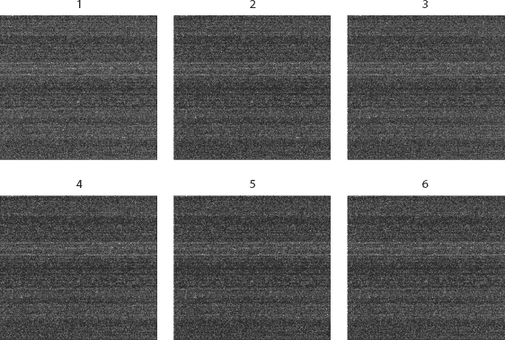
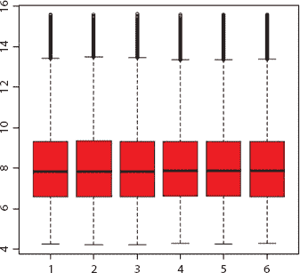
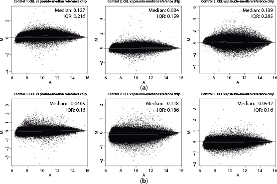
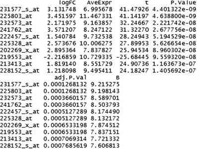
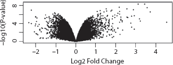

# 8 DNA 微阵列分析：从 Affymetrix CEL 文件到比较基因表达

**Sandeep Kumar^(1)\*, Shruti Shandilya^(2), Suman Kapila^(3), Mohit Sharma^(4,5) and Nikhil Agrawal^(6†)**

^(*1*)*兽医教育与研究国际研究所，哈里亚纳邦罗特克，印度*
^(*2*)*阿尔托大学应用物理系，埃斯波，芬兰*
^(*3*)*印度农业研究委员会国家乳品研究所，哈里亚纳邦，印度*
^(*4*)*华沙医科大学分子医学研究生院，华沙，波兰*
^(*5*)*雅盖隆大学马尔波尔斯基生物技术中心，克拉科夫，波兰*
^(*6*)*夸祖鲁-纳塔尔大学健康科学学院，西维尔，德班，南非*

> ***摘要***
> 
> 微阵列技术被广泛用于同时快速检测和比较数千个基因的表达。对于微阵列数据分析，稳健且可重复的方案每天都在生成。Bioconductor 提供了多个免费的微阵列数据分析包。分析包括以下过程：质量控制、标准化以及差异基因表达的计算。本章演示了一种使用 Bioconductor 工具从原始数据（.CEL 文件）中找出差异表达基因的方案。
> 
> ***关键词**:* 微阵列, Bioconductor, 基因

## 8.1 引言

DNA 微阵列，也称为 DNA 芯片，是一种用于定量细胞/组织中 mRNA 表达的分子技术 \[1\]。在此技术中，数百个已知 DNA 片段组成的阵列称为探针，被固定在芯片上的特定位置。该芯片可由硅或尼龙制成。使用微阵列技术，可以同时研究数千个基因以比较不同条件 \[2\]。斑点微阵列和寡核苷酸芯片是用户进行表达研究时最流行的两种微阵列类型，两者的区别在于探针固定在载玻片上的方式。在斑点或 DNA 微阵列中，探针是单独合成并机械固定到芯片上的。然而，在寡核苷酸芯片中，探针是直接在载玻片上合成的。寡核苷酸芯片中使用探针集而不是单个探针 \[3\]。微阵列数据分析包括图像分析、质量控制、标准化和差异基因表达。在本章中，微阵列数据分析的流程在 RStudio 中开发并运行，RStudio 是 R 的集成开发环境（IDE）。软件包从 Bioconductor 下载。它提供了微阵列数据分析的高级工具。Bioconductor 建立在开源平台 R 编程语言之上。Bioconductor 软件组件作为 R 包提供。在这里，我们将使用 affy、affyQCReport、limma、gdata 和 gplots 包进行分析。本章将提供 Affymetrix 微阵列数据分析的详细方法 \[5\]。

## 8.2 数据处理

### 8.2.1 工作流安装

软件包通过 BiocManager 使用 R studio 中的以下命令安装。

```
if (!requireNamespace("BiocManager", quietly = TRUE))
install.packages("BiocManager")
BiocManager::install("affy")
BiocManager::install("affyQCReport")
BiocManager::install("limma")
BiocManager::install("gdata")
BiocManager::install("gplot")
```

成功安装软件包后，所有软件包按顺序加载。要调用软件包，使用`library()`函数。这也会加载运行工作流所需的所有其他软件包。

```
library(affy)
library(affyQCReport)
library(limma)
library(gdata)
library(gplots)
```

如果加载了具有相同功能的多个软件包，例如 oligo 和 affy，则 R 将无法识别软件包。Affy 和 oligo 软件包具有相似名称的函数，例如`intensity()`、`MAplot()`和`rma()`。如果调用函数`intensity(data)`，则应在调用函数前指定软件包名称，例如，

```
oligo::intensity(data)
```

否则，它默认选择 affy 而不是 oligo。

### 8.2.2 导入原始数据进行处理

工作目录使用`setwd`函数指定，其中所有.CEL 文件已下载。

```
setwd("Path to the working directory")
```

要查看工作目录的路径，使用`getwd`函数。

```
getwd()
```

下一步是将包含原始探针水平数据的.CEL 文件导入`AffyBatch`对象。可以使用`ReadAffy`函数导入数据

```
data <- ReadAffy()
```

要查看加载的数据，在控制台中输入`data`

```
data
```

此函数将给出有关阵列大小、affy ID、注释以及样本数和基因数的相关信息。

```
AffyBatch object

size of arrays=1164x1164 features (20 kb)

cdf=HG-U133_Plus_2 (54675 affyids)

number of samples=6

number of genes=54675

annotation=hgu133plus2
```

### 8.2.3 检索数据的样本注释

微阵列数据集不仅包括表达数据，还包括杂交到阵列上的样本信息，例如样本标签。`AffyBatch`对象包含多个槽，`phenoData`是其中之一。它包含样本标签。

```
ph = data@phenoData
ph
```

此函数将给出有关表型数据和实验元数据的相关信息。

一个‘`AnnotatedDataFrame`’类的对象

`sampleNames`: Control 1.CEL Control 2.CEL ... Treated 3.CEL (6 total)

`varLabels`: sample

`varMetadata`: labelDescription

`ph`是一个数据框，可以使用$符号选择数据框的列。要查看实验中的样本数，使用

```
ph$sample
```

[1] 1 2 3 4 5 6

要观察数据框中的数据，使用

```
ph@data
```

它将显示实验中使用的样本名称和编号

sample

Control 1.CEL 1

Control 2.CEL 2

Control 3.CEL 3

Treated 1.CEL 4

Treated 2.CEL 5

Treated 3.CEL 6

要检索探针 ID（Affymetrix ID），使用`featureNames`函数

```
featureNames(data)
```

[1] "1007_s_at" "1053_at" "117_at"

[4] "121_at" "1255_g_at" "1294_at"

[7] "1316_at" "1320_at" "1405_i_at"

[10] "1431_at" "1438_at" "1487_at"

[13] "1494_f_at" "1552256_a_at" "1552257_a_at"


[16] "1552258_at" "1552261_at" "1552263_at"
[19] "1552264_a_at" "1552266_at" "1552269_at"
[22] "1552271_at" "1552272_a_at" "1552274_at"
[25] "1552275_s_at" "1552276_a_at" "1552277_a_at"
[28] "1552278_a_at" "1552279_a_at" "1552280_at"
[31] "1552281_at" "1552283_s_at" "1552286_at"
[34] "1552287_s_at" "1552288_at" "1552289_a_at"

获取阵列上表示的探针集数量

```
>length(featureNames(data))
[1] 54675
```

### 8.2.4 质量控制

在计算差异基因表达之前的第一步是质量评估。为检查芯片的完整性，使用以下代码。

```
for (i in 1:6) {
name = paste("image",i,".jpg",sep="")
jpeg(name)
image(data[,i],main=ph@data$sample[i])
dev.off()
}
```



**图 8.1** 芯片图像分析。为检查微阵列芯片的完整性，进行图像分析。六个样本用于演示微阵列数据的分析。

结果中，芯片的图像如图 8.1 所示。这些图显示了芯片的质量。前景和背景信号应清晰。必须评估原始数据的质量以检查偏差、强度、RNA 降解等。Affymetrix 的质量控制在归一化前后使用简单的图形探索方法进行质量评估。函数 `affyQAReport` 用于检查微阵列数据的质量

```
>affyQAReport(data)
```

它创建名为 `affyQC` 的文件夹，其中包含 pdf 文件中的所有质量检查：箱线图、直方图、MA 图、MAD 图像、RNA 降解图 和 QCstat。

#### 8.2.4.1 箱线图

箱线图是比较不同阵列的对数强度分布的图形表示（图 8.2a）。这些箱线图评估归一化过程；因此，箱线图在归一化前后绘制。

#### 8.2.4.2 密度直方图

除了箱线图之外，`affyQAReport` 还生成对数强度的直方图（图 8.2b）。原始数据的密度曲线未经平滑，而归一化后曲线变得平滑。

#### 8.2.4.3 MA 图

MA 图用于识别依赖于对数强度的偏差。MA 图将每个阵列的对数强度与其参考阵列进行比较（图 8.2c）。图的 Y 轴为一个阵列相对于参考中位阵列的对数比强度（“M”），X 轴为两个阵列的平均对数强度（“A”）。在重复组内，探针水平预计不会有很大差异，因此我们期望 MA 图从低强度到高强度以 Y = 0 轴为中心。每个重复的 MA 图单独显示参考阵列是每个组的中间阵列。这些图用于检查归一化方法的功效，因为归一化预计会校正依赖于对数强度的偏差。

#### 8.2.4.4 NUSE 图

该图显示探针集的均一性。归一化未缩放标准误差 Normalized Unscaled Standard Error (NUSE) 图用于可视化来自探针水平模型拟合的标准误差（图 8.2d）。对于每个基因，中位标准误差的值为 1。质量差的阵列具有更高的中位标准误差。

#### 8.2.4.5 RLE 图

RLE（相对对数表达 Relative Log Expression）图表示基因或探针集的估计表达与中位表达的比率。假设所有探针均未差异表达；因此，RLE 图以 0 为中心（图 8.2e）。如果图未以 0 为中心，则阵列质量较低。

#### 8.2.4.6 RNA 降解图

为了结果的准确性，用于微阵列实验的 RNA 应具有良好的质量。RNA 降解图用于评估实验中使用的 RNA 质量。该图还可用于识别微阵列中的伪影。具有相似 RNA 降解模式的阵列可用于进一步分析。RNA 质量差的阵列将从 5′ 到 3′ 具有非常陡峭的斜率（图 8.2f）。


**图 8.2** (a 至 c) 箱线图 (a)、密度直方图 (b) 和 MA 图 (c)。这些图用于在归一化前检查样本中的数据偏差。(d 和 e) NUSE 图 (d) 和 RLE 图 (e) 用于确定探针集的均一性。NUSE 图中以箱线图形式可视化来自探针水平模型的标准误差。RLE 图中以箱线图形式可视化基因表达相对于中位的偏差。RLE 图应以接近 0 为中心。在低质量阵列中，RLE 图的模式不会以接近 0 为中心。(f 和 g) RNA 降解图 (f) 和 QC 统计图 (g)。RNA 降解图用于可视化所有探针集在 5′ 到 3′ 端的每个探针的平均强度。阵列中使用的质量控制参数在 QC 统计图中可视化。

#### 8.2.4.7 QCstat

QC 图提供平均背景、比例因子、被判定为存在的基因数量、对照基因 β-actin 和 GAPDH 的 3′:5′ 比率以及 spike-in 对照转录物的值等信息。图形从底部绘制，即第一个芯片绘制在基部，最后一个芯片绘制在顶部。每个由水平虚线分隔的图代表每个样本。每个图包含单个芯片的信息。蓝色区域表示比例因子在所有芯片平均比例因子的三倍范围内的区域。比例因子绘制为从中心线抬起的水平蓝色线。如果比例因子落在蓝色区域之外，则绘制为红色线（图 8.2g）。

## 8.3 使用 RMA 方法对微阵列数据进行归一化

原始数据由于许多未知的变异来源总是存在偏差。为了消除偏差，进行数据归一化。该过程去除偏差以确保具有最高准确性的结果。此处使用稳健多阵列平均 Robust multi-array average (RMA) 方法进行数据归一化 [4]。该方法涉及三个步骤将对数强度值转换为基因表达值。

### 8.3.1 背景校正

此步骤通常校正背景噪声和强度。背景噪声可能来自许多来源，例如探针非特异性结合和洗涤不良引起的荧光。正在使用不同的方法校正背景噪声，稳健多阵列平均 RMA 算法是其中流行的方法。此步骤对于特异性杂交的准确测量是必需的。

### 8.3.2 归一化


背景校正后的下一步是数据归一化，以归一化技术变异，因为在杂交过程中，芯片之间总存在差异，这导致芯片之间对数强度存在差异。

### 8.3.3 汇总

这是必要的，因为所有转录本都由多个探针表示。对于每个基因，归一化后的探针强度和背景校正后需要汇总为一个表达值。

```
data.rma = rma(data)
```

背景校正

归一化 计算

表达

箱线图由归一化数据绘制，用于评估归一化过程，如图 8.3 所示。



**图 8.3** 归一化后阵列数据的箱线图。

```
name = "boxplotnorm.jpg"
jpeg(name)
boxplot(data.matrix,col='ed',names=ph@data$sample)
dev.off()
```

MA 图用于比较 `affy` 中的原始数据和归一化数据，如图 8.4 所示。红线显示与中央蓝线的偏差。以下代码用于从原始数据生成 MA 图（图 8.4a）。

```
for (i in 1:6) {
name = paste("MAplot",i,".jpg",sep="")
jpeg(name)
MAplot(data,which=i)
dev.off()
}
```

此代码用于从归一化数据生成 MA 图（图 8.4b）。



**图 8.4** 用于比较归一化方法的 MA 图。归一化前（a）和归一化后（b）。

```
for (i in 1:6) {
name = paste("MAplotnorm",i,".jpg",sep="")
jpeg(name)
MAplot(data.rma,which=i)
dev.off()
}
```

## 8.4 差异基因表达的统计分析

对于统计分析，使用 `limma` 包。它通过为每个基因拟合线性模型来估计倍数变化和标准误差。创建设计矩阵并分配列名。设计矩阵指示哪些芯片是染料交换。

```
design <- model.matrix(~ -1+factor(c(1,1,1,2,2,2)));
colnames(design) <- c("S1", "S2")
```

为了比较处理组与对照组，创建对比矩阵

```
contrast.matrix <- makeContrasts(S2-S1, levels=design)
```

为了基于给定的芯片系列为每个基因拟合线性模型，使用以下代码。

```
fit <- lmFit(data.rma, design)
```

对于给定的对比集，计算估计系数和标准误差。

```
fit2 <- contrasts.fit(fit, contrast.matrix)
```

通过经验贝叶斯收缩将标准误差收缩至共同值，计算 moderated t 统计量和差异表达的对数几率。

```
fit2 <- eBayes(fit2)
```

以下代码用于查看前 10 个差异表达基因的列表（图 8.5）。

```
topTable(fit2, coef=1, adjust="fdr", sort.by="B", number=10)
```

为了汇总结果，使用 `summary()` 函数。

```
results <- decideTests(fit2)
summary(results)
```

S2 - S1

下调 1490

不显著 52026

上调 1159

它显示了显著上调、下调和不显著的基因表达。有 1,490 个基因下调，1,159 个基因上调。为了查看基因差异表达的图形表示，使用火山图。它分别在 y 轴和 x 轴上绘制显著性与倍数变化（图 8.6）。

```
volcanoplot(fit2)
```



**图 8.5** 显示基因表达对数倍数变化及 p 值的结果。



**图 8.6** 基因表达对数倍数变化的火山图。右侧散点图（正值）表示上调基因，左侧散点图（负值）表示下调基因。

## 8.5 结论

微阵列是一种有前景的分子技术，用于识别参与多种过程的目标基因和通路。它还解释了不同条件下的基因表达模式。本章演示了使用 Bioconductor 工具分析微阵列数据的流程。该流程演示了在两种不同条件之间计算差异基因表达，但它不仅限于两种条件，可以使用该流程分析多个样本。本章展示了 Bioconductor 在微阵列数据分析中的灵活性。

## 参考文献

1. Hardiman, G., 微阵列技术——概述. *Pharmacogenomics*, 3, 3, 293–297, 2002.

2. Li, Z., 基因调控回路分析, in: *Microarray Technology and Its Applications. Biological and Medical Physics, Biomedical Engineering*, U.R. Müller and D.V. Nicolau (Eds.), Springer, Berlin, Heidelberg, 2005.

3. Woo, Y., Affourtit, J., Daigle, S., Viale, A., Johnson, K., Naggert, J., Churchill, G., cDNA、寡核苷酸和 Affymetrix GeneChip 基因表达微阵列平台的比较. *J. Biomol. Tech.: JBT*, 15, 4, 276, 2004.

4. Bolstad, B.M., Irizarry, R.A., Åstrand, M., Speed, T.P., 基于方差和偏差的高密度寡核苷酸芯片数据归一化方法的比较. *Bioinformatics*, 19, 2, 185–193, 2003.

5. Gentleman, R.C., Carey, V.J., Bates, D.M., Bolstad, B., Dettling, M., Dudoit, S., Ellis, B., Gautier, L., Ge, Y., Gentry, J., Hornik, K., Bioconductor：计算生物学和生物信息学的开放软件开发. *Genome Biol*., 5, 10, R80, 2004.

1. **通讯作者*: sandeepvermma@gmail.com

2. †*通讯作者*: nikhil.08oct@gmail.com

# 9

# 生物信息学中的机器学习

**Rahul Yadav^(1), Mohit Sharma^(2,3) and Nikhil Agrawal^(4)***

^1*SRM University, SRM Nagar, Kattankulathur, Tamil Nadu, India*

^2*Postgraduate School for Molecular Medicine, Medical University of Warsaw, Warszawa, Poland*

^3*Poland Malopolskie Centre of Biotechnology Jagiellonian University, Krakow, Poland*

^4*College of Health Sciences, University of KwaZulu-Natal, Westville, Durban, South Africa*

***摘要***


人类进化经历了不同的阶段，目前我们正处于 `Information Age`。 这一时代的革命始于互联网的出现。 在当今时代，科学的不同领域产生的数据量巨大。 特别是在生物科学中，例如 `genomics`、`proteomics`、`molecular modeling` 等。 `genomics` 生成的数据与 `molecular modeling` 生成的数据不同。 然而，这些信息可以关联起来，以获得对功能甚至细胞水平的更深入见解。 在短时间内分析如此庞大的数据并得出结论变得困难。 随着 `Machine Learning` 方法的实施，当前的状况正在发生变化。 `Machine Learning` 提供了对问题的更深入见解，并以数学模型为支撑，从而在分析方面节省时间。 `Machine Learning` 已应用于癌症患者的检测和用药建议。 在药物发现中，已开发出 `Machine Learning` 模型来设计潜在的药物分子。 在本章中，我们尝试提供对 `Machine Learning` 在生物信息学领域及其不同分支中的理解和重要性。

**关键词：** `Machine learning`, `bioinformatics`, `drug discovery`, `genomics`

## 9.1 引言与背景

人类在进化的过程中通过发明提高了生活标准。 在我们的进化过程中，人类经历了四个主要时代。 第一个是“`Stone Age`”，或通常被称为“`Hunter and the Gatherer Age`”，基本上是人类通过狩猎和采集食物为生。 在 `Stone Age` 的后期，人类开始过上更稳定的生活，专注于农业技能以及在 `Mesolithic` 和 `Neolithic` 阶段的其他发展，如制造武器和器具。 第二个时代是“`Bronze Age`”，这一时代在人类进化中被认为非常重要。 与 `Stone Age` 相比，人类进化出金属工具和武器，而在 `Stone Age` 中，工具和武器大多由石头和木头制成。 `Bronze Age` 也被称为 `Industrial Age`。 正是在这一时代的后期，人类开始首次制造工业机器。 这一时代并不遥远，现在我们正处于人类进化的第三个时代，即“`Computer Age`”。

`Stone Age` 持续了数百万年，`Bronze Age` 持续了数千年，而 `Computer Age` 仅在几十年前才开始。 信息已被收集和积累了很长时间。 然而，过去几十年被证明是最关键的。 第一台蒸汽驱动的计算机器由著名的英国数学家 `Charles Babbage` 于 1822 年建造。 然而，这一时期不被视为 `Computer Age`。 1936 年，另一位数学家 `Alan Turing` 博士在第二次世界大战期间制造了一台能够计算任何可计算事物的机器。 从那时起，`Computer Age` 开始了。 在随后几年成立了多家公司，其中最著名的是由 David Packard 和 Bill Hewlett 创立的 `Hewlett-Packard` 以及 `IBM` (`International Business Machines`)。

今天的时代是计算机的时代，“`Computer Age`”，也被称为 `Information Age`”。 随着现代计算机的发明，`Information Age` 经历了显著的转变。 随着这一时代的进步，计算机在计算能力和高速信息处理方面不断发展。 然而，计算机体积变小，但变得更加紧凑和强大。 如今，我们拥有高性能计算系统，其 `RAM` 容量可达数 TB (`TB`)。

直到最近，这已经足够了。 随着每秒收集的海量信息，计算机需要强大和智能变得不可避免。 过去十年里，每个科学领域产生的数据量急剧膨胀。

`Artificial Intelligence` (`AI`) 是一种程序，专门设计用于解决复杂问题以获得有趣、有价值的信息。 它包含两个部分。 第一部分是找出问题是什么以及为什么需要解决这个问题。 第二部分是实施特定算法来解决问题并获得期望的输出。 可以使用各种算法来解决这些问题。 这些算法以数学模型为支撑 \[1\]。

计算机的物理限制导致了通常被称为 `AI` 的算法的创新。 随着每天产生的数据量，找到必要的信息变得像在大海捞针。 然而，如今使用此类程序挖掘信息变得越来越方便。

那么，什么是 `Artificial Intelligence`？ `Artificial Intelligence` 或更 commonly known as `AI` 是一种经过训练的程序，旨在基于某些数学模型在更少的时间和空间内从海量数据中查找特定信息。 该程序在使用前会先使用模型数据集进行训练。 这些程序可以根据数据进行适应和操作，而无需人工干预。 一个例子是苹果的 `Siri`。 目前，特定的 `AI` 程序只能用于执行其设计时的任务。 `AI` 本身有两个子集，即 `Machine Learning` (`ML`) 和 `Deep Learning` (`DL`)。

一个 `ML` 程序是一种更智能的人工智能程序，可以通过数据暴露来自我纠正。 尽管它们也需要在训练数据集上进行训练，但 `ML` 程序是利用数学模型设计的，可以通过数据暴露来自我纠正。 最好的例子之一是 `IBM` 的 `Watson Health`。 `Watson Health` 是一款用于癌症诊断和治疗的 `ML` 程序。 它通过考虑患者的基因组、病史和病理学来推荐癌症患者的治疗方案。 该程序随后借助先前存在的信息推荐可能的治疗方案。

`DL` 程序是 `ML` 的子集。 `DL` 程序之所以得名，是因为与 `ML` 程序相比，此类程序中使用的神经网络数量多得多。 `DL` 程序的一个例子是从图像中检测人脸 \[4\]。 下面是一张图片，用于简要概述 `AI`、`ML` 和 `DL` 之间的关系(`Figure 9.1`)。 `AI` 目前几乎在所有领域都得到应用。 `AI` 应用的领域示例如下。

![图 9.1 人工智能、机器学习和深度学习之间相关性的典型示例 \[1–4\]。](images/fig9-1.jpg)

`Figure 9.1` `Artificial Intelligence`、`Machine Learning` 和 `Deep Learning` 之间相关性的典型示例 \[1–4\]。

### 9.1.1 生物信息学

在过去几十年中，生物信息学不断发展，并在生物技术、药物设计等相关领域发挥着重要作用。 最显著的进步是 `DNA` 测序技术的发明。 由 `Sanger` 博士实现了对任何生物体的 `DNA` 测序。 该技术使我们能够测序人类基因组，包含约 32 亿个核苷酸碱基。 但随着这一时期成立的各种公司，时间已大幅缩短至仅几天，而机器产生的数据量也大幅增加至 `TB`。 为了处理此类数据，需要高性能计算系统以及更好的算法。 临床基因组学领域也取得了各种进步。 `IBM` 的 `Watson` 就是一个例子。 `ML` 程序用于识别、诊断并为患者提供可能的治疗方案 \[4\]。


## 9.1
在生物信息学领域，ML 也被使用，计算生物学药物发现是另一个领域，该领域需要高计算速度以及相当数量的内存来执行其任务。支持向量机，一种 ML 算法，可以被实现以完成此类任务。SVMs 基于回归模型工作，通常是基于监督的程序。这类 ML 程序在计算生物学界获得了流行。有时，基于隐马尔可夫模型的概率方法也用于计算生物学领域的预测 \[5\]。

### 9.1.2 文本挖掘
另一个使用 ML 的领域是文本挖掘领域。该术语首次由 Ronen Faldman 提出。尽管 Ronen 实际创造的术语是数据库中的知识发现，它是一种数据挖掘过程，其主要目的是提取潜在有用的数据 \[6\]。用于文本挖掘、检索或信息提取的 ML 方法也被称为自然语言处理，它使用算法、ML 方法和统计学来从特定文本中推导出重要信息。它使用一种称为分词的方法，其中文档被拆分为单词，所有标点符号都被制表符或其他空白字符替换。这些分词后的单词构成词典的一部分。该词典随后通过降维算法缩小规模，其中较不重要的词被移除。SVM 用于干净、降维且已索引的数据上 \[7\]。

### 9.1.3 物联网设备
当今最好的例子是物联网设备的发明，这些设备是小型、单一的机器单元，旨在执行特定任务。其中一项任务可以是收集特定地理位置的天气信息。数百个此类设备可以放置在地理位置内的各个地方。可以收集空气污染指数、二氧化碳水平、温度和湿度等信息。公司正在整合来自数百个此类设备产生的数据。通过这些设备收集的信息总体上变得庞大。因此，它增加了处理时间并需要计算机更多的内存 \[2\]。

## 9.2 生物信息学中的机器学习应用
生物信息学是一个快速发展的领域，在其每个领域中都在产生需要分析的数据海洋。产生的大量数据导致了 ML 方法的实施。模式识别是生物信息学领域最具代表性的方面之一。就问题而言以及解决问题的思路而言，生成的数据有两大主要类别。其中一种是已经存在的数据类型，并且解决问题的思路信息已经为人所知。用于此类数据的思路或多或少已经确立。第二种数据类型是任何新颖的数据，其任何信息此前均未知。此类数据需要一些新颖的方法，这也可能导致开发全新的技术来解决此类问题。

基因组学已成为生物信息学中最突出和最著名的领域之一。在生物信息学的早期阶段，使用微阵列生成了大量数据。这是因为它在计算生物学家中获得了流行，并作为一种新兴技术。微阵列技术使我们能够研究多个基因在面板上的表达。mRNA 首先被反转录为 DNA，然后与荧光标记染料连接。在激发下，荧光标记染料发出特定颜色，被传感器捕获。荧光标记有两种颜色：绿色和红色。绿色表示上调，红色表示下调。这被称为双系统杂交技术。由于它使用了 mRNA 表达的特性，因此发现它在医学诊断领域有应用。该方法还用于找出健康个体和患病个体之间的差异。此类问题的训练数据是关于正常个体中特定基因表达水平的已知信息。应用于此类问题且可以使用训练数据集的 ML 方法被称为监督学习方法。微阵列技术推动了基于监督学习方法的 SVM 的使用。ML 的其他应用包括癌症数据中单核苷酸多态性的检测、蛋白质中氨基酸残基各种性质的预测、分类和癌症预测。所有这些数据都可以使用人工神经网络（ANNs）进行分析。

SVMs 用于各种基因表达数据的分类以及蛋白质四级结构的分类 \[8\]。

计算系统发育距离并绘制系统发育树是生物信息学领域的一项艰巨任务。系统发育树表示生物体之间的亲近程度或距离。这是通过一种称为多序列比对的方法进行的，其中包含至少三个以上生物体的所有序列被一起比对，并计算得分。然后序列被重新排列并重新比对。该过程迭代进行，以获得最佳比对来表示生物体之间的精确距离。ML 方法用于执行此类任务并实现各种算法 \[9\]。

## 9.3 机器学习方法


ML 通常使用两种不同的方法来处理数据并从中推断出可用的信息。两种不同的方法是有监督学习和无监督学习。

有监督学习是一种 ML 方法，它在相似的示例数据上进行训练，以便学习如何从数据集中推断出有用的信息。而无监督学习则是一种方法，其中 ML 程序事先未进行训练，但它仍尝试推断问题的解决方案 \[10\]。

在生物信息学中，有监督学习的一个例子是基因查找算法的使用。基因查找算法通常在已知的一组序列上进行训练。这些序列的基因转录起始位点和转录终止位点已经已知。这些序列之间的剪接位点信息也已知。

然后，程序根据训练数据集得出的信息，如 DNA 序列排列、起始密码子和终止密码子以及 5’ 和 3’ UTR 和内含子的信息，对其提供的任何未知序列预测基因 \[10\]。

当这类信息不可用时，就需要使用无监督 ML 程序。在生物信息学中，无监督学习方法最好的例子之一在谈论表观遗传数据时可以解释。

DNA 元素百科全书（`ENCODE`）联盟和 Roadmap 表观基因组学项目产生了异质的表观基因组数据集合。在处理这种异质数据混合物以寻找某些信息模式时，最好使用无监督学习方法。

在这种情况下，程序本身在迭代集上进行训练以找到特定的一组模式，然后将其用于在输入相似数据集时推导出相似模式 \[11\]。

这种 ML 程序最好的例子之一是名为 `GeneMark` 的基因查找工具。`GeneMark` 既有基于网络的版本也有独立版本。`GeneMark` 通常有两个不同的变体：其中一个使用有监督学习方法，而另一个使用无监督学习方法进行 *in silico*–based 基因查找。

有监督模型是 `GeneMark.hmm`，它使用一种称为隐马尔可夫模型的有监督学习类型进行基因预测。两种方法都产生相当准确的结果。

有监督模型使用预定义的一组信息，其中相似数据的起始密码子和终止密码子 5’ 和 3’ UTR 区域程序已经知道。然后它使用信息在查询数据集中找到相似模式并预测基因。它最适合用于已知的生物体，其基因组区域信息已知 \[11\]。

`GeneMark` 的另一个变体是 `GeneMark S`，它是 GeneMark 自学习 的缩写，使用无监督方法进行基因查找。

`GeneMark S` 使用两套不同的算法进行基因查找。首先，它使用通用的 `GeneMark.hmm`，这是一种具有已知信息进行基因查找的方法。然后它尝试从未知序列中寻找模式，这些模式反过来用于与从 `GeneMark.hmm` 获得的结果进行匹配，准确率高达 99% 或直到基因查找的稳定性在特定水平饱和。如果准确率百分比开始下降，则停止其迭代 \[12\]。

## 9.4 结论与结束语

正在开发更新更好的算法以预测精确结果。ML 方法几乎在生物信息学的各个方面都得到实施。

若干基因预测程序使用 ML 模型来预测 `CDS` 区域的未知基因。

在下一代测序机器中，基于学习的 方法用于分析数据。一个例子是实施 ML 方法用于分析 `QIIME2` 中的 `16S rRNA` 序列。该程序的开发人员已使用 ML 模型来分析此类数据。

ML 在科学的每个领域中被越来越多地使用。在生物信息学领域，由于生成的数据类型多样性极大，它获得了巨大的流行。生物信息学的每个领域中生成的大量数据需要不断改进的精确分析方法。

在现实世界中，分子可能以某种方式作用。为了反映相同的结果，需要更多研究来了解生物学功能。

## 参考文献

1\. Marr, D., 人工智能——个人观点. *Artif. Intell*., *9*, 1, 37–48, 1977.

2\. Desai, N.S. and Alex, J.S.R., 基于 Beagle bone black 的物联网空气污染监测与预测系统, in: *2017 International Conference on Nextgen Electronic Technologies: Silicon to Software (ICNETS2)*, IEEE, pp. 367–370, 2017, March.

3\. Meidan, Y., Bohadana, M., Shabtai, A., Guarnizo, J.D., Ochoa, M., Tippenhauer, N.O., Elovici, Y., ProfilIoT：基于网络流量分析的物联网设备识别机器学习方法. In: *Proceedings of the symposium on applied computing*, pp. 506–509, 2017 Apr 3.

4\. Bini, S.A., 人工智能、机器学习、深度学习和认知计算：这些术语的含义是什么以及它们将如何影响医疗保健？ *J. Arthroplasty*, *33*, 8, 2358–2361, 2018.

5\. Vert, J.P. and Jacob, L., 用于体内虚拟筛选和化学基因组学的机器学习：新策略. *Comb. Chem. High Throughput Screen*., 11, 8, 677–685, 2008.

6\. Feldman, R., Fresko, M., Kinar, Y., Lindell, Y., Liphstat, O., Rajman, M., Zamir, O., 术语层面的文本挖掘, in: *European Symposium on Principles of Data Mining and Knowledge Discovery*, 1998, September, Springer, Berlin, Heidelberg, pp. 65–73.

7\. Hotho, A., Nürnberger, A., Paaß, G., 文本挖掘简要综述, in: *Ldv Forum*, 2005, May, vol. 20, No. 1, pp. 19–62.

8\. Bhaskar, H., Hoyle, D.C., Singh, S., 生物信息学中的机器学习：从业者简要综述与建议. *Comput. Biol. Med*., *36*, 10, 1104–1125, 2006.

9\. Larranaga, P., Calvo, B., Santana, R., Bielza, C., Galdiano, J., Inza, I., Robles, V., 生物信息学中的机器学习. *Brief. Bioinform*., *7*, 1, 86–112, 2006.

10\. Lloyd, S., Mohseni, M., Rebentrost, P.. 有监督和无监督机器学习的量子算法. arXiv preprint arXiv:1307.0411, 2013 Jul 1.

11\. Libbrecht, M.W. and Noble, W.S., 遗传学和基因组学中的机器学习应用. *Nat. Rev. Genet*., 16, 6, 321–332, 2015.

12\. Besemer, J., Lomsadze, A., Borodovsky, M., `GeneMarkS`：预测微生物基因组基因起始的自训练方法。寻找调控区域序列基序的意义. *Nucleic Acids Res*., *29*, 12, 2607–2618, 2001.

1.  \**通讯作者*: nikhil.08oct@gmail.com
