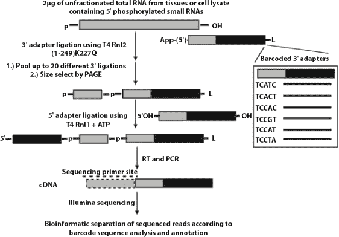
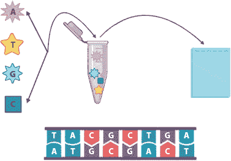

# 10 DNA-RNA 条形码和基因测序

**Gifty Sawhney^(1,2), Mohit Sharma^(3,4) and Nikhil Agrawal^(5)\***

^(*1*)*炎症药理学分部，CSIR-印度综合医学研究所，贾 ammu，J&K，印度*

^(*2*)*科学创新研究学院（AcSIR），CSIR-印度综合医学研究所，贾 ammu，J&K，印度*

^(*3*)*分子医学研究生院，华沙医科大学，华沙，波兰*

^(*4*)*马尔波尔斯卡生物技术中心，雅盖隆大学，克拉科夫，波兰*

^(*5*)*健康科学学院，夸祖鲁-纳塔尔大学，西维尔，德兰，南非*

> ***摘要***
>

DNA 条形码是一种基于采集任何个体微小组织样本的 DNA 序列来快速鉴定任何物种的新方法，现已扩展到生命之树上的所有类群。DNA 条形码作为分类学家研究工具，有助于通过纳入生物个体生活史的各个阶段来增强对生物体的分析能力。DNA 条形码通过鉴定理论上对科学而言是新物种来促进生物多样性的探索。DNA 条形码被用作解决基本生态和进化问题的生物技术，例如植物群落中生物体的形成。DNA 条形码过程有两个基本步骤：（1）创建已鉴定生物体的 DNA 条形码库和（2）将未鉴定条形码序列与条形码库进行比对以进行鉴定。虽然 DNA 条形码作为方法的使用时间不足十年，但其已随着作为条形码产生的序列数量及其应用的比例显著增长。本卷介绍了原生生物、细菌和植物，并提供了关于整个生命之树上 DNA 条形码的生产、使用和研究的最新信息。

***关键词***：DNA 条形码，RNA 条形码，基因序列，人类基因组，染色体

## 10.1 引言

生物体的可遗传成分是其基因组，即一段大型的脱氧核糖核酸（DNA）序列，其中包含个体及其细胞携带的全部遗传信息。在 2000 年代初期，伦敦（英国）自然历史博物馆举办了首次国际“生命条形码”会议，约有来自 50 个国家的 200 多名代表出席，并报道称目前已有紧凑型 DNA 测序系统可用于对所有生命进行分类 \[1\]。鉴定 170 万个物种耗费了分类学家两个世纪的时间，但发现这一数字可能是对地球真实生物多样性的明显误导 \[2, 3\]。虽然分类学家可能对他们所熟悉的大多数物种进行分类，但一个新兴的社会需要广泛的物种分类学分类数据。RNA/DNA 资料库的建立具有极大的前景，可用于对物种进行分类和归类，并促进环境和生物多样性支持研究项目。在 2000 年代初期，慕尼黑德国国家收藏馆的 DNA 分类学研讨会由德国科学协会（DFG）赞助，约有 100 名主要来自欧洲国家的科学家参与 \[4\]。在这一初步阶段的问题主要是 DNA 分类学（即在物种中基于 DNA 的通用分类机制）的有用指标，以及将已知名称与遗传密码为基础的系统中的实体相连接的挑战 \[5\]。

基因组可含有约 500 个基因（对于支原体，一种细菌而言），人类约有 20,000 至 25,000 个，水稻约有 50,000 至 60,000 个。W. Sutton 于 1903 年提出了染色体上存在基因的理论，在此背景下。Sutton 于 1910 年获得了 T.H. Morgan 的实验支持。到 1922 年，Morgan 及其同事开发了基因 mapping 技术，并分析了 *Drosophila melanogaster* 四条染色体上超过 2,000 个基因的相对位置。尽管这些经典遗传学研究取得了成功，但直到 1940 年代，基因的分子存在仍未得到真正理解。尽管如此，没有人相信 DNA 是遗传物质，但在 Avery、MacLeod 和 McCarty 于 1944 年的研究以及 Hershey 和 Chase 于 1952 年的实验之前，人们普遍认为染色体是由蛋白质组成的。DNA 功能的突破为生物医学研究提供了巨大动力。DNA 功能的发现是基因工程的重要催化剂，许多重要科学家进入了下一代（**图 10.1**）（其中最具影响力的有 Delbrück、Chargaff、Crick 和 Monod）。

基因组由染色体 DNA 和真核质粒组成。在真核生物中，DNA 存在于线粒体和叶绿体中。基因组的进化受基因组内表达核苷酸序列的物质影响。DNA 基因组通过复杂的网络过程在适当的时间和所需的细胞内产生身体的所有蛋白质。蛋白质在生物体的形成和功能中发挥多种作用；它们可以构成个体的美学特征的一部分，具有发育复杂结构的能力，进行生命必需的生化反应，并作为转录因子和受体发挥作用，并在信号转导途径和其他分子的调控中发挥关键作用。

真核细胞的大部分 DNA 通常整合到细胞核中称为染色体的结构中。原核细胞中的所有遗传数据都存在于一个环状 DNA 分子中，其长度约为一毫米，并且多次存在于细胞的中央区域。生物体的基因组包含其全部 DNA 组成（**表 10.1**）。除卵子和精子外，所有正常人体细胞都有 46 条染色体。其中一半可追溯至母亲，因此另一半基因可追溯至父亲。从物理上看，基因组可分为几个独立的 DNA 分子或染色体。换句话说，也可以说每条染色体的 DNA 密码就是基因组。基因组在功能上分为基因。每个基因在许多情况下是编码单一类型 RNA 并且最终编码多肽的 DNA 序列。不同基因组的每条染色体可能包含大量基因（**图 10.2**）。

![图 10.1 显示 1865 年至 2001 年遗传学显著简史的流程图 \[229\]。](images/fig10-1.jpg)

**图 10.1** 显示 1865 年至 2001 年遗传学显著简史的流程图 \[229\]。

**表 10.1** DNA 类型 \[230\].

| **序号** || **项目** || **A** || **B** || **Z** |
| --- | --- | --- | --- | --- |
| 1 || 螺旋盘绕方向 || 右手性 || 右手性 || 左手性 |
| 2 || 糖磷酸键 || 正常 || 正常 || 之字形 |
| 3 || 螺距 (nm) || 2.8 || 3.4 || 4.5 |
| 4 || 轴向上升 (nm) || 0.25 || 0.337 || 0.37 |
| 5 || 直径 || 26Å || 20Å || 18Å |
| 6 || 平均每圈碱基对数 || 10.7 || 10.0 || 12 |
| 7 || 旋转/碱基对 || 33.6° || 35.9° || 60°/2 |
| 8 || 糖苷键角 || 反式 || 反式 || C: 反式, G: 合式 |
| 9 || 轴向每碱基对上升 || 2.3Å || 3.32Å || 3.8Å |
| 10 || 碱基对相对于轴的倾斜度 || +19° || −1.2° || −9° |
| 11 || 螺旋每圈螺距 || 24.6Å || 33.2Å || 45.6Å |
| 12 || 平均螺旋扭转 || +18° || +16° || 0° |
| 13 || 糖环构象 || C3’-endo || C2’-endo || C: C2’-endo, G: C2’-exo |
| 14 || 重复单元 || 1 bp || 1 bp || 2 bp |

![图 10.2 显示分子水平上的染色体结构 \[231\]。](images/fig10-2.jpg)

**图 10.2** 显示分子水平上的染色体结构 \[231\]。

## 10.2 RNA

核糖核酸（RNA）是一种关键的聚合物信使，在多种生物活动中调控、编码、激活并表达基因。DNA 和 RNA 以及脂质、蛋白质和碳水化合物构成了所有已知生命形式所必需的四大主要大分子。RNA 由与 DNA 相同的核苷酸序列组成，并且与配对的双链不同，在自然界中 RNA 通常被视为自身折叠的单链。细胞生物利用遗传信息 \[氮基如鸟嘌呤（G）、尿嘧啶（U）、腺嘌呤（A）和胞嘧啶（C）\] 来表明某些蛋白质合成是由信使 RNA（mRNA）驱动的（图 10.3）（表 10.2）。大多数 RNA 通过催化生物反应、基因表达、细胞信号响应感知和通讯参与细胞。蛋白质的产生是 RNA 分子在核糖体上指导蛋白质合成的最有效基本系统之一（图 10.4）（表 10.3）。该过程利用 tRNA 分子将氨基酸传递到核糖体，其中核糖体 RNA（rRNA）将氨基酸连接起来形成编码蛋白质。

![图 10.3 RNA 的不同类型 \[232\].](images/fig10-3.jpg)

**图 10.3** RNA 的不同类型 \[232\]。

**表 10.2** 不同类型 RNA 的比较 \[233\]。

| **序号.** || **RNA 类型** || **大小** || **功能** |
| --- | --- | --- | --- |
| 1. || tRNA 转运 RNA || 小 || 它协助将氨基酸运送到蛋白质合成位点用于蛋白质合成。 |
| 2. || rRNA 核糖体 RNA || 若干种大小不一 || 它与蛋白质协同协助蛋白质合成位点形成核糖体。 |
| 3. || mRNA 信使 RNA || 可变 || 它指导蛋白质氨基酸序列。 |
| 4. || SnRNA 小核 RNA || 小 || 将真核生物中的初始 mRNA 处理成成熟形式。 |
| 5. || SiRNA 小干扰 RNA || 小 || 它影响基因表达；科学家用正在研究的基因进行敲除。 |
| 6. || Micro RNA 微小 RNA || 小 || 它在生长发育中很重要并影响基因表达。 |

![图 10.4 DNA 和 RNA 的结构 \[234\].](images/fig10-4.jpg)

**图 10.4** DNA 和 RNA 的结构 \[234\]。

**表 10.3** DNA 与 RNA 的差异 \[235\]。

| **DNA** || **RNA** |
| --- | --- |
| 1\. DNA 是基本的遗传物质。 || 1\. RNA 是某些病毒的遗传物质。 |
| 2\. DNA 除某些病毒外为双链，例如（Ø × 174）。 || 2\. 大多数细胞 RNA 为单链，除某些病毒外（例如 *Reovirus* 中为双链）。 |
| 3\. DNA 具有脱氧核糖 || 3\. 五碳糖为核糖。 |
| 4\. 碱基对为腺嘌呤、鸟嘌呤、胞嘧啶和胸腺嘧啶。 || 4\. 常见的有机碱基为腺嘌呤、鸟嘌呤、胞嘧啶和尿嘧啶。 |
| 5\. 碱基配对：AT（腺嘌呤-胸腺嘧啶）和 GC（鸟嘌呤-胞嘧啶）。 || 5\. 腺嘌呤与尿嘧啶配对，鸟嘌呤与胞嘧啶配对。 |
| 6\. 碱基配对贯穿整个分子长度。 || 6\. 碱基配对仅在螺旋区域。 |
| 7\. 嘌呤和嘧啶碱基数量相等。 || 7\. 嘌呤和嘧啶碱基的数量之间没有比例关系。 |
| 8\. DNA 易受紫外线损伤。 || 8\. 与 DNA 相比，RNA 对紫外线损伤相对具有抵抗力。 |
| 9\. 在染色体中，大部分 DNA 被储存。细胞质中也包含一些 DNA，例如线粒体和叶绿体中。 || 9\. 在染色体上，信使 RNA 形成并位于细胞核和细胞质中。染色体 rRNA 和 tRNA 也存在于细胞质中。 |
| 10\. 它以原染色体、染色质或染色体的形式存在。 || 10\. 它存在于核糖体中或与核糖体形成关联。 |
| 11\. 它寿命长。 || 11\. 一些 RNA 寿命短，而其他 RNA 稍长。 |
| 12\. DNA 编码遗传信息。 || 12\. RNA 的通常功能是将 DNA 中编码的信息翻译成蛋白质。 |

## 10.3 DNA 条形码

### 10.3.1 引言

# DNA 条形码概述

DNA 条形码是从生物基因组适当部分取出的短核苷酸序列，用于在物种水平上界定它。约有 170 万个生物基于形态学（即林奈）特征被鉴定出来，其中包括 20 万种被子植物、9 万种单子叶植物和 808 种裸子植物。该数字可能低估了地球的真实生物多样性 \[5\]。近期，大量开创性的 DNA 条形码出版物（同义：采样和基因分型）聚焦于紧密保存的序列细节，包括现代系统学和系统发育学方法 \[6–9\]。DNA 条形码由 400–800 个碱基对的简短序列组成，可通过聚合酶链式反应 (`PCR`) 以系统的方式从研究对象中进行测序和扩增。 nevertheless，分子条形码的使用对于鉴定特定的亚种 (`ssp.`)、生态栽培品种 (`cv.`)、形态型、突变体和克隆非常重要。某个生物的条形码可以与其它类群的序列进行对比，并基于 `MOTU`、有机功能分类单元进行分子系统发育分析 \[10\]。DNA 条形码对水生生物特别有用 \[11\]，即鱼类 \[12, 13\]、土壤 meiofauna \[2\]、和 meiobenthos 淡水和灭绝鸟类。在雨林中，快速昆虫学调查为基础的 DNA 已非常有效，以至于热带生态学家最积极地支持 DNA 条形码 \[14, 15\]。此外，DNA 条形码已被证明在生物安全监测方面更具实用性，例如追踪疾病携带者 \[16\]，以及执法和灵长类学 \[17\] 和寄生性害虫 \[18\]。在分类学领域，条形码引发了一些混淆 \[19–21\]。为了界定动物，传统分类学家使用多种形态特征。目前，基于 DNA 的数据正逐步补充这些特征。DNA 条形码的分类系统基于显著的单一复杂性状（650-bp 线粒体细胞色素 c 氧化酶亚基 I 基因的一个基因元件，常被称为 `COI` 或 `COX-I`）因此条形码测试被认为不准确且易受识别错误影响 \[22\]。尽管在线粒体细胞色素氧化酶亚基 I 基因在许多动物类群中是广泛使用的条形码 \[23\]，由于其突变率低，该位点不适用于作物 \[24, 25\]。然而，杂交和多倍体等复杂的进化过程使物种边界难以识别，在植物中很常见。用于条形码的 DNA 序列被讨论为数字和身份 \[26, 27\]。

## 主要资源

主要的 DNA 条形码机构和资源是（1）生命条形码联盟 (`CBOL`; [`www.barcodeoflife.org`](http://www.barcodeoflife.org))，成立于 2004 年早些时候，以及（2）国际生命法案 (`iBOL`; [`www.ibol.org`](http://www.ibol.org))，于 2010 年 10 月启动。`iBOL` 是一个非营利项目，旨在让发展中国家和发展中国家参与国际计费活动，通过来自 50 个国家的 200 多个成员组织以及位于华盛顿特区史密森尼学会国家自然历史博物馆的积极贡献，推动 DNA 条形码的发展；（3）生命条形码数据系统 (`BoLD`; [`www.boldsystems.org`](http://www.boldsystems.org))。安大略生物多样性研究所是该企业的大学中心及其主任。生命条形码数据系统是一个数字条形码 DNA 服务器，包含条形码数据库、分析工具、样本上传网关至 `GenBank`，以及用于物种识别和与国际网页开发者和生物信息学家的联网平台（`Table 10.4`）。它由安大略生物多样性研究所于 2005 年建立。`rbcL` + `matK` 植物工作组（2009）已被生命条形码联盟 (`CBOL`) 建议作为两件式主要组合。然而，尽管这些位点键具有实用特性，仍无法确定它们是否提供足够高的物种分辨率。区分密切相关或近期发育的植物的能力是作物条形码的一个障碍。许多实验最近集中在作物 DNA 条形码上（例如，\[28–32\]）。

## `Table 10.4`

`Table 10.4` 自 2003 年以来，已发表了几篇关于 DNA 条形码的关键文章。

| **年份** || **社论和文章** || **参考文献** |
| --- | --- | --- |
| 2003 || 分类学、DNA 与生命条形码  
通过 DNA 条形码进行生物鉴定  
对 DNA 分类学的呼吁 || \[33\]  
\[34\]  
\[35\] |
| 2004 || 时机已到  
DNA 条形码：前景与陷阱  
通过 DNA 条形码鉴定鸟类  
分子的神话：物种的 DNA 条形码无法取代形态学进行鉴定和分类 || \[36\]  
\[36\]  
\[37\]  
\[38\] |
| 2005 || 微型制造高密度皮升反应器中的基因组测序 向编写生命百科全书迈进：DNA 条形码导论 DNA 条形码用于生物安全：入侵物种鉴定 DNA 条形码并不与分类学竞争 DNA 条形码对分类学的承诺 DNA 条形码不是分类学的替代品 DNA 条形码的危险与整合分类学的需要 DNA 测序的新兴技术组装大量 DNA 条形码的关键因素 DNA 条形码：基于全面采样的错误率下一代 DNA 测序技术 || \[39\] \[40\]\[18\]\[41\]\[42\]\[43\]\[44\]\[45\]\[46\]\[47\]\[48\] |
| 2006 || 谁实际上会使用 DNA 条形码以及它将花费多少？ 最小化条形码可以鉴定 DNA 已降解的标本 || \[49\]  
\[46\] |
| 2007 || 在多样化的热带蝴蝶群落中 DNA 条形码的有限性能 提出一种标准化方案以对所有陆生植物进行条形码标记 || \[50\] \[29\] |
| 2008 || 下一代测序平台对种群靶向测序平台对种群靶向测序研究的影响 生态学家的 DNA 条形码 || \[51\] \[52\] |
| 2010 || DNA 条形码：六问之旅以提高用户对该方法的认识 下一代测序的序列比对算法综述生物信息学简报 || \[53\] \[54\]\[54\] |
| 2011 || 对新鲜和旧博物馆标本进行迷你条形码的焦磷酸测序 使用 rbcL 和 trnL-F 作为两基因座 DNA 条形码鉴定西北欧洲蕨类：生态学视角环境条形码：利用河流底栖生物进行生物监测应用的下一代测序方法关于基因组数据的未来 || \[55\] \[56\]\[57\]\[58\] |
| 2012 || 濒临无关紧要的萌生科学：过去 9 年 DNA 条形码的回顾 下一代测序技术用于环境 DNA 研究环境 DNA 利用 DNA 元条形码进行下一代生物多样性评估元系统学的黄金时代保护的血腥福音生态学中环境 DNA 的未来从土壤 DNA 追踪蚯蚓群落淡水生态系统中环境 DNA 的持久性植物和动物 DNA 元条形码的生物信息学挑战 ABGD，初级物种界定的自动条形码间隙发现土壤采样和从大量起始材料中分离细胞外 DNA，适用于元条形码研究 || \[59\] \[60\]\[61\]\[62\]\[63\]\[64\]\[65\]\[66\]\[67\]\[68\]\[69\] |

| 2013 || DNA 条形码作为森林资源保护和增值的一种补充工具 将 `trnH-psbA` 纳入核心 DNA 条形码显著改善了南非 Combretaceae 科内物种的鉴别 陆生植物的 DNA 微型条形码 迈向基于序列的真菌鉴定统一范式 DNA 条形码检测检疫真菌的潜力 植物 DNA 条形码：in silico 方法和资源的演进与应用 与全长 `ITS` 相比，短 `ITS2` 序列可作为高效的分类序列标签 评估 DNA 条形码作为物种鉴定和数据质量控制工具 DNA 条形码的七宗罪 利用潜在 DNA 条形码 `ITS2` 鉴定药材 || \[70\] \[71\]\[72\]\[73\]\[74\]\[75\]\[76\]\[77\]\[78\]\[79\] |
| 2014 || DNA 条形码引入 20 年：从理论到应用 DNA 条形码时代的生态学：资源、前景与未来挑战 || \[80\] \[81\] |

### 10.3.2 DNA 条形码与分子系统发育

Dobzhansky 说除非在进化的背景下，否则生物学中没有什么是有意义的 \[82\]。系统发育学正经历复兴，这已通过创新基因组学和定量方法的广泛应用得到证实。在所有进化阶段，系统发育实验都为进化层级提供了见解。系统发育树存在于动物和植物分类系统的各个等级中，在生物学不同领域、分子发育和比较遗传学的相关研究中发挥着重要作用 \[83\]。基本 DNA 核苷酸替换率估计为 1.3 × 10⁸ \[84\]，在禾本科植物中每位点每年替换 6.5 × 10⁹，`Arabidopsis` 中估计为 1.5 • 108 \[85, 86\]。生物体的变异性分析通常侧重于形态特征。分子差异主要基于植物类群和高级分类单元中同源基因 DNA 核苷酸序列的改变 \[87\]。随着分子科学的进步，我们对不同树尺度物种遗传变异性的理解取得了显著进展 \[88, 89\]。植物基因组范围从 8.8 × 10⁶ 到超过 300 × 10⁹ bp，但 DNA 可储存在少量（0.1 g）叶组织中。需要多种分子和遗传方法来检验遗传多样性，包括位点限制分析、DNA 重排评估，以及基因和内含子片段化以及以 DNA 测序和分支系统原子基因组 (`nuDNA`) 为补充的优势 PCR 策略 \[90, 91\]。用于推断系统发育的序列比对计算机程序有 `MULTALIN` `BioEdit Sequence Alignment Editor`（美国北卡罗来纳州立大学）\[92, 93\]、`CLUSTAL W` \[94\]、`FastPCR` \[95\]、国家生物技术信息中心 (`NCBI`) 数据库的 `BLAST` 分析 \[96\] 以及 `MEGA5` \[97\]。有人建议使用 DNA 或蛋白质序列对物种进行分类，这比传统分类方法更有效 \[5, 35\]。叶绿体基因如 `matK`（成熟酶 K）或内转录间隔区 (`ITS`) 可作为植物中有效的条形码靶点 \[24, 98\]。Kress *et al*. \[24\] 已证明 DNA 条形码在被子植物中的有效性。核糖体 DNA（例如 `ITS`）可用于补充基于质体基因的结果，通过多重要素使物种鉴定和界定更加复杂 \[99\]。核小亚基核糖体 RNA 基因 (`SSU`) 和核糖体 RNA 顺反子的高度可变内转录间隔部分（`ITS`，由 5S 核糖体 RNA 分为 `ITS1` 和 `ITS2` 区）用于标记核亚基核糖体 RNA 基因（`SSU`，在原核生物中也分类为 16S，在大多数真核生物中为 `18S`）和核大亚基核糖体 RNA 基因（`LSU`）。Kress *et al*. \[24\] 指出 `ITS` 间隔区和质体 `trnH-psbA` 的分化潜力大于任何其他位点，`trnHpsbA`、`rp136-rpf8` 和 `trnL-F` 的扩增性能评级最高，序列大小足够，优于任何其他位点 \[24\]。

### 10.3.3 核基因组（nuDNA）的核糖体 DNA（rDNA）—ITS

编码核糖体结构 RNA（`rRNAs`）的核核糖体（`rDNA`）基因常用于植物系统发育学 \[100–102\]。`rDNA` 由数千个串联重复的残基排列而成，位于一个或几个染色体位点。事实上，`rDNA` 可占整个植物基因组的 10% \[103\]。大多数被子植物基因组大小在 135 至 160 kb 之间（`图 10.5`）。人类核糖体 `rDNA` 的重复单元长度（`18S rRNA`；`28S rRNA`；`5.8S rRNA`；`5’ETS`；`3’ETS`；`ITS1`；`ITS2`；基因间间隔区；cdc27 假基因；p53 结合位点）为 42.999 bp（`NCBI` # `U13369`）。`rDNA` 顺反子编码为 `18S`、`26S` 和 `5.8S`，顺反子伴随植物基因组中转录的 50 和 30 外部间隔区（`50-ETS` 和 `30-ETS`），其分为两个内部转录间隔区（`ITS1` 和 `ITS2`）。这些区域是相当短的花序列，`ITS1` 为 200–300 bp，`ITS2` 为 180–240 bp，`5.8S` 为 160 bp。扩增和解码的引物极其标准化 \[104\]。真核核糖体由两个亚基组成，其中有大亚基（`LSU`），其长度约为中亚基（`SSU`）的两倍。`SSU` 由 `18S` 编码，`LSU` 由 `26S` 和 `5.8S` 编码。`ITS` 区域包含 `5.8S` 基因，是最常见的种间和属间分子标记 \[105\]。由于协同进化的作用 \[103\]，多态性并非由于这些位点的基因组内异质性，而是由于同一基因组内多个 `ITS` 拷贝的更规律趋同。`18S` 基因是一个进化标记，可用于检测被子植物系统发育 \[87\] 和像 `Caryophyllales` 这样的科。

![图 10.5 各类植物基因组大小（bp）与染色体数目（2n）对比人类基因组大小（3.2 ×10⁹ bp）\[236\]。](images/fig10-5.jpg)

`图 10.5` 各类植物基因组大小（bp）与染色体数目（2n）对比人类基因组大小（3.2 ×10⁹ bp）\[236\]。

![图 10.6 ITS 系统发育示例。豆科植物树的分支图。BioEdit 分析了二十二个物种的 ITS 序列 \[92\] 和 ML（最大似然）\[89\]；分支图由 MEGA4 \[114\] 编辑（•1,000 bootstrap）。建议 Fabaceae 的三个亚科和替换水平（0.1）\[236\]。](images/fig10-6.jpg)

`图 10.6` `ITS` 系统发育示例。豆科植物树的分支图。`BioEdit` 分析了二十二个物种的 `ITS` 序列 \[92\] 和 `ML`（最大似然）\[89\]；分支图由 `MEGA4` \[114\] 编辑（•1,000 bootstrap）。`Fabaceae` 的三个亚科和替换水平（0.1）被建议 \[236\]。

然而，被子植物中低变异率是用于系统发育分析的 `18S rDNA` 中最显著的限制。`26S` 序列的系统发育效用尚未得到充分研究。`26S` 基因在植物中约为 3.4 kb，由 12 个可扩增片段 (`ES`) 组成，可被修饰 \[106\]。`26S` 序列已被用于区分包括 `Apiales` 在内的近缘类群 \[107\]，并评估植物物种的系统发育地位 \[108\]。外部转录间隔区 (`ETS`)（尤其是邻近 `18S` 的 3'端 5'-`ETS`）被用于系统发育分析。`ETS` 多态性的频率仍缺乏充分了解。此外，`ETS` 区域的重复内部结构会干扰扩增和序列比对 \[109, 110\]。在植物系统发育研究中，`ITS` 是用于匹配所有 `rDNA` 位点的最常见基因座（图 10.6）\[111, 112\]。`ITS` 区域的优势在于可利用 `5.8S` 基因座将其扩增为两个较小的片段（`ITS1` 和 `ITS2`）。此外，保存良好的 `5.8S` 区域包含足够的系统发育信号，可用于目和门水平的分类，但该基因座与条形码无关。`ITS` 区域也因插入和缺失而非替换而存在差异，使得测序困难，因为同时分析了多种 `ITS` 序列形式 \[113\]。

### 10.3.4 叶绿体 DNA
环状分子大小为 120–217 kb，但有一个惊人的例外，绿藻 Floydiella terrestris 的 `cpDNA` 为 521.168 bp（`NCBI # NC_014346`）\[115\]。叶绿体基因组中约有 100 个功能基因。它包含两个倒位重复区（`IRL – IRless`），即 10–76 kb 的反向重复序列（`IR`），叶绿体基因组由此分为小单拷贝区（`SSC`）和大单拷贝区（`LSC`）。

叶绿体基因组的结构组织高度保守，即完全独立于显著的易位、缺失、倒位、插入和 `SNPs`（单核苷酸多态性），使其可用于进化分析。叶绿体 DNA 与核 DNA 相比相对丰富（通常每个细胞有 50 个叶绿体，其 `cpDNA` 拷贝数乘以 50）（通常为 2n）。叶绿体中存在的 DNA 通常由一个亲本遗传（裸子植物为父系，被子植物为母系），例外情况除外，通常这有助于在杂种和异源多倍体中鉴定母本 \[116\]。Kress 等 \[24\] 对比了 Atropa 和 Nicotiana 的质体基因组，并指出九个基因间间隔区：`trNH-psbA`、`trnK-rps16`、`atpB-rbcL`、`rp136-rps8`、`ycf6-psbM`、`trinV-atpE`、`trnC-ycf6`、`psbM-trnD` 和 `trnL-F` 符合条形码要求。

### 10.3.5 线粒体 DNA
线粒体 DNA（`mtDNA`）分析对动物进化过程和群体遗传学领域产生了重大影响。与哺乳动物相比，作物 `mtDNAs` 研究相对较少。植物 `mtDNA` 编码了约 5% 的已鉴定线粒体蛋白。植物 `mtDNA` 比动物 `mtDNAs`（16–25 kb）异常更大，长度差异为 300–600 kb。在锦葵科和葫芦科中，线粒体基因组（`Cucumis melo`）跨度超过 2,900 kb \[117\]。在植物 `mtDNA` 中存在许多外源序列。12 kB 的叶绿体 DNA 序列被整合到 `mtDNAs` 中，且 `cpDNA` 序列可占据 `mtDNA` 的约 5%–10%。由于频繁的分子内和分子间重组，植物线粒体基因组不适合用于条形码 \[118, 119\]。`mtDNA` 的替换频率比 `cpDNA` 低 3–4 倍，比植物 `nuDNA` 低约 12 倍，比牲畜 `mtDNA` 的替换率低 40–100 倍 \[120\]。只有少数线粒体标记显示出系统发育效用，保证系统发育效率 \[121, 122\]。然而，仅在亚基 1（`cox1`）的编码区观察到少数超过 1.4 kb 的简单序列对可区分植物和动物科，使其可用于条形码 \[23, 123\]。

### 10.3.6 分子系统发育分析
条形码区域序列是从不同个体中收集的 DNA 条形码。然后利用所得序列数据构建系统发育树。在这样的树中，相似的、推测相关的个体被归为一组。DNA 条形码似乎意味着每个类群都由一个独特序列分类，但每个物种内部以及它们之间都存在显著的遗传变异。尽管如此，物种间的遗传差异通常大于种群内的差异，因此每个类群代表一个生殖隔离的物种，分类树由紧密关联的生物类群组成 \[22\]。美国国立卫生研究院的 `GenBank`（一个注释所有广泛可用的 DNA 序列的数据库）在 DNA 条形码中发挥关键作用。`GenBank` 是日本 DNA 数据库（`DDBJ`）、欧洲分子生物学实验室（`EMBL`）和 `NCBI` 的 `GenBank` 的一部分，也是核苷酸序列数据库合作伙伴关系的全球成员。`GenBank` 序列数据库是对所有可访问的核苷酸组合及其蛋白质翻译的自由访问、图示汇编。该数据库作为 `NCBI` 的一部分建立，国际核苷酸序列数据库参与其中。`GenBank` 及其合作机构收集了来自世界各地实验室产生的超过 100,000 个不同物种的序列。`GenBank` 基于独立实验室的具体提交以及测序中心的大量提交。`GenBank` 融合了自然历史原理与科学概念。

# GenBank 数据检索与系统发育分析

The `Enterz Nucleotide` and `BLAST` are the two main search and recovery methods of `GenBank` data (`Basic Local Alignment Tool`) available for sequence data analysis. 您可以在全球范围内浏览各种程序及其详细信息：1. [`bioinformatics.unc.edu/software/opensource/index.htm`](http://bioinformatics.unc.edu/software/opensource/index.htm), 2. [`molbiol-tools.ca/molecular\_biology\_freeware.htm#Phylogeny`](http://molbiol-tools.ca/molecular_biology_freeware.htm#Phylogeny), 3. [`evolution.genetics.washington.edu/phylip/software.html#recent`](http://evolution.genetics.washington.edu/phylip/software.html#recent)).

`MP` (maximum parsimony), `ML` (maximum probability), and `BI` (Bayesian inference) are the three widely employed approaches of phylogenetic analysis. 其中，观察到 `ML` 偏差最大 \[89\]。为了预测最短可能的树（例如，完全简约树），`MP` 算法搜索较少的遗传发生次数（例如，核苷酸替换）。有时，研究也会简约地生成大量树。由于所研究的每个生物体的发育模式差异显著，简约性结果可能具有误导性。简约性研究最常使用 `PAUP*` 4.0 \[124\] 和 `MEGA` 计算机程序 \[114\] 进行。最大似然法 (`ML`) \[89, 125\] 分析一种进化理论，即观察到的数据是否可能由所提出的模型及其假定背景正确产生。然后选择具有最大机会或潜力的解释。与其他方法相比，抽样误差和自适应边际效应不太可能改变此方法。它可以在数学上评估树的各种拓扑结构并使用所有序列数据。

一种基于模型的方法，贝叶斯系统发育推断被建议作为最高概率的替代方案。`MrBayes` 3.0 \[126\] 计算机程序，使用一种称为蒙特卡洛马尔可夫链的模拟方法，基于树的似然的后验分布（或 `MCMC`）进行贝叶斯系统发育估计。`MrBayes` 可以将来自各种数据分区或子集的信息与特定的随机进化模型结合起来。这有助于用户探索由不同数据组成的异质样本，包括解剖学和核苷酸。`BI` 使测试参数丰富的进化模型变得容易。表 10.5 简要介绍了用于系统发育和 DNA 条形码的常用程序。

## 表 10.5 系统发育和 DNA 条形码常用程序

**表 10.5** 简要介绍了用于系统发育和 DNA 条形码的常用程序。

| **系统发育分析软件** || **描述** || **链接/参考文献** |
| --- | --- | --- |
| 贝叶斯进化分析采样树 (`BEAST`) || 一个用于根树劣于时钟或时钟模型的贝叶斯 MCMC 程序。它可用于氨基酸序列、核苷酸序列和形态学信息的研究。此外，研究结果可以在包括 `Tracer` 和 `FigTree` 在内的多个程序中进行解释、描述和可视化。 || [`beast.bio.ed.ac.uk`](http://beast.bio.ed.ac.uk) |
| `BioEdit` || `BioEdit` 是一个相当全面的序列比对分析工具。`BioEdit` 支持广泛的类型并提供简单的 `BLAST` 本地搜索界面。 || [`www.mbio.ncsu.edu/bioedit/bioedit.html`](http://www.mbio.ncsu.edu/bioedit/bioedit.html) |
| `ClustalX` || `ClustalX` 是 `ClustalW` 的 Windows 界面的多序列比对程序。它为多个序列和谱系的性能和分析提供了一个互联环境。 || [`www.clustal.org/`](http://www.clustal.org/) |
| `ClustalW` || 这提供了多种可能的数据展示替代方案和系统发育分析矩阵 [`PAM` (Dayhoff)、`BLOSUM` (Henikoff) 或 `GONNET`，以及系统发育树展示（`Neighbor-Joining`、`Phylip` 或 `Distance`）]。 || [`www.ebi.ac.uk/Tools/msa/clustalw2/`](http://www.ebi.ac.uk/Tools/msa/clustalw2/) |
| `DNA for windows` || Windows DNA 是一款打包在用户友好的 DNA 研究应用程序中，适用于小规模分析的项目。 || [`www.dna-software.co.uk/`](http://www.dna-software.co.uk/) |
| `Geneious` || 它提供了一个基因组和遗传信息存储库，用于自动更新以及组织和分析数据。该软件提供了一个完全集成、视觉上复杂的工具包：系统发育和序列比对；`BLAST` 序列分析；`EMBL`、`NCBI`、自动扫描、蛋白质结构显示等。 || [`www.geneious.com/`](http://www.geneious.com/) |
| `MAFFT` || 这是一个用于多序列同步的类 Unix 系统。它提供多种多重比对流程，`L-INS-I`（精确用于 < 200 序列比对）、`FFT-NS-2`（快速；< 10,000 序列比对）等。 || [`mafft.cbrc.jp/alignment/software/`](http://mafft.cbrc.jp/alignment/software/) |
| `FigTree` || 它旨在作为系统发育树的视觉查看器显示由 `BEAST` 创建的汇总和注释树。 || [`tree.bio.ed.ac.uk/software/figtree`](http://tree.bio.ed.ac.uk/software/figtree) |
| `Format Converter v2.2.5` || 该程序将未指定格式的序列序列（例如，比对）作为源，并将序列转换为用户状态。 || [`www.hiv.lanl.gov/content/sequence/FORMAT\_CONVERSION/form.html#details\_section`](http://www.hiv.lanl.gov/content/sequence/FORMAT_CONVERSION/form.html#details_section) |
| `GARLI` || 一种使用遗传算法搜索最大概率树的方案。它包含 `GTR+T` 模型，可以分析核苷酸、氨基酸和密码子序列。 || [`code.google.com/p/garli`](http://code.google.com/p/garli) |
| 使用系统发育进行假设检验 (`HYPHY`) || 一个具有分子进化模拟完整概率的系统。词汇很强，因此用户可以用它来定义模板并设置似然比检验。 || [`www.hyphy.org`](http://www.hyphy.org) |
| `MEGA` || 基于 Windows 的软件，集成了 `ClustalW` 同步系统，可从 `GenBank` 收集数据，并具有完整的图形用户界面。 || [`www.megasoftware.net`](http://www.megasoftware.net) |
| `MrBayes` || 贝叶斯 MCMC 中的系统发育推断软件。它包含所有为核苷酸、氨基酸和密码子替换的似然分析而构建的模型。 || [`mrbayes.net`](http://mrbayes.net) |
| `ModelTest` || `ModelTest` 是一个系统，它将 `GTR` (General Time Reversible) 核苷酸替换模型家族的兼容性与分层似然比检验 (`hLRT`) 进行对比。此外，还计算了 `Akaike Information Criterion` 概率分数的计算。 || [`darwin.uvigo.es/software/`](http://darwin.uvigo.es/software/) |
| `Oligo Calculator` || 在线工具用于查找大小、熔解温度、GC 含量百分比和 DNA 序列分子量。 || [`mbcf.dfci.harvard.edu/docs/oligocalc.html`](http://mbcf.dfci.harvard.edu/docs/oligocalc.html) |
| `PAML` || 一组用于参数估计和似然分析的应用程序。它主要用于成功选择研究、祖先重建和分子钟估计。对于树检查，它不是最优的。 || [`abacus.gene.ucl.ac.uk/software`](http://abacus.gene.ucl.ac.uk/software) |
| `PHYLIP` || 系统发育推断程序的距离、简约性和概率方法的汇编。`PHYLIP` 是一套用于推断系统发育的程序。`PHYLIP` 是最受欢迎的系统发育软件包，与 `PAUP` 一起竞争行业中发表树木数量最多的。 || [`evolution.genetics.washington.edu/phylip.html`](http://evolution.genetics.washington.edu/phylip.html) |

| 名称 | 描述 | 链接 |
|---|---|---|
| PhyML | 一个简单的软件，用于扫描核型或蛋白质序列数据以获取总似然树。 | [`www.atgcmontpellier.fr/phyml/binaries.php`](http://www.atgcmontpellier.fr/phyml/binaries.php) |
| PAUP | PAUP（最初意为简约法系统发育分析），由佛罗里达州立大学计算与信息技术学院的 David Swofford 发表，位于佛罗里达州塔拉哈西。 | [`paup.csit.fsu.edu`](http://paup.csit.fsu.edu) |
| ProfDistS | 基于序列结构比对的系统发育。 | [`profdist.bioapps.biozentrum.uniwuerzburg.de/cgi-bin/index.php`](http://profdist.bioapps.biozentrum.uniwuerzburg.de/cgi-bin/index.php) |
| MacClade | MacClade 是一个用于系统发育分析的软件应用程序。其定量重点在于性状演化研究。它还提供其他工具用于信息和系统发育的输入与编辑，以及树状图和图表。 | [`macclade.org/`](http://macclade.org/) |
| Neighbor-Joining | 用于从进化距离数据重建系统发育树的邻接法被提出。 | [`www.sequentix.de/gelquest/help/neighbor\_joining\_method.htm`](http://www.sequentix.de/gelquest/help/neighbor_joining_method.htm) |
| RAxML | 一种快速软件，使用核苷酸或氨基酸序列，在 GTR 模板内检查最高似然树。同时版本尤其强大。 | [`scoh-its.org/exelixis/software.html`](http://scoh-its.org/exelixis/software.html) |
| Readseq | 一种工具，对使用不同系统发育工具的人特别有用，可转换常见序列文件格式。 | [`www.ebi.ac.uk/Tools/sfc/readseq/`](http://www.ebi.ac.uk/Tools/sfc/readseq/) |
| 4SALE | 一种用于比对和编辑同步 RNA 序列和二级结构的方法。 | [`4sale.bioapps.biozentrum.uniwuerzburg.de/index.html`](http://4sale.bioapps.biozentrum.uniwuerzburg.de/index.html) |
| Sequencher | Sanger 和 NGS 数据集首选 DNA 序列分析软件。 | [`www.genecodes.com/`](http://www.genecodes.com/) |
| Tree analysis using new technology | 用于大量数据的快速简约软件。 | [`www.zmuc.dk/public/phylogeny/TNT`](http://www.zmuc.dk/public/phylogeny/TNT) |
| TreeView | TreeView 提供对 NEXUS、PHYLIP 或任何其他格式树文件内容的极佳访问。 | [`taxonomy.zoology.gla.ac.uk/rod/treeview.html`](http://taxonomy.zoology.gla.ac.uk/rod/treeview.html) |

### 10.3.7 元条形码
在古代，DNA 条形码仅用于分类学。DNA 条形码现在可以扩展到多种应用，并在研究领域中多样化。不仅使用分离且完整的 DNA，而且人类经常将 DNA（例如皮肤 DNA、假牙、血液和废物产物）释放到大气中。这种通常被称为环境 DNA（eDNA）的 DNA 形式受损严重。它可以存在于空气、水或土壤等大气样本中，并且无需动物在场即可获得。eDNA 片段比正常 DNA 片段短，因此需要改进的条形码方法。此外，这还包括使用更短的条形码。生物样本的使用不仅用于识别个体，还用于在一个样本中考虑多种物种，这是第二种发展方法。这被称为元条形码。NGS 的发现有助于开发元条形码方法，允许对来自一个 DNA 提取物的 DNA 序列进行平行读取，而无需克隆。因此，元条形码范围从正常的 DNA 条形码和按物种识别保留的生物（例如完整基因组）开始，并旨在用于识别降解的 DNA（eDNA）样本，直至科以上水平。

### 10.3.8 DNA 条形码的材料
与福尔马林保存的动物标本等新鲜材料相比，DNA 变得非常稳定的基质，因此可以从博物馆收藏中获得。标本馆中长达 100 年的植物 DNA 可以从收藏品中获得，也可从考古物种的化石中获得。作物 DNA 的价值取决于压制干燥后采用的技术。植物学家也会暂时使用乙醇加压标本以避免真菌攻击和劣化，当标本干燥设施，特别是潮湿热带气候下无法立即获得时。已证明酒精对高质量 DNA 的回收有害。从乙醇处理干燥的博物馆昆虫样本中轻松产生 CO1 序列是有希望的。有机香料常被用作肉类、着色和调味化学品、防腐剂和传统药物的成分。然而，在不断发展的香料行业中，香料的真实性验证和掺假检测，尤其是粉末状香料，是公众健康面临的主要挑战和关注点。为解决这一问题，已建立一种基于 DNA 条形码的鉴定方法。使用 ITS2 和 psbA-trnH 序列成功鉴定了十六种不同的香料形式及其特定掺假物，证明这是一种有效且强大的掺假检测过程 \[127\]。

1. DNA 条形码对分类学使用者非常有帮助。其进展速度比传统分类学研究更快。
2. DNA 条形码帮助分类学家通过识别可反映新生物的 divergent 形态特征来快速区分变种。
3. DNA 条形码为分类学家提供了大幅扩展全球生命多样性清单并最终完成它的机会。
4. DNA 条形码帮助许多人快速、廉价地区分已知物种并收集信息，并将利用技术和遗传学方面的进步加速尚未命名的数千个物种的发现。
5. “生命条形码”通过对生命进行条形码编码，经由万维网识别与插图、使用和生态系统保护状况等其他数据类型相关的生物。
6. DNA 条形码将得到充分发展，能够改变我们对生物复杂性以及我们与自然关系的认知。
7. 条形码有望成为识别和保护地球巨大生物多样性的关键新工具。
8. 通过提供统一且高科技的检测方法，如生物医学（寄生虫和媒介）、农业（害虫）、环境评估和海关（濒危物种贸易），使综合输入可供尽可能大的终端用户社区使用。
9. 减轻分类学家的分类负担，使其能够集中于更重要的活动，如分类单元的界定、关系确定以及新物种的鉴定和表征。
10. 将不同发育阶段（例如幼苗和幼虫）与同一物种配对。
11. 为公众提供生物素养资源。
12. 使用作物 DNA 条形码结合 HRM 研究来区分食品安全的有营养作物与有毒植物。

## 10.4 DNA 条形码的主要原因
1. DNA 条形码促进民主化获取，即结构化的条形码数据库可以让更多人能够为周围的生物命名，并鼓励物种得到识别，无论是常见还是不常见、特有或入侵，从而实现对生物多样性的本地和全球理解。
2. DNA 条形码机制在生命的所有阶段都有效。
3. DNA 条形码揭示了看起来相似的类群。
4. DNA 条形码消除了不确定性。
5. DNA 条形码提供知识以加速已知物种的识别并促进新物种的快速承认。
6. DNA 条形码为生命之树萌发新叶。

7. DNA 条形码展示了标本采集的价值。

8. DNA 条形码加速撰写生命的百科全书，并且

9. 条形码将生物分类与 DNA 测序、数字小型化、自动化信息存储的前沿边界联系起来，这种融合可以促进移动桌面设备的发展，并最终实现手持式条形码扫描仪。

## 10.5 DNA 条形码的局限性/限制
种内分化与种间遗传变异之间的区分用于 DNA 为基础的生物体的分类。DNA 条形码的局限性如下列出：

1. 这类变异类别的分布尚不明确，且可能因类群而异。最近，由杂交演化而来的分歧生物或新物种可能难以分辨。
2. 没有通用的 DNA 条形码基因，没有在生命的每个领域中保持并表现出足够生物序列异质性的独特基因。
3. 因此，DNA 条形码的准确性基于从分类学上已确认的样本中鉴定参考序列。
4. 这被认为是一种动态方法，需要众多科学家和组织共同合作。
5. 条形码序列通常较短（约 500–1,000 bp），这限制了条形码用于解决不同纲和目之间系统发育的重大分支。
6. 关于 DNA 条形码有效性的讨论一定程度上存在，主要是因为假设这种创新的分类系统不会加强而是削弱传统的形态分类学，这可能导致仅基于遗传分化而对生物体进行不准确的物种识别。

尽管如此，我们必须保留条形码序列及其不断扩展的分类范围成为用于分类学、系统学和诊断的非平行方法的选项。

## 10.6 RNA 条形码
近年来，通过小型调控（20–30 nt）RNA，尤其是 miRNA 和 piRNA 来表征转录后基因调控，已成为一个主要的研究重点。它们在不同发育阶段以及正常和疾病组织以及模型细胞系中的鉴定和定量是表征小 RNA 的前提。小（20–23 核苷酸）微小 RNA（miRNA）是直接序列特异性的表观遗传调控机制，并被编入动物、植物和病毒动物的基因组中 \[128–133\]。这类遗传调控因子分布的模式是组织类型、细胞和发育阶段特有的，而 miRNA 基因紊乱或突变会诱发或导致各种人类疾病 \[132, 134–137\]。需要开发稳健、可靠且有效的 miRNA 丰度测量方法来检测多个生物或医学样本中的 miRNA 表达。微阵列分析或定量 RT-PCR（qRT-PCR）\[138–142\]是 miRNA 特征分析的标准方法\[143\]。这些技术虽然经济有效，但仅限于分析 miRbase（[www.mirbase.org](http://www.mirbase.org)）中的现有 miRNA \[144, 145\]。交叉杂交会阻碍微阵列检测，禁止鉴定 miRNA 序列家族的单个成员或 miRNA 的突变变体，而 qRT-PCR 方法则仅限于预先选择的 miRNA 子集。在此，我们提供了一种逐步方法，用于从小 RNA cDNA 文库的深度测序中生成 miRNA 表达谱。除了收集基于 miRNA 序列技术的丰度信息外，还可以发现新的或突变的 miRNA 以及新的小 RNA 家族 \[146–151\]。深度组织测序足以鉴定几乎任何注释的 miRNA 生物体，尽管其中大部分很小 \[152, 153\]。一小部分 miRNA 通常占已知 miRNA 序列的绝大多数（>90%）（哺乳动物组织中为 30–50 种）\[154–157\]。典型的 Illumina HiSeq 测序所达到的测序量足以记录参与基因调控的 miRNA 的相对丰度（目前超过 1.5 亿条序列读数）。与此同时，与微阵列和/或 PCR 检测相比，制备和测序原型小 RNA cDNA 文库既耗时又昂贵。用于多重检测的条形码系统的使用缓解了这些缺点。在将多个样本组合创建小 RNA cDNA 文库的第一阶段，使用条形码可降低处理时间和测序成本 \[155, 158–163\]。

### 10.6.1 方法概述
如图 10.7 所示的小 RNA cDNA 文库处理实验方法（图 10.7）涉及 RNA 分离、最多 20 个独立样本的 30 接头、样本混合、50 接头连接、反转录和 PCR 以制造 cDNA 文库和测序。与多种 RNA 的 cDNA 文库方法相比，用于 RNAseq 应用的 cDNA 文库方法通过将具有不同序列的 30 至 50 接头连接到较小的 RNA 上来保留 RNA 插入物的方向，并在 cDNA 序列后检测基因组来源或反义链。生物信息学下游分析首先进行条形码序列读序列分离，然后按照 Berninger *et al*. 在随附方案中描述的方式进行概述和衍生序列的定义 \[164\]。

**图 10.7** 小 RNA cDNA 文库制备的示意图。在 3’ 连接寡脱氧核苷酸的 5’ 端，条形码反映了 5-nt 特定序列。Illumina HiSeq 测序在最小规模下每个测序通道产生超过 1.5 亿条序列读数。一些序列读数（>70%）包含可识别的条形码序列，使用完整的 20 个带条形码接头套装，每次检测可产生超过 300 万条序列读数。L，抑制接头环化的 30 氨基己基阻断基团。

## 10.7 方法学
下一代测序输出为每个测序序列和性能评分的文本文件。这些文件被处理以（1）从读段中去除 30 条形码接头序列并将读段分配给特定的条形码样本，（2）为每个子样本生成包含独特（非冗余）读段的文件，列出每个单独读段出现的次数，（3）排除低复杂度序列和接头-接头结合产物，以及（4）将独特读段映射到基因组。

输出是每个 miRNA 的读数频率谱，可将其转换为相对读数频率或绝对输入量 miRNA（与每个亚样本的校准读数相对照）。因此，这些 miRNA 谱可以通过聚类并分析序列家族和基因组簇中的比较表达来进行分类。miRNA 基因家族具有一组 MIRNA，其据推测靶向一组 MRNA，而 miRNA 基因组簇则具有邻近基因组的 miRNA。接下来，我们确定 miRNA 的筛选策略，这是通过检查其表达和原型 miRNA 发夹结构可能性来识别 miRNA 生物学研究候选者的重要步骤。最后，我们揭示了识别 RNA 核苷酸差异的策略，并使用技术对新的 miRNA 进行分类。基于序列的 miRNA 谱可以存入 `SRA`（序列读数档案） ([www.ncbi.nlm.nih.gov/sra](http://www.ncbi.nlm.nih.gov/sra))，既作为未明确分配给条形码的条形码文件，也针对每个亚样本（包括读数、读数率和分配的注释）。

### 10.7.1 所需材料
需要软件工作站或设备来分析简单的小 RNA 深测序数据。工作站传统上与台式电脑相比提供更高的性能。尽管如此，现代个人电脑也可以用作工作站，利用通用可访问的软件和硬件组件。工作站型电脑可能具有以下特性：内存错误修复支持（`ECC`）（一种修复常见内部数据损坏类型的数据存储方式）；使用许可模块的更高数量的内存插槽；众多处理器插槽；以及可靠的 CPU 和稳定的操作系统（例如，Unixbased）。为了获得 miRNA 读数频率，会处理在 Illumina Genome Analyzer II 和 HiSeq 上创建的原始深测序文件。经过图像处理后，一次深测序会生成一个 `fastq` 格式的文本文件，其中包含每个核苷酸碱基的质量评分。压缩后 `fastq` 文件的大小现在为多 GB。取决于用于测序的 RNA 分离方法和平台，文库可能包含 1000 万到超过 200 万条读数。初始排序阶段（包含在平台特定软件包中）可以根据性能评分进行。

### 10.7.2 条形码 RNA 测序 单神经元投射的高层次映射
神经元通过长程轴突投射向远端脑区传递信息。在某些情况下，在一个小区域内，功能不同的神经元群体会相互混杂。例如，邻近的下丘脑核团调节基本驱动，这些核团的投射指向来自这些核团的分离目标，如饥饿、攻击和性吸引，且这些核团的神经元投射到不同的靶点 \[165, 166\]。在外周皮层区 V1，视觉刺激反应与神经元的特征相关，并传递到更高视觉区 \[167, 168\]。这些结论表明，每个神经元传输的数据可以定制以适应其目标。这种特定数据路由涉及解剖学基质，但目前尚无用于分析神经元投射模式的高性能方法。用于绘制长程关系的解剖学方法在带宽和分辨率之间存在良好相关性。在传统的顺行脑图谱研究中，使用荧光或酶标记以允许光学显微镜可视化细胞体和远端投射。整体方法挑战了单个位点上神经元的预期数量，从而检查整个神经元群体的集体功能。已有大量系统绘制介观连接性的努力，包括 Allen George Atlas \[169\] 和 iConnectome \[170\]。虽然快速，但这些整体方法掩盖了所标记的众多投射神经元研究中的异质性。例如，想象一个单一来源区域扩散到三个下游区域。投射机制允许神经元将初始区域的信息传递到三个下游区域。然而，相同的整体投射模式可以通过几种方式形成：（1）一对一架构，其中每个神经元仅瞄准一个下游（左）区域；（2）来自完整结构，其中每个神经元靶向下游（中）区域；或（3）一组多样化（右）架构。这三种投射模式无法通过常规整体标记区分，而不进行具有不同功能含义的进一步实验。除了传统的整体品牌顺行标记外，还开发了各种替代方法。例如，Cre 重组酶等标记物可以接近区域内遗传决定的神经元亚群 \[171, 172\]。

### 10.7.3 使用 RNA 追踪神经元
传统的神经解剖追踪类型依赖于神经元的颜色或蛋白质负载以进行显微镜神经过程。这些方法的一个隐含限制——尽管很少得到严格测试——是，无论距离胞体的长度如何，示踪剂都会慷慨且均匀地填充神经元，以使其力量与指定神经环路的数量相关。在远端过程中，我们尝试改善条形码 mRNA 的丰度和均匀性，以便在 `MAPseq` 中作为可比较的标记（图 10.8）。

该蛋白质实际上是由研究人员作为一项更广泛项目的组成部分而设计的，该项目旨在通过 mRNA 读取突触通信，称为 `MAPP-nπ`。一种修饰的突触前蛋白被直接用于在末端轴突中结合和转移 mRNA 条形码。由于内源性突触前蛋白 `NRXN1β` 与交通信号的融合，我们从 pre-mGRASP 开始，这是一种为突触前末端设计的蛋白 \[173\]。随后科学家在该蛋白的胞质部分插入了四种版本的 nλ 结构域 RNA。`nλ` 结构域是一种 22-AA 肽，能强烈且特异性地结合一种 15-nt RNA 发夹，称为 BoxB，其源自 λ噬菌体 λN 蛋白。mRNA 条形码具有发夹 boxB 的四个变体，这保证了 MAPP-nŢ 与条形码 mRNA 的附着到轴突末端，从而实现条形码 mRNA 的转移 \[174\]。其次，研究人员使用 `Sindbis` 病毒递送条形码序列，这种病毒可以迅速实现相当高的表达 \[175\]。

![图 10.8 生物信息学分析流程管道的总体概述 \[237\].](images/fig10-8.jpg)

**图 10.8** 生物信息学分析流程管道的总体概述 \[237\].

回顾 miRNA 生物发生和结构有助于促进对 miRNA 谱分析的理解。成熟 miRNA 由多阶段机制从初级转录本（`pri-miRNAs`）中省略，该机制包含一个或多个 70-nt 发夹 miRNA（`pre-miRNAs`），并由其自身启动子支持或与宿主蛋白编码基因共享启动子。RNA（`dsRBP`），一种 dsRNA 结合蛋白和 `RNASEN`，也称为 `RNase III Drosha`，对核内某些复合物进行分类，这些复合物被切除以产生 `pre-miRNAs`。

许多 miRNAs 绕过了 miRNA 的基本加工顺序，并且可能与其 DGCR8 和 RNASEN 的成熟无关，或独立于 DICER1。DGCR8- 和 RNASEN-非依赖性 miRNAs 包括 mirtrons 和带尾 mirtrons，其 pre-miRNA 由剪接和核酸外切酶修剪释放 \[176, 177\]。下一代 miRNA 检测不仅需要差异表达实验，还有助于鉴定差异核苷酸（包括 RNA 编辑、3' 和 5' 修饰）以及新的 miRNAs。读序列读数，也称为读频，在小 RNA cDNA 文库制备中包含时，只要针对比较要求（校准寡核糖核苷酸）以已知量标准化到每个样本，就有助于量化任何测试样本中 miRNA 的整体可用性。最终，为了进一步解释 miRNA 丰度，我们讨论方法特异性偏倚。研究人员最近通过定量 770 种合成 miRNA 和 50 种带条形码样接头的 RNA 以及方法，建立了受影响 miRNA 校正因子的 miRNA 和校准序列特异性偏差 \[158\]。

### 10.7.4 生命保护条码器
随着分子工程的改进以及由此产生的广泛分子条形码开发数据库的重要性 \[46\]，条形码在分类学、系统发育学和种群遗传学中的应用变得更加复杂。这并非独一无二，但其技术和社会抱负的大规模可能正是使生命条形码独一无二的原因。条形码用于标记标准化、DNA 银行和适当的分类凭证的目的是另一个重要因素。开发 DNA 和组织库的重要性已被充分认识 \[17, 178\]，对于所有类别的生物，例如，“条形码线虫” \[179\] 最初似乎在物种水平上没有表现出形态变异 \[180\]，已被证明是关联 DNA 样本与分类凭证的方法。生命编码必须纳入其他国际分类项目，例如《生物多样性公约》的全球分类倡议（[www.biodiv.org](http://www.biodiv.org)）或全球生物多样性信息机构（[www.gbif.org](http://www.gbif.org)）。当然，只有当每个孩子、领导者和科学专家都能如此便捷地获取有关生命的信息时，保护生物多样性的重要性才能得到显著提升。这并不是盲目忽视生物可持续性问题的意义，而是我们将以条形码生命的案例方式拥抱并为新倡议的发展做出贡献。

### 10.7.5 基因测序
Watson 和 Crick 对 DNA 结构的鉴定有助于发现基因和遗传的物理基础。遗传工程技术的快速进步以及操纵 DNA 分子功能特性的能力使许多重要发展成为可能。遗传工程使研究人员能够检查生命分子与神经系统结构和功能之间的相互作用，并了解 DNA 中微小的差异，甚至单个核苷酸的改变，如何在更深层次上表现出来。分子生物学家像传统艺术家一样在电影制作中使用 DNA。如果电影导演想从胶片中移除一段序列并添加到另一卷胶片中，那么整个场景将被识别、物理移除并一起放入新的胶片盒中。可预见的是，分子生物学家可能想将 DNA 序列从一种专门的 DNA 存储系统——称为载体——分离到不同的载体中。

DNA 监测现在已成为研究和解释基础研究的强大工具。DNA 测序在医学中已被具体研究为治疗或预后的方法。DNA 测序的主要应用包括（1）识别和理解细胞内部结构，（2）了解哪种序列编码用于哪种蛋白质，（3）检测与疾病相关的基因突变，（4）规划基于序列的蛋白质，以及（5）治愈基于序列的疾病。

DNA 测序是确定 DNA 链中核苷酸序列（腺嘌呤、鸟嘌呤、胞嘧啶和胸腺嘧啶）的方法。自 1970 年代以来，出现了各种方法。化学方法由 Fred Sanger 和 Alan Maxam 以及 Walter Gilbert 发明 \[181, 182\]。Sanger 策略是分子生物学中最常用的方法，直到大规模测序技术——也称为下一代 DNA 测序方法 \[183\] 的引入。这些包括 SOLiD、焦磷酸测序和 Illumina 平台。这些技术使得在单次运行中生成数百万条 50–1,000 个核苷酸的读段成为可能，这些读段借助强大的生物信息学程序组装成大型 DNA 分子。相关成本持续下降；目前，少于 US$ 1,000 即可对一个真核基因组进行完全测序。对许多个体的基因组进行比较有助于鉴定与疾病相关的基因和位点、生物和非生物胁迫抗性、产量和系统发育。

DNA 领域中具有重要意义的核苷酸序列由 DNA 测序技术确定。它可以在 DNA 分类的一系列步骤中使用，例如匹配现有遗传序列以检测基因或验证重组 DNA 材料在修饰后是否合适。

#### 10.7.5.1 DNA 测序方法
Sanger 链终止法可在任何纯 DNA 样本中确定核苷酸序列。该方法显示出约 200–500 个碱基对的高保真序列。基于 *体外* DNA 合成，Sanger 方法合成短段 DNA：在存在不能再添加碱基的核苷酸碱基的情况下以链终止的双脱氧核糖核苷三磷酸结束链。这些核苷酸被标记并与常规碱基混合，以产生许多不同长度的 DNA 片段，这些片段通过添加终止链的核苷酸随机停止。最初，当该程序进行时以及多年后，每个链末端核苷酸都被标记为放射性探针，科学家必须执行四种不同的反应（每种核物质一种）并用每种反应沿不同路径运行一个凝胶。

现代方法为每种链终止核苷酸标记不同颜色的荧光染料。这样，只需进行一次特定的反应，涉及每种明确标记的链终止核苷酸，自动荧光检测器就会快速扫描凝胶以“解释”该位置最后终止核苷酸的鉴定。这使您能够确定核苷酸碱基的顺序。现代分子生物学实验室本身并不生成测序反应，因为 DNA 片段通常更快更便宜地发送到专门的测序设施（图 10.9）。

每个核苷酸都用特定样本标记，可合成多个 DNA 片段。每个位置都可包含标记的链终止核苷酸。当所有合成的 DNA 片段通过凝胶电泳分离时，它们按大小排列，接收透镜可以检测每个位置产生荧光的标记。

### 10.7.5 下一代测序技术

目前的下一代测序 (NGS) (表 10.6) 技术是在 1990 年代发明的。1990 年 10 月，一种包含 DNA 芯片上可逆 30 阻断剂的新型 NGS 技术由 Roger Tsien、Pepi Ross、Margaret Fahnestock 和 Allan J. Johnston 专利申请。另一种 NGS 改良技术，名为焦磷酸测序，于 1996 年由 Pal Nyren 和 Mostafa Ronaghi 发表。1997 年，Pascal Mayer 和 Laurent Farinelli 提出了一种被称为 DNA colony 测序的方法。Illumina 的 Hi-seq 基因组测序仪应用了这些方法的组合。Lynx Therapeutics 于 2000 年发布并销售了一种名为“大规模并行签名解码”的现代 NGS 方法。454 Life Sciences 于 2004 年引入了焦磷酸测序的并行模型。

DNA 测序技术无疑对生物科学专业知识的发展至关重要。因此，DNA 测序技术的快速发展是为了实现更快、更易、更可靠且最合适的方案。

**图 10.9** 基因测序概述。

**表 10.6** 常用 NGS 方法比较。

| **方法** || **读长** || **准确度 (单次读长非共识)** || **每次运行的读数** || **优点** || **缺点** |
| --- | --- | --- | --- | --- | --- | --- |
| 单分子实时测序 (Pacific Biosciences) || 10,000–15,000 bp 平均 (14,000 bp N50)；最大读长 >40,000 个碱基 || 87% 单次读长准确度 || 每个 SMRT 细胞 50,000 条或 500–1,000 百万碱基 || 快速；检测 4mC、5mC、6mA、读长最长 || 效率中等；仪器可能昂贵 |
| --- | --- | --- | --- | --- | --- | --- |
| 离子半导体 (Ion Torrent 测序) || 最长 400 bp || 98% || 最多 80 百万 || 设备成本较低；快速 || 同聚物错误 |
| 焦磷酸测序 (454) || 700 bp || 99.9% || 100 万 || 读长较长；快速 || 运行成本很高；同聚物错误 |
| 合成测序 (Illumina) || 50–300 bp || 99.9 % (Phred 30) || 最多 60 亿 (TruSeq 双端) || 具有高测序产量的潜力，取决于测序仪型号和所需应用 || 设备可能非常昂贵；需要高 DNA 浓度 |
| 连接测序 (SOLiD 测序) || 50+35 或 50+50 bp || 99.9% || 12–14 亿 || 单位碱基成本低 || 工具比其他更简单；包含回文编码问题 |
| 链终止 (Sanger 测序) || 400–900 bp || 99.9% || N/A || 长读长；适用于各种实现 || 随着更大规模的测序项目；成本更高且效率低下；该方法还需要在很长时间内进行质粒克隆或 PCR |

#### 10.7.5.2 第一代测序技术

DNA 测序首次出现于 1970 年代。随着更多技术方法的出现；第一种核苷酸测序是 RNA 测序。在对噬菌体 MS2 的研究中，Walter 等人迈出了 RNA 测序的第一步。噬菌体 MS2 是 1972 年鉴定的第一个基因，也是 1972 年鉴定的第一个基因组 \[184–186\]。Frederick Sanger 以及 Allan Maxam 和 Walter Gilbert (Maxam-Gilbert) 的 DNA 测序研究对现代 DNA 测序技术的发展做出了重大贡献，并在 1977 年产生了巨大影响。

#### 10.7.5.3 Maxam 和 Gilbert 的化学方法

Maxam 和 Gilbert 于 1973 年通过化学反应降解 DNA 开发了 DNA 碱基序列。首先，他们的方法基于末端标记 DNA 的限制，操作者对大肠杆菌 lac 的 RNA 转录本的 24 个碱基进行了测序，每次重复一个碱基 \[187\]。他们分离出包含乳糖启动子的约 1,000 bp 大肠杆菌 dsDNA 片段。一旦与携带 lac 基因的超声 DNA 片段配对，lac 阻遏蛋白就会结合到硝酸纤维素上，只有属于 lac 操作子的片段才会被处理。异丙基β-D-1-硫代半乳糖苷 (IPTG)，一种 lac 操纵子人工诱导剂，洗脱被阻遏蛋白附着的 DNA 片段。他们获得了约 27-bp 长的片段，dsDNA。这些 DNA 片段随后合成 RNA 分子。RNA 被解析为单分子生物体以用于特定区域的合成。利用 RNA 聚合酶三磷酸诱导和变性 DNA 受 NTP 浓度低于 5 μM 抑制的发现，如果提供与模板互补的二聚或多聚核苷酸，聚合酶将在 RNA 链开始处激活并插入，在特定点合成一条具有参差 3’ 端的操作子 DNA 链，并在聚丙烯酰胺凝胶电泳期间将其转化为条带。RNA 合成基于单链 GpGpApApU 寡核苷酸，而另一链上为 UpA 二核苷酸和 ApUpCpG 五核苷酸。GpU 在两端引物，并在大肠杆菌 lac 操作子中导致了 24 bp 核酸 e-测序。

在 Maxam-Gilbert 1977 年的文章中，化学反应途径被概述。在此过程中，DNA 用 32P 或 5’ 荧光染料标记，主要鉴定核苷酸序列。DNA 分子随后被分成四个试管。在这四个单独的管中，均进行特定碱基 (A、C、G 或 T) 的化学变化和氧化的化学反应。这些化学反应基本上分为两个步骤。第一步是利用二甲基亚硫酸盐与嘌呤以及肼与嘧啶，使核苷酸三磷酸中核糖葡萄糖与碱基之间的糖苷键断裂。第二步是切割哌啶磷酸二酯键。

Maxam-Gilbert 测序是二甲基亚硫酸盐和哌啶在 G 核苷酸切割上产生的介质。因此，甲酸产生第二种介质，即肼和哌啶，它切割 G 和 A 核苷酸，同时肼和 T 和 C 核苷酸（第三种介质），并且在 2M NaCl 中，肼和哌啶的另一种混合物形成 C 核苷酸（第四种介质）。

5’ 端放射性标记的 ssDNA 在系统 DNA 测序反应后，在独特的 DNA 测序反应后被提取。在反应过程中装入高百分比聚丙烯酰胺中，分子通过电泳分离。由于凝胶片段被放射性标记，自摄影技术使它们可见并鉴定碱基序列。特异性碱基化学破坏反应由标记的 DNA 片段测序。尽管该方法可用于 ssDNA 和 dsDNA，但不需要 DNA 聚合酶。四种碱基被特异性还原为放射性标记碱基的片段，四种碱基通过电泳分离到聚丙烯酰胺平面 (slab) 凝胶分离线中 \[188\]。

#### 10.7.5.4 Sanger 测序

自 Frederick Sanger 和 Alan R. Coulson 于 1975 年发表实验以来，现代 DNA 测序技术开始 \[189, 190\] 确定 DNA 碱基序列。Sanger 开发了一种不太复杂的方法，也称为“加减测序”，称为“链终止法”。当时生物学中 DNA 序列的发现成为了解码基因（包括所有基因组）的方法 \[191\]。虽然该方法在科学界提供了令人难以置信的事实，并在 1980 年，它帮助 Frederick Sanger 赢得了诺贝尔奖。

基因分型研究与 `Sanger Sequencing` 竞争（在文献中被接受为链终止法、酶法或二脱氧法）。`Sanger’s DNA sequence method` 依赖于新 DNA 片段的合成，通过正常脱氧核苷酸（`dNTPs`）和二脱氧核苷酸（`dddNTPs`）的反应结合，使新的 DNA 合成链得以形成。四种形式的二脱氧核苷酸（`ddATP`、`ddGTP`、`ddCTP` 和 `ddTTP`）以非常受控的量和时间加入合成反应中。在每种反应混合物中，四种 `ddNTP` 类型、`DNA Polymerase I`（`Klenow Fragment`）、四种 `dNTP` 类型（`dATP`、`dGTP`、`dCTP` 和 `dTTP`——这些是 DNA 聚合所必需的）以及 `DNA template` 将确定碱基序列，并在 `3’` 端的 DNA 碱基互补引物和 `5’` 端的 `32P` 处进行标记 \[192\]。

在此类 `ddNTPs` 被链式掺入的情况下，`ddNTPs` 结构中脱氧核糖的 `3’` 位缺乏氧而仅存在 `H`，将在合成过程中停止聚合。因此，`ddNTPs` 无法与缺乏 `OH` 基团的其他分子形成磷酸二酯键。四种反应体系产生的不同 DNA 片段在所有步骤结束后被独立电泳并根据长度分离。它们经自显影后形成明显的黑色条带，并据此尝试确定其碱基序列。`Sanger sequencing` 的结果读长约为 800–1,000 个碱基 \[190, 193–196\]。

##### 10.7.5.5 Automation in DNA Sequencing
在第一代测序技术中，放射性同位素被用于标记 DNA。为了实现自动化 DNA 测序，使用了荧光示踪剂以最大限度减少放射性物质的使用，从而降低对实验室工作人员安全构成的风险。大多数自动 DNA 测序方法在 1980 年代左右将 `PCR` 与荧光鉴定相结合 \[197–199\]。

##### 10.7.5.6 Use of Fluorescent-Marked Primers and ddNTPs
在原始 DNA 测序系统中，用于分离测序反应产物的标准平板 `PAGE` 和自显影技术仪器被使用。`PAGE` 是一种分子尺寸分离工具。`PAGE` 通过丙烯酰胺单体聚合成长链实现。通过溶液中聚丙烯酰胺含量的变化形成孔径各异的凝胶。DNA 分子也会穿过这些孔并被捕获。因为孔会吸收较小的 DNA 分子，它们在溶液中移动得更慢。这也会导致大片段 DNA 相对于小片段在溶液上部滞留。另一方面，较小的片段更快地进入凝胶，并在凝胶板的下部观察到条带。

用于鉴定的自显影程序是在用 `32P` 和 `35S` 等放射性物质标记 DNA 片段后进行的。所用凝胶已暴露于辐射中，所获得的图像更新了检测结果。通过用放射性磷标记 DNA 片段进行的链终止过程中产生了许多基于检测的序列分析改进。其中包括在引物的 `5’` 端使用荧光染料进行标记。然而，这种基于检测的转换并未取代四种单独反应介质的需求。通过光学系统简单、快速、经济的分析实现自动化的途径，建立了染料终止子测序以用颜色标记 DNA 片段。Hood 等人的突破在于利用荧光引物和 `ddNTPs` 建立了高度自动化的 DNA 测序 \[200\]。

##### 10.7.5.7 Dye Terminator Sequencing
染料终止子测序是标记链终止子以测序标记引物的替代方法。与通过标记引物进行的测序过程相比，该程序的重要优势是单一反应介质（标记主介质中使用四种反应介质）。链中的四种终止子各自用一种单独的荧光染料标记，并在颜色序列终止子序列中具有不同的荧光波长。该技术的局限性在于染料效率，这在毛细管电泳（`CE`）中导致峰的长短和形状不均等形成中起作用。与 DNA 高性能样品分析机器人一起，染料终止子测序方法被用于多个测序程序中。因此，快速且低成本的测序程序得以进行 \[201\]。

##### 10.7.5.8 Using Capillary Electrophoresis
在平板凝胶测序系统开发后不久，基于 `CE` 的系统被开发出来。与平板凝胶系统相比，基于 `CE` 的测序系统具有更大的样品尺寸，提供快速鉴定、使用便利性和更高的精确度 \[202–204\]。

通过在 `CE` 中使用安装在 DNA 片段上的颜色更新检测，避免了自显影的技术困难和局限性。与基于平板凝胶的测序类似，`CE` 分离具有多种优势。第一个是毛细管系统具有便携层，可在分离过程中实现基质替代。对于平板液体分离，溶液被喷洒在玻璃片之间并聚合。不形成气球的情况下，浇注凝胶很困难，其制备耗时。然而，对于基于毛细管的自动化系统，这一问题已被避免。此外，由于毛细管结构与微孔板相结合，一次进行的多次实验变得不必要。在 384 孔基于 `CE` 的分离中整合的同时，最多可分离 384 个样品。第三大优势是，与放射性物质不同，使用附着在 DNA 片段上的染料以防止对人体健康的损害 \[192, 205, 206\]。

在自动 DNA 测序系统的单一工作中，通过整合多种技术可以对多个样品进行检查。荧光最大色谱图，即原始数据，是通过在 `CE` 维度分离的 DNA 测序中检测荧光染料收集的 \[192, 206\]。

### 10.7.6 Developments and High-Throughput Methods in DNA Sequencing
`Sanger sequencing` 毫无疑问是检测先前描述的多态性/突变的特定工具。尽管如此，它是检查通过其他基因分型系统检测到的多态性或在类似系统无响应的情况下的常用工具。然而，与金标准相比，现代基因分型技术的开发因繁重劳动和长期工作流程而陷入困境 \[207, 208\]。

尽管 Sanger 测序是最常用的简单测序方法，但它无法在极低水平上区分野生型序列。这种情况在处理含有各种不同类型细胞群的标本时会导致问题，例如实体瘤。实体瘤具有异质性的组织组成，是肿瘤性和非肿瘤性细胞类型的产物。因此致癌基因的功能获得性突变变得难以识别，原因在于肿瘤细胞和非正常细胞具有两个等位基因，其中一个等位基因通常是野生型。灵活、经济有效且易于使用的方法因此是必要的 \[209, 210\]。改进的基于序列的研究最终导致了高性能测序技术的出现，这些技术允许一次分析数千个，也许数百万个序列，且测序研究实现了低成本和快速结果。2005 年左右，由于第一代方法的性能低下，第二代测序技术开始商业化。这些第二代测序方法最有趣的方面是能够在更短的时间内快速执行一次以上同时进行的测试。在第二代测序中，进行了“清洁和测试”程序。在这些过程中，标记的核苷酸被插入到洪水试剂中新鲜合成的 DNA 链中；随后反应被停止并冲洗，以去除和测试不必要的试剂的整合基础阶段。扫描评估反应之前，该过程会被复制 \[193\]。

### 10.7.7 焦磷酸测序方法
焦磷酸测序是一种在溶液中使用的基于合成的模式技术，采用生物发光测定 \[211\]。在这个过程中，新合成 DNA 链中核苷酸的量产生的焦磷酸盐 PPi 因此通过一系列酶反应转化为明显的光，采用生物发光计算。控制该方法中化学反应的酶包括 Klenow 片段 DNA 聚合酶 I、ATP 硫化酶、焦磷酸酶和荧光素酶。在第一个反应中，当核苷酸添加到测序模板反应碱基对时，DNA 聚合发生。Klenow DNA 聚合酶产生无机焦磷酸盐并用作 ATP 硫化酶底物，该底物作为第二个反应贡献于 ATP 的产生。为了光检测，ATP 被转化为荧光素酶。或者，焦磷酸酶在不同简单添加物之间提取过量的未掺入核苷酸和 ATP，以进行有序的 DNA 合成和适当的核添加后的有效光分析 \[211\]。基于四种酶的焦磷酸测序可以测序约 1–100 bp。基于三种酶的焦磷酸测序系统，读长可以增加到 300 个碱基；但如果需要控制阶段，方法的优化就会失败，并且 DNA 模型失败是这种焦磷酸测序的限制变量 \[212\]。焦磷酸测序有两个主要限制。其中第一个需要专门的设备和该主题的培训，第二种不需要由基线读取的时期限制诱导的基因组序列。尽管存在这些限制，实验选择的丰富性，例如使用 96 或 384 孔板进行大量样本、等位基因差异、甲基化和基因重复区分数量提高了其选择性 \[213\]。

### 10.7.8 基因组测序仪 454 FLX 系统
2004 年，罗氏团队 454 Life Technologies 推出了基于焦磷酸测序方法的下一代测序 FLX 方法 \[214\]。这是使用 PCR ePCR 在脂肪溶液的水滴乳液中合成 DNA 模板的方法 \[215\]。模板 DNA 存在于每个滴中，与珠连接的引物结合。在此滴中，PCR 过程产生克隆菌落。每个孔包含一个珠和用于测序的酶，甚至是皮升体积。gDNA、PCR、BAC 和 cDNA 可对从微小到大型生物体的各种标本进行测序。对于较小的片段 300,800 bp，需要预测序雾化以获得较大片段，而对于较小的样本，无需片段化。短的 A 和 B 接头附着到所需的片段上以进行纯化、扩增和测序。在 ePCR 过程中，单链 ssDNA 文库的 DNA 片段与琼脂糖珠混合。每个珠被捕获在克隆扩增片段中，产生具有珠固定特性的克隆扩增 DNA 片段。然后，ssDNA 文库珠附着到 DNA 珠孵育混合物中，并与酶珠一起放置在 PicoTiterPlat 454 测序系统中，以在测序期间保持 DNA 珠的位置。在每个框架中，每个珍珠在文库内融合。PicoTiterPlate 然后装载到 FLXTM 基因组测序仪上。当 CCD 相机检测到将互补核苷酸掺入 DNA 时产生的光时，SDNA 分子在流体通过平板时被测序。FLX 机器每次循环可读取约 400 至 600 Mb 的序列 \[216, 217\]。

### 10.7.9 Illumina/Solexa 基因组分析仪
这是一种以可逆着色终止子为重点的测序方法。随后终止子被切割以插入下一个核苷酸。所有四种基于终止子的 dNTP 都存在于每次测序过程中，这使得测序更精确。摄影仪器拍摄标记的荧光核苷酸的图像，并通过在 3’ 端化学氧化从阻断端的 DNA 上提取荧光染料。Illumina 可在每个阶段产生超过 200–300 千兆碱基的信息。精确度来源为 99.5%，是测序中最常用的方法 \[217, 218\]。

### 10.7.10 过渡测序技术
第三代测序技术消除了第二代每个碱基整合技术在测序期间的反应延迟 \[193\]。序列领域的这一演变提高了测序速率和序列长度以及样本制备的复杂性。有希望的第三代测序方法为第二分子测序 单个 DNA/RNA 分子测序。此外，某些创新尚未属于第三代或第二代。这些技术清楚地展示了第三代测序技术的开发阶段，并让我们理解第三代测序技术更好。

### 10.7.11 Ion-Torrent 的半导体测序
在 Ion-Torrent 的序列测序技术中，使用半导体技术开发了高密度微波阵列，并且基于掺入过程进行氢离子测序 \[193\]。该方法简化了采样过程，消除了用光测试样本的需要并降低了成本。然而，该技术仍然采用第二代的“清洁和采样”测序方法，并在每个孔中使用 PCR 进行 DNA 模板扩增。因此，与第二代测序系统相比，测序所需的时间和通量降低 \[193\]，这使得该实践介于第二代和第三代测序方法之间。

### 10.7.12 Helico 的基因分析平台

Helico 的基因分析平台是首个实施测序技术的商业系统 \[219–221\]。该系统使用指定的引物、改变的聚合酶和荧光核苷酸类似物，并在合成过程中可视化附着在平面外层的 DNA 分子。核型类似物的荧光标记，被称为虚拟终止子核苷酸，由于染料化学可裂解基团附着于核苷酸，使得染料能够逐步测序 \[220\]。核苷酸的顺序大小约为 32，且测序时间与第二代测序技术相似较长。与第二代测序技术相比，此过程中不需要 PCR。与所有第二分子测序技术一样，由于其高折叠性和 99% 的可读性，错误读取率超过 5% \[193\]。

### 10.7.13 第三代测序技术

第三代测序策略（第二分子测序），主要正在创建，可定义为三个基本类别：（1）合成测序技术，其中 DNA 聚合酶分子在与单 DNA 分子合成过程中被可视化，以及（2）当碱基通过纳米孔移动时用于测序单个碱基的纳米孔技术。在特定应用中，每个类别都被使用。本章将寻求快速阐明第三代的这些不同技术。

在第一组中，第二分子是转录序列，是实时检测 DNA 聚合酶的首个第三代测序技术，测序方法为实时荧光共振能量转移 DNA 测序（FRET）（由 Visigen Biotechologien/Life Technologies 提供）。该过程依赖于荧光团标记的 DNA 聚合酶在实时 FRET DNA 测序中靠近带有荧光团标记的受体核苷酸时产生 FRET 信号。核苷酸引入后，可识别已发表的荧光团标记 \[193\]。

在第二组中，两种方法是直接显微先进 DNA 成像、电子显微镜（TEM）DNA 成像和扫描隧道显微镜（STM）。Halcyon Molecular 的可视 TEM 对 DNA 序列的扫描识别平面层上的非周期性原子，并使用暗场摄影测试 TEM \[222\]。使用 STM，核苷酸是从导电表面数字定义的，其中 DNA 通过显微镜隧道连接到特定 DNA 序列中 \[223\]。

纳米孔 DNA 测序是第三类，其中技术使用少量未改变的单个 DNA 分子，当它们由于电流或光学信号通过纳米孔重新定位时，它们专注于碱基的识别 \[193\]。

## 10.8 结论

DNA 测序技术具有广泛的相关性。DNA 作为同一家族中数个成员的遗传物质的确立以及某些疾病状况的观察，提高了对核苷酸及其与某些疾病关系鉴定的需求。通过探索测序技术，DNA 测序已成为生物科学的里程碑之一。人类基因组测序导致了多种分子疾病的鉴定，而许多疾病仍未被发现。DNA 测序用于多种不同的应用，从众多物种的完整基因组测序不等：DNA/RNA 序列分析、SNP 分析、蛋白质核酸关联、甲基化分析和基因调控研究。今天，在测序技术的帮助下，对许多疾病的适应性疗法得以开展。Sanger 测序过程通过向系统中引入荧光、原发性-ddNTPs 和毛细管凝胶电泳而得到简化，这在最初使用时是一种笨拙的方法，并使科学研究变得更容易、更广泛。对该方法的了解增加使其适用性得以提高。因此，DNA 测序兴趣的上升导致了该过程出版物数量的增加。由于 DNA 测序方法的优势，增强其适用性并降低其成本的研究将变得至关重要。通过这些研究，新一代高通量测序设备使科学研究变得容易且廉价。随着收集的研究结果，遗传水平改变（SNP、系统性或片段性拷贝）的实际影响将被识别，并且这些数据还将被用于“社会治疗”或“私人咨询”。人们之间遗传差异的理解可以为定制治疗铺平道路，并通过此类方法提高身体治疗的价值。为了使测序技术足够便宜，需要对特定 DNA 进行预扫描以确定可能的遗传易感性 \[223–228\]。向定制疗法的进展，这一医学领域中的新概念，意味着新一代 DNA 测序方法将成为基础实验室方法，特别是在保护和治疗医学应用中。

## Abbreviations

| % || 百分比 |

| --- | --- |

| i.e. || 即 |

| μM || 微摩尔 |

| μl || 微升 |

| bp || 碱基对 |

| DNA || 脱氧核糖核酸 |

| RNA || 核糖核酸 |

| PCR || 聚合酶链式反应 |

| FRET || 荧光共振能量转移 |

| UK || 英国 |

## Acknowledgement

作者谨向 CSIR-印度综合医学研究所主任和 AcSIR - 科学与创新研究学院表示最深切的感谢和赞赏。我们还感谢印度科学技术部通过奖学金编号 DST/INSPIRE Fellowship/2017/IF170212 为 Gifty Sawhney 提供研究奖学金。

## References

1\. Marshall, E., DNA 条形码能否为分类注入活力？生物学家希望对所有生命形式进行简单标记，甚至手持阅读器，将使分类成为 21 世纪的科学。 *Science*, 307, 5712, 1037–1038, 2005.

2\. Blaxter, M., 分子系统学：用 DNA 数天使。 *Nature*, 421, 6919, 122, 2003.

3\. Wilson, E.O., 生命百科全书。 *Trends Ecol. Evol*., 18, 2, 77–80, 2003.

4\. Tautz, D. *et al*., DNA 为分类学指明了前进方向。 *Nature*, 418, 6897, 479, 2002.

5\. Blaxter, M., Elsworth, B., Daub, J., 一个被忽视的动物门的 DNA 分类学：缓步动物的意外多样性。 *Proc. R. Soc. Lond. Ser. B: Biol. Sci*., 271, suppl\_4, S189–S192, 2004.

6\. Wyman, S.K., Jansen, R.K., Boore, J.L., 用 DOGMA 对细胞器基因组进行自动注释。 *Bioinformatics*, 20, 17, 3252–3255, 2004.

7\. Leebens-Mack, J. *et al*., 在叶绿体基因组系统发育中识别基部被子植物节点：通过采样走出费尔森斯坦区域。 *Mol. Biol. Evol*., 22, 10, 1948–1963, 2005.

8\. Jansen, R.K. *et al*., 基于完整叶绿体基因组序列的葡萄属（葡萄科）系统发育分析：分类单元采样和系统发育方法对解决蔷薇类植物间关系的影响。 *BMC Evol. Biol*., 6, 1, 32, 2006.

9\. Hansen, A.K. *et al*., 西番莲属的系统发育关系和染色体数目演化。 *Syst. Bot*., 31, 1, 138–150, 2006.

10\. Floyd, R. *et al*., 用于土壤线虫鉴定的分子条形码。 *Mol. Ecol*., 11, 4, 839–850, 2002.

11\. Schander, C. and Willassen, E., 生物条形码能为海洋生物学做什么？ *Mar. Biol. Res*., 1, 1, 79–83, 2005.

12\. Mason, B., 海洋调查显示鱼类物种数量净增加。 *Nature*, 425, 6961, 889–890, 2003, [`nopr.niscair.res.in/handle/123456789/13509`](http://nopr.niscair.res.in/handle/123456789/13509).

# 参考文献

13. Ward, R.D. *等*., DNA 条形码澳大利亚鱼类物种。 *Philos. Trans. R. Soc. B: Biol. Sci*., 360, 1462, 1847–1857, 2005.
14. Monaghan, M.T. *等*., 利用线粒体和核标记对热带甲虫进行基于 DNA 的物种界定。 *Philos. Trans. R. Soc. B: Biol. Sci*., 360, 1462, 1925–1933, 2005.
15. Jansen, R.K. *等*., 对 64 个质体基因组中 81 个基因的分析阐明了被子植物的亲缘关系并鉴定出基因组尺度的进化模式。 *Proc. Natl. Acad. Sci*., 104, 49, 19369–19374, 2007.
16. Besansky, N.J., Severson, D.W., Ferdig, M.T., 寄生虫和无脊椎动物疾病媒介的 DNA 条形码：你不知道的可能会伤害你。 *Trends Parasitol*., 19, 12, 545–546, 2003.
17. Lorenz, J.G. *等*., DNA 条形码用于灵长类生物材料物种诊断的问题与前景。 *Philos. Trans. R. Soc. B: Biol. Sci*., 360, 1462, 1869–1877, 2005.
18. Armstrong, K. and Ball, S., 用于生物安全的 DNA 条形码：入侵物种鉴定。 *Philos. Trans. R. Soc. B: Biol. Sci*., 360, 1462, 1813–1823, 2005.
19. Mallet, J. and Willmott, K., 分类学：文艺复兴还是巴别塔？ *Trends Ecol. Evol*., 18, 2, 57–59, 2003.
20. Lipscomb, D., Platnick, N., Wheeler, Q., 分类学的智力内涵：对 DNA 分类学的评述。 *Trends Ecol. Evol*., 18, 2, 65–66, 2003.
21. Seberg, O. *等*., 系统学的捷径？对基于 DNA 的分类学的评述。 *Trends Ecol. Evol*., 18, 2, 63–65, 2003.
22. Dasmahapatra, K.K. and Mallet, J., DNA 条形码：近期成功与未来展望。 *Heredity*, 97, 4, 254–255, 2006.
23. Hebert, P.D. *等*., 通过 DNA 条形码进行生物鉴定。 *Proc. R. Soc. Lond. Ser. B: Biol. Sci*., 270, 1512, 313–321, 2003.
24. Kress, W.J. *等*., 利用 DNA 条形码鉴定开花植物。 *Proc. Natl. Acad. Sci*., 102, 23, 8369–8374, 2005.
25. Fazekas, A.J. *等*., 使用 DNA 条形码标记，植物物种是否本质上比动物物种更难区分？ *Mol. Ecol. Resour*., 9, 130–139, 2009.
26. Pennisi, E., 分类学。寻：植物的条形码。 *Science*, 318, 5848, 190–191, 2007.
27. Ledford, H., 植物身份。 *Nature*, 451, 7179, 616, 2008.
28. Lágler, R. *等*., 与 4 世纪和 15 世纪出土的考古样本相比的普通小米（P. miliaceum）的分子多样性。 *Hung. Agric. Res*., 1, 14–19, 2006.
29. Chase, M.W. *等*., 对为所有陆生植物建立条形码的标准协议的建议。 *Taxon*, 56, 2, 295–299, 2007.
30. Newmaster, S. *等*., 在肉豆蔻科中测试候选植物条形码区域。 *Mol. Ecol. Resour*., 8, 3, 480–490, 2008.
31. Steven, G.N. and Subramanyam, R., 在泛热带金合欢（含羞草亚科，豆科）姐妹种复合体中测试植物条形码。 *Mol. Ecol. Resour*., 9, 172–180, 2009.
32. Techen, N. *等*., 用于鉴定的药用植物材料的 DNA 条形码。 *Curr. Opin. Biotechnol*., 25, 103–110, 2014.
33. Stoeckle, M., 分类学、DNA 与生命的条形码。 *BioScience*, 53, 9, 796–797, 2003.
34. Hebert, P.D. and Barrett, R.D., 对 L. Prendini 关于“通过 DNA 条形码鉴定蜘蛛”的评论的答复。 *Can. J. Zool*., 83, 3, 505–506, 2005.
35. Tautz, D. *等*., 呼吁 DNA 分类学。 *Trends Ecol. Evol*., 18, 2, 70–74, 2003.
36. Moritz, C. and Cicero, C., DNA 条形码：前景与陷阱。 *PLoS Biol*., 2, 10, e354, 2004.
37. Hebert, P.D. *等*., 通过 DNA 条形码鉴定鸟类。 *PloS Biol*., 2, 10, e312, 2004.
38. Will, K.W. and Rubinoff, D., 分子的神话：物种的 DNA 条形码无法取代形态学用于鉴定和分类。 *Cladistics*, 20, 1, 47–55, 2004.
39. Margulies, M. *等*., 在微加工高密度皮升反应器中进行基因组测序。 *Nature*, 437, 7057, 376, 2005.
40. Savolainen, V. *等*., 迈向生命百科全书的编写：DNA 条形码导论。 *Philos. Trans. R. Soc. B: Biol. Sci*., 360, 1462, 1805–1811, 2005.
41. Gregory, T.R., DNA 条形码并不与分类学竞争。 *Nature*, 434, 7037, 1067–1067, 2005.
42. Hebert, P.D. and Gregory, T.R., DNA 条形码对分类学的潜力。 *Syst. Biol*., 54, 5, 852–859, 2005.
43. Ebach, M.C. and Holdrege, C., DNA 条形码不是分类学的替代品。 *Nature*, 434, 7034, 697, 2005.
44. Will, K.W., Mishler, B.D., Wheeler, Q.D., DNA 条形码的危险与整合分类学的必要性。 *Syst. Biol*., 54, 5, 844–851, 2005.
45. Metzker, M.L., DNA 测序的新兴技术。 *Genome Res*., 15, 12, 1767–1776, 2005.
46. Hajibabaei, M. *等*., 组装大量 DNA 条形码的关键因素。 *Philos. Trans. R. Soc. B: Biol. Sci*., 360, 1462, 1959–1967, 2005.
47. Meyer, C.P. and Paulay, G., DNA 条形码：基于全面采样的错误率。 *PloS Biol*., 3, 12, e422, 2005.
48. Ansorge, W.J., 下一代 DNA 测序技术。 *New Biotechnol*., 25, 4, 195–203, 2009.
49. Cameron, S., Rubinoff, D., Will, K., 谁会真正使用 DNA 条形码以及它将花费多少？ *Syst. Biol*., 55, 5, 844–847, 2006.
50. Elias, M. *等*., DNA 条形码在多样化的热带蝴蝶群落中的有限表现。 *Proc. R. Soc. B: Biol. Sci*., 274, 1627, 2881–2889, 2007.
51. Mardis, E.R., 下一代测序技术对遗传学的影响。 *Trends Genet*., 24, 3, 133–141, 2008.
52. Valentini, A., Pompanon, F., Taberlet, P., 生态学家的 DNA 条形码。 *Trends Ecol. Evol*., 24, 2, 110–117, 2009.
53. Casiraghi, M. *等*., DNA 条形码：提高用户对该方法认识的六问导览。 *Briefings Bioinf*., 11, 4, 440–453, 2010.
54. Li, H. and Homer, N., 下一代测序的序列比对算法综述。 *Briefings Bioinf*., 11, 5, 473–483, 2010.
55. Shokralla, S. *等*., 用于新鲜和旧博物馆标本微型条形码的焦磷酸测序。 *PloS One*, 6, 7, e21252, 2011.
56. De Groot, G.A. *等*., 将 rbcL 和 trnL-F 用作西北欧蕨类植物鉴定的双位点 DNA 条形码：生态学视角。 *PloS One*, 6, 1, e16371, 2011.
57. Hajibabaei, M. *等*., 环境条形码：利用河流底栖生物进行生物监测应用的下一代测序方法。 *PLoS One*, 6, 4, e17497, 2011.
58. Kahn, S.D., 关于基因组数据的未来。 *Science*, 331, 6018, 728–729, 2011.
59. Taylor, H. and Harris, W., 濒临无关紧要的萌芽科学：过去 8 年 DNA 条形码的回顾。 *Mol. Ecol. Resour*., 12, 3, 377–388, 2012.
60. Shokralla, S. *等*., 环境 DNA 研究的下一代测序技术。 *Mol. Ecol*., 21, 8, 1794–1805, 2012.
61. Taberlet, P. *等*., 环境 DNA。 *Mol. Ecol*., 21, 8, 1789–1793, 2012.
62. Sabatier, P. *等*., 西地中海阿尔卑斯地区 6 千年洪水频率和强度的记录——太阳和温度强迫的相互作用。 *Quat. Sci. Rev*., 170, 121–135, 2017.
63. Hajibabaei, M., DNA 超系统学的黄金时代。 *Trends Genet*., 28, 11, 535–537, 2012.
64. Callaway, E., 保护的血腥福音。 *Nat. News*, 484, 7395, 424, 2012.
65. Yoccoz, N.G., 环境 DNA 在生态学中的未来。 *Mol. Ecol*., 21, 8, 2031–2038, 2012.
66. Bienert, F. *等*., 通过土壤 DNA 追踪蚯蚓群落。 *Mol. Ecol*., 21, 8, 2017–2030, 2012.
67. Dejean, T. *等*., 环境 DNA 在淡水生态系统中的持久性。 *PLoS One*, 6, 8, e23398, 2011.
68. Coissac, E., Riaz, T., Puillandre, N., 植物和动物 DNA 元条形码的生物信息学挑战。 *Mol. Ecol*., 21, 8, 1834–1847, 2012.
69. Puillandre, N. *等*., ABGD，自动条形码间隙发现用于主要物种界定。 *Mol. Ecol*., 21, 8, 1864–1877, 2012.

# 参考文献

70\. Laiou, A. *et al*., DNA 条形码作为森林资源保护和增值的补充工具. *ZooKeys*, 365, 197–213, 2013.

71\. Gere, J. *et al*., 将 trnH-psbA 纳入核心 DNA 条形码可显著提高南非 Combretaceae 物种鉴别能力. *ZooKeys*, 365, 129–147, 2013.

72\. Little, D.P., 陆地植物的 DNA 微型条形码. *Mol. Ecol. Resour*., 14, 3, 437–446, 2014.

73\. Kõljalg, U. *et al*., 迈向基于序列的真菌鉴定统一范式. *Mol. Ecol*., 22, 21, 5271–5277, 2013.

74\. Gao, R. and Zhang, G., DNA 条形码检测检疫真菌的潜力. *Phytopathology*, 103, 11, 1103–1107, 2013.

75\. Bhargava, M. and Sharma, A., 植物 DNA 条形码：in silico 方法与资源的演进及应用. *Mol. Phylogenet. Evol*., 67, 3, 631–641, 2013.

76\. Han, J. *et al*., 与全长 ITS 相比，短 ITS2 序列可作为高效的分类序列标签. *BioMed Res. Int*., 2013, 741476, 2013.

77\. Shen, Y.-Y., Chen, X., Murphy, R.W., 评估 DNA 条形码作为物种鉴定和数据质量控制工具的价值. *PloS One*, 8, 2, e57125, 2013.

78\. Collins, R. and Cruickshank, R., DNA 条形码的七宗罪. *Mol. Ecol. Resour*., 13, 6, 969–975, 2013.

79\. Pang, X. *et al*., 利用潜在 DNA 条形码 ITS2 鉴定药用材料. *J. Nat. Med*., 67, 3, 571–575, 2013.

80\. Pečnikar, Ž.F. and Buzan, E.V., DNA 条形码引入 20 年：从理论到应用. *J. Appl. Genet*., 55, 1, 43–52, 2014.

81\. Joly, S. *et al*., DNA 条形码时代的生态学：资源、前景与未来挑战. *Mol. Ecol. Resour*., 14, 2, 221–232, 2014.

82\. Swynghedauw, B., 医学中的一切除非在进化的光照下才有意义：综述. *Evolutionary biology from concept to application*, pp. 197–207, Springer-Verlag Berlin Heidelberg, 2008.

83\. Soltis, E.D. and Soltis, P.S., 植物分子系统学对分子进化研究的贡献. *Plant Mol. Biol*., 42, 1, 45–75, 2000.

84\. Ma, J. and Bennetzen, J.L., 水稻核基因组近期快速增长与分化. *Proc. Natl. Acad. Sci*., 101, 34, 12404–12410, 2004.

85\. Gaut, B.S. *et al*., 禾本科与棕榈科替换速率比较：核基因 Adh 的同义替换速率差异与质体基因 rbcL 的速率差异平行. *Proc. Natl. Acad. Sci*., 93, 19, 10274–10279, 1996.

86\. Koch, M.A., Haubold, B., Mitchell-Olds, T., 拟南芥、阿拉伯芥及相关属（十字花科）中查尔酮合酶和醇脱氢酶基因座的比较进化分析. *Mol. Biol. Evol*., 17, 10, 1483–1498, 2000.

87\. Hamby, R.K. and Zimmer, E.A., 核糖体 RNA 作为植物系统学中的系统发育工具. *Molecular systematics of plants*, pp. 50–91, Springer, Boston, MA, 1992.

88\. Avise, J. and Markers, M., *Natural history and evolution*, Chapman & Hall, New York, 1994.

89\. Hillis, D.M., Huelsenbeck, J.P., Swofford, D.L., 系统发育学的妖怪？ *Nature*, 369, 6479, 363–364, 1994.

90\. Martins, L. and Hellwig, F.H., 基于 ETS 和 ITS 序列数据推断的 Serratula 和 Klasea 属在 Centaureinae（Cardueae，菊科）中的系统位置及 Klasea 中的新组合. *Taxon*, 54, 3, 632–638, 2005.

91\. Mitchell, A. and Wen, J., 基于核 ITS 和 5S-NTS DNA 序列的亚洲 Brassaiopsis（五加科）系统发育. *Syst. Bot*., 30, 4, 872–886, 2005.

92\. Hall, T.A., BioEdit：适用于 Windows 95/98/NT 的用户友好型生物序列比对编辑与分析程序, in: *Nucleic acids symposium series*, Information Retrieval Ltd., London, pp. c1979–c2000, 1999.

93\. Combet, C. *et al*., NPS@：网络蛋白质序列分析. *Trends Biochem. Sci*., 25, 3, 147–150, 2000.

94\. Thompson, J.D. *et al*., CLUSTAL_X Windows 接口：借助质量分析工具的多序列比对灵活策略. *Nucleic Acids Res*., 25, 24, 4876–4882, 1997.

95\. Kalendar, R. *et al*., 野生大麦（Hordeum spontaneum）基因组进化受 BARE-1 反转座子动态影响，对急剧微气候分化的响应. *Proc. Natl. Acad. Sci*., 97, 12, 6603–6607, 2000.

96\. Altschul, S.F. *et al*., 带空位的 BLAST 和 PSI-BLAST：新一代蛋白质数据库搜索程序. *Nucleic Acids Res*., 25, 17, 3389–3402, 1997.

97\. Tamura, K. *et al*., MEGA5：利用最大似然法、进化距离和最大简约法进行分子进化遗传分析. *Mol. Biol. Evol*., 28, 10, 2731–2739, 2011.

98\. Kress, W.J. and Erickson, D.L., DNA 条形码：基因、基因组学和生物信息学. *Proc. Natl. Acad. Sci*., 105, 8, 2761–2762, 2008.

99\. Chase, M.W. *et al*., 陆地植物与 DNA 条形码：短期与长期目标. *Philos. Trans. R. Soc. B: Biol. Sci*., 360, 1462, 1889–1895, 2005.

100\. Baldwin, B.G., 植物核糖体 DNA 内转录间隔区的系统发育效用：来自菊科的实例. *Mol. Phylogenet. Evol*., 1, 1, 3–16, 1992.

101\. Baldwin, B.G. *et al*., 勘误：核糖体 DNA 的 ITS 区：被子植物系统发育的有价值证据来源（密苏里植物园年报（1995）82（247–277））. *Ann. Missouri Bot. Gard*., 83, 1, 151, 1996.

102\. Hershkovitz, M., 核糖体 DNA 序列与被子植物系统学, in: *Molecular systematics and plant evolution*, 1999.

103\. Zimmer, E. *et al*., 编码血红蛋白 α 链基因的快速复制与丢失. *Proc. Natl. Acad. Sci*., 77, 4, 2158–2162, 1980.

104\. White, T.J. *et al*., 真菌核糖体 RNA 基因的扩增与直接测序用于系统发育, in: *PCR protocols: a guide to methods and applications*, vol. 18(1), pp. 315–322, 1990.

105\. Nieto Feliner, G., Gutiérrez Larena, B., Fuertes Aguilar, J., Armeria（千屈菜科）核糖体内部转录间隔区中的精细地理结构、个体内多态性与重组. *Ann. Bot*., 93, 2, 189–200, 2004.

106\. Bult, C.J., Sweere, J.A., Zimmer, E.A., 植物核糖体 DNA 大亚基中的隐秘序列简单性、核苷酸组成偏差及分子协同进化：对系统发育分析的意义. *Ann. Missouri Bot. Gard*., 82, 235–246, 1995.

107\. Chandler, G. and Plunkett, G., Apiales 的进化：核与叶绿体标记几乎完美和谐. *Bot. J. Linn. Soc*., 144, 2, 123–147, 2004.

108\. Simmons, M.P. *et al*., 基于 26S 核核糖体 DNA、光敏色素 B、rbcL、atpB 和形态的 Celastraceae 系统发育. *Mol. Phylogenet. Evol*., 19, 3, 353–366, 2001.

109\. Baldwin, B.G. and Markos, S., 18S–26S rDNA 外转录间隔区（ETS）的系统发育效用：Calycadenia（菊科）ETS 与 ITS 树的符合性. *Mol. Phylogenet. Evol*., 10, 3, 449–463, 1998.

110\. Linder, C.R. *et al*., 18S-26S rDNA 完整外转录间隔区：在菊科及近缘科低分类水平上的扩增与系统发育效用. *Mol. Phylogenet. Evol*., 14, 2, 285–303, 2000.

111\. Pandey, A.K. and Ali, M.A., 植物系统学中的分子标记 I：核序列, in: *Plant Sciences Research in India: Challenges and Prospects*, pp. 21–34, Botanical Survey of India, Dehradun, India, 2006.

112\. Pandey, A.K. and Ali, M.A., 基于 nrDNA 内转录间隔区（ITS）序列的 Panax assamicus Ban. 种群内变异, [`nopr.niscair.res.in/handle/123456789/13509,2012`](http://nopr.niscair.res.in/handle/123456789/13509,2012).

# 参考文献
113. Elbadri, G.A. *et al*., 利用限制性片段长度多态性和核糖体 RNA 基因座内转录间隔区 DNA 测序评估 Radopholus similis 隔离株的种内变异。 *国际寄生虫学杂志*., 32, 2, 199–205, 2002.
114. Tamura, K. *et al*., MEGA4：分子进化遗传学分析（MEGA）软件版本 4.0。 *分子生物学与进化*., 24, 8, 1596–1599, 2007.
115. Gyulai, G. *et al*., 保护遗传学：考古西瓜（葫芦科，Citrullus l. lanatus）aDNA 的核 SSR 热图分析与现代品种比较。 *基因基因组基因组学*, 6, 86–96, 2012.
116. Ackerfield, J. and Wen, J., Hedera（常春藤属，五加科）的进化：来自叶绿体 DNA 数据的见解。 *植物科学国际杂志*., 164, 4, 593–602, 2003.
117. Alverson, A.J. *et al*., 来自西瓜 Citrullus lanatus 和南瓜 Cucurbita pepo（葫芦科）完整序列的线粒体基因组大小进化的见解。 *分子生物学与进化*., 27, 6, 1436–1448, 2010.
118. Soltis, D.E. and Soltis, P.S., 选择系统发育分析的方法和合适的基因。 *植物分子系统学 II*, pp. 1–42, Springer, Boston, MA, 1998.
119. Palmer, J.D. *et al*., 植物线粒体基因组的动态进化：移动基因和内含子以及高度可变的突变率。 *国家科学院院刊*., 97, 13, 6960–6966, 2000.
120. Cho, Y. *et al*., 在一个开花植物属中线粒体替换率异常升高且变异。 *国家科学院院刊*., 101, 51, 17741–17746, 2004.
121. Demesure, B., Sodzi, N., Petit, R., 植物线粒体和叶绿体 DNA 多态性非编码区扩增的通用引物组。 *分子生态学*., 4, 1, 129–134, 1995.
122. Freudenstein, J.V. and Chase, M.W., 兰科线粒体 nad1b-c 内含子序列分析：长度变化性状的效用和编码。 *系统植物学*., 643–657, 2001.
123. Vrijenhoek, R., 用于从多种后生动物无脊椎动物扩增线粒体细胞色素 c 氧化酶亚基 I 的 DNA 引物。 *分子海洋生物学与生物技术*., 3, 5, 294–9, 1994.
124. Swofford, D., *PAUP\*–系统发育分析使用简约法（\*和其他方法），版本 4.0 b10*, Sinauer Associate, Sunderland, MA, 2002.
125. Felsenstein, J., 系统发育树的置信限：使用自举法的一种方法。 *进化*, 39, 4, 783–791, 1985.
126. Huelsenbeck, J.P. and Ronquist, F., MRBAYES：系统发育树的贝叶斯推断。 *生物信息学*, 17, 8, 754–755, 2001.
127. Zhang, M. *et al*., 一种基于 DNA 条形码的高效方法用于粉末天然香料的鉴定和掺假检测。 *食品控制*, 106, 106745, 2019.
128. Bhattacharyya, S.N. and Filipowicz, W., Argonautes 和同伴：逆风航行。 *细胞*, 128, 6, 1027–1028, 2007.
129. Bartel, D.P., 微 RNA：靶标识别和调控功能。 *细胞*, 136, 2, 215–233, 2009.
130. Stefani, G. and Slack, F.J., 动物发育中的小非编码 RNA。 *自然综述·分子细胞生物学*., 9, 3, 219, 2008.
131. Voinnet, O., 植物微 RNA 的起源、生物发生和活性。 *细胞*, 136, 4, 669–687, 2009.
132. Skalsky, R.L. and Cullen, B.R., 病毒、微 RNA 和宿主互作。 *微生物学年度综述*., 64, 123–141, 2010.
133. Cullen, B.R., 病毒和微 RNA：具有严重后果的 RISCy 互作。 *基因与发育*., 25, 18, 1881–1894, 2011.
134. Hébert, S.S. and De Strooper, B., 神经退行性疾病中的 miRNA。 *科学*, 317, 5842, 1179–1180, 2007.
135. Ryan, B.M., Robles, A.I., Harris, C.C., 微 RNA 网络中的遗传变异：对癌症研究的意义。 *自然综述·癌症*, 10, 6, 389, 2010.
136. Croce, C.M., 癌症中微 RNA 失调的原因和后果。 *自然综述·遗传学*., 10, 10, 704, 2009.
137. Calin, G.A. and Croce, C.M., 人类癌症中的微 RNA 特征。 *自然综述·癌症*, 6, 11, 857, 2006.
138. Bissels, U. *et al*., 利用通用参比绝对定量微 RNA。 *RNA*, 15, 12, 2375–2384, 2009.
139. Bissels, U. *et al*., 微 RNA 和 mRNA 特征的联合表征描绘了 CD133+ 和 CD34+ 造血干细胞和祖细胞的早期分化途径。 *干细胞*, 29, 5, 847–857, 2011.
140. Barad, O. *et al*., 寡核苷酸微阵列检测的微 RNA 表达：系统建立和人类组织表达谱分析。 *基因组研究*., 14, 12, 2486–2494, 2004.
141. Nelson, P.T. *et al*., 基于微阵列的高通量微 RNA 基因表达谱分析。 *自然·方法*, 1, 2, 155, 2004.
142. Baskerville, S. and Bartel, D.P., 微 RNA 微阵列分析显示其与邻近 miRNA 和宿主基因频繁共表达。 *RNA*, 11, 3, 241–247, 2005.
143. Fiedler, S.D., Carletti, M.Z., Christenson, L.K., 成熟微 RNA 表达分析的定量 RT-PCR 方法。 *RT-PCR 方案*, pp. 49–64, Humana Press, Totowa, NJ, 2010.
144. Griffiths-Jones, S. *et al*., miRBase：微 RNA 基因组学的工具。 *核酸研究*., 36, suppl\_1, D154–D158, 2007.
145. Kozomara, A. and Griffiths-Jones, S., miRBase：利用深度测序数据注释高置信度微 RNA。 *核酸研究*., 42, D1, D68–D73, 2013.
146. Aravin, A.A. *et al*., 果蝇发育期间的小 RNA 特征。 *发育细胞*, 5, 2, 337–350, 2003.
147. Chen, P.Y. *et al*., 通过小 RNA 克隆确定的斑马鱼发育 miRNA 特征。 *基因与发育*., 19, 11, 1288–1293, 2005.
148. Aravin, A. *et al*., 一类新型小 RNA 与小鼠睾丸中的 MILI 蛋白结合。 *自然*, 442, 7099, 203, 2006.
149. Lau, N.C. *et al*., 大鼠睾丸 piRNA 复合体的特征分析。 *科学*, 313, 5785, 363–367, 2006.
150. Saito, K. *et al*., Pimet，果蝇 HEN1 同源物，介导 Piwi 相互作用 RNA 3' 端的 2'-O-甲基化。 *基因与发育*., 21, 13, 1603–1608, 2007.
151. Carmell, M.A. *et al*., MIWI2 对小鼠雄性生殖系中的精子发生和转座子抑制至关重要。 *发育细胞*, 12, 4, 503–514, 2007.
152. Chiang, H.R. *et al*., 哺乳动物微 RNA：新基因和先前注释基因的实验评估。 *基因与发育*., 24, 10, 992–1009, 2010.
153. Friedländer, M.R. *et al*., 利用 miRDeep 从深度测序数据中发现微 RNA。 *自然·生物技术*., 26, 4, 407, 2008.
154. Landgraf, P. *et al*., 基于小 RNA 文库测序的哺乳动物微 RNA 表达图谱。 *细胞*, 129, 7, 1401–1414, 2007.
155. Farazi, T.A. *et al*., 通过深度测序对乳腺肿瘤中微 RNA 序列和表达进行分析。 *癌症研究*., 71, 13, 4443–4453, 2011.
156. Hafner, M. *et al*., 通过 PAR-CLIP 全转录组鉴定 RNA 结合蛋白和微 RNA 靶位点。 *细胞*, 141, 1, 129–141, 2010.
157. Ugras, S. *et al*., 小 RNA 测序和功能特征分析揭示了脂肪肉瘤中 MicroRNA-143 肿瘤抑制活性。 *癌症研究*., 71, 17, 5659–5669, 2011.
158. Hafner, M. *et al*., RNA 连接酶依赖性偏差对深度测序小 RNA cDNA 文库中 miRNA 代表性的影响。 *RNA*, 17, 9, 1697–1712, 2011.
159. Xu, Q. *et al*., 240,000 个正交 25mer DNA 条形码探针的设计。 *国家科学院院刊*., 106, 7, 2289–2294, 2009.
160. Parameswaran, P. *et al*., 一种针对焦磷酸测序的核苷酸条形码设计揭示了大规模样本多重分析的机会。 *核酸研究*., 35, 19, e130, 2007.
161. Schulte, J.H. *et al*., 深度测序揭示了有利与不利神经母细胞瘤中微 RNA 的差异表达。 *核酸研究*., 38, 17, 5919–5928, 2010.
162. Hamady, M. *et al*., 用于焦磷酸测序数百个样本多重分析的纠错条形码引物。 *自然·方法*, 5, 3, 235, 2008.

# 参考文献

163. Vigneault, F., Sismour, A.M., Church, G.M., 高效 microRNA 捕获和条形码化通过酶促寡核苷酸腺苷化。 *Nat. Methods*, 5, 9, 777, 2008.
164. Berninger, P. *等*., 小 RNA 克隆数据的计算分析。 *Methods*, 44, 1, 13–21, 2008.
165. Kennedy, A. *等*., 内在状态与行为决策：迈向情感与认知的整合, in: *冷泉港定量生物学研讨会*, Cold Spring Harbor Laboratory Press, 2014.
166. Sternson, S.M., 下丘脑生存回路：目的性行为的蓝图。 *Neuron*, 77, 5, 810–824, 2013.
167. Glickfeld, L.L. *等*., 小鼠视觉皮层中皮层-皮层投射在功能上具有靶点特异性。 *Nat. Neurosci*., 16, 2, 219, 2013.
168. Movshon, J.A. and Newsome, W.T., 投射到猕猴 MT 区纹状皮层神经元的视觉反应特性。 *J. Neurosci*., 16, 23, 7733–7741, 1996.
169. Oh, S.W. *等*., 小鼠大脑的中尺度连接组。 *Nature*, 508, 7495, 207, 2014.
170. Zingg, B. *等*., 小鼠新皮层的神经网络。 *Cell*, 156, 5, 1096–1111, 2014.
171. Gong, S. *等*., 利用细菌人工染色体构建体将 Cre 重组酶靶向特定神经元群体。 *J. Neurosci*, 27, 37, 9817–9823, 2007.
172. Harris, J.A. *等*., 用于神经环路图谱绘制和操控的 Cre 驱动小鼠的解剖学特征。 *Front. Neural Circuits*, 8, 76, 2014.
173. Kim, J. *等*., mGRASP 使利用光学显微镜绘制哺乳动物突触连接成为可能。 *Nat. Methods*, 9, 1, 96, 2012.
174. Daigle, N. and Ellenberg, J., λ N-GFP：活细胞成像的 RNA 报告系统。 *Nat. Methods*, 4, 8, 633, 2007.
175. Ehrengruber, M.U., 神经生物学中的阿尔法病毒基因转移。 *Brain Res. Bull*., 59, 1, 13–22, 2002.
176. Berezikov, E. *等*., 哺乳动物 mirtron 基因。 *Mol. Cell*, 28, 2, 328–336, 2007.
177. Okamura, K. *等*., mirtron 通路在果蝇中产生 microRNA 类调控 RNA。 *Cell*, 130, 1, 89–100, 2007.
178. Savolainen, V. and Reeves, G., 为 DNA 银行请愿。 *Science*, 304, 5676, 1445–1445, 2004.
179. Blaxter, M. *等*., 利用 DNA 条形码数据定义操作分类单元。 *Philos. Trans. R. Soc. B: Biol. Sci*., 360, 1462, 1935–1943, 2005.
180. De Ley, P. *等*., 线虫快速且信息丰富的形态学凭证的综合方法，用于分子条形码应用。 *Philos. Trans. R. Soc. B: Biol. Sci*., 360, 1462, 1945–1958, 2005.
181. Maxam, A.M. and Gilbert, W., DNA 测序的一种新方法。 *Proc. Natl. Acad. Sci*., 74, 2, 560–564, 1977.
182. Sanger, F., 利用链终止抑制剂进行 DNA 测序。 *Proc. Natl. Acad. Sci. U.S.A*., 80, 2432–2436, 1983.
183. Mardis, E.R., 下一代 DNA 测序方法。 *Annu. Rev. Genomics Hum. Genet*., 9, 387–402, 2008.
184. Bergallo, M. *等*., 尿液和血清样本中病毒 DNA 提取和纯化六种方法的评估。 *New Microbiol*., 29, 2, 111–119, 2006.
185. Bickle, T.A. and Krüger, D., DNA 限制的生物学。 *Microbiol. Mol. Biol. Rev*., 57, 2, 434–450, 1993.
186. Biss, M., Hanna, M.D., Xiao, W., 酵母核酸的分离。 *酵母方案集*, pp. 15–21, Humana Press, New York, NY, 2014.
187. Alberts, B. *等*., *细胞分子生物学*, 第六版., Garland Science, Taylor & Francis Group, LLC, New York, 2015.
188. Bishop, R., 荧光原位杂交（FISH）在检测具有医学意义的遗传异常中的应用。 *Biosci. Horiz*., 3, 1, 85–95, 2010.
189. Anguiano, A. *等*., 光谱核型分析用于在国家参考实验室鉴定构成性染色体异常。 *Mol. Cytogenet*., 5, 1, 3, 2012.
190. Boyd, S.D., 高通量 DNA 测序的诊断应用。 *Annu. Rev. Pathol.: Mech. Dis*., 8, 381–410, 2013.
191. Boyer, H.W., 细菌中的 DNA 限制和修饰机制。 *Annu. Rev. Microbiol*., 25, 1, 153–176, 1971.
192. Kunkel, T.A., 体外 DNA 合成过程中 DNA 聚合酶-β 的突变特异性。移码、碱基替换和缺失突变的产生。 *J. Biol. Chem*., 260, 9, 5787–5796, 1985.
193. Bridge, J.A., 间叶性肿瘤中细胞遗传学、分子细胞遗传学和分子诊断检测的优势与局限性。 *J. Orthop. Sci*., 13, 3, 273, 2008.
194. Brown, T.A., *基因克隆与 DNA 分析：导论*, 432pp., John Wiley & Sons, 2020.
195. Bustin, S., INVITED REVIEW 利用实时逆转录 PCR（RT-PCR）定量 mRNA：趋势与问题。 *J. Mol. Endocrinol*., 29, 23–39, 2002.
196. Bustin, S.A., 利用实时逆转录聚合酶链反应测定绝对定量 mRNA。 *J. Mol. Endocrinol*., 25, 2, 169–193, 2000.
197. Aho, K.A., *使用 R 的生物学家基础与应用统计学*, 618pp., CRC Press, 2013.
198. Catalina, P. *等*., 干细胞研究中的常规和分子细胞遗传学诊断方法：简要综述。 *Cell Biol. Int*., 31, 9, 861–869, 2007.
199. Capuano, F. *等*., 胞嘧啶 DNA 甲基化存在于黑腹果蝇中，但在酿酒酵母裂殖酵母和其它酵母物种中不存在。 *Anal. Chem*., 86, 8, 3697–3702, 2014.
200. Tüzmen, Ş. *等*., 核酸工程技术：基因操纵的基础。 *组学技术与生物工程*, pp. 247–315, Academic Press, England, 2018.
201. Clarke, G.M. and Higgins, T.N., 血红蛋白病和地中海贫血的实验室检查：综述与更新。 *Clin. Chem*., 46, 8, 1284–1290, 2000.
202. Chuang, L.-Y. *等*., 基因组中 SNP 的限制性内切酶挖掘。 *Anticancer Res*., 28, 4A, 2001–2007, 2008.
203. Dahm, R., 弗里德里希·米舍尔与 DNA 的发现。 *Dev. Biol*., 278, 2, 274–288, 2005.
204. Dahm, R. and Discovering, D.N.A., 弗里德里希·米舍尔与核酸研究的早期岁月。 *Hum. Genet*., 122, 6, 565–581, 2008.
205. Braman, J. (ed.), *体外诱变方案*. Vol. 634, pp. 421–430, Humana Press, Totowa, NJ, 2010.
206. Burden, D.W., 生物样本破坏指南-2012。 *Random Primers*, 12, 1, 1–25, 2012.
207. Harvey, D., *现代分析化学*, McGraw-Hill Companies, Inc, Boston, 2000.
208. Downie, S.E., Flaherty, S.P., Matthews, C.D., 利用荧光原位杂交检测人类精子中的染色体并估计非整倍体。 *Mol. Hum. Reprod*., 3, 7, 585–598, 1997.
209. Dryden, D., Murray, N.E., Rao, D., 核苷三磷酸依赖性限制酶。 *Nucleic Acids Res*., 29, 18, 3728–3741, 2001.
210. Dussoix, D. and Arber, W., 大肠杆菌产生的 DNA 的宿主特异性：II. 对感染噬菌体 λ DNA 接受的控制。 *J. Mol. Biol*., 5, 1, 37–49, 1962.
211. Edwards, J. *等*., 一种新的三体综合征。 *Lancet*, 275, 7128, 787–790, 1960.
212. Eyler, E., 解释性章节：核酸酶保护测定。 *Methods Enzymol*., 530, 89–97, 2013.
213. Henning, F., Trifonov, V., Almeida-Toledo, L.F.d., 鱼类分子细胞遗传学中染色体微切割的应用。 *Genet. Mol. Biol*., 31, 1, 279–283, 2008.
214. Ford, C.E. *等*., 生殖腺发育不全（特纳综合征）病例中的性染色体异常。 *Lancet*, 273, 711–713, 1959.
215. Freeman, W.M., Walker, S.J., Vrana, K.E., 定量 RT-PCR：陷阱与潜力。 *Biotechniques*, 26, 1, 112–125, 1999.
216. Frenzilli, G., Nigro, M., Lyons, B., 用于评估水生环境基因毒性影响的彗星实验。 *Mutat. Res./Rev. Mutat. Res*., 681, 1, 80–92, 2009.
217. Galas, D.J. and Schmitz, A., DNAase 足迹法：检测蛋白-DNA 结合特异性的简便方法。 *Nucleic Acids Res*., 5, 9, 3157–3170, 1978.

218\. Goodsell, D.S., 分子视角：限制性内切酶。 *Oncologist*, 7, 1, 82–83, 2002.
219\. Geerlof, A., *利用限制性酶进行克隆*, pp. 06–07, 欧洲分子生物学实验室, 汉堡, 检索, 2008.
220\. Gualandi-Signorini, A. and Giorgi, G., 胰岛素制剂——综述。 *Eur. Rev. Med. Pharmacol. Sci*., 5, 73–84, 2001.
221\. Hampshire, A.J. *et al*., 足迹法：测定 DNA 结合配体序列选择性、亲和力和动力学的方法。 *Methods*, 42, 2, 128–140, 2007.
222\. Heckman, K.L. and Pease, L.R., PCR 驱动的重叠延伸基因拼接和诱变。 *Nat. Protoc*., 2, 4, 924, 2007.
223\. Henderson, A., Warburton, D., Atwood, K., 人类染色体组中核糖体 DNA 的位置。 *Proc. Natl. Acad. Sci*., 69, 11, 3394–3398, 1972.
224\. Adams, M., Activists, T., Council, A., Clinton, B., Initiative, B.H., 自然界和传统农业中的基因转移， [`www.truthwiki.org/genetically_modified_crops/`](http://www.truthwiki.org/genetically_modified_crops/)。
225\. Houldsworth, J. and Chaganti, R., 比较基因组杂交：概述。 *Am. J. Pathol*., 145, 6, 1253, 1994.
226\. HSU, T.-C., 哺乳动物染色体 *体外*：I. 人类的核型。 *J. Hered*., 43, 4, 167–172, 1952.
227\. Huggett, J.F. *et al*., 数字 MIQE 指南：定量数字 PCR 实验发表的最低信息要求。 *Clin. Chem*., 59, 6, 892–902, 2013.
228\. Hughes, A., 异常张力对鸡组织培养中分裂细胞的一些影响。 *J. Cell Sci*., 3, 22, 207–219, 1952.
229\. Motulsky, A.G., 人类遗传学史。 In: Speicher, M.R., Motulsky, A.G., Antonarakis, S.E. (eds), *Vogel 和 Motulsky 的人类遗传学*. 斯普林格, 柏林, 海德堡, 2010. [`doi.org/10.1007/978-3-540-37654-5_2`](http://doi.org/10.1007/978-3-540-37654-5_2).
230\. Dickerson, R.E., DNA 结构从 A 到 Z。 *Methods in Enzymology*, vol. 211, pp. 67–111. 爱思唯尔 Science Direct, 1992.
231\. Ris, H., 染色体和基因 - 染色体的精细结构。 *Proc. R. Soc. Lond. B*., 164, 246–257, 1966B.
232\. Mattick, J., RNA 调控：一种新的遗传学？ *Nat Rev Genet*., 5, 316–323, 2004.
233\. Baumgarte, S. *et al*., 急性肠炎患者粪便样本中人类肠道病毒的流行率、类型和 RNA 浓度，包括第六种肠道病毒类型。 *J. Clin. Microbiol*., 46, 1, 242–248, 2008.
234\. Grosjean, H., *DNA 和 RNA 修饰酶：结构、机制、功能和进化*. CRC 出版社, 2009.
235\. Chen, T. *et al*., DNA 和 RNA 的不断扩展的世界。 *Curr. Opin. Chem. Biol*., 34, 80–87, 2016.
236\. Ali, M.A. *et al*., 物种鉴定不断变化的典范——DNA 条形码。 *Saudi J. Biol. Sci*., 21, 3, 204–231, 2014.
237\. Kang, W., Eldfjell, Y., Fromm, B. *et al*., miRTrace 揭示了 microRNA 测序数据的生物体来源。 *Genome Biol*., 19, 213, 2018. [`doi.org/10.1186/s13059-018-1588-9`](http://doi.org/10.1186/s13059-018-1588-9).
1. **通讯作者*: nikhil.08oct@gmail.com
