# 11 癌症检测中的生物信息学

**Mohit Sharma^(1,2), Umme Abiha^(3), Parul Chugh^(3), Balakumar Chandrasekaran^(4) and Nikhil Agrawal^(5)\***

^(*1*)*华沙医科大学分子医学研究生院，华沙，波兰*
^(*2*)*雅盖隆大学马尔波尔斯卡生物技术中心，克拉科夫，波兰*
^(*3*)*安米蒂生物技术学院，诺伊达，印度*
^(*4*)*费城大学-约旦分校药学院，安曼，约旦*
^(*5*)*夸祖鲁-纳塔尔大学健康科学学院，西维尔，德班，南非*

> ***摘要***
>
> 异常细胞的无控制生长通常由基因和表观遗传因子的改变决定。肿瘤学研究正因先进技术在探索构成生物体单元细胞的分子关系方面的改进而经历一场剧烈革命。由于分子医学领域的明显技术进步，分子生物学家对基因组、转录组和蛋白质组数据更为了解。这进一步导致了药物开发的新潜在靶点的开发，以及为对抗癌症建立统一治疗和疗法的分子标志物。众多癌症研究采用了改变的方案、样本和来自多个来源的数据，以比较和验证新策略与传统策略。此外，它还开辟了一个广阔的领域来开发个性化或分层医学以应对医疗动荡。生物信息学有助于开发新方法和先进趋势，以实现在癌症研究领域开发治疗和诊断方案的最终目标。
>
> 在本章中，我们将讨论生物信息学在癌症研究中的贡献、应用和重要性。
>
> ***关键词**:* 癌症, 生物信息学, 表观遗传因子

## 11.1 引言

癌症是最致命和最具毁灭性的疾病，其流行已在全球夺去数百万人的生命。尽管在临床诊断和精准医学领域出现了先进的研究和技术，癌症仍然是一种令人恐惧的疾病，具有严重的健康影响。这种疾病可能是由遗传或表观遗传因子引起的，甚至两者兼而有之。世界卫生组织报告称，癌症的负担在 2018 年估计的年度统计记录中夺去了 960 万人的生命。据报道，它是全球每 6 名死者中 1 人的死因，仍然是一个巨大的医学挑战 \[1\]。各种遗传改变和分子异常会使癌症发展为进行性疾病；因此，最佳的治疗干预必须针对改变和异常，以避免增殖性生长。基因异常如突变、易位、缺失、复制，甚至翻译后修饰通常会导致不同类型的癌症。因此，在对任何癌症患者诱导或启动治疗之前，应了解其病因起源，并确认特定类型癌症的确切异常和改变模式。通过药物敏感性测试、癌症生物信息学和药理遗传学是 PCT 的主要部分，它们旨在揭示遗传改变和分子异常信息并选择最佳抗癌药物 \[2\]。

使用先进的计算技术和数学方法来存储、管理和分析数据是生物信息学在 P-4 医学领域占据主导地位的最前沿基础。癌症研究人员面临的最大障碍是缺乏存储和分析生物数据的基础设施，但随着虚拟存储库的使用，这一问题得到了改善，因为它在公共领域中可供所有机构随时使用 \[3\]。

## 11.2 癌症中生物信息学的时代


癌症预防和治疗领域的生物信息学在过去的多年里迅速发展。 自其最初实施以来，由于高通量技术的进步，如下一代测序、ChiP-ChiP、ChiP-Seq 以及用于 miRNA 分析以检测抑癌基因失调的高密度微阵列，表观遗传学研究现在成为可能。 这进一步改变了我们对癌症生物学的理解，导致了日益具有竞争力的研究方法来探究额外和更先进的数据集 \[4\]。 生物信息学流程在预测遗传变异的巨大影响和量化肿瘤微环境变化方面协同工作。 广泛的研究导致了新工具的开发，这些工具分析肿瘤-免疫微环境及其相互作用，以评估肿瘤浸润白细胞含量、微卫星不稳定性、总变异负荷和新抗原呈递 \[5\]。 基因组学和组学领域的信息和技术呈爆炸性增长，因为通过测序和微阵列芯片生成了大量数据以整合基于组学的分析，这令人震惊。 此外，这加速了机器学习和基于集成网络的方法在多个平台上的应用，以调查各种数据，这些数据可通过公共可访问资源获得，例如癌症图谱 \[6\]。

在各种理想测序条件和特定应用方法中，将分子和遗传变异注释为浸润细胞状态，正处于改进的边缘，以建立强大的分析技术和测量基因表达。 这种能力为科学研究提供了阐明基因表达过程及其紊乱的机制。 这些技术从对福尔马林固定组织中拷贝数变异和生物现象的改进定量不等，应用于需要高灵敏度的应用，如从液体活检（循环游离 DNA）中定量肿瘤突变 \[7\]。 由于严格需要开发对处理方法限制的理解效率，以及改进基因如重复或可置换内源性元件的分布灵活性和分子影响的新技术，人们越来越感到需要在多变量分析流程中建立注释完善的、易于访问的信息数据库。 随着 SIGdb 和 cBio-Portal 的进步和分离，它可以为传统干预模式以及免疫肿瘤学等新兴领域和未满足的临床需求领域建立新的诊断和预后生物标志物 \[8\]。 这突出了生物信息学在癌症生物学中应用的现状，并推断出通过计算机科学和机器学习方法不断增长的信息处理应用的未来前景。 图 11.1 解释了生物信息学在通过促进的基于微 RNA 的疗法在癌症研究中的作用。

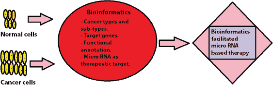

**图 11.1** 生物信息学在癌症检测中的作用。

## 11.3 通过国家癌症研究所促进癌症研究

国家癌症研究所或 NCI 通过发展基因组学、蛋白质组学和代谢组学领域来整合数据集并开发癌症病因起源和分子基础的知识，在癌症研究的进步中发挥了重要作用 \[9\]。 生物医学信息学和信息技术中心（CBIIT）监督计算数据以及各机构之间生物信息学计算结果的交换，其中国家癌症信息学计划（NCIP）使用 NCIP HubExit Disclaimer 并整合基因组、临床和转化研究以增强记录共享、常规评估和数据可视化。 这是一个中央操作平台，专为研究人员设计，以便交换、共享和记录重要的生物信息学数据以加快癌症研究。 NCIP 的操作平台是一个测试，无论癌症研究社区是否揭示了该机器的社会和网络因素对团队技术专长和多研究者研究团队是否有益 \[10\]。 NCI 是一个公共存储库，保证与私营公司合作长期保存临床数据，以促进技术进步并提出推动诊断和治疗方法。 这是在 NCI 癌症研究中心内的癌症数据科学实验室（CDSL）的整合下实现的，该实验室主要功能是协作癌症基因组学和组学特征的实验室统计数据，并进一步开发计算技术来研究它。 总之，计算模拟和数学算法在回答关键研究问题方面发挥着重要作用，例如癌症的病因起源、其进展以及如何预防或治愈。

癌症基因组图谱（TCGA）是一个为期三年的合作试点项目，由 NCI 和国家人类基因组研究所于 2005 年发起，报告与癌症进展相关的各种人类基因组突变。 研究人员对超过 11,000 名癌症患者的肿瘤和正常健康样本使用了高通量基因组分析技术，对此进行了各种研究并发表 \[11\]。 NCI 的“可治疗性研究以产生有效治疗”（TARGET）计划使科学家能够分离儿童癌症中的遗传变异，这些变异在儿童肿瘤学组进行的医学试验中主要在儿童中观察到。 NCI 的临床蛋白质组学肿瘤分析联盟（CPTAC）是机构和研究人员的构成性国家合作，他们参与癌症的基因组和蛋白质组分析，以发展对癌症流行率的理解基础。 NCI 协调临床试验并为院内研究人员提供广泛支持，并进一步促进生物医学研究，该研究也在公共领域可用 \[12\]。 这个广泛的网络推动了对癌症生物学的理解，并分离出新型药物靶向治疗的潜在靶点。 不可避免地，这导致了固定统计数据的建立和发展，并能够发现新的设备和方法来分析和访问大数据。

## 11.4 大数据在精准医学发展中的应用

公共领域中大量生物数据的可用性只有在随着时间的推移而发展起来的强大新研究技术才成为可能。 这些数据不仅使科学界对精准医学感到兴奋，而且还使科学家和研究人员能够了解疾病背后的生物学原因。

这使得使用定制药物、预防技术的发展和诊断治疗成为可能。

数据库中可用的大数据量可以由研究人员检索并在平台上交换，以便用于搜索这些致命疾病的罕见和未解之谜的生物学结论 \[13\]。


癌症数据的最大局限性在于碎片化和区隔化；因此，研究人员正试图克服阻碍研究发展的挑战。为了加快研究进展，研究人员同时进行经整理的数据的交换和访问至关重要，以便他们能够分析问题 \[14\]。因此，需要一个基础设施，使研究人员能够在共同的公共平台上存储、分析、可视化、整合和访问生物数据，并且该平台对全球所有研究人员和科学家保持可访问。生物信息学是一个不断发展的研究领域，过去十年经历了蓬勃发展。它使用先进的计算和编码算法、数学模拟以及不同的技术平台来管理、存储和分析数据。如今，研究人员使用不同的工具和平台来管理生物数据，涵盖蛋白质的全面分析、全基因组测序和先进的影像学研究，但将来自不同平台的数据进行整合存在困难，因为研究人员无法访问由其他研究创建的原始数据，也由于缺乏整合和分析所需计算工具和基础设施 \[15\]。近期，虚拟存储库的使用，即也称为数据云，出现了大幅度的繁荣，不仅有助于整合，还改善了研究数据的访问。尽管这些步骤仍处于初期阶段，围绕这些云的整合组织、协调及其用途仍存在疑问。正因为美国国家癌症研究所（NCI）在蛋白质组学、基因组学和代谢组学的科学进步中发挥了主导作用，才有可能理解癌症的分子基础 \[16\]。国家癌症信息学计划在纳入临床、基因组和转化研究方面发挥着关键作用，以改善众多研究领域的数据共享分析与可视化 \[17, 18\]。例如，图 11.2 提供了癌细胞和正常细胞的结构变异和点突变的详细流程分析，这些变异和突变可通过不同的测序设施报告，其中数据被注释和整合。数据进一步汇编，以便通过湿实验室程序进行验证，或在科学界进行讨论。数据的验证建立了系统性理解的生物学基础，这不仅能带来可靠的生物学结果，还可以被存储和可视化 \[19\]。

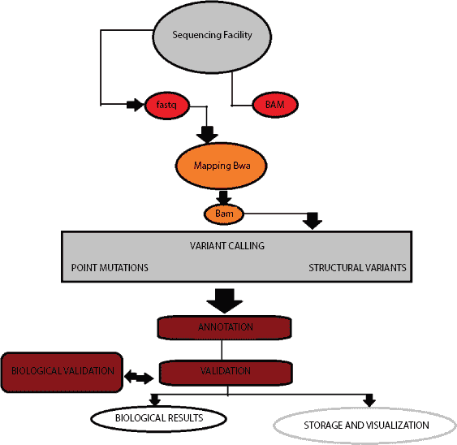

**图 11.2** 管道分析。

## 11.5 历史视角与发展

生物信息学和计算革命加强了理解癌症遗传和分子基础的方法。这促使科学界研究表达基因组中的显著基因表达，而非关注单个基因。无论是实验室产生的分子知识，还是存储在患者记录中的数据量，都在以惊人的速度不断增长。为癌症遗传学创造新的视角，对于发现整合这些结果的新方法至关重要。生物信息学，即遗传学、信息技术和工程学的整合，继续发展成为癌症生物学研究的关键组成部分 \[20\]。

癌症生物信息学是聚焦癌症生物信息学方法的方式之一，取决于疾病的代谢速率、信号传导、相互作用和增殖的性质。临床生物信息学是一门不断发展的科学，融合了临床计算机科学、生物信息学、信息技术、医学信息学、数学和组学研究，可被视为解决癌症患者早期检测、成功治疗和可靠诊断等临床重要问题的关键方面之一。开发针对癌症的生物信息学方法，或实施新的和专门的生物信息学工具以应对特定的癌症问题是必要的 \[21\]。例如，语义网平台已被用于解释高通量临床数据，并创建从 Corvus 获得的定量语义模型，Corvus 是一个数据仓库，提供不同类型组学数据的标准化接口，专注于结构化生物信息，同时使用 SPARQL 端点。包括转录组、表观基因组和基因组数据的语义模型，这些数据来自黑色素瘤样本，并结合基因本体数据和基于转录因子结合信息构建的调控网络，用于细胞分子状态与其对癌症治疗反应之间的相互作用。多变量检测是一种表征检测结果误差的方法，该误差由样本制备的固有误差和贡献变量的计算产生，用于支持和指导临床医生考虑在乳腺癌护理策略中使用基于 PAM50 中心的基因组预测因子，并纳入有关不确定性的有用知识。可以认真考虑适用性、准确性和方法学、应用、计算方法和数据库的收敛性，这些方法学、应用、计算方法和数据库可用于研究癌症分子通路并识别和验证新型生物标志物、网络生物标志物和个体化癌症药物。

miRTrail 是一种整合方法，用于评估依赖于表达谱的详细基因和 miRNA 关联，以产生关于致病性失调过程更严格和准确的数据。有人提出，miRTrail 通过整合对 20,000 个基因、约 1,000 个 miRNA 和约 280,000 个推定相互作用的知识，可以为人类疾病（包括癌症）探索基因和 miRNA 之间的调控相关性提供机会。探索将基因和 miRNA 之间的某些调控相互作用与临床表型进行比较的理论计算模式将是有用的，例如，基因相互作用在肿瘤部位、阶段、患者效应或治疗反应中的差异 \[22\]。

医学影像必须是癌症生物信息学发展中需要解决的关键考虑因素之一，因为临床病理学、断层扫描、核磁共振成像和正电子发射断层扫描中的影像学是识别和诊断癌症“早期和精确”的最合适和有效方法之一。基于生物信息学的医学图像中肿块和其他异常表面形态的评估是通过数学形态学对目标特征进行系统提取，并通过两种对比度调整技术改善提取的特征来进行。基于临床乳腺癌数据 \[23\]，Haustein 和 Schumacher 在《临床生物信息学杂志》癌症生物信息学专题系列中提到的算法可以预测肿瘤生长，并在细胞中临床检测之前确定某些转移的发展。如果癌症生物信息学专家能够协助临床医生定义与肿瘤相关形状、密度或位置相一致的基因或蛋白质关联和通路的可能图像，这可能是一个无关紧要的问题，也可能是一个希望。

## 11.6 生物信息学在癌症研究中的应用方法

有许多生物信息学方法用于研究癌症，这些方法根据基因表达或遗传特征对不同类型的癌症进行分类。图 11.3 描述了三种重要方法：微阵列特征的逐步连锁分析（SLAMS）、模块图和癌症异常轮廓分析（COPA）。

### 11.6.1 SLAMS


为了标示癌症的诊疗标准，肿瘤根据分级、分期和组织学进行分类。组织学标本的详细分析仅在分子水平上提供一个视角，因此各种类型的组织看起来相同但行为不同，且若干关联并不具有特征性。这些分子变异可能导致密切分类组织的疗效变异和治疗反应。这增加了相当大的困惑，因为医生必须为患者精确调整特定治疗 \[24\]。虽然基因表达谱在临床治疗中尚未广泛应用，但它证实了更系统的肿瘤检测方法。即便如此，该方法仍存在缺点，因为最终结果不仅仅是发现遗传标记，而是要认识到基因在疾病中的作用机制并确定影响输出的潜在靶点。

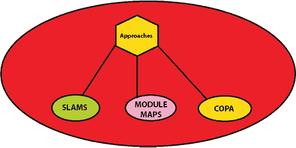

**图 11.3** 基于生物信息学的不同方法。

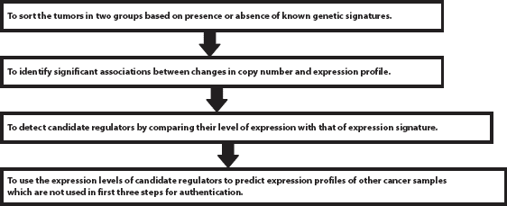

**图 11.4** SLAMS 涉及的步骤。

一组斯坦福大学的科学家开发了一种方法，通过将 DNA 拷贝数转移到由候选致癌基因调控因子组成的染色体区域来识别基因表达数据。与已知肿瘤类型相关的基因表达谱 \[25–27\] 是连锁研究中的表型。

他们的方法，即 SLAMS 由四个步骤组成（**图 11.4**）。

SLAMS 通过在乳腺癌样本上使用得到证实，随后得出结论，邻近的基因可能与 MYC 基因（致癌转录因子）相互作用以表达创伤特征 \[28\]。

### 11.6.2 模块图

模块图可能是说明异质组织和癌症疾病过程中基因表达正常趋势的可能工具 \[29, 30\]。模块可以通过将特定基因集与表达数据进行比较并检索共表达基因的子集来计算。所获得的模块可应用于所有类型的组织以寻找共同特征，揭示潜在过程。

《自然遗传学》发表的文章 \[31\] 通过使用模块图，表明了对癌症研究的期望。科学家从 2,000 项微阵列研究中获得了各种类型癌症的发现，并将其与临床证据汇编在一起。从 3,000 个基因集中鉴定出约 456 个模块，然后在多种癌症中进行匹配。该研究发现不同癌症共有的基因表达变异，从而为癌症通路提供了宝贵的知识。该技术有助于突出单次微阵列研究中不明显的全球性疾病的动态。但也存在局限性。来自众多技术的结局不一致带来了挑战，以及分析试验缺乏准确的临床知识也会影响其效用 \[24, 32\]。

### 11.6.3 COPA

当代致癌基因表达谱鉴定技术在通过多个样本区分模式的能力方面有限，特别是当这些模式不够突出时。这归因于样本中表达模式的异质性，使得难以从原始模式之间的背景变异中区分出来 \[33\]。COPA 用于解决此问题，以对在肿瘤样本子集中发现的变异进行分类。通过这种方法，我们可以区分表达水平较低的特定基因组的外部表达谱，而过表达则揭示了肿瘤样本的一个小子集。COPA 技术包含三个步骤（**图 11.5**）。

COPA 有助于压缩表达谱的正常动态范围。它还阐明了偏离平均表达水平的谱。对于每个基因，其与正常表达模式的偏离程度随后被评级，以产生合适的外部基因列表。

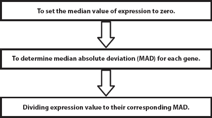

**图 11.5** COPA 涉及的步骤。

COPA 已添加到 oncomine 数据库中，定义了多种离群谱 \[34\]。COPA 的进展促使研究人员关注可能显示类似重排的其他肿瘤，这可能为潜在的诊断方法或治疗靶点提供线索。

## 11.7 结论与未来挑战

生物信息学在癌症研究中有多种应用，但另一方面也存在重大挑战。需要更创新的方法和技术来理解与癌症相关的尚不明确的遗传变化。还需要方法学用于在不同实验室在各种条件下组装的样本的数据整合和标准化算法。应采用标准格式来存储数据和注释样本。

需要研究癌症在微阵列样本标记之外的阳性或阴性；需要更彻底的注释来理解遗传学在癌症亚型、治疗反应和其他相关参数中的功能。此外，应以可计算模式将微阵列数据与患者的临床信息关联起来，并存储数据，这带来了有效挖掘临床数据的挑战。caBIG^™ 是改变标准研究程序的最大前景之一。

## 参考文献

1\. Ma, X. and Yu, H., 癌症的全球负担. *Yale J. Biol. Med*., 79, 3–4, 85–94, 2006.

2\. Hasty, P. and Montagna, C., 癌症中的染色体重排：检测和潜在的因果机制. *Mol. Cell. Oncol*., 1, 1, e29904, 2014, [`doi.org/10.4161/mco.29904`](http://doi.org/10.4161/mco.29904).

3\. Institute of Medicine (US) and National Academy of Engineering (US) Roundtable on Value & Science-Driven Health Care, *构建学习型医疗保健系统：展望未来：研讨会摘要*, p. 3, National Academies Press (US), Washington (DC), 2011, 医疗保健系统复杂性、障碍和失败. 可从以下获取： [`www.ncbi.nlm.nih.gov/books/NBK61963/`](http://www.ncbi.nlm.nih.gov/books/NBK61963/).

4\. Shyr, D. and Liu, Q., 癌症研究和临床应用中的下一代测序. *Biol. Proced. Online*, 15, 1, 4, 2013, [`doi.org/10.1186/1480-9222-15-4`](http://doi.org/10.1186/1480-9222-15-4).

5\. Hackl, H., Charoentong, P., Finotello, F. *et al*., 解析肿瘤-免疫细胞相互作用的计算基因组学工具. *Nat. Rev. Genet*., 17, 441–458, 2016, [`doi.org/10.1038/nrg.2016.67`](http://doi.org/10.1038/nrg.2016.67).

6\. Misra, B., Langefeld, C., Olivier, M., Cox, L., 综合组学：工具、进展和未来方法. *J. Mol. Endocrinol*., 62, 1, R21–R45, 2019.

7\. Elazezy, M. and Joosse, S.A., 作为癌症管理中液体活检组分的循环肿瘤 DNA 使用技术. *Comput. Struct. Biotechnol. J*., 16, 370–378, 2018, [`doi.org/10.1016/j.csbj.2018.10.002`](http://doi.org/10.1016/j.csbj.2018.10.002).

8\. Cesano, A. and Warren, S., 将下一代免疫肿瘤生物标志物带入临床. *Biomedicines*, 6, 1, 14, 2018, [`doi.org/10.3390/biomedicines6010014`](http://doi.org/10.3390/biomedicines6010014).

9\. Manzoni, C., Kia, D.A., Vandrovcova, J., Hardy, J., Wood, N.W., Lewis, P.A., Ferrari, R., 基因组、转录组和蛋白质组：组学数据在生物医学科学中的兴起及其整合. *Briefings Bioinf*., 19, 2, 286–302, 2018, [`doi.org/10.1093/bib/bbw114`](http://doi.org/10.1093/bib/bbw114).


10\. Mongkolwat, P., Kleper, V., Talbot, S., Rubin, D., 国家癌症信息学计划 (NCIP) 注释和图像标记 (AIM) 基础模型. *J. Digit. Imaging*, 27, 6, 692–701, 2014, [`doi.org/10.1007/s10278-014-9710-3`](http://doi.org/10.1007/s10278-014-9710-3).

11\. Tomczak, K., Czerwińska, P., Wiznerowicz, M., 癌症基因组图谱 (TCGA)：无可估量的知识来源. *Contemp. Oncol. (Poznan, Poland)*, 19, 1A, A68–A77, 2015, [`doi.org/10.5114/wo.2014.47136`](http://doi.org/10.5114/wo.2014.47136).

12\. Rudnick, P.A., Markey, S.P., Roth, J., Mirokhin, Y., Yan, X., Tchekhovskoi, D.V., Edwards, N.J., Thangudu, R.R., Ketchum, K.A., Kinsinger, C.R., Mesri, M., Rodriguez, H., Stein, S.E., 临床蛋白质组学肿瘤分析联盟 (CPTAC) 共同数据分析流程的描述. *J. Proteome Res*., 15, 3, 1023–1032, 2016, [`doi.org/10.1021/acs.jproteome.5b01091`](http://doi.org/10.1021/acs.jproteome.5b01091).

13\. Wooden, B., Goossens, N., Hoshida, Y., Friedman, S.L., 利用大数据发现胃肠道和肝脏疾病的诊断和治疗方法. *Gastroenterology*, 152, 1, 53–67.e3, 2017, [`doi.org/10.1053/j.gastro.2016.09.065`](http://doi.org/10.1053/j.gastro.2016.09.065).

14\. Tremblay, D., Touati, N., Roberge, D. *等*., 更好地理解癌症网络以更有效地实施：一种混合方法多案例研究. *Implementation Sci*., 11, 39, 2015, [`doi.org/10.1186/s13012-016-0404-8`](http://doi.org/10.1186/s13012-016-0404-8).

15\. He, K.Y., Ge, D., He, M.M., 基因组医学的大数据分析. *Int. J. Mol. Sci*., 18, 2, 412, 2017, [`doi.org/10.3390/ijms18020412`](http://doi.org/10.3390/ijms18020412).

16\. Chakraborty, S., Hosen, M., II, Ahmed, M., Shekhar, H.U., 肿瘤多组学方法：癌症研究的新前沿. *BioMed. Res. Int*., 2018, Article ID 9836256, [`doi.org/10.1155/2018/9836256`](http://doi.org/10.1155/2018/9836256).

17\. National Academies of Sciences, Engineering, and Medicine; Health and Medicine Division; Board on Health Care Services, National Cancer Policy Forum. *改善癌症诊断和护理：临床应用* *精准肿瘤学中的计算方法：研讨会论文集*, 2019 Jun 20 National Academies Press (US), Washington (DC), 可从以下获取： [`www.ncbi.nlm.nih.gov/books/NBK544637/`](http://www.ncbi.nlm.nih.gov/books/NBK544637/).

18\. Liu, J., Lichtenberg, T., Hoadley, K.A., Poisson, L.M., Lazar, A.J., Cherniack, A.D., Kovatich, A.J., Benz, C.C., Levine, D.A., Lee, A.V., Omberg, L., Wolf, D.M., Shriver, C.D., Thorsson, V., Cancer Genome Atlas Research Network, Hu, H., 用于推动高质量生存结局分析的整合 TCGA 跨癌症临床数据资源. *Cell*, 173, 2, 400–416.e11, 2018, [`doi.org/10.1016/j.cell.2018.02.052`](http://doi.org/10.1016/j.cell.2018.02.052).

19\. Rodriguez, H. and Pennington, S.R., 通过协作蛋白质组学和数据共享革新精准肿瘤学. *Cell*, 173, 3, 535–539, 2018, [`doi.org/10.1016/j.cell.2018.04.008`](http://doi.org/10.1016/j.cell.2018.04.008).

20\. Hulsen, T., Jamuar, S.S., Moody, A.R., Karnes, J.H., Varga, O., Hedensted, S., Spreafico, R., Hafler, D.A., McKinney, E.F., 从大数据到精准医学. *Front. Med*., 6, 34, 2019, [`doi.org/10.3389/fmed.2019.00034`](http://doi.org/10.3389/fmed.2019.00034).

21\. Wu, D., Rice, C.M., Wang, X., 癌症生物信息学：系统临床医学的新方法. *BMC Bioinf*., 13, 71, 2012, [`doi.org/10.1186/1471-2105-13-71`](http://doi.org/10.1186/1471-2105-13-71).

22\. Laczny, C., Leidinger, P., Haas, J. *等*., miRTrail - 用于分析基因和 miRNA 模式以增强对疾病中调控机制理解的综合网络服务器. *BMC Bioinf*., 13, 36, 2012, [`doi.org/10.1186/1471-2105-13-36`](http://doi.org/10.1186/1471-2105-13-36).

23\. Wu, D., Rice, C., Wang, X., 癌症生物信息学：系统临床医学的新方法. *BMC Bioinf*., 13, 71, 2012, 10.1186/1471-2105-13-71.

24\. Park, T., Yi, S.G., Kang, S.H., Lee, S., Lee, Y.S., Simon, R., 微阵列数据归一化方法的评估. *BMC Bioinf*., 4, 33, 2003.

25\. Chen, C.N., Lin, J.J., Chen, J.J., Lee, P.H., Yang, C.Y., Kuo, M.L., Chang, K.J., Hsieh, F.J., 基因表达谱可预测手术切除后胃癌患者的生存期. *J. Clin. Oncol*., 23, 7286–95, 2005.

26\. Dyrskjot, L., Zieger, K., Kruhoffer, M., Thykjaer, T., Jensen, J.L., Primdahl, H., Aziz, N., Marcussen, N., Moller, K., Orntoft, T.F., 浅表性膀胱癌中的分子特征可预测临床结局, *Clin. Cancer Res*., 11, 4029–36, 2005.

27\. Gyorffy, B., Surowiak, P., Kiesslich, O., Denkert, C., Schafer, R., Dietel, M., Lage, H., 30 条癌细胞系的基因表达谱分析可预测在临床达到浓度下对 11 种抗癌药物的耐药性, *Int. J. Cancer*, 118, 1699–712, 2006.

28\. Gyorffy, B., Serra, V., Jurchott, K., Abdul-Ghani, R., Garber, M., Stein, U., Petersen, I., Lage, H., Dietel, M., Schafer, R., 基于耐药细胞系基因表达谱的乳腺肿瘤阿霉素敏感性预测与患者生存相关, *Oncogene*, 24, 51, 7542–51, 2005 Nov 17.

29\. Ihmels, J., Friedlander, G., Bergmann, S., Sarig, O., Ziv, Y., Barkai, N., 揭示酵母转录网络的模块化组织, *Nat. Genet*., 31, 370–7, 2002.

30\. Tanay, A., Sharan, R., Kupiec, M., Shamir, R., 通过高度异质的全基因组数据的综合分析揭示酵母分子网络的模块性和组织结构, *Proc. Natl. Acad. Sci. U.S.A*., 101, 2981–6, 2004.

31\. Segal, E., Friedman, N., Koller, D., Regev, A., 显示癌症中表达模块条件性活动的模块图, *Nat. Genet*., 36, 1090–8, 2004.

32\. Chua, S.W., Vijayakumar, P., Nissom, P.M., Yam, C.Y., Wong, V.V., Yang, H., 一种有效去除微阵列数据中系统变异的新归一化方法, *Nucleic Acids Res*., 34, e38, 2006.

33\. Tomlins, S.A., Rhodes, D.R., Perner, S., Dhanasekaran, S.M., Mehra, R., Sun, X.W., Varambally, S., Cao, X., Tchinda, J., Kuefer, R., Lee, C., Montie, J.E., Shah, R.B., Pienta, K.J., Rubin, M.A., Chinnaiyan, A.M., 前列腺癌中 TMPRSS2 和 ETS 转录因子基因的反复融合, *Science*, 310, 644–8, 2005.

34\. Rhodes, D.R., Yu, J., Shanker, K., Deshpande, N., Varambally, R., Ghosh, D., Barrette, T., Pandey, A., Chinnaiyan, A.M., ONCOMINE：癌症微阵列数据库和集成数据挖掘平台, *Neoplasia*, 6, 1–6, 2004.

1. **通讯作者*: nikhil.08oct@gmail.com

# 12

# 多囊卵巢综合征的基因组关联：单核苷酸多态性及其在疾病进展中的作用

**Gowtham Kumar Subbaraj\*^(†) and Sindhu Varghese^(†)**

*Faculty of Allied Health Sciences, Chettinad Hospital and Research Institute, Chettinad Academy of Research and Education (Deemed to be University), Old Mahabalipuram Road, Kelambakkam, Tamil Nadu, India*

> ***摘要***
>


多囊卵巢综合征是一种常见且多方面的女性内分泌疾病，也是女性不孕的突出原因之一。它也众所周知是南印度女性中的典型综合征，导致不孕的高风险。在此，研究旨在探讨 FSHR、IL-10 和 IRS1 基因单核苷酸多态性与 PCOS 发病机制的关系。在三级护理医院对 PCOS 病例和对照女性进行了一项医院为基础的试点病例对照研究。基因分型通过聚合酶链反应进行。计算了比值比，结果分别为 0.71、1.06 和 0.32，并估计了 95% CI 以评估相对风险。相对可能性分别为 0.72、1.05 和 0.35。因此，我们的研究结果提示 FSHR (rs6166) 与 PCOS 无关联，而 IL10 (rs1800896) 与 PCOS 情况呈正相关。而 IRS-1 (rs1801278) 多态性显示出负相关，这些发现应谨慎解读。然而，不同人群中的研究数量应绝对增加，并应进行更深入的分析。

### Keywords
多囊卵巢综合征, FSHR, IL-10, IRS1, 单核苷酸多态性

## 12.1 Introduction

不孕被定义为在无避孕措施的情况下进行相当时间的性交后仍未能实现临床妊娠 \[1\]。根据健康、性史和生殖史、年龄、身体检查结果和检查结果，受孕尝试可在 1 年内启动。不孕是一种疾病，会导致功能受损而产生残疾 \[2\]。通常，年轻夫妇在无保护性交 1 个月后有 25% 的受孕可能性；70% 的夫妇在 6 个月内受孕，90% 的夫妇在一年内有受孕机会。只有 5% 的夫妇在一年半或两年后受孕 \[3\]。

不孕的原因可分为 i) 男性因素，ii) 女性因素，iii) 男女共同因素，以及 iv) 不明原因。男性不孕情况包括精液参数异常、精索静脉曲张、先天性和获得性泌尿生殖系统异常、内分泌紊乱、遗传异常、生殖道感染、生殖道阻塞、免疫因素以及药物/毒物暴露。男性不孕占全部不孕情况的 30%–50%。由于不同国家报道的不孕发病率不一致，男性不孕的真实发生率尚不明确 \[4\]。正常的生殖道有助于精子的通过以及在子宫内膜适合植入时释放优质卵子，这是女性伴侣成功妊娠的两个基本前提。

约 5%–10% 的不孕女性可能存在遗传异常，例如染色体异常、单基因或多基因改变以及多态性。不孕可能至少与环境影响、内分泌干扰和激素失衡有关 \[5\]。子宫内膜异位症与黑色素瘤、哮喘、自身免疫综合征、过敏性疾病、心血管疾病和卵巢癌的发病率升高有关 \[6\]。PCOS 与腰围增大、胰岛素抵抗 (IR)、血清胰岛素水平升高、脂蛋白比例升高、2 型糖尿病、高脂血症以及在正常 BMI 情况下中心/内脏脂肪增加有关 \[7\]。女性不孕可能有多种原因。女性不孕最常见的原因包括排卵困难、输卵管或子宫损伤以及宫颈并发症。

PCOS 可通过雄激素水平升高、月经异常以及一侧或两侧卵巢上的小囊肿来分类。该综合征可以是形态学上的（多囊卵巢）或主要生化性的（高雄激素血症）。约 1/5 的女性通过超声等诊断方式诊断出多囊卵巢的存在 \[8\]，10% 的女性表现出 PCOS 的额外生化和临床特征 \[9\]。随着肥胖的增加，多囊卵巢女性的比例上升，近期肥胖的流行预计会使多囊卵巢综合征变得更常见 \[10\]。PCOS 可定义为一种寡基因综合征，其中多种遗传和环境因素的相互作用控制着临床、异质性以及生化表型。

PCOS 的体征和症状各不相同。PCOS 的患病率及其体征和症状显示在 图 12.1 中。

* 月经不规律: 排卵不足会阻止子宫内膜每月脱落。
* 大量出血: 子宫内膜在更长的时间内积累。
* 毛发生长: 70% 的患此情况的女性面部和身体长出毛发——包括腹部、背部和胸部。多余的毛发生长被称为多毛症。
* 体重增加: 80% 的多囊卵巢综合征女性肥胖或超重。

尽管人们对多囊卵巢综合征、其识别和相关疾病的认识很高，但上述基本病理生理学却反复未被提及。本文为指导和扩展有关多囊卵巢综合征的起源和控制的知识提供了概述。即使是经验丰富的妇科医生也经常难以识别 PCOS，主要是因为临床类型因患者而异。

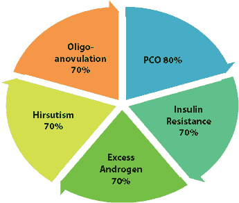

**图 12.1** PCOS 的患病率及其体征和症状。

尽管不同专家可能对其病理生理基础有不同看法，并且大约的可能性可以被检查，随后的原型提供了一个有益的背景来构建和呈现主要概念和管理途径。在概述中，卵巢发育有六个阶段以及与其相互作用的影响因素，有助于阐明多囊卵巢综合征进展中的背景。这些阶段的信息对于理解其管理方法至关重要。

该方法中的初始阶段是观察卵巢卵泡内激素雌二醇的构建。卵巢卵泡具有双层类固醇生成细胞层：外层的卵泡膜细胞层和内层的颗粒细胞层，通过穹窿膜分离 \[11\]。颗粒细胞层负责激素雌二醇的产生和分泌。它主要受垂体前叶分泌的促卵泡激素的刺激，该激素结合并刺激促卵泡激素受体 \[12\]。雌二醇被归类为性激素，所有类固醇激素在化学上本质上都是胆固醇 \[13\]。


# 多囊卵巢综合征

## 雄激素向雌激素转化与促性腺激素调节

雄激素通过芳香化酶的作用转化为雌激素。颗粒细胞含有大量芳香化酶；然而，它们不表达将胆固醇转化为雄激素所必需的酶和蛋白质；因此，它们不能产生雄激素。因为它们无法产生适于生成雌二醇的雄激素底物，所以需要从其他来源获取雄激素。雄激素由卵泡膜细胞分泌并进一步转化为雌激素。卵泡膜细胞在垂体分泌的促黄体激素（LH）的刺激下分泌雄激素，该激素触发 LH 受体 \[14\]。因此，为了使雌二醇产生成为可能，LH 引发雄激素的生成，而 FSH 促进那些被识别为双细胞、双促性腺激素模型的雌激素产生细胞的转化，且这些激素在生物学上是稳定的 \[15\]。

## 卵泡发育与囊肿形成

定义多囊卵巢综合征进展的另一个阶段是关注多囊卵巢的扩张与雄激素更大暴露相关，雄激素对其具有特定的特殊后果，影响卵泡进展和发育。已知多囊卵巢含有较多数量的轻度液体积聚的小窦卵泡，可在超声扫描中看到。它不能被定义为“囊肿”，因为它们包含一个可能健康的卵母细胞 \[16\]，并且其发育通常也受外源性促卵泡激素的诱导 \[17\]。这就是为什么在辅助受孕过程中使用促卵泡激素后，多囊卵巢综合征女性出现卵巢过度刺激综合征的风险明显增高的原因。多囊卵巢综合征中的卵巢“囊肿”实际上是停滞的卵泡，细胞进展缓慢且伴有细胞凋亡。雄激素阻碍优势窦卵泡的进展，却促进较小窦卵泡的发育。正常排卵与囊肿形成之间的差异如图 图 12.2 所示。

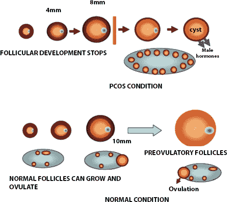

图 12.2 正常排卵与囊肿形成（PCOS）之间的差异。

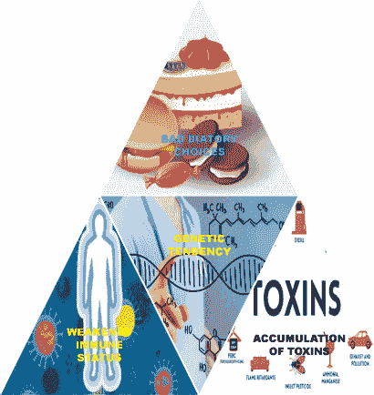

图 12.3 导致 PCOS 的因素和食物。

## 对雄激素的临床反应

临床上，多囊卵巢结构与内源性雄激素增加相关。内源性雄激素水平系统性升高的情况包括雄激素分泌性肿瘤和迟发性先天性肾上腺增生。在这些情况下，肾上腺雄激素分泌水平可能升高 \[11\]。导致 PCOS 的食物和因素如图 图 12.3 所示。患有这些情况的女性同样会出现多囊卵巢。因此，卵巢对雄激素增加的反应是多囊形态的进展和后期卵泡发育的阻碍。

## 激素失衡与胎儿编程

第三阶段是论证卵巢可能暴露于雄激素浓度升高的机制。通过两种细胞的验证，假设激素不平衡发生，例如循环 LH 浓度高于促卵泡激素浓度，卵巢雄激素的产生就会增强。之前，LH 与 FSH 比率的升高被认为是诊断多囊卵巢综合征的必要条件。这不是检查标准的一部分，后者强调随后升高的雄激素 \[12\]。然而，确切的是，多囊卵巢综合征女性更可能具有升高的基础 LH 浓度 \[13\] 以及升高的 LH 脉冲幅度和频率。虽然长期无排卵可能导致 LH 水平升高，但 LH 与 FSH 的比例失调可能是多囊卵巢综合征易感女性导致无排卵的原因。来自动物模型和人类的证据越来越多表明，多囊卵巢综合征可由出生前胎儿对雄激素的过度暴露所致 \[14, 15\]。这可能长期提高基础 LH 的分泌 \[16\] 并增加释放的 LH 数量，后者进一步对促性腺激素释放激素（GnRH）作出反应 \[16\]。

## 流行病学和临床特征

PCOS 是在多个国家常见的疾病，发生在青春期后导致不孕，尤其在南印度女性中更为常见。它是一种常见的内分泌疾病，主要导致女性生殖功能障碍 \[17\]。导致女性不孕的原因如图 图 12.4 所示。多囊卵巢综合征障碍以无排卵、高雄激素血症和/或多囊卵巢（即卵巢内的囊肿）形态为特征 \[18\]。与多囊卵巢综合征相关的症状包括月经不规律、肥胖、痤疮、多毛等 \[19\]。多囊卵巢综合征的发病机制尚不明确。这种多囊卵巢综合征还会增加发生心血管疾病和 II 型糖尿病的可能性 \[20\]。几种遗传因素包括与多囊卵巢综合征状态相关的各种基因的多态性或突变。

多囊卵巢综合征是月经严重不规律和延长（也称为闭经、稀发月经）的女性中最常见的诊断。它是由于无排卵引起的不孕和多毛症的常见原因。多囊卵巢综合征女性会出现循环雄激素浓度升高，并与血脂异常、胰岛素抵抗、妊娠糖尿病、肥胖、心血管疾病和 2 型糖尿病有明显关联。此外，它是子宫内膜增生的公认原因，因此与子宫内膜癌相关。多囊卵巢综合征的短期和长期问题表明其对卫生资源负担日益加重。


图 12.4 不孕症背后的因素和原因。

## 胰岛素抵抗和分子机制

在 50% 的多囊卵巢综合征女性中，胰岛素抵抗似乎与胰岛素受体的过度丝氨酸磷酸化相关。它似乎控制雄激素生物合成的主要调控酶的作用。因此，在某些 PCOS 女性中，特定的缺陷可能同时导致胰岛素抵抗和高雄激素血症 \[21\]。编码 IRS 蛋白的基因的多态性，尤其是 IRS-1 Gly972Arg，与 PCOS 的表型特征相关 \[22\]。胰岛素受体包含两个 alpha 亚基和两个 beta 亚基，被认为是异源四聚体。α 亚基包含配体结合位点，而 β 亚基包含配体激活的酪氨酸激酶。酪氨酸磷酸化后，胰岛素受体磷酸化两种胞内底物，即胰岛素受体底物-1 和胰岛素受体底物-2。IRS-1 作为信号转导的锚定分子，从而激活称为磷脂酰肌醇 3-激酶的酶。


子宫内膜不受约束的雌激素作用增加了子宫内膜癌的可能性 \[23\]。升高的游离雌激素模拟促黄体激素，诱发高雄激素血症，导致卵泡闭锁以及多毛症的体征和症状。胰岛素同样上调雄激素的产生，进一步加重多毛症并增加糖尿病的易感性 \[23\]。多囊卵巢综合征的病理生理学和分子基础目前尚不明确。研究表明，多囊卵巢综合征是一种多因素疾病，主要通过关联研究进行探讨，涉及胰岛素受体（`INSR`）、胰岛素（`INS`）、卵泡抑素（`FST`）以及类固醇酶等基因，且已被证实参与其中，但目前其致病分子缺陷仍未明确。此外，最新的证据还提出多囊卵巢综合征最重要的关联在于第 `19p 13.2` 染色体上的纤连蛋白 3（`FBN3`）以及第 `2p23.3` 染色体上的众多其他基因，但致病机制尚未确定 \[24\]。

## 12.2 FSHR 基因
卵泡刺激素受体（`FSHR`）已知是一种糖蛋白，由前垂体分泌，对女性卵泡发育、卵母细胞成熟和类固醇生成调节至关重要 \[25\]。`FSHR` 属于 G 蛋白偶联受体家族（鸟苷酸结合蛋白），包含 10 个外显子、9 个内含子，其启动子区域位于染色体区域 `2p21` \[26\]。由于单核苷酸多态性（`SNP`）变化，如 `Ala 307Thr` 和 `Ser 680Asn` 以及相应的氨基酸改变导致 `PCOS` \[27\]。

## 12.3 IL-10 基因
抗炎细胞因子白细胞介素-10（`IL-10`）在免疫系统调节中具有重要作用 \[28\]。在人类中，`IL-10` 基因位于染色体 `1q31-1q32` \[29\]。该 `IL-10` 作为抗炎因子，与 2 型糖尿病和肥胖相关 \[30\]。有两种多态性如 `819C/T` 和 `−1082G/A` 据报道会影响 `PCOS` \[28\]。这些病例研究在高加索人群中报道。

## 12.4 IRS-1 基因
研究假设 `IRS-1` `Gly972Arg` 调控多囊卵巢综合征患者的代谢和激素特征。`IR` 已知是 `PCOS` 发病机制中一个重要问题 \[31\]。图 12.5 说明了胰岛素抵抗的症状和原因。胰岛素配体与其受体的结合促进胞质底物 `IRS-1` 的磷酸化 \[32\]。`IRS-1` 对酪氨酸蛋白激酶的生物动力学反应取决于结合相似性以及胰岛素受体底物中酪氨酸磷酸化位点的特异性，而这些位点可通过磷酸酪氨酸结合（`PTB`）结构域中氨基酸多态性的改变而改变 \[33\]。

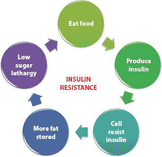

**图 12.5** 胰岛素抵抗（IR）的病因和症状。

鉴于 `IRS1` `rs1801278G≥A` 多态性在 `PCOS` 中的重要作用，先前的报道显示 `PCOS` 的易感性与 `SNP` 相关 \[34\]。`IR` 指的是胰岛素不能与细胞上的胰岛素受体相互作用的状态 \[35\]。`IR` 与 `PCOS` 之间的关联对 `PCOS` 的发病机制提供了重要见解 \[36\]。多项研究表明，改变的胰岛素水平可以直接刺激 `PCOS` 中卵巢雄激素的生成 \[37\]。胰岛素还可以通过增强对促肾上腺皮质激素（`ACTH`）的反应来刺激肾上腺类固醇生成 \[38\]。包括细胞葡萄糖摄取和基因表达在内的重要生理过程受胰岛素控制 \[39\]。`PCOS` 中的 `IR` 使个体易患 2 型糖尿病 \[40\]。

有建议认为额外体重与 `Arg-variant` 绝对相关，从而提高 2 型糖尿病的风险。迄今为止，研究已在 `IRS-1` 基因中发现了众多多态性。最常见 `IRS-1` 变体是在 972 编码子处的 `Gly→Arg` 改变，据报道在 2 型糖尿病患者中更常见。`Arg972` 携带者与非携带者相比被认为具有 `C-peptide` 和较低的空腹胰岛素水平，表明 `Arg972` `IRS-1` 变异可能导致胰岛素分泌受损。

2 型糖尿病是一种复杂的综合征，其特征是对胰岛素的抵抗以及代偿性胰岛素分泌反应不足 \[41\]。已收集大量证据表明遗传因素参与糖尿病的发病机制，体现在同卵双胞胎中较高的符合率 \[42\]、特定种族人群中发病率增加 \[43\] 以及受累个体后代中患病率升高 \[44\]。对 `IR` 和胰岛素不足的易感性似乎具有遗传稳定性 \[45\]。纵向研究提出 `IR` 是糖尿病发病机制中最初可观察到的缺陷。

首先，胰腺 β 细胞分泌的胰岛素可以补偿 `IR`，而当 β 细胞功能衰竭时，高血糖状态最终会进展。胰岛素受体基因的改变已在罕见疾病中被发现，如严重的 `IR`，例如 Rabson-Mendenhall 综合征和侏儒症 \[46\]。β 细胞功能缺陷由葡萄糖激酶基因 \[47, 48\]、肝核因子 1α（`HNF 1α`）、1β（`HNF 1 β`）以及（`HNF 4 α`）突变引起，这些均被认为是转录因子 \[49\]。胰岛素促进因子-1 已在青少年糖尿病患者中得到证实，这是一种罕见的单基因型糖尿病。尽管研究深入，负责 2 型糖尿病常见形式发生的基因仍未明确。

## 12.5 PCR 引物使用
`FSHR - rs6166`

| 正向外引物（5’ - 3’） | `CTGCTATGAAATGCAAGCCCAAATTTAT` |
|---|---|
| 反向外引物（5’ - 3’） | `TGTGTAGAAGCACTGTCAGCTCTTTGTG` |

`IL10 - rs1800896`

| 正向外引物（5’ - 3’） | `CTCCCAGTTACAGTCTAAACTGGAATG` |
|---|---|
| 反向外引物（5’ - 3’） | `CTCCCAGTTACAGTCTAAACTGGAATG` |

`IRS-1 - rs1801278`

| 正向引物 | `5’-CATCCCAGCTCCAGCCAGCTCCCAGAG-3’` |
|---|---|
| 反向引物 | `5’-TGGGCAGGCTCACCTCCTCTGCAGCAAT-3’` |

## 12.6 统计分析
对结果进行统计分析以计算基因多态性的比值比和风险比。显著性检验：`P-value` 按 Sheskin \[50\] 描述考虑。标准正态偏差（`z-value`）计算为 `ln(OR)/SE{ln(OR)}`。`PCR` 使用引物对分离的 DNA 进行以检测 `SNPs` 如 `rs1801278`、`rs6166` 和 `rs1800896`。运行后，`PCR` 产物通过 2% 琼脂糖凝胶电泳与对照 ladder（100 bp）在同一泳道中进行分析。`PCR` 样品包含引物、master mix、样品（患者和对照）以及无菌水，并设置了 `PCR`。对 `PCR` 样品进行 2% 琼脂糖凝胶电泳，并计算基因 `IL-10` 的比值比：比值比 `OR` = 1.0625，95% `CI` = 0.1559 至 7.0615，`p` = 0.95。`IL-10` 的风险比为 `RR` = 1.0556。基因 `IRS-1` 的比值比计算为：`OR` = 0.3269，95% `CI` = 0.0275 至 3.8927，`p` = 0.37。`IRS-1` 的风险比为 `RR` = 0.35。再次，对于基因 `FSHR`，比值比 `OR` = 0.7143，95% `CI` = 0.0135-37.75，`p` = 0.86。`FSHR` 的风险比为 `RR` = 0.72。这些比值比和风险比是使用公式计算的

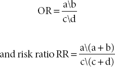


# PCOS 遗传关联研究

## 人口统计学和临床特征
人口统计学数据来自患者和对照组进行了分析，因此，在总样本中，肥胖是 `PCOS` 患者中比对照组更主要的致病因素。还有其他可能的遗传信息的数据，如糖尿病、心血管疾病、妊娠糖尿病和高血压的家族史，这些在对照组中相比之下更高。其他情况如减重困难、过敏、多余面部和其他多余毛发生长状况以及经前综合征 (`PMS`) 也是从患者和对照组收集到的信息。

## 流行病学和发病机制
`PCOS` 是一种常见的导致不孕的疾病，涉及所有育龄妇女的 8% 至 10%。`PCOS` 的病因尚未完全明确。也有报道称 `PCOS` 女性的雄激素水平升高，且几乎在 `BMI` 范围内升高。同样，基因变异编码多种促炎细胞因子，这些细胞因子与 `IR`、肥胖和糖尿病相关，并增加患心血管疾病和 2 型糖尿病的风险。85% 的女性为双侧 `PCOS`，15% 为单侧 `PCOS`。`PCOS` 与下丘脑促性腺激素释放激素 (`GnRH`) 脉冲发生器发生率增加有关。

## FSHR 基因多态性
`FSHR` 基因作为 `SNP` 从 `Ala 307Thr` 和 `Ser 680Asn` 对应的氨基酸变异导致 `PCOS`。`FSH` 是一种激素，对卵泡生长、卵母细胞成熟、类固醇生成调节以及启动靶蛋白和腺苷酸环化酶的磷酸化至关重要。在先前的研究中 \[51\]，卵巢反应被描述为不良反应，即卵母细胞数量较少，接近五个，而正常反应较高，其中卵母细胞数量更多 \[51\]。饮食习惯发生变化，生活方式改变也是肥胖的主要原因之一，因此肥胖与印度女性的 `PCOS` 和不孕症直接相关。在一项研究中 \[52\]，他们发现 `PCOS` 与对照组之间等位基因或基因型传递的重要变化，并且他们还指出 `FSHR` 多态性 (`rs6166`) 与 `PCOS` 在隐性及共显性模型中相关 \[52\]。Huang *et al*., \[53\] 的研究解释说，`FSHR` 中的多态性是 `PCOS` 患者中的一个促成因素，导致韩国人群中不孕症 \[53\]。有报道称 `IL-10` 基因多态性与前列腺癌的发生相关 \[54\]。

## 细胞因子相关研究
有多种与细胞因子相关的研究，如 `IL-6`、`IL-10`、`IL β1` 和 `IL-18`。`IL-10` 是妊娠期中一种重要的抗炎细胞因子，可控制特发性频繁自发性流产。`IL-10` 的下调与周末子宫内膜灌注有关，这会使子宫内膜具有防御性，可能最终导致早期妊娠丢失。`IL-10` 由单核细胞和淋巴细胞产生，被认为是最重要的抗炎和抗动脉粥样硬化免疫调节细胞因子 \[55\]。有关于与细胞因子、肿瘤坏死因子α和 `IL-6` 相关的各种基因的可能研究，但关于 `IL-10` 基因多态性与 `PCOS` 的信息没有。人类 `IL-10` 基因位于染色体 `1q31` 和 `1q32` \[56\]。它们也参与前列腺癌。在 Kelly *et al*., 的先前研究中，他们指出 `PCOS` 女性存在低水平持续性炎症，这在患者中比对照组中发展的 `CRP` 水平更高 \[56\]。

## 相关基因和生活方式因素
有多种基因与 `PCOS` 相关，如 `IL-6`、`IRS-1` 和 `IRS-2`、`TNF alpha` 和 `PPAR`，在高加索人中报道最多，部分在亚洲人群中报道。这种 `PCOS` 状况是由于生活方式改变和饮食习惯改变所致。由于 `BMI` 范围增加，导致肥胖。由于环境变化，有时基因变化也会导致 `PCOS`。大多数患有 `PCOS` 的患者初潮年龄为 11–13 岁。这项研究是一项试点研究，其中样本量太小，结果在小人群中进行比较。对更大样本量的分析能够确定南印度人群中 `PCOS` 状况的严重程度。在同一人群中比较这两个基因后，我们得出结论，基因 `FSHR` 与南印度人群中的 `PCOS` 状况无关，而 `IL10` 基因与 `PCOS` 状况相关。

## 生物标志物和胰岛素信号传导机制
`PCOS` 的生物标志物包括卵巢和肾上腺类固醇激素、类固醇生成作用、胰岛素分泌和作用、能量稳态、促性腺激素作用和调节以及慢性炎症 \[57\]。`PCOS` 的潜在机制非常难以定义且尚未系统认识；家族聚集表明基因组因素在该疾病的病因学中起关键作用 \[58\]。证据表明 `IR` 在 `PCOS` 的发病机制中具有重要作用 \[59, 60\]。胰岛素受体包含两个 α- 和两个 β- 二聚体。配体结合位点存在于 α 亚基中，而配体激活的酪氨酸激酶存在于 β 亚基中。一旦胰岛素与其受体结合，酪氨酸就会被磷酸化，胰岛素受体底物-1 (`IRS-1`) 和 `IRS-2` 以及两个细胞内底物也会被磷酸化。随后，`IRS-1` 和 `IRS-2` 结合并触发下游效应物，包括磷脂酰肌醇 3-激酶，以调节消化并参与胰岛素的促有丝分裂活性。`IRS-1` 位于染色体 `2q36` 上。最常见的变异 `IRS-1` `rs1801278G>A` 多态性 (`Gly972Arg`) 被提出。近期，一项荟萃分析显示 `IRS-1` `rs1801278G>A` 多态性与患 `PCOS` 的易感性之间存在重要关联 \[61\]。

## IRS1 多态性与 2 型糖尿病风险
到目前为止，许多基因因其在胰岛素分泌、胰岛素信号传导、脂肪细胞信号传导等中的已知或可能的生物学功能而被认为是 2 型糖尿病风险基因，通过候选基因策略 \[62\]。其中之一是 `IRS1`，它是胰岛素信号传导过程中的核心分子 \[63, 64\]。一旦胰岛素与其受体结合，`IRS1` 的酪氨酸磷酸化可作为下游效应物如 `PI3K` 和磷酸酪氨酸磷酸酶 2 (`SHP-2`) 的对接分子。持续的胰岛素刺激和其他刺激由 `IR` 的诱导物激活，触发 IRS 激酶，在 `Ser/Thr` 残基上磷酸化 `IRS1` \[65, 66\]。另一方面，酪氨酸磷酸化位点的结合特异性和亲和力对 `IRS1` 对酪氨酸蛋白激酶的反应至关重要，因此蛋白酪氨酸磷酸化位点内的多态性可以改变这些相互作用 \[67\]。因此，`IRS1` 酪氨酸磷酸化的减少会阻碍 `IRS1` 的下游信号传导 \[68\]。总之，多项新的病例对照研究在中等样本量下报告了 `IRS-1` `rs1801278 G>A` 变异与 `PCOS` 的关联，但结果各不相同。早期荟萃分析的结果强调 `IRS-1` `rs1801278 A` 等位基因改变了 `PCOS` 的风险 \[69\]。近期，关于 `IRS-1` `rs1801278 G>A` 多态性与 `PCOS` 风险的建议的额外研究被展示。`IRS-1` 位于染色体 `2q36` 上，编码 131.6 kDa 的 `IRS-1` 蛋白。最常见的 `SNP`，`IRS-1` `rs1801278 G>A` (`Gly972Arg`)，被认为与 `IR`、`PCOS` 和 `T2DM` 相关 \[70, 71\]。

## 研究局限性与结论
这项研究是一项试点研究，其中样本量太小，结果在小人群中进行比较。对更大样本量的分析能够确定南印度人群中 `PCOS` 状况的严重程度。在同一人群中比较这两个基因后，我们得出结论，基因 `FSHR` 与南印度人群中的 `PCOS` 状况无关，`IL10` 基因与 `PCOS` 状况相关，而 `IL-10` 基因也与该疾病无关联。


## 12.7 结论

在 `IRS1` 和 `IRS2` 之间，`IRS 1` 基因的多态性可能在 `PCOS` 的发病生理和风险中发挥促成作用。我们已分析 `PCOS` 参与者并对照 DNA 样本，通过聚合酶链扩增方法检测 `FSHR` `rs6166`、`IL-10` `rs1800896` 和 `IRS-1` `rs1801278` 多态性。结果显示，在 `SNP` 中，`rs6166` 与 `PCOS` 状况无关联，而 `rs1800896` 显示出阳性关联，而 `rs1801278` 在所研究人群中与 `PCOS` 显示出阴性关联（比值比为 0.35，相对风险为 0.32）。然而，研究人群应肯定增加，并应进行更广泛的研究以强调 `PCOS` 与 `FSHR`、`IL-10` 和 `IRS 1` 基因多态性之间的关联。

## 参考文献

1\. Brugo-Olmedo, S., Chillik, C., Kopelman, S., 不孕的定义和原因. *Reprod. Biomed. Online*, 2, 1, 173–85, 2001;1.

2\. Zegers-Hochschild, F., Adamson, G.D., Dyer, S., Racowsky, C., de Mouzon, J., Sokol, R., Rienzi, L., Sunde, A., Schmidt, L., Cooke, I.D., Simpson, J.L., 不孕和生育护理国际术语表, 2017. *Hum. Reprod*., 32, 9, 1786–801, 2017 Jul 28.

3\. Kamel, R.M., 不孕夫妇的管理：基于证据的方案. *Reprod. Biol. Endocrinol*., 8, 1, 21, 2010.

4\. Ghuman, N. *et al*., 男性不育评估和管理概览. *Obstet. Gynaecol. Reprod. Med*., 28, 7–14, 2018.

5\. Tarín, J.J., García-Pérez, M.A., Hamatani, T., Cano, A., 不孕病因在遗传和临床上与单一元疾病中的其他疾病相关联. *Reprod. Biol. Endocrinol*., 13, 31, 2015;15.

6\. Kvaskoff, M., Mu, F., Terry, K.L., Harris, H.R., Poole, E.M., Farland, L., Missmer, S.A., 子宫内膜异位症：主要慢性疾病的高危人群？ *Hum. Reprod. Update*, 21, 4, 500–16, 2015 Mar 11.

7\. Ghaffarzad, A., Amani, R., Sadaghiani, M.M., Darabi, M., Cheraghian, B., 多囊卵巢综合征不孕女性血清脂蛋白比值与胰岛素抵抗的相关性：病例对照研究. *Int. J. Fertil. Steril*., 10, 1, 29, 2016.

8\. Polson, D.W., Wadsworth, J., Adams, J., Franks, S., 多囊卵巢——正常女性的常见发现. *Lancet*, 331, 8590, 870–2, 1988; 6.

9\. Franks, S., 多囊卵巢综合征. *N. Engl. J. Med*., 333, 835–861, 1995.

10\. Motta, A.B., 肥胖在多囊卵巢综合征发展中的作用. *Curr. Pharm. Des*., 18, 2482–2492, 1990.

11\. Adams, 2012, Peng, L. *et al*., 二甲双胍对多囊卵巢综合征血清白细胞介素-6 水平的影响：系统综述. *BMC Women’s Health*, 14, 93, 2014.

12\. Rotterdam ESHRE/ASRM-Sponsored PCOS Consensus Workshop Group, 修订的 2003 年多囊卵巢综合征相关诊断标准和长期健康风险共识. *Fertil. Steril*., 81, 19–25, 2004.

13\. Franks, S., 多囊卵巢综合征. *N. Engl. J. Med*., 333, 13, 853–61, 1995; 28.

14\. Abbott, D.H., Nicol, L.E., Levine, J.E., Xu, N., Goodarzi, M.O., Dumesic, D.A., 非人类灵长类动物多囊卵巢综合征模型. *Mol. Cell. Endocrinol*., 373, 1-2, 21–8, 2013; 5.

15\. Padmanabhan, V. and Veiga-Lopez, A., 多囊卵巢综合征表型的绵羊模型. *Mol. Cell. Endocrinol*., 373, 1-2, 8–20, 2013; 5.

16\. Abbott, D.H., Barnett, D.K., Bruns, C.M., Dumesic, D.A., 雄激素过量胎儿编程女性生殖：多囊卵巢综合征的发育病因？ *Hum. Reprod. Update*, 11, 357–74, 2005; 1.

17\. Helvaci, N. *et al*., 多囊卵巢综合征与阻塞性睡眠呼吸暂停风险：荟萃分析和文献综述. *Endocr. Connect*., 6, 437–445, 2017.

18\. Tumu, V.R. *et al*., IL-6 基因启动子多态性与南印度女性 PCOS 相关. *J. Assist. Reprod. Genet*., 30, 1541–1546, 2013.

19\. Panda, P.K. *et al*., PCOS 遗传学：揭示 PCOS 相关蛋白的系统生物信息学方法. *Genom. Data*, 8, 52–60, 2016.

20\. Almawi, W.Y. *et al*., 对 *VEGFA* 变异的分析和 VEGF 水平变化强调了 VEGF 对多囊卵巢综合征的贡献. *PLoS One*, 11, e0165636, 2011.

21\. Dunaif, A. and Graf, M., 胰岛素给药改变胰岛素抵抗型多囊卵巢综合征女性的性腺类固醇代谢，与促性腺激素分泌变化无关. *J. Clin. Investig*., 83, 1, 23–9, 1989; 1.

22\. Sir-Petermann, T., Perez-Bravo, F., Angel, B., Maliqueo, M., Calvillan, M., Palomino, A., 多囊卵巢综合征女性中 IRS-1 的 G972R 多态性. *Diabetologia*, 44, 9, 1200–1, 2001;1.

23\. Almind, K., Doria, A., Kahn, C.R., 将 II 型糖尿病基因定位于图谱上. *Nat. Med*., 7, 3, 277, 2001 Mar.

24\. Barthelmess, E.K. and Naz, R.K., 多囊卵巢综合征：现状与未来展望. *Front. Biosci. (Elite edition)*, 6, 104, 2014.

25\. Peluso, C. *et al*., 人类生殖结局中 FSHR 基因的 Ala307Thr 和 Asn680Ser 多态性. *Cell Physiol. Biochem*., 34, 1527–1535, 2014.

26\. Thathapudi, S. *et al*., 促卵泡激素受体基因 ser680 asn (rs6166)多态性与多囊卵巢综合征的关联. *Int. J. Reprod. Contracept. Obstet. Gynecol*., 5, 9, 3126–3132, 2016.

27\. Wu, X.-Q. *et al*., 华北中国女性 FSHR 多态性与多囊卵巢综合征的关联. *J. Assist. Reprod. Genet*., 31, 371–377, 2014.

28\. Zangeneh, F.Z., Naghizadeh, M.M., Masoumi, M., 多囊卵巢综合征与循环炎症标志物. *Int. J. Reprod. Biomed*., 15, 6, 375, 2017.

29\. Cordeiro, C.A., Moreira, P.R., Andrade, M.S., Dutra, W.O., Campos, W.R., Oréfice, F., Teixeira, A.L., 白细胞介素-10 基因多态性（-1082G/A）与弓形虫视网膜脉络膜炎相关. *Invest. Ophthalmol. Vis. Sci*., 49, 5, 1979–82, 2008.

30\. Barry, J.C., Shakibakho, S., Durrer, C., Simtchouk, S., Jawanda, K.K., Cheung, S.T., Mui, A.L., Little, J.P., 2 型糖尿病中对白细胞介素-10 抗炎作用的低反应性. *Sci. Rep*., 6, 21244, 2016; 17.

31\. Polonsky, K.S., Sturis, J., Bell, G.I., Beth Israel 医院波士顿医学研讨会。非胰岛素依赖型糖尿病是β细胞代偿胰岛素抵抗的遗传性编程失败. *N. Engl. J. Med*., 334, 777–783, 1996; 21.

32\. Ogihara, S.D., 胰岛素样生长因子 II（IGF-II）. *Int. J. Biochem. Cell Biol*., 30, 7, 767–71, 1997.

33\. Garzia, V., Erices, L., Valdes, P., Salzar, L., 智利多囊卵巢综合征女性及对照组中过氧化物酶体增殖物激活受体γ2 基因的常见 34C > G 变异. *Intl*., 25, 4, 867–73, 1993.

34\. Wang, Y., Wu, X., Cao, Y., Yi, L., Fan, H., Chen, J., 中国多囊卵巢综合征女性中过氧化物酶体增殖物激活受体-γ及其共激活因子-1α基因的多态性. *Fertil. Steril*., 85, 5, 1536–40, 2012.

35\. Ciaraldi, T.P., 多囊卵巢综合征中胰岛素作用的分子缺陷：可能的组织特异性. *J. Pediatr. Endocrinol. Metab*., 13, Suppl 5, 1291–3, 2000.

36\. Skov, V., Glintborg, D., Knudsen, S., Jensen, T., Kruse, T.A., Tan, Q., 胰岛素抵抗型多囊卵巢综合征女性骨骼肌中线粒体氧化代谢相关核编码基因表达降低. *Diabetes*, 56, 9, 2349–55, 2007.

37\. Michelmore, K., Ong, K., Mason, S., Bennett, S., Perry, L., Vessey, M., 多囊卵巢女性临床特征：与胰岛素敏感性、胰岛素基因 VNTR 和出生体重的关系. *Clin. Endocrinol. (Oxf)*, 55, 4, 439–46, 2001.


## 参考文献
38\. Dunaif, A. and Graf, M., 胰岛素给药改变了胰岛素抵抗的多囊卵巢综合征女性中性腺类固醇代谢，而与促性腺激素分泌的变化无关。 *J. Clin. Invest*., 83, 1, 23–9, 1997.

39\. Plum, L., Belgardt, B.F., Bruning, J.C., 中枢胰岛素作用于能量和葡萄糖稳态。 *J. Clin. Invest*., 116, 7, 1761–6, 2006.

40\. Chakraborty, C., 胰岛素抵抗的生化和分子基础。 *Curr. Protein Pept. Sci*., 7, 2, 113–21, 2006.

41\. De Fronzo, R., 2 型糖尿病的发病机制：识别糖尿病基因的代谢和分子意义。 *Diabetes Rev*., 5, 177–269, 1997.

42\. Newmann, B. *et al*., 男性双胞胎中 2 型（非胰岛素依赖性）糖尿病的符合性。 *Diabetologia*, 30, 763–768, 1987.

43\. Lillioja, S. *et al*., 胰岛素抵抗和胰岛素分泌功能障碍作为非胰岛素依赖性糖尿病的先兆。皮马印第安人的前瞻性研究。 *N. Engl. J. Med*., 329, 1988–1992, 1993.

44\. Rich, S.S., 糖尿病基因定位：遗传流行病学视角。 *Diabetes*, 39, 1315–1319, 1990.

45\. Martin, B.C. *et al*., 葡萄糖和胰岛素抵抗在 2 型糖尿病发展中的作用：25 年随访研究结果。 *Lancet*, 340, 925–929, 1992.

46\. Taylor, S.I., Kadowaki, T., Kadowaki, H., Accili, D., Cama, A., McKeon, C., 胰岛素抵抗患者胰岛素受体基因的突变。 *Diabetes Care*, 13, 3, 257–79, 1990.

47\. Froguel, P. *et al*., 第 7 号染色体 p 上葡萄糖激酶基因座与早发性非胰岛素依赖性糖尿病密切连锁。 *Nature*, 356, 162–164, 1992.

48\. Vionnet, N. *et al*., 葡萄糖激酶基因的无义突变导致早发性非胰岛素依赖性糖尿病。 *Nature*, 356, 721–722, 1992.

49\. Yamagata, K. *et al*., 成年发病青年糖尿病中肝细胞核因子-4α基因的突变。 *. Nat*., 384, 458–460, 1996.

50\. Sheskin DJ (2004) 参数和非参数统计程序手册。 3rd ed. Boca Raton: Chapman & Hall/CRC.

51\. Peluso, C. *et al*., 人类生殖结局中 *FSHR* 基因的 Ala307Thr 和 Asn680Ser 多态性。 *Cell. Physiol. Biochem*., 34, 1527–1535, 2014.

52\. Sujatha, T. *et al*., FSHR 基因 ser680 asn (rs6166) 多态性与 PCOS 的关联。 *Int. J. Reprod. Contracept. Obstet. Gynecol*., 5, 9, 3126–3132, 2016.

53\. Huang, X., Li, L., Hong, L., Zhou, W., Shi, H., Zhang, H., Zhang, Z., Sun, X., Du, J., 促卵泡激素受体基因中的 Ser680Asn 多态性与控制性卵巢过度刺激中的卵巢反应相关。 *Clin. Endocrinol*., *82*, 4, 577–583, 2015.

54\. Chen, H., Tang, J., Shen, N., Ren, K., 白细胞介素 10 基因 rs1800896 多态性与前列腺癌风险相关。 *Oncotarget*, 8, 39, 66204, 2017; 12.

55\. Mosser, D.M. and Zhang, X., 白细胞介素-10：一种旧细胞因子的新视角。 *Immunol. Rev*., 226, 1, 205–18, 2008.

56\. Karadeniz, M. *et al*., 多囊卵巢综合征中白细胞介素-10 基因的多态性*. Int. J. Immunogenet*., 35, 119–123, 2008.

57\. Rosenfield, R.L. and Ehrmann, D.A., 多囊卵巢综合征（PCOS）的发病机制：PCOS 作为功能性卵巢高雄激素血症的假说再探。 *Endocr. Rev*., 37, 5, 467–520, 2016.

58\. Azziz, R., PCOS：诊断挑战。 *Reprod. Biomed. Online*, 8, 6, 644–8, 2004.

59\. Legro, J.M., Flight, I.H., Norman, R.J., 多囊卵巢综合征中的二甲双胍：系统评价和荟萃分析。 *BMJ*, 327, 7421, 951–3, 1999.

60\. Chen, Z.J., Zhao, H., He, L., Shi, Y., Qin, Y., Li, Z., 全基因组关联研究鉴定出 2 号染色体 p16.3、2p21 和 9q33.3 上多囊卵巢综合征易感位点。 *Nat. Genet*., 43, 1, 55–9, 2011.

61\. Ruan, Y., Ma, J., Xie, X., IRS-1 和 IRS-2 基因多态性与多囊卵巢综合征的关联：荟萃分析。 *Endocr. J*., 59, 601–609, 2012.

62\. Arikoglu, H., Hepdogru, M.A., Kaya, D.E., Asik, A., Ipekci, S.H., Iscioglu, F., IRS1 基因多态性 Gly972Arg 和 Ala513Pro 与非肥胖土耳其人群中胰岛素抵抗和 2 型糖尿病风险无关。 *Meta Gene*, 2, 579–85, 2014; 1.

63\. Yiannakouris, N., Cooper, J.A., Shah, S., Drenos, F., Ireland, H.A., Stephens, J.W., Li, K.W., Elkeles, R., Godsland, I.F., Kivimaki, M., Hingorani, A.D., IRS1 基因变异、糖代谢异常变化和 2 型糖尿病风险。 *Nutr. Metab. Cardiovasc. Dis*., 22, 12, 1024–30, 2012;1.

64\. Thangavelu, M., Godla, U.R., Paul, S.F., Maddaly, R., INS、INSR、IRS1、IRS2、PPAR-G 和 CAPN10 基因的单核苷酸多态性在多囊卵巢综合征发病机制中的作用。 *J. Genet*., 96, 1, 87–96, 2017; 1.

65\. Kilpeläinen, T.O., Zillikens, M.C., Stančákova, A., Finucane, F.M., Ried, J.S., Langenberg, C., Zhang, W., Beckmann, J.S., Luan, J.A., Vandenput, L., Styrkarsdottir, U., IRS1 附近的遗传变异与降低的脂肪量和受损的代谢特征相关。 *Nat. Genet*., 43, 8, 753, 2011.

66\. Boura-Halfon, S. and Zick, Y., IRS 蛋白的磷酸化、胰岛素作用和胰岛素抵抗。 *Am. J. Physiol. Endocrinol. Metab*., 296, 581–591, 2009.

67\. Garzia, V., Erices, L., Valdes, P., Salzar, L., 智利多囊卵巢综合征女性及对照组中过氧化物酶体增殖物激活受体 γ2 基因的常见 34C > G 变异。 *Intl*., 25, 4, 867–73, 1993.

68\. Aguirre, V., Werner, E.D., Giraud, J., Lee, Y.H., Shoelson, S.E., White, M.F., 胰岛素受体底物-1 中 Ser307 的磷酸化阻断与胰岛素受体的相互作用并抑制胰岛素作用。 *J. Biol. Chem*., 277, 1531–1537, 2002.

69\. Ruan, Y., Ma, J., Xie, X., IRS-1 和 IRS-2 基因多态性与多囊卵巢综合征的关联：荟萃分析。 *Endocr. J*., 59, 601–609, 2012.

70\. Baba, T., Endo, T., Sata, F., Honnma, H., Kitajima, Y., Hayashi, T., 在日本人群中，多囊卵巢综合征与胰岛素信号基因 IRS-1 的遗传多态性相关，但与 ENPP1 无关。 *Life Sci*., 81, 10, 850–4, 2007.

71\. Haghani, K. and Bakhtiyari, S., 伊朗西部库尔德族群中 IRS-1 Gly972Arg 和 IRS-2 Gly1057Asp 多态性与 2 型糖尿病关系的调查。 *Genet. Test. Mol. Biomarkers*, 16, 1270–1276, 2012.

1.  **通讯作者*: gowtham_phd@yahoo.com

2.  ^†这些作者对本工作贡献相等。

# 13

# 利用同源建模进行蛋白质结构预测的见解

**S. Muthumanickam^(1), P. Boomi^(1)\*, R. Subashkumar^(2), S. Palanisamy^(3), A. Sudha^(4),** **K. Anand^(5), C. Balakumar^(6), M. Saravanan^(7), G. Poorani^(8), Yao Wang^(9),** **K. Vijayakumar^(10) and M. Syed Ali^(11)**

^(*1*)*生物信息学系，阿拉加帕大学，卡赖库迪，泰米尔纳德邦，印度*

^(*2*)*斯里拉马克里希纳艺术与科学学院（原 SNR Sons College）（自治，隶属于巴拉蒂亚大学）阿维纳希路，纳瓦印度，科伊姆巴托尔，泰米尔纳德邦，印度*

^(*3*)*东海岸生命科学研究所，江陵原州国立大学，江陵，韩国*

^(*4*)*生物技术系，德鲁·乌迈亚尔·拉马纳森女子学院，卡赖库迪，泰米尔纳德邦，印度*

^(*5*)*化学病理学系，病理学学院，健康科学学院及国家健康实验室服务，自由州大学，布隆方丹，南非*


6 药学院，费城大学，安曼，约旦
7 微生物学与免疫学系，生物医学科学分部，医学院，健康科学学院，梅克勒大学，梅克勒，埃塞俄比亚
8 库马拉古鲁技术学院，科伊姆巴托，泰米尔纳德邦，印度
9 生命科学学院，生物技术系，安阳工学院，河南，中国
10 化学系 M. 库马拉萨米工程学院，卡鲁尔，泰米尔纳杜，印度
11 P.G. 与研究生物技术系，Mohamad Sathak 艺术与科学学院，金奈，泰米尔纳杜，印度

## Abstract

同源建模是一种计算方法，是利用氨基酸查询序列和模板蛋白构建三维蛋白结构的重要步骤之一。如果查询序列与模板结构相似，则模型结构可以很容易地以高分辨率预测。同源建模在结构预测中发挥着至关重要的作用，可用于发现针对各种疾病的新型药物靶点。基于物理定律和进化等两个重要原理，可以预测三维蛋白结构。根据物理和进化原理，蛋白质折叠通过最小化能量形成稳定且结构良好的结构，且蛋白质分子是序列和结构逐渐变化的结果。同源建模具有多个步骤，可最准确地预测绝对模型结构。当序列一致性低于 15%时，不能用于进一步的结构建模，这可能导致误导性结论。从查询和模板序列获得的 30%至 40%之间的最大相似性可用于进一步的同源建模。如果相似性高于 50%，则获得的模型质量足够，可用于进一步的分子对接，包括蛋白-蛋白对接、蛋白-配体复合物和分子动力学模拟研究。这种建模技术非常舒适、快速且成本效益高。本章将讨论用于药物开发过程中蛋白结构预测的不同同源模型。

**Keywords:** 同源建模，用于同源建模的方法和工具

## 13.1 Introduction

十多年来，许多真菌、动物和植物基因组都有大量蛋白质。数百万个特定蛋白质的绝对三维晶体结构在蛋白质数据银行（`http://www.pdb.org`）中愉快地可用。然而，一些蛋白质没有鉴定出特定结构。预测三维结构是结构生物学的一项重要任务。因此，计算方法对于从数据库中鉴定蛋白质结构并使用各种工具如 SWISS-MODEL、Robetta、I-TASSER、Phyre2、IntFOLD、Modbase 和 HHpred [1, 2] 预测新结构至关重要。详细的工具信息如下给出。当序列一致性低于 15%时，不能用于进一步的结构建模，这可能导致误导性结论。从查询和模板序列获得的 30%至 40%之间的最大相似性可用于进一步的同源建模。如果相似性高于 50%，则获得的模型质量足够，可用于进一步的分子对接，包括蛋白-蛋白对接、蛋白-配体复合物和分子动力学模拟研究 [3]。

PDB 中有大量三维蛋白质结构可供使用。截至 2021 年 1 月，PDB 数据库包含 173,754 个经实验解析的蛋白质结构，UniProtKB 数据库包含 563,927 个注释序列。所有结构均通过实验方法解析。实验中的结构测定过程涉及多个步骤，包括蛋白质表达分析、蛋白质纯化、结晶技术（气相扩散、微批和微透析），以及通过 X 射线晶体学和 NMR（核磁共振）光谱测定结构 [4]。在上述实验和表征技术获得结构确认后，绝对三维结构连同详细信息可在 PDB 数据库（`http://www.pdb.org`）[5] 中获得。重要的是，膜蛋白由于三维蛋白质结构与注释序列之间存在巨大差距，很难结晶并解析结构。因此，计算建模方法是预测蛋白质准确结构和功能的一种创新技术 [2]。

通常，用于蛋白质建模有三种不同的方法：（i）同源或比较建模，（ii）*ab initio* 建模，以及（iii）threading 或蛋白质折叠。

第一个同源或比较建模是最精确的计算方法，可用于在没有实验解析结构的情况下根据氨基酸序列构建蛋白质结构 [6]。该方法涉及多种方法来预测其蛋白质结构以进行药物开发 [7]。然后，*ab initio* 建模是构建蛋白质结构的重要方法。如果蛋白质结构在 PDB 中不可用且蛋白质相似性较少，则该方法可以帮助预测新结构以用于药物开发过程。基于物理原理和蒙特卡洛算法，*ab initio* 方法有多种方法，包括 ROSETTA、TOUCHSTONE-II 和 I-Tasser 来预测蛋白质结构。由于计算资源需求大、准确性低且无需模板即可预测蛋白质结构，该方法未被广泛使用 [8]。因此，这仅适用于小型蛋白质 [9, 10]。最后，threading 或蛋白质折叠：该技术可用于将序列与三维结构进行比对，以从一组备选结构中选择已知序列的合适折叠。threading 或蛋白质折叠采用两个原理：第一个原理是初级序列折叠，其相对接近相似结构。第二个原理是蛋白质结构折叠数量有限 [11]。这意味着非同源蛋白质具有相似的结构。目标蛋白质序列与合适的模板结构折叠以预测新结构，然后进行优化 [12]。因此，threading 方法通常不使用，但有时会与其他计算技术结合使用 [13]。

## 13.2 同源建模方法


## 13.2 同源建模

一般而言，与单独的序列相比，蛋白质的结构信息对药物发现过程更有价值。在生物科学中，基因序列的数量很容易获得，同时，经实验解析的蛋白质结构却非常少。因此，同源建模方法对于预测最终模型结构至关重要，该结构取决于靶蛋白与模板蛋白序列之间的进化关系。同源建模的两个主要观察结果包括三维结构决定氨基酸序列、蛋白质结构保守以及进化过程中与序列相关的微小变化 \[14\]。一般而言，同源建模的流程包括四个步骤：鉴定潜在靶点、序列比对、模型构建和模型优化。经实验解析的蛋白质结构可作为蛋白质结构建模的模板。从所得模板来看，选择模板的结构有一些标准，如查询序列与模板序列之间的相似度水平、经实验解析的结构质量，以及是否存在配体或辅因子。同源建模是基于蛋白质结构相似性和序列相似性进行预测的。因此，给定模板的实验结构来生成靶序列，其显著序列同一性高于 30%。然而，结构预测包含错误，且实验上准确的结构很少达到。因此，靶模板序列 30%的同一性在同源建模中仍然具有挑战性。同源模型的正确性受三个因素影响：(I) 靶蛋白与模板具有结构相似性，(II) 准确的靶模板比对，以及 (III) 优化模型的能力 \[15\]。

### 13.2.1 同源建模策略

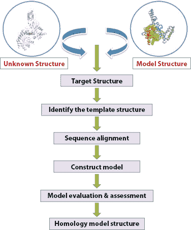

注：如果建模的蛋白质结构不合适，则需进一步使用不同的模板进行不同的比对。

### 13.2.2 流程

构建具有相似模型结构精度的蛋白质模型已使用了多种不同的方法。以下流程可用于构建模型结构。
1. 从 `UniProtKB` 数据库获取蛋白质序列时，序列文件将以 `fasta` 格式下载。科学界为蛋白质序列提供了一种独特的文件格式。`fasta` 文件以 `>` 符号开头，该符号提供有关序列的特定信息。
```
>sp|-------|OPSD_
MNGTEGPNFYVPFSNATGVVRSPFEYPQYYLAEPWQFSMLAAYM FLLIVLGFPINFLTL
```
2. 对序列进行比对以发现与氨基酸序列最相似的靶标的模板序列。序列比对最广泛使用的算法是 `BLAST`（基本局部序列比对搜索工具）。`BLAST` 搜索会给出模板 `PDB` ID 及其同一性百分比的列表。
3. 创建蛋白质模型需要模板与靶序列之间的序列比对。可使用 `ClustalW` 服务器进行多序列比对（MSA），从而给出进化关系。`ClustalW2` 表示的共识符号如下：
* `*` 表示完美的序列比对。
* `:` 表示与显示强相似性的组相关的位点。
* `.` 表示与显示较弱相似性的组相关的位点。

比对后，基于查询序列与模板序列获得的较高相似性，将为靶蛋白构建三维蛋白质模型。最后，所得模型将用于评估和验证，可使用 `PROCHECK` 和 `WHATCHECK` 服务器进行。两个服务器均提供立体化学评估（键级、键长、键级、极性、非极性残基、坏接触等），以提高建模蛋白质结构的结构质量。

## 13.3 同源建模涉及的步骤

整体同源建模流程包括七个步骤：模板识别、序列比对、骨架生成、环建模、侧链建模、模型优化和模型验证。

### 13.3.1 模板识别

同源建模过程的起点可用于从 `PDB`、`SCOP`、距离矩阵比对和 `CATH` \[16, 17\] 中识别模板结构。有多种工具可用于搜索靶氨基酸序列的模板，采用不同的方法。其中，相似序列可通过 `BLAST` 搜索，该工具可提供成对序列比对以检测 20%–30%序列同一性范围内的进化关系，并允许将靶序列与 `PDB` 数据库进行比较以识别可共享高度相似性的最佳模板结构。模板序列与靶序列的序列相似性可生成高精度的模型三维结构 \[18\]。

### 13.3.2 序列比对

序列相似性分析是发现同源序列最重要的步骤之一。选择一个或多个合适的模板后，序列相似性的程度将通过 `ClustalW`、`Clustal Omega` 和 `T-Coffee` 等序列比对工具进行分析。然后将同时进行比对校正。对于比对校正，如果比对序列之间存在缺失序列或多余序列，则序列将分别自动插入或删除。此过程可提高三维蛋白质结构的质量。

### 13.3.3 骨架生成

骨架生成是模型结构的关键过程之一，可使用 `Modeller` 或 `CASP` 等不同工具进行。序列比对后，可借助比对序列启动真正的模型构建以生成骨架。如果比对的残基不同，则可复制骨架坐标（N、Cα、C 和 O）及 Cβ。然后，保守残基被完全复制并生成三维模型 \[19\]。

### 13.3.4 环建模

同源建模中的环区在构建可参与活性位点和结合位点的三维模型结构中起重要作用。已为众多药物发现应用开发了多种环建模方法。在大多数情况下，靶序列与模板序列之间通过插入和删除存在少量间隙，同时骨架链发生少量构象变化。环区构象变化的预测非常困难。然而，这仅发生在诸如螺旋和链等二级结构元件中。但由于多种原因，构象变化不能发生在二级结构元件中。原因在于，首先，表面环可参与形成模板与靶之间的晶体接触；其次是小基团与大基团之间的相互交换；最后，如果脯氨酸氨基酸侧链中存在 5 元环且甘氨酸结构中存在氢原子，则从 Ramachandran 图中预测非常困难。此外，很难从甘氨酸或脯氨酸检测环残基的突变 \[20\]。

### 13.3.5 侧链建模

侧链建模是使用同源建模方法构建蛋白质结构的重要步骤。一般而言，侧链建模可通过将侧链放置到父结构骨架坐标上并生成 *从头* 建模模拟来完成。蛋白质侧链的低能量构象有限数量称为 rotamers。根据能量函数和搜索策略，rotamers 与优选蛋白质序列和正确骨架坐标一起被选出。对于侧链建模，可利用 `RAMP` 和 `SCWRL` \[21\] 服务器 \[22\]。


### 13.3.6 模型优化
当开始模型优化时，模型蛋白的准备可以通过分子力学力场进行能量最小化。每次能量最小化步骤，都可以减少和消除少量误差。此外，使用合适的力场进行数百步的能量最小化可以用来降低模型结构中的误差。不同的力场如 `CHARMM` \[23\]、`GROMOS` \[24\] 和 `AMBER` \[25\] 已被用于校正其模型蛋白结构中的键几何并去除不良接触。最陡下降法和共轭梯度或其他能量最小化算法可用于优化模型蛋白结构。

#### 13.3.6.1 模型验证
最后，构建的模型结构可以进一步验证和确认。取决于序列相似性、环境参数和模板的质量，所生成模型的准确性不同。此外，还需要对模型进行立体化学分析，以分析键角、键级、扭转角和旋转角参数，这些参数可以通过 `WHATCHECK`、`PROCHECK`、`SAVES` 和 `molprobity` 等不同服务器确定。`Ramachandran` 图是通过氨基酸残基的 `Phi` 和 `Psi` 角分布来检查蛋白质结构质量的最准确方法。此外，该图用于了解氨基酸残基落在允许区域和禁止区域的情况。如果氨基酸落在允许区域之外，则会在模型结构中造成问题。此外，`VERIFY3D` 和 `PROSAII` 服务器均用于根据建模蛋白的 `3D` 构象确定其空间排列 \[26–28\]。

## 13.4 用于同源建模的工具
### 13.4.1 Robetta
`Robetta` 是一个可靠的基于网络的蛋白质建模套件接口服务器。它可轻松用于从基因组数据进行全自动结构预测和结构信息。`Robetta` 服务器最初由华盛顿大学的 David Baker 开发。截至目前，超过 44 名合作者目前正在维护它。蛋白质结构可以通过氨基酸序列通过同源建模或 `ab initio` 建模方法进行预测。`Robetta` 服务器中提供了多个模块，如 `Rosetta` `ab initio`、`RosettaNMR`、`RosettaDesign`、`Rosetta Dock`、`Rosetta Fragment Selection`、`Rosetta Nucleic Acids` 和 `Rosetta Ligand` \[29, 30\]。

### 13.4.2 M4T（多模板）
`M4T` 服务器是一个全自动比较蛋白质建模服务器，通过最小化与比较建模相关的误差来产生准确的比对。采用了两个重要步骤：（1）识别一个或多个模板候选；（2）降低目标与模板结构之间序列比对准确性相关的误差。`M4T` 服务器中的 `Multiple Mapping Method` 可为许多比对方法提供绝对解决方案。在最后一步，结构构建可使用 `modeler` 进行 \[31\]。

### 13.4.3 I-Tasser（迭代线程组装精炼的实现）
`I-Tasser`（迭代实现线程组装精炼）是最受欢迎的蛋白质结构预测服务器的基于网络的接口。`I-Tasser` 协议为蛋白质结构和功能预测的网络服务器系统设计提供了新的指导。它通过计算机算法从氨基酸序列生成超高质量的 `3D` 结构。`I-Tasser` 服务器是供学术使用的免费网络服务器。该服务器可用于每三个月存储一次数据并开发置信度评分系统 \[32, 33\]。

### 13.4.4 ModBase
1998 年，`ModBase` 由 Sali 小组开发，目前，`ModBase` 包含来自 66 个物种的 38,000,000 个蛋白质模型。`ModBase` 软件主要依赖于 `modeller`。`ModBase` 是一个注释的比较建模数据库。

### 13.4.5 Swiss Model
`Swiss Model` 是基于网络的接口、全自动蛋白质建模服务器，可通过 `ExPASy` 蛋白组学网络服务器访问。全球所有生物化学家和分子生物学家都可以在此服务器上进行蛋白质建模。每个用户都有个人工作界面，可同时进行多个建模项目。模板选择、建模构建和结构质量评估可在工作区内实现 \[34\]。

### 13.4.6 PHYRE2（蛋白质同源/类比识别引擎 2）
`PHYRE2` 是一个基于网络的接口同源建模服务器，可用于预测和分析蛋白质的结构、功能和突变。复杂的 `BackPhyre` 设施可用于在广泛的基因组中搜索蛋白质结构、用于同源建模的蛋白质序列数量，以及将用户序列线程到用户结构上，以及 `Phyrealarm` 用于对难以发现的蛋白质进行重复扫描，以深入分析蛋白质结构、功能和突变的模型质量。高级 `Phyre2` 服务器是一种远程同源建模方法，用于构建蛋白质的 `3D` 结构、创建结合位点并找到蛋白质序列的氨基酸变体。该服务器提供有关模型蛋白二级和三级结构的信息 \[35\]。

### 13.4.7 Modeller
`Modeller` 是同源建模中最常用的程序之一，是免费的软件，具有许多强大的功能。`Modeller` 速度很快，并且自动计算非氢原子。`modeller` 不仅执行模型结构，还执行一些任务，如折叠评估、两个或多个序列比对、序列聚类以及使用 `ab initio` 建模方法进行环建模以构建 `3D` 蛋白质结构 \[36\]。

### 13.4.8 结论
同源建模是构建 `3D` 模型结构的有前景的重要计算技术。对于蛋白质结构预测，已使用了多种方法和工具。包括物理和评估在内的两个重要原则也被应用于预测 `3D` 蛋白质结构。蛋白质折叠应通过最小化能量形成稳定且结构良好的结构，并且蛋白质分子在序列和结构上应发生渐进变化。通过同源建模，我们可以通过序列比对创建绝对结构模型，可用于针对各种人类疾病开发新型靶点。

## 致谢
作者衷心感谢 UGC-Innovative \[No.F. 14-13/2013 (Inno/ASIST)\]、DST-FIST \[SR/FST/LSI-667/2016(C)\]、DST PURSE \[SR/PURSE Phase 2/38 (G)\]、MHRD-RUSA 2.0 \[F.24/51/2014-U Policy (TNMulti-Gen), Dept. of Edn. Govt. of India\] 和 DST-SERB \[EEQ/2016/000044\] 提供的资金支持和基础设施设施。

## 参考文献
1\. Melissa, R.P. and Ian Menz, R., 蛋白质同源建模方法. *Appl. Mycol. Biotechnol*., 6, 37, 2006.

2\. Kuntal, B.K., Aparoy, P., Reddanna, P., EasyModeller：MODELLER 的图形界面. *BMC Res. Notes*, 3, 226, 1–5, 2010.

3\. Reddy, C.S., Vijayasarathy, K., Srinivas, E., Sastry, G.M., Sastry, G.N., 膜蛋白同源建模：关键评估. *Comput. Biol. Chem*., 30, 2, 120–126, 2006.

4\. Eswar., N., Eramian, D., Webb, B., Shen, M.-Y., Sali, A., 使用 Modeller 进行比较蛋白质结构建模. *Curr. Protoc. Bioinf*., 54, 1–5, 2006.

5\. Berman, H.M., Westbrook, J., Feng, Z., Gilliland, G., Bhat, T.N., Weissig, H., Shindyalov, I.N., Bourne, P.E., 蛋白质数据库. *Nucleic Acids Res*., 28, 235–242, 2000.

6\. Sanchez, R. and Sali, A., 比较蛋白质结构建模的进展. *Curr. Opin. Struct. Biol*., 7, 206–214, 1997.


## 参考文献

7\. Kallberg, M., Wang, H., Wang, S., Peng, J., Wang, Z., Lu, H., Xu, J., 使用 RaptorX 网络服务器的基于模板的蛋白质结构建模. *Nat. Protoc*., 7, 8, 1511–1522, 2012.

8\. Moult, J., Fidelis, K., Kryshtafovych, A., Tramontano, A., 蛋白质结构预测方法（CASP）轮次的批判性评估. *Proteins*, 86, 7–15, 2011.

9\. Lee, J., Wu, S., Zhang, Y., 从头蛋白质结构预测. 载于《从蛋白质结构到生物信息学中的功能》. *BMC Biol*., 17, 3–25, 2007.

10\. Rigden, D.J. (Ed.), *TASSER 模拟*, pp. 3–25, Springer, Dordrecht, Netherlands, 2009.

11\. Wu, S., Skolnick, J., Zhang, Y., 通过迭代 TASSER 模拟对小蛋白质进行从头建模. *BMC Biol*., 5, 17, 2007.

12\. Lesk, A.M. and Chothia, C.H., 蛋白质结构对氨基酸序列变化的响应. *Philos. Trans. R. Soc., A*, 317, 345, 1986.

13\. Rayan, A., Siew, N., Cherno-Schwartz, S., Matzner, Y., Bautsch, W., Goldblum, A., 预测 G 蛋白偶联受体跨膜结构的一种新计算方法：应用于人类 C5aR 和 C3aR. *Recept. Channels*, 7, 121–137, 2000.

14\. Fiser, A., 基于模板的蛋白质结构建模. *Methods Mol. Biol*., 673, 73–94, 2010.

15\. Zhou, H. and Zhou, Y., 通过结合由进化推导的序列特征和基于深度依赖的片段结构比对推导的序列特征进行折叠识别. *Proteins*, 58, 321–328, 2005.

16\. Muhammed, T.M. and Aki-Yalcin, E., 药物发现中的同源建模：概述、当前应用和未来展望. *Chem. Biol. Drug Des*., 93, 12–20, 2019.

17\. Westbrook, J., Feng, Z., Jain, S., 蛋白质数据库：统一档案. *Nucleic Acids Res*., 30, 245–248, 2002.

18\. Saxena, A., Singh Sangwan, R., Mishra, S., 同源建模步骤的基础知识及重要生物信息学工具之间的比较：概述. *Sci. Int*., 1, 237–252, 2013.

19\. Gromiha, M.M., Nagarajan, R., Selvaraj, S., 蛋白质结构生物信息学：概述, in: *Encyclopedia of Bioinformatics and Computational Biology*, vol. 2, pp. 445–459, 2019.

20\. Cavasotto, C.N. and Phatak, S.S., 药物发现中的同源建模：当前趋势和应用. *Drug Discovery Today*, 14, 676–683, 2009.

21\. Krivov, G.G., Shapovalov, M.V., Dunbrack Jr., R.L., 使用 SCWRL4 改进蛋白质侧链构象预测. *Proteins*, 77, 778–795, 2009.

22\. Hameduh, T., Haddad, Y., Adam, V., Heger, Z., 集体智能和人工智能时代的同源建模. *Comput. Struct. Biotechnol. J*., 18, 3494–3506, 2020.

23\. Brooks, B.R., Bruccoleri, R.E., Olafson, B.D., States, D.J., Swaminathan, S., Karplus, M., CHARMM：用于大分子能量、最小化和动力学计算的程序. *J. Comput. Chem*., 4, 187–217, 1983.

24\. Scott, W.R., Hünenberger, P.H., Tironi, I.G., Mark, A.E., Billeter, S.R., Fennen, J., van Gunsteren, W.F., GROMOS 生物分子模拟程序包. *J. Phys. Chem. A*, 103, 3596–3607, 1999.

25\. Cornell, W.D., Cieplak, P., Bayly, C.I., Gould, I.R., Merz, K.M., Ferguson, D.M., Kollman, P.A., 用于蛋白质、核酸和有机分子模拟的第二代力场. *J. Am. Chem. Soc*., 117, 5179–5197, 1995.

26\. Chen, V.B., Arendall, W.B., Headd, J.J., Keedy, D.A., Immormino, R.M., Kapral, G.J., Murray, L.W., Richardson, J.S., Richardson, D.C., MolProbity：用于大分子晶体学的全原子结构验证. *Acta Crystallogr. Sect. D Biol. Crystallogr*., 66, 12–21, 2010.

27\. Carugo, O. and Djinovic, C.K., Ramachandran 图的半个世纪. *Acta Crystallogr. Sect. D Biol. Crystallogr*., 69, 1333–1341, 2013.

28\. Cavasotto, C.N. and Phatak, S.S., 药物发现中的同源建模：当前趋势和应用. *Drug Discovery Today*, 14, 676–683, 2009.

29\. Chivian, D., Kim, E., Malmström, L., Bradley, P., Robertson, T., Murphy, P., Strauss, E.M., Bonneau, R., Rohl, A., Bakr, D., 使用 Robetta 服务器对 CASP-5 结构进行自动预测. *Proteins*, 53, 524–533, 2003.

30\. Kim, D.E. and Dylan, C., David Baker. 使用 Robetta 服务器进行蛋白质结构预测和分析. *Nucleic Acids Res*., 32, W526–W531, 2004.

31\. Fernandez-Fuentes, N., Madrid-Aliste, C.J., Rai, B.K., Jorge, E.F., Fiser, A., M4T：一个比较蛋白质结构建模服务器. *Nucleic Acids Res*., 35, W363–W368, 2007.

32\. Yang, Z., 用于蛋白质三维结构预测的 I-TASSER 服务器. *BMC Bioinf*., 9, 40, 1–8, 2008.

33\. Roy, A., Kucukura, A., Zhang, Y., I-TASSER：用于自动化蛋白质结构和功能预测的统一平台. *Nat. Protoc*., 5, 725–738, 2010.

34\. Lalit, R.S., Vikrant, C.S., Abhay, C., 蛋白质建模、优化和验证的在线服务器和离线工具：综述. *Int. J. Pharm. Sci. Rev. Res*., 28, 123–127, 2014.

35\. Kelley, L.A., Mezulis, S., Yates, C.M., Wass, M.N., Sternberg, M.J., 用于蛋白质建模、预测和分析的 Phyre2 网络门户. *Nat. Protoc*., 10, 845–858, 2015.

36\. Mellow, F. and Sali, A., 用于比较蛋白质结构建模的折叠评估. *Protein Sci*., 16, 2412–2426, 2007.

1. \**通讯作者*: pboomi1983@gmaail.com
