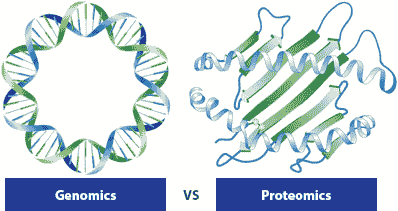
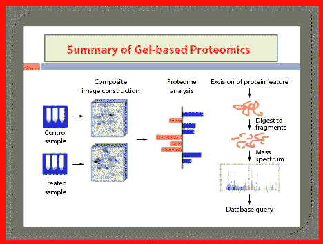

# 14 蛋白组学的基础概念与应用

**Jesudass Joseph Sahayarayan^(1)\*, A.S. Enogochitra^(2) and Murugesan Chandrasekaran^(3)**

^(*1*)*生物信息学系，阿拉格帕大学，卡赖库迪，印度*

^(*2*)*物理系，Dr. URCW，卡赖库迪，印度*

^(*3*)*食品科学与生物技术系，世宗大学，广津区，首尔，韩国*

> ***摘要***
>
> 与基因组学或转录组学相比，蛋白质组学通常被视为一种“新兴技术”，即尚未达到同等成熟水平。虽然成功实施蛋白质组学工作流程和技术仍需要大量的专业知识和专业化，但已取得了长足的进步，使技术更加强大、精简和易于使用。2014 年，两项里程碑式的研究发表了人类蛋白质组的第一版草案。我们旨在专门介绍基于质谱（MS）的蛋白质组学的背景。在该领域，MS 已成为核心技术。结合日益强大的分离技术和数据处理及生物信息学解决方案，它可以在数天内对整个蛋白质组进行定量分析，这一时间尺度终于使全球比较蛋白质组研究成为可能。我们介绍并讨论了蛋白质组学 MS 背后的基本概念以及相关的蛋白质和肽分离主题，重点关注此类研究中出现的数据集的特性。
>
> ***关键词**:* 蛋白组学, 质谱, 数据格式

## 14.1 引言

## 14.1 引言

细菌细胞看似简单，但实际上是一种复杂的结构——细胞质的凝胶状基质，被脂质双层细胞膜和细胞壁包围。细胞应发挥完全不同的极限，同时确认增强，处理这些升级，改善，分割细胞，并排出废物。粒子的结合是什么？尽管如此，水、蛋白质、淀粉、完全不同的粒子和有组织的各种粒子都包含在生命物质中，蛋白质却做了过量的工作。对于发育和衰老，传统的细菌需要远超过 4,000 种蛋白质用于发育和衰老。并非所有蛋白质组合同时形成，有些是在极端条件下极其少量地制造，例如当细胞受到压力或发现自己处于全新区域时。在特定环境中该单个细胞中发现的蛋白质集合即为蛋白质组。蛋白质组学是对构成每个活细胞活动的蛋白质的关联、结构、局限目的和合作的评估。

如果细菌细胞需要超过 4,000 种蛋白质，我们在动物中可以预期找到多少种？哺乳动物，包括人类，可能拥有超过 100,000 种蛋白质。尽管基因组包含像专家一样的内在程序，真核生物的蛋白质提供了独特的结构和最终目的，描述了特定的细胞或组织类型，最终描绘了一个生命体。不同类型的细胞产生不同的蛋白质；因此，一个细胞的蛋白质组并不真正克隆另一个细胞的蛋白质组。同样，由污染产生，例如冒险性发育的细胞，与普通细胞具有奇特的蛋白质。以这种方式，了解细胞的常规蛋白质对于理解因疾病而发生的发育至关重要。这些信息将激发对疾病分子解释的理解，这随后可能被选择用于创建治疗方法。了解蛋白质组如何随着生物体的生长而变化，也可能为健康生物体发育的机制提供见解。

在“一个基因产生一个蛋白质”的标准计划下，蛋白质将基本上融合生物体基因组中显著多样的属性礼物的最终结果。然而并非如此简单。人类基因组中明显的基因数量大约为 30,000–35,000。仅仅 35,000 个基因如何编码超过 100,000 种蛋白质？对此请求有许多潜在的回答，将在下面更详细地讨论。一个答案是每个基因可以通过一种称为选择性连接的策略编码多种蛋白质。选择性连接提出一个基因可以构建有组织的信使 RNA 产物，从而产生各种蛋白质。另一个答案是脂质分子一旦被整合就可以被错误地修饰以构建替代功能。第三点答案是蛋白质在复杂的通路和通路系统中相互组织，可以改变其功能。因此，一个基因可以通过多种方式构建一些在每个合理意义上不同的蛋白质。图 14.1 显示了基因组学和蛋白质组学之间的差异。

**图 14.1** 基因组学和蛋白质组学之间的差异。 (来源: [`microbenotes.com/difference-between-genomics-and-proteomics/`](http://microbenotes.com/difference-between-genomics-and-proteomics/).)

## 14.2 蛋白质组学的挑战

世纪之交，发生了从纯功能驱动的生物科学向系统性和整体性方法的范式转变。继令人难以置信的遗传学项目之后，传统的脂质分子科学已发展成为一种高产出生物科学，被称为蛋白质组学。从 1995 年开始，首次尝试提供“基因组的蛋白质补充”使用了成熟的高分辨率分离技术，如二维 (2D) 凝胶电泳，并几乎完全通过日益强大的质谱鉴定蛋白质。目前，出现了主要和概念上的困难。与基因组不同，蛋白质是动态的，会对遗传和典型参数的任何修改做出反应。此外，蛋白质组似乎比基因组更复杂，由于核糖核酸水平的连接和修饰结构，并可归因于脂质分子水平上的所有翻译后事件，如义务寻址、翻译后变化和污染。情况在逻辑上设计得很糟糕，因为不同的大蛋白质仅在极少数副本/细胞中存在，并且必须在观察大量各种化合物的同时被看到和评估。丰富蛋白质和次要蛋白质的动态范围通常超过所有分析方法的能力。

到目前为止，只有少数解决方案可用于处理复杂性和动态范围。其中之一是降低蛋白质组的复杂性，并将低丰度蛋白质与更丰富的蛋白质分离。这，作为一个模型，将通过多维捆绑步骤开发。无论如何，蛋白质的冲动失败和无数发生的部分使该框架冗余且荒谬。当然，要研究的蛋白质将通过精确的传统分离来有效，或通过使用廉价模型设计来减少奇思妙想（例如，脉冲物质芯片、功能化外部芯片和类别非特异性抗血清）。有利可图的模型是对重要结构的评估，或最交互的蛋白质组学方法趋于关闭。在另一个框架中，执行特定的独特确认，仅设想显示分类一般功能的特定化合物范围。这可以通过抗体、特定染色外观、超分子配体或分类质谱分析框架如 MRM（特定响应查看）或 SRM（单响应检查）\[1\]来实现。该系统的最直接用途是“基于蛋白质组学”，它筛选少量明显获得的蛋白质/肽。

无论如何，在上个世纪的后期，蛋白质组学项目整合的根本问题是解析蛋白质的组成成分。只有逐步才意识到，为了处理标准问题并理解清除通路的能力，超分子范围上变化的发育和元素应被实验性地检查。

## 14.3 基于凝胶的蛋白质组学

自 1975 年以来，在 O’Farrel \[2\]和 Klose \[3\]的报告中，二维凝胶吸引了完全不同的研究人员，这归因于他们的样品处理。浓缩结构（如等电聚焦）与按质量显示的分离（如 SDS 凝胶电泳）相结合，提供了一个沉降区域，可容纳远超过 10,000 种特定混合物。因此，二维凝胶成为首选策略，用于控制特别复杂的脂分子混合物，类似于蛋白质分子。不幸的是，基于凝胶的蛋白质组学在可重复性和动态变化方面存在固有控制（图 14.2）。常规工作框架即使在一个科学实验室内，也必须仔细搜索以产生基本可重复的结果。从不同实验室产生的相同样品的结果在实际重要的每个方面都较少，并且在初步阶段是模糊的。一个重要的发展是 DIGE 方法（GE Healthcare）的介绍，这是一种多路复用荧光 Cy-Dye 重染多种蛋白质状态的方法，在很大程度上消除了实际不可靠性 \[4\]。在半胱氨酸改变的“DIGE 浸没检查”中，仅用几微克的起始物质就可以获得重要的蛋白质洞察力 \[5\]。一个缺点是只有两种不同的发光化学物质可用于“总 DIGE”，并且化学物质的费用对于更重要的蛋白质组学实验来说相当具有限制性。此外，负载能力、定量可重复性、处理困难以及与质谱分析的接口问题确保了基于凝胶的蛋白质组学的评估重要性和细致程度被认为。

**图 14.2** 基于凝胶的蛋白质组学。（来源：[`www.slideshare.net/AngelSForde/gel-based-proteomics-and-protein-sequences-analysis`](http://www.slideshare.net/AngelSForde/gel-based-proteomics-and-protein-sequences-analysis).）

## 14.4 非凝胶电泳方法
如何克服凝胶的预防，同时保持类似于等电聚焦的有意分离方式的补偿？两种或三种仪器被设计出来，它们至少可以在策略中分离蛋白质，同时利用浓缩结构。可能，这些概念最公认的实现是自由流动电泳仪器，如“Octopus”（Becton Dickinson）和“Off-Gel”系统（Agilent）。无疑，当这些相对较新的系统与 2D 凝胶相比时，在回收率和可应用量的改进方面实现了明显的优势，但与进一步分离维度的接口因体积较大和缓冲液成分而受阻。因此，二维凝胶的目标至今尚未实现。迟早，特定的重要更新将被依赖以通常克服部分障碍。

## 14.5 色谱法
在分离系统的有限场景中，色谱法似乎具有作为全面蛋白质评估的替代工具的潜力。然而，从比例字体脂分子科学来看，值得注意的是蛋白质在多种操作模式下没有提供定量回收。到目前为止，基于色谱方法的唯一非凝胶多维方法已实现商业化。在“Proteome Lab thulium PF-2D”框架（Beckman）中，色谱聚焦阶段与旋转阶段色谱相结合，将模型分馏成远超过 1,000 个片段。尽管如此，这里蛋白质保持在蓝图中的一点余地被削弱了，因为完全操作方案的目标在非常基本的水平上低于二维凝胶的意图。

## 14.6 基于肽的蛋白质组学
因此，鉴于定量复杂蛋白质分布似乎会极其令人恼火，完全不同的选择被寻找。一个合理的新的计划是将包装和评估问题从脂分子转移到酰胺水平。如果这可以实践，速度、自动化和可重复性的另一部分将被获得。以这种方式，新的基于肽的结构，例如 MudPIT \[6\]，是在将蛋白质切割成肽之后创建的，随后是惊人的计算机化多维液体色谱分离，然后使用串联质谱分析识别肽。主要由于转向基于肽的蛋白质组学，色谱学经历了新的繁荣，肽分离柱的微型化至直径低于 100 µm 以及能够提供纳升级流速的仪器的引入变得可用。联网或分离的质谱分析领域的纳米 LC 变得正常。然而，在复杂模式下，纳米 LC 仍然处于特定可用性的边缘，尽管它经历了活力的缺失和易于管理。

使用基于肽的蛋白质组学技术，一些可验证的缺点变得明显自明。通过将蛋白质切割成肽，不仅蛋白质组的复杂性增加了十倍，而且有关蛋白质鉴定的重要信息也被破坏。完全不同的肽在本质上所有不同的蛋白质中都不可区分地存在。因此，从一个酰胺来看，前体通常无法无歧义地解析。此外，不同的异构体、翻译后修饰的蛋白质或蛋白质的处理和降解产物，都会产生大量相同的肽。因此，选定脂分子的定量知识最终变得可疑。在多于一种脂分子变体中存在的酰胺的丰度并不反映特定蛋白质变体的比例，而是反映包含该酰胺的所有脂分子类型组合的比例。

由于复杂性和通过串联质谱分析每个肽的必要性，蛋白质组分析时间和成本显著增加。仔细地说，如今，即使是最快的质谱仪似乎也无法在一次 LC 运行中详细分解大部分存在的物质。以这种方式，通常显著次要的肽似乎没有被复合。这表明“欠采样”是蛋白质研究通常令人惊讶的可重复性的一贯原因，其中分析的基本丰度通常提供约 20%–30%的覆盖信息。由于这些观点，复杂蛋白质组学中多样性的下降必须在脂分子阶段完成。脂分子在整个包装中的主导地位可能是一个特征参数，并且也必须用于特定蛋白质类型的明确鉴定和分离。

## 14.7 稳定同位素标记

为了推进定量蛋白质组学结果，“同位素阶梯”系统被赋予。这些“同位素减弱”技术当时已被用于对极小颗粒、药物和蛋白质的评估。Aebersold 团队完成了将该技术引入蛋白质组学领域的开创性工作，其中两个蛋白质组状态下所有蛋白质的半胱氨酸残基被含有生物素的重或轻版本的试剂修饰（同位素编码亲和标签，`ICAT^®`）(7)。到那时为止，被标记的蛋白质被连接并分离成肽。基本上，携带标记的含半胱氨酸肽可通过使用链霉亲和素的亲和纯化来富集。肽分离和质谱分析揭示了肽的身份，同时通过同位素肽对的信号强度确定了原始蛋白质组中肽的定量比例。增强型的原子化学品被创建，例如原子密码脂质分子名称，`ICPL^®`（Serva），微不足道的氨基酸事件开放试剂，它们提供了更高的反应产率和扩展的收集思想 \[8\]。

当然，尽可能早地引入同位素标记是可取的，因为所有在没有同位素控制下进行步骤都可能导致定量错误的结果。因此，在蛋白质分析的相当早期的时间点引入原子标记被创建。培养基中加入 `N15` 原子或在细胞培养中对氨基酸进行恒定同位素标记在蛋白质组学测试中被使用，主要在细胞培养或通过微生物 \[9\]。无论如何，通过有趣的努力，“`SILAC` 小鼠”也被类似地创建用于蛋白质组学测试 \[10\]。代谢阶梯方法通常局限于细胞培养分离物，而且似乎不适用于来自更高生物体的测试（例如，体液和组织）。

因此，对于基于肽的方法，设计了不同的原子试剂。最无可争议的是 `iTRAQ` (`ABI`)，即八种同位素氨基酸聚类开放化学品的集合 \[11\]。由于试剂所有变体的质量相同，来自不同蛋白质组状态的特定肽将以相同的质量出现，因此——与非同位素异质试剂相反——标记不会增加质谱中的复杂性。无论如何，通过基础、简洁和快速的 `MS` 分析，无法获得定量信息。基本上在 `MS/MS` 分析过程中，用于各种试剂的明确报告离子被释放并且可以被检测。为了获得定量正确的结果，用于 `MS/MS` 分析的质量选择应实际上是未污染的。这在拥挤的色谱图中经常不成立。因此，同位素化学品的高通量多路复用的优势被极大地降低了，因为需要非常低复杂度的肽混合物，以及必须通过 `MS/MS` 分析分离每个衍生肽以揭示初步结果的任务。

## 14.8 数据挖掘与信息学

大型蛋白质组学项目的主要困难之一是将会产生的大量数据。通过使用先进的编程方法，每种蛋白质组条件下的不可确定质谱将令人惊讶地组合起来。鉴于在拥挤的谱图中引用高曝光以及测试肽/蛋白质分析证明，并且如今可控制的数据范围微不足道，信息评估和知识评估在很大程度上是蛋白质评估中最无聊的部分。未来可以预期用于自动检测从一个蛋白质组状态到另一个状态发生变化的有趣蛋白质并将此类蛋白质从复杂的蛋白质组数据中过滤出来的软件。

繁荣的信息处理可能是知识科学和编程在社会保障领域的混合体。健康信息学领域中有许多当前的研究领域，包括 `Bioinformatics`、图像信息学（例如 `Neuroinformatics`）、`Clinical Informatics`、`Public Health Informatics`，以及 `Translational BioInformatics` (`TBI`) 分析，这些分析耗尽了健康信息处理（连同其子领域）将从信息检查、恢复、存储、利用数据挖掘技术进行评估等连接起来。然而，本研究的范围将是使用数据挖掘来回答健康各个层面的问题的研究。

耗尽健康信息处理选定子领域的全部评估使用来自特定程度人类亲近性的信息 \[12\]。`Bioinformatics` 利用原子水平信息；`neuroinformatics` 利用组织水平信息；临床信息处理应用耐受水平信息；公共卫生信息处理使用人群信息（来自整体或多数）。这些子领域目前和再次展开（例如，单一报告应实际考虑来自两个相邻层级的信息）；然而，考虑到对令人信服混乱的真实压力，我们倾向于在此工作中，根据使用的最高信息水平组织评估（因为本文受信息使用控制）。此外，在给定的数据水平内，我们将根据研究试图回答的问题的类型（即水平）分解研究，其中每个问题水平与其中一个数据水平的范围相对相当。组织水平与人类尺度科学查询的范围相似，患者信息的范围与临床请求已知，并且人群信息的水平与大流行水平请求相似。

子领域 `TBI` 使用的数据水平则滥用来自这些层级的信息，从原子水平到整个个体团队 \[12\]。具体而言，`TBI` 毫无疑问是基于将 `bioinformatics` 水平的信息与额外的巨大水平组合，考虑到该水平的大部分已被撤回评估工作场所并与额外的患者挑战性水平（`neuroinformatics`、临床信息处理和人口信息学）隔离。`TBI` 和来自所有人类亲近程度的信息连接是健康信息处理中备受赞誉的新方向。`TBI` 最终试图回答的请求质量水平在临床水平上，并且同样，答案将促进患者改善的 `HCO`。在所有可访问数据水平上使用各种数据挖掘和分析技术进行的研究可用于帮助医疗保健系统更快、更准确、更高效地做出决策，并且比不使用此类方法更具成本效益。

## 14.9 蛋白质组学的应用

蛋白质组学揭示了主要应用，即解析蛋白质翻译后修饰的能力。这些变化可以是磷酸化、糖基化和硫酸化以及与蛋白质结构维持相关的一些不同修饰。

这些修饰对于蛋白质在细胞中的运动、溶解性和定位具有重要意义。蛋白质修饰的鉴定比蛋白质的鉴定要困难得多。就鉴定目的而言，仅需少数肽即可进行蛋白酶切割，然后对已知肽序列进行数据库比对。然而，对于蛋白质修饰的鉴定，需要更多的材料，因为并非所有肽都具有正常的亚原子质量，需要进一步分解。

蛋白质组学对细胞蛋白质相互作用网络的阐明具有巨大价值，有助于理解细胞的生物学。关于特定蛋白质的表达时间、其表达水平，以及最终其与另一种蛋白质相互作用形成中间体以执行特定生物功能的信息目前已可获得。

这些中间体也可用于治疗目的。研究蛋白质-蛋白质相互作用的一个有吸引力的方法是通过亲和力为基础的技术，利用 GST 融合蛋白、抗体、肽等纯化整个多蛋白复合物。

噬菌体展示是指使噬菌体颗粒表达与衣壳或包膜蛋白融合的感兴趣的肽或蛋白质。它可用于筛选肽表位、肽配体、酶底物或单链抗体片段。

另一种重要的鉴定蛋白质-蛋白质相互作用的策略包括在相互作用蛋白质上的荧光标记之间利用荧光共振能量转移（FRET）。FRET 是一种非放射性技术，其中激发供体荧光团的能量转移到受体荧光团。第一种荧光团激发后，FRET 可通过使用合适滤光片的第二种荧光团的发射或供体荧光寿命的变化来检测。

一种日益重要的蛋白质组学技术包括在细胞中定位蛋白质，这是理解复杂细胞系统中蛋白质功能的重要第一步。绿色荧光蛋白（GFP）的发现及其光谱变体的发展为利用光学显微镜在活细胞中研究蛋白质铺平了道路。

蛋白质组学最大的应用仍然是蛋白质表达谱分析。蛋白质样品的表达水平可通过 2-DE 或其他新方法如同位素编码亲和标签（ICAT）来测定。利用这些方法，两个不同蛋白质样品的表达水平变化也可进行分析。

在临床蛋白质组学提供的帮助下，已设计出一些药物。这旨在发现具有临床相关性的蛋白质，以识别药物开发的潜在靶点、疾病诊断或分期的标志物，以及临床和环境研究的风险评估。由于基因、蛋白质与疾病之间的联系，蛋白质组学进展将在药物发现、诊断和分子医学中发挥重要作用。

## 14.10 未来展望

然而，迄今为止许多发表的蛋白质组学实验并未真正提供坚实且有价值的科学内容。这部分与整体方法本身的概念有关，即扰动系统的反应观察不一定能提供简单清晰的答案，而更是一种假设生成概念。不幸的是，尽管质谱和纳米分离技术取得了惊人的进展，但应对蛋白质组复杂性的技术能力仍然非常有限。在此方面，有时试图以巨大的劳动、时间和金钱来研究一种蛋白质；无论如何，通过这种分析，大部分蛋白质组都难以实现。仅有极少量的蛋白质会被研究，并且为了证实结果的可靠性和有效性，技术和生物学重复是必不可少的。无论如何，由于巨大的劳动和庞大的费用，这通常被忽视。危险在于，从长远来看，通过主导不常见的经济实践，蛋白质组学作为一套规则的热情计划可能会受到关注。

从现在起，我们有义务阐明敏锐且现代的框架，以确保在样品制备、分离科学、质谱分析和信息处理等这些发展中获得深入和本质的特征知识。最接近这一目标的可能是“靶向蛋白质组学”。如今，这种思维方式可以定量且谨慎地筛选若干已知蛋白质，并且随着时间的推移，其置信度将提高并进入常规临床诊断。

通过全局相对蛋白质组学尝试完整方案，情况正在动态地转向更接近蛋白质科学的一般方向。如今，实验意义和定量准确性都不具吸引力。翻译后修饰和对来自同一基因的许多不同蛋白质种类的分析在高通量方法中提出了主要困难，需要创新策略。稳定同位素标记技术与无标记方法相结合。经过十年的分析技术快速改进，而分离领域仅有轻微改进后，当前对分离科学的进一步发展的压力变得十分紧迫。大多数问题和缺陷已被认识到，不同的专业人员正在处理其解决方案。经过数十年的分析系统热烈改进，而分离领域主要仅有轻微改进后，目前对分离科学的任何进展的压力前所未有。复杂、精心设计且特别自动化的工作流程利用各种色谱和电泳技术对于解决确定的蛋白质组分离问题至关重要。新型分离系统和主要自动化多维分级方案的接口方法是一个有问题的研究领域，并在很大程度上决定了蛋白质组学作为广泛策略的成功。

## 14.11 结论

在过去相当长的一段时间里，蛋白质组学领域取得了极大有帮助的进展。进展迅速且敏感，并提供更广泛的蛋白质组覆盖。此外，这些技术的结合在纯化、分析、表征、定量、测序、结构分析以及广泛真核和原核生物中大量蛋白质的生物信息学分析方面取得了进展。所有与生命科学相关的领域都因蛋白质组学策略的广泛应用而受益。然而，进一步的工作仍需进行以提高公认蛋白质组学工具的可重复性和性能。

## 参考文献

1\. Anderson, L. and Hunter, C.L., 主要血浆蛋白的定量质谱多反应监测测定. *Mol. Cell. Proteomics*, 5, 573–588, 2006.

2\. O’Farrell, P.H., 蛋白质的高分辨率二维电泳. *J. Biol. Chem*., 250, 4007–4021, 1975.

3\. Klose, J., 通过小鼠组织联合等电聚焦和电泳进行蛋白质 mapping：一种检测哺乳动物诱导点突变的新方法. *Humangenetik*, 26, 231–243, 1975.

4\. Unlue, M., Morgan, M.E., Minden, J.S., 差向凝胶电泳：检测蛋白质提取物变化的单凝胶方法. *Electrophoresis*, 18, 2071–2077, 1997.

5\. Sitek, B., Luettges, J., Marcus, K., Kloeppel, G., Schmiegel, W., Meyer, H.E., Hahn, S.A., Stuehler, K., 荧光差向凝胶电泳饱和标记在胰腺导管腺癌微切除前体病变分析中的应用. *Proteomics*, 5, 10, 2665–2679, 2005.

6\. Washburn, M.P., Wolters, D., Yates, J.R., 通过多维蛋白质鉴定技术对酵母蛋白质组进行大规模分析. *Nat. Biotechnol. Mar*., 19, 3, 242–277, 2001.

7\. Gygi, S.P., Rist, B., Gerber, S.A., Turecek, F., Gelb, H.M., Aebersold, R., 利用同位素编码亲和标签对复杂蛋白质混合物进行定量分析。 *Nat. Biotechnol*., 17, 994–999, 1999.

8\. Schmidt, A., Kellermann, J., Lottspeich, F., 利用同位素编码蛋白质标签进行定量蛋白质组学的全新策略。 *Proteomics*, 5, 4–15, 2005.

9\. Ong, S.E., Blagoev, B., Kratchmarova, I., Kristensen, D.B., Steen, H., Pandey, A., Mann, M., 稳定同位素氨基酸细胞培养标记，SILAC，作为表达蛋白质组学的一种简单而准确的方法。 *Mol. Cell. Proteomics*, 1, 376–386, 2002.

10\. Krueger, M., Moser, M., Ussar, S., Thievessen, I., Luber, C., Forner, F., Schmidt, S., Zaniva, S., Fässler, R., Mann, M., 用于定量蛋白质组分析的 SILAC 小鼠揭示 Kindlin-3 是红细胞功能的关键因子。 *Cell*, 134, 2, 353–364, Jul 25 2008.

11\. Ross, P.L., Huang, Y.N., Marchese, J.N., Williamson, B., Parker, K., Hattan, S., Khainovski, N., Pillai, S., Dey, S., Daniels, S., Purkayastha, S., Juhasz, P., Martin, S., Bartlet-Jones, M., He, F., Jacobson, A., Pappin, D.J., 使用胺反应性同位素标记试剂对 *Saccharomyces cerevisiae* 进行多路蛋白质定量。 *Mol. Cell. Proteomics*, 3, 1154–1169, 2004.

12\. Chen, J., Qian, F., Yan, W., Shen, B., 云中转化生物医学信息学：现状与未来。 *Biomed. Res. Int*., 2013, 658925, 2013.

1. **通讯作者*: jjsrbioinformatics2016@gmail.com
