# 15 药物发现中共价方法的前景：概述

**Balajee Ramachandran^(1), Saravanan Muthupandian^(2) and** **Jeyakanthan Jeyaraman^(1)\***

^(*1*)*结构生物学与生物计算实验室，生物信息学系，阿拉古帕大学，卡赖库迪，泰米尔纳德邦，印度*

^(*2*)*微生物学与免疫学系，生物医学科学分部，医学院，健康科学学院，梅凯莱大学，梅凯莱，埃塞俄比亚*

> ***摘要***
>
> 计算方法在药物发现研究中被广泛使用。分子建模方法被广泛用于理解蛋白-抑制剂复合物的机制，以在药物发现过程中提供更多见解。与非共价抑制剂相比，共价抑制剂提供了与蛋白靶点可信的机制，从而可鉴定出效力更高且更安全的候选药物。已开发了大量计算方法来理解蛋白-抑制剂复合物之间的共价相互作用。然而，它仍需要有效的算法来克服药物发现研究中的挑战。在本综述中，我们强调以下主题，即 (i) 针对生物靶点的共价抑制剂，(ii) 物理化学概念在共价药物设计中的应用，(iii) 共价靶点的重要性，(iv) 共价对接的最新框架，(v) 计算方法中的 S[N]2 反应，以及 (vi) 共价对接中的其他关键方面。本综述的目的是突出对新型共价抑制剂的适当评估和开发至关重要的组成部分。此外，本综述中强调的共价方法及其应用将增强药物设计的未来工作。
>
> ***关键词**:* 分子对接, 药物设计, 共价靶点, 蛋白酶, `SN2` mechanism, `QM/MM` approaches

## 15.1 引言

药物设计是一个众所周知的概念，其中药物被设计为在特定生理条件下与大分子靶点相互作用 \[1, 2\]。大分子靶点与抑制剂之间的结合亲和力最大化了它们的强度，导致治疗反应和药物效率增强，并基于传统和非传统方式为现代药物发现建立了渠道。“传统方式”被称为“非共价抑制剂”，而“非传统方式”被称为“共价抑制剂”。共价抑制剂通常与催化亲核基团结合，例如丝氨酸/半胱氨酸蛋白酶，或可与非催化亲核基团结合，如 `GPCR` 和核受体 \[3\]。由此产生的共价抑制剂将基于亲电基团与大分子靶点形成键，并与蛋白亲核基团相关，从而提高酰化速率，即保持稳定并长时间保持活性。这些共价抑制剂将根据 `K[i]` 而非 `IC[50]` 值进行校准，这比 `IC[50]` 值更适合预测以评估其对靶点的效力 \[4, 5\]。在其他实验条件下，共价方法有助于基于生物靶点、抑制剂和底物准确测定 `IC[50]` 值。而 `K[i]` 值仅考虑靶点和抑制剂，且与底物无关。它完全由内在和热力学量决定。方程如下所示。

### 竞争性抑制

Reaction (15.1)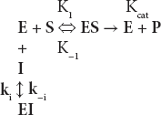

其中 `K[d] = k[–1]/k[1]` 且 `K[i] = k[\-i]/k[i]`，总方程为

(15.1)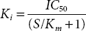

### 不可竞争性抑制

Reaction (15.2)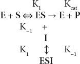

方程可写为

(15.2)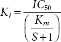

### 非竞争性抑制

Reaction (15.3)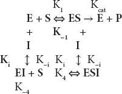

其中 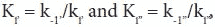方程可写为

(15.3)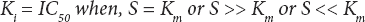

在现代研究中，药物发现研究的非传统方式在科学界探索更多挑战，以识别全球威胁的各种可能性。此外，现有的 *计算机模拟* 工具主要设计用于通过非共价抑制剂进行研究，而少数工具将筛选共价靶点。然而，通过 *计算机模拟* 方法可以实现从文库中鉴定更佳共价抑制剂的研究 \[6\]。

## 15.2 针对生物靶点的共价抑制剂

早期报道证实共价药物在 1970 年代后期已商业化 \[7–9\]。19 世纪阿司匹林针对 `COX-1` 和 `COX-2` 酶的出现是共价药物的突破 \[10\]。后来，青霉素和头孢菌素等抗生素用于细菌性疾病，研究已扩展到调查各种疾病/病症，例如 `HCV` 蛋白酶、质子泵（奥美拉唑）和 II 型糖尿病 \[10, 11\]。在肿瘤学中，一些共价药物包括芳香化酶、胸苷酸合成酶和核糖核苷酸还原酶的抑制剂 \[12, 13\]。另一方面，像氯吡格雷、普拉格雷和替氯匹定这样的药物抑制嘌呤能受体 12 (`P2Y[12]`) 并修饰 `GPCR` \[14–16\]。这些抑制剂为血管疾病治疗提供了重大突破，这在 2008 年的美国被观察到 \[17\]。今天，超过 25 种获批的共价药物在商业市场上流通，年全球销售额达 400 亿美元 \[18\]。在当前框架下，制药和生物技术公司更专注于共价药物（或通过模仿现有分子）推向市场 \[21, 22\]。因此，当前趋势将提升药物化学家发现新型强效且安全的药物的能力 \[23\]。

Potential research on the natural products unleashes the barrier to offer effective drugs. Hence, natural products in drug discovery research with the new advancement in the pharma sector provide benefits to the scientific community \[19, 20\]. The bioactive natural compounds comprised of enormous amount of data in order to enhance the drug discovery research for many biological targets which will help the scientific community \[24, 25\]. The hydrolytic mechanism from the natural products has produced overwhelming response in the drug discovery research and turned on huge business in pharma industry. The natural products obtained from micro-organisms also play a crucial role in the pharma research to develop drugs for the antivirals, antibacterial, antifungals, etc. \[18, 26–28\].

In the drug discovery process, focusing on toxicity of the small molecule will be the crucial than identifying the target and lead compounds in the initial step. In the earlier days, the covalent drugs like bromobenzene and acetaminophen caused severe adverse effects. On the other hand, the drugs like beta-lactams and omeprazole have filled the vacuum to merge into the market. In the case of toxicity, the covalent drugs could be evaluated by the off-target mechanisms where the non-covalent drugs will show time-dependent values. An advancement of bioinformatics and cheminformatics approaches will provide the better understanding of the covalent drug molecules to explore their properties which will support in the drug discovery research \[29–31\]. Moreover, the adequate data for the covalent inhibitors related to the toxicity is being studied. Whereas, comparing the toxicity data of non-covalent inhibitors like pharmacokinetics, binding kinetics, and pharmacodynamics with the covalent inhibitors leads to the severe adverse effects. As a result, in the current stage, the pharma industry focusing mainly to deliver the product with the minimal side effects using the covalent drugs \[32\].

## 15.3 Application of Physical Chemistry Concepts in Drug Designing

The association of the target enzyme (`E`) and inhibitor (`I`) forms the protein-ligand complex. The binding affinity of the complex can be expressed by the equilibrium constant, `K[i]`. The complex can be detailed in terms of Gibbs free energy through 方程 (15.4):

(15.4)

Apparently, additional steps are required for the covalent binding. The enzyme-inhibitor complex forms the covalent adduct \[33–35\]. The covalent inhibitors were considered as safe and effective compounds when the reaction was fine-tuned toward the biological target of either activation or inactivation of metabolism to attain the remarkable mechanism of action \[5\]. The covalent inhibitors play a key role in the efficacy which is directly proportional to the residence time (`1/k[off]`) of the protein-ligand complex.

Hence, covalent inhibitor of the enzyme inactivation process is not an equal process with the reversible inhibition \[4\]. The `IC[50]` is an important parameter which indicates the potency of the reversible inhibitor. The `IC[50]` value can be converted to `K[1]/K[-1]`, called as `K[i]`, according to the equation proposed by Cheng-Prusoff \[36\]. The covalent inhibitors correspond to the time and concentration dependent target inhibition, where the covalent bond formation is time-dependent mechanism. On the other hand, the reversible inhibitor shows the significance only with the concentration dependent. In few cases, the optimized ligand will neutralize the target effectively, where the Pharmacokinetic-Pharmacodynamic (`PK/PD`) profile of the covalent inhibitor will minimize the drug burden of the patients with no such hindrance in drug dosage/efficacy \[37\]. As a result of neutralization, the covalent inhibitors are difficult to interpret the `IC[50]` values since it is time dependent; instead, the favorable kinetic parameters that include (i) rate of inactivation of a target (`k[inact]`) and (ii) inhibition constant (`k[i]`) are applied.

Therefore, the `k[inact]/k[i]` ratio is usually referred to predict the potency of covalent bound complexes \[38\]. The strength or potency of the covalent inhibitors are determined by the biological rate constant (`k[inact]/k[i]`). On contrast to the `IC[50]`, the determination of `K[inact]/K[i]` is comprised with multi-step reactions as shown in 图 15.1.

In the binding assay, the inhibition was examined over a period of time at various concentrations. The `k[obs]` for each concentration will be obtained from 方程 (15.5) proposed by Kitz *et al*. \[39\]:

(15.5)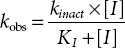

The rate at which an inhibitor reacts with the target (`k[inact]`) can be determined using transition state theory (`TST`), which relates to the rate of reaction to the Gibbs energy profile along the reaction coordinates \[3\]. Using `TST`, the rate of reaction can be calculated by the Gibbs energy of activation (`ΔG^≠`) given by

(15.6)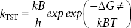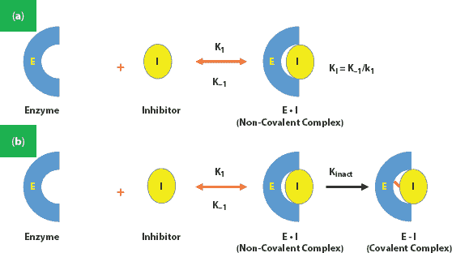

**图 15.1** 非共价和共价复合物的差异。 (a) 非共价抑制剂与受体的相互作用。 (b) 共价抑制剂与受体的相互作用。

The mechanism of the covalently bound protein-ligand complex comprised of various reaction steps. For instance, in the protein mechanism of papain, the covalent adduct is formed between `Cys25` and carbonyl carbon. In the initial step, the covalently modified complex will be comprised of “Michael acceptor” reaction that begins with the proton transfer step in cysteine to form thiolate. The calculation of covalent modification yields the outcomes like `ΔG[non-covalent]`, `ΔG[covalent]`, activation free energy (`ΔG^≠`), the `K[on]` and `K[off]` values that manage the drug residence time, which is a determinant factor to predict the pharmacological activity of the drug in contrast to the binding affinity \[40, 41\].

## 15.4 Docking Methodologies—An Overview

Computer-aided drug design, a theoretical approach, has become a common approach which is widely used in both pharmaceutical and academic sectors. The main aim of the computational approach is to predict the binding affinity between the protein and ligand to provide the valuable estimation to the experimental studies \[42\]. Each docking program implements their own algorithm and scoring functions in order to estimate the properties of ligand. The commonly used algorithms are `AutoDock` \[43\], `AutoDock VINA` \[44\], `GOLD` \[45\], `GLIDE` \[46, 47\], `Hex Docking` \[48\], and `FlexX` \[49\]. The main focus of these algorithms is to predict hydrogen bonding interactions and other non-bonding interactions like van der Waals interactions and electrostatics for the non-covalent bound inhibitors. An electrostatic interaction plays crucial role on determining the binding affinity between the protein-ligand interactions \[50\]. Some of the drugs (peptide substrates) bind tightly to the biological target in order to mimic as a natural substrate by involving in the metabolic pathways \[47, 48\].

共价药物的近期发现迅速增长。本文在此指出了共价药物增长的一些原因：(i) 与非共价抑制剂相比，共价药物具有许多优势，如药物剂量、副作用等；(ii) 活性延长；以及 (iii) 达到药理学反应所需的浓度较低 \[41\]。与非共价抑制剂相比，共价抑制剂仅需极低的浓度即可表现出相似或增加的药理学反应。此外，非键相互作用对结合亲和力、与毒性相关的特异性以及提高效力也起着关键作用。

## 15.5 共价靶点的重要性

许多研究人员报道，非共价亲和力可直接由相互作用的表面积估算。而共价相互作用具有紧密的结合亲和力，且复合物通过实现靶向内和靶向外活性在药理学反应中显示出重要性 \[52, 53\]。当底物进入代谢途径并在抑制靶点后建立为天然底物时，这一点更令人感兴趣 \[54\]。因此导致抑制剂被置换。在靶点与药物之间形成不可逆共价键的情况下，不可能发生置换，提供了一个更高效的生物学靶点。最好的例子是 cruzain，其中一种小肽 `Ac-Ala-Ala-Ala-Gly-Ala-OCH[3]` 与 `T. cruzi` 结合并显示出对查加斯病的增强活性，如 图 15.2 所示。

随着共价药物从非共价药物中脱颖而出，用于非共价对接的众多软件变得可用于共价对接 \[55\]。从可用的工具/软件中，结构通过手动建立靶点与配体之间的键而被修改；这种方法也被称为“`link-atom`”方法。该研究可通过评分评估来探索其意义 \[56\]。该方法使用户能够确定蛋白质中的亲核残基和配体的亲电基团。然而，对生物靶点筛选多样化化合物集耗时且存在问题 \[57\]。许多作者报道共价结合可通过两种方式进行：(i) 基于网格的方法和 (ii) 柔性侧链修饰。基于网格的方法采用高斯偏置函数实现。在柔性侧链修饰中，亲核体和亲电体被视为反应中心 \[58, 59\]。

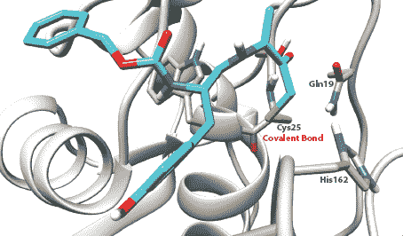

**图 15.2** 蛋白质与肽底物之间的共价键 (PDB: `1AIM`, [`www.rcsb.org`](http://www.rcsb.org))。

**表 15.1** 药物发现过程及描述。

| **序号** || **过程** || **属性** |
| --- | --- | --- |
| 1 || 靶点识别 || 亲核区域、底物、抗性 |
| 2 || 命中物识别 || 共价对接、弹头几何结构、基于底物 |
| 3 || 结合表征 || 结合模式、结合动力学、实验方法 |
| 4 || 优化 || 结构-动力学关系 |

药物发现过程通常以第二步（柔性侧链修饰）进行，该步骤包含两个步骤：(i) 分子应以非共价形式结合到生物靶点，以及 (ii) 反应性亲电体应位于靶点特定亲核体的合理距离内以形成键 \[60, 61\]，从而增强复合物的性质。药物发现方法是一个持续的过程，其中通过各种搜索方法识别先导化合物以检测最终优化产品 \[62, 63\]。共价药物的独特特征和性质如 表 15.1 所示。

## 15.6 现有对接协议的最新框架

本主题说明了可用于共价对接方法的现有工具。此外，本研究倡导共价药物发现研究领域的未来展望。几位作者报道了使用现有分子对接协议进行共价对接的连接原子方法。这些协议有助于验证相应反应基团中的结合亲和力。早些时候，De Cesco *等*. 2012 \[64\] 总结了最新的共价对接程序，如 `DOCKTITE`、`DOCKovalent`、`FITTED`、`CovalentDock` 和 `CovDock`，并探讨了其挑战。上述工具具有以下显著特征：

* 自动识别亲电区域或原子使用 `SMARTS` 模式。
* 在多样化化合物情况下，可采用 `FITTED` 程序。
* `CovalentDock` (`AutoDock`) 通过筛选大量化合物支持对接协议。
* `CovDock` (`Schrodinger Suite`) 是另一工具，其通过将反应性残基突变为丙氨酸进行处理，并在完成共价对接协议后保留相同残基。该过程可能不利于静电环境并导致对接不准确。

本文所述工具具有自动识别亲电基团的潜力。在当前情况下，需要高效算法来克服上述工具中的主要缺陷。

## 15.7 计算方法中的 S[N]2 反应

Zhang *等*. (2012) \[65\] 报道，与非共价药物设计相比，现有共价药物的计算方法在近期情况下是不充分的。对接算法的现状显示出对共价靶点更多的利弊。现有算法对于共价机制要么结合要么识别基团都不明确。现有工具显示出倾向于应用约束来构建反应原子之间的键。其次，除了键形成之外，残基被突变为丙氨酸或任何特定残基以了解对蛋白质复合物的影响。此外，在对接运行中应用约束并突变为丙氨酸残基可能会影响其静电和非键效应。这些显著问题对结合能因子提出了更多疑问。最终，解决多样化化合物集仍不明确 \[66\]。

## 15.8 共价对接中需要考虑的其他关键因素

### 15.8.1 可离子化残基的作用

主要地，共价修饰伴随相应残基如 `Cys` 和 `Ser` 的去质子化以产生更具反应性的形式。特别是，亲核体-亲电体之间的相互作用可以被研究以形成稳定的复合物。通常情况下，半胱氨酸靶点的巯基在靶向亲电体之前应被去质子化，这表明整个蛋白质复合物取决于其可离子化残基和净电荷。而可离子化残基完全取决于净电荷，后者决定了蛋白质的酸/碱性质 \[67\]。

整个蛋白质中可电离残基的存在约占 30% \[68, 69\]. 埋藏区域中存在的可电离残基在决定 pKa 值方面起关键作用。埋藏区域主要位于半胱氨酸、组氨酸和酪氨酸的侧链中，它们在 pH 7 时呈中性，而天冬氨酸和谷氨酸等其他残基（酸性残基）在 pH 7 时带电。氨基酸残基具有较高的 pKa 值并可提供多达五个氢键，据称是 pKa 约为 12.3 的精氨酸残基。胍基在水分子存在下被认为是弱水合阳离子，这是由于电荷局域化。精氨酸残基在蛋白质的稳定性和功能上发挥着至关重要的作用。因此，精氨酸残基的埋藏区域带电，含有大量的氢键相互作用以及与蛋白质中其他平面侧链基团堆积的相互作用 \[70, 71\]. 这种相互作用可以通过展示β-内酰胺类 D 型 OXA-10 的氨基酸残基 Arg259 与亚胺培南具有氢键相互作用来证明 \[72, 73\]，并在 图 15.3 中示出。

在生物复合物中，可电离残基的 pKa 值可能根据环境而变化，例如蛋白质的溶剂可及性、带电和极性残基 \[72\]. 针对可电离基团需要考虑的主要因素如下：(i) 蛋白质中可电离基团的 pKa 值可与参考模型相比在 pH 单位范围内变化；(ii) 特定残基可能具有不同的 pKa 值（例如，羧基和氨基）；以及 (iii) 当其存在于 apo 状态或与其它模型结合时，pKa 值会有所不同。上述参数有助于理解自由能，该自由能对蛋白质折叠以及蛋白质与配体复合物在平衡状态下的结合具有直接影响，这与溶液的 pH 相对应。因此，pH 也是决定生物复合物稳定性的关键因素 \[74, 75\].

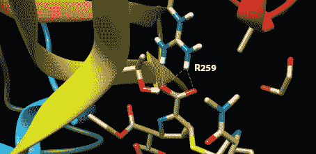

**图 15.3** OXA23-亚胺培南相互作用（该图片代表了 Arg259 与亚胺培南的重要性）。

### 15.8.2 电荷调节
物理理论在解释蛋白质环境中电荷调节的重要性方面发挥着至关重要的作用。电荷调节机制由 Linderstorm-Lang 于 1924 年阐述 \[68\]. 近年来，它被认为是生物物理方法中的一个“热点话题”，用于进一步讨论静电相互作用、电荷调节等 \[78–81\]. 电荷调节包括蛋白质在溶剂环境中的局部电荷、盐浓度和各种 pH。在最近的研究中，电荷调节机制已扩展到跨膜蛋白 \[82\]. 电荷调节参数已针对生物系统进行评估，以详细研究蛋白质电荷特性。原子进入静电上有利的生物系统；系统将相应地通过带正电和带负电的离子进行修饰 \[83–85\].

### 15.8.3 电荷-电荷相互作用
给定可电离残基的 pKa 对天冬氨酸、谷氨酸、酪氨酸和半胱氨酸等酸性残基携带净负电荷，而对组氨酸、赖氨酸和精氨酸等其他残基携带净正电荷。相互作用的能量可以用库仑定律计算 \[86\]：

 (15.7)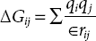

其中 `q[i]` 为感兴趣的可电离基团，`q[i]` 为其他基团上的电荷，`∈` 为介电常数，`r[ij]` 为两电荷之间的距离。这里已显示静电相互作用。

Zydney *et al*. \[87\] 已使用理论模型证明了静电相互作用，以揭示电离与离子结合反应组合中电荷调节特征的重要性，用于牛血清白蛋白（`BSA`）并采用线性化形式。他们报告说，当孔进入膜表面时，由于电势的扰动，电荷密度和表面电势将会发生变化。此外，Majee *et al*. \[88\] 报道了排斥力对抗 `vdW` 力不足以理解膜堆叠。膜蛋白堆叠上电荷网络的改变会影响整体电荷分布，这一直是植物机制中的长期问题 \[89, 90\]. 他们建议膜的不对称形式对堆叠的形成至关重要。Warshel 及其同事于 2006 年 \[91\] 建议在探索蛋白质中静电效应的微观、宏观和半宏观计算的挑战时，泊松-玻尔兹曼（`PB`）计算比广义玻恩（`GB`）计算更可靠。他们进一步解释，与 `GB` 方法相比，正确的静电能量由 `PB` 结果在假设介电常数下表示。因此，长程效应和边界条件问题会影响微观模型达到收敛的准确性。`PB` 和 `GB` 与产生相似结果直接相关 \[92\]. `GB` 模型在小肽配体与蛋白质结合的自由能计算中也产生与 `PB` 模型相似的预期结果，该结果被称为 `dG[bind]` \[93, 94\].

与显式溶剂相比，隐式溶剂被广泛使用，因为显式溶剂模型的计算成本更高 \[95, 96\]. 在隐式溶剂模型中，环境是根据一定的介电和界面性质计算的。由于其考虑的自由度较少，它可能会忽略氢键相互作用、生物复合物的重取向以及蛋白质环境中部分水分子的聚焦。此外，螺旋结构的蛋白质折叠是一个具有挑战性的任务，其中β-折叠片在隐式溶剂中更可行 \[97\]. 在最近的分子动力学方法中，隐式溶剂模型因其灵活性和可调性能而被接受的目的已得到明确描述 \[98\].

![图 15.4 蛋白质中现有可电离残基的 pKa 值在带正电环境中会产生降低的影响 \[74\].](images/fig15-4.jpg)

**图 15.4** 蛋白质中现有可电离残基的 pKa 值在带正电环境中会产生降低的影响 \[74\].

另一方面，显式溶剂在模拟系统中表现出最大贡献 \[99, 105\]，粒子网格 Ewald（`PME`）近似在生物分子模拟中常用，它通过溶质和溶剂原子之间所有配对的相互作用建立环境，从而加速计算 \[100, 101\]。与隐式溶剂相比，显式溶剂模型通过提供最接近的值非常有效地计算长程相互作用 \[102–104\]。现有算法揭示了隐式溶剂模型的重要性。因此，对力场和算法的改进支持了显式模型，而显式模型对于确定可电离残基的质子化状态的准确性高度必需 \[76, 77\]。此外，像半胱氨酸、丝氨酸和赖氨酸这样的残基具有不同的潜在状态，需要实验评估来理解 `pKa`，特别是靶向共价抑制剂的目标 \[78\]。`GB` 模型被广泛接受的原因是计算效率和准确性。在某些计算中，例如蛋白-配体相互作用，`GB` 和 `PB` 模型在接受蛋白表面内部离子时遇到问题，导致估计自由能困难 \[106\]，其中 `ΔG[el]` 静电和 `ΔG[non-polar]` 的组合影响系统的溶剂化自由能。溶剂（水）存在下溶质之间的相互作用（`ΔG[sol]`）在预测生物系统的自由能方面发挥着至关重要的作用 \[107, 108\]。

(15.8)

以下方程用于在广义 Born 近似下计算蛋白-配体系统溶剂化的静电部分 \[109\]。

(15.9)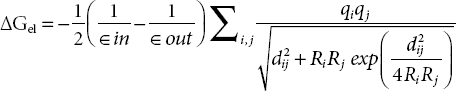

## 15.9 QM/MM 方法

酶促反应的研究需要计算方法来理解蛋白-底物复合物中键形成或键断裂的清晰图景。系统的反应物部分将被视为 QM 区域，其余系统将被视为 MM 区域。因此，`QM/MM` 方法能够利用现有计算资源深入研究共价结合复合物中的结合机制、活化自由能和非键相互作用。`QM/MM` 方法从分子对接方案中提供可靠结果，可与实验动力学数据相关联，所提供的见解将成为科学家发现或微调类药化合物的重要基准 \[110\]。

多位作者使用 `QM/MM` 方法提出了半胱氨酸和丝氨酸蛋白酶的酶促机制。Gao *et al*. (2007) \[111\] 报道了组织蛋白酶 K 在蛋白环境和水溶液中酰化及去酰化过程中的活化自由能分别为 19.8 和 16.7 kcal/mol，分析表明酰化是决速步骤。他们证明在亲核攻击之前，`Cys25` 将质子转移给 `His162`，随后对底物的羰基碳进行亲核攻击；因此两者高度耦合。他们还报道肽水解可通过 `Gln19` 通过向羰基氧供氢键稳定“Michaelis 复合物”中的氧阴离子空穴来实现。

静电效应在决定结构方面发挥关键作用，并导致研究蛋白质的功能机制（分子识别、配体特异性、催化机制和酶调节）\[112, 113\]。此外，静电效应影响酰化和去酰化反应，从而阐明酶催化反应。Dardenne *et al*. (2003) \[114\] 报道了通过蛋白复合物静电效应研究的水解酶中 `Cys25^–` 和 `His159^+` 的形成、稳定和调节的可能作用。他们确定邻近残基 `Gln19`、`Gly23`、`Ser24`、`Asp158` 和 `Ala160` 是重要残基，它们对总电场有贡献。Nobel *et al*. \[115\] 指出 `Asp158` 的 `pKa` 为 2.8，Asp-COOH 残基的去质子化影响 `Cys^–`/`His159^+` 离子对的形成。此外，他们显示 `Glu35`、`Glu50`、`Glu52`、`Asp55`、`Asp57` 和 `Glu89` 是最相关的残基，可作为静电调节剂。此外，他们建议 `Asp57` 是作为静电调节剂的有前景的残基。

Arafat *et al*. \[116\] 用克鲁兹蛋白酶解释了半胱氨酸蛋白酶机制，他们的研究始于将质子从 `His162` 转移到肽底物的 `N1` 原子上形成瞬态中间体，随后 `Cys25` 攻击羰基碳。他们报道局部环境由邻近残基稳定，而非 `Cys25`/`His159` 对，并证明 `Gln19`、`Asn175` 和 `Trp181` 可在两个阶段中通过催化 `His159` 的高 `pKa` 值调节反应。他们的研究表明 `TS3` 是决速步骤，能垒为 26 kcal/mol。

## 15.10 结论与评述

共价药物通过根据各自的弹头报道作用模式而从已知的非共价药物中扩展而来。在了解共价药物某些预测机制的初始阶段，它在制药市场中得到普及。共价药物源于非共价药物分子的已知参数，例如氢键供体、受体、构象异构体和其他理化性质，其中某些参数对药物设计更为关键。因此，共价药物应通过靶向相应的催化位点而在蛋白质（静电有利环境）中得到良好配合。因此，有电荷相互作用应被仔细解释，以更好地理解酶机制，从而提供成功的药物。

进行共价抑制剂的动力学研究以及其他描述符是十分必要的，以了解如何就结合动力学和药物溶解度改进抑制剂。由现有工具/软件设计的共价抑制剂的快速增长可能会导致数据不准确。因此，需要专门的工具和改进的算法来探索共价抑制剂的挑战，以实现准确性、安全性和速度，并改善药物化学家日常使用的情况。本综述的目的是为共价抑制剂的进一步研究提供一些有价值的输入，这些研究在靶向导向和结构导向的药物发现方法方面具有良好的契合度。因此，我们认为本综述可作为进一步开发的基准，以提供强效的共价抑制剂。

## 致谢

作者 BR 和 JJ 感谢由 DST – 高等教育机构科技基础设施改善基金（FIST）(SR/FST/LSI-667/2016) (C)、DST – 大学研究与科学卓越促进（PURSE）(No. SR/PURSE Phase2/38) (G)、2017、UGC-RA-2016-18-OB-AM-7124 日期：18.04.2016、DST-SERB (File No. EMR/2016/000498 日期：26.09.2016)、MHRD-RUSA 2.0、新德里 \[F.24-51/2014-U, Policy (TNMulti-Gen), Dept. of Edn. Govt. of India, Dt. 09.10.2018\] 提供的财务资助，用于开展此项工作的计算设施。

## 参考文献

1\. Robertson, J.G., 作为一类特殊治疗靶点的酶：临床药物及其作用模式. *Curr. Opin. Struct. Biol*., 17, 674, 2007.

# 参考文献

2\. Amala, M., Rajamanikandan, S., Prabhu, D., Surekha, K., Jeyakanthan, J., 针对 *Wolbachia* 内共生菌 *Brugia malayi* 天冬氨酸半醛脱氢酶的抗丝虫先导化合物的鉴定：结合分子对接和分子动力学方法。 *J. Biomol. Struct. Dyn*., 37, 394, 2019.

3\. Drahl, C. *等*., 蛋白质反应性天然产物。 *Angew. Chem. Int. Ed*., 44, 5788, 2005.

4\. Krippendorff, B.F. *等*., 直接从时间依赖性 IC[50] 值推导 K[i] 和 Kinact。 *J. Biomol. Screen*., 14, 913, 2009.

5\. Cer, R.Z., Mudunuri, U., Stephens, R., Lebeda, F.J., IC[50]\-to-K[i]：一种用于将酶活性抑制剂和配体结合抑制剂的 IC50 转换为 Ki 值的基于网络的工具。 *Nucleic Acids Res*., 37, Web Server issue, W441, 2009.

6\. Lu, X.G., Wang, Z., Cui, Y., Jin, Z., 计算热力学、计算动力学与材料设计。 *Chin. Sci. Bull*., 59, 1662, 2014.

7\. Penning, T.M., 自杀底物的设计：作为药物开发高度选择性酶抑制剂的一种方法。 *Trends Pharmacol. Sci*., 4, 212, 1983.

8\. Rando, R.R., 酶失活剂设计的新模式。 *Trends Pharmacol. Sci*., 1, 168, 1980.

9\. Walsh, C., 自杀底物：基于机制的酶失活剂。 *Tetrahedron*, 38, 871, 1982.

10\. Chen, Y.N.P. and Marnett, L.J., 阿司匹林乙酰化前列腺素-H 合成酶所需的血红素辅基。 *FASEB J*., 3, 2294, 1989.

11\. Choubey, S.K., Prabhu, D., Nachiappan, M., Biswal, J., Jeyakanthan, J., 分子建模、动力学研究和密度泛函理论方法用于鉴定人类 SIRT4 蛋白的潜在抑制剂：2 型糖尿病治疗的新靶点。 *J. Biomol. Struct. Dyn*., 35, 3316, 2017.

12\. Esplugues, J.V. and Marti-Cabrera, M., 质子泵抑制剂的安全性和相互作用：数百万患者的经验教训。 *Gastroenterol. Hepatol*., 33, 15, 2010.

13\. Ravi, M., Tentu, S., Baskar, G., Rohan Prasad, S., Raghavan, S., Jayaprakash, P., Jeyakanthan, J., Rayala, S.K., Venkatraman, G., 藻胆蛋白在三阴性乳腺癌细胞中抗癌活性的分子机制。 *BMC Cancer*, 15, 768, 2015.

14\. Xu, H., Faber, C., Uchiki, T., Racca, J., Dealwis, C., 真核核糖核苷酸还原酶 I 的结构定义了吉西他滨二磷酸的结合和亚基组装。 *Proc. Natl. Acad. Sci*., 103, 4028, 2006.

15\. Savi, P. *等*., 氯吡格雷活性代谢物的鉴定和生物活性。 *Thromb. Haemost*., 84, 891, 2000.

16\. Yusuf, S. *等*., 在无 ST 段抬高的急性冠状动脉综合征患者中，氯吡格雷联合阿司匹林的疗效。 *N. Engl. J. Med*., 345, 494, 2001.

17\. Bartholow, M. 2009 年处方药前 200 名。 *Pharmacy Times*, 78, 7, [`www.pharmacytimes.com/issue/pharmacy/2010/May2010/RxFocusTopDrugs-0510`](http://www.pharmacytimes.com/issue/pharmacy/2010/May2010/RxFocusTopDrugs-0510) 2010.

18\. Singh, J., Petter, R.C., Baillie, T.A., Whitty, A., 共价药物的复兴。 *Nat. Rev. Drug Discovery*, 10, 307, 2011.

19\. Kola, I. and Landis, J., 制药行业能否降低流失率？ *Nat. Rev. Drug Discovery*, 3, 711, 2004.

20\. Knowles, J. and Gromo, G., 药物发现指南：药物发现中的靶点选择。 *Nat. Rev. Drug Discovery*, 2, 63, 2003.

21\. Zhou, S.F., Chan, E., Duan, W., Huang, M., Chen, Y.Z., 药物生物活化、与靶蛋白的共价结合及毒性相关性。 *Drug Metab. Rev*., 37, 41, 2005.

22\. Kalgutkar, A.S. and Dalvie, D.K., 新一代共价药物的药物发现。 *Expert Opin. Drug Discovery*, 7, 561, 2012.

23\. Ma, Y., Xu, B., Fang, Y., Yang, Z., Cui, J., Zhang, L., Zhang, L., 新型肽醛作为 20S 蛋白酶抑制剂的合成与构效关系研究。 *Molecules*, 16, 7551, 2011.

24\. Baillie., T.A., 药物设计的靶向共价抑制剂。 *Angew. Chem. Int. Ed*., 55, 13408, 2016.

25\. Sudharsana, S., Madhana Priya, N., Prabhu, D., Jeyakanthan, J., Mohanapriya, A., 植物化学物对银屑病相关 SRC 激酶家族成员抑制机制的构象见解。 *J. Biomol. Struct. Dyn*., 9, 1, 2019.

26\. Huggett, B., 生物技术的源泉：2012 年私营生物技术企业的健康状况。 *Nat. Biotechnol*., 31, 396, 2013.

27\. Garber, K., Principia 生物制药。 *Nat. Biotechnol*., 31, 377, 2013.

28\. Prabhu, D., Rajamanikandan, S., Saritha, P., Jeyakanthan J., 来自 Serratia marcescens 的链霉素腺苷酰转移酶的进化意义和功能表征, *J. Biomol. Struct. Dyn*., 38, 15, 4418–4431, 2020.

29\. Kuntz, I.D. *等*., 配体的最大亲和力。 *Proc. Natl. Acad. Sci*., 96, 9997, 1999.

30\. Santhosh, R., Bankoti Padmashri, N., Michael, A.M.D., Jeyakanthan, J., Sekar, K., MRPC：多肽链中缺失区域的知识库。 *J. Appl. Cryst*., 52, 1422, 2019.

31\. Rajendran, Santhosh., Namrata, Bankoti., Gurudarshan, Manickam., Jeyakanthan, J., Sekar, K., IMRPS：蛋白质结构中插入和修饰残基的数据库, *J. Appl. Cryst*., 53, 569, 573, 2020.

32\. Smith, A.J.T. *等*., 超越皮摩尔亲和力：药物与蛋白质非共价和共价结合的定量方面。 *J. Med. Chem*., 52, 225, 2009.

33\. Ogata, M., Umemoto, N., Ohnuma, T., Numata, T., Suzuki, A., Usui, T., Fukamizo, T., 溶菌酶的一种新型过渡态类似物 4-O-β-三-N-乙酰壳三糖基莫拉诺林提供了支持共价糖基-酶中间体的证据。 *J. Biol. Chem*., 288, 6072, 2013.

34\. Rojas, R.J., Edmondson, D.E., Almos, T., Scott, R., Massari, M.E., 通过生物物理技术研究单胺氧化酶 B (MAO B) 的可逆和不可逆小分子抑制剂。 *Bioorg. Med. Chem*., 23, 770, 2015.

35\. Santhosh, R., Chandrasekaran, P., Michael, D., Rangachari, K., Bankoti, N., Jeyakanthan, J., Sekar, K., ACMS：蛋白质结构主链和侧链原子中发现的交替构象的数据库。 *J. Appl. Cryst*., 52, 910, 2019.

36\. Cheng, Y. and Prusoff, W.H., 抑制常数 (K1) 与导致酶反应 50% 抑制的抑制剂浓度 (I[50]) 之间的关系。 *Biochem. Pharmacol*., 22, 3099, 1973.

37\. Claxton, A.J. *等*., 剂量方案与用药依从性之间关联的系统综述。 *Clin. Ther*., 23, 1296, 2001.

38\. Strelow, J.M., 共价和不可逆抑制动力学视角。 *SLAS Discovery*, 22, 3, 2016.

39\. Kitz, R., Wilson, I. B., 甲磺酸酯作为乙酰胆碱酯酶不可逆抑制剂, *J. Biol. Chem*., 237, 3245–3249, 1962.

40\. Alberty, R.A. and Hammes, G.G., 扩散控制反应理论在酶动力学中的应用。 *J. Phys. Chem*., 62, 154, 1958.

41\. Copeland, R.A., 药物-靶点驻留时间模型：十年回顾。 *Nat. Rev. Drug Discovery*, 15, 87, 2016.

42\. Morris, G.M., Huey, R., Lindstrom, W., Sanner, M.F., Belew, R.K., Goodsell, D.S., Olson, A.J., AutoDock4 和 AutoDockTools4：具有选择性受体灵活性的自动化对接。 *J. Comput. Chem*., 30, 2785, 2009.

43\. Balajee, R., Srinivasa Desikan, V., Sakthivadivel, M., Gunasekaran, P., 分子对接和 DFT 方法用于鉴定针对登革病毒 NS2/NS3 蛋白酶的潜在治疗性新型抑制剂, [doi.org/10.1155/2016/7264080](http://doi.org/10.1155/2016/7264080).

44\. Trott, O. and Olson, A.J., AutoDock Vina：通过新的评分函数、高效优化和多线程提高对接速度和准确性。 *J. Comput. Chem*., 31, 455, 2010.

45\. Jones, G., Willett, P., Glen, R.C., Leach, A.R., Taylor, R., 柔性对接遗传算法的开发与验证。 *J. Mol. Biol*., 267, 727, 1997.

# 参考文献

46. Friesner, R.A., Banks, J.L., Murphy, R.B., Halgren, T.A., Klicic, J.J., Mainz, D.T., Repasky, M.P., Knoll, E.H., Shaw, D.E., Shelley, M., Perry, J.K., Francis, P., Shenkin, P.S., Glide：快速、准确对接和评分的新方法。1. 方法与对接准确性评估。 *J. Med. Chem*., 47, 1739, 2004.

47. Guru Raj, R.R., Jayashree, B., Sureka, K., Jeyakanthan, J., 探索来自 *Pyrococcus horikoshii* OT3 的 N5-CAIR 变位酶新型抑制剂 - 计算研究。 *J. Comput. Biol*., 26, 457, 2019.

48. Shanmughavel, P., Jeyakanthan, J., 分子相互作用, Today & Tomorrows Printers & Pub, 2015, India, ISBN: 9788170195115

49. Ritchie, D.W., Kozakov, D., Vajda, S., 利用多维旋转 FFT 生成函数加速和聚焦蛋白质-蛋白质对接相关性。 *Bioinformatics*, 24, 1865, 2008.

50. Cross, S.S.J., 使用 FlexS 确定的基础片段放置改进的 FlexX 对接。 *J. Chem. Inf. Model*., 45, 993, 2005.

51. Rarey, M., Kramer, B., Lengauer, T., Klebe, G., 一种使用增量构建算法的快速灵活对接方法。 *J. Mol. Biol*., 261, 470, 1996.

52. Bauer, R.A., 药物发现中的共价抑制剂：从偶然发现到避免的责任和设计的疗法。 *Drug Discovery Today*, 20, 1061, 2015.

53. Swinney, D.C., 药物作用的生化机制：实现成功需要什么？ *Nat. Rev. Drug Discovery*, 3, 801, 2004.

54. Lanning, B.R., Whitby, L.R., Dix, M.M., Douhan, J., Gilbert, A.M., Hett, E.C., Johnson, T.O., Joslyn, C., Kath, J.C., Niessen, S., Roberts, L.R., Schnute, M.E., Wang, C., Hulce, J.J., Wei, B., Whiteley, L.O., Hayward, M.M., Cravatt, B.F., 评估共价激酶抑制剂蛋白质组范围选择性的路线图。 *Nat. Chem. Biol*., 10, 760, 2014.

55. Srinivasan, P., Prasanth, K.S., Karthikeyan, M., Jeyakanthan, J., Jasrai, Y.T., Pandya, H.A., Rawal, R.M., Patel, S.K., 基于表位的免疫信息学和分子对接研究克里米亚-刚果出血热病毒（CCHFV）的核衣壳蛋白（NP）和卵巢肿瘤（OTU）结构域。 *Front. Genet*., 2, 2, 2011.

56. Jones, G., Willett, P., Glen, R.C., Leach, A.R., Taylor, R., 灵活对接遗传算法的开发与验证。 *J. Mol. Biol*., 267, 727, 1997.

57. Koch, A., Rode, H.B., Richters, A., Rauh, D., Hauf, S., 类似物敏感 Aurora 激酶共价抑制的化学遗传学方法。 *ACS Chem. Biol*., 7, 723, 2012.

58. Warshaviak, D.T., Golan, G., Borrelli, K.W., Zhu, K., Kalid, O., 基于结构的虚拟筛选方法用于发现共价结合配体。 *J. Chem. Inf. Model*., 54, 1941, 2014.

59. Ouyang, X., Zhou, S., Su, C.T.T., Ge, Z., Li, R., Kwoh, C.K., CovalentDock：参数化共价连接能量估计和分子几何约束的自动化共价对接。 *J. Comput. Chem*., 34, 326, 2013.

60. Moitessier, N., Englebienne, P., Lee, D., Lawandi, J., Corbeil, C.R., 迈向通用、快速且高度准确的对接/评分方法的发展：任重道远。 *Br. J. Pharmacol*., 153, S7, 2008.

61. Kumalo, H. M., Bhakat, S., Soliman, M.E.S., 药物发现中共价对接的理论与应用：优点与陷阱, *Molecules*, 20(2), 1984-2000, 2015, doi: 10.3390/molecules20021984.

62. Vanajothi, R., Vedagiri, H., Jeyakanthan J., Premkumar, K., 基于配体的药效团映射和虚拟筛选用于鉴定潜在的 Discoidin 结构域受体 1 抑制剂, *J Biomol Struct Dyn*., 38(9):2800-2808, 202.

63. Vanajothi, R., Hemamalini, V., Jeyakanthan, J., Premkumar, K., 基于配体的药效团映射和虚拟筛选用于鉴定潜在的 Discoidin 结构域受体 1 抑制剂。 *J. Biomol. Struct. Dyn*., 4, 1, 2019.

64. De Cesco, S., Deslandes, S., Therrien, E., Levan, D., Cueto, M., Schmidt, R., Cantin, L.D., Mittermaier, A., Juillerat-Jeanneret, L., Moitessier, N., 虚拟筛选和计算优化用于发现具有人类细胞活性的共价脯氨酰寡肽酶抑制剂。 *J. Med. Chem*., 55, 6306, 2012.

65. Zhang, T., Inesta-Vaquera, F., Niepel, M., Zhang, J., Ficarro, S.B., Machleidt, T., Xie, T., Marto, J.A., Kim, N., Sim, T., Laughlin, J.D. *et al*., JNK 效力强且选择性共价抑制剂的发现。 *Chem. Biol*., 19, 140, 2012.

66. Liew, C. Y., Pan, C., Tan, A., Ang, K.X.M., Yap, C.W., 化学物质代谢活化为共价反应性物质的 QSAR 分类, *Mol. Divers*., 16(2), 389-400, 2012. doi: 10.1007/s11030-012-9364-3.

67. Linderstrom-Lang, K., 关于蛋白质的电离。 Cr. Trav. Lab. *Carlsberg*, 15, 1, 1924.

68. Jordan, I. K., Kondrashov, F. A., Adzhubei, I. A., Wolf, Y. I., Koonin, E. V., Kondrashov, A. S., Sunyaev, S., 蛋白质进化中氨基酸获得和丢失的普遍趋势, *Nature*, 433, 633 - 638, 2005.

69. Gowri Shankar, B.A., Sarani, R., Michael, D., Mridula, P., Ranjani, C.V., Sowmiya, G., Vasundhar, B., Sudha, P., Jeyakanthan, J., Velmurugan, D., Sekar, K., 非冗余蛋白质结构中的离子对。 *J. Biosci*., 32, 693, 2007.

70. Lesser, G.J. and Rose, G.D., 蛋白质中氨基酸亚基的疏水性。 *Proteins*, 8, 6, 1990.

71. Mason, P.E., Neilson, G.W., Dempsey, C.E., Barnes, A.C., Cruickshank, J.M., 盐酸胍和硫氰酸根离子的水合结构：对水溶液中蛋白质稳定性的影响。 *Proc. Natl. Acad. Sci*., 100, 4557, 2003.

72. Malathi, K. and Ramaiah, S., 分子对接和分子动力学研究用于鉴定铜绿假单胞菌潜在 OXA-10 扩展谱 β-内酰胺酶非水解抑制剂。 *Cell Biochem. Biophys*., 74, 141, 2016.

73. Saravanan, M., Ramachandran, B., Gebretsadkan G., 非洲产超广谱 β-内酰胺酶（ESBLs）肠杆菌科的流行率和耐药模式, *Microbial Pathogenesis*, 114, 180, 192, 2017. doi.org/10.1016/j. micpath.2017.11.061.

74. Pace, C.N., Grimsley, G.R., Scholtz, J.M., 蛋白质可电离基团：pK 值及其对蛋白质稳定性和溶解度的贡献。 *J. Biol. Chem*., 284, 13285, 2009.

75. Sinha, N., Tsai, C.-J., Nussinov, R., 淀粉样纤维伸长的结构模型：结构域交换形成交错 β-结构聚合物。 *Protein Eng*., 14, 93, 2001.

76. Cambillau, C. and Claverie, J.M., 超嗜热性的结构和基因组相关性。 *J. Biol. Chem*., 275, 32383, 2000.

77. Ibarra-Molero, B. and Sanchez-Ruiz, J.M., 设计蛋白质稳定表面电荷分布的遗传算法。 *J. Phys. Chem., B*, 106, 6609, 2002.

78. Maple, J.R., Dinur, U., Hagler, A.T., 从从头算能量面推导分子力学和动力学的力场。 *Proc. Natl. Acad. Sci*., 85, 5350, 1988.

79. Spassov, V.Z. and Yan, L., 蛋白质电离的快速准确计算方法。 *Protein Sci*., 17, 1955, 2008.

80. Kirkwood, J. and Shumaker, J.B., 溶液中蛋白质分子之间源于质子电荷和构型波动的力。 *Proc. Natl. Acad. Sci*., 38, 855, 1952.

81. Marcus, 聚电解质热力学性质的计算。 *J. Chem. Phys*., 23, 1057, 1955.

82. Lifson, S., 聚电解质中离子对形成的探讨。 *J. Chem. Phys*., 26, 727, 1957.

83. Puthiyaveetil, S., Van Oort, B., Kirchhoff, H., 光合膜中表面电荷动力学及其结构后果。 *Nat. Plants*, 3, 17020, 2017.

84. Mustárdy, L., Buttle, K., Steinbach, G., Garab, G., 植物类囊体膜的三维网络：基粒-基质复合体的准螺旋模型。 *Plant Cell*, 20, 2552, 2008.

# 参考文献

85\. Kirchoff, H., Hall, C., Wood, M., Herbstova, M., Tsabari, O., Nevo, R., Charuvi, D., Shimoni, E., Reich Z, 颗粒类囊体腔内蛋白质扩散的动态调控. *美国国家科学院院刊*., USA, 108(50), 20248-20253, 2011.

86\. Kirchhoff, H., 光合膜中结构-功能关系：挑战与新兴领域. *植物科学*., 266, 76, 2018.

87\. Berisio, R., Lamzin, V.S., Sica, F., Wilson, K.S., Zagari, A., Mazzarella, L., 结晶状态下的蛋白质滴定. *分子生物学杂志*., 292, 845, 1999.

88\. Narahari, S. and Zydney, A.L., 圆柱形孔中球形颗粒的电荷调节与静电相互作用. *胶体与界面科学杂志*., 192, 338, 1997.

89\. Arghya, M., Markus, B., Ralf, B., Rudolf, P., 电荷调节从根本上改变了膜堆叠中的静电作用. *物理评论 E*, 100, 050601, 2019.

90\. Srinivasa Desikan V, C.-H. Lu, Ramachandran, B., S.-L. Lee. 肌氨酸电子性质的微溶剂化效应：理论研究, *化学选择*, 2, 8950, 8958, 2017, DOI: 10.1002/slct.201701430.

91\. Warshel, A., Sharma, P.K., Kato, M., Parson, W.P., 蛋白质中静电效应的建模. *生物化学与生物物理学报（BBA）*, 1764, 1647, 2006.

92\. Jindal, G., Ramachandran, B., Bora, R.P., Warshel, A., 探索肯普消除酶中两条定向进化路径中基态去稳定化和过渡态稳定化的发展, *ACS 催化*, 7(5), 3301- 3305, 2017, DOI:10.1021/acscatal.7b00171

93\. Mustárdy, L., Buttle, K., Steinbach, G., Garab, G., 植物中类囊体膜的三维网络：颗粒-基质组装的准螺旋模型. *植物细胞*, 20, 2552, 2008.

94\. Sanjay, K.C. and Jeyakanthan, J., 基于分子动力学和量子化学的方法鉴定同工酶选择性 HDAC2 抑制剂——预防阿尔茨海默病的新靶点. *受体与信号转导研究杂志*., 38, 266, 2018.

95\. Zhang, H., Tan, T., van der Spoel, D., 有机溶剂中自由能计算的广义 Born 和显式溶剂模型：环糊精二聚化. *化学理论与计算杂志*., 11, 5103, 2015.

96\. Ramachandran, B. and DhanaRajan, M.S., 法尼基转移酶与潜在抑制剂 Theflavin 的分子对接与模拟研究. *应用药学科学杂志*., 1, 141, 2011.

97\. Nymeyer, H. and Garcìa, A.E., α螺旋肽折叠平衡的模拟：广义 Born 近似与显式溶剂的比较. *美国国家科学院院刊*., 100, 13934, 2003.

98\. Jens, K. and Franca, F., 生物分子模拟中隐式溶剂模型的构建与应用. *结构生物学当前观点*., 25, 126, 2014.

99\. Forouzesh, N., Izadi, S., Onufriev, A.V., 用于计算静电结合自由能的基于网格的表面广义 Born 模型. *化学信息学与建模杂志*., 57, 2505, 2017.

100\. Darden, T., York, D., Pedersen, L., 粒子网格 Ewald：大系统中 Ewald 求和的 N•log(N)方法. *化学物理杂志*., 98, 10089, 1993.

101\. Jayashree, B., Jayaprakash, P., Suresh, K.R., Ganesh, V., Poopandi, S., Raghu, R., Jeyakanthan, J., 利用水热力学分析鉴定 Pak1 抑制剂. *生物分子结构与动力学杂志*., 38, 13, 2020.

102\. Essmann, U., Perera, L., Pedersen, L.G., 一种光滑粒子网格 Ewald 方法. *化学物理杂志*., 103, 8577, 1995.

103\. Toukmaji, A.Y. and Board, J.A., Jr., Ewald 求和技术的展望：综述. *计算物理通讯*., 95, 73, 1996.

104\. York, D. and Yang, W., 计算 Ewald 求和的快速傅里叶泊松方法. *化学物理杂志*., 101, 3298, 1994.

105\. Izadi, S., Harris, R.C., Fenley, M.O., Onufriev, A.V., 广义 Born 模型在静电结合自由能计算中的精度比较. *化学理论与计算杂志*., 14, 1656, 2018.

106\. Sharp, K.A., Madan, B., Manas, E., Vanderkooi, J.M., 模拟和红外光谱揭示的疏水性和极性溶质诱导的水结构变化. *化学物理杂志*., 11, 1791, 2001.

107\. Roux, B. and Simonson, T., 隐式溶剂模型. *生物物理化学*., 78, 1, 1999.

108\. Sanjay, K.C., Richard, M., Santhosh, R., Jeyakanthan, J., 通过联合药效团建模、3D-QSAR 分析、计算机筛选和密度泛函理论（DFT）方法鉴定新型组蛋白去乙酰化酶 1 抑制剂. *分子结构杂志*., 1125, 391, 2016.

109\. Still, W.C., Tempczyk, A., Hawley, R.C., Hendrickson, T., 分子力学和动力学中溶剂化的半解析处理. *美国化学会志*., 112, 6127, 1990.

110\. Chaskar, P., Zoete, V., Rohrig, U., 具有吸引空腔的即时 QM/MM 对接. *化学信息学与建模杂志*., 57, 73, 2017.

111\. Ma, S., Devi-Kesavan, L.S., Gao, J., 半胱氨酸蛋白酶催化途径的分子动力学模拟：人组织蛋白酶 K 的联合 QM/MM 研究. *美国化学会志*., 129, 13633, 2007.

112\. Guan, H.H., Goh, K.-S., Davamani, F., Wu, P.L., Huang, Y.W., Jeyakanthan, J., Wu, W g, Chen, C.J., 两种具有不同活性的蝰蛇毒金属蛋白酶的结构突出了 ADAMalysin 家族蛋白 D 结构域中的二硫键模式. *结构生物学杂志*., 169, 294, 2010.

113\. Dhanachandra Singh, Kh., Palani, K., Shanthi, N., Sugunadevi, S., Karthikeyan, M., Velmurgan, D., Jeyakanthan, J., 基孔肯雅病毒 nsP2 蛋白酶的同源建模、分子动力学、电子药效团映射和对接研究. *分子建模杂志*., 18, 39, 2012.

114\. Laurent, E.D., Werneck, A.S., Al de Oliveira Neto, M., Bisch, P.M., 木瓜蛋白酶催化位点中的静电性质：离子对反应性的可能调控机制. *蛋白质：结构、功能与遗传学*, 52, 236, 2003.

115\. Noble, M.A., Gul, S., Verma, C.S., Brocklehurst, K., 木瓜蛋白酶和木瓜蛋白酶中天冬氨酸残基 158 的电离特征和化学影响由结构相关动力学和计算技术测定：活性中心化学的多重静电调节因子. *生物化学杂志*., 351, 723, 2000.

116\. Kemel, Arafet., Silvia, Ferrer., Vicent, Moliner., 克鲁兹蛋白酶半胱氨酸蛋白酶催化机制的计算研究, *ACS 催化*, 7(2), 1207 1215, 2017, doi: 10.1021/acscatal.6b03096.

1.  **通讯作者*: jjkanthan@gmail.com; jjeyakanthan@alagappauniversity.ac.in
