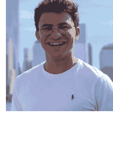
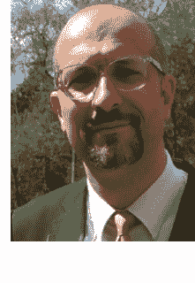

## 关于作者

**Ahmed Fathi Bekhit** 是 Magic Studio 的联合创始人兼首席技术官，Magic Studio 是一家总部位于佛罗里达州博卡拉顿的软件公司，专注于开发尖端的视频处理和流媒体技术。Ahmed 软件工程职业生涯的早期，他连续三年获得 Apple WWDC 奖学金，并在 15 岁时被 *《华尔街日报》* 称作“Apple 神童”。

截至今日，Ahmed 已在几家初创公司担任软件工程师七年，并拥有超过十年的软件编写经验。他还定期为开源社区做出贡献，并以创建 ARVideoKit 而闻名，这是一款 iOS 框架，可将 ARKit 内容渲染为带有增强现实组件的视频、GIF 和实况照片进行捕捉。除了开发软件外，Ahmed 还对编写以软件工程为重点的教育材料感兴趣，以分享他的背景和知识。例如，他为教程网站 AppCoda 撰写了多篇文章。他还通过斯坦福大学学者计划发布了教育材料。此外，在过去几年里，Ahmed 开发并发布了独立的 iOS 应用，累计用户超过五百万。Ahmed 的工程工作曾被集成到获艾美奖的软件中，并获得许可以帮助 COVID 疫苗生产管道。

## 关于技术审校

**Massimo Nardone** 在安全、Web/移动开发以及云和 IT 架构方面拥有超过 22 年的经验。他的真正 IT 激情是安全和 Android。他在 20 多年里一直从事编程并教授如何使用 Android、Perl、PHP、Java、VB、Python、C/C++ 和 MySQL 进行编程。他拥有意大利萨勒诺大学计算科学硕士学位。

他多年来曾担任项目经理、软件工程师、研究工程师、首席安全架构师、信息安全经理、PCI/SCADA 审计员以及高级首席 IT 安全/云/SCADA 架构师。

## 致谢

我谨此感谢家人和朋友在我撰写本书旅程中给予我的非凡支持；我非常幸运和感激自己身边拥有如此出色的支持系统。感谢 David Parshenkov、Fathi Bekhit、Mohamed Bekhit、Hazem Abdeltawab、Youssef Gamal、Ahmed Abdulkareem、Seif Hediya 和 Amr Aly，感谢你们给予我的所有爱与支持，这激励着我走过这段旅程。我爱你们所有人。

本书之所以成为现实，多亏了 Apress 的高级收购编辑 Aaron Black 相信我；Apress 的协调编辑 Jessica Vakili 持续的支持和反馈；深度学习工程师 Akanksha Devkar 提供的出色反馈，使本书内容全面；以及深度学习研究员 Affan Abbas 对当今学术界使用的最先进计算机视觉技术的精彩见解和反馈。

最后但同样重要的是，感谢你，Leo，在我撰写本书的深夜里一直陪伴着我。没有你，我无法做到。
