### 第 1 章

### 计算机视觉导论

本章将重点介绍计算机视觉是什么、我们为什么需要它、技术的发展历程、其不同的应用，以及它在增强现实中的使用方式。

#### 什么是计算机视觉？

视觉是分析和解释感兴趣的场景和物体的能力。人类视觉已被研究了数百年，以了解视觉过程如何运作。人类视觉过程是最复杂的过程之一。事实上，至今视觉科学家尚未找到视觉过程如何运作的完整答案。然而，视觉科学家对人类视觉过程如何开始以及其之后的少量发现启发了计算机科学家开发出我们今天所知的计算机视觉。视觉研究人员和科学家描述说，视觉过程始于眼睛处理光信号并将其转换为场景和图像，供大脑视觉皮层分析和解释。1950 年代的一项视觉研究突破发现，视觉过程始于检测图像的简单结构和边缘，以帮助在视觉信息变得更复杂时构建更详细的解释。这项突破性的视觉研究启发了计算机科学家开发我们今天使用的预处理计算机视觉算法，以启动每项计算机视觉任务。与今天典型的计算机相比，人类大脑的计算速度明显慢于计算机的计算速度，然而人类大脑执行视觉任务的速度要快得多，并且明显优于任何计算机。因此，研究人员开发计算机视觉算法的灵感始终是自然界中视觉的演变。

计算机视觉是研究和开发使计算机能够处理、分析和解释数字图像的技术领域。今天，计算机视觉应用可以在多个行业中找到，例如工业机器人、医学成像、监控等。所有这些应用都有一个主要使命，即处理、分析和解释数字图像的内容以执行与行业需求相关的任务，在本书其余部分中将此称为视觉任务。视觉任务是指任何需要处理、分析或解释数字图像和视频内容的一类任务。供参考，视频是一系列数字图像，通常每秒由 30–60 张数字图像组成，也称为帧。

计算机经常显示数字图像。当数字图像作为输入提供给计算机时，计算机将其读取为二维像素数组；也可以定义为二维矩阵。图像矩阵由 M 列和 N 行组成。图像的像素大小可以通过求 M 列和 N 行的乘积来确定（M × N），其中 M 为图像宽度，N 为图像高度。像素位置由其在矩阵中的 x 和 y 坐标（x, y）标识。计算机图形和数字图像中的坐标系统与典型的笛卡尔坐标系统略有不同；数字图像中原点（0, 0）始于图像的左上角。因此，x 从左到右递增，y 从上到下递增（见图 1-1）。


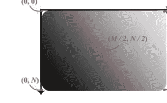

#### 图 1-1. 数字图像坐标系统

在灰度数字图像中，像素值可以用多种格式表示；然而，最常用的格式是 8 位（1 字节）无符号整数，范围从 0 到 255，其中 0 为黑色，255 为白色。0 到 255 之间的任何值都定义了不同的灰度色调（见图 1-2）。

#### 放大 16x16 灰度图像

#### 图像矩阵

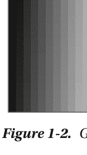

```
0 16 32 48 64 80 96 112 128 144 160 176 192 208 224 240
1 17 33 49 65 81 97 113 129 145 161 177 193 209 225 241
2 18 34 50 66 82 98 114 130 146 162 178 194 210 226 242
3 19 35 51 67 83 99 115 131 147 163 179 195 211 227 243
4 20 36 52 68 84 100 116 132 148 164 180 196 212 228 244
5 21 37 53 69 85 101 117 133 149 165 181 197 213 229 245
6 22 38 54 70 86 102 118 134 150 166 182 198 214 230 246
7 23 39 55 71 87 103 119 135 151 167 183 199 215 231 247
8 24 40 56 72 88 104 120 136 152 168 184 200 216 232 248
9 25 41 57 73 89 105 121 137 153 169 185 201 217 233 249
10 26 42 58 74 90 106 122 138 154 170 186 202 218 234 250
11 27 43 59 75 91 107 123 139 155 171 187 203 219 235 251
12 28 44 60 76 92 108 124 140 156 172 188 204 220 236 252
13 29 45 61 77 93 109 125 141 157 173 189 205 221 237 253
14 30 46 62 78 94 110 126 142 158 174 190 206 222 238 254
15 31 47 63 79 95 111 127 143 159 175 191 207 223 239 255
```

#### 图 1-2. 灰度图像转换为矩阵

图 1-2 演示了一个 16 × 16 灰度图像转换为像素值，这些像素值以 8 位无符号整数表示。

在彩色数字图像中，像素值必须用三种颜色指定——红色、绿色和蓝色——这代表 RGB 色彩空间。因此，像素值表示为三个数字的向量，每个数字范围从 0 到 255。随着数值的增加，每种颜色的亮度也会增加，也称为颜色强度。例如，如果某个像素值为 (255, 255, 255)，则表示红色、绿色和蓝色强度（或亮度）均设置为最高值，这定义了一个白色像素（见图 1-3）。

| 红色强度 | 0 | 255 | 255 | 0 | 0 |
| 绿色强度 | 0 | 255 | 0 | 255 | 0 |
| 蓝色强度 | 0 | 255 | 0 | 0 | 255 |

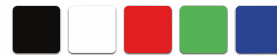

#### 图 1-3. RGB 色彩空间和颜色强度示例

在图 1-3 中可以看到颜色强度如何影响最终的颜色结果。颜色强度越高，结果颜色越亮。

尽管渲染数字图像看起来像是计算机友好的任务，但计算机视觉需要更复杂的处理来解释、分析或操作数字图像的内容。计算机视觉包含两个核心应用：操作数字图像和处理数字图像以执行视觉任务。操作数字图像包括图像增强、修复、重建和压缩。图像增强和修复通常用于提高失真图像的质量。图像重建利用来自不同角度的一组二维图像来重建三维图像。然而，一些使用深度学习的实现尝试从单张二维图像重建三维图像。图像压缩用于将图像转换为更高效的表示以最小化存储使用。另一方面，处理数字图像可能会使用一些图像操作技术来执行视觉任务，以匹配、描述或识别图像的内容。匹配和描述图像内容的过程主要取决于将图像分割成更小的部分，并将分割后的部分与其他模板图像进行比较，并测量分割部分与模板图像之间的关系（见图 1-4）。


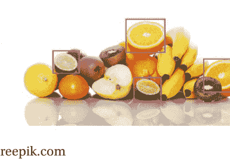

模板匹配算法

图片来源：Racool_studio/Freepik.com

#### 图 1-4. 模板匹配抽象示例

图 1-4 演示了模板匹配算法的示例结果。

#### 计算机视觉工作原理概述

为了让计算机执行面部检测等视觉任务，它需要执行多个较小的任务以达到目标任务。例如，为了执行视觉任务，计算机通常必须执行各种数字图像预处理技术，例如灰度操作、边缘增强和检测、噪声去除、图像修复、插值和图像分割。图像预处理是每个视觉任务的第一阶段，并且在取得成功结果方面发挥着重要作用。预处理的目的是提取给定图像中的有价值部分并去除不需要的失真。

有价值的部分有助于开发像素、形状和表面在给定图像中的有用描述。如前所述，像素值由 1 字节整数定义（当它在灰度图像中时）或表示 RGB 色彩空间的整数向量（当它在彩色图像中时）；并且每个像素值都有不同的强度级别代表颜色的亮度。给定图像中强度的变化提供了关于图像中形状和表面结构的线索。

在预处理阶段，我们尝试使用诸如噪声去除、边缘增强和图像分割等技术在没有任何图像内容知识的情况下提取这些信息。噪声去除是平滑图像以减少和消除不需要的噪声/失真的过程。然而，有时噪声去除技术最终会使图像模糊；在这种情况下，边缘增强技术就派上用场了。边缘增强通过增加两个区域边界之间的强度水平差异来提高图像中边缘的清晰度（见图 1-5）。

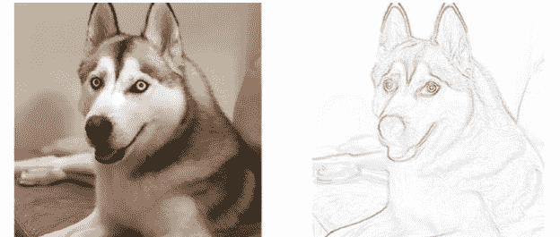

图 1-5. 边缘增强/检测示例

左侧的图像是原始图像。右侧的图像是在应用边缘增强技术后得到的结果图像。如你可能已经注意到的，右侧图像似乎“勾勒”出了狗的边缘，这可用于各种视觉任务，例如图像分类。

图像分割是将图像分离成称为分割的较小部分的过程。分割用于分别处理图像的部分，因为在许多情况下，图像不仅仅包含一个有助于识别图像内容的独特对象或特征。图像分割被认为是预处理和为对象检测或分割分类处理图像之间的中间步骤（见图 1-6）。

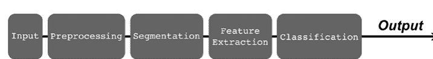

图 1-6. 抽象计算机视觉流程

在对数字图像进行预处理后，处理步骤开始，在许多情况下，它可能涉及特征提取、纹理分析和模式识别等技术。根据每个视觉任务的不同，你会选择更相关的技术来执行任务。例如，为了执行图像分类任务，你会使用特征提取技术从给定图像的分割中提取独特特征。图像的分割是在图像分割过程中提取的。一旦从图像分割中提取出独特特征，它们就会被用来寻找与预定义或标记的图像分割相匹配的独特模式；标记的图像分割是经过人工监督手动定义的一块图像（图 1-7）。

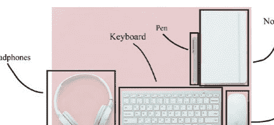

图 1-7. 标记图像分割示例

寻找与标记分割完全匹配的过程称为特征匹配；寻找独特模式的过程称为模式识别。图 1-6 演示了抽象的计算机视觉流程，以及当计算机执行视觉任务时给定图像通常需要经历的过程。本书将在后续章节中介绍不同图像处理技术的更多细节。

#### 为什么我们需要计算机视觉？

自从互联网可供全球数十亿用户访问以来，它使许多人能够捕获、制作和发布多媒体内容，例如图像、视频和动画图像（也称为 GIF）。用户生成内容定义了我们今天所知的互联网，并且每天发布的多媒体内容数量正在迅速增加。今天，仅 YouTube 发布者每分钟就贡献 300 小时的视频；即每周 300 万小时的视频。没有人能以这种速度观看这么多视频。YouTube 和许多允许在其平台上发布用户生成内容的类似公司面临着为数十亿用户生成图像和视频编目、分类和分类的挑战，以便为观众提供他们最想观看的最相关内容。所有这些内容的分类不能由典型的软件妥善处理；大多数现有方法都依赖于发布者的文本输入，例如视频标题、描述、关键词等。然而，在许多情况下，发布者的文本输入可能不相关；其内容可能包含不适合某些年龄段显示的不当或暴力场景，或者许多观众可能希望选择不观看此类内容。唯一能够实现大规模图像和视频编目、分类和分类的技术是计算机视觉。计算机视觉是公司所需要的，例如


YouTube，用于索引和分类海量多媒体内容。除了对图像和视频进行分类之外，计算机视觉还可以用于

- 为视障用户和客户提供图像和视频的视觉描述。
- 过滤不适合特定年龄段的不当内容。
- 警告观众图像或视频中包含的场景和内容类型。
- 检测可能对观众或被篡改内容中的人物造成伤害的被操纵图像和视频。

除了计算机视觉可以解决的与互联网相关的问题之外，还有许多其他行业的问题需要计算机视觉技术来解决。如今，你可以在我们日常互动的许多事物中发现计算机视觉技术集成其中，例如收银系统、监控系统、生物识别扫描仪、医疗设备、交通运输等，还有更多。

- 收银系统集成计算机视觉技术以实现自助结账亭。
- 监控系统使用图像和视频增强算法来检测和分析监控图像和视频的内容。
- 生物识别扫描仪使用边缘检测和增强技术来收集和分析生物识别信息（即指纹、面部特征、眼睛特征……等）。
- 医疗设备利用各种计算机视觉技术，例如图像重建和恢复，以从医疗设备和扫描仪中获取有用信息。

这个列表可以延续数页，展示计算机视觉的所有不同应用。事实上，过去十年中，对计算机视觉技术的需求只是在不断增加。顶级公司正在其产品中采用该技术，而新公司则开始提供由计算机视觉驱动的产品。计算机视觉技术的影响是无限的，在未来几年里，它将被世界各地更多的行业和组织所采用。你可能已经看到了计算机视觉应用未来的初步迭代，例如自动驾驶车辆、自主制造以及通过增强现实进行的教育。

在 2019 年，企业对增强现实、虚拟现实和计算机视觉工程师的需求增加了 1500%（State of Software Engineers, Hired.com）。计算机视觉将在未来几年对社会产生巨大影响，并需要更多为该技术做出贡献的人，本书旨在通过使软件工程师和对计算机视觉感兴趣的人参与到这项革命性技术的发展中来实现这一目标。

#### 计算机视觉的演变

1959 年，一项神经生理学研究对一只猫的视觉系统进行了几次实验。实验在猫大脑的主视觉皮层放置电极，研究人员在向猫展示各种图像时观察视觉皮层的神经反应（图 1-8）。

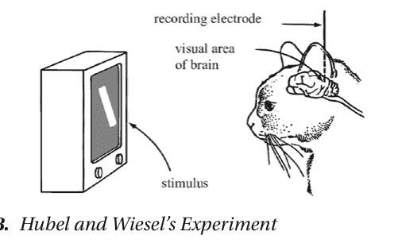

##### 图 1-8. Hubel 和 Wiesel 的实验

随着实验的进行，研究人员注意到当呈现新图像时猫的神经反应存在一种模式。研究得出结论，视觉皮层中存在简单和复杂神经元。视觉过程始于检测图像的简单结构和边缘，以帮助构建更详细的解释。随着视觉信息变得更加复杂，视觉皮层依赖复杂神经元来解释图像的剩余细节。这项研究后来成为计算机视觉领域最具影响力的研究之一。它启发了计算机视觉研究人员实现了今天所知的图像预处理。

1966 年 7 月，麻省理工学院（MIT）人工智能实验室的教授 Seymour Papert 发起了“夏季视觉项目”。该项目分配给 MIT 本科生，旨在开发模式识别技术，尝试使机器能够看到。该项目是一个非常乐观的计划，旨在在一个夏天开发出我们今天所知的计算机视觉。在 1960 年代，有各种尝试开发计算机视觉系统；然而，研究人员最终意识到这样一个项目需要数年，如果不是数十年才能实现。而现在，50 年后，计算机视觉仍处于研究和开发阶段。

自 1960 年代以来，计算机视觉已经发展成为我们今天在许多应用中看到的技术。计算机视觉的开创性研究之一是在 1970 年代，研究重点是物体识别。物体识别的初始迭代是抽象且简单的，目的是证明物体识别的概念。实现使用了简单物体的线条连接，例如圆柱体和立方体，以识别它们。在随后的几十年中，研究人员和工程师开发了传统计算机视觉的核心技术，其中包括两个主要阶段：

- 1. 图像预处理
- 2. 图像处理

图像预处理阶段专注于增强图像颜色和边缘，以帮助检测给定图像中的简单结构。处理阶段使用预处理后的图像执行以下一种或多种处理技术：

- 图像压缩
- 图像增强
- 图像恢复和重建
- 模式匹配和识别

尽管自开发以来几十年来一直使用传统的图像处理技术，例如上面列出的技术，但这些技术 alone 无法解决的一些问题，例如在显著不寻常或意外的上下文中识别物体，例如手写单词、数字，以及从不寻常角度拍摄的物体图像（图 1-9）。

##### 狗的正常图像

##### 狗的不寻常图像

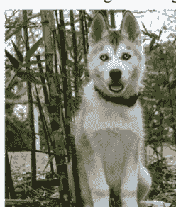

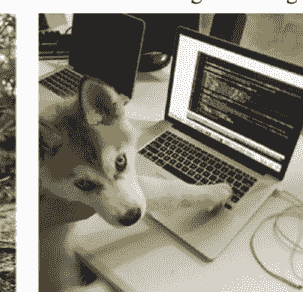

图 1-9. 物体的正常 vs. 不寻常图像

因此，在 1980 年代，发表了各种开创性研究。研究建议使用简单和复杂“神经元”的人工网络来识别某些模式。这个人工网络今天被称为人工神经网络（ANN）。神经网络是一种计算模型，旨在在一组标记数据（本例中为标记图像）中识别模式。网络使用给定的图像来识别模式并预测每张图像的结果。一旦网络预测了图像的结果，它就会将其预测与分配给图像的标签进行比较。比较阶段使网络能够“学习”其初始过程中的错误，然后它多次执行相同过程，直到网络提供更准确的结果。神经网络通常需要大量标记数据才能提供显著良好的结果。因此，在早期，由于缺乏数据，神经网络并未发挥其全部潜力。

在 2010 年代初期，一组计算机视觉研究人员启动了一个大规模图像数据集，包含数百万张图像和超过 20,000 个类别，称为 ImageNet。ImageNet 的灵感来自计算机视觉领域对更多数据的需求。它推动了最先进神经网络模型的发展，这些模型对今天看到的先进计算机视觉应用产生了巨大影响。神经网络及其变体被认为是深度学习领域的一部分，而深度学习是机器学习的一个子集。因此，当神经网络用于执行视觉任务时，我将称其为基于深度学习的计算机视觉。

#### 传统 vs. 基于深度学习的计算机视觉

传统计算机视觉自计算机视觉领域开始以来就一直存在。传统计算机视觉技术已被用于几十年，以高效执行视觉任务。传统技术帮助开发了许多今天常用的算法，例如尺度不变特征变换（SIFT）和加速稳健特征（SURF）。像 SIFT 和 SURF 这样的算法由于其高效性能和准确结果，已成为开发当今增强现实技术的基石。然而，在某些情况下，由于缺乏准确性，传统计算机视觉技术并不是最佳选择。在这些情况下，最佳选择通常是使用基于深度学习的技术。深度学习以多种方式用于执行复杂的视觉任务，例如图像分类。基于深度学习的方法在图像分类方面通常优于传统方法。图像分类是将图像内容在不同类别之间进行分类的过程。例如，最受欢迎的图像分类问题之一是猫和狗图像的分类。当软件被呈现猫的图像时，它应该以高准确度将其分类为猫。在深度学习之前，这项任务几乎不可能实现；然而，深度


深度学习推动了计算机视觉可能实现极限的边界，并成功使计算机能够以高精度区分猫和狗。如果没有极快的计算机和数百万张猫狗图像的数据集，这是不可能实现的。你可能会想知道为什么深度学习需要快速的计算机和大量的数据。好吧，答案在于深度学习是什么以及它是如何真正工作的。深度学习是机器学习的一个子集，大多建立在人工神经网络（ANNs）之上，人工神经网络是一种受人类大脑运作方式启发的计算模型。与人类大脑相似，人工神经网络由多个计算“神经元”组成。神经网络中的一个人工神经元执行一个简单的计算操作，并与其他连接的神经元通信以做出决策。神经元之间连接的每个连接都有特定的强度。神经元之间连接的强度称为权重（见图 1-10）。

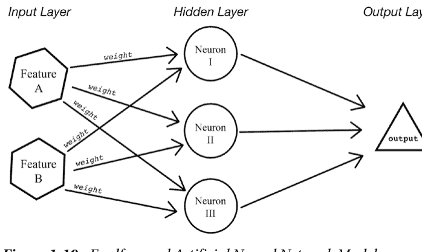

图 1-10. 前馈人工神经网络模型

图 1-10 展示了一个简单的神经网络，由三层组成——（1）输入层，（2）隐藏层，（3）输出层：

- 1. 输入层由多个输入组成，每个输入代表给定数据集的独特特征。
- 2. 隐藏层是一组神经元，根据权重值以某种方式计算和处理。
- 3. 输出层是神经网络中的最后一层，从之前的隐藏层接收最终结果。

一组神经元代表一个神经网络隐藏层，而典型的深度学习算法由多个神经网络隐藏层组成。ANNs 由两个阶段组成，学习阶段和执行阶段。在学习阶段，神经网络利用标记数据集来“学习”数据与其描述（也称为标签）之间的相关性。在我们的例子中，标记数据集将由一组图像组成，每张图像都有其内容的描述。当神经网络被提供一张标记图像时，它会尝试在隐藏层中处理该图像并返回标签的预测作为输出。一旦输出返回，神经网络就会通过使用称为目标函数的各种函数将其与原始标签进行比较来“评分”其结果。如果成绩没有超过某个阈值，它就会从中“学习”，通过调整神经网络中神经元之间连接的权重。神经网络通过向自身重复呈现相同的输入来继续学习，并且随着学习的进行，网络的权重会得到调整。此过程重复多次，直到神经网络的“成绩”超过所需的阈值。“学习”并调整权重的过程称为误差反向传播，也称为反向传播。回顾一下，典型的<|message|> 人工神经网络在“学习”新事物时经历的简单有序步骤如下：

- 1. 接收标记输入
- 2. 尝试预测输入的标签
- 3. 将预测的标签作为输出返回
- 4. 将预测的标签与实际标签进行比较
- 5. 对结果进行评分
- 6. 调整神经元之间连接的强度，也称为权重
- 7. 重复该过程，直到最终成绩超过阈值

#### 增强现实中的计算机视觉

增强现实（AR）是一种通过摄像头实时画面在物理世界中增强或显示数字对象的技术。为了在物理世界中显示数字对象，我们需要实时理解和检测物理世界中的对象。在某些情况下，对象可以是特定的模板。在其他情况下，它可以是水平表面，例如桌子和地板，或者是垂直表面，例如墙壁和门。为了能够检测对象和表面，我们需要使用计算机视觉技术在物理世界中显示数字对象。增强现实主要有三种类型：基于标记、免标记和基于地理位置的增强现实。基于标记的 AR 需要预定义的模板来在上面显示数字对象。例如，书或杂志中的一页可以有一个特殊图标，当摄像头检测到该图标时，它会在图标或页面上映射并显示一个数字对象（图 1-11）。

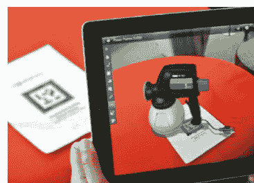

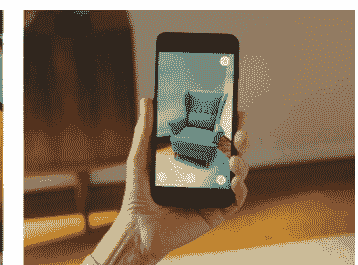

#### 基于标记的 AR

##### 免标记 AR

图 1-11. 基于标记与免标记 AR

与基于标记的 AR 不同，免标记 AR 不需要在显示数字对象时使用任何特殊预定义模板。相反，它可以使用各种计算机视觉技术将数字对象放置在任何水平或垂直表面上。地理位置 AR 在许多情况下依赖于基于标记或免标记 AR，并集成位置传感器技术，根据视觉和位置数据在物理世界中显示数字对象。

增强现实今天主要通过移动设备访问，具体来说是智能手机。虽然人们曾尝试通过开发定制硬件和设备（如微软的 HoloLens、Magic Leap 眼镜和 Google 眼镜）来集成沉浸式 AR 体验，但对于消费者来说，采用新颖不熟悉的硬件还为时过早。因此，智能手机是向消费者介绍 AR 的完美工具。在移动 AR 的早期，使用标记，如二维码或模板图像，是在物理世界中增强数字对象的主要方式。为此，需要诸如模式识别和姿态估计等技术。模式识别是一种依赖于预定义的数据集来描述在给定图像中查找和分析的特征的技术。姿态估计

使用检测到的模式根据摄像机角度模拟三维姿态（见图 1-12）；该技术用于根据摄像机的视角从各个角度看到三维对象。

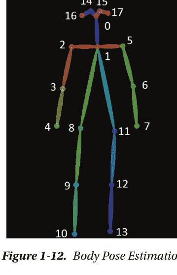

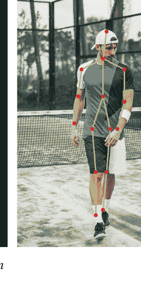

图 1-12. 身体姿态估计

基于标记的 AR 允许任何拥有智能手机的用户交互和使用该技术；然而，拥有物理标记的要求对于日常使用来说既不可扩展也不实用。因此，由于其易用性和可访问性，免标记 AR 具有更大的潜力。在免标记 AR 开发的早期，需要双摄像头来重建物理世界。

#### 总结

在本章中，我们阅读了计算机视觉的历史。比较了灰度图像和彩色图像。我们还研究了为什么我们需要计算机视觉及其评估。我们还看到了前馈人工神经网络的简化架构。最后，我们查看了增强现实。

总之，计算机视觉是人工智能（AI）的一个领域，它使计算机和系统能够从数字图像、视频和其他视觉输入中提取有意义的信息，并基于该信息采取行动或做出建议。如果 AI 使计算机能够思考，计算机视觉则使它们能够看到、观察和理解。

计算机视觉的工作方式与人类视觉非常相似，只是人类起步更早。人类视觉的优势在于拥有数十年的上下文来训练如何区分物体、它们有多远、它们是否在移动，以及图像中是否有问题。

在下一章中，我们将研究增强现实以及不同类型的增强现实。
