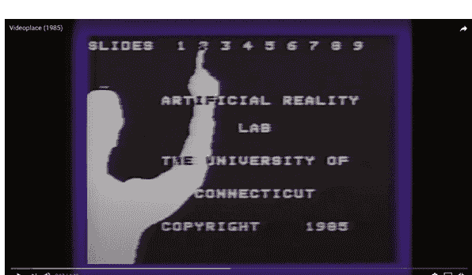
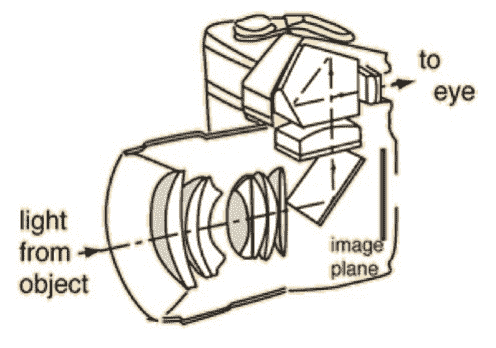
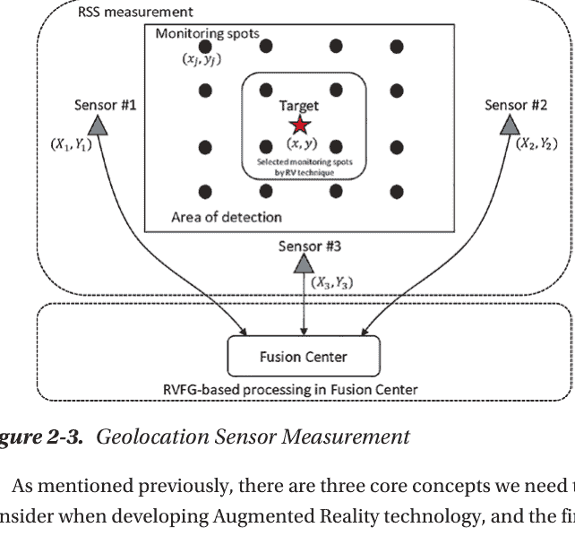
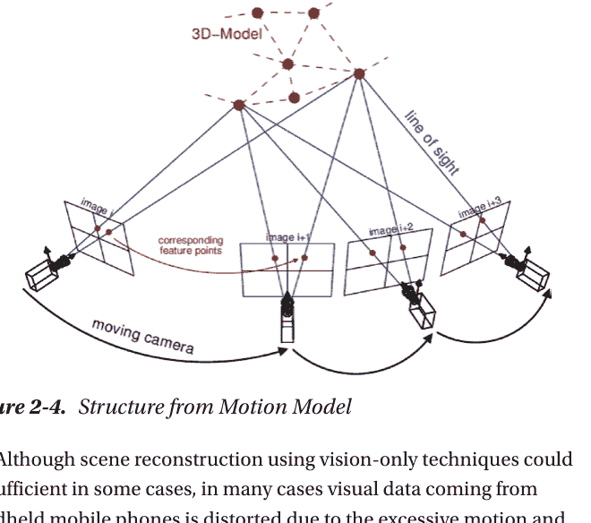
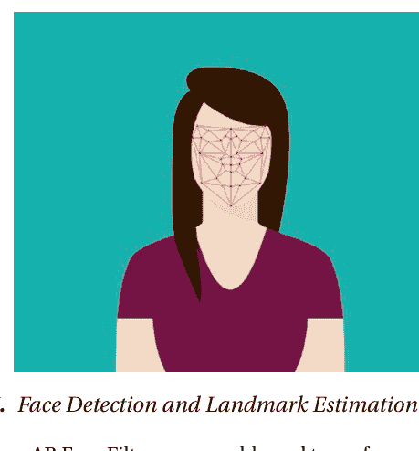
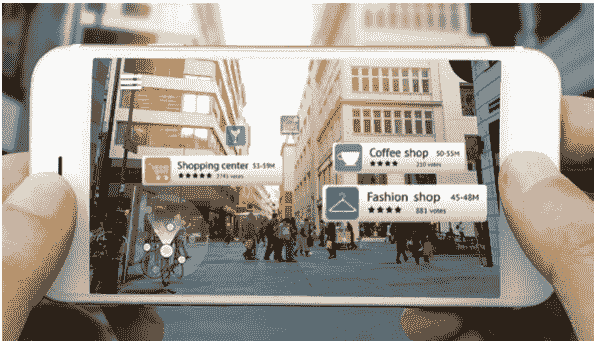

### 第 2 章

### 增强现实简介

本章将重点介绍增强现实是什么、技术的发展及其不同的应用。

#### 什么是增强现实？

几十年来，人类一直使用某种技术来可视化数据、讲述故事、教育学生，甚至娱乐。数据可视化对于许多组织和个人更好地理解信息和做出决策至关重要。讲故事在让观众参与活动中发挥着重要作用。教育对于使当今的学生能够塑造他们的未来至关重要。娱乐形式可以是电子游戏、体育和音乐会。所有这些都是可以通过在物理世界中增强数字对象并使消费者能够与之交互而变得更加互动的活动示例。为了成功地在物理世界中增强数字对象，我们必须将光投影成自定义形状并将其显示在物理对象上。然而，这种方法需要大多数消费者不常用的额外硬件，例如屏幕投影仪和全息投影仪。需要额外硬件来“增强”物理世界中的数字对象这一事实使该技术变得

易于获取且难以扩展，因为所需的硬件价格昂贵。随着计算机视觉的发展，越来越多的研究人员和工程师共同努力开发各种技术，以在物理世界中增强数字对象并实现与计算机交互的新方式，从而发展出我们今天所知的增强现实。

增强现实是重建并在物理世界中显示交互式数字对象以开发交互式用户体验的领域。在开发增强现实技术和应用的过程中，我们需要考虑三个核心概念：

- 1. 物理世界重建和映射技术
- 2. 数字对象投影技术
- 3. 新的人机交互指南

早期增强和与物理世界中的数字对象交互的方法之一是由计算机研究员 Myron Krueger 开发的一个项目，他使用摄像头的实时视觉数据并将计算机界面投影出来，以便在物理世界中与数字计算机组件进行交互（图 2-1）。

图 2-1. Videoplace – AR 的开端

许多其他方法也依赖于摄像头的实时视觉数据来进行场景理解；但数字组件的投影始终在变化。一些尝试创建了头戴设备和眼镜，将数字组件投影到可佩戴的小屏幕上。另一些则将摄像头的实时视觉数据流式传输到计算机屏幕，并通过屏幕与数字组件进行交互。随着计算机视觉技术的演进，带有便携屏幕实时画面摄像头的设备变得更受欢迎且更容易被消费者获取，我们今天所熟悉的增强现实技术的开发也随之开始。除了开发计算机视觉和数字对象投影技术来实现增强现实之外，使增强现实更人性化、易于使用对于发挥该技术的全部潜力至关重要。多年来，计算机视觉、硬件和人机交互研究人员和工程师一直在共同努力创造终极的增强现实体验，这导致了今天在手机上看到的最常见的增强现实形式的诞生。

今天，智能手机，例如 iOS 和 Android 设备，是使用户体验增强现实的主要设备，因为大多数智能手机都配备了功能强大的摄像头、传感器和地理定位硬件。通过利用智能手机中硬件提供的信息，我们可以通过增强现实为用户提供沉浸式和娱乐性的体验。智能手机中提供足够信息来实现增强现实的硬件部件包括单镜头或多镜头摄像头、加速度计、陀螺仪、磁力计和地理定位传感器（图 2-2）。

##### 图 2-2. 单镜头摄像头

单镜头摄像头提供场景从一个角度的视觉数据，有助于检测和跟踪场景中表面的简单特征。另一方面，多镜头摄像头提供来自两个不同角度的视觉数据，有助于检测和跟踪场景中的深度，而深度跟踪能够实现更准确的现实世界距离测量。加速度计、陀螺仪和磁力计都是惯性测量单元（IMU）的一部分，该单元能够测量设备的加速度并估计其速度、距离、方向和重力。地理定位传感器提供有关设备位置和地理坐标的信息，这使得能够在特定位置区域“钉住”并增强数字对象（图 2-3）。

##### 图 2-3. 地理定位传感器测量

如前所述，在开发增强现实技术时，我们需要考虑的三个核心概念中，第一个概念是物理世界重建和映射，也称为场景重建。场景重建是一项计算机视觉任务，其核心目标是将视频帧重建为三维场景。这项视觉任务对于在房间的特定部分放置数字对象并使用从重建的三维场景中获取的特定坐标值来识别对象在物理世界中的位置至关重要。

要执行此视觉任务，我们需要从单镜头或多镜头摄像头获取视频帧。从单镜头摄像头获取的视频帧由于缺乏深度信息，重建场景会更困难；然而，借助一种称为运动结构（SfM）的计算机视觉技术，通过单镜头摄像头进行场景重建是可行的。SfM 是一种利用一组二维图像来检测图像阵列中的独特特征并重建三维场景的技术（图 2-4）。与单镜头摄像头不同，使用多镜头摄像头的图像进行场景重建稍 less 具有挑战性，因为我们可以从两个或多个图像中估计深度并使用深度数据重建三维场景。

##### 图 2-4. 运动结构模型

尽管仅使用视觉技术进行场景重建在某些情况下可能足够，但在许多情况下，手持移动电话提供的视觉数据由于过度运动和不可预测的光照条件而失真，导致误差范围很大，在某些情况下甚至无法实现场景重建。在这种情况下，现代大多数移动电话中都有的惯性测量单元（IMU）将与视觉数据一起使用，以实现最佳的场景重建。来自 IMU 设备的诸如方向和加速度等信息在视觉数据因任何原因失真或延迟时非常有帮助，因为 IMU 数据提供的频率高于视觉数据，这有助于检测运动和环境中的任何细微或显著变化。这样的 IMU 数据与视觉数据对齐以计算初始速度和设备的物理坐标。

使用 IMU 数据与摄像头视觉数据相结合一直是计算机视觉和增强现实领域中用于执行场景重建和其他物理世界测量任务的常见方法。事实上，它通常被称为视觉惯性里程计，简称 VIO。VIO 最初是为空中机器人，例如无人机，以及车辆开发的，以实现自主应用。随着技术从仅依赖多镜头视觉发展到单镜头视觉数据，其应用范围扩大，并最终实现了智能手机上的增强现实。VIO 的增强现实应用主要围绕“无标记 AR”展开，它可以在不需要“标记”的情况下在物理世界中增强数字对象。AR 标记是用于增强数字对象的唯一标识对象或图像；这可以是二维码、书中的图像，或人体/动物身体部位，例如面部、手部和脚部。为了实现基于标记的增强现实，需要执行各种视觉任务，例如对象姿态估计、标注和地标检测。

#### 不同类型的增强现实

今天常用的增强现实有几种类型；包括基于标记的、无标记的和基于地理位置的增强现实（AR）。这三种类型的核心目标都是在物理世界中增强数字对象；然而，实现每种类型所使用的技术各不相同。此外，每种类型的应用目的也不同。例如，基于标记的 AR 需要预先定义的图像特征，我们可以利用这些特征来增强数字对象。其常见用例是面部滤镜。AR 面部滤镜在检测到的面部上或周围增强数字对象，并跟踪面部运动以相应地改变数字对象的位置（图 2-5）。

#### Figure 2-5. Face Detection and Landmark Estimation

要实现 AR 面部滤镜，我们需要执行计算机视觉任务，例如人脸检测和人脸关键点检测/跟踪。人脸检测是从给定图像中分割并检测人脸的过程。人脸关键点检测是检测面部特征并跟踪变化的过程，例如眨眼、张嘴/闭嘴和面部表情。通过实时结合人脸的两种信息，我们就能成功地在人脸上叠加数字对象。除了使用检测到的人脸作为标记外，还有其他方法依赖于各种其他标记，例如简单的二维码、独特图像和定制物理物体（即瓶子、杯子、帽子等）。用于实现其他基于标记的 AR 方法的处理技术源自计算机视觉中特征检测、跟踪和姿态估计的概念。随着我们在本章末尾接近实现过程，我们将更深入地介绍用于实现基于标记的 AR 的算法。

无标记 AR 是一种稳健的技术，不需要对环境有任何先验知识；然而，实现它需要某些硬件。在无标记 AR 开发的早期，实现无标记 AR 所需的硬件类型并不为消费者所普遍拥有，例如立体相机和先进的 IMU 设备。随着 AR 研究和开发的增加，我们看到了各种方法来减少对不常见硬件的使用，而转而依赖消费者广泛可用的硬件，例如低成本 IMU 设备和单镜头相机，今天智能手机中常见。在上一节中，我们简要介绍了今天大多数手机中如何使用视觉惯性里程计技术实现无标记 AR，该技术利用 IMU 设备和相机检索到的信息来执行场景重建以及其他能够实现无标记 AR 的计算机视觉任务。无标记 AR 应用是无限的，并且有更多创造性和影响力应用的空间。今天，无标记 AR 可用于测量物理物体并将体验模拟到物理世界。这些应用在教育、设计、旅游等众多行业产生了巨大影响。总之，无标记和基于标记的 AR 在根本上是相同的，但由于每种技术的限制，其应用完全不同。尽管这两种 AR 方法的应用极其不同，但它们可以同时使用以实现更复杂的增强现实体验，这就引出了基于地理位置的 AR。

基于地理位置的 AR 将无标记和基于标记的 AR 与地理位置数据集成，以增强并“钉”数字对象到特定的地理位置坐标（图 2-6）。

Figure 2-6. Geolocation-Based AR

#### Summary

在本章中，我们讨论了一些与增强现实相关的基本概念。之后，讨论了不同类型的增强现实。

AR 可以定义为一个系统，它结合了三个基本特征：真实世界和虚拟世界的结合、实时交互以及虚拟和真实物体的精确 3D 注册。

任何基于 AR 的工具的核心组件都是处理器、传感器、输入设备，主要是显示器。显示器可以是智能手机、手持设备、智能眼镜或头戴式显示器（HMD）。输入设备是相机或网络摄像头。传感器包括陀螺仪和加速度计。

在下一章中，我们将详细了解图像和视频处理的基础知识。
