### CHAPTER 3

### Image and Video Processing Fundamentals

本章将重点介绍图像和视频处理基础，包括所需数学、标准算法、实现选项，以及将实际示例实现到 C++ 应用程序中。

### Mathematics Overview

自第一台计算机发明以来，数学一直是计算机工作的基础。事实上，计算机的早期应用之一是在需要在一短时间内计算复杂数学问题的企业中。随着计算机硬件能力在几十年中不断提升，计算机在一秒钟内能够完成的复杂计算量急剧增加，使计算机能够轻松执行图像和视频处理，从而使计算机能够用于图形处理和音频处理等高速和高计算功率应用。在之前的章节中，我们简要介绍了图像如何显示、渲染和处理。在本节中，我们将介绍

使当今的图像和视频处理（也称为计算机视觉）和人工智能技术成为可能的数学基础。

尽管计算机视觉和人工智能关系密切，但它们对数学的侧重点略有不同。下面的雷达图总结了这一论点。在下面的图中，你可以看到计算机视觉与人工智能/深度学习相比融合了不同的数学分支。计算机视觉比深度学习更大幅度地利用概率和统计（图 3-1）。

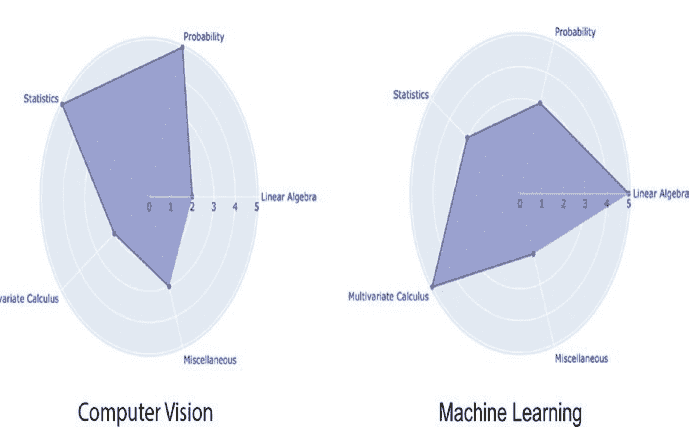

Computer Vision

Machine Learning

#### Figure 3-1. Computer Vision vs. Machine Learning

尽管计算机视觉和深度学习有很多共同点，但它们的主要关注点极其不同。我们在计算机视觉中的主要目标是调查和分析图像或视频，提出建议并验证它们。

这些似乎是用于揭示数据中初看不可见的隐藏假设的方法。因此，为了比较和测试假设，我们必须完全依赖统计和概率概念（图 3-2）。计算机视觉和机器学习都强调线性代数原理，因为它是所有复杂系统的起点。另一方面，多元微积分关注参数分析，这将是我们在本书中进一步讨论的所有深度神经网络背后的驱动因素。

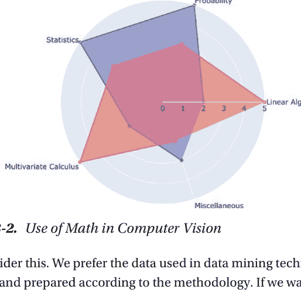

#### Figure 3-2. Use of Math in Computer Vision

考虑一下。我们更喜欢数据挖掘技术中使用的数据是干净的，并且根据方法学准备好的。如果我们想端到端工作（计算机视觉 + 机器学习），我们应该学习和探索计算机视觉和人工智能应用所需的数学基础。

在计算机视觉和机器学习中，数学并不是关于分析数据；而是关于理解正在发生的事情，为什么会发生，以及我们如何通过实验不同变量来获得我们期望的结果。下面的图表展示了给定变量的变化率；这也被称为上升除以运行、斜率公式，有时也被称为梯度。这使我们能够理解给定输入的变化上下文。

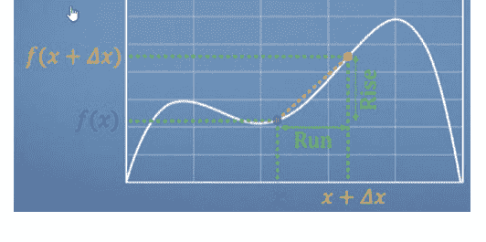

#### Graph for Rate of Change of Variable

对任何线性方程的几何解释和直觉在处理给定图像时至关重要。下面公式是梯度公式的标准表示：

```
Gradient at x ≈ Rise/Run = [f(x + Δx) - f(x)] / [(x + Δx) - x] = [f(x + Δx) - f(x)] / Δx
```

#### Rate of Change of Variables (Differentiation)

这有助于我们解读这些令人困惑的陈述。

好吧，让我们转换我们的重点，理解为什么我们必须学习这些不同的数学分支，以及什么会是直观学习它们的良好来源。

#### Image Processing Basics

目前，最热门的研究领域之一是深度学习。深度学习是一种机器学习和人工智能（AI）技术，它模仿人类获取某些类型知识的方式。与典型的机器学习算法线性不同，深度学习算法以日益复杂和抽象的层次构建。深度学习作为一个领域融合了多种学术学科，


包括计算机科学（图形学、算法、哲学、结构与体系结构）、数学（信息检索、机器学习）、工程学（机器人、语音、NLP、图像处理）、物理学（光学）、生物学（神经科学）以及心理学（认知科学），等等。

由于其跨领域的掌握能力，许多科学家都认为机器视觉为通用人工智能铺平了道路，因为它代表了对视觉环境及其上下文的相对理解。

#### 那么什么是计算机视觉？

正式教材中的定义如下：

- “从图像构建物理对象的明确、有意义的描述”（Ballard & Brown, 1982）。
- “...从一个或多个数字图像计算三维世界的属性”（Trucco & Verri, 1998）。
- “...基于感知的图像对真实物理对象和场景做出有用决策”（Sockman & Shapiro, 2001）。

#### 为什么是计算机视觉？

最明显的回答是，这一研究领域拥有日益增长的实用应用集合。以下是仅有的几个例子（图 3-3）：

- 人脸识别：Snapchat 和 Facebook 使用人脸检测算法来添加滤镜并在图像中识别你。
- 图片检索：Google 图片使用基于内容的查询来定位合适的图像。算法会探索查询图像的内容，并根据最相关的内容返回结果。
- 游戏和控制：Microsoft Kinect 是一款出色的商用设备，在游戏中利用立体视觉。

#### 计算机视觉的应用

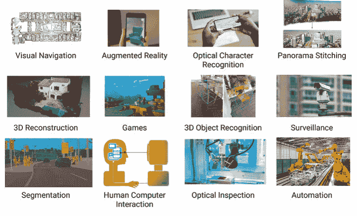

图 3-3. 计算机视觉的应用

- 监控摄像头在公共场所很常见，用于追踪异常活动。
- 指纹、虹膜和人脸匹配是最受欢迎的生物识别认证技术之一。
- 视觉仍然是检测智能车辆的道路信号、灯光和其他视觉特征的主要信息来源。

计算机视觉涉及视觉识别，例如图像描述、定位和识别。

#### 标准算法

这些最先进的视觉识别技术的效率由于神经网络和深度学习方法的最新进展而得到了极大提升。本书是学习深度学习架构以及它们在尖端机器视觉科学中如何使用的绝佳平台。在本书中，我们将介绍五种最重要的计算机视觉策略：卷积神经网络、AlexNet、基于区域的卷积神经网络（R-CNN）和 Fast R-CNN。此外，我们还将介绍每种策略可用于的主要深度学习模型和应用。

#### 图像分类

图像分类（图 3-4）的目标如下：我们得到一系列图像，所有图像都用单一类别标记，我们被要求为一组新的测试图像预测这些类别，并计算预测的准确率。视角变化、尺寸变化、类内变化、图像变形、图像遮挡、光照条件和背景杂乱都是该活动带来的问题。

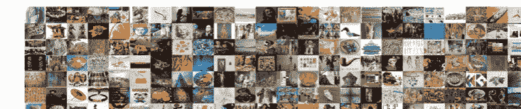

图 3-4. 图像分类

我们如何构建一个可以将图像分类到不同组别的算法？计算机视觉研究人员为此问题设计了数据驱动的解决方案。他们向计算机提供每个图像类别的多个示例，然后创建学习算法，让这些算法查看这些示例并学习每个类别的视觉外观，而不是尝试在代码中显式确定感兴趣的每个图像类别的外观。

换句话说，首先将标记好的图像训练数据集输入系统进行处理并据此创建分类模型。以下是图像分类流程的正式版本：

- 作为输入提供包含 N 张图像的训练数据集，每张图像都标记为 K 个组之一；其中 N 是所有组中图像的总数，K 是分类模式中的组数。组代表图像所属的类别。
- 然后我们使用这个训练包来教分类器如何对图像进行分类。
- 最后，我们通过让它为从未见过的新图像系列推断标签来衡量分类器的输出。这些图像的实际标签将与分类器预测的标签相等。

卷积神经网络（CNNs）是最常用的图像识别架构。当你将图像输入网络并让网络对数据进行分类时，这是 CNN 的常见用例。CNN 通常以一个输入“扫描器”开始，该扫描器并非设计为一次处理所有训练数据（图 3-5）。例如，当处理 CNN 时，你不希望有一个包含 10,000 个节点的层来输入一个 100 × 100 像素的文件。这将极其低效且在更大规模上不实用。

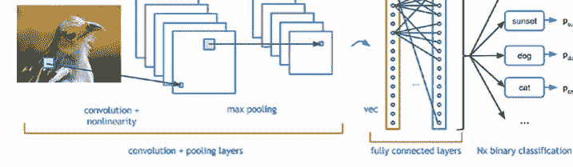

##### 图 3-5. 卷积神经网络

相反，你创建一个 10 × 10 扫描输入层，将图像的第一个 10 × 10 像素输入其中。数据传递后，将扫描器向右移动 1 像素以输入下一个 10 × 10 像素。这种过程被称为滑动窗口。

卷积层而非常规层用于处理输入数据。每个节点只关心其邻近范围内的单元。这些卷积层通常随着变厚而显得变小，这归因于可快速分割的输入因子。它们通常还具有池化层。一种流行的池化策略是最大池化，其中我们取例如 2 × 2 像素并继续处理具有最多特定属性的像素。

ImageNet，一个近 120 万个高分辨率训练文件的数据集，如今被用于训练大多数图像识别技术。测试图像将以无初始标注的方式查看（即无分割或标签），算法将被要求创建标注以显示图像中存在哪些对象。来自牛津、INRIA 和 XRCE 的领先计算机视觉团队在此数据集上测试了一些更好的当前计算机视觉方法。通常，计算机视觉解决方案使用多阶段管道，并在早期阶段通过调整几个参数进行手工调优。

Alex Krizhevsky（NIPS 2012），首届 ImageNet 竞赛的获胜者，构建了一个非常深的卷积神经网络，其类型由 Yann LeCun 开创。其架构中有七个隐藏层，不包括任何最大池化层（图 3-6）。前两层是卷积层，最后几层是全局相关的。在每个隐藏层中，激活函数是经过整流的线性单元。这些单元比逻辑单元更具表达力且训练速度更快。此外，还使用了竞争性归一化来消除隐藏行为，当附近单元具有更强活动时。这有助于强度差异。

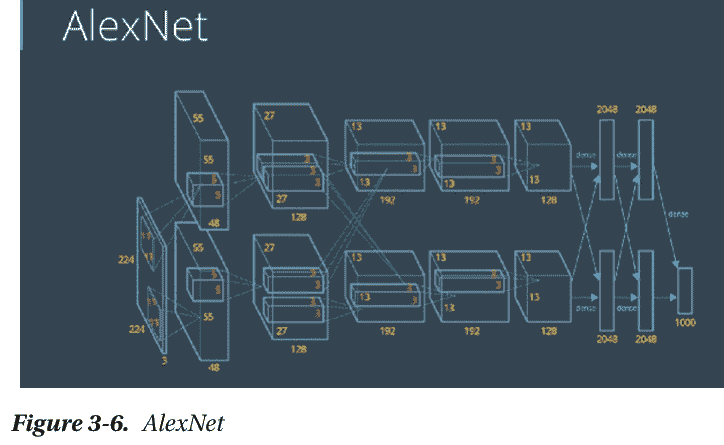

图 3-6. AlexNet

就硬件而言，Alex 使用两块 Nvidia GTX 580 GPU 来运行非常强大的卷积网络实现（超过 1000 个快速小核心）。GPU 非常适合矩阵-矩阵乘法并且具有大量内存带宽。这有助于它们在一周内训练网络，并在测试期间快速合并来自十个补丁的结果。随着核心变得更便宜且数据库变得更大，大型神经网络可以比传统 CV 网络更进一步。

#### 目标检测

输出特定对象的边界框和标记是广泛用于描述图像中对象的技术。这与分类/定位挑战不同，在该挑战中分类和定位应用于大量对象而非单一主导对象。对象分组只有两种类型：项目边界框和非对象边界框。例如，在汽车检测中，你必须检测给定图片中的所有汽车及其边界框（图 3-7）。

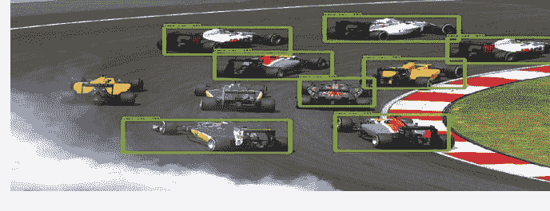

图 3-7. 目标检测

如果我们使用滑动窗口技术来识别和定位图像，我们需要将 CNN 添加到图像的多个不同裁剪上。由于 CNN 将每个裁剪分类为实体或上下文，我们必须将 CNN 应用于大量位置和尺寸，这在计算上非常昂贵。


为了解决这个问题，神经网络理论家建议改用区域，即图像中可能包含外观“斑块状”特征的图像区域。

这是一个相对容易进行的游戏。R-CNN（基于区域的卷积神经网络）是第一个推动它发展的模型。在 R-CNN 中，我们首先使用选择性搜索算法扫描输入图像以寻找潜在的伪影，产生 2,000 个区域建议（图 3-8）。然后，在所有这些区域建议之上运行 CNN。最后，我们将每个 CNN 的输出输入 SVM 以识别区域，并使用线性回归收紧对象的边界框。

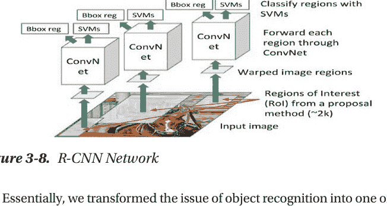

##### Figure 3-8. R-CNN Network

本质上，我们将对象识别问题转化为图像分类问题。然而，有几个缺点：准备需要很长时间并且需要大量的磁盘空间，并且推理通常很缓慢。

快速 R-CNN 是 R-CNN 的直接后代，它通过进行两项改进来提高检测速度：（1）在提出区域之前进行特征提取，从而只需对整张图像运行一次 CNN，以及 2）用 softmax 层替换 SVM，从而扩展神经网络进行预测而不是开发新模型。

由于它只为整张图片训练一个 CNN，因此 fast R-CNN 在速度方面表现更好。另一方面，选择性搜索算法生成区域建议也需要很长时间。

因此，开发了更快的 R-CNN，并且它此后已成为基于深度学习的物体检测的经典标准（图 3-9）。它插入一个区域建议网络（RPN）来从特征中预测建议，用快速神经网络取代缓慢的选择性搜索算法。为了最大限度地减少整体推理过程的计算需求，RPN 用于确定“在哪里”查找。RPN 快速高效地扫描每个位置，以决定该区域是否需要进一步处理。它通过生成 K 个边界框建议来实现这一点，每个建议都有两个分数，显示在每个位置存在项目的可能性。

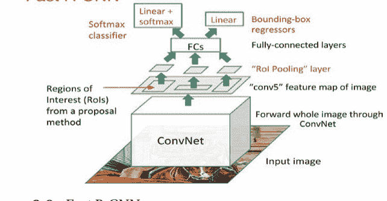

Figure 3-9. Fast R-CNN

一旦我们有了它们，我们就将我们的区域想法直接输入到实际上是快速 R-CNN 的内容中。最后添加一个池化层、多个全连接层、一个 softmax 分类层和一个边界框回归器。

总体而言，faster R-CNN 在速度和准确性方面优于竞争对手。虽然未来模型将检测速度大幅提高，但只有少数模型能够以相当大的优势超越 faster R-CNN。换句话说，虽然 faster R-CNN 不是最简单或最快的物体检测过程，但它仍然是最有效的方法之一（图 3-10）。

#### Faster R-CNN

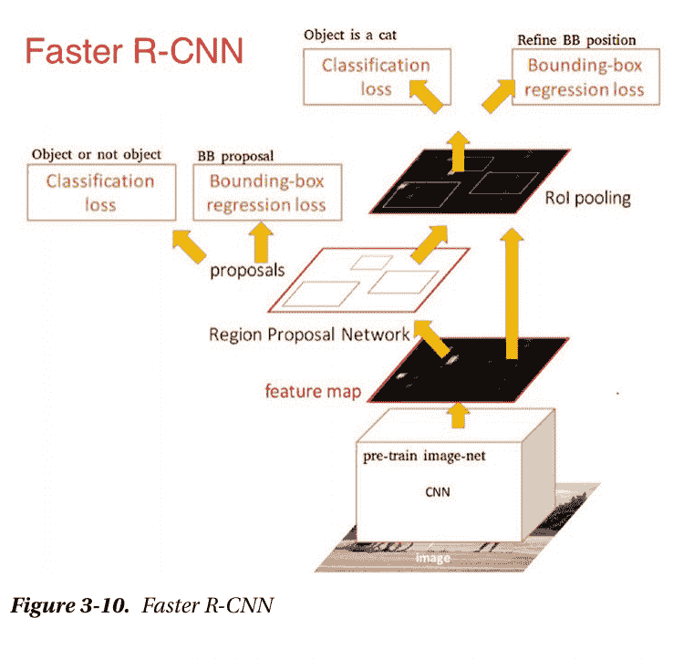

Figure 3-10. Faster R-CNN

近年来，全球物体检测模式已转向更简单、更强大的检测系统。作为在整张图片上共享计算的一步，像 You Only Look Once（YOLO）、Single Shot MultiBox Detector（SSD）和 Region-Based Fully

Convolutional Networks（R-FCNs）等方法变得可见。因此，这些策略使自己与三个 R-CNN 技术昂贵的子网络区分开来。这些模式背后的主要原因是停止让不同的算法孤立地专注于各自的子问题，这可能会增加训练时间并降低网络精度。

在给定场景中跟踪一个感兴趣点或多个对象的方法称为对象跟踪（图 3-11）。它历史上一直用于视频和现实世界遭遇中，其中结果是在对象最初识别后得出的。它现在对于自动驾驶应用（如 Uber 和 Tesla 的自动驾驶汽车）至关重要。

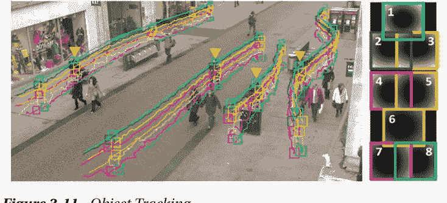

##### Figure 3-11. Object Tracking

根据观察范式，对象跟踪方法可分为两类：生成式和判别式。生成式方法，例如 PCA，使用生成模型来解释可见特征并最小化重建误差。

判别式方法将目标与背景区分开来；其准确性更可靠，并且越来越多地取代传统的跟踪方法。跟踪检测是判别过程的另一个术语，深度学习属于这一组。为了实现跟踪检测，我们在所有帧中检测候选对象，然后使用深度学习在候选对象中对目标对象进行分类。堆叠自编码器（SAE）和卷积神经网络（CNN）是两种可用于此的简单网络模型。

Deep Learning Tracker（DLT）是使用 SAE 进行监控任务的最常见深度网络，因为它允许离线预训练和在线微调。过程如下：

- 通过对输入图像施加噪声并重建原始图像，堆叠去噪自编码器将实现更强大的函数表达能力。

要创建分类网络，将预训练网络的编码部分与分类器结合，然后使用从原始帧收集的正负样本微调网络，以区分当前实体与过去。DLT 使用粒子滤波器作为运动模型为当前帧创建候选补丁。分类网络为这些补丁生成似然分数，显示其分类的置信度，然后选择其中最高的补丁作为对象。

- DLT 采用最小阈值方法进行模型更新。

由于其在图像识别和物体检测中的主导地位，CNN 已成为机器视觉和视觉识别的标准深度范式。通常可以训练大规模 CNN 作为分类器和跟踪器。一般来说。完全卷积网络跟踪器（FCNT）和多域 CNN 是两种基于 CNN 的跟踪算法的示例（MD Net）。

- FCNT 成功分析和利用 VGG 模型的函数映射，该模型是预训练的 ImageNet，得出以下结果：
  - CNN 函数映射可用于监控和定位。
  - 对于区分特定对象与其上下文的任务，通常 CNN 函数映射通常模糊或无关。
  - 较低层编码更多判别属性以捕捉类内变化，而较高层捕捉对象类别上的语义概念。

由于这些结果，FCNT 构建了一个特征发现网络，以在 VGG 网络的 conv4-3 和 conv5-3 层上选择最重要的特征映射。然后它为来自两个层的选定特征映射分别创建两个额外通道（称为 SNet 和 GNet），以防止在嘈杂的特征映射上过拟合。GNet 捕捉对象的类别细节，而 SNet 将对象与相似的外观上下文区分开来。

为了获得对象的热力图，两个网络都使用第一帧中指定的边界框进行初始化，对于新帧，以前一帧中对象位置为中心的感兴趣区域（ROI）被裁剪并传播。最后，分类器接收来自 SNet 和 GNet 的两个热力图进行预测，并且跟踪器根据是否存在干扰物确定将使用哪个热力图来产生最终跟踪结果。FCNT 流程如下所示（图 3-12）。

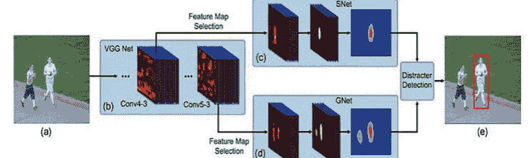

##### Figure 3-12. Convolutional Network Pipeline

#### Summary

本章涵盖了计算机视觉的基础数学，包括线性代数和多元微积分。它还涵盖了为什么要学习计算机视觉。本章涵盖的标准算法是图像分类、物体检测、实例分割和物体跟踪。它还涵盖了计算机如何读取图像。

图像分类是根据特定规则对图像中像素或向量的组进行分类和标记的过程。

物体检测是一种计算机视觉技术，允许我们在图像或视频中识别和定位物体。

语义分割描述了将图像的每个像素与类别标签关联起来的过程（例如花朵、人、道路、天空、海洋或汽车）。

在下一章中，我们将讨论人脸检测/识别和人体检测/跟踪。


