### CHAPTER 4
### 计算机视觉应用

本章将重点介绍各种计算机视觉应用、技术的发展演变，以及如何搭建一个 C++ 视觉应用。

#### 概述

在计算机视觉中，模拟人眼使计算机能够以与人类相同的方式处理和识别视频和照片中的事物，从风景到物体、运动等等。计算机视觉直到最近才以小规模运行。如今，深度学习推动了我们在日常使用的许多软件中看到的先进计算机视觉。事实上，深度学习最受欢迎的分支之一就是计算机视觉；因此，深度学习在实现和执行复杂的计算机视觉操作方面发挥着至关重要的作用。

如果让你描述图 4-1 中的物体/事物，你可能会提到这张图片中有“果汁、篮子、男孩、女孩、男人、女人、草等”。然后如果让你描述图片中发生了什么，你的回答很可能是“这是一个家庭正在享受野餐”，几乎不需要任何努力。这些是大多数六七岁以上儿童都能完成的两个非常基本任务。然而，从上下文来看，这是一个非常复杂的过程。人眼视觉是我们视力中极其复杂的有机组成部分。我们的概念模型、我们对抽象解释的概念，以及我们在与宇宙的数十亿次、万亿次相遇中所考虑的上下文发生，都被纳入其中。

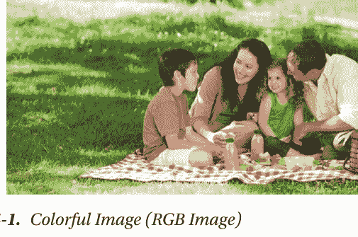

图 4-1. 彩色图像（RGB 图像）

数码相机呈现的图像分辨率具有远超人类视觉系统的细节。以非常高的精度，颜色的变化也可以被观察和量化。但对这些图片内容进行理解是计算机几十年来面临的挑战。

我们作为人类，很容易体验到周围世界的三维特性。与此同时，计算机视觉研究人员已经开发出数学方法来恢复摄影中物体的三维结构和外观。

#### 计算机视觉的应用

计算机视觉在其解决的问题上具有相关性。这是数字世界中最重要的发展之一。计算机视觉帮助车辆实现自主驾驶并感知周围环境。摄像头记录汽车的不同角度并将信息输入计算机视觉软件，然后该软件通过处理图像实时找到道路限制和交通灯，并检测与其他汽车、行人和物体的距离。在高速公路和街道上，自动驾驶车辆随后会导航其行驶路线，避免撞击障碍物，并安全地将乘客送达目的地。

计算机视觉中的一个常见功能是人脸识别。我们通过计算机视觉技术将人们的人脸照片与他们的身份进行匹配。在图像中，计算机视觉算法检测人脸特征并将其与数据库中的人脸档案进行比较。为了验证其所有者的身份，消费设备使用面部识别。为了标记用户，社交媒体应用程序使用面部识别。

在计算机视觉中，帮助平板电脑、智能眼镜和智能手机等计算机系统在现实世界图片中叠加虚拟物体的技术在增强现实和混合现实中发挥着重要作用。AR 设备使用计算机视觉来识别现实世界中的物体，以便在设备的显示器上定位虚拟物体。例如，AR 系统可能会使用计算机视觉算法来检测平面，这些平面对于检测深度和测量以及定位非常重要。

像 Google Photos 这样的在线照片库使用计算机的“眼睛”来检测并自动按主题类型对照片进行分类。你将节省大量时间，而无需为你的照片和说明应用标签。该技术还允许用户通过输入他们想要的内容形式来扫描视频小时数，而不是手动观看全长视频。计算机视觉在健康科学的进步中也发挥了至关重要的作用。计算机视觉算法可以帮助医疗自动化任务，包括在皮肤图像中识别癌性肿块。

计算机视觉中还存在其他更复杂的应用。例如，想象一个智能家居监控摄像头不断将你家视频发送到云端，并允许你在远程级别上显示图像。你可以设置一个带有计算机视觉的云框架，以便在发生任何可疑情况时立即提醒你，房子里任何起火的东西。这将为你节省大量时间，确保你可以用一双警惕的眼睛看着你的房子。美国军方现在正在使用计算机视觉处理由摄像头和无人机记录的视频内容。

如果你在此示例中更进一步，你会注意到保护程序只存储视觉算法标记为异常的视频。这将使我们能够最小化存储在云中的内容大小，因为在几乎所有情况下，你的安全摄像头照片都是无害的，不需要检查。

在计算机视觉能够实现的一些深度学习活动出现之前，开发人员和人工操作员需要大量的主动性和手动编码。例如，如果你想识别人脸，你必须执行以下步骤：

- 1. 通过建立数据库，以特定格式收集每个主体的图像。为每张图片注释图像并输入大量数据项，例如眼睛之间的距离、鼻梁宽度、上唇与鼻子的距离，以及数百项进一步的测量值，这些测量值定义了每个人的特定特征。
- 2. 捕获图像。如果你使用图片或视频内容，你将不得不捕获新文件。然后必须重新进行测量过程以标记图片中的关键点。你还必须考虑图像的角度。

程序最终会将这些与数据库中的内容进行匹配，并比较在新图像中找到的测量值，如果它们符合任何跟踪档案。事实上，这项工作是手动进行的，自动化程度很低，误差率仍然很高。

机器学习是解决计算机视觉问题的另一种方法。有了机器学习，开发人员不再需要在视觉应用中为每个规则手动编写代码。相反，“特征”的编程包括可以检测此类图像模式的较小应用程序。然后算法使用统计学习算法（如线性回归、决策树和逻辑回归）来检测趋势、识别独特特征并检测对象。

深度学习为机器学习提供了一种全新的方式。深度学习依赖于神经网络，可以克服任何可以通过示例说明的问题。神经网络包含特定类别数据的许多表示，可以从这些示例中提取常见模式并将其转换为数学方程，有助于识别潜在数据项。

构建深度学习程序只涉及选择一个预先构建的算法或使用预期检测的个人的面部示例创建一个。神经网络可以在没有额外功能和测量说明的情况下，仅凭适当的示例识别人脸。

深度学习是计算机视觉的强大方法。在某些情况下，开发成功的深度学习算法包括选择大量命名训练数据和限制，例如神经网络形式、网络的神经层数以及训练网络的次数。深度学习和机器学习都比以前的形式更容易、更快地实现。

随着硬件和云计算基础设施的可用性和进步，深度学习被用于大多数当前机器视觉系统，如自动驾驶车辆、人脸识别和癌症识别。


#### 读取、写入和显示图像

计算机使用数字如照片和文本来查看和处理一切。图像的读取和写入对于任何计算机视觉项目都很重要。而使用 OpenCV 库，这项工作变得简单得多。

矩阵中的一个整数决定了该特定位置的像素强度。在上图中，我们显示了灰度图像及其右侧的像素值强度等价物（图 4-2），在该示例中只有一个属性，即给定像素位置处的黑色强度。OpenCV 中 imread 的功能以 BGR 读取图像。在实现 imread 函数时，我们可以选择以不同形式读取给定图像：彩色、灰度或未更改。下面列表演示了需要传递给函数的实际值：

- 1. Cv2.IMREAD_COLOR
- 2. Cv2.IMREAD_GRAYSCALE
- 3. Cv2.IMREAD_UNCHANGED

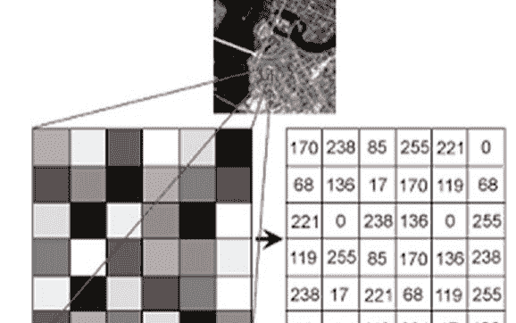

图 4-2. 二维连续图像中的行列划分

#### 更改颜色空间

以便于重现的方式，表达颜色的协议是一种颜色空间。灰度图像对单个像素有一个像素值，而彩色图像对单个像素有三个值，即红色（R）、绿色（G）和蓝色（B），通常称为 RGB。

在大多数情况下，计算机视觉使用 RGB 格式处理图像。今天，OpenCV 库读取图像时的默认格式是 RGB，然而它以 BGR 存储图像数据，这与 RGB 相似，但仅在像素描述的顺序上有所不同。因此，使用 OpenCV 读取图片时，必须将图像颜色字段从 BGR 转换为 RGB（图 4-3）。

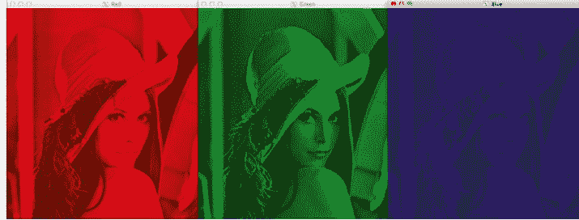

图 4-3. 图像的 RGB 分量

#### 调整图像大小

训练模型对机器学习任务有固定的输入大小。计算机视觉模型也同样适用。我们在训练模型时应具有相同大小的图像。OpenCV 提供方便的方法来放大和缩小图像。当我们需要将图像转换为深度学习算法的输入形式以进行训练时，这些方法很有帮助（图 4-4）。

#### 图 4-4. 图像的不同分辨率/比例

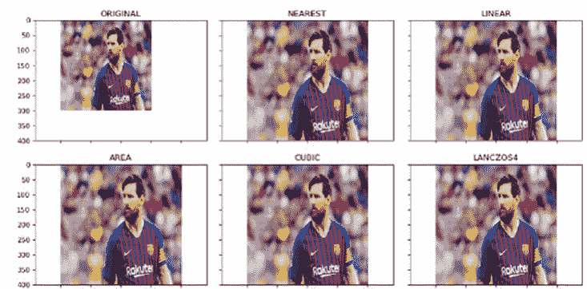

#### 旋转图像

数据增强方法是最常用的方法之一，而图像/数据增强中一种易于引入的技术是旋转（图 4-5）。使用这种技术，我们将能够为深度学习训练模型构建更多示例。数据增强使用可用数据样本并通过旋转和平移构建它们的新副本。

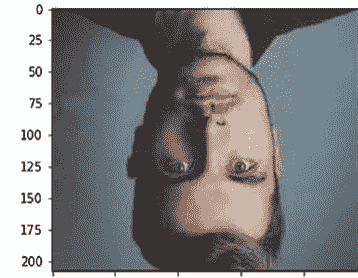

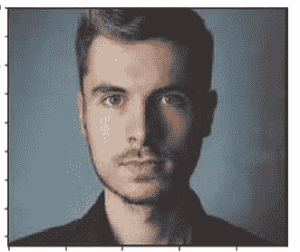

#### 图 4-5. 图像旋转

#### 位运算

AND、OR、XOR 和 NOT 是位运算。这些运算非常有帮助，并且与掩码一起使用，当我们想从输入图像中移除我们希望的区域时（图 4-6）。

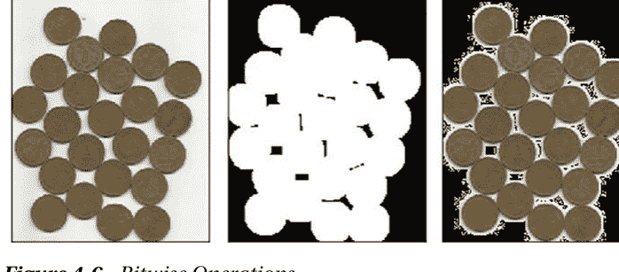

图 4-6. 位运算

我们可以使用分水岭算法测量图像中的分割掩码，并在使用位“AND”运算消除图像背景并获取我们需要的区域后，查看我们提供的图像。

#### 检测边缘

边缘是非常有用的图像特征，可用于各种目的，例如图像识别和物体定位。图片中物体的边缘特征也可以通过深度研究模型确定。它们还用于锐化图像（图 4-7）。

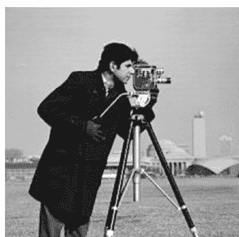

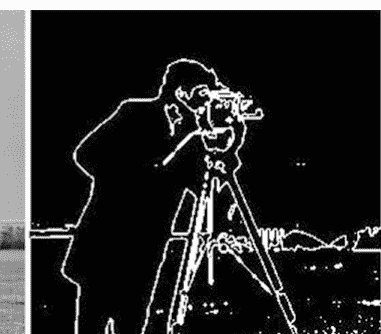

图 4-7. 图像锐化

#### 图像滤波

为了模糊图像，我们使用高斯滤波器，它根据邻近像素与所考虑像素的距离给予它们不同的权重（图 4-8）。

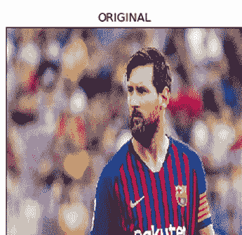

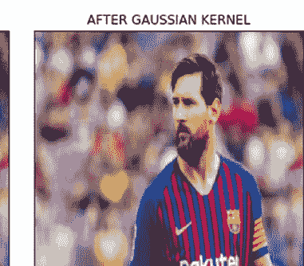

图 4-8. 原始图像和高斯核处理后的图像

要应用高斯滤波器，使用核进行图像滤波。核用于确定图像中给定部分的点积。当计算新像素值时，核的中心与像素重叠。附近的像素值乘以必要的核值。分配给与核中心重合的像素一个值。

#### 人脸检测

OpenCV 支持基于 Haar 级联的物体识别。Haar 级联是基于机器学习框架的分类器，测量边缘、线条等各种特征。机器通过视网膜检测人脸（图 4-9）。

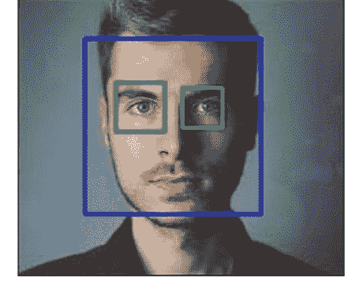

图 4-9. 人脸检测的边界框

#### 计算机视觉算法

用于对照片进行分类或识别的技术通常表示为一组数据点，用于预测特定类别。图像标注是分类的一个子问题，其中整张图片被标记为一个类别。使用图像标注技术，人手动将整张图像标记为一组类别。一旦我们有一组带标签的图像数据，我们就可以应用匹配算法将新的未标记用户输入图像与我们的数据集进行比较。一旦找到匹配或相似的带标签图像，我们就返回相应的类别集合。

你可以将特定图片分类到无数个组中。考虑一个手动过程，其中图像被匹配并按相似特征排序，但事先不知道你在寻找什么。这显然是一项繁重的任务。为了更清楚，假设有数十万张图像。为了有效地做到这一点，显然需要一个自动化系统。

对图像进行分类的许多任务需要物体的照片。CIFAR-10 和 CIFAR-100 是两个常见的数据集，图片分别需要分类到 10 个和 100 个组中。这些数据集是行业标准，并且可供公众使用。

#### 深度学习中的图像分类

深度照片识别的架构通常包含卷积层，形成卷积神经网络（CNN）。对于 CNN，通常将图像输入网络并将细节划分为网络类别。CNN 从一个输入“扫描器”开始，并非所有训练数据同时被解析。例如，你不希望一个 10,000 节点的层处理一个 100 × 100 像素的图像。相反，你创建一个 10 × 10 输入层，接受前 10 × 10 图像像素。你在输入传输前将扫描器向右移动 1 个像素，然后输入下一个 10 × 10 像素。这种技术使过程更高效。

#### 目标检测

目标检测是一种机器视觉过程，用于在图片或视频中查找和区分物体。物体识别具体是在检测到的物体周围绘制边界框以确定它们在给定场景中的位置（或观察它们如何移动）。目标识别通常与图像识别混淆，因此在继续之前我们必须解释它们之间的区别。图像识别，也称为图像分类，为图像分配一个名称。狗的图片代表“狗”标记。“狗”标记仍然适用于两只狗的图片。另一方面，目标识别在每只狗周围绘制边界框并将框命名为“狗”。这指定了模型预测中给定物体的位置以及应添加的标记/标题。因此，目标检测提供了比识别/分类更多的图像信息（图 4-10）。


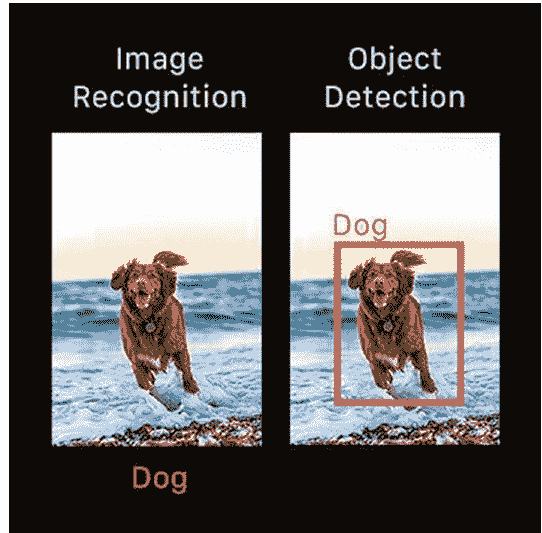

Figure 4-10. Object Recognition/ Detection

#### Object Detection Types

目标识别通常可以分为机器学习方法和深度学习方法。

计算机视觉技术使用传统的基于机器学习的方法来识别像素的类别，这些像素可能属于一个物体，通过分析图像的各种属性，例如颜色直方图或边界。然后将这些特征整合到一个回归模型中，该模型预测实体的位置和名称。

深度学习方法则基于卷积神经网络（CNN），用于识别需要单独提取的工件。

由于深度学习方法已成为目标识别的现代方法，因此对于本次实现的目的，我们将重点关注这些技术。

#### Importance of Object Detection

物体 ID 与其他相关的计算机视觉技术不可分割地联系在一起，例如模式识别和图像分割，这些技术帮助我们识别和感知图像或视频场景。

尽管如此，仍存在根本差异。图像检测仅为检测到的物体创建类别标签，而图像分割则提供场景组件的像素级描述。目标识别通过具备在图像或视频中识别物体的独特能力，与这些其他实践区分开来。这随后使您能够计算这些物体并以能够识别某些主要区别的独特能力对它们进行映射；我们可以看出它可以以多种方式整合：

- Counting audience
- Cars self-driving
- Surveillance recording
- Detection of the mask

#### Detection of Anomaly

这显然不是一个完整的列表，但它包括了目标识别影响我们未来的一些主要问题。

#### Object Tracking

在任何给定场景中，这适用于跟踪一个或多个移动物体（Figure 4-11）。这在历史上是在最初观察到物体后实现的，以跟踪现实世界的遭遇。它是 Uber 和 Tesla 等公司即将推出的自动驾驶汽车中非常重要的一部分。可以将目标检测分为两类：生成式和有偏见的。生成式方法将描述可见特征并在寻找主题时最小化重建误差。

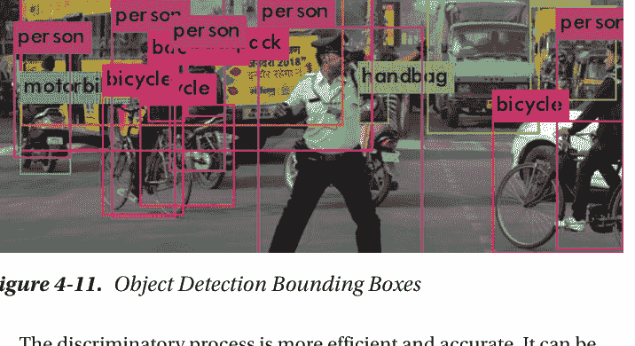

Figure 4-11. Object Detection Bounding Boxes

歧视性过程更高效、更准确。它可用于区分问题和含义，并且一直是监控的首选方式。它被称为通过检测跟踪。

#### Semantic Segmentation

将图像中属于同一物体类别的部分聚类的方法称为语义分离或图像分割。由于它按类别进行分类，每个图像像素都具有某种像素预览。Cityscapes、PASCAL VOC 和 ADE20K 是此任务的标准之一。Mean IoU 和像素精度指标通常用于测试模型。Mean IoU 用于测试模型。更准确地说，语义图像分割的目的是标记图像中每个像素所描绘的内容对应的类别。这种方法通常被称为密集预测，因为我们为图像中的每个像素进行预测。

需要记住的一个重要点是，同一类别的实例不会被区分；我们只考虑每个像素的类型。换句话说，如果您的输入图像中有两个属于同一组的物体，它们不会自动被分割图区分开来作为单独的物体。存在另一种类型的模型，称为示例分割模型，它区分同一类别的不同物体。

对于许多活动，分割模型很有帮助。

#### Vehicles That Are Automatic

为了使自动驾驶汽车能够安全地融入我们当前的高速公路，我们需要为汽车配备必要的感知能力来考虑其周围环境。

#### Medical Diagnostic Picture

机器将改善放射科医生进行的研究工作，显著减少诊断测试所需的时间（Figure 4-12）。

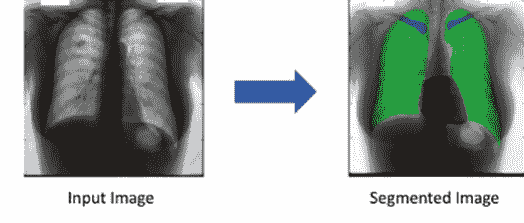

Figure 4-12. Sample Segmented Image

#### Instance Segmentation

对于图像中每个识别出的物体，实例分割区分每个物体的实例。

实例分割为每个图像像素分配一个标记。它用于计算给定图像中项目的数量，例如图像分割任务。

#### Requirements

这里目标检测的目标是识别特定物体并为每个实体示例放置一个边界框。

每个示例都被分割。目标是定义固定类别集合中的每个像素，而不区分物体实例。

Mask R-CNN 是一种深度学习技术，它扩展了 R-CNN，更专注于实例分割。

R-CNN 和 Faster R-CNN 有什么新变化？

Mask R-CNN 还有另一个分支，用于预测每个字段或感兴趣区域（ROI）的像素到像素分割。

R-CNN 不同步输入网络像素以提高速度。Faster R-CNN 产生两个输出：

- Class symbol
- Each applicant’s offset bounding box

Mask R-CNN 的三个输出是

- Class symbol
- Each applicant’s offset bounding box
- Mask object

Mask R-CNN 和 Faster R-CNN 分支在这里用于边界的分组和回归。

为了删除图像特征，我们可以使用 ResNet 101 深度学习架构。

两者都使用网络区域提议来建立感兴趣的区域（RPN）。

#### Work on Image Reconstruction

想象一下，你有一张旧照片，随着时间的推移，照片的某些部分开始侵蚀。这是一张非常珍贵的照片，所以你想恢复它。这就是图片的修复。为了提出模型必须学习恢复和增强的图像的损坏副本，数据集通常包含现有图片。在 IBM 和 Pinterest 等企业的引领下，两个行业都在大力投资计算机视觉研究。尽管计算机视觉功能强大，但它以黑箱决策而臭名昭著，因此仍然存在安全问题。这就是人们怀疑使用信息来预测他们的一举一动并对信用风险、健康状况以及许多其他人类选择等事项做出决定的计算机的原因。尽管如此，随着人工智能的快速发展和安全需求的增加，我们应该希望解决某些问题来缓解我们的隐私问题。

#### Implementing Vision Applications

##### A) Face Detection/Recognition

此程序在此使用 OpenCV 库在网络摄像头馈送或本地保存的视频剪辑中检测人脸。此处的代码实时识别或监控人脸。它借助预训练的 XML 分类器来实现这一点。该程序中使用的分类器已编程了面部特征。为了检测各种物体，可以使用分类技术。

要运行程序，您需要执行以下操作：

- 1. 在本地计算机上，必须配置 OpenCV。
- 2. 在程序运行之前，必须定义分类器 XML 文件的路径。这些 XML 文件位于 OpenCV 位置“OpenCV/data/haarcascades”中。
- 3. 在捕获时，使用“0”作为值。要运行网络摄像头流，请键入 open (0)。
- 4. 提供视频文件的路径以用于人脸检测，(capture.open(“path to video”))，例如。

#### Implementation

```
// CPP program to detects face in a video

// Include required header files from OpenCV directory
#include "/usr/local/include/opencv2/objdetect.hpp"
#include "/usr/local/include/opencv2/highgui.hpp"
#include "/usr/local/include/opencv2/imgproc.hpp"
#include <iostream>

using namespace std;
using namespace cv;

// Function for Face Detection
void detectAndDraw( Mat& img, CascadeClassifier& cascade,
CascadeClassifier& nestedCascade, double scale );
string cascadeName, nestedCascadeName;

int main( int argc, const char** argv )
{
    // VideoCapture class for playing video for which faces to be detected
    VideoCapture capture;
    Mat frame, image;

    // PreDefined trained XML classifiers with facial features
    CascadeClassifier cascade, nestedCascade;
    double scale=1;

    // Load classifiers from "opencv/data/haarcascades" directory
    nestedCascade.load( "../../haarcascade_eye_tree_eyeglasses.xml" );
```

在此代码部分，您需要包含 OpenCV 目录中的所需头文件并加载分类器。

```
// Change path before execution
cascade.load( "../../haarcascade_frontalcatface.xml" );
```

之后，在执行之前更改“cascade.load”中的路径。


// 执行前更改路径
cascade.load( "../../haarcascade_frontalcatface.xml" );

// 开始视频..1) 0 表示网络摄像头 2) "视频路径" 表示本地视频
capture.open(0);
if( capture.isOpened() )
{
    // 从视频中捕获帧并检测人脸
    cout << "Face Detection Started...." << endl;
    while(1)
    {
        capture >> frame;
        if( frame.empty() )
            break;
        Mat frame1 = frame.clone();
        detectAndDraw( frame1, cascade, nestedCascade, scale );
        char c = (char)waitKey(10);

        // 按 q 退出窗口
        if( c == 27 || c == 'q' || c == 'Q' )
            break;
    }
    else
        cout<<"Could not Open Camera";
    return 0;
}

使用 0 启动网络摄像头流。之后，人脸检测将开始。

```
void detectAndDraw( Mat& img, CascadeClassifier& cascade,
                    CascadeClassifier& nestedCascade,
                    double scale)
{
    vector<Rect> faces, faces2;
    Mat gray, smallImg;

    cvtColor( img, gray, COLOR_BGR2GRAY ); // Convert to Gray Scale
    double fx = 1 / scale;

    // Resize the Grayscale Image
    resize( gray, smallImg, Size(), fx, fx, INTER_LINEAR );
    equalizeHist( smallImg, smallImg );

    // Detect faces of different sizes using cascade classifier
    cascade.detectMultiScale( smallImg, faces, 1.1,
        2, 0|CASCADE_SCALE_IMAGE, Size(30, 30) );
```

这段代码使用级联分类器检测不同尺寸的人脸。

```
for ( size_t i = 0; i < faces.size(); i++ )
{
    Rect r = faces[i];
    Mat smallImgROI;
    vector<Rect> nestedObjects;
    Point center;
    Scalar color = Scalar(255, 0, 0); // Color for Drawing tool
    int radius;

    double aspect_ratio = (double)r.width/r.height;
    if( 0.75 < aspect_ratio && aspect_ratio < 1.3 )
    {
        center.x = cvRound((r.x + r.width*0.5)*scale);
        center.y = cvRound((r.y + r.height*0.5)*scale);
        radius = cvRound((r.width + r.height)*0.25*scale);
        circle( img, center, radius, color, 3, 8, 0 );
    }
    else
        rectangle( img, cvPoint(cvRound(r.x*scale), cvRound(r.y*scale)),
            cvPoint(cvRound((r.x + r.width-1)*scale),
            cvRound((r.y + r.height-1)*scale)), color, 3, 8, 0 );
    if( nestedCascade.empty() )
        continue;
    smallImgROI = smallImg( r );
```

这段代码通过检测形状在人脸周围绘制一个圆，并使用标量颜色作为绘图工具。

```
nestedCascade.detectMultiScale( smallImgROI, nestedObjects, 1.1, 2, 0|CASCADE_SCALE_IMAGE, Size(30, 30) );
```

这会从输入图像中检测眼睛。

```
for ( size_t j = 0; j < nestedObjects.size(); j++ )
{
    Rect nr = nestedObjects[j];
    center.x = cvRound((r.x + nr.x + nr.width*0.5)*scale);
    center.y = cvRound((r.y + nr.y + nr.height*0.5)*scale);
    radius = cvRound((nr.width + nr.height)*0.25*scale);
    circle( img, center, radius, color, 3, 8, 0 );
}
```

此循环将在眼睛周围绘制一个圆。

```
}
}

// Show Processed Image with detected faces
imshow( "Face Detection", img );
}
```

函数 *imshow* 将在检测到人脸时处理图像，如以下输出图像所示：

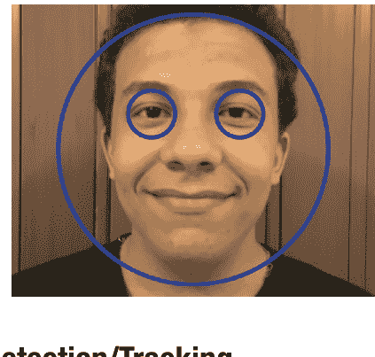

#### B) 身体检测/跟踪

跟踪是在视频中逐帧寻找物体的过程。虽然含义似乎直接，但跟踪确实是计算机视觉和机器学习中一个极其宽泛的概念，其中包含概念相关但技术上不同的概念。例如，目标跟踪涵盖了许多以下不同但相互关联的概念：

- 密集光流：此类算法有助于计算视频帧中每个像素的运动矢量。

稀疏光流：Kanade-Lucas-Tomasi (KLT) 特征跟踪是其中一种算法，它跟踪图片中某些特征点的位移。

卡尔曼滤波：一种常用的信号处理算法，利用先前的运动知识来预测移动物体的位置。导弹的制导是该算法最早的应用之一！“引导阿波罗 11 号登月舱下降的机载计算机具有卡尔曼滤波器”，根据文章所述。

均值漂移和 Camshift：这些算法可用于找到密度函数的最大值。它们也用于跟踪过程中。

单目标跟踪器：在此类跟踪器中，第一帧用矩形标记出我们希望跟踪的物体的位置。然后使用跟踪算法在后续帧中跟踪该物体。此类跟踪器通常与物体检测器结合使用于实际应用中。

多目标跟踪算法：使用快速物体检测器时，最好从每一帧中检测多个物体，并使用跟踪算法来确定每一帧中的矩形是否与下一帧中的矩形相对应。

检测与跟踪：如果你使用过 OpenCV 人脸检测，你会发现它在实时中运行或可以立即在每一帧中发现人脸。为什么要在初始位置进行跟踪？让我们看看为什么你需要在剪辑中跟踪物体，而不是仅仅进行重复检测。

跟踪比检测更快：与检测算法相比，跟踪算法通常更快。原因很简单。虽然跟踪一个在上一帧中已观察到的物体时，我们拥有关于该物体存在的大量信息。我们现在知道前一帧的位置，以及移动位置和速度。因此，在下一帧中，我们将利用所有这些知识来估计物体所在的位置，或者在预测位置周围进行小范围搜索以精确放置物体。有效的跟踪算法可以利用它在整个过程中对物体的所有了解，而检测算法总是从零开始。因此，在构建这样一个有效的方法时，物体检测算法通常每隔 n 帧运行一次，而跟踪算法用于 n-1 帧（n 减 1，其中 n 为视频中的总帧数）。你可以在第一帧中检测到物体后就跟踪它。虽然在我们有额外数据时跟踪有优势（即大量图像或视频），但如果物体在较长时间内被障碍物遮挡或移动速度过快以至于跟踪算法无法跟上，它仍可能丢失和遗漏。跟踪算法也常会出现错误，例如跟踪物体的边界框会逐渐偏离。检测算法经常被应用来解决这些跟踪算法的问题。训练检测算法的一个巨大例子用于其物体。因此，它们对物体的特定类别非常了解。另一方面，跟踪算法最了解的是我们一直在跟踪的类别的特定实例。

当检测失效时，跟踪会提供帮助：当在剪辑中使用人脸检测器但物体遮挡了人的脸时，它很可能会失败。另一方面，强大的跟踪算法可以在一定程度上处理形变。

跟踪保留了身份：物体检测会输出包含物体的矩形序列。然而，该物体没有身份。例如，检测红色点的检测器可以在这里的剪辑中发出指向每一帧中检测到的每个点的矩形。这会在第一帧中产生一系列新的矩形。特定点可能在第一帧中以数组中的索引 10 的矩形表示，而在第二帧中以索引 17 表示。当我们对单帧使用检测时，我们无法确定哪个矩形指的是哪个物体。


##### OpenCV Tracking API

OpenCV 4 包含一个跟踪 API，具有多种配置用于单个目标跟踪算法。BOOSTING、MIL、KCF、TLD、MEDIANFLOW、GOTURN、MOSSE 和 CSRT 是 OpenCV 4.2 中包含的八个跟踪器。在本节中我们将进一步阐述每种配置的差异以及优缺点。

**需要考虑：** 只有以下六个跟踪器在 OpenCV 3.2 中实现：BOOSTING、MIL、TLD、MEDIANFLOW、MOSSE 和 GOTURN。以下五个跟踪器在 OpenCV 3.1 中实现：BOOSTING、MIL、KCF、TLD 和 MEDIANFLOW。BOOSTING、MIL、TLD 和 MEDIANFLOW 是 OpenCV 3.0 中实现的唯一四个跟踪器。

**更新：** OpenCV 3.3 中的跟踪 API 已改进。
在实现跟踪器时，建议在调用相应的 API 配置之前进行 OpenCV 版本检查。让我们在实现跟踪算法时查看设置和使用方法。要开始实现跟踪器，我们首先将跟踪器选项表示为一个数组，以便我们可以简单地在跟踪器形式之间切换 – BOOSTING、MIL、KCF、TLD、MEDIANFLOW、GOTURN、MOSSE 或 CSRT – 如以下带注释的代码所示：

```
1 #include <opencv2/opencv.hpp>
2 #include <opencv2/tracking.hpp>
3 #include <opencv2/core/ocl.hpp>
4 
5 using namespace cv;
6 using namespace std;
7 
8 // Convert to string
9 #define SSTR( x ) static_cast< std::ostringstream & >( \
10 ( std::ostringstream() << std::dec << x ) ).str()
11 
12 int main(int argc, char **argv)
13 {
14     // List of tracker types in OpenCV 3.4.1
15     string trackerTypes[8] = {"BOOSTING", "MIL", "KCF", "TLD","MEDIANFLOW",
16     "GOTURN", "MOSSE", "CSRT"};
        // vector <string> trackerTypes(types, std::end(types));
```

在代码开始时，必须包含 OpenCV 和跟踪库，并添加 OpenCV 3.4.1 中的跟踪器类型列表。

```
// Create a tracker
string trackerType = trackerTypes[2];

Ptr<Tracker> tracker;

#if (CV_MINOR_VERSION < 3)
{
    tracker = Tracker::create(trackerType);
}
#else
{
    if (trackerType == "BOOSTING")
        tracker = TrackerBoosting::create();
    if (trackerType == "MIL")
        tracker = TrackerMIL::create();
    if (trackerType == "KCF")
        tracker = TrackerKCF::create();
    if (trackerType == "TLD")
        tracker = TrackerTLD::create();
    if (trackerType == "MEDIANFLOW")
        tracker = TrackerMedianFlow::create();
    if (trackerType == "GOTURN")
        tracker = TrackerGOTURN::create();
    if (trackerType == "MOSSE")
        tracker = TrackerMOSSE::create();
    if (trackerType == "CSRT")
        tracker = TrackerCSRT::create();
}
#endif
```

在这部分中，已创建了一个跟踪器，并且之前添加的所有跟踪器类型都将被使用。

```
// Read video
VideoCapture video("videos/chaplin.mp4");

// Exit if video is not opened
if(!video.isOpened())
{
    cout << "Could not read video file" << endl;
    return 1;
}
```

在此代码部分中，视频被读取，并且你必须在 VideoCapture 中指定视频文件的路径。

```
57  // Read first frame
58  Mat frame;
59  bool ok = video.read(frame);
60
61  // Define initial bounding box
62  Rect2d bbox(287, 23, 86, 320);
63
64  // Uncomment the line below to select a different bounding box
65  // bbox = selectROI(frame, false);
66  // Display bounding box.
67  rectangle(frame, bbox, Scalar( 255, 0, 0 ), 2, 1 );
68
69  imshow("Tracking", frame);
70  tracker->init(frame, bbox);
71
72  while(video.read(frame))
73  {
74      // Start timer
75      double timer = (double)getTickCount();
76      // Update the tracking result
77      bool ok = tracker->update(frame, bbox);
78
79      // Calculate Frames per second (FPS)
80      float fps = getTickFrequency() / ((double)getTickCount() - timer);
81
82      if (ok)
83      {
84          // Tracking success : Draw the tracked object
85          rectangle(frame, bbox, Scalar( 255, 0, 0 ), 2, 1 );
86      }
87      else
88      {
89          // Tracking failure detected.
90          putText(frame, "Tracking failure detected", Point(100,80),
91  FONT_HERSHEY_SIMPLEX, 0.75, Scalar(0,0,255),2);
92      }
93
94      // Display tracker type on frame
95      putText(frame, trackerType + " Tracker", Point(100,20),
FONT_HERSHEY_SIMPLEX, 0.75, Scalar(50,170,50),2);
```

视频帧将在 while 循环中读取。然后会创建一个边界框，然后根据跟踪器类型在视频帧上显示并显示相应的结果。

```
97  // Display FPS on frame
98  putText(frame, "FPS : " + SSTR(int(fps)), Point(100,50),
99  FONT_HERSHEY_SIMPLEX, 0.75, Scalar(50,170,50), 2);
100 
101  // Display frame.
102  imshow("Tracking", frame);
103 
104  // Exit if ESC pressed.
105  int k = waitKey(1);
106  if(k == 27)
107  {
108      break;
109  }
110 }
111 }
```

最后，在跟踪完成后并创建边界框后，帧会在屏幕上显示。imshow 函数负责在用户界面中显示完全渲染的帧。而 if 语句处理按下退出键以取消跟踪的情况。

我们将在本部分中查看一些不同的跟踪算法。目标是获得对每个跟踪器的实际了解，而不是一小部分深奥的理论知识。

首先，我将介绍一些基本的跟踪概念。我们的跟踪目标是在准确跟踪（或大约所有）先前帧中的对象后，在当前帧中定位该对象。运动模型似乎只是一个很好的说法，即你知道对象在后续帧中的位置和速度（速度 + 移动方向）。除非我们无法检测或分析对象，否则我们可以根据当前运动模型估计新位置；因此，了解对象是什么对于实时检测其位置至关重要。你可以创建一个描述对象外观的外观模型。此外观模型可用于在运动模型预测位置的小邻域内搜索，以更准确地预测对象的位置。正例（对象）和负例（上下文）被输入到分类器中以训练它。让我们看看不同的跟踪算法如何解决在线训练问题。

##### BOOSTING Tracker

该跟踪器基于 AdaBoost 的在线版本，这是基于 Haar 级联的人脸检测器的内部算法。该分类器必须在运行时针对对象的正例和负例进行训练。在新帧中，分类器在前一个位置附近的每个像素上运行，并记录分类器的分数。分数最高的像素就是对象的新位置。因此，我们现在又有一个分类器的正例。随着更多帧的到来，分类器会用新信息进行更新。

优点：其算法已有十多年历史并且仍然有效，但在有其他专用跟踪器（MIL、KCF）可用的情况下，我想不出更好的用途，它们遵循类似的原理。

缺点：跟踪方面的输出平平。它并不总是能理解何时跟踪不起作用。

##### MIL Tracker

它与 BOOSTING 跟踪器相似。主要区别在于，与其仅将对象的当前位置作为正例来查找，此方法会在当前位置周围的小社区中搜索多个可能的正例。在 MIL 中，你不指定正例和负例，而是指定正例和负例“包”。正例包的图像数组并不完全由正例组成。相反，正例包中只需要一张图片是好的例子！在我们的例子中，正例包包含基于对象当前位置的补丁以及其周围小社区的补丁。

优点：结果很优秀。它不会像 BOOSTING 跟踪器那样漂移，因此在部分遮挡时表现非常出色。如果你在 OpenCV 3.0 上，这可能是最好的跟踪器。然而，如果你使用的是更高版本，KCF 是一个不错的选择。

缺点：跟踪误差没有被准确记录。在完全遮挡后，它不会恢复。


##### Kernelized Correlation Filter (KCF)

前两个跟踪器中讨论的思想在 Kernelized Correlation Filter 跟踪器中得到了扩展。该跟踪器结合了 MIL 跟踪器的多个正样本，这些样本包含宽交互区域。该并发研究定义了一些有趣的几何参数，该跟踪器使用这些参数使跟踪既更快又更精确。

优点：它在准确性和速度方面优于 BOOSTING 和 MIL，并且报告跟踪失败。如果您使用的是 OpenCV 3.1 或更高版本，我建议在大多数应用中使用它。

缺点：在完全遮挡后，它不会恢复。

##### MedianFlow Tracker

在内部，检测器计算对象在一段时间内前后轨迹之间的差异。它可以通过减少前后误差来准确检测跟踪错误，并在剪辑序列中选择准确的轨迹。在我的实验中，我发现当运动很小且可预测时，该跟踪器有效。该跟踪器可以检测到跟踪失败并相应停止，然而其他跟踪器即使跟踪失败也会继续运行。

优点：对监控失败的报告非常出色。如果运动可预测且没有收缩，这种技术效果极佳。

缺点：当运动量很大时，它会停滞。

##### GOTURN Tracker

它是跟踪器类中唯一使用卷积神经网络（CNN）的跟踪算法。我们了解到 OpenCV 的文档称其“可靠地应对预期修改、光照变化和缺陷”。

需要考虑：GOTURN 使用 Caffe 模型，这是一个基于 CNN 的跟踪器。

##### MOSSE Tracker

MOSSE 代表最小输出平方和误差。在用单帧初始化时，使用自适应相关进行对象跟踪，从而实现平衡的关联滤波。光照、长度和姿势变化以及非刚性变形不会影响 MOSSE 跟踪器。

平方误差的最大平均比率通常用于识别变形，从而使跟踪器在对象出现时停止并重新开始。它确实简单易用、可靠，并且比其他复杂跟踪器快得多。然而，在准确性方面，它不及基于深度学习的跟踪器。

##### CSRT Tracker

Discriminative Correlation Filter with Channel and Spatial Reliability (DCF-CSR) 中使用空间可靠性图，通过跟踪框架将滤波器辅助更改为指定位置的部分。它仅使用两种标准特征（HoGs 和 Color Names）。它也有较低的帧率（25 fps），但具有更好的对象跟踪可靠性。

#### C) Image-to-Text Analysis

##### 使用 C++ OCR 库，将图像转换为文本

OCR（光学字符识别）技术允许您解释和翻译图像或扫描文档中的文本，将其转换为人类可理解的文本。从优惠券上读取代码、创建可格式化文本的自助商店、将印刷信息翻译成数字版本等等，只是 OCR 的一些应用。市场上似乎有各种 OCR 软件和库，但 OCR 测试的准确性至关重要。在本节中，我将向您展示如何使用 C++ 构建我们自己的 OCR 软件并将图像转换为文本。

##### 使用 C++ 将图像页面转换为文本

让我们从一个包含多行文本的图片的场景开始。如果您有一本扫描的书籍，每页有大量文本行，则可能是这种情况。在这种情况下，将图像转换为文本的步骤如下。

- 在字符串变量中存储图像的方向。
- 制作一个缓冲区来保存 OCR 结果。
- 使用 aspose::ocr::page(const char *image path, wchar_t *buffer, size_t buffer size) 函数执行 OCR。
- 结果可以打印或保存到文件。
- 以下程序示例演示了如何使用 C++ 进行 OCR 并将图像转换为文本：

```
std::string image_path = "sample.png";

// Prepare buffer for result (in symbols, len_byte = len * sizeof(wchar_t))
const size_t len = 4096;
wchar_t buffer[len] = { 0 };

// Perform OCR
size_t size = aspose::ocr::page(image_path.c_str(), buffer, len);

//Print result
std::wcout << buffer << L"\n";
```

##### 使用 C++ 对图像进行单行 OCR

我们在前一个示例中转换了包含多行文本的图像。当图片只有一行文本时，例如标题或标语，这可能是这种情况。在这种情况下，执行 OCR 的步骤如下：

- 使用字符串变量设置图像的方向。
- 创建一个缓冲区来保存 OCR 数据。
- 使用 aspose::ocr::line(const char *image path, wchar_t *buffer, size_t buffer size) 函数执行 OCR。
- OCR 发现可以保存或打印。

以下代码示例演示了如何使用 C++ 对包含短文本的图片实现 OCR：

```
std::string image_path = "sample_line.jpg";

// Prepare buffer for result (in symbols, len_byte = len * sizeof(wchar_t))
const size_t len = 4096;
wchar_t buffer[len] = { 0 };

// Perform OCR
size_t size = aspose::ocr::line(image_path.c_str(), buffer, len);

//Print result
std::wcout << buffer << L"\n";
```

##### 在 C++ 中，将图像的特定区域转换为文本

您还可以配置 API 以将 OCR 限制为图像的特定区域。在此场景中，您可以通过在图像上绘制矩形来访问所需区域。提取图像特定区域文本的步骤如下：

- 在变量中存储图像的方向。
- 制作一个缓冲区来保存 OCR 结果。
- 使用 aspose::ocr::page_rect(const char *image path, wchar_t *buffer, size_t buffer size, int x, int y, int w, int h) 函数执行 OCR。
- 应打印 OCR 结果。

以下 C++ 代码示例演示了如何将图像的特定区域转换为文本：

```
std::string image_path = "sample_line.jpg";

// Prepare buffer for result (in symbols, len_byte = len * sizeof(wchar_t))
const size_t len = 4096;
wchar_t buffer[len] = { 0 };

int x = 138, y = 352, w = 2033, h = 537;

// Perform OCR or selected area
size_t size = aspose::ocr::page_rect(image_path.c_str(), buffer, len, x, y, w, h);

//Print result
std::wcout << buffer << L"\n";
```
