### CHAPTER 5

### Custom Object Tracking

本章介绍了如何通过测量周期平均背景场景，使用缩小后的图片细节实时跟踪移动和静止对象。

#### Overview

在处理剪辑流而不是单个静态图片时，我们经常有特定的对象或项目要跨视觉场进行跟踪。

计算机视觉中跟踪的基本问题发生在两种类型之一；您将要么跟踪先前识别的对象，要么在许多场景中跟踪未知对象，根据其运动识别它们。

跟踪中还有建模的问题。此外，在最佳情况下，跟踪策略会向我们发送对象从帧到帧的实际位置的混乱估计（图 5-1）。建模帮助我们克服这一点。在测量对象轨迹的混乱评估时，已经制定了几种有效的数学方法。这样的策略可用于创建对象的二维或三维表示及其位置。

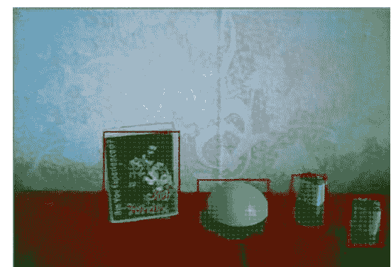

图 5-1. 对象跟踪

#### Real-Time Object Tracking

该主题说明了如何使用传统的网络摄像头实时跟踪移动或固定对象。当对象开始显示时，跟踪的简单方法是将预先指定的背景图片与相同的背景帧进行比较。这种情况在固定环境中运行，您可以在其中了解背景图片，尽管必须跟踪任何前景对象，例如室内、着陆区、办公室、市场、车间等。如果一张纸在这种情况下移动或在较长时间内保持固定，您应该将其视为场景的一部分并将图片叠加到背景上以防止额外检测。如果场景中删除了背景对象，同样适用。这种方法的缺点是缺乏照明和需要调整摄像头位置。在这种情况下，您必须再次测量最新的背景。另一个选择是使用边缘算子来减少光照变化的影响。如果您想描述对象的身体而不是仅轮廓，您将不得不编写一些额外的代码。


#### 背景

传统的网络摄像头分辨率为 640 × 480 像素已过时。如果您计划跟踪非常小的物体，可以将此分辨率缩小约三倍，以消除失真并在不丢失关键跟踪能力的情况下大大提高处理器速度。降采样步骤可以实现物体跟踪的极高处理速度。当没有物体时，在 2 GHz 单核上运行速度约为每秒一百帧，而有物体时则在每秒 30 到 90 帧之间。物体越大，测量 blob 的每个像素所需的时间就越长。除了 ImageBlobs 类之外，本章以及代码都依赖于之前的提交。

#### 利用代码

通过设置摄像头以及在 Video Preview 中定义的帧捕获级别，同时使用 Buffered Mode 中的 SampleGrabber 将帧捕获到内存中来开始视频捕获。首先，背景测量方法选择一个背景单选按钮。当您选择启动跟踪复选框以开始物体跟踪时，所有记录的帧都应合并，并且会计算出一个平均背景帧，该帧将保存为名为 background.jpg 的 JPEG 文件。我建议您将摄像头对准您认为会看到运动的方向。在处理摄像头失真或在短时间内场景中出现一些随机移动物体时，测量数秒的背景。它们将被平均背景计算有效消除。将一个物体引入您想要跟踪的场景，要么等待它们出现，要么它们处于活动状态。

#### 库

推荐使用背景帧的均值估计，因为它有助于消除所有失真或小幅运动。

```
C++
1: background[i] = 0;
   frames_number = 0;
2: while(frames_number < N)
       background[i] = current_frame[i] + background[i];
       frames_number++;
3: background[i] = background[i] / frames_number;
```

以下类已添加到库中：

- MotionDetector
- ImageBlobs

与其在序列帧之间取差值，而像在人脸检测文章中那样，MotionDetector 中的修改使我们能够调整背景帧，以便对任何新图像帧执行对比。ImageResize 对象用于呈现背景帧和最新图像帧。首先，设置视频帧大小和长度，包括 MotionDetector 对象的降采样因子：

- void MotionDetector::init(unsigned int image_width, unsigned int image_height, float zoom);

使用 zoom = 0.125f 来将图像缩小三倍。如果您已完成背景计算方法，请调用 set background() 函数：

```
C++
inline int MotionDetector::set_background(const unsigned char* pBGR)
{
    return m_background.resize(pBGR);
}
```

我们现在可以利用 detect() 函数来计算与前景物体相对应的像素。

```
const vec2Dc* MotionDetector::detect(const unsigned char* pBGR)
{
    if (status() < 0)
        return 0;

    m_image.resize(pBGR);

    //RGB version
    char** r1 = m_image.getr();
    char** g1 = m_image.getg();
    char** b1 = m_image.getb();
    char** r2 = m_background.getr();
    char** g2 = m_background.getg();
    char** b2 = m_background.getb();
    for (unsigned int y = 0; y < m_motion_vector->height(); y++) {
        for (unsigned int x = 0; x < m_motion_vector->width(); x++) {
            if (abs(r1[y][x] - r2[y][x]) > m_TH ||
                abs(g1[y][x] - g2[y][x]) > m_TH ||
                abs(b1[y][x] - b2[y][x]) > m_TH)
                (*m_motion_vector)(y, x) = 1;
            else
                (*m_motion_vector)(y, x) = 0;
        }
    }

    //gray scale version
    /*m_difference_vector->sub(*m_image.gety(), *m_background.gety());
    for (unsigned int y = 0; y < m_motion_vector->height(); y++) {
        for (unsigned int x = 0; x < m_motion_vector->width(); x++) {
            if (fabs((*m_difference_vector)(y, x)) > m_TH)
                (*m_motion_vector)(y, x) = 1;
            else
                (*m_motion_vector)(y, x) = 0;
        }
    }*/

    m_tmp_motion_vector->dilate(*m_motion_vector, 3, 3);
    m_motion_vector->erode(*m_tmp_motion_vector, 5, 5);
    m_tmp_motion_vector->dilate(*m_motion_vector, 3, 3);

    return m_tmp_motion_vector;
}
```

您可以选择比较 RGB 值或灰度图像信息。在将物体转换为灰度值时，我们认为这对于相似色调来说不可靠。腐蚀和膨胀操作可用于覆盖物体 blob 中的一些孔洞，这些孔洞可能由于背景和物体中的相同像素色调而产生，以及消除来自非常小的运动或非常薄物体的噪声。从 ImageBlobs 对象返回的向量已用于 blob 移除。使用该类时，您需要了解以下功能。

- void ImageBlobs::init(unsigned int width, unsigned int height);
- int ImageBlobs::find_blobs(const vec2Dc& image, unsigned int min_elements_per_blob = 0);
- void ImageBlobs::find_bounding_boxes();
- void ImageBlobs::delete_blobs();

首先，将对象的大小设置为降采样后的图像尺寸。

```
(e.g., init(zoom * image_width, zoom * image_height)).
```

之后，您可以开始测量 blob 以 find_blobs()，基于通过 MotionDetector::Detect() 调用获取的图像。特征会查看上下相邻的非零图像向量分量，形成一个 blob。然后为每个分量分配当前找到的 blob 编号。例如，使用 10x10 向量用于图像向量。


find_blobs() 将从该图像估计出三个 blob。您可以使用 const vec2Dc* ImageBlobs::get_image() const 函数获取包含找到的 blob 的向量。

```
1 1 1 0 0 0 0 0 0 0
1 1 1 1 0 0 0 0 0 0
1 1 1 1 0 0 0 0 0 0
1 1 1 1 0 0 0 0 0 0
0 1 0 0 0 2 2 2 2 0
0 0 0 0 2 2 2 2 2 0
3 3 0 2 2 2 2 2 2 2
3 3 0 2 2 2 2 2 2 2
3 0 2 2 2 2 2 2 2 2
0 0 0 2 2 2 2 2 2 2
```

您可以使用 min_elements_per_blob 来排除检测到的微小 blob（例如，min_elements_per_blob = 5 将使第三个 blob 未被检测到）。

我们可以使用以下方法获取找到的 blob 的特征：

- inline unsigned int ImageBlobs::get_blobs_number() const;
- inline const struct Blob* ImageBlobs::get_blob(unsigned int i) const;

以下是 Blob 结构：

```
struct Blob {
    unsigned int elements_number;
    vector<struct Element> elements;
    unsigned int area;
    RECT bounding_box;    //{[top,left; right,bottom)
};
```

因此，元素数量是存储在 Element 结构的元素数组中的 blob 中的元素数量。

```
struct Element {
    vector<struct Element> neighbs;
    struct Coord coord;
};
```

坐标确实是图像向量中的元素坐标，而邻居包括其直接相邻的邻近元素。

```
struct Coord {
    int x;
    int y;
};
```

在调用 find blobs() 时，我们可以使用 find bounding boxes() 来测量每个 blob 的边界框，该边界框包含在 Blobs::bounding box 的 RECT 布局中。在再次调用 find blobs() 之前，必须使用 delete blobs() 从 Picture Blobs 对象中删除找到的 blob。
find_blob() 函数如下所示：

```
int ImageBlobs::find_blobs(const vec2Dc& image,
                          unsigned int min_elements_per_blob)
{
    if (m_image == 0)
        //not initialized
        return -1;

    m_image->copy(image);

    while (true) {
        struct Blob blob;
        blob.elements_number = 0;
        blob.area = 0;

        unsigned int y, x;
        //find first non-zero entry//////////////////////////////
        for (y = 0; y < m_image->height(); y++) {
            for (x = 0; x < m_image->width(); x++) {
                if ((*m_image)(y, x) != 0) {
                    struct Element element;
                    element.coord.x = x;
                    element.coord.y = y;
                    blob.elements_number = 1;
                    blob.elements.push_back(element);
                    blob.area = 0;
                    memset(&blob.bounding_box, 0, sizeof(RECT));
                    break;
                }
            }
            if (blob.elements_number > 0)
                break;
        }

        if (blob.elements_number == 0) {
            mark_blobs_on_image();
            return get_blobs_number();
        }

        blob.elements.reserve(m_image->width() * m_image->height());
```


Here we will find the first non-zero entry:

```
//find blob////////////////////////////////////////////
unsigned int index = 0;
while (index < blob.elements_number) {
    unsigned int N = (unsigned int)blob.elements_number;
    for (unsigned int i = index; i < N; i++) {
        add_up_neighbour(blob, i);
        add_right_neighbour(blob, i);
        add_down_neighbour(blob, i);
        add_left_neighbour(blob, i);
    }
    index = N;
}
remove_blob_from_image(blob);

if (blob.elements_number > min_elements_per_blob) {
    blob.area = (unsigned int)blob.elements_number;
    blob.elements.reserve(blob.elements_number);
    m_blobs.push_back(blob);
}
```

Now we will find the blob in the given code.

An add * neighbour () processes look for the picture component that is identical to an ith Component within the present blob upwards, below, left, or right, then attach this towards a Blob components array:

```
inline unsigned int ImageBlobs::add_up_neighbour(struct Blob& blob, unsigned int i)
{
    const struct Element& element = blob.elements[i];
    if (element.coord.y - 1 < 0)
        return 0;
    else if ((*m_image)(element.coord.y - 1, element.coord.x) > 0) {
        struct Element new_element;
        new_element.coord.x = element.coord.x;
        new_element.coord.y = element.coord.y - 1;
        if (has_neighbour(element, new_element) == false) {
            int index = is_element_present(blob, new_element);
            if (index >= 0) {
                blob.elements[index].neighbs.push_back(element);
                return 0;
            }
            new_element.neighbs.push_back(element);
            blob.elements_number++;
            blob.elements.push_back(new_element);
            return 1;
        }
        else
            return 0;
    }
    else
        return 0;
}
```

Is_element_present() as well as has_neighbour() decide whether the same latest component has already been existing inside the blob:

```
inline int ImageBlobs::is_element_present(const struct Blob& blob,
    const struct Element& new_element) const
{
    //int index = 0;
    for(int i = (int)blob.elements_number - 1; i >= 0; i--) {
        const struct Element& element = blob.elements[i];
        if (element.coord.x == new_element.coord.x &&
            element.coord.y == new_element.coord.y) {
            //wprintf(L" %d\n", blob.elements_number - 1 - i);
            return i;
        }
        //if (++index > 2) //inspect at least 2 last elements
        //    break;
    }
    return -1;
}

inline bool ImageBlobs::has_neighbour(const struct Element& element,
    const struct Element& new_element) const
{
    unsigned int N = (unsigned int)element.neighbs.size();
    if (N > 0) {
        for (unsigned int i = 0; i < N; i++) {
            if (element.neighbs[i].coord.x == new_element.coord.x &&
                element.neighbs[i].coord.y == new_element.coord.y)
                return true;
        }
        return false;
    }
    else
        return false;
}
```

#### Conclusions

I’ve chosen a fixed background (Figure 5-2) as well as conducted a few object tracking tests using items in front of me. The background that I utilized is shown in the following. This became averaged across a long amount of duration.

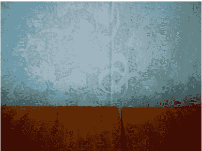

##### Figure 5-2. Background

At 66.67 frames per second, two items (display cleaners as well as mobile devices) were tracked (Figure 5-3).

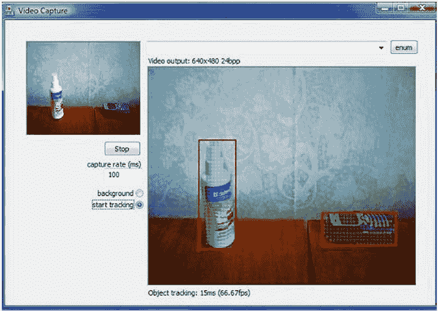

##### Figure 5-3. Object Tracking in Videos

At 71.43 frames per second, a mobile energy connector was tracked (Figure 5-4). Since the cord seems to be so thin, it is not observed by erosion and dilation techniques.

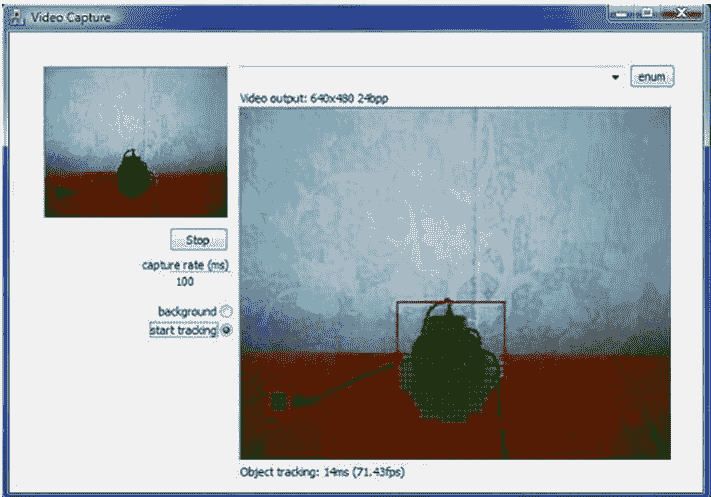

Figure 5-4. Object Tracking in Videos

The following is for a few pens as well as locks: 90.91 frames per second (Figure 5-5).

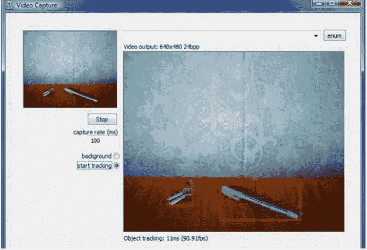

Figure 5-5. Tracking Different Objects

Three distinct items were observed at 29.41 frames per second in a quite complicated situation (Figure 5-6).

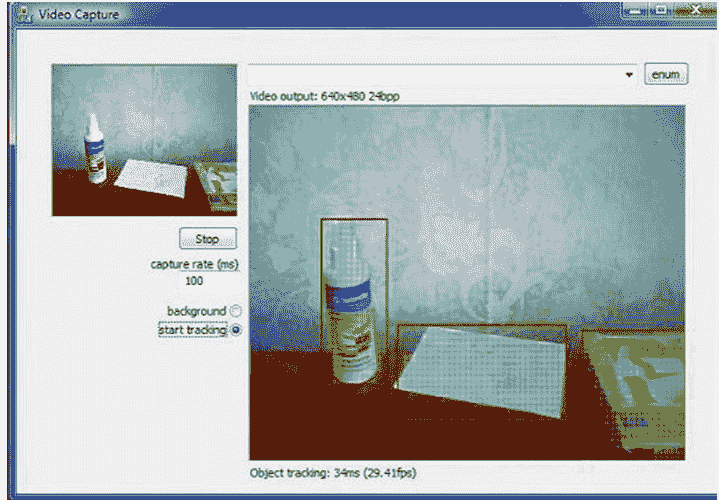

Figure 5-6. Tracking Different Objects

At 55.56 fps, a Jimi Hendrix and a 9v power were tracked (Figure 5-7).

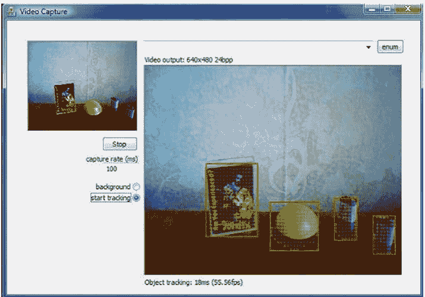

Figure 5-7. Tracking Different Objects

Other background configurations are as follows (Figure 5-8):

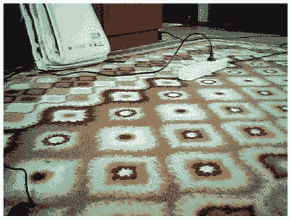

Figure 5-8. Another Complex Background

At 90.91fps, numerous 9v batteries, rolling upon on rug, were observed (Figure 5-9). Due to a limitation on the quantity of components, a battery was kept unobserved.

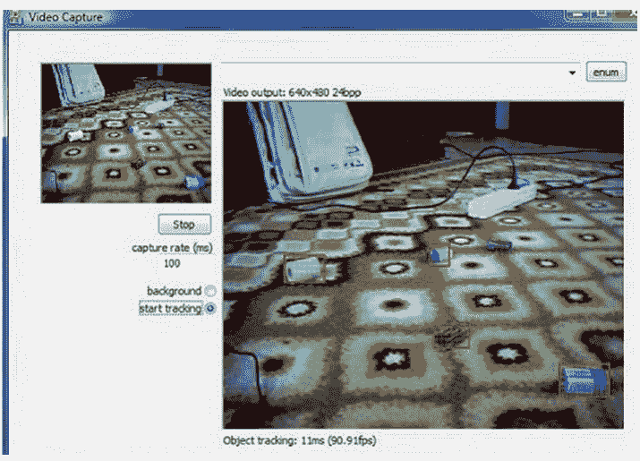

Figure 5-9. Another Complex Background

At 90.91 frames per second, a battery connector, LCD-TFT filter, and 9v battery were observed (Figure 5-10). A minuscule one went unobserved once more, this time because of erosion and dilation techniques.

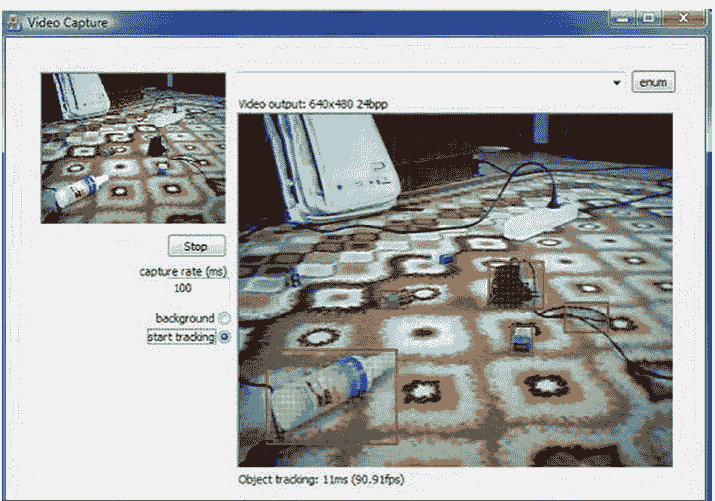

Figure 5-10. Another Complex Background

Then after 83.33 fps, candles as well as cellphones were observed (Figure 5-11).

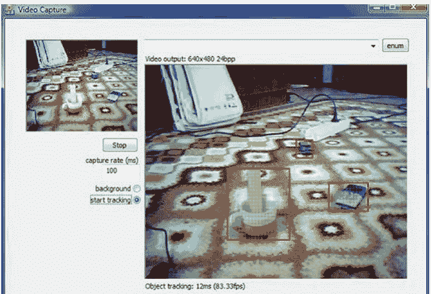

Figure 5-11. Another Complex Background

As you'll observe a larger entity, much longer it takes to measure a blobs' components. It also doesn't deal with shadows by objects upon on white back wall as well as a table. Highly prominent reflections, but on the other hand, would be tracked as being related to the item.

#### Points of Concern

One could enhance an algorithm for tracking the location of an object's bounding box. One can insert an area toward the background scenario photo if it would be fixed for a set duration, as a result, an object being integrated into the scenario. (For example, few objects move to a scenario but remain constant.)

#### Custom Barcode Generator/Reader

##### Utilizing C++, Build and Read Barcodes

We’ll show you how to programmatically create barcodes in C++ within the chapter. You’ll also discover ways to build a barcode reader or scanner in the C++ program (Figure 5-12).

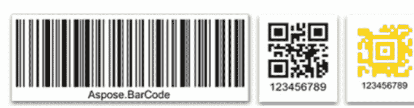

Figure 5-12. Custom Barcode Reader

Information is visually represented in the format in which machines can read it using barcodes. Innovation has proven to be beneficial in such a variety of applications, including automatic check systems within shops as well as in markets. A barcode can now be used on most commercial products. The barcode’s increasing success has led to new applications across several fields. Aspose introduced a barcode generator and reader API for different channels a couple of years back, recognizing the importance of barcodes. The purpose of this chapter is to demonstrate how to automatically produce and interpret barcodes using the barcode generator and reader in C++ programs.

#### API for Producing and Reading Barcodes in C++

Assume, barcode with C++ is indeed a functionality C++ API that allows users to build and read a wide range of 1D as well as 2D barcodes. It allows you to produce, configure, as well as send greater-quality pictures through barcodes.

The following is a list of barcode symbologies that Aspose.BarCode with C++ will generate:

- Code128
- Code39 Standard
- Code39 Extended
- Code93 Standard
- Code93 Extended
- Code11
- Codabar
- BooklandEAN
- EAN13
- EAN8
- EAN128
- Interleaved2of5
- Standard2of5
- MSI
- Postnet
- Planet
- UPCA
- UPCE
- EAN14(SCC14)
- SSCC18
- ITF14
- BarCode supplement
- Pdf417
- QR
- Datamatrix
- Matrix 2 of 5
- PZN (Pharma Zentral Nummer, Pharmazentralnummer barcode)
- Deutsche Post Identcode
- Aztec
- Australia Post

#### Generating a Barcode Using C++

Utilizing Aspose to build a barcode: With only a few code lines, you can create a barcode. The measures to execute this procedure include the following:

- Make an object of a Barcode Generator class.
- Start an object with encode form and text of the barcode.
- Use the Barcode Generator->Save (System::String) process, and build a barcode.

The following code demonstration illustrates how to produce a barcode in C++:

```
const System::String codeText = u"1234567";
const System::String fileName = u"code39_barcode.jpg";
// Create barcode generator
System::SharedPtr<BarcodeGenerator> barcodeGenerator = System::MakeObject<BarcodeGenerator>(EncodeTypes::Code39Standard, codeText);
barcodeGenerator->get_Parameters()->set_Resolution(300);
// Generate barcode and save as image
barcodeGenerator->Save(fileName);
```


使用前面的代码生成的条形码如下所示（图 5-13）：

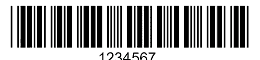

图 5-13. 自定义条形码阅读器

#### 利用 C++，生成二维条形码（QR 或其他）

我们在之前的实例中生成了一个一维条形码。让我们制作一个类似二维码的二维条形码。制作 QR 条形码的步骤如下：

- 创建一个条形码生成器类的对象。
- Encode Types:: 用于配置对象。设置二维码的文本。
- 使用 Barcode Generator->Save (System::String) 过程，并创建条形码图片。

以下代码演示说明了如何使用 C++ 创建 QR 条形码：

```
const System::String codeText = u"1234567";
const System::String fileName = u"QR_Code.jpg";
// Create barcode generator
System::SharedPtr<BarcodeGenerator> barcodeGenerator = System::MakeObject<BarcodeGenerator>(EncodeTypes::QR, codeText);
barcodeGenerator->get_Parameters()->set_Resolution(300);
// Generate barcode and save as image
barcodeGenerator->Save(fileName);
```

使用此代码，二维码将被确实生成。

#### 使用 C++，创建和自定义条形码

您也可以调整条形码的显示。您可以更改前景色、背景色、比例、边界类型和其他选项，例如。以下列出了使用 Aspose.BarCode 使用 C++ 自定义条形码的方法。

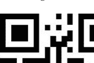

- 创建一个条形码生成器类的对象。
- Barcode Generator->get Parameters () 方法用于访问条形码规范。
- 定义您喜欢的规范。
- 制作条形码并将其保存为照片。

以下编码演示说明了如何在 C++ 中创建个性化条形码：

```
System::SharedPtr<BarcodeGenerator> barcodeGenerator = &[] { auto tmp_0 = System::MakeObject<BarcodeGenerator>(EncodeTypes::Aztec, System::String(u"1234567890"));
// set border style
tmp_0->get_Parameters()->get_Border()->set_DashStyle(Aspose::BarCode::BorderDashStyle::Solid);
// set width
tmp_0->get_Parameters()->get_Border()->set_Width(System::Drawing::Unit::Millimeters(1.0f));
// set border visibility
tmp_0->get_Parameters()->get_Border()->set_Visible(true);
// set background color
tmp_0->get_Parameters()->set_BackColor(System::Drawing::Color::get_Black());
// set barcode's bar color
tmp_0->get_Parameters()->get_Barcode()->set_ForeColor(System::Drawing::Color::get_Orange());
// set border color
tmp_0->get_Parameters()->get_Border()->set_Color(System::Drawing::Color::get_Black());
// set text color
tmp_0->get_Parameters()->get_Barcode()->get_CodeTextParameters()->set_Color(System::Drawing::Color::get_Orange());
// set image resolution
tmp_0->get_Parameters()->set_Resolution(400);
return tmp_0; };
barcodeGenerator->Save(System::String(u"custom_barcode.jpg"));
```

我们创建的可自定义 Aztec 条形码如下所示（图 5-14）：

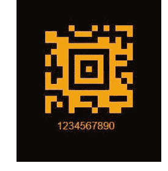

图 5-14. 可自定义 Aztec 条形码

#### 利用 C++，创建带字幕的条形码

字幕可以出现在条形码下方或上方。条形码图片中字幕的内容和外观也可以自定义。以下代码示例说明了如何在 C++ 中构建带字幕的条形码：

```
System::SharedPtr<BarcodeGenerator> generator = [&] { auto tmp_0 = System::MakeObject<BarcodeGenerator>(EncodeTypes::Code39Standard,
System::String("1234567890"));
// set caption above
tmp_0->get_Parameters()->get_CaptionAbove()->set_Text(u"Caption Above");
// set visibility
tmp_0->get_Parameters()->get_CaptionAbove()->set_Visible(true);
// set caption below
tmp_0->get_Parameters()->get_CaptionBelow()->set_Text(u"Caption Below");
// set visibility
tmp_0->get_Parameters()->get_CaptionBelow()->set_Visible(true);
// set resolution
tmp_0->get_Parameters()->set_Resolution(300);
return tmp_0; }();
generator->Save(System::String(u"barcode_caption.jpg"));
```

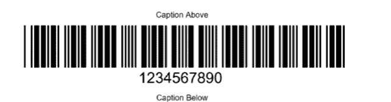

图 5-15. 可在此处看到上下均包含字幕的条形码

#### 利用 C++，扫描和读取条形码

让我们看看如何使用 Aspose.BarCode for C++ 来扫描和读取条形码。使用此功能的过程如下：

- 从 Barcode Reader 类创建一个实体。
- 创建一个包含条形码及其符号的图片文件的 Barcode Reader 示例。
- 使用 Barcode Reader->Read () 工具获取条形码的文本或形式。

以下编程示例演示了如何在 C++ 中搜索和解释条形码：

```
// Create instance of BarcodeGenerator class
System::SharedPtr<BarCodeReader> reader = System::MakeObject<BarCodeReader>(u"Code128.png", DecodeType::Code128);
while (reader->Read())
{
    // Display code text and Symbology Type
    System::Console::WriteLine(System::String(u"CodeText: ") + reader->GetCodeText());
    System::Console::Write(System::String(u"Symbology Type: ") + reader->GetCodeType());
}
reader->Close();
```

#### C++ 用于读取具有多种符号的条形码

在大多数情况下，一张图片只包含一种条形码符号。即使如此，在某些情况下，一张图片可以在相对相似的时间内包含来自多种符号的条形码。在这种情况下，您应该有一组待扫描和读取的条形码符号。以下程序示例演示了如何使用 C++ 扫描包含多种条形码符号的图片：

```
// Set barcode symbologies
System::ArrayPtr<System::SharedPtr<BaseDecodeType>> objArray = System::MakeArray<System::SharedPtr<Aspose::BarCode::BarCodeRecognition::BaseDecodeType>>({DecodeType::Code39Standard, DecodeType::PDF417});

// Initialize the BarCodeReader, Call Read() method in a loop and Display the codetext and symbology type
System::SharedPtr<BarCodeReader> reader = System::MakeObject<BarCodeReader>(u"RecognizingMultipleSymbologies.png", objArray);
while (reader->Read())
{
    System::Console::WriteLine(System::String(u"Codetext: ") + reader->GetCodeText());
    System::Console::WriteLine(System::String(u"Symbology type: ") + reader->GetCodeType());
}
reader->Close();
```

#### 摘要

在本章中，您学习了如何使用 C++ 构建各种符号的条形码。涵盖了条形码的扫描和读取，并附有 C++ 代码示例。文档将帮助您了解有关 API 的所有内容。
