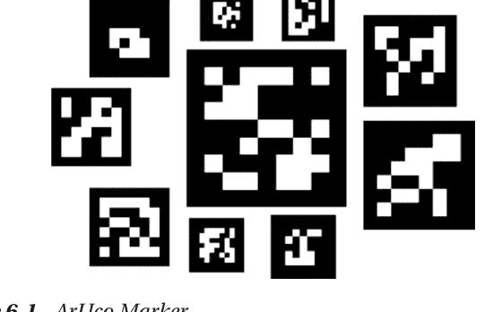
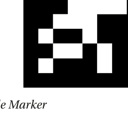
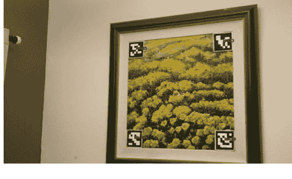
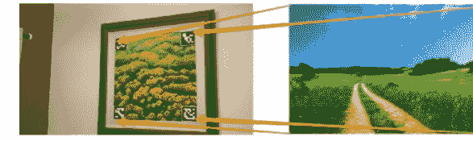
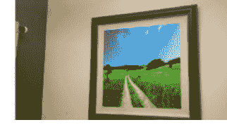

### 第 6 章

### 增强现实
使用 OpenCV

本章解释了如何通过测量周期平均背景场景来使用缩小后的图片细节实时跟踪移动和静态对象。

#### 概述

增强现实，也称为 AR，是一种允许我们在视野中看到虚拟对象和细节的技术。我们可以通过增强现实获得我们可以看到的对象的详细信息。这通过结合现实世界组件来改进屏幕。例如，如果我将手机指向一条街道，这将为我提供额外的信息，如餐馆、健身中心、医生的名称等。增强现实被称为数字知识与个人世界的实时结合。用户可以通过增强现实技术与其自然环境中的虚拟对象进行交互。佩戴虚拟现实眼镜的人使用手机或平板电脑屏幕来查看他们正在查看的任何对象的详细信息。

这里讨论了三种不同类型的 AR。

#### 基于标记的 AR

数字世界与物理世界相互连接。我们必须知道用户将摄像机对准特定页面以将教育动画直接显示在期刊的纸张上。因此，系统最初应检测您从摄像机的实时视图中正在查看的是哪一页。这将通过使用页面上的独特图像或形状来实现。图像将被识别，动画将立即开始，跟踪到页面上的正确位置。用户也可以将该实际书籍移动以查看虚拟世界是否遵循页面的真实表面。系统识别的可识别图像被称为标记。几乎任何东西都可以用作标记，只要它具有足够独特的视觉特征即可。

#### 无标记 AR

虚拟对象由用户移动。考虑一种增强现实技术，允许您将虚拟家具放置在客厅中。它使我们能够尝试不同的对象设计，以及位置组合。客户必须在该过程中确定虚拟对象的放置位置。它被称为“无标记 AR”。

#### 基于位置的 AR

虚拟世界存在于现实世界中。

基于位置的 AR 将增强现实技术连接到特定位置。假设您走在一条不熟悉的公共道路上，看到手机摄像机显示一个虚拟街道标志，显示街道名称，那就是基于位置的 AR。而且，就像我们的 AR City 应用程序一样，这可以帮助您通过在您面前的实际路径上方叠加路线来移动到该位置。


#### 基于标记的增强现实

#### 使用 OpenCV (C++) 中的 ArUco 标记创建增强现实

在本节中，我们将介绍 ArUco 标记是什么，以及如何利用它们与 OpenCV 一起执行基本的增强现实活动。ArUco 标记长期以来一直用于虚拟现实、相机姿态预测和校准。让我们更仔细地了解一下它。

##### 什么是 ArUco 标记？

ArUco 代表 Augmented Reality University of Cordoba（科尔多瓦大学增强现实，图 6-1）。科尔多瓦大学是西班牙科尔多瓦的一所大学，它是在那里创建的。



图 6-1. ArUco 标记

以下是一些示例：

ArUco 标记是一种 fiducial 标记，它被放置在被拍摄的物体以及场景上。它是一个二进制正方形，具有深色背景和边框，以及一个识别它的白色生成图案。深色边框使其更容易被看到。它有多种尺寸可供选择。为了有效检测，尺寸是根据物体的大小以及场景的大小来选择的。虽然非常小的标记无法被识别，但只需增大其尺寸即可帮助它们被找到。

一个概念是将这些标记扫描并在现实生活中使用它们。拍摄自然世界可以让你特别识别这些标记。当你是一个初学者时，你可能会想，“这对我有什么帮助？”让我们看几个例子。我们在文章中提到的实例中，将打印的标记大多放置在图像框架的边缘上。因此，当标记被特别识别时，你可以用图片或剪辑替换图像框架。一旦你切换相机，一个新的图像似乎具有正确的视点失真。这些标记可以放置在仓库的路线上，并在机器人应用中安装相机。由于每个标记都有唯一的 ID，我们知道标记在仓库中的位置。每当机器人的相机识别到这些标记中的任何一个时，它就可以精确定位仓库内的确切位置。

##### 使用 OpenCV 创建 ArUco 标记

利用 OpenCV，我们可以快速生成这些标记。OpenCV 的 aruco 模块中预定义了 25 个标记词汇表。字典中的标记都包含相同的块大小顺序（44、55、66 或 77），因此每个词汇表都有固定数量的标记（50、100、250 或 1000）。

以下是显示如何识别和生成 Aruco 标记的 C++ 代码。我们必须使用 aruco 模块。代码中的 PredefinedDictionary 显示了如何加载包含 250 个标记的字典。

##### C++

```
// Import the aruco module in OpenCV
#include <opencv2/aruco.hpp>

Mat markerImage;
// Load the predefined dictionary
Ptr<cv::aruco::Dictionary> dictionary =
aruco::getPredefinedDictionary(cv::aruco::DICT_6X6_250);
// Generate the marker
aruco::drawMarker(dictionary, 33, 200, markerImage, 1);
```

前面的 drawMarker 函数允许我们从一组 250 个 ID 范围为 0 到 249 的标记中选择一个具有特定 ID（第二个参数 – 33）的标记。生成的标记的大小由 drawMarker 函数的第三个参数决定。它可能在前面的实例中生成一个 200 × 200 像素的图片。第四个参数（前面的 markerImage）是用于保存生成的标记的对象。最终，密度参数指的是应作为边界插入到形成的二进制图案中的块的数量。在之前的说明中，一个 1 位边框将被插入到 6×6 生成的形状中，从而在 200 × 200 像素的图片中产生一个 7×7 位图片（图 6-2）。前面的代码将生成一个与以下所示类似的标记。



图 6-2. 示例标记

在大多数情况下，我们需要创建多个标记，将它们打印出来，并将它们放置在场景中。

**ArUco 标记检测：** 我们必须识别 ArUco 标记，然后在场景被可视化时将它们用于进一步分析。我们将在下面向你展示如何发现标记。

##### C++

// Load the dictionary that was used to generate the markers.
Ptr<Dictionary> dictionary = getPredefinedDictionary(DICT_6X6_250);

// Initialize the detector parameters using default values
Ptr<DetectorParameters> parameters = DetectorParameters::create();

// Declare the vectors that would contain the detected marker corners and the rejected marker candidates
vector<vector<Point2f>> markerCorners, rejectedCandidates;

// The ids of the detected markers are stored in a vector
vector<int> markerIds;

// Detect the markers in the image
detectMarkers(frame, dictionary, markerCorners, markerIds, parameters, rejectedCandidates);

首先，我们加载一个与创建标记时使用的相同的词汇表。DetectorParameters 用于检测一组起始参数：make something ()。我们可以使用 OpenCV 在识别阶段调整许多参数。默认参数在大多数情况下效果良好，OpenCV 建议你使用它们。因此，我们将保持相同的设置。每个活动标记检测都会识别标记的四个侧点，按顺序为左上、右上、右下和左下。这些矩形指针被处理为 C++ 中的点向量，以及图片中多个标记被组合成点向量的向量。detectMarkers 功能用于查找和检测标记的角。场景中带有标记的图片将是第一个参数。用于创建标记的字典是第二个参数。被准确识别的标记将被保存为 markerCorners，或其 ID 将被保存到 markerIds 中。DetectorParameters 实体也被作为参数发送，该实体是在之前创建的。最终，被拒绝的成员保存在 rejected candidates 数据库中。

在打印、裁剪并将它们插入场景中时，务必在标记的黑色边界上留出白色边框，以便于识别。

##### 一个增强现实应用

ArUco 标记是为解决估计相机姿势的问题而设计的，适用于各种应用，例如增强现实。我们将在本节中使用它们来创建一个增强现实应用，该应用允许我们将每个当前场景叠加到当前图片或剪辑上。我们选择一个在家中的场景，其中有一个巨大的图像框架，我们希望将其替换为最新的图像，以查看它们在表面上的外观。我们然后尝试将一个剪辑嵌入到一部电影中。我们通过打印、裁剪并将宽大的 ArUco 标记粘贴到图片区域的边缘上，如此处图片所示，然后录制一个剪辑来实现这一点。拍摄的剪辑可以在页面顶部的视频左侧找到。之后，我们逐帧处理视频的每一帧。首先为每张图片检测标记。以下图片中显示的已识别标记以绿色显示。一个小红环表示第一个点。通过顺时针导航标记的边界，你可以到达第二、第三和第四阶段。



为了计算单应性，使用输入图片中以及当前场景图片中的四个对应点（图 6-3）。在我们之前的帖子中，我们讨论了单应性。单应性确实是一种变换映射，将一个参考点映射到不同意见的场景中的另一个给定交点。





图 6-3. 使用 OpenCV 中的 ArUco 标记进行增强现实

在示例中，使用单应性度量将新场景图片扭曲到由标记在点击图片中识别的四边形中。在下面的代码中，我们演示了如何做到这一点。


##### C++

// Compute homography from source and destination points
Mat h = cv::findHomography(pts_src, pts_dst);

// Warped image
Mat warpedImage;

// Warp source image to destination based on homography
warpPerspective(im_src, warpedImage, h, frame.size(), INTER_CUBIC);

// Prepare a mask representing region to copy from the warped image into the original frame.
Mat mask = Mat::zeros(frame.rows, frame.cols, CV_8UC1);
fillConvexPoly(mask, pts_dst, Scalar(255, 255, 255));

// Erode the mask to not copy the boundary effects from the warping
Mat element = getStructuringElement( MORPH_RECT, Size(3,3) );
erode(mask, mask, element);

// Copy the masked warped image into the original frame in the mask region.
Mat imOut = frame.clone();
warpedImage.copyTo(imOut, mask);

源点（pts_src）是当前场景图片边缘点，而终点位置（pts_dst）是点击图片内照片框架中匹配的图片中心点。单应性函数‘h’在输入点和目标点之间是使用 OpenCV 函数 findHomography 计算的。然后当前图片会使用单应性矩阵进行扭曲以融合到目标框架中。经过遮罩和复制的扭曲图片被粘贴到目标框架中。该阶段在剪辑中的每一帧中持续进行。

#### 手机上基于视觉-惯性估计的无标记增强现实

在增强现实（AR）中，真实世界环境的实时视图与计算机生成的虚拟内容相结合。移动增强/虚拟现实（AR/VR）中虚拟场景与现实世界的配准需要实时六自由度（6-DoF）运动跟踪。即使如此，由于当今移动终端有限的计算能力，连续到达位姿之间的延迟会损害移动 AR/VR 的用户体验。移动 AR/VR 到达位姿的实时精度是通过惯性传感器提供的高频率和被动输出实现的。此外，传统仅视觉运动跟踪的鲁棒性得到了改进，从而在存在运动模糊时提高了移动 AR/VR 效率。此外，还开发了一种自适应滤波系统，以自动应对不同的运动情况，在视觉-惯性融合期间平衡抖动和延迟，从而实现实时 6-DoF 运动跟踪。AR 系统面临特定的障碍，例如需要高质量的相机位姿估计以及需要在资源最少的平台上运行。移动 AR 旨在在真实世界环境中以准确的位姿呈现虚拟对象。设备必须能够使用移动计算确定用户的位置和他们正在看的内容。

另一方面，移动 VR 允许用户与虚拟世界之间进行各种交互和连接。在此，我们提出了一个完整的系统，该系统基于混合方法，使用 ORB 二进制特征和光流在消费级平板电脑上接近实时运行。因此，移动 AR/VR 中最相关的问题之一是位姿跟踪，即实时测量用户的位置和方向。即使如此，由于移动设备的计算能力有限，移动 AR/VR 的实时运动跟踪仍然是一个瓶颈。基于标记或基于模型的方法只能在对场景有一定先验知识的情况下执行 6-DoF 跟踪，而无标记运动跟踪可以在任何情况下运行。因此，无标记跟踪将在未来在移动 AR/VR 中变得更加普遍。

即使如此，由于计算需求高且环境多变，实时 6-DoF 无标记运动监控在移动 AR/VR 中的适用性和鲁棒性仍需要进一步研究。设备采用自适应特征地图来增加可使用的 ORB 特征数量。“地图”被描述为特征描述符及其 3D 世界坐标的列表。因此每个地图都有一个由四个世界坐标组成的三维边界框。一旦计算出相机位姿，该边界框就可以投影到图片帧中。

通过集成单目相机和惯性传感器，实现了移动 AR/VR 实时基于传感器融合的 6-DoF 运动跟踪。提出了一种自适应滤波架构，以在视觉-惯性融合期间平衡抖动和延迟现象，从而实现移动 AR/VR 的实时、平滑的 6-DoF 运动跟踪。在此，我们展示了如何通过提出平台特定的优化以及使用两种现有位姿估计算法来提高跟踪速度和范围，从而实现实时效率。如果我们想在合成 VR 世界中建立临场感，跟踪用户的姿势也是必不可少的。借助有关用户 6-DoF 位姿的详细信息，设备将从用户的视角显示虚拟世界。同时定位与地图构建（SLAM）是一种常见的无标记跟踪方法，可以在未准备好的环境中检测移动相机的 6-DoF 位姿，从而允许在没有基准标记的情况下使用手机 AR/VR 应用。

#### 增强现实（AR）虚拟现实的子类

虚拟现实（VR）有一个名为增强现实（AR）的子类。在真正的虚拟现实应用中，用户接收到的所有感官反馈都是模拟的。在增强现实中，虚拟内容与真实世界的感官反馈混合以产生环境的组合版本。它最常由当今的消费级移动设备实现。该系统能够实时运行，使用计算机视觉技术分析来自手持相机或头戴式显示器（HMD）的实时视频输入，以评估相机在 3D 空间中的位置和方向（位姿）。利用这些位姿数据，虚拟增强可以无缝地融入真实世界的视频流中。无标记 AR 可用于更普遍和临时的应用。无标记 AR 系统不是依赖人工标记，而是利用环境中已有的自然特征。无标记 AR 最困难的部分是通过自然特征检测和匹配来满足相机位姿估计的计算需求。该问题在手持移动设备中至关重要。设备工作所需的一切只是一个校准过的单目相机。

几乎所有过程，包括地图制作，都是在线实时完成的，这限制了处理速度和内存。对管道的每个点，讨论了移动设备的计算限制，并使用 Android 实现来测试整个系统。当找到足够数量的良好匹配时，设备会尝试使用地图已知的 3D 坐标和 2D 帧位置来估计相机的位姿。在决定位姿时，考虑了两种情况：来自描述符匹配的位姿和来自跟踪内点的位姿，每种对应于混合系统的模式。尽管在匹配过程中实施了各种限制和阈值，但仍可能存在误报。这样的错误匹配可能占对应关系的大部分，如果不将其丢弃，恢复的相机位姿的准确性就会受损。目标是仅使用正确的匹配来计算位姿。最大迭代次数是通过反复试验计算得出的。由于 RANSAC 算法不是概率性的，因此相机位姿的可信度在很大程度上取决于在可能的最多迭代次数中选择四个正确点对应关系的可能性。虽然在 5000 次迭代后找不到内点的风险微乎其微，但运行时间会过长。

在地图修改后，最后一步是将恢复的位姿返回给 OpenGL，在那里它将被用于生成模型视图矩阵。任何 3D 增强都可以使用从准确相机位姿获得的模型视图矩阵绘制。有了足够的 3D 绘图知识，人们可以创建与真实环境融合的复杂增强。我们的系统算法与其他候选算法进行了比较，特别关注执行速度。笔记本电脑测试是为了解释效率差距而进行的


current laptops and smartphones/tablets. The speed of image decoding is tested for three implementations – CPU-based floating-point and integer conversions, as well as our NEON accelerated integer-based conversion – since optic flow is unaffected by the detector used.

#### Estimation

It is simple to locate the tracked features at first to calculate. The system’s two pose estimation methods (iterative and EPnP) are compared in terms of time. Because the iterative method is only used in least-squares estimation when monitoring, this is easy. The number of RANSAC iterations performed before an appropriate pose is found determines the computation time for EPnP. As the purpose of every AR system is to create a smooth and interactive user experience, the following images display the system in action via live screen captures from the user’s perspective. A 3D cube is augmented at three different sizes, as well as from an oblique angle, in the top row. Three separate maps are recognized in the bottom row, with various colors of triangles drawn depending on which map has been tracked. A marker-less virtual reality system can be used in real time on today’s mobile devices.

#### ORB Function Detector

The ORB function detector will be implemented using NEON and the SIMD engine as the most imminent future work. If the system’s previous NEON implementations are any indication, this would significantly increase the system’s worst-case execution speed and may even enable feature matching to be done on top of optic flow tracking to provide a more robust pose estimate. Furthermore, as mobile hardware advances, acceleration methods used in PC implementations will become more important. Parallelization via GPU is a common way to boost algorithm performance and speed. NVidia recently unveiled the Tegra 4 processor, which will include a programmable 72-CUDA core GPU, enabling

CUDA implementations to run on cellular phones. Additional features can be added as performance improves. Currently, the device is unable to recognize multiple maps in a single camera frame; instead, it will choose the map with the highest lookup score. Following the selection of possible maps, the descriptor matching and pose estimation processes will be applied to each one separately. Because of NEON acceleration, the matching phase is rapid enough that it can be repeated several times without affecting output significantly.

Even though pose estimation is much slower, the effect of doing it several times could be mitigated by using NEON or GPU acceleration to speed up feature detection. This will result in several camera poses, each of which would have been sent back to OpenGL and augmented separately. Furthermore, real-time camera tracking performance is needed to implement SLAM technology for mobile AR/VR. Frequency of arriving poses for mobile AR should be at least as high as a standard video frame rate (25 Hz) that is usually specified as a standard regulation for real-time output. This norm is also taken into account in this document for non-mobile VR real-time outputs. Since mobile VR provides better real-time efficiency than traditional scenarios, the 6-DoF motion tracking arriving frequency should be at least 60 Hz. Only in this manner will the individual in the VR setting have a pleasant experience. Otherwise, the user will be disgusted by the delay concept in VR environments. To our understanding, there is no full AR system that incorporates all of the components discussed in this book when operating in real time on mobile devices. Online map development and multiple-map support are two features that are currently missing from existing systems.

#### SLAM Process

The specific SLAM process, on the other hand, involves calculating the entire image’s photometric error, performing a dense (all pixels in the image) or semi-dense (high gradient areas) reconstruction while tracking

the camera, and GPU acceleration is needed for real-time performance due to the computational expense. Market mobile devices’ processing capabilities are inadequate for direct real-time camera monitoring. Aside from its high performance, feature-based SLAM is also thought to be more reliable than direct SLAM. As a result, the visual-based monitoring approach in this document is the feature-based SLAM system. These real-time monitoring techniques, though, were only tested on a computer. To create a mobile device that can monitor motion in real time, we incorporate various image processing techniques to detect key features in a given set of frames to find the differentiators by yielding the homography matrix.

Even so, such visual-only tracking methods suffer from poor features or motion blur, making it difficult to monitor important image features. Furthermore, the frame rate requirement for mobile VR is much greater than for smartphone AR to mitigate the dizziness phenomenon in a simulated world. As a result, the preceding visual-only tracking approaches are ineffective for both smartphone AR and VR. Other sensors can be used to further increase the robustness and frame rate of motion tracking for mobile AR/VR.

The inertial sensor can provide high-frequency and passive measurements for pose estimation as a primary motion capture sensor. The 6-DoF motion monitoring through visual-inertial fusion has been summarized by some researchers. Sensor fusion solutions can be classified as tightly coupled or loosely coupled based on various fused frameworks. Tightly coupled approaches can conduct systematic fusion of visual and Inertial Measurement Unit (IMU) measurements, which typically adds complexity, while loosely coupled approaches optimize visual and IMU monitoring separately, resulting in lower computational complexity. An external sensor module containing a wide-angle monocular camera and an IMU is used in this work to increase the camera’s field of view (FOV).

#### Monocular Camera

The monocular camera can acquire a 640 × 480-pixel picture stream at 30 frames per second, and the IMU can output linear acceleration as well as angular velocity at 250 frames per second. No GPU or other acceleration methods to speed up motion tracking were used to test the efficiency of the proposed system. The cumulative processing time from feature extraction in the front end to pose optimization in the back end for each incoming frame is collected to check the processing efficiency of our visual-based tracking in smartphones. The average mobile motion tracking efficiency can achieve near-real-time accuracy. The latency trend is evident because the new filtered pose for phone AR/VR depends strongly on the prior ones.

#### Key Problem

As a result, a key problem for mobile AR/VR is how to perform real-time motion tracking while automatically balancing jitter and latency in various situations. The frame rate of incoming photos and IMU measurements is constant with the existing monocular camera and inertial sensor, resulting in a constant time interval between adjacent arriving poses from the visual-inertial fusion. As a result, the position changes of neighboring postures are used to differentiate between various motion circumstances in real time.

The following extensive analyses of the proposed segmented strategies are given to further explain the proposed adaptive filter system:

- Jitter filtering: So when a mobile AR/VR device is nearly stationary or runs gradually, the transition among adjacent poses can be almost neglected. As a result, the jitter phenomenon dominates in this case, whereas the latency phenomenon for mobile AR/VR users can be ignored. Such a stage is referred to as jitter-filtering in this book. At the same time, the real-time distances among arrival poses are currently small enough.

- Moderation filtering: During the work with a moderate distance pitch, this stage is known as moderation filtering when the motion situation of the mobile AR/VR system is under moderate motion circumstances.

- Latency filtering: Whenever the mobile AR/VR system is subjected to rapid motion, a difference among adjacent arriving poses is dramatic. When the pose does not arrive on time, the consumer will note the latency. Therefore, in this situation for mobile AR/VR, the latency phenomenon dominates, while the jitter phenomenon can be overlooked in a fast-moving situation. Latency filtering is the term for this point.

The normalized distance among adjacent postures can be used to feed the proposed adaptive filter system, as per the preceding explanations. Thus, to solve various motion situations, the appropriate filter phase is decided. To efficiently solve the jitter and latency phenomena, quadratic functions are used in the jitter and latency stages to smooth out extreme motion conditions. Furthermore, a linear function is known as moderation filtering to bridge the jitter filtering and latency filtering stages on mobile terminals to reduce computing complexity. These segmented frameworks aim to estimate an ideal dynamic system, resulting in a simple and suboptimal solution for mobile AR/VR jitter and latency. Therefore, an adaptive filter mechanism can manage the jitter and latency for real-time motion. A qualitative experiment is conducted to test the efficiency of the proposed real-time motion tracking for mobile AR/VR. And tracking based on the actual motion scenarios for the mobile AR/VR to check device uncertainty. The visual-inertial fusion approach can easily provide a high-frequency arriving pose with the aid of IMU, although it is prone to drift due to the combined error of IMU between the two visual frames in mobile.


#### 拟议的自适应视觉-惯性方法

拟议的自适应视觉-惯性方法具有多个优势。此外，当遭受运动模糊或纹理较差时，跟踪稳定性可以得到增强，这是由于 IMU 在短时间内提供了可信的姿态估计。进行了定量实验以进一步验证拟议的流程。拟议方法的地面真值是从典型目标图案获得的轨迹，已知其具有高精度。智能手机 AR 仅基于视觉运动跟踪就容易崩溃，这是由于不可思议的模糊图像。即使如此，使用拟议的传感器融合依赖跟踪方法也可以缓解由快速运动模糊引起的跟踪丢失现象。

VR 帮助用户以多种方式与虚拟世界进行通信。因此，实时监控用户的姿势和行为对于 VR 设备至关重要。此外，VR 中运动跟踪的帧率高于 AR。或者，用户会因延迟现象而感到不适。拟议的自适应视觉-惯性融合过程可以实时实现蜂窝 VR 的平滑 6-DoF 运动跟踪。用户头部安装的拟议多传感器设备可以实时观察用户的 6-DoF 运动。因此，当用户在现实世界中独立行走时，虚拟场景的焦点将调整以匹配真实的 6-DoF 运动跟踪。

#### 实时运动跟踪

实时运动跟踪是任何 AR/VR 设备的关键问题，因此有多种方法可以实现此性能。在基于标记的运动跟踪中，设备必须先检测并识别标记，然后再计算观察者的相对姿势。即使如此，标记必须提前放置在关注项目上或附近，并且在某些情况下并非总是可行。此外，标记必须在移动 AR/VR 操作期间保持可见，因为如果标记不可见，跟踪更有可能被破坏。相应地，移动 AR/VR 的另一种流行运动跟踪系统是基于模型的方法。这种跟踪方法使用要跟踪环境的先验模型。通常，这种先验知识由真实场景的 3D 模型或 2D 模板组成。

#### 总结

本工作提出了一种用于智能手机 AR/VR 的实时运动跟踪策略，其效果优于传统的基于视觉的无标记跟踪方法。文档中开发了一种单目视觉-惯性融合，可以在实时和稳健的姿态到达移动 AR/VR 的情况下，有效提高跟踪鲁棒性并在惯性传感器的帮助下提高帧率。此外，提出了一种自适应滤波系统，以减轻异构传感器融合中的抖动现象，可以根据各种运动情况改变滤波器权重，从而实现两种技术的实时和平滑运动监控。最终，在各种 AR/VR 场景中进行了实验，结果表明拟议的方法既稳健又准确。本文提出了一种分段自适应框架以简化计算，并获得了智能手机 AR/VR 实时运动跟踪的次优输出。即使如此，跟踪输出在分段点处会出现不稳定转换，因此未来的工作将集中于视觉-惯性融合的更连续滤波系统。
