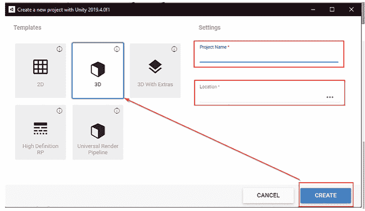
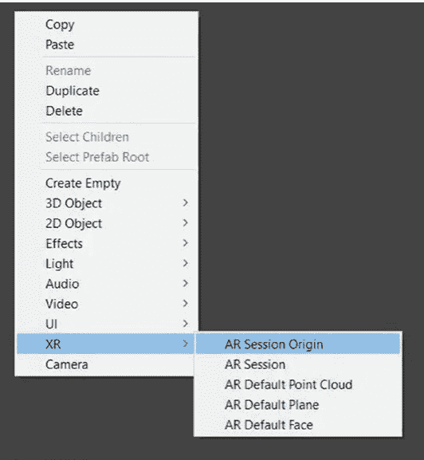
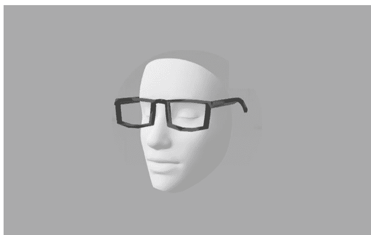
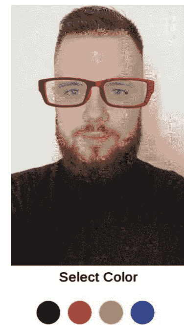
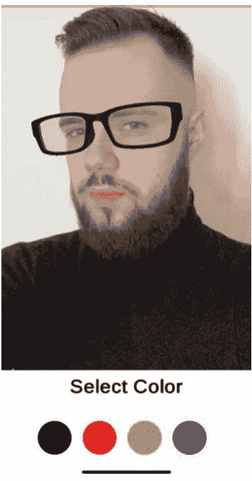

### 第 7 章

### 使用 ARKit 和 OpenCV 的增强现实

ARKit 一直是 Apple 最受欢迎的 iOS 11 功能之一。每天都在开发更多创新的增强现实应用程序。在本项目中，我们将重点介绍如何使用 Apple 的 ARKit 设置您的第一个增强现实项目并在 Unity 中实现它。

#### 为什么使用 OpenCV 而不是 Core ML？

##### 支持多个平台

虽然 Core ML 对于仅限 iOS 11 的 iPhone 应用可能是最佳选择，但每当您想要向后兼容或希望支持多个平台时，您将不得不为每个平台构建自定义方法或使用 OpenCV。

机器学习并非适用于每个问题。虽然 Apple 为对象以及场景检测等项目提供了一些免费开源模型，但计算机视觉领域的范围远大于机器学习，而 OpenCV 是访问这些资源最方便的方式。

#### ARKit 和 OpenCV 集成

通过委托调用，ARSession 允许直接访问当前帧数据。

```
- (void)session:(ARSession *)session didUpdateFrame:(ARFrame *)frame;
```

当新帧可见时，此函数将被调用。我们可以从这里通过帧获取原始数据的 CVPixelBufferRef。虽然帧中的数据以平面 YCbCr 格式给出，但对于我们的目的，我们只需要灰度版本。我们跳过转换阶段并直接捕获 Y 帧，因为我们知道它是 YUV 格式。

我们是这样做的：

```
cv::Mat mat;

CVPixelBufferLockBaseAddress(buffer, 0);

//Get only the data from the plane we're interested in

void *address = CVPixelBufferGetBaseAddressOfPlane(buffer, 0);

int bufferWidth = (int)CVPixelBufferGetWidthOfPlane(buffer,0);

int bufferHeight = (int)CVPixelBufferGetHeightOfPlane(buffer, 0);

int bytePerRow = (int)CVPixelBufferGetBytesPerRowOfPlane(buffer, 0);

mat = cv::Mat(bufferHeight, bufferWidth, CV_8UC1, address, bytePerRow).clone();

//Rotate the frame we receive

cv::Mat rotated;

cv::transpose(mat, rotated);

cv::flip(rotated, rotated,1);
//Do what we want with the frame
//detect faces, track objects ect.

CVPixelBufferUnlockBaseAddress(buffer, 0);
```

我们只需要 Y 帧，正如前面提到的，它保存在第一个平面中。

为此，我们使用平面索引为 0 的 `CVPixelBufferGetBaseAddressOfPlane` 技术，而不是标准的 `CVPixelBufferGet` 方法。

最终，由于我们获得的帧处于横向模式，我们所要做的就是在将其传递给任何 OpenCV 魔法之前旋转它。

逻辑被重用了。

如果您正在制作一个也支持 iOS 10 的增强现实应用，您可以通过更改 AVCaptureVideoDataOutput 的格式以适应 ARKit 来使用前面提到的方法

```
_captureOutputVideo.videoSettings = @{
    (NSString *)kCVPixelBufferPixelFormatTypeKey :
    @(kCVPixelFormatType_420YpCbCr8BiPlanarVideoRange)};
```

并使用 SampleBufferRef 来获取相同的 CVPixelBufferRef。

```
CVImageBufferRef imageBuffer =
CMSampleBufferGetImageBuffer(sampleBuffer);
```

#### 总结

虽然 iOS 11（及以后版本）的安装基数一直在增加，但典型的增强现实应用程序不能仅集成 Apple 最新更新中包含的工具。然而，通过将我们从 ARKit 获得的帧数据与 OpenCV 集成，我们将能够构建看似令人信服的交互，因为它们确实使用 OpenCV 的低级实现和 ARKit 的便捷方法和 API 来增强真实。交互可以是任何内容，从身体跟踪到深度分析（图 7-1）。


图 7-1. iOS 中使用 ARKit 的身体跟踪

#### 先决条件

由于我们为 Apple 生态系统构建，因此我们需要一台 Mac 计算机来开发我们的程序和一台 iOS 设备来运行它们。

#### 硬件

就硬件而言，需要一台兼容 macOS Catalina 的 macOS PC。强大的 Apple A12 Bionic CPU 也需要用于身体监控程序的正常运行。以下 Mac 计算机和 iOS 设备有资格参加此促销活动：

| 计算机 | 移动设备 |
|---|---|
| 12 英寸 MacBook | iPhone XS |
| MacBook Air，2012 及以后 | iPhone XS Max |
| MacBook Pro，2012 及以后 | iPhone XR |
| Mac mini，2012 及以后 | iPad Pro 11 英寸 |
| iMac，2012 及以后 | iPad Pro 12.9 英寸 |
| iMac Pro |  |
| Mac Pro，2013 及以后 |  |

图 7-2. 适用于此促销的 Mac 计算机和 iOS 设备

#### 软件

要在 Mac 上运行演示，您需要安装以下应用程序：

- Unity3D 2019.1.5f1 with iOS build target
- MacOS Catalina 10.15 (beta)
- Xcode 11 (beta)

您的设备上应安装 iOS 13（beta）或 iPadOS 13。正如您将看到的那样，在撰写本文时，大多数程序仍处于测试阶段。请记住，设备可能会变得缓慢或不可靠，因此请采取额外的预防措施以避免丢失重要数据。

#### 分步身体跟踪

让我们开始 ARKit 魔法。在计算机上启动 Unity3D 2019.1 并开始一个新项目（图 7-3）。




#### Figure 7-3. Unity3D 2019

#### Step 1: Set Up the Primary Scenario

Unity3D will begin by creating a blank scene. We must first import the necessary dependencies before adding any visual elements or writing any code. The ARKit toolkit includes skeleton-tracking capability. As a consequence, the ARKit and ARFoundation dependency packages must be imported. Make a new scene using an AR Session and an AR Session Origin object. These objects control the iOS camera while also delivering a plethora of ARKit features.

#### Figure 7-4. Using the Application

Furthermore, create a new C# script and attach it to an empty game object called Human Body Tracking (HumanBodyTracking.cs).

It should be like




#### Figure 7-5. Front End of the Application

#### Step 2: Set Up the Skeleton

We can now begin implementing interactivity that the visual pieces are in place. Add a reference to the ARHumanBodyManager class to the HumanBodyTracking.cs script. The main script that analyzes camera data to detect human bodies is ARHumanBodyManager.

```
[SerializeField] private ARHumanBodyManager humanBodyManager;
```

We will use some simple Unity3D spheres to represent the joints. Each sphere would represent a different type of joint. To modify the joint data frame by frame, add a C# Dictionary class.

```
private Dictionary<JointIndices3D, Transform> bodyJoints;
```

Lastly, add references to the skeleton’s user interface pieces. A sphere object will be used for the joints, and a line object will be used for the bones.

```
[SerializeField] private GameObject jointPrefab;
[SerializeField] private GameObject lineRendererPrefab;

private LineRenderer[] lineRenderers;
private Transform[][] lineRendererTransforms;
```

#### Step 3: Locate the Followed Bodies

It’s the most crucial section of the guide! Body tracking has never been easier or more available, thanks to ARKit. Everything you have to do is subscribe to the “humanBodiesChanged” event using the ARHumanBodyManager object.

```
private void OnEnable()
{
    humanBodyManager.humanBodiesChanged += OnHumanBodiesChanged;
}

private void OnDisable()
{
    humanBodyManager.humanBodiesChanged -= OnHumanBodiesChanged;
}
```

The magic happens in the event handler. The event arguments include information on the tracked bodies. Here’s how you get the bodies:

```
private void OnHumanBodiesChanged(ARHumanBodiesChangedEventArgs eventArgs)
{
    foreach (ARHumanBody humanBody in eventArgs.added)
    {
        UpdateBody(humanBody);
    }

    foreach (ARHumanBody humanBody in eventArgs.updated)
    {
        UpdateBody(humanBody);
    }
}
```

Isn’t it a piece of cake? Now, let’s put it all together and show the skeleton in the Unity user interface that we built in the prior iterations. Notice that ARKit only allows one tracked body as of this writing.

#### Step 4: Show the Skeleton

The lines of code that follow update the joint positions in the camera space. The spheres and lines are overlaid on top of the camera feed from the iOS device.

```
private void UpdateBody(ARHumanBody arBody)
{
    if (jointPrefab == null) return;
    if (arBody == null) return;
    if (arBody.transform == null) return;

    InitializeObjects(arBody.transform);

    NativeArray<XRHumanBodyJoint> joints = arBody.joints;

    foreach (KeyValuePair<JointIndices3D, Transform> item in bodyJoints)
    {
        UpdateJointTransform(item.Value, joints[(int)item.Key]);
    }

    for (int i = 0; i < lineRenderers.Length; i++)
    {
        lineRenderers[i].SetPositions(lineRendererTransforms[i]);
    }
}
```

Apple supports 92 different types of joints (indices). But not many of these types of joints are tracked! The placements of their adjoining joints are used to infer the majority of them. I've chosen 14 joint types for your convenience so that I can make a fair comparison with the Kinect camera.

This is how the appropriate joints are connected and the human bones are formed:

```
private void InitializeObjects(Transform arBodyT)
{
    if (bodyJoints == null)
    {
        bodyJoints = new Dictionary<JointIndices3D, Transform>
        {
            { JointIndices3D.head_joint, Instantiate(jointPrefab, arBodyT).transform },
            { JointIndices3D.neck_l_joint, Instantiate(jointPrefab, arBodyT).transform },
            { JointIndices3D.left_arm_joint, Instantiate(jointPrefab, arBodyT).transform },
            { JointIndices3D.right_arm_joint, Instantiate(jointPrefab, arBodyT).transform },
            { JointIndices3D.left_forearm_joint, Instantiate(jointPrefab, arBodyT).transform },
            { JointIndices3D.right_forearm_joint, Instantiate(jointPrefab, arBodyT).transform },
            { JointIndices3D.left_hand_joint, Instantiate(jointPrefab, arBodyT).transform },
            { JointIndices3D.right_hand_joint, Instantiate(jointPrefab, arBodyT).transform },
            { JointIndices3D.left_upLeg_joint, Instantiate(jointPrefab, arBodyT).transform },
            { JointIndices3D.right_upLeg_joint, Instantiate(jointPrefab, arBodyT).transform },
            { JointIndices3D.left_leg_joint, Instantiate(jointPrefab, arBodyT).transform },
            { JointIndices3D.right_leg_joint, Instantiate(jointPrefab, arBodyT).transform },
            { JointIndices3D.left_foot_joint, Instantiate(jointPrefab, arBodyT).transform },
            { JointIndices3D.right_foot_joint, Instantiate(jointPrefab, arBodyT).transform }
        };

        lineRenderers = new LineRenderer[]
        {
            Instantiate(lineRendererPrefab).GetComponent<LineRenderer>(), // head neck
            Instantiate(lineRendererPrefab).GetComponent<LineRenderer>(), // upper
            Instantiate(lineRendererPrefab).GetComponent<LineRenderer>(), // lower
            Instantiate(lineRendererPrefab).GetComponent<LineRenderer>(), // right
            Instantiate(lineRendererPrefab).GetComponent<LineRenderer>() // left
        };

```

```
lineRendererTransforms = new Transform[][]
{
    new Transform[] { bodyJoints[JointIndices3D.head_joint], bodyJoints[JointIndices3D...] },
    new Transform[] { bodyJoints[JointIndices3D.right_hand_joint], bodyJoints[J...] },
    new Transform[] { bodyJoints[JointIndices3D.right_foot_joint], bodyJoints[J...] },
    new Transform[] { bodyJoints[JointIndices3D.right_arm_joint], bodyJoints[Jc...] },
    new Transform[] { bodyJoints[JointIndices3D.left_arm_joint], bodyJoints[Joi...] }
};

for (int i = 0; i < lineRenderers.Length; i++)
{
    lineRenderers[i].positionCount = lineRendererTransforms[i].Length;
}
}
```

The position and rotation of the joints in 3D space are provided by ARKit! That’s how you update the sphere’s scale, location, and rotation in 2D screen space:

```
private void UpdateJointTransform(Transform jointT, XRHumanBodyJoint bodyJoint)
{
    jointT.localScale = bodyJoint.anchorScale;
    jointT.localRotation = bodyJoint.anchorPose.rotation;
    jointT.localPosition = bodyJoint.anchorPose.position;
}
```

That’s it! Let’s build and test our app on a real iOS device!

#### Step 5: Create and Deploy

Eventually, we must construct and test the project on a real device. We can’t test our code on macOS because ARKit is only available on iOS and iPadOS. Select File ► Build Settings in Unity. Click the Build button after selecting the iOS build target. You must choose a place for the produced project to be saved. Patiently wait till Unity’s build process is completed. An Xcode project will be created by Unity (.xcodeproj). Using Xcode 11 beta, open the project. You’ll get an error and your project won’t run properly if you use an older version of Xcode. Give your iOS development credentials, connect your iOS 13 device, and then click the Run button once the project has been launched. The project will be deployed to the device in this manner.

When you’re done, point the camera toward a person to see the 3D overlay appear on top of the tracked body!


#### ARKit 3 中的面部追踪


图 7-6. ARKit 3 中的面部追踪

##### 用户等级：基础

自增强现实引入行业以来，它为我们提供了开发面向移动技术用户的互动且令人兴奋的机会的能力。AR 可以在多种方式上为我们节省时间，包括查看理想的沙发在我们公寓中的外观、判断所选的油漆颜色是否适合室内装饰，甚至即时试戴新妆容。

面部追踪是 iPhone X 及更新机型上 ARKit 3 的强大功能。我们可以用合适的组件快速创建用于试戴珠宝、口红或眼镜的应用程序。在本示例中，我们将集中于最后一种选择：创建一个用于试戴眼镜的 AR 应用，并带有简单的镜框颜色切换。

#### ARKit 3 的设置和规范

由于 ARKit 3 的 AR 面部追踪需要 iPhone X 中引入的 A11 Bionic 芯片，因此我们需要该系统或更新的系统来使我们的示例正常工作。我们需要 Unity 2019.1 或更高版本来构建我们的项目

以利用 ARKit 3 的所有功能，例如多面部追踪。在构建项目后，我们需要安装所需的 ARKit 包。自 2019 年 7 月起，ARKit for Unity 已包含在 ARFoundation 捆绑包中，因此我们需要从 Window 菜单打开 Package Manager 并安装以下包：

- 1. ARFoundation
- 2. AR Subsystems
- 3. AR Face Tracking 用于所有必需的面部追踪脚本
- 4. XR Legacy Input Helpers 用于 Tracked Pose Driver 脚本

安装后，将项目移动到 iOS 平台并设置播放器配置是个好主意。在 Player Settings 窗口中将 Target minimum iOS Version 设置为 11.0，因为 ARKit 3.0 需要最低 SDK 版本 11.0。

在同一窗口的 Architecture 下拉菜单中选择 ARM64，因为 ARKit 仅支持 64 位设备。你还需要指定 Camera Usage Description，即当应用请求使用系统摄像头的批准时出现的脚本。你可以将文本更改为你想要的任何内容，例如“ARKit 3 Face Detection。”

#### 增强现实中的会话对象

项目正确设置后，我们就可以开始创建必需的 AR Session 对象。首先，我们在场景中创建一个 ARSession GameObject 并向其添加两个脚本：一个 AR Session 脚本和一个 AR Input Manager 脚本。

然后，我们使用 AR Session Origin 脚本和 AR Face Manager 创建一个 AR Session Origin 对象。由于 ARKit 很少使用设备的正面摄像头——它仅在面部追踪/识别场景中使用——

Face Manager 脚本至关重要。AR Session Origin 中有一个用于 Camera 脚本的空字段。

让我们只需将 Main Camera 对象放置在 AR Session Origin 对象内部，然后在 AR Session Origin 脚本中引用它。需要三个脚本：

- Pose Driver with Tracking（在 Tracked Pose Driver 中，将 Pose Source 更改为 Color Camera 并启用 Use Relative Transform）
- AR Camera History
- AR Camera Manager

你是否发现 AR Session Origin 脚本中的 AR Face Manager 中有一个用于 Face Prefab 的空字段？那是我们将用来想象我们的基于 AR Face 的眼镜的预制件。

#### 预制件 AR 眼镜

我们需要创建一个新的 GameObject，我们将其命名为 GlassesPrefab。我们对预制件需要做的第一件事是为其附加两个组件。第一个是 ARFace 变量，它将为我们提供已识别的面部点数据。第二个是 ARGlassesController，这是一个脚本，将负责根据 ARFace 更新的数据定位眼镜。



##### 图 7-7. ARFace 应用

之后，我们需要在预制件内构建一个 GameObject，它将附加到我们的眼镜网格上，我们将使用 ARGlassesController 对其进行操作。预制件的最终形式应类似于前一图像所示。被操作的网格必须作为子对象保存在我们的预制件内。ARFaceManager 控制预制件的位置，而 ARFace 顶点是与检测到的面部相关的特征的局部点。

#### ARGlassesController 类

```
using UnityEngine;
using UnityEngine.XR.ARFoundation;
using UnityEngine.XR.ARSubsystems;

[RequireComponent(typeof(ARFace))]
public class ARGlassesController : MonoBehaviour
{
    [field: SerializeField]
    public static ARGlassesController Instance { get; private set; }

    [field: SerializeField]
    public Transform ModelTransform { get; private set; }

    [field: SerializeField]
    public Material FrameMaterial { get; private set; }

    private ARFace ARFaceComponent { get; set; }

    private const string MATERIAL_COLOR_SETTING_NAME = "_Color";
    private const int AR_GLASSES_PLACEMENT_VERTICE_INDEX = 16;

    public void ChangeFrameColor (Color color)
    {
        if (FrameMaterial != null)
        {
            FrameMaterial.SetColor(MATERIAL_COLOR_SETTING_NAME, color)
        }
    }

    protected virtual void Awake ()
    {
        if (Instance == null)
        {
            Instance = this;
        }
    }
```

```
ARFaceComponent = GetComponent();
}

protected virtual void OnDestroy ()
{
    Instance = null;
}

protected virtual void OnEnable ()
{
    ARFaceComponent.updated += TryToUpdateModelStatus;
    ARSession.stateChanged += TryToUpdateModelStatus;
    TryToUpdateModelStatus();
}

protected virtual void OnDisable ()
{
    ARFaceComponent.updated -= TryToUpdateModelStatus;
    ARSession.stateChanged -= TryToUpdateModelStatus;
}

private void TryToUpdateModelStatus (ARFaceUpdatedEventArgs eventArgs)
{
    TryToUpdateModelStatus();
}

private void TryToUpdateModelStatus (ARSessionStateChangedEventArgs eventArg
{
    TryToUpdateModelStatus();
}
```

```
protected virtual void OnDisable ()
{
    ARFaceComponent.updated -= TryToUpdateModelStatus;
    ARSession.stateChanged -= TryToUpdateModelStatus;
}

private void TryToUpdateModelStatus (ARFaceUpdatedEventArgs eventArgs)
{
    TryToUpdateModelStatus();
}

private void TryToUpdateModelStatus (ARSessionStateChangedEventArgs eventAr;
{
    TryToUpdateModelStatus();
}

private void TryToUpdateModelStatus ()
{
    bool isFaceVisible = GetFaceVisibility();
    ModelTransform.gameObject.SetActive(isFaceVisible);

    if (isFaceVisible == true)
    {
        ModelTransform.localPosition = ARFaceComponent.vertices[AR_(
    }
}

private bool GetFaceVisibility()
{
    return enabled == true && ARFaceComponent.trackingState != Tracking!
}
```

#### ARKit 3 中的 ARFace 数据和面部检测

过程很简单：当 ARFaceManager 检测到面部时，它会发送新的 ARFace 数据。由于我们的控制器链接到 ARFace 的 updated 事件，脚本会在检测到新的面部点坐标集时更新眼镜的位置。

顶点数组索引通常适用于人类面部上的相同特征点；唯一根据个人面部特征而变化的是整体位置和面部网格。我们将眼镜与顶点索引 16 对齐，得到了以下结果。



#### 选择颜色



#### 颜色选择器

我们喜欢使用连接到简单 UI 中按钮的 ColorController 脚本来调整镜框颜色，因此我们将 ARGlassesController 制作成单例，以便 ColorController 在场景中可用时可以访问它。

```
using UnityEngine;

public class ColorController : MonoBehaviour
{
    [field: SerializeField]
    public Color Color { get; private set; }

    public void SetFrameColor()
    {
        if (ARGlassesController.Instance != null)
        {
            ARGlassesController.Instance.ChangeFrameColor(Color);
        }
    }
}
```

SetFrameColor 函数链接到场景中每个颜色按钮的 Click 事件，使我们能够在点击按钮时将镜框颜色更改为控制器中指定的颜色。

#### 总结

前面的说明涵盖了增强现实面部追踪应用的制作。这只是增强现实和 ARKit 中众多可能应用的一个实例。ARKit 面部追踪 API 可用于构建更复杂的应用程序，而不仅仅是时尚和化妆品，还可用于工业和企业应用，例如员工识别和用户身份验证。今天，苹果为我们提供了复杂且多功能的工具，可以赋能数千个应用程序。鉴于未来公司将更多投资于增强现实硬件和软件，我们很高兴看到该技术在不久的将来如何发展，以及苹果在不久的将来在硬件和软件方面将提供什么。


