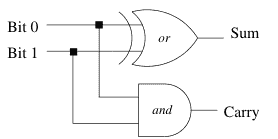
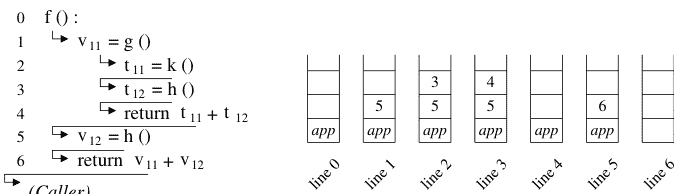
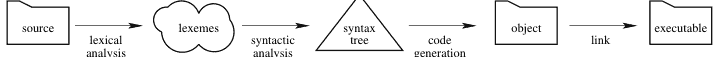

## 1. 从硬件到软件

本章首先对所有计算机中存在的组件进行简要概述，从大型机到平板电脑、智能手机和智能对象中的处理芯片，中间经过台式机或笔记本电脑。在此基于硬件的呈现之上，我们将接着给出计算机执行的操作的更抽象描述，从而对“程序”和“执行”这两个术语给出统一定义，超越所谓电子设备的各种特性。

### 1.1. 计算机：低层视图

计算机科学是计算机对信息进行理性处理的科学。计算机有能力根据给定的指令执行各种进程。每个 _信息_ 项都是知识元素，可以使用信号传输，并使用一组符号序列结合一组用于解码它们的规则进行编码，即从符号序列重建信号。计算机使用二进制编码，涉及两个符号；这些符号可称为“真”/“假”、“0”/“1”或“高”/“低”；这些术语可以互换，都代表数字电子电路中电势的两个稳定状态。

#### 1.1.1. 信息处理

从示意图上看，计算机由以下三类组件组成：

- 内存：存储数据（信息）和可执行代码（即所谓的冯·诺依曼架构）；
- 一个或多个微处理器，称为 CPU（中央处理单元），通过应用基本操作来处理信息；
- 外围设备：这些设备使 CPU/内存组合与外部之间能够交换信息。

计算机的信息处理——换句话说，程序的执行——可以总结为三个步骤的序列：获取数据、计算结果并返回它们。每个基本处理操作对应于 CPU 逻辑电路的配置，称为逻辑函数。如果该函数的结果仅取决于输入，并且计算中不涉及“时间”概念，则该函数称为组合逻辑函数；否则，称为时序逻辑函数。

例如，如图 1.1 所示的二进制半加器是一个电路，用于计算两个二进制数字（输入）的和，以及可能的进位值。它因此实现了一个组合逻辑函数。



图 1.1. 二进制半加器

组合函数的基本特征是，对于相同的输入，函数始终产生相同的输出，无论情况如何。时序逻辑函数则不然。

例如，一个计算其输入变化次数的逻辑函数依赖于“时间”概念（变化随时间发生），并且在两个输入之间需要持久状态来记录计数器的先前值。该状态保存在内存中。对于时序函数，相同的输入值可能导致不同的输出值，因为每个输出不仅取决于输入，还取决于读取新输入时内存的状态。

#### 1.1.2. 内存

计算机使用内存来保存程序和数据。内存组件中使用了几种不同的技术，简化的呈现如下：

- RAM（随机存取存储器）：RAM 内存既可读又可写。RAM 组件通常速度快，但也是易失性的：如果电力失效，其内容将丢失；
- ROM（只读存储器）：存储在 ROM 中的信息在制造时写入，并且是只读的。ROM 比 RAM 慢，但是非易失性的，例如，刻录的 DVD；
- EPROM（可擦除可编程只读存储器）：该内存是非易失性的，但可以使用特定设备写入，通过紫外线照射，或通过修改电源电压等方式。它比 RAM 慢，无论是读取还是写入。EPROM 可以被视为相当于可重写 DVD。

计算机使用几种技术的内存组件。随着访问速度的提高，存储容量会减小，因为快速访问内存成本更高。通常区分四种不同类型的内存：

- 大容量存储以太字节为单位，由机械磁盘（访问时间约为 10 ms）或——越来越多地——固态硬盘（SSD）块组成。这些块使用 EEPROM 变体（电可擦除），访问时间约为 0.1–0.3 ms，称为闪存。大容量存储是非易失性的，主要用于文件系统；
- RAM，位于微处理器外部。最近的家用计算机和智能手机通常具有较大的 RAM 容量（以千兆字节为单位）。嵌入式系统或消费者开发电子板的 RAM 容量可能要低得多。访问时间约为 40–50 ns；
- 缓存通常包含在现代机器的 CPU 中。这是一个小容量的 RAM 内存（几千字节或兆字节），访问时间约为 5–10 ns。通常有多个缓存级别，访问时间随大小减小。缓存用于保存经常使用和/或连续的数据和/或指令，通过在本地保留信息来减少访问较慢 RAM 的需求。缓存管理很复杂：需要确保主内存和缓存中的数据一致性，不同 CPU 或不同内核（同一 CPU 中的完整独立处理单元）之间的一致性，以及决定丢弃哪些数据以释放空间等；
- 寄存器是速度最快的内存单元，位于微处理器本身的中心。微处理器包含有限数量（几十个）的这些存储区，由 CPU 指令直接使用。访问时间约为一个处理器周期，即约 1 ns。

#### 1.1.3. CPU

顾名思义，CPU 是负责通过执行基本指令来处理信息的单元，这些指令大致可分为五类：

- 数据传输指令（在寄存器之间或内存与寄存器之间复制）；


- 算术指令（两个寄存器中包含的两个整数值相加，乘以常数等。）；
- 逻辑指令（按位与/或/非，移位，旋转等。）；
- 分支操作（条件分支、无条件分支、子例程调用等。）；
- 其他指令（停止处理器、重置、中断请求、测试并置、比较并交换等。）。

指令以特定于每个微处理器的格式编码为二进制字。高级编程语言中的几行程序被翻译成几十甚至几百条基本指令，手动编写这些指令既困难又容易出错且耗时。图1.2对此进行了说明，其中展示了用C编写的“Hello World！”程序，旁边是其对应的x86-64指令，由gcc编译器生成。

```
#include <stdio.h>
int main () {
 printf ("Hello world!\n") ;
 return (0) ;
 }

.section __TEXT
.globl _main
.align 4, 0x90
_main:
.cfi_startproc
## BB#0:
pushq %rbp
Ltmp0:
.cfi_def_cfa_offset 16
Ltmp1:
.cfi_offset %rbp, -16
movq %rsp, %rbp
Ltmp2:
.cfi_def_cfa_register %rbp
subq $16, %rsp
leaq L_.str(%rip), %rdi
movb $0, -4(%rbp)
movb $0, %al
callq _printf
xorl %ecx, %ecx
movl %eax, -8(%rbp)
movl %ecx, %eax
addq $16, %rsp
popq %rbp
retq
.cfi_endproc
.section __TEXT
L_.str:
.asciz "Hello world!\n"
```

## 图1.2. C和x86-64指令中的“Hello world！”

简单来说，微处理器分为两部分：控制单元，负责解码和排序要执行的指令；以及一个或多个算术逻辑单元（ALU），负责执行指令规定的操作。CPU永久地运行一个三阶段循环：

- 1) 从内存中获取下一条要执行的指令：每个微处理器都包含一个特殊寄存器，即程序计数器（PC），它记录这条指令的位置（地址）。然后PC递增，即将获取的指令的大小加到其中；
- 2) 解码获取的指令；
- 3) 执行这条指令。

然而，下一条指令并不总是位于当前指令旁边。考虑示例1.1中用C编写的函数min，它返回其两个参数中较小的一个。

## 示例1.1

```
int min (int a, int b) {
if (a < b) return (a) ;
else return (b) ;
}
```

该函数可以直观而天真地翻译成基本指令，首先将a和b放入寄存器，然后比较它们：

```
min:
load	a, reg0
load	b, reg1
compare	reg0, reg1
```

根据测试结果（真或假），会考虑不同的后续执行流程。执行继续使用其中一种后续流程的指令：因此我们有两条可能的控制路径。在这种情况下，必须使用条件跳转指令，在需要时修改PC值，以选择两条可能路径中的第一条指令。

```
branchgt	a_gt_b
load	reg0, reg2
jump	end
a_gt_b:
load	reg1, reg2
end:
return	reg2
```

branchgt指令将标签a_gt_b处指令的位置加载到PC中。如果compare指令的结果是reg0 > reg1，则下一条指令是该地址处的指令：load reg1, reg2。否则，下一条指令是branchgt之后的指令：load reg0, reg2。随后是无条件跳转指令jump，它能无条件修改PC，将其加载为end标签的地址。因此，无论比较结果如何，执行都以指令`return reg2`结束。

条件分支需要使用特定的存储器来确定先前指令的执行是否满足某些条件（溢出、正结果、零结果、优越性等）。每个CPU都包含一个专用寄存器，即状态寄存器（SR），其中每一位都用于指示这些条件之一。执行大多数指令可能会修改寄存器中的所有或某些位。条件指令（包括跳转和更“异国情调”的变体）在执行时使用相应的位值。某些ARM®架构[ARM 10]甚至允许所有指令本质上都是条件性的。

每个程序都由函数组成，这些函数可以在程序的不同点调用，并且这些调用可以嵌套。当调用函数时，必须记录函数执行完成后执行应恢复的位置——即_返回地址_。考虑一个由函数g() = k() + h()和f() = g() + h()组成的程序，其中包含多个函数调用，有些是嵌套的。

```
g () =
  t11 = k ()
  t12 = h ()
  return t11 + t12

f () =
  v11 = g ()
  v12 = h ()
  return v11 + v12
```

单个寄存器不足以记录不同调用的返回地址。从g调用k之后，必须调用h来计算t12。但这次g的调用是由f完成的，因此其在f中的返回地址也应被记录，以便后续计算v12。需要记录的返回地址数量随嵌套调用数量的增加而增加，并在退出这些调用时减少，这非常自然地暗示将这些地址保存在栈中。图1.3展示了连续函数调用期间栈结构的演变，证明了记录多个返回地址的必要性。栈的状态在每个执行步骤中都会显示，即在执行程序中的某一行时。

一个专用寄存器，栈指针（SP），始终包含栈中下一个空闲槽的地址（或者，最后一个已用槽的地址）。因此，在嵌套调用的情况下，返回地址被保存到SP指示的地址中，并且SP按该地址的大小递增。当函数返回时，PC会加载从栈中保存的地址，并且SP相应地递减。



## 图1.3. 函数调用和返回地址

总之，微处理器的内部状态由其通用寄存器、程序计数器、状态寄存器和栈指针组成。请注意，不过，这是一种高度简化的观点。存在许多不同种类的微处理器，具有不同的内部架构和/或指令集（例如，有些不具备整数除法指令）。因此，直接使用某个微处理器的指令集编写的程序无法在另一种微处理器型号上执行，需要重写。用给定微处理器的汇编语言编写的程序的可移植性几乎为零。高级语言通过提供与目标微处理器无关的语法结构来解决这个问题。编译器或解释器必须将这些结构翻译成微处理器使用的语言。

#### 1.1.4. 外围设备

如1.1.3节所见，处理器执行获取、解码和执行指令的持续循环。计算使用存储在内存中的数据进行，无论是由程序本身还是由输入/输出机制完成。计算结果也存储在内存中，并可以使用此输入/输出机制返回给用户。

任何可编程系统的兴趣点本质上取决于输入/输出能力，系统通过该能力对外部环境做出反应并可能作用于该环境。即使是汽车工厂中一遍又一遍重复相同动作的装配机器人，也必须对来自环境的数据输入做出反应。例如，抓握机构的压力在抓住螺栓后必须停止增加，而完成此操作所需的时间会根据螺栓的确切位置而有所不同。

输入/输出系统使用外围设备运行，外围设备是可能是电子的、机械的或两者结合的辅助设备。这些设备允许微处理器获取外部信息，并将信息传输到外部。计算机


鼠标、屏幕和键盘是与台式计算机一起使用的外围设备，但电机、模拟/数字采集卡等其他元素也是外围设备。

如果存在外围设备，微处理器需要将部分处理时间用于数据采集和计算结果的传输。与外围设备的这种交互可以直接集成到程序中。但在这种情况下，程序必须包含对输入外围设备的定期检查，以查看是否有新信息可用。在每个程序中包含此类监控在技术上是困难的（如果不是不可能的话）。此外，如果没有新数据可用，定期检查外围设备是对时间和精力的浪费。最后，无法保证信息会在检查时刻准确到达，因为数据可能是异步发送的。

该问题可以通过依赖硬件来指示新外部事件的发生，而不是使用软件来检查这些事件来避免。*中断*机制用于中断当前代码的执行并启动与外部事件相关的中断处理程序。该处理程序是一段代码，不会由正在执行的程序显式调用；它位于微处理器已知的地址。由于任何程序都可能在任何点被中断，因此在处理中断之前必须保存处理器状态，尤其是寄存器。用于处理中断的代码确实会使用寄存器并修改 SR、SP 和 PC。因此，必须恢复寄存器的先前值，以便恢复中断代码的执行。这种上下文保存部分由硬件执行，部分由软件执行。

### 1.2. 计算机：高层视图

1.1 节中介绍的冯·诺依曼机器的低层视角，很好地概述了计算机的组件和程序执行，而无需深入电子元件的操作细节。然而，在日常编程活动的背景下，这种视角并不特别有帮助。二进制代码，甚至汇编代码编写的程序难以编写，因为它们需要考虑执行的每一个细节；它们本质上冗长，难以审阅、理解和调试。第一批“高级”编程语言在第一批计算机出现后不久就出现了。这些语言为内存中的某些值和地址赋予名称，提供一组可以拆分为低层机器指令的指令。换句话说，编程语言提供了计算机的抽象视角，使用户在编写程序时可以忽略低层细节。图 1.2 中的“hello world”程序清楚地展示了 C 语言与 X86 汇编语言相比的抽象能力。

#### 1.2.1. 建模计算

任何程序只是在其自身编程语言中对一系列计算（包括读写操作）的描述，而这些是计算机能够执行的唯一操作。对计算机的抽象视角需要对计算概念的抽象视角——我们称之为*模型*。该主题早在计算机出现之前很久，即19世纪末，就由逻辑学家、数学家和哲学家首次探讨，他们引入了关于可计算性理论的多种不同方法。

图灵机 [TUR 95] 是1936年引入的一种计算数学模型。该机在分为单元的无限内存磁带上运行，并有三条指令：将磁带向左或向右移动一个单元，在单元中写入或读取符号，或比较两个单元的内容。已正式证明，任何具有赋值、条件指令和while循环的“命令式”编程语言，都具有与该图灵机相同的表达能力。

在20世纪期间，引入了若干其他算法计算概念模型，并已正式证明它们与图灵机等效。一个显著的例子是克莱尼的递归理论 [KLE 52]，它是“纯函数”语言的基础，基于（潜在）递归函数的概念；因此，这些语言也具有与图灵机相同的表达能力。纯函数语言和命令式语言在高级编程的历史上并行发展，导致了不同的编程风格。

#### 1.2.2. 高级语言

广义上说，函数式程序的执行是进行一系列导致结果的函数调用，中间值完全存储在寄存器中。命令式程序的执行是对由标识符命名的内存单元进行一系列修改，单元中的值在执行期间计算。最广泛使用的高级语言同时包含函数式和命令式特性，以及各种可能性（模块、对象特性等），用于将源代码分割成可重用的片段。

无论使用何种编程风格，任何用高级语言编写的程序都需要被翻译成二进制语言才能执行。这些翻译要么在每次执行程序时执行——在这种情况下，翻译程序称为*解释器*——要么只执行一次并存储生成的二进制代码——在这种情况下，翻译器称为*编译器*。

正如我们所见，高级语言有助于算法的编码。它们便于审阅程序的源代码，因为与汇编代码中的相同算法相比，文本更加简洁。然而，这并不意味着用户能更好地理解程序的工作方式。编写程序时，对所使用的构造（换句话说，它们的*语义*，即它们做什么和意味着什么）有精确的了解，对于理解源代码至关重要。错误并不总是算法编码错误的结果，而且通常是由对语言元素的错误解释引起的。例如，C语言中的递增运算符`++`存在两种形式（`i++`或`++i`），其理解并不像看起来那么简单。例如，以下程序：

```
#include <stdio.h>
int main () {
int i = 0 ;
printf ("%d\n", i++) ;
return (0) ;
}
```

将打印0，但如果将`i++`替换为`++i`，同一程序将打印1。

所有高级语言都共有若干概念：值命名、命名空间组织、显式内存管理等。然而，这些概念可以使用不同的语法结构来表达。语言语义领域涵盖一组逻辑-数学理论，用于描述这些概念及其属性。构建程序的语义允许正式验证程序是否具备所有所需属性。

#### 1.2.3. 从源代码到可执行程序

从程序源代码到其执行的过程是一个多步骤过程。这些步骤在不同语言中可能有所不同。在本节中，我们将概述分析和转换源代码涉及的主要步骤，适用于大多数编程语言。

程序的源代码由一个或多个文本文件组成。确实，为了便于软件架构，大多数语言允许将源代码拆分为多个文件，称为*编译单元*。每个文件在最终阶段之前单独处理，在该阶段中，处理结果将合并为一个单一的*可执行文件*。

##### 1.2.3.1. 词法分析

词法分析是翻译的第一阶段：它将确实是源文件的字符序列转换为一系列*单词*，并将每个分配到一个类别。注释通常在此阶段被删除。因此，在以下被假设用C语言编写的文本中


/* This is a comment. */
if [x == 3 int +) cos ($v

词法分析将识别关键字 if、左括号、标识符 x、运算符 ==、整数常量 3、类型标识符 int 等。C 语言中的单词不能包含字符 $，因此在遇到 $v 时会高亮显示词法错误。

词法分析可视为一种“拼写检查”形式，其中每个被识别的单词都会被分配到一个类别（关键字、常量、标识符）。这些单词被称为 token。

##### 1.2.3.2. 语法分析

每种语言都遵循语法。例如，在英语中，如果一个句子包含主语、动词和补语，并且顺序易于理解，则通常被认为构成正确。编程语言也不例外：语法分析验证源文件中的短语是否符合其语言的语法。例如，在 C 语言中，关键字 if 后必须跟一个带括号的表达式，一条语句必须以分号结束，等等。很明显，上面在词法分析语境下给出的源文本不符合 C 语言的语法。

从技术角度看，语法分析器负责源文件的完整语法分析。每当需要一个 token 来推进已分析源码的进度时，它就会调用词法分析器。因此，语法分析是一种语法验证形式，同时它还通过一种数据结构（通常是一棵树，称为抽象语法树（AST））构建源文件的表示。该数据结构将被编译的所有后续阶段使用，一直到由解释器执行或创建可执行文件为止。

##### 1.2.3.3. 语义分析

编译的前两个分析阶段仅关注源码的文本结构。它们不关注程序的含义，即其语义。通过语法分析阶段的源文本并不总是有意义。短语“大海吃了一只可派生的兔子”在语法上是正确的，但显然是胡言乱语。

最著名的语义分析是类型分析，它禁止组合性质不兼容的元素。因此，在上一阶段中，“可派生的”可能适用于函数，但绝不适用于“兔子”。

语义分析不仅限于一种类型分析形式，但它们都会根据所选语言的语义来解释程序的结构。语义分析可用于消除会导致执行错误的程序。它们还可以对程序代码应用某些转换，以生成可执行文件（依赖分析、闭包消除等）。这些语义分析可以在源代码处理的后续遍中执行，甚至在下一节描述的代码生成阶段之后执行。

##### 1.2.3.4. 代码解释/生成

一旦创建了抽象语法树（或其派生树），就有两种选择。要么通过编程语言提供的 *解释器* 直接执行该树，要么使用 AST 生成 *目标代码* 文件，旨在创建可以独立运行的可执行文件。我们先关注第二种方法。解释机制将在后面讨论。

编译使用从源文件生成的 AST 来生成一系列指令，这些指令将由 CPU 或虚拟机（VM）执行。如果执行这一系列指令的结果符合程序的语义，则编译是正确的。

优化阶段可能在目标代码生成期间或之后进行，旨在提高其紧凑性或执行速度。现代编译器实现了一系列优化，其研究超出了本书的范围。某些优化是“通用”的，而其他优化可能特定于生成代码所针对的 CPU。

编译器生成的目标代码可以是直接编码指令的二进制代码，也可以是汇编代码形式的源文本。在后一种情况下，必须调用一个称为 *汇编器* 的程序，将这种低级源代码转换为二进制代码。一般来说，汇编器只是以机械方式将助记符编写的指令（mov、add、jmp 等）转换为二进制表示。然而，某些更复杂的汇编器也可能在此级别执行优化操作。

将助记符代码汇编为二进制代码是一个非常简单的操作，不会改变程序的结构。目标 CPU 的参考手册为每条指令提供了相应二进制字中各位的含义。例如，MIPS32® 架构 [MIP 13] 的参考手册描述了指令 ADD rd , rs , rt（对寄存器产生的效果为 rd ← rs + rt）的 32 位二进制格式如下：

| 位权重 | 31 | 26 | 25 | 21 | 20 | 16 | 15 | 11 | 10 | 0 |
|---|---|---|---|---|---|---|---|---|---|---|
| 位值 | 000000 | num.rs | num.rt | num.rd | | | | | | 000000100000 |

图 1.4. 在 MIPS32® 中对 ADD 指令进行编码

三个 6 位的组保留用于编码寄存器编号；该字中的其他位是固定的，用于编码指令。汇编器的任务是根据源代码中遇到的指令生成此类位模式。

##### 1.2.3.5. 链接

一个程序可能由多个分别编译的源文件组成。一旦每个源文件的目标代码被生成，所有这些代码都必须收集到一个可执行文件中。每个目标文件都包括“空洞”，指示在生成该目标代码时未知的信息。了解在哪里可以找到这段缺失代码非常重要，例如在调用在不同编译单元中定义的函数时，或在当前单元之外定义的变量的位置。

链接器必须收集所有目标文件并填充所有空洞。显然，要使一组目标文件生成可执行文件，所有空洞都必须填充；因此，源代码中调用的每个函数的代码都必须可用。链接过程还必须集成所需代码，如果这些代码来自某些库（无论是标准语言库还是第三方库）。还有一个最终问题需要回答，即关于执行应从何处开始。在某些语言（如 C、C++ 和 Java）中，源代码必须包含一个且仅一个特殊函数，通常名为 main，用于启动执行。在其他语言（如 Python 和 OCaml）中，定义按照它们出现的顺序执行，该顺序由链接过程中的文件顺序定义。因此，“执行”函数的定义并不会调用该函数：相反，该函数的“值”会被创建并存储，以便在以后调用函数时使用。这意味着程序员必须在源文件中插入对他们认为是执行“起点”的函数的调用。此调用通常是链接器处理的最后一个源文件的最后一条指令。

源代码编译中涉及的不同转换阶段的简化图示如图 1.5 所示。



**图 1.5. 编译过程**

##### 1.2.3.6. 解释和虚拟机

如我们所见，非正式地说，解释器直接从 AST “执行” 程序。此外，代码生成过程可以为虚拟机生成代码。实际上，解释器很少直接在树上工作；编译到虚拟机通常作为中间阶段进行。虚拟机（VM）可以被视为一种伪微处理器，具有一个或多个栈、寄存器和相当高级别的指令。VM 的代码通常被称为字节码。在这种情况下，编译不会生成由 CPU 直接执行的文件。执行由虚拟机解释器执行，这是由编程语言环境提供的程序。因此，解释和编译之间的区别并不明显。

使用 VM 有几个优点：编译器不再需要考虑 CPU 的特定性，代码通常更加紧凑且可移植性更高。只要计算机上有虚拟机解释器的可执行文件，就可以为该计算机生成二进制文件。这种方法的缺点是，以这种方式获得的程序通常比编译为“原生”机器码的程序要慢。


