## 3. 函数式特性的语义

在本章中，我们考察构成函数式语言内核的结构的语义。我们将介绍几种表达这些结构含义的方法，以及描述其语义的不同方式。此处研究的函数式语言对应于 ML 风格语言的函数式内核。关于语言函数式特性的语义，已有许多其他出版的介绍，例如 [DOW 11, FRI 01]。

### 3.1. 句法方面

#### 3.1.1. 函数式内核的语法

此处研究的语言，记为 Exp₂，只包含一个句法范畴：表达式。其抽象语法从变量（符号）集合 X、常量值集合 K = Z ∪ IB（其中 Z 是相对整数集合，IB 是布尔值集合）以及一组原始算子定义。

表 3.1 展示了九条构造规则，这些规则允许对集合 Exp₂ 进行归纳定义。因此，该语言中的表达式可以是：

- 1) 表示 K 中某个值的常量，该值可以是相对整数、*真* 或 *假*；
- 2) 标识符，这里称为变量，以保持与表达式通常术语的一致性；
- 3) 对一个表达式应用一元算子；
- 4) 对两个表达式应用二元算子，使用中缀表示法；
- 5) 条件表达式；
- 6) 表达式 let x = e1 in e2，它声明变量 x（称为表达式 e2 中的局部变量），并由表达式 e1 对其进行定义（换句话说，e1 的值在表达式 e2 中被命名为 x）；
- 7) 变量 x 的函数，其主体是表达式 e，通过在 e 中对 x 进行抽象获得。变量 x 通常称为函数的参数（或形式参数）；
- 8) 递归函数，由标识符 f 指定，其参数是 x，主体是表达式 e，该表达式可能包含对 f 的递归调用；
- 9) 对表达式 e1 与表达式 e2 进行应用（表达式 e2 称为 e1 的参数或实际参数）。

| e ::= v | 常量 (v in K) | (1) |
| --- | --- | --- |
| | x | 变量 (x in X) | (2) |
| | op e1 | 原始一元算子的应用 (op in {not}) | (3) |
| | e1 op e2 | 原始二元算子的应用 (op in {+, -, *, /, and, or, =, <=}) | (4) |
| | if e1 then e2 else e3 | 条件表达式 | (5) |
| | let x = e1 in e2 | 局部绑定 (x in X) | (6) |
| | fun x -> e | 函数定义 (x in X) | (7) |
| | rec f x = e | 递归函数定义 (x, f in X) | (8) |
| | (e1 e2) | 函数应用 | (9) |

表 3.1. 表达式语言 Exp2 的语法

#### 3.1.2. 抽象语法树

该语言中的每个表达式都可以用一棵树表示，即抽象语法树（AST），其中每个节点都标记了所应用构造规则的标签。例如，表达式：

```
fun x1 -> x1 + x2
```

是通过对表达式 x1 + x2 中的 x1 进行抽象得到的，该表达式以此方式构造的函数作为主体。同样，表达式 efact：

```
rec fact n = if n <= 1 then 1 else (fact (n - 1)) * n
```

通过对函数主体中的 n 进行抽象，递归定义了计算 n! 的函数。

其 AST 为：

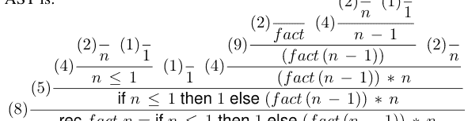

程序中引入的所有算子（用 Python 和 OCaml 编写）的名称都以 2 结尾，以引用 Exp2 这个名称。常量集合 K 包含相对整数和布尔值，可以表示如下：

```python
class CInt2:
    def __init__(self,cst_int):
        self.cst_int = cst_int

class CBool2:
    def __init__(self,cst_bool):
        self.cst_bool = cst_bool
```
```ocaml
type const2 = CInt2 of int | CBool2 of bool
```

让我们定义 Exp2 表达式中使用的算子：

```python
class Not2:
    pass
class Plus2:
    pass
class Minus2:
    pass
class Mult2:
    pass
class Div2:
    pass
class And2:
    pass
class Or2:
    pass
class Eq2:
    pass
class Leq2:
    pass
```
```ocaml
type unary_op2 = Not2
type bin_op2 = Plus2 | Minus2 | Mult2 | Div2 | And2 | Or2 | Eq2 | Leq2
```

```python
class B_Op2:
    def __init__(self,op,exp1,exp2):
        self.op = op
        self.exp1 = exp1
        self.exp2 = exp2

class If2:
    def __init__(self,exp1,exp2,exp3):
        self.exp1 = exp1
        self.exp2 = exp2
        self.exp3 = exp3

class Rec2:
    def __init__(self,nom,param,corps):
        self.nom = nom
        self.param = param
        self.corps = corps

class App2:
    def __init__(self,exp1,exp2):
        self.exp1 = exp1
        self.exp2 = exp2
```

```ocaml
type 'a exp2 =
  | Cste2 of const2                | Var2 of 'a
  | U_Op2 of unary_op2 * 'a exp2   | B_Op2 of bin_op2 * 'a exp2 * 'a exp2
  | If2 of 'a exp2 * 'a exp2 * 'a exp2 | Letin2 of 'a * 'a exp2 * 'a exp2
  | Fun2 of 'a * 'a exp2           | Rec2 of 'a * 'a * 'a exp2
  | App2 of 'a exp2 * 'a exp2
```

例如，表达式 fun \(x_1 \mapsto x_1 + x_2\)、let \(x_1 = x_1 + x_2\) in \(x_1 + x_3\) 以及在 [3.2] 中定义的表达式 \(e_{fact}\) 可以写成：

```
ex_exp1 = Fun2("x1",B_Op2(Plus2(),Var2("x1"),Var2("x2")))
ex_exp2 = Letin2("x1",B_Op2(Plus2()),Var2("x1"),Var2("x2")),
        B_Op2(Plus2(),Var2("x1"),Var2("x3")))

a_fact = \
    Rec2("fact","n",
        If2(B_Op2(Leq2()),Var2("n"),Cste2(CInt2(1))),
            Cste2(CInt2(1)),
            B_Op2(Mult2(),App2(Var2("fact"),
                                B_Op2(Minus2(),Var2("n"),Cste2(CInt2(1)))),
                        Var2("n"))))
```

```
let ex_exp1 = Fun2 ("x1", B_Op2 (Plus2, Var2 "x1", Var2 "x2"))
val ex_exp1 : string exp2
let ex_exp2 =
    Letin2 ("x1", B_Op2 (Plus2, Var2 "x1", Var2 "x2"),
            B_Op2 (Plus2, Var2 "x1", Var2 "x3"))
val ex_exp2 : string exp2
let ex_fact =
    ("fact", "n",
    If2 (B_Op2 (Leq2, Var2 "n", Cste2 (CInt2 1)),
        Cste2 (CInt2 1),
        B_Op2 (Mult2,
            App2 (Var2 "fact", B_Op2 (Minus2, Var2 "n", Cste2 (CInt2 1))),
            Var2 "n"))))
val a_fact : string exp2
```


#### 3.1.3. 通过归纳对表达式进行推理

集合 Exp₂ 以归纳方式定义：每个表达式 \(e \in \text{Exp}_2\) 都是通过有限次应用 Exp₂ 的构造规则获得的。这意味着，可以通过应用 Box 3.1 中所示的结构归纳方案，对 Exp₂ 的元素证明属性 P：我们只需针对每个构造项证明属性 P，并假设 P 对该构造项的每个组件都成立。这种归纳推理在本书余下部分中将多次使用。

```
if ∀v ∈ K P(v)
and ∀x ∈ X P(x)
and ∀e₁ ∈ Exp₂ P(e₁) ⇒ P(op e₁)
and ∀e₁, e₂ ∈ Exp₂ (P(e₁) and P(e₂)) ⇒ P(e₁ op e₂)
and ∀e₁, e₂, e₃ ∈ Exp₂ (P(e₁) and P(e₂) and P(e₃)) ⇒ P(if e₁ then e₂ else e₃)
and ∀x ∈ X ∀e₁, e₂ ∈ Exp₂ (P(e₁) and P(e₂)) ⇒ P(let x = e₁ in e₂)
and ∀x ∈ X ∀e ∈ Exp₂ P(e) ⇒ P(fun x ↦ e)
and ∀x, f ∈ X ∀e ∈ Exp₂ P(e) ⇒ P(rec f x = e)
and ∀e₁, e₂ ∈ Exp₂ (P(e₁) and P(e₂)) ⇒ P((e₁ e₂))
then ∀e ∈ Exp₂ P(e)
```

### Box 3.1. 针对 e ∈ Exp₂ 的结构归纳方案

#### 3.1.4. 变量声明、绑定变量和自由变量

同一个标识符可以在同一个表达式中使用多次，每次使用都称为标识符的一次出现。同一个标识符的不同出现并不都起相同的作用。在构造项 (6) let x = e₁ in e₂ 中，标识符 x 被声明，并在环境中绑定到 e₁ 的值，该值将用于求值 e₂。构造项 (7) 在表达式 e 中抽象了变量 x。该参数 x 在表达式 fun x ↦ e 中被认为是绑定（或抽象）的。它可以重命名而不修改函数的定义；因此，它有时被称为哑变量。例如，在 fun x ↦ x + y 中将 x 替换为 z 得到 fun z ↦ z + y，两者是等价的。显然，我们不能将 x 替换为 y，因为 y 已经出现在函数体 x + y 中。在构造项 (8) 中，标识符 f 被声明，变量 x 在表达式 e 中被绑定。例如，表达式是：

```
let x₁ = 25 in let f = fun x₂ ↦ x₃ + 3 in (f 7) + x₄ [3.3]
```

包含四个 $x$ 的出现，索引从 1 到 4。出现 2 在 $f$ 的函数体中抽象了出现 3。这些哑变量 $x$ 的出现可以重命名。出现 1 声明了标识符 $x$，用于为出现 4 赋值。

当表达式中变量的出现既未被声明也未被绑定时，可以说该出现在该表达式中是 *自由* 的。对于 $e \in \mathbf{Exp}_2$，变量集合 $\mathcal{F}(e)$（即在 $e$ 中至少有一次自由出现的变量）以归纳方式定义为：

```
\mathcal{F} : \mathbf{Exp}_2 \to \wp(\mathbf{X})
\mathcal{F}(v) = \emptyset \quad (v \in \mathbf{K})
\mathcal{F}(x) = \{x\} \quad (x \in \mathbf{X})
\mathcal{F}(\mathbf{op} \ e_1) = \mathcal{F}(e_1)
\mathcal{F}(e_1 \mathbf{op} \ e_2) = \mathcal{F}(e_1) \cup \mathcal{F}(e_2)
\mathcal{F}(\mathbf{if} \ e_1 \ \mathbf{then} \ e_2 \ \mathbf{else} \ e_3) = \mathcal{F}(e_1) \cup \mathcal{F}(e_2) \cup \mathcal{F}(e_3)
\mathcal{F}(\mathbf{let} \ x = e_1 \ \mathbf{in} \ e_2) = \mathcal{F}(e_1) \cup (\mathcal{F}(e_2) \setminus \{x\})
\mathcal{F}(\mathbf{fun} \ x \mapsto e) = \mathcal{F}(e) \setminus \{x\}
\mathcal{F}(\mathbf{rec} \ f \ x = e) = \mathcal{F}(e) \setminus \{x, f\}
\mathcal{F}((e_1 e_2)) = \mathcal{F}(e_1) \cup \mathcal{F}(e_2)
```

不包含自由变量的表达式称为 *闭合*。对于函数 $\mathbf{fun}\ x \mapsto e$，如果它是常量函数（$\mathcal{F}(e) = \emptyset$ 且 $x$ 不出现在 $e$ 中）或者 $\mathcal{F}(e) = \{x\}$（即函数体 $e$ 除了 $x$ 外没有自由变量），则称其为闭合。例如，函数 $\mathbf{fun}\ x \mapsto x + 1$ 是闭合的。$\mathbf{fun}\ x_1 \mapsto \mathbf{fun}\ x_2 \mapsto x_1 + x_2$ 也是闭合的，但 $\mathbf{fun}\ x_2 \mapsto x_1 + x_2$ 不是，因为在此例中 $x_1$ 是自由变量：在切换到子表达式时，这一概念并不稳定（表达式是闭合的并不必然意味着其子表达式也是闭合的）。

示例 3.1. 对于在 [3.2] 中定义的表达式 $e_{fact}$ 和在 [3.3] 中定义的表达式 $e_{25}$，有 $\mathcal{F}(e_{fact}) = \mathcal{F}(e_{25}) = \emptyset$。在表达式 $e_{25}$ 中，$x$ 的出现 3 在子表达式 $x + 3$ 中是自由的，但在表达式 $\mathbf{fun}\ x \mapsto x + 3$ 中变为绑定。以下两个示例不是闭合表达式：

```
\mathcal{F}(\mathbf{fun}\ x_1 \mapsto x_1 + x_2) = \{x_2\}
\mathcal{F}(\mathbf{let}\ x_1 = x_1 + x_2\ \mathbf{in}\ x_1 + x_3) = \{x_1, x_2, x_3\}
```

直观地说，求值一个表达式需要知道其变量的值。表达式中自由变量的值在求值环境中查找。例如，要对表达式 $x + 1$ 求值，需要知道 $x$ 的值。相比之下，表达式 $\mathbf{let}\ x = 3\ \mathbf{in}\ 2 * x$ 是闭合的，可以在不涉及其所含（绑定）变量“外部”信息的情况下求值。

**Exp₂** 中表达式的自由变量集合可以递归定义如下：

```python
def free_var2(e):
    if isinstance(e,Cste2): return emptyset
    if isinstance(e,Var2): return [e.symb]
    if isinstance(e,U_Op2): return free_var2(e.exp1)
    if isinstance(e,B_Op2): return union(free_var2(e.exp1),free_var2(e.exp2))
    if isinstance(e,IF2):
        return union(union(free_var2(e.exp1),free_var2(e.exp2)),
                     free_var2(e.exp3))
    if isinstance(e,Letin2):
        return union(free_var2(e.exp1),
                     diff_set(free_var2(e.exp2),[e.symb]))
    if isinstance(e,Fun2): return diff_set(free_var2(e.corps),[e.param])
    if isinstance(e,Rec2): return diff_set(free_var2(e.corps),[e.param,e.nom])
    if isinstance(e,App2): return union(free_var2(e.exp1),free_var2(e.exp2))
    raise ValueError
```

```ocaml
let rec free_var2 e = match e with
  | Cste2 -> emptyset
  | Var2 x -> [x]
  | U_Op2 (op, e1) -> free_var2 e1
  | B_Op2 (op, e1, e2) -> union (free_var2 e1) (free_var2 e2)
  | IF2 (e1, e2, e3) ->
      union (union (free_var2 e1) (free_var2 e2)) (free_var2 e3)
  | Letin2 (x, e1, e2) -> union (free_var2 e1) (diff_set (free_var2 e2) [x])
  | Fun2 (x, e1) -> diff_set (free_var2 e1) [x]
  | Rec2 (f, x, e1) -> diff_set (free_var2 e1) [x; f]
  | App2 (e1, e2) -> union (free_var2 e1) (free_var2 e2)
val free_var2 : 'a exp2 -> 'a list
```

考虑示例 3.1 中的表达式，得到：

```python
>>> free_var2(ex_exp1)
['x2']
>>> free_var2(ex_exp2)
['x2', 'x1', 'x3']
>>> free_var2(a_fact)
[]
```

```ocaml
# free_var2_ex_exp1 ;;
- : string list = ["x2"]
# free_var2 ex_exp2 ;;
- : string list = ["x1"; "x2"; "x3"]
# free_var2 a_fact ;;
- : string list = []
```

### 3.2. 执行语义：求值函数

编程语言的执行语义（或 *动态语义*）描述了该语言中所有语法正确程序的执行。在本节中，我们研究“纯”函数式语言 **Exp$_2$**。由于该语言不提供对内存的操作，只需要求值环境的概念。请注意，与内存（内容可修改）不同，执行环境（也称为求值环境）只能通过将标识符绑定到新值来扩展；该标识符的任何现有绑定都会被新绑定简单地遮蔽。

**Exp$_2$** 中的程序是一个表达式。其执行包括对表达式求值，即计算其值。为此，我们首先定义一个求值函数，如第 2 章所示：

```
$[[ \_ ]]_{\_} : \mathbf{E} \times \mathbf{Exp}_2 \rightarrow \mathbb{V}$
```

值 $[[e]]_{Env}$ 是表达式 $e$ 在环境 $Env$ 中求值的结果。在这里，环境 $Env \in \mathbf{E}$ 是绑定 $(x, v) \in \mathbf{X} \times \mathbf{V}$ 的列表。集合 $\mathbf{V}$（在第 3.2.2 节中定义）是与变量关联的值的集合，而 $\mathbb{V}$ 是 $\mathbf{V}$ 与一组用于指示求值失败的特殊值的并集。

#### 3.2.1. 求值错误

我们选择区分在对表达式 $e \in \mathbf{Exp}_2$ 求值期间产生的三种不同类型的错误。

- 1) 表达式 $e$ 中自由变量出现的值必须在当前执行环境中找到。如果该变量不属于环境的域，则对 $e$ 的求值返回一个标记为 Err$_U$ 的错误（U 表示未绑定）。

- 2) 算术错误，例如溢出或数学上未定义的值，标记为 Err$_E$（E 表示异常，即处理器用于指示“异常”情况的机制，这种情况使得无法继续正常执行）。出于我们的目的，我们将考虑限制在除以零的情况。

- 3) **Exp$_2$** 中的表达式表示整数、布尔值或函数。因此，可能尝试将布尔值与整数相加（3 + true），或者将整数应用于表达式（8(x + 1)）。此类表达式在语法上是正确的，但不能表示 V 中的值。在我们的模型中，对此类表达式的求值会导致一种称为类型错误 Err$_T$ 的错误。类型错误在执行前的检测将在第 5 章中介绍。请注意，某些语言为我们认为在 **Exp$_2$** 中无效的表达式赋予语义。例如，在 Python（v3.6）中，表达式 3 + True 返回值 4。


此处考虑的错误集合为 IE = {ErrU, ErrE, ErrT}。这一选择有些任意：既可以只使用一种错误，也可以，反之，对不同的错误原因做出更精细的区分。这可以通过修改错误处理规则来完成。

在 Exp2 中，某些表达式 e 的求值可能不会终止，在这种情况下，值 [[e]]Env 未定义：不会返回任何值——甚至错误值也不会返回。求值函数 [[_]]_ 因此是一个偏函数。非终止的正式处理超出了本书的范围。

#### 3.2.2. 值

集合 V 包含整数、布尔值以及称为闭包的函数值，将在 3.2.4 节中介绍。对于非递归函数 (fun x -> e)，闭包是一个三元组 (x, e, Env)，由函数参数名 (x)、函数体 (e) 以及求值函数定义的环境 (Env) 组成。对于递归函数 (rec f x = e)，闭包是一个四元组 <f, x, e, Env>，由函数名 (f)、函数参数名 (x)、函数体 (e) 以及求值函数定义的环境 (Env) 组成。因此，闭包集合 IF 定义为：

IF = (X x Exp2 x E) U (X x X x Exp2 x E)

绑定到环境中标识符的每个值都是集合 V = Z U IB U IF 中的一个元素。集合 V = V U IE 包含表达式求值的所有可能结果。

集合 IE、V 和 V 可定义如下：

```python
class E_Typ2:
    pass
class E_Exec2:
    pass
class E_Undef2:
    pass
class VInt2:
    def __init__(self,val_int):
        self.val_int = val_int
class VBool2:
    def __init__(self,val_bool):
        self.val_bool = val_bool
class Clos2:
    def __init__(self,param,corps,envdef):
        self.param = param
        self.corps = corps
        self.envdef = envdef
class ClosRec2:
    def __init__(self,nomf,param,corps,envdef):
        self.nomf = nomf
        self.param = param
        self.corps = corps
        self.envdef = envdef
class Val2:
    def __init__(self,val):
        self.val = val
class Err2:
    def __init__(self,err):
        self.err = err
```

```ocaml
type erreur2 = E_Typ2 | E_Exec2 | E_Undef2
type 'a valeur2 =
| VInt2 of int | VBool2 of bool
| Clos2 of 'a * 'a exp2 * ('a * 'a valeur2) list
| ClosRec2 of 'a * 'a * 'a exp2 * ('a * 'a valeur2) list
type 'a val_err2 = Val2 of 'a valeur2 | Err2 of erreur2
```

| | 真 | 假 | b ∈ V \ IB |
|---|---|---|---|
| not_v | 假 | 真 | Err_T |

| and_v | 真 | 假 | b2 ∈ V \ IB |
|---|---|---|---|
| 真 | 真 | 假 | Err_T |
| 假 | 假 | 假 | Err_T |
| b1 ∈ V \ IB | Err_T | Err_T | Err_T |

| or_v | 真 | 假 | b2 ∈ V \ IB |
|---|---|---|---|
| 真 | 真 | 真 | Err_T |
| 假 | 真 | 假 | Err_T |
| b1 ∈ V \ IB | Err_T | Err_T | Err_T |

| | v2 ∈ Z | v2 ∈ V \ Z |
|---|---|---|
| v1 ∈ Z | v1 + v2 | Err_T |
| v1 ∈ V \ Z | Err_T | Err_T |

| | v2 ∈ Z | v2 ∈ V \ Z |
|---|---|---|
| v1 ∈ Z | v1 / v2 如果 v2 ≠ 0 | Err_T |
| | 如果 v2 = 0 则 Err_E | |
| v1 ∈ V \ Z | Err_T | Err_T |

| =v | v2 ∈ Z | v2 ∈ IB | v2 ∈ IF |
|---|---|---|---|
| v1 ∈ Z | 当 v1 = v2 时为真 | Err_T | Err_T |
| | 当 v1 ≠ v2 时为假 | | |
| v1 ∈ IB | Err_T | 当 v1 = v2 时为真 | Err_T |
| | | 当 v1 ≠ v2 时为假 | |
| v1 ∈ IF | Err_T | Err_T | Err_T |

| <=v | v2 ∈ Z | v2 ∉ Z |
|---|---|---|
| v1 ∈ Z | 当 v1 ≤ v2 时为真 | Err_T |
| | 当 v1 > v2 时为假 | |
| v1 ∉ Z | Err_T | Err_T |

#### 3.2.3. 运算符的解释

Exp2 中的原始运算符是用于从现有表达式构造新表达式的符号。要对表达式求值，必须确定每个符号 op 表示 V 上值的哪个操作 opv；换句话说，必须对这些符号进行解释。Exp2 中使用的运算符的解释在表 3.2 中定义。

原始运算符的解释定义如下：

```python
def apply2_unary_op(op,v):
    if isinstance(op,Not2):
        if isinstance(v,VBool2): return Val2(VBool2(not v.val_bool))
        return Err2(E_Typ2)
    raise ValueError

def apply2_binary_op(op,v1,v2):
    if isinstance(op,Plus2):
        if isinstance(v1,VInt2) and isinstance(v2,VInt2):
            return Val2(VInt2(v1.val_int + v2.val_int))
        return Err2(E_Typ2)
    if isinstance(op,Minus2):
        if isinstance(v1,VInt2) and isinstance(v2,VInt2):
            return Val2(VInt2(v1.val_int - v2.val_int))
        return Err2(E_Typ2)
    if isinstance(op,Mult2):
        if isinstance(v1,VInt2) and isinstance(v2,VInt2):
            return Val2(VInt2(v1.val_int * v2.val_int))
        return Err2(E_Typ2)
    if isinstance(op,Div2):
        if isinstance(v1,VInt2) and isinstance(v2,VInt2):
            if v2.val_int == 0: return Err2(E_Exec2)
            return Val2(VInt2(v1.val_int / v2.val_int))
        return Err2(E_Typ2)
    if isinstance(op,And2):
        if isinstance(v1,VBool2) and isinstance(v2,VBool2):
            return Val2(VBool2(v1.val_bool and v2.val_bool))
        return Err2(E_Typ2)
    if isinstance(op,Or2):
        if isinstance(v1,VBool2) and isinstance(v2,VBool2):
            return Val2(VBool2(v1.val_bool or v2.val_bool))
        return Err2(E_Typ2)
    if isinstance(op,Eq2):
        if isinstance(v1,VBool2) and isinstance(v2,VBool2):
            return Val2(VBool2(v1.val_bool == v2.val_bool))
        if isinstance(v1,VInt2) and isinstance(v2,VInt2):
            return Val2(VBool2(v1.val_int == v2.val_int))
        return Err2(E_Typ2)
    if isinstance(op,Leq2):
        if isinstance(v1,VInt2) and isinstance(v2,VInt2):
            return Val2(VBool2(v1.val_int <= v2.val_int))
        return Err2(E_Typ2)
    raise ValueError
```

```ocaml
let apply2_unary_op op v = match op with
| Not2 -> (match v with
| VBool2 b -> Val2 (VBool2 (not b))
| _ -> Err2 E_Typ2)
val apply2_unary_op : unary_op -> 'a valeur2 -> 'b val_err2

let apply2_binary_op op v1 v2 = match op with
| Plus2 -> (match (v1, v2) with
| (VInt2 n1, VInt2 n2) -> Val2 (VInt2 (n1 + n2))
| _ -> Err2 E_Typ2)
| Minus2 -> (match (v1, v2) with
| (VInt2 n1, VInt2 n2) -> Val2 (VInt2 (n1 - n2))
| _ -> Err2 E_Typ2)
| Mult2 -> (match (v1, v2) with
| (VInt2 n1, VInt2 n2) -> Val2 (VInt2 (n1 * n2))
| _ -> Err2 E_Typ2)
| Div2 -> (match (v1, v2) with
| (VInt2 n1, VInt2 n2) ->
    if n2 = 0 then Err2 E_Exec2 else Val2 (VInt2 (n1 / n2))
| _ -> Err2 E_Typ2)
| And2 -> (match (v1, v2) with
| (VBool2 b1, VBool2 b2) -> Val2 (VBool2 (b1 && b2))
| _ -> Err2 E_Typ2)
| Or2 -> (match (v1, v2) with
| (VBool2 b1, VBool2 b2) -> Val2 (VBool2(b1 || b2))
| _ -> Err2 E_Typ2)
| Eq2 -> (match (v1, v2) with
| (VInt2 n1, VInt2 n2) -> Val2 (VBool2 (n1 = n2))
| (VBool2 b1, VBool2 b2) -> Val2 (VBool2 (b1 = b2))
| _ -> Err2 E_Typ2)
| Leq2 -> (match (v1, v2) with
| (VInt2 n1, VInt2 n2) -> Val2 (VBool2 (n1 <= n2))
| _ -> Err2 E_Typ2)
val apply2_binary_op : bin_op -> 'a valeur2 -> 'b valeur2 -> 'c val_err2
```

#### 3.2.4. 闭包

语言 Exp2 允许我们定义函数并将其应用于实际参数（也称为实参）。设 f 为具有形式参数 x 和函数体 e_f 的函数。要在当前环境 Env_a 中对 (f e) 求值，必须在此环境中对 e 求值以得到值 v。然后必须在一个环境 Env 中对函数体 e_f 求值，其中 x 绑定到 v：这种绑定允许用实际参数替换形式参数。那么这个环境 Env 是什么呢？设 f 为表达式 fun x1 -> x1 + x2：对 (f 2) 求值会创建绑定 (x1,2)，其余就是找到 x2 的值——但在哪个环境中呢？有两种可能：这个值要么由对应用 (f 2) 求值的环境 Env_a 提供，要么由定义 f 的环境提供。在第一种情况中，我们称之为动态作用域，而在第二种情况中，我们称之为静态作用域或词法作用域。对于 Exp2，我们采用词法作用域：因此闭包记录了函数定义所在的环境。这样一来，函数体中自由变量的值（形式参数除外）就是函数定义阶段的值，即这些变量在函数定义环境中绑定的值。

编译器通常使用词法作用域，而解释器则常选择动态作用域。编译器提供闭包概念的优化实现，避免代码重复。在使用词法作用域的语言中，函数体仅在该函数应用于实际参数时才求值。然而，这并不意味着会保留该函数体的源代码；函数体被翻译成目标代码，其中包含记录定义环境所需的指令（至少包括该环境中函数自由变量的绑定），以及将形式参数绑定到调用提供的实际参数值的指令。将函数应用于实际参数的执行会导致在正确的环境中执行其函数体的目标代码。

#### 3.2.5. 表达式的求值

表 3.3 通过归纳法定义了 Exp2 中表达式的求值函数，遵循抽象语法规则。让我们来看看这个表中的各行。常量的值是常量本身。在环境中绑定变量会提供该变量的值。要对形式为 op e 或 e1 op e2 的表达式求值，必须对子表达式 e 或 e1 和 e2 求值。条件表达式 if e1 then e2 else e3 的求值取决于 e1 求值返回的结果。要对 let x = e1 in e2 求值，先对 e1 求值得到 v，然后用绑定 (x, v) 扩展当前环境，以便对 e2 求值。函数的值是一个闭包。如果该函数是递归的，则闭包还将包含函数 f 的名称。为了对应用 (e1 e2) 求值，必须首先在当前环境 Env 中对 e1 和 e2 求值。然后在闭包中包含的环境 Env_f（并通过绑定 (x, v) 扩展）中对函数体求值。对于递归函数 f，将函数名 f 添加到闭包意味着我们可以在 f 绑定到该闭包的环境中对其函数体 e_f 求值。构造递归函数 f 的闭包的另一种方法（在 3.3.3 节中使用）是扩展 f 的定义环境，以包含 f 与其自身闭包的绑定，从而可以求值递归调用：

[[rec f x = e]]Env = F   with   F = <x, e, (f, F) ⊕ Env>


这两种方法是等价的。

| e | [[e]]_Env | |
|---|---|---|
| v | v | (v ∈ K) |
| x | Env(x) | 如果 x ∈ dom(Env) (x ∈ X) |
| x | Err_U | 如果 x ∉ dom(Env) |
| op e1 | op_V [[e1]]_Env | 如果 [[e1]]_Env ∈ V (op ∈ {not}) |
| op e1 | [[e1]]_Env | 如果 [[e1]]_Env ∈ IE |
| e1 op e2 | [[e1]]_Env op_V [[e2]]_Env | (op ∈ {+, -, *, /, and, or, =, ≤}) 如果 [[e1]]_Env ∈ V 且 [[e2]]_Env ∈ V |
| e1 op e2 | [[e1]]_Env | 如果 [[e1]]_Env ∈ IE |
| e1 op e2 | [[e2]]_Env | 如果 [[e1]]_Env ∈ V 且 [[e2]]_Env ∈ IE |
| if e1 then e2 else e3 | [[e2]]_Env | 如果 [[e1]]_Env = true |
| if e1 then e2 else e3 | [[e3]]_Env | 如果 [[e1]]_Env = false |
| if e1 then e2 else e3 | Err_T | 如果 [[e1]]_Env ∈ V \ IB |
| if e1 then e2 else e3 | [[e1]]_Env | 如果 [[e1]]_Env ∈ IE |
| let x = e1 in e2 | [[e2]]_(x,v)⊕Env | 如果 [[e1]]_Env = v ∈ V |
| let x = e1 in e2 | [[e1]]_Env | 如果 [[e1]]_Env ∈ IE |
| fun x ↦ e | <x, e, Env> | |
| rec f x = e | <f, x, e, Env> | |
| (e1 e2) | [[ef]]_(x,v)⊕Env_f | 如果 [[e1]]_Env = <x, ef, Env_f> 且 [[e2]]_Env = v ∈ V |
| (e1 e2) | [[ef]]_(f,f,x,ef,Env_f))⊕(x,v)⊕Env_f | 如果 [[e1]]_Env = <f, x, ef, Env_f> 且 [[e2]]_Env = v ∈ V |
| (e1 e2) | [[e2]]_Env | 如果 [[e1]]_Env ∈ F 且 [[e2]]_Env ∈ IE |
| (e1 e2) | Err_T | 如果 [[e1]]_Env ∉ F |

### 表 3.3. Exp2 中表达式的求值

注.— 与第 2 章中介绍的语言 Def1 不同，Exp2 不提供将绑定添加到当前环境所需的 let x = e; 构造。但是，let x = e1 in e2 构造使得可以模拟它。要在环境 [(x1, v1), (x2, v2), · · · , (xn, vn)] 中求值表达式 e，我们只需考虑以下表达式：

```
let x1 = v1 in
let x2 = v2 in
...
let xn = vn in e
```

示例 3.2.– [3.3] 中定义的表达式求值如下：

```
[[let x = 25 in let f = fun x ↦ x + 3 in (f 7) + x]]Env0
= [[let f = fun x ↦ x + 3 in (f 7) + x]]Env1
= [[(f 7) + x]]Env2 = [[(f 7)]]Env2 + [[x]]Env2 = [[x + 3]](x,7)⊕Env1 + 25
= 7 + 3 + 25 = 35
```

其中：

```
ENV1 = (x, 25) ⊕ ENV0 since [[25]]Env0 = 25
ENV2 = (f, ⟨x, x + 3, ENV1⟩) ⊕ ENV1 since [[fun x ↦ x + 3]]Env1 = ⟨x, x + 3, ENV1⟩
```

请注意，变量 x 的每个出现都以适应其含义的方式进行处理。

示例 3.3.– 表达式 (efact 3) 的求值过程如下，其中 efact 是 [3.2] 中定义的表达式：

```
[[((rec fact n = if n ≤ 1 then 1 else (fact (n - 1)) * n) 3)]]Env0
efact
= [[if n ≤ 1 then 1 else (fact (n - 1)) * n]]Env1
(since [[efact]]Env0 = Ffact and [[3]]Env0 = 3)
= [[(fact (n - 1)) * n]]Env1
(since [[n ≤ 1]]Env1 = false since [[n]]Env1 = 3)
= [[(fact (n - 1))]]Env1 * [[n]]Env1
= [[if n ≤ 1 then 1 else (fact (n - 1)) * n]]Env2 * [[n]]Env1
(since [[fact]]Env1 = Ffact and [[n - 1]]Env1 = [[n]]Env1 - 1 = 3 - 1 = 2)
= [[(fact (n - 1)) * n]]Env2 * [[n]]Env1
(since [[n ≤ 1]]Env2 = false since [[n]]Env2 = 2)
= [[(fact (n - 1))]]Env2 * [[n]]Env2 * [[n]]Env1
= [[if n ≤ 1 then 1 else (fact (n - 1)) * n]]Env3 * [[n]]Env2 * [[n]]Env1
(since [[fact]]Env2 = Ffact and [[n - 1]]Env2 = [[n]]Env2 - 1 = 2 - 1 = 1)
= [[1]]Env3 * [[n]]Env2 * [[n]]Env1
(since [[n ≤ 1]]Env3 = true since [[n]]Env3 = 1)
= 1 * 2 * 3 = 6
```

其中：

```
Ffact = ⟨fact, n, if n ≤ 1 then 1 else (fact (n - 1)) * n, ENV0⟩
ENV1 = (fact, Ffact) ⊕ (n, 3) ⊕ ENV0
ENV2 = (fact, Ffact) ⊕ (n, 2) ⊕ ENV0
ENV3 = (fact, Ffact) ⊕ (n, 1) ⊕ ENV0
```

请注意，每次递归调用都在闭包 Ffact 中包含的环境 ENV0 上求值，并将 n 绑定到其当前值。

表 3.3 中所示 **Exp**$_2$ 表达式的求值函数可直接定义如下：

```python
def eval2(env,e):
    if isinstance(e,Cste2):
        if isinstance(e.cste,CInt2): return Val2(VInt2(e.cste.cst_int))
        if isinstance(e.cste,VBool2): return Val2(VBool2(e.cste.cst_bool))
    if isinstance(e,Var2):
        x = valeur_de(env,e.symb)
        if x is None: return Err2(E_Undef2)
        return Val2(x)
    if isinstance(e,U_Op2):
        a = eval2(env,e.exp1)
        if isinstance(a,Val2): return apply2_unary_op(e.op,a.val)
        return a
    if isinstance(e,B_Op2):
        a1 = eval2(env,e.exp1)
        if isinstance(a1,Val2):
            a2 = eval2(env,e.exp2)
            if isinstance(a2,Val2):
                return apply2_binary_op(e.op,a1.val,a2.val)
            return a2
        return a1
    if isinstance(e,If2):
        a1 = eval2(env,e.exp1)
        if isinstance(a1,Val2):
            if isinstance(a1.val,VBool2):
                if a1.val.val_bool == True: return eval2(env,e.exp2)
                return eval2(env,e.exp3)
        return Err2(E_Type2)
        return a1
    if isinstance(e,Letin2):
        a1 = eval2(env,e.exp1)
        if isinstance(a1,Val2):
            ne = ajout_liaison_env(env,e.symb,a1.val)
            return eval2(ne,e.exp2)
        return a1
    if isinstance(e,Fun2): return Val2(Clos2(e.param,e.corps,env))
    if isinstance(e,Rec2):
        return Val2(ClosRec2(e.nom,e.param,e.corps,env))
    if isinstance(e,App2):
        a1 = eval2(env,e.exp1)
        if isinstance(a1,Val2):
            if isinstance(a1.val,Clos2):
                a2 = eval2(env,e.exp2)
                if isinstance(a2,Val2):
                    ne = ajout_liaison_env(a1.val.envdef,a1.val.param,a2.val)
                    return eval2(ne,a1.val.corps)
                return a2
            if isinstance(a1.val,ClosRec2):
                a2 = eval2(env,e.exp2)
                if isinstance(a2, Val2):
                    ne = ajout_liaison_env(ajout_liaison_env(a1.val.envdef,
                        a1.val.nomf,
                        a1.val.param, a2.val),
                    return eval2(ne, a1.val.corps)
                return a2
            return Err2(E_Typ2)
        return a1
raise ValueError
```

```ocaml
let rec eval2 env e = match e with
| Cste2 (CInt2 n) -> Val2 (VInt2 n)
| Cste2 (CBool2 n) -> Val2 (VBool2 n)
| Var2 x -> (match valeur_de_env x with
| Some v -> Val2 v | None -> Err2 E_Undef2)
| U_Op2 (op, e1)-> (match eval2 env e1 with
| Val2 v -> apply2_unary_op op v | z -> z)
| B_Op2 (op, e1, e2) -> (match eval2 env e1 with
| Val2 v1 -> (match eval2 env e2 with
| Val2 v2 -> apply2_binary_op op v1 v2 | z -> z)
| z -> z)
| If2 (e1, e2, e3) -> (match eval2 env e1 with
| Val2 (VBool2 true) -> eval2 env e2
| Val2 (VBool2 false) -> eval2 env e3
| Val2 x -> Err2 E_Typ2
| z -> z)
| Letin2 (x, e1, e2) -> (match eval2 env e1 with
| Val2 v -> eval2 (ajout_liaison_env x v) e2 | z -> z)
| Fun2 (x, e1) -> Val2 (Clos2 (x, e1, env))
| Rec2 (f, x, e1) -> Val2 (ClosRec2 (f, x, e1, env))
| App2 (e1, e2) -> (match eval2 env e1 with
| Val2 (Clos2 (pf, cf, ef)) -> (match eval2 env e2 with
| Val2 v -> eval2 (ajout_liaison_env ef pf v) cf | z -> z)
| Val2 (ClosRec2 (nf, pf, cf, ef)) -> (match eval2 env e2 with
| Val2 v ->
eval2 (ajout_liaison_env
(ajout_liaison_env
ef nf (ClosRec2(nf,pf,cf,ef))) pf v) cf
| z -> z)
| _ -> Err2 E_Typ2)
val eval2 : (’a * ’a valeur2) list -> ’a exp2 -> ’a val_err2
```

示例 3.2 和 3.3 中表达式的求值可通过以下方式得到：

```python
e25 = Letin2("x",Cste2(CInt2(25)),
       Letin2("f",Fun2("x",B_Op2(Plus2(),Var2("x"),Cste2(CInt2(3)))),
              B_Op2(Plus2(),App2(Var2("f"),Cste2(CInt2(7))),Var2("x"))))
>>> (eval2([],e25)).val.val_int
35
>>> (eval2([],App2(a_fact,Cste2(CInt2(3))))).val.val_int
6
```

```ocaml
let e25 =
    Letin2 ("x", Cste2 (CInt2 25),
            Letin2 ("f", Fun2 ("x", B_Op2 (Plus2, Var2 "x", Cste2 (CInt2 3))),
                    B_Op2 (Plus2, App2 (Var2 "f", Cste2 (CInt2 7)), Var2 "x")))
val e25 : string val_err2
# (eval2 [] e25);;
- : string val_err2 = Val2 (VInt2 35)
# (eval2 [] (App2(a_fact,Cste2(CInt2(3)))));;
- : string val_err2 = Val2 (VInt2 6)
```

##### 3.2.5.1. 子表达式求值顺序

表达式的子表达式求值顺序会影响最终求值的结果。表 3.3 中定义的求值函数任意确定了 e1 op e2 子表达式的求值顺序：我们选择先求值 e1，再求值 e2。如果求值 e1 触发错误，则不会求值 e2。因此，数学上交换的二元运算符的实现失去了这一属性。例如，如果变量 x 不属于环境 Env 的定义域，则 [[(3 / 0) + x]]Env ≠ [[x + (3 / 0)]]Env。确实，我们有：

[[(3 / 0) + x]]Env = [[3 / 0]]Env = ErrTE [[x + (3 / 0)]]Env = [[x]]Env = ErrTU

同理，一些所谓的“惰性”布尔运算符也是如此。例如，在求值 e1 和 e2 时，如果 e1 求值为 false，则可能在不求值 e2 的情况下返回结果 false（因为无论何种情况合取值都为 false）；因此，e2 中的执行错误不会被检测到。

另一方面，在应用 (e1 e2) 的求值中，未指定 e1 和 e2 的求值顺序。尽管如此，当语义在编译器或解释器中实现时，必须做出选择。例如，在前面介绍的解释器 eval2 中，e1 在 e2 之前求值。在某些“惰性”语言中，函数的参数 e2 仅在必要时才求值（如果 e1 是常量函数，则无需求值参数；这意味着参数中的执行错误不会被检测到）。


对于其他表达式，求值顺序由语法结构的语义决定。例如，求值 if e1 then e2 else e3 从求值 e1 开始，并根据返回的布尔值继续求值 e2 或 e3 中的一个。显然，如果表达式 e1 的求值导致错误，则不会求值任何子表达式。

##### 3.2.5.2. 词法作用域与动态作用域

相同的程序，根据所选的作用域机制，可能会产生不同的结果。请考虑以下表达式：

```
let x2 = 3 in
let f = fun x1 ↦ x1 + x2 in
let x2 = 8 in (f 2)   [3.4]
```

使用词法作用域，该表达式的求值过程如下：

```
[[let x2 = 3 in let f = fun x1 ↦ x1 + x2 in let x2 = 8 in (f 2)]]Env
= [[let f = fun x1 ↦ x1 + x2 in let x2 = 8 in (f 2)]](x2,3)⊕Env
= [[let x2 = 8 in (f 2)]](f,⟨x1,x1+x2,⊕(x2,3)⊕Env)⊕(x2,3)⊕Env
= [[(f 2)]](x2,8)⊕(f,⟨x1,x1+x2,⊕(x2,3)⊕Env)⊕(x2,3)⊕Env
= [[x1 + x2]](x1,2)⊕(x2,3)⊕Env = 2 + 3 = 5
```

使用动态作用域时，采用表 3.3 中所示的求值规则，但有关函数定义和应用的规则除外：在这种情况下，函数的定义环境不会记录在闭包中。如果在环境 Env_a 中对某个应用求值，则函数体将在 Env_a 的扩展环境中求值，该扩展环境将形式参数绑定到实参的值。在前面的示例中，该求值过程如下：

```
[[let x2 = 3 in let f = fun x1 ↦ x1 + x2 in let x2 = 8 in (f 2)]]Env
= [[let f = fun x1 ↦ x1 + x2 in let x2 = 8 in (f 2)]](x2,3)⊕Env
= [[let x2 = 8 in (f 2)]](f,⟨x1,x1+x2⟩)⊕(x2,3)⊕Env
= [[(f 2)]](x2,8)⊕(f,⟨x1,x1+x2⟩)⊕(x2,3)⊕Env
= [[x1 + x2]](x1,2)⊕(x2,8)⊕(f,⟨x1,x1+x2⟩)⊕(x2,3)⊕Env = 2 + 8 = 10
```

动态作用域机制存在两个缺点。首先，如果函数体包含自由变量，则其含义取决于自由变量当前值（在 Env_a 中），该值可能在不同调用之间发生变化。这在尝试审查源代码时尤其成问题：函数的含义会随执行而被修改。此外，自由变量在执行过程中可能绑定到不同类型的值，这在求值函数应用时可能导致类型错误。例如，如果表达式 [3.4] 中的 x2 关联的是布尔值而不是整数值 8，则求值 (f 2) 将涉及将 2 与布尔值相加，从而导致错误。但是，在函数 \( f \) 的定义期间，与 \( x_2 \) 关联的值是整数 3，且在该情况下，\( f \) 函数体中运算符 \( + \) 的应用不会出现任何问题。因此，函数 \( f \) 在定义期间是“正确类型”的。

使用词法作用域机制，函数体中变量自由出现所关联的值由函数定义所在的环境决定。因此，在前面示例中函数 \( f \) 的函数体内，\( x_2 \) 的值始终为 3，且表达式 [3.4] 始终会被求值为 5。词法作用域机制将在本章余下部分中使用。

### 3.3. 执行语义：操作语义

操作语义通过一组推理规则来描述语言编译器的规范，如下所示：

\( (R) \frac{h_1 \cdots h_n}{c} (I) \)

该规则名为 \( R \)，表示如果假设 \( h_1, \cdots, h_n \) 为真，则可以推导出 \( c \)，或者等价地，可以通过建立 \( h_1, \cdots, h_n \) 来推导出 \( c \)。\( I \) 对应附加信息（规则应用条件或中间计算）。例如，考虑一个指定两个表达式相加求值的规则：

\( (R) \frac{\text{Env} \vdash e_1 \rightsquigarrow v_1 \quad \text{Env} \vdash e_2 \rightsquigarrow v_2}{\text{Env} \vdash e_1 + e_2 \rightsquigarrow v} (v = v_1 + v_2) \)

在这种情况下，\( \text{Env} \vdash e \rightsquigarrow v \) 表示在环境 Env 中，表达式 \( e \) 的求值返回值 \( v \)。\( e_1 \) 和 \( e_2 \) 的求值顺序未指定，下面两个规则将错误传播的选择留给了（编译器的）开发者：

\( (R_1) \frac{\text{Env} \vdash e_1 \rightsquigarrow v_1}{\text{Env} \vdash e_1 + e_2 \rightsquigarrow v_1} (v_1 \in \text{IE}) \quad (R_2) \frac{\text{Env} \vdash e_2 \rightsquigarrow v_2}{\text{Env} \vdash e_1 + e_2 \rightsquigarrow v_2} (v_2 \in \text{IE}) \)

这是一个求值关系，而非函数。在第 3.2 节中定义的函数 \( [[\_]] \) 实现了规则 \( R_1 \)。

第 3.2 节中介绍的函数 eval12 定义了一种非常精确的求值策略，确定了求值子表达式的顺序。因此，该函数为求值提供了完全确定性的定义。

另一方面，函数 \( [[\_]] \) 保留了一些选择（例如应用中子表达式的求值顺序），同时固定了其他选择（例如运算符中子表达式的求值顺序）。

注意.- 当表达式的求值结果取决于编译器用于求值子表达式所选择的实现时，该表达式本身被认为在语义上是不正确的。与表达式关联的值取决于编译器。某些编程语言的参考手册详细说明了这些情况。

操作语义允许我们安全地忽略某些约束，例如运算符中实参的求值顺序。例如，编译器设计者可能更愿意不遵循强制的实参计算顺序，这通常出于优化方面的原因。可以通过使用一种语义来指定编译器的义务，该语义建立语言中结构的含义，同时在某些实现选择上保留一定的自由度。例如，交换二元运算符中实参的求值顺序可以在语义中留空。这意味着同一个表达式可能关联多个不同的值，例如，如果语义包含上面定义的两条规则 R1 和 R2。

#### 3.3.1. 简单表达式

语言 Exp2 中简单表达式的求值关系（记为 ~~ ）使用框 3.2 中介绍的推理系统来定义。我们选择定义一种尊重函数 [[_]] 中所用选择的操作语义。这产生了两种等价的语义。

```
(F1) ENV |- v ~~ v (v ∈ K)
(F2) ENV |- op e1 ~~ opv v1 (v1 ∈ V)
(F3) ENV |- e1 ~~ v1 (v1 ∈ IE)
(F4) ENV |- e1 ~~ v1   ENV |- e2 ~~ v2
     -----------------------------------
     ENV |- e1 op e2 ~~ v1 opv v2 (v1 ∈ V)
     (v2 ∈ V)
(F5) ENV |- e1 ~~ v1 (v1 ∈ IE)
(F6) ENV |- e1 ~~ v1   ENV |- e2 ~~ v2
     -----------------------------------
     ENV |- e1 op e2 ~~ v1 (v1 ∈ V)
     (v2 ∈ IE)
(F7) ENV |- e1 ~~ true   ENV |- e2 ~~ v
     -----------------------------------
     ENV |- if e1 then e2 else e3 ~~ v
(F8) ENV |- e1 ~~ false   ENV |- e3 ~~ v
     -----------------------------------
     ENV |- if e1 then e2 else e3 ~~ v
(F9) ENV |- e1 ~~ v
     -----------------------------------
     ENV |- if e1 then e2 else e3 ~~ ErrT (v ∈ V \ IB)
(F10) ENV |- e1 ~~ v
      -----------------------------------
      ENV |- if e1 then e2 else e3 ~~ v (v ∈ IE)
```

### 框 3.2. Exp2 中简单表达式的操作语义

规则 F1 表明语言中的常量求值为其自身。规则 F2、F3、F4、F5 和 F6 表明，将一元或二元运算符应用于一个或两个表达式的求值，是通过将该运算符应用于所涉及子表达式的求值结果来获得的。当然，如果在求值这些表达式之一时遇到错误，则运算符的任何应用都将返回相同的错误。规则 F7、F8、F9 和 F10 处理 if e1 then e2 else e3 形式的条件表达式的求值。根据 e1 的求值结果，将求值表达式 e2 或 e3。再次强调，如果在求值 e1 时遇到错误，则条件表达式的求值将导致相同的错误。此外，如果 e1 的求值返回非布尔值，则在求值条件表达式时会发生类型错误 (ErrTT)。

#### 3.3.2. 按值调用

定义 3.1.- 按值调用：按值调用机制定义了求值函数应用的策略，指出实参（即实际参数）必须始终求值。该策略扩展到 let x = e1 in e2 表达式，其中 e1 始终求值。

框 3.3 中列出的规则定义了 Exp2 的操作语义。这些规则应用按值调用机制。

```
(F11) Env |- x ~~> Env(x) (x in dom(Env))
(F12) Env |- x ~~> ErrU (x not in dom(Env))

(F13) Env |- e1 ~~> v1   (x, v1) in Env |- e2 ~~> v2
      -----------------------------------------------
      Env |- let x = e1 in e2 ~~> v2   (v1 in V)

(F14) Env |- e1 ~~> v1
      -----------------------
      Env |- let x = e1 in e2 ~~> v1   (v1 in I)

(F15) Env |- fun x -> e ~~> <x, e, Env>
(F16) Env |- rec f x = e ~~> <f, x, e, Env>

      Env |- e1 ~~> <x, e, ef, Envf>   Env |- e2 ~~> v2
      (x, v2) + Envf |- e ~~> v
      ------------------------------------------------
      (F17) Env |- (e1 e2) ~~> v   (v2 not in I)

      Env |- e1 ~~> <f, x, ef, Envf>   Env |- e2 ~~> v2
      <f, <f, x, ef, Envf>> + (x, v2) + Envf + ef ~~> v   (v2 not in I)
      ------------------------------------------------
      (F18) Env |- (e1 e2) ~~> v

      Env |- e1 ~~> v1   Env |- e2 ~~> v2   (v1 in I, v2 in I)
      -----------------------------------------
      (F19) Env |- (e1 e2) ~~> v2

      Env |- e1 ~~> v
      ---------------
      (F20) Env |- (e1 e2) ~~> ErrTT   (v not in I)
```

### 框 3.3. Exp2 的操作语义：按值调用


规则 $F_{11}$ 和 $F_{12}$ 用于获取环境 Env 中变量 \(x\) 关联的值。如果该变量不属于 Env 的定义域，则返回值 Err\(_\text{U}\)。规则 $F_{13}$ 和 $F_{14}$ 描述了在环境 Env 中求值形式为 let \(x = e_1\) in \(e_2\) 的表达式。首先，在 Env 中求值表达式 \(e_1\)，得到值 \(v_1\)。接下来，在扩展了绑定 \((x, v_1)\) 的 Env 中求值 \(e_2\)，以获得最终结果。如果在求值表达式 \(e_1\) 时发生错误，那么求值表达式 let \(x = e_1\) in \(e_2\) 将导致相同的错误。规则 $F_{15}$ 和 $F_{16}$ 定义函数的值，即包含当前环境（函数定义所在的环境）的闭包。

规则 $F_{17}$ 和 $F_{18}$ 描述了应用 \((e_1 e_2)\) 的求值。如果 \(e_1\) 被求值为闭包，且 \(e_2\) 的求值不产生错误，则此求值不会产生错误。规则 \(F_{17}\) 适用于表达式 \(e_1\) 的情况，该表达式被求值为非递归函数，即形式为 \(\langle x, e_f, \text{Env}_f \rangle\) 的闭包。参数 \(e_2\) 在当前环境（即调用所在的环境）Env 中求值，得到值 \(v_2\)。函数 \(e_1\) 的函数体，即 \(e_f\)，在 \(\text{Env}_f\) 中求值，\(\text{Env}_f\) 是 \(e_1\) 的定义环境，并扩展了将形式参数绑定到实际参数值的绑定 \((x, v_2)\)。

规则 \(F_{18}\) 适用于 \(e_1\) 被求值为递归函数的情况，即形式为 \(\langle f, x, e_f, \text{Env}_f \rangle\) 的闭包。此应用的求值与规则 \(F_{17}\) 定义的求值类似，但 \(\text{Env}_f\) 包含一个额外的绑定 \((f, \langle f, x, e_f, \text{Env}_f \rangle)\)，用于求值对应于在 \(e_f\) 中对函数进行递归调用的应用。请注意词法绑定机制的使用：函数体中的自由变量保留函数定义时的值，无论之后发生什么。

### 示例 3.4.

再次考虑 [3.3] 中定义的表达式：

```
let x = 25 in let f = fun x -> x + 3 in (f 7) + x
```

该表达式的求值树如下：

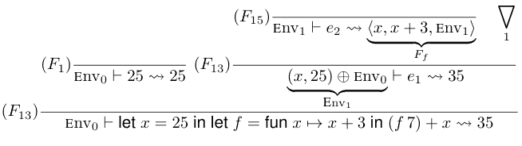

其中 \(\nabla_1\) 是求值树：

```
\((F_{11})\overline{\text{Env}_2 \vdash f \rightsquigarrow F_f} \quad (F_1)\overline{\text{Env}_2 \vdash 7 \rightsquigarrow 7} \quad \nabla_2\)
\((F_{17})\overline{\text{Env}_2 \vdash (f \ 7) \rightsquigarrow 10} \quad (F_{11})\overline{\text{Env}_2 \vdash x \rightsquigarrow 25}\)
\((F_4)\overline{(f, F_f) \oplus \text{Env}_1 \vdash (f \ 7) + x \rightsquigarrow 35}\)
```

其中 \(\nabla_2\) 是求值树：

```
\((F_{11})\overline{(x, 7) \oplus \text{Env}_1 \vdash x \rightsquigarrow 7} \quad (F_{11})\overline{(x, 7) \oplus \text{Env}_1 \vdash 3 \rightsquigarrow 3}\)
\((F_4)\overline{(x, 7) \oplus \text{Env}_1 \vdash x + 3 \rightsquigarrow 10}\)
```

### 示例 3.5.

对 \((e_{fact} 3)\) 进行求值，其中 \(e_{fact}\) 是 [3.2] 中定义的表达式：

```
(rec fact n = if n <= 1 then 1 else (fact (n - 1)) * n)
```

求值过程如下：

```
\((F_{16})\overline{\text{Env}_0 \vdash e_{fact} \rightsquigarrow \langle fact, n, e_1, \text{Env}_0 \rangle} \quad (F_1)\overline{\text{Env}_0 \vdash 3 \rightsquigarrow 3} \quad \nabla_1\)
\((F_{18})\overline{F_{fact}}\)
\(\text{Env}_0 \vdash (e_{fact} \ 3) \rightsquigarrow 6\)
```

其中 \(\nabla_1\) 是求值树：

```
\((F_4)\overline{\text{Env}_1 \vdash n \rightsquigarrow 3} \quad (F_1)\overline{\text{Env}_1 \vdash 1 \rightsquigarrow 1} \quad \nabla_2 \quad (F_{11})\overline{\text{Env}_1 \vdash n \rightsquigarrow 3}\)
\((F_4)\overline{\text{Env}_1 \vdash n \le 1 \rightsquigarrow false} \quad (F_4)\overline{\text{Env}_1 \vdash e_2 \rightsquigarrow 6}\)
\((F_8)\overline{\langle fact, F_{fact} \rangle \oplus (n, 3) \oplus \text{Env}_0 \vdash e_1 \rightsquigarrow 6}\)
```

其中 \(\nabla_2\) 是求值树：

```
\((F_{11})\overline{\text{Env}_1 \vdash fact \rightsquigarrow F_{fact}} \quad (F_4)\overline{\text{Env}_1 \vdash n \rightsquigarrow 3} \quad (F_1)\overline{\text{Env}_1 \vdash 1 \rightsquigarrow 1} \quad \nabla_3\)
\((F_{11})\overline{\text{Env}_1 \vdash fact \rightsquigarrow F_{fact}}\)
\(\text{Env}_1 \vdash (fact (n - 1)) \rightsquigarrow 2\)
```

其中 \(\nabla_3\) 是求值树：

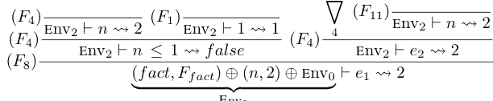

其中 \(\nabla_4\) 是求值树：

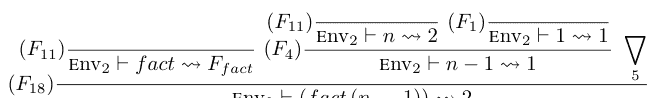

其中 \(\nabla_5\) 是求值树：

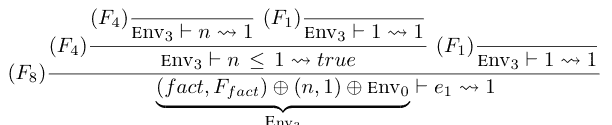

### 备注。

求值机制的终止性：使用语法构造 rec f x = e，可以定义那些求值不终止的表达式。例如，由以下定义的表达式 e_foo：

```
rec f x = (f x) [3.5]
```

我们可以构造表达式：

```
let foo = (rec f x = (f x)) in (foo 2) [3.6]
```

此表达式的求值不终止。此表达式求值树的构建是无休止的：

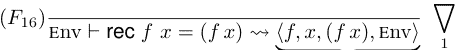

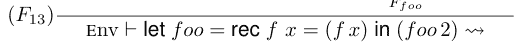

其中 \(\nabla_1\) 的构建如下：

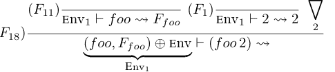

其中 \(\nabla_2\) 的构建如下：

(F_{11}) \frac{\text{Env}_2 \vdash f \rightsquigarrow F_{foo}}{} \quad (F_{11}) \frac{\text{Env}_2 \vdash x \rightsquigarrow 2}{} \quad (F_{18}) \frac{\text{Env}_2 \vdash (fx) \rightsquigarrow}{} \quad \vdots \\
(F_{18}) \frac{((f, F_{foo}) \oplus (x, 2) \oplus \text{Env} \vdash (fx) \rightsquigarrow)}{\text{Env}_2}

此语义仅可用于描述终止的执行。换言之，Env \(\vdash e \rightsquigarrow v\) 表达的事实是：\(v\) 是通过有限求值树获得的 \(e\) 的值，该求值树使用框 3.2 和框 3.3 中呈现的推理规则构建。对于表达式 [3.6] 不存在这样的求值树。此语义称为 *大步操作语义*：Env \(\vdash e \rightsquigarrow v\) 不描述计算，只描述结果。为了使用包括非终止计算在内的计算进行描述和推理，语义可以形式化为 *小步语义*（或归约语义），这是第 4 章详细讨论的主题。

#### 3.3.3. 递归和互递归函数

在规则 \(F_{18}\) 中，符号 \(\vdash\) 两侧各出现两次 \(e_f\)，该规则涉及递归函数的应用。乍一看，这似乎很悖论：对右侧 \(e_f\) 求值会导致我们对左侧 \(e_f\) 求值。如第 3.2.5 节所示，这个问题可以直接通过使用规则 \(F_{16}\) 并将 \(f\) 绑定到闭包来表达：

\(F = \langle x, e, (f, F) \oplus \text{Env} \rangle\)

再次，\(F\) 出现在等号两边。值 \(F\) 的存在性可以使用最小不动点（LFP）数学理论来证明，该理论在 4.7.1 节中简要介绍；更详细的描述可见 [JAU 16]。采用这种方法，规则 \(F_{16}\)、\(F_{17}\) 和 \(F_{18}\) 可以浓缩为两条规则：

(N_{16}) \text{Env} \vdash \text{rec } f \ x = e \rightsquigarrow \langle x, e, (f, F) \oplus \text{Env} \rangle \stackrel{\text{Env}_f}{=} F

(N_{17\_18}) \frac{\text{Env} \vdash e_1 \rightsquigarrow \langle x, e, \text{Env}_f \rangle \quad \text{Env} \vdash e_2 \rightsquigarrow v_2}{(x, v_2) \oplus \text{Env}_f \vdash e \rightsquigarrow v} \text{Env} \vdash (e_1 e_2) \rightsquigarrow v

递归和非递归函数的应用基于相同的机制。LFP 理论使我们可以确定，任何具有有限次递归调用的表达式的求值都会终止。此外，相同的理论可以用来证明，这两种方法为 \(\text{Exp}_2\) 定义了相同的语义。


现在，让我们考虑互递归函数的情况。例如，以下函数用于确定整数的奇偶性：

```
rec even n = if n = 0 then true else odd(n - 1)
rec odd n = if n = 0 then false else even(n - 1)
```

函数 even 的函数体中包含对函数 odd 的调用，而后者的函数体中也包含对函数 even 的调用。这两个函数被称为互递归，某些编程语言使用语法结构来表达两个函数之间的这种依赖关系。当两个函数互递归时，不可能为它们提供两个独立的值：例如，与函数 even 关联的闭包中包含的定义环境必须包含对函数 odd 的绑定，反之亦然。解决此问题的一种简单方法是从语法上处理。例如，结构

```
let_rec f x = e_f and g y = e_g;
```

可用于定义两个互递归函数 f 和 g。对该结构的求值将同时将 f 和 g 的绑定添加到当前环境中。

考虑到本节开头介绍的闭包方法，对这些定义的求值将当前环境 ENV 扩展如下：

```
(g, G) ⊕ (f, F) ⊕ ENV with
F = ⟨x, e_f, (g, G) ⊕ (f, F) ⊕ ENV⟩
G = ⟨y, e_g, (g, G) ⊕ (f, F) ⊕ ENV⟩
```

#### 3.3.4. 按名调用

定义 3.2.– 按名调用：按名调用机制定义了求值函数应用和其他表达式的策略。表达式 e 的子表达式只有在其值用于求值 e 时才会被求值。

要对 (f e) 求值，我们在当前环境 ENV 中对 f 求值。仅当对 f 在其定义环境 Env_f 中的函数体求值需要 ENV 中 e 的值时，表达式 e 才会被求值。因此，必须保留对 [e, ENV]（称为冻结表达式）。环境因此变成一个关联列表，其中元素为对 (x, [e, ENV_e])，其中 x 是一个“冻结”变量，e 是定义 x 的表达式，ENV_e 是 e 应在其中求值的环境：

```
ENV = [(x_1, [e_1, ENV_{e1}]), ..., (x_n, [e_n, ENV_{en}])]
```

因此，闭包的概念被推广到所有表达式，而不仅仅是函数。

按名调用策略的大步操作语义在框 3.2 和框 3.4 中定义。框 3.2 中定义的简单表达式求值规则对两种调用策略均有效。例如，条件表达式的求值始终取决于条件的求值，而算术表达式的求值要求我们至少求值一个操作数。框 3.4 所示规则使用新的环境概念。要在环境 ENV 中对变量 x 求值，ENV 将 [e_x, ENV_x] 与 x 关联，我们只需在环境 ENV_x 中对 e_x 求值，即应用规则 F'11 和 F'12。要在环境 ENV 中对形式为 let x = e_1 in e_2 的表达式求值，我们在环境 (x, [e_1, ENV]) ⊕ ENV 中对 e_2 求值；这是规则 F'13 的应用。对函数求值会产生额外的闭包。第 3.3.3 节中提出的表述也用于规则 F'14 和 F'15。要在环境 ENV 中将函数 f 应用于参数 e，首先将 f 在 ENV 中作为闭包 <x, e_f, ENV_f> 求值，然后在环境 (x, [e, ENV]) ⊕ ENV_f 中对 e_f 求值，遵循规则 F'16。

```
(F'11) ENV |- e_x ~~ v   (F'12) ENV |- x ~~ ERR_U  (x ∉ dom(ENV))
       ---------------------------- ------------------------------------
       ENV |- x ~~ v          (x, [e_x, ENV_x]) ∈ ENV

(F'13) (x, [e_1, ENV]) ⊕ ENV |- e_2 ~~ v
       ---------------------------------
       ENV |- let x = e_1 in e_2 ~~ v

(F'14) ENV |- fun x -> e ~~ <x, e, ENV>

(F'15) ENV |- rec f x = e ~~ <x, e, f, [rec f x = e, ENV]> ⊕ ENV

(F'16) ENV |- e_1 ~~ <x, e_f, ENV_f>   (x, [e_2, ENV]) ⊕ ENV_f |- e_f ~~ v
       -------------------------------------------------------------
       ENV |- (e_1 e_2) ~~ v

(F'17) ENV |- e_1 ~~ v
       ---------------
       ENV |- (e_1 e_2) ~~ ERR_T  (v ∉ F)
```

### 框 3.4. Exp2 的操作语义：按名调用

#### 3.3.5. 按值调用与按名调用

两种调用策略不一定产生相同的结果。例如，使用按值调用策略对表达式 ((fun x ↦ 3) (8 / 0)) 的求值操作如下：

```
(F1)       (F1)
ENV |- 8 ~~ 8   ENV |- 0 ~~ 0
--------------------------- (F4)
ENV |- 8 / 0 ~~ ERR_E

(F15) ENV |- fun x -> 3 ~~ <x, 3, ENV>
------------------------------------- (F19)
ENV |- ((fun x -> 3) (8 / 0)) ~~ ERR_E
```

如果按值调用策略产生有限求值树，则按名调用策略也会产生有限树。另一方面，使用按名调用策略获得有限树并不意味着使用按值调用一定会产生有限树。例如，使用按值调用策略对表达式 ((fun x ↦ 3) (e_foo 2)) 的求值不会终止（参见第 3.3.2 节），而使用按名调用则获得值 3：

```
(F'14) Env |- fun x -> 3 ~~ <x, 3, Env> (F1) (x, [(e_foo 2), Env]) ⊕ Env |- 3 ~~ 3
(F'16) -------------------------------------------------------------------------------
Env |- ((fun x -> 3) (e_foo 2)) ~~ 3
```

两种策略在共享子表达式求值的能力上也有所不同。例如，使用按值调用，((fun x ↦ x + x) e) 的求值如下：

```
(F15) Env |- e_f ~~ <x, x + x, Env> (R) ... ∇
(F17) -------------------------------------------------------------------------------
Env |- ((fun x -> x + x) e) ~~ v
       e_f
```

其中 ∇ 是以下树：

```
(F11) Env_1 |- x ~~ v_e (F11) Env_1 |- x ~~ v_e
(F4) -------------------------------------------------------------------------------
       (x, v_e) ⊕ Env |- x + x ~~ v
       Env_1
```

这里，值 v 通过仅计算一次 e 的值 v_e 而获得。另一方面，使用按名调用机制，我们得到：

```
(F'14) ... (F11) ... ∇ ... (F11) ... ∇ ...
       Env |- e ~~ v_e   Env |- e ~~ v_e
(F4)   Env_1 |- x ~~ v_e   Env_1 |- x ~~ v_e
       -------------------------------------------------------------------------------
       (x, [e, Env]) ⊕ Env |- x + x ~~ v
       Env_1
(F'16) -------------------------------------------------------------------------------
Env |- ((fun x -> x + x) e) ~~ v
       e_f
```

e 的值 v_e 被计算两次以获得表达式 x + x 的值 v。按需调用策略是按名调用策略的一种实现，它试图最大限度地共享子表达式，以便仅计算一次函数的参数。

备注。—— 在允许副作用（读取/写入/赋值）的语言中，通常使用按值调用，因为该策略可以预测副作用何时发生；按名调用策略则不然。使用按名调用策略的语言的编译器会对产生副作用的子表达式使用按值调用策略。

### 3.4. 求值函与求值关系

在本节中，我们考察按值调用策略下求值函的确定性。这引导我们研究一种新的归纳形式。

#### 3.4.1. 求值函的状态

本节考察的问题是，对于每个表达式 \( e \in \mathbf{Exp}_2 \)，是否存在一个唯一的值 \( v \in \mathbb{V} \) 使得 \( \llbracket e \rrbracket_{\text{Env}} = v \)。答案是否定的。如果 \( e \) 是一个需要对非终止递归函数应用求值的表达式（例如第 3.3.2 节中称为“foo”的表达式 [3.6]），那么我们无法获得一个值 \( v \in \mathbb{V} \) 使得 \( \llbracket e \rrbracket_{\text{Env}} = v \)。因此，\( \llbracket \_ \rrbracket \) 不是全函数。但是，如果存在这样的值 \( v \)，则可以证明它是唯一的（因此 \( \llbracket \_ \rrbracket \) 是偏函数）：

```
\(\forall e \in \mathbf{Exp}_2 \quad \underline{\forall_{\text{Env}} \in \mathbf{E} \quad \forall v, v' \in \mathbb{V} \quad (\llbracket e \rrbracket_{\text{Env}} = v \text{ and } \llbracket e \rrbracket_{\text{Env}} = v') \Rightarrow v = v'} \quad P(e)\)
```

让我们称此属性为 \( P \)。我们可以尝试通过对 \( e \) 进行归纳，使用框 3.1 中定义的归纳方案来证明 \( P \ 对于所有表达式 \( e \in \mathbf{Exp}_2 \) 都成立。对于大多数语法结构，这是可能的，例如形式为 let \( x = e_1 \) in \( e_2 \) 的表达式。设 Env 为一个环境，\( v \) 和 \( v' \) 为两个值。如果 \( \llbracket \text{let } x = e_1 \text{ in } e_2 \rrbracket_{\text{Env}} = v \) 和 \( \llbracket \text{let } x = e_1 \text{ in } e_2 \rrbracket_{\text{Env}} = v' \)，那么我们可以证明 \( v = v' \)。首先，注意根据归纳假设，\( P(e_1) \) 得到验证，因此如果 \( [\![e_1]!]_{\text{Env}} = v_1 \) 和 \( [\![e_1]!]_{\text{Env}} = v'_1 \)，则 \( v_1 = v'_1 \)。现在有两种情况。如果 \( v_1 \in \mathbf{V} \)，那么根据定义，\( v = [\![e_2]!]_{(x,v_1) \oplus \text{Env}} \) 和 \( v' = [\![e_2]!]_{(x,v'_1) \oplus \text{Env}} \)，由于 \( v_1 = v'_1 \)，根据对 \( e_2 \) 的归纳假设，我们得到 \( v = v' \)。否则，如果 \( v_1 \in \mathbf{IE} \)，那么根据定义，\( v = v_1 \) 和 \( v' = v'_1 \)，由于 \( v_1 = v'_1 \)，我们直接得到 \( v = v' \)。

类似的推理可以用于证明除了函数应用（即形式为 \( (e_1 e_2) \) 的表达式）之外的所有结构的 \( P \)。在这种情况下，可用的唯一归纳假设与 \( (e_1 e_2) \) 中的子表达式 \( e_1 \) 和 \( e_2 \) 相关。但是，当 \( e_1 \) 作为包含表达式 \( e_f \) 的闭包求值时，应用 \( (e_1 e_2) \) 的求值会导致对函数体 \( e_f \) 的求值，其

1 注意，属性 \( P \) 陈述中量词的顺序会影响归纳假设的形式。例如，首先对环境进行量化（\( \forall_{\text{Env}} \in \mathbf{E} \forall e \in \mathbf{Exp}_2 \forall v, v' \in \mathbb{V} \)）允许我们对 \( e_1 \) 使用归纳假设，因为 \( e_1 \) 在 Env 中求值，但禁止我们对 \( e_2 \) 使用归纳假设，因为 \( e_2 \) 在与 Env 不同的环境中求值。


不是 $(e_1 e_2)$ 的子表达式（例如，$e_1$ 可能只是函数的名称）。我们不能假设 $P$ 对 $e_f$ 成立，也无法得出结论。因此，无法通过对表达式 $e$ 进行结构归纳来证明 $P(e)$。该属性不能通过对表达式结构进行归纳来证明，而需要对求值过程中涉及的计算的“大小”进行归纳。考虑到求值函数 $\lfloor \_ \rfloor$，可以使用连续函数的最小不动点理论来完成，如第 4.7.1 节所述。这里将使用大步操作语义来证明该属性，它允许我们通过对求值树进行归纳来推理；这是一种考虑求值过程中涉及的计算“大小”的方法。

#### 3.4.2. 对求值树进行归纳

我们在这里的目标是证明一个属性 $P$，即如果一个表达式被求值为一个值，那么这个值是唯一的。形式上，在大步操作语义框架内，我们希望证明以下命题：

### 命题 3.1. – 确定性：

\[
\forall e \in \mathbf{Exp}_2 \ \forall Env \in \mathbf{E} \ \forall v, v' \in \mathbb{V} \ (Env \vdash e \rightsquigarrow v \text{ and } Env \vdash e \rightsquigarrow v') \Rightarrow v = v'
\]

$\mathbf{Exp}_2$ 中表达式的求值（或推导）树集合可以归纳定义，这意味着我们可以通过对这些树进行归纳来推理，即对求值过程中执行的计算的“大小”进行归纳。更一般地，给定一个推理系统 $\mathbb{S}$，即一组形式的推理规则

\[
(R) \frac{e_1 \cdots e_n}{e}
\]

可以推导的元素 $e$ 的集合 $\mathbb{A}_\mathbb{S}$（有时也称为 $\mathbb{S}$ 的定理集）归纳定义如下：

- 对于 $\mathbb{S}$ 中的每个公理，即每种形式 $(R)-$ 的规则，结论 $e$ 属于 $\mathbb{A}_\mathbb{S}$；
- 如果 $e_1, \cdots, e_n$ 是 $\mathbb{A}_\mathbb{S}$ 中的元素，且

\[
(R) \frac{e_1 \cdots e_n}{e}
\]

是 $\mathbb{S}$ 中的规则，则 \( e \in \mathbb{A}_{\mathbb{S}} \)。确实，如果 \( e_1, \cdots, e_n \) 是 \( \mathbb{A}_{\mathbb{S}} \) 中的元素，那么对每个元素都存在树 \( \nabla_1, \cdots, \nabla_n \)，因此我们可以构造以下树：

\[
\frac{ \begin{array}{c} \nabla_1 \quad \cdots \quad \nabla_n \\ e_1 \quad \cdots \quad e_n \end{array} }{ e } (R)
\]

对 \( \mathbb{A}_{\mathbb{S}} \) 的元素证明属性 \( P \)，归结为证明该属性对 $\mathbb{S}$ 中结束每个公理的所有元素都成立，并证明对于每条规则

\[
(R) \frac{ e_1 \cdots e_n }{ e }
\]

在 $\mathbb{S}$ 中，如果所有 \( e_1, \cdots, e_n \) 都满足属性 \( P \)，那么 \( e \) 也满足属性 \( P \)。这产生了一个基于 \( e \) 的推导树的归纳推理方案。在 \( \mathbf{Exp}_2 \) 表达式的求值树的情况下，这使我们能够通过对求值过程中执行的计算进行归纳来推理。

使用此技术，并将 \( \mathbb{S}_{\mathbf{Exp}_2} \) 视为定义 \( \mathbf{Exp}_2 \) 表达式大步操作语义的推理系统，命题 3.1 可以通过考虑以下等价表述来证明：

\[
\forall \text{Env} \vdash e \rightsquigarrow v \in \mathbb{A}_{\mathbb{S}_{\mathbf{Exp}_2}} \quad \underbrace{(\forall v' \in \mathbb{V} \text{ Env} \vdash e \rightsquigarrow v' \in \mathbb{A}_{\mathbb{S}_{\mathbf{Exp}_2}} \Rightarrow v = v')}_{P(\text{Env} \vdash e \rightsquigarrow v)} \quad \text{[3.7]}
\]

证明。设 \( P \) 为要证明的属性，并让我们证明该属性被所有求值树 \( \text{Env} \vdash e \rightsquigarrow v \in \mathbb{A}_{\mathbb{S}_{\mathbf{Exp}_2}} \) 满足。

如果 \( \text{Env} \vdash e \rightsquigarrow v \) 是使用规则 \( F_1 \) 得到的，那么 \( e = v \) 是 \( \mathbf{K} \) 中的一个常量，并且由于 \( F_1 \) 是可用于求值常量的唯一规则，因此 \( v = v' \)。

如果 \( \text{Env} \vdash e \rightsquigarrow v \) 是使用规则 \( F_2 \) 得到的，那么 \( e = \text{op } e_1 \)，\( \text{Env} \vdash e_1 \rightsquigarrow v_1 \)，\( v_1 \in \mathbf{V} \) 且 \( v = \text{op}_\mathbf{V} v_1 \)。根据归纳假设，如果 \( \text{Env} \vdash e_1 \rightsquigarrow v'_1 \)，那么 \( v'_1 = v_1 \in \mathbf{V} \)，并且由于 \( F_2 \) 是求值 \( e \) 的唯一适用规则，我们得到 \( v' = \text{op}_\mathbf{V} v'_1 = \text{op}_\mathbf{V} v_1 = v \)。

如果 \( \text{Env} \vdash e \rightsquigarrow v \) 是使用规则 \( F_3 \) 得到的，那么 \( e = \text{op } e_1 \)，\( \text{Env} \vdash e_1 \rightsquigarrow v_1 \)，\( v_1 \in \mathbf{E} \) 且 \( v = v_1 \)。根据归纳假设，如果 \( \text{Env} \vdash e_1 \rightsquigarrow v'_1 \)，那么 \( v'_1 = v_1 \in \mathbf{E} \)。\( F_3 \) 是求值 \( e \) 的唯一适用规则，我们得到 \( v' = v'_1 = v_1 = v \)。

如果 \( \text{Env} \vdash e \rightsquigarrow v \) 是使用规则 \( F_4 \) 得到的，那么 \( e = e_1 \text{ op } e_2 \)，\( \text{Env} \vdash e_1 \rightsquigarrow v_1 \)，\( \text{Env} \vdash e_2 \rightsquigarrow v_2 \)，\( v_1, v_2 \in \mathbf{V} \) 且 \( v = v_1 \text{ op}_\mathbf{V} v_2 \)。根据归纳假设，如果 \( \text{Env} \vdash e_1 \rightsquigarrow v'_1 \)，那么 \( v'_1 = v_1 \in \mathbf{V} \)，如果 \( \text{Env} \vdash e_2 \rightsquigarrow v'_2 \)，那么 \( v'_2 = v_2 \in \mathbf{V} \)。规则 \( F_4 \) 是求值 \( e \) 的唯一适用规则，我们得到 \( v' = v'_1 \text{ op}_\mathbf{V} v'_2 = v_1 \text{ op}_\mathbf{V} v_2 = v \)。

如果 \( \text{Env} \vdash e \rightsquigarrow v \) 是使用规则 \( F_5 \) 得到的，那么 \( e = e_1 \text{ op } e_2 \)，\( \text{Env} \vdash e_1 \rightsquigarrow v_1 \)，\( v_1 \in \mathbf{I} \) 且 \( v = v_1 \)。根据归纳假设，如果 \( \text{Env} \vdash e_1 \rightsquigarrow v'_1 \)，那么 \( v'_1 = v_1 \in \mathbf{I} \)。规则 \( F_5 \) 是求值 \( e \) 的唯一适用规则，我们得到 \( v' = v'_1 = v_1 = v \)。

如果 \( \text{Env} \vdash e \rightsquigarrow v \) 是使用规则 \( F_6 \) 得到的，那么 \( e = e_1 \text{ op } e_2 \)，\( \text{Env} \vdash e_1 \rightsquigarrow v_1 \)，\( \text{Env} \vdash e_2 \rightsquigarrow v_2 \)，\( v_1 \in \mathbf{V} \)，\( v_2 \in \mathbf{I} \) 且 \( v = v_2 \)。根据归纳假设，如果 \( \text{Env} \vdash e_1 \rightsquigarrow v'_1 \)，那么 \( v'_1 = v_1 \in \mathbf{V} \)，如果 \( \text{Env} \vdash e_2 \rightsquigarrow v'_2 \)，那么 \( v'_2 = v_2 \in \mathbf{I} \)。规则 \( F_6 \) 是求值 \( e \) 的唯一适用规则，我们得到 \( v' = v'_2 = v_2 = v \)。

如果 \( \text{Env} \vdash e \rightsquigarrow v \) 是使用规则 \( F_7 \)（或 \( F_8 \)）得到的，那么 \( e \) 是条件表达式 if \( e_1 \) then \( e_2 \) else \( e_3 \)，\( \text{Env} \vdash e_1 \rightsquigarrow \text{true} \)（或 \( \text{Env} \vdash e_1 \rightsquigarrow \text{false} \)）以及 \( \text{Env} \vdash e_2 \rightsquigarrow v \)（或 \( \text{Env} \vdash e_3 \rightsquigarrow v \)）。根据归纳假设，如果：

\[
\text{Env} \vdash e_1 \rightsquigarrow v_1' \quad \text{then} \quad v_1' = \text{true} \quad (\text{respectively } v_1' = \text{false})
\]

和如果：

\[
\text{Env} \vdash e_2 \rightsquigarrow v' \quad (\text{respectively, } \text{Env} \vdash e_3 \rightsquigarrow v') \quad \text{then} \quad v' = v
\]

规则 \( F_7 \)（或 \( F_8 \)）是求值 \( e \) 的唯一适用规则，我们得到 \( v' = v \)。

如果 \( \text{Env} \vdash e \rightsquigarrow v \) 是使用规则 \( F_9 \)（或 \( F_{10} \)）得到的，那么 \( e = \text{if } e_1 \text{ then } e_2 \text{ else } e_3 \)，\( \text{Env} \vdash e_1 \rightsquigarrow v_1 \)，\( v_1 \in \mathbf{V} \backslash \mathbf{IB} \)（或 \( v_1 \in \mathbf{IE} \））以及 \( v = \text{ErrT} \)（或 \( v = v_1 \)）。根据归纳假设，如果 \( \text{Env} \vdash e_1 \rightsquigarrow v_1' \)，那么 \( v_1' = v_1 \)。规则 \( F_9 \)（或 \( F_{10} \)）是求值 \( e \) 的唯一适用规则，我们得到 \( v' = v \)。

如果 \( \text{Env} \vdash e \rightsquigarrow v \) 是使用规则 \( F_{11} \)（或 \( F_{12} \)）得到的，那么 \( e = x \) 是 \( \mathbf{X} \) 中的一个变量，满足 \( x \in \text{dom}(\text{Env}) \)（或 \( x \notin \text{dom}(\text{Env}) \）以及 \( v = \text{Env}(x) \)（或 \( v = \text{ErrU} \)）。规则 \( F_{11} \)（或 \( F_{12} \)）是求值 \( e \) 的唯一适用规则，我们得到 \( v' = v \)。

如果 \( \text{Env} \vdash e \rightsquigarrow v \) 是使用规则 \( F_{13} \) 得到的，那么 \( e = \text{let } x = e_1 \text{ in } e_2 \)，\( \text{Env} \vdash e_1 \rightsquigarrow v_1 \)，\( (x, v_1) \oplus \text{Env} \vdash e_2 \rightsquigarrow v_2 \)，\( v_1 \in \mathbf{V} \) 且 \( v = v_2 \)。根据归纳假设，如果 \( \text{Env} \vdash e_1 \rightsquigarrow v_1' \)，那么 \( v_1' = v_1 \in \mathbf{V} \)，如果 \( (x, v_1) \oplus \text{Env} \vdash e_2 \rightsquigarrow v_2' \)，那么 \( v_2' = v_2 \)。规则 \( F_{13} \) 是求值 \( e \) 的唯一适用规则，并且由于 \( v_1' = v_1 \)，则 \( (x, v_1') \oplus \text{Env} = (x, v_1) \oplus \text{Env} \)，我们得到 \( v' = v_2' = v_2 = v \)。

如果 \( \text{Env} \vdash e \rightsquigarrow v \) 是使用规则 \( F_{14} \) 得到的，那么 \( e = \text{let } x = e_1 \text{ in } e_2 \)，\( \text{Env} \vdash e_1 \rightsquigarrow v_1 \)，\( v_1 \in \mathbf{IE} \) 且 \( v = v_1 \)。根据归纳假设，如果 \( \text{Env} \vdash e_1 \rightsquigarrow v_1' \)，那么 \( v_1' = v_1 \in \mathbf{IE} \)，并且 \( F_{14} \) 是求值 \( e \) 的唯一适用规则，我们得到 \( v' = v_1' = v_1 = v \)。


若使用规则 F15（分别，F16）推导出 Env ⊢ e ↝ v，则 e = fun x ↦ e_f 且 v = ⟨x, e_f, Env⟩（分别，e = rec f x = e_f 且 v = ⟨f, x, e_f, Env⟩），且由于 F15（分别，F16）是对函数（分别，递归函数）求值的唯一适用规则，则 v = v'。

若使用规则 F17（分别，F18）推导出 Env ⊢ e ↝ v，则 e = (e₁ e₂) 且：

Env ⊢ e₁ ↝ ⟨x, e_f, Env_f⟩（分别，Env ⊢ e₁ ↝ ⟨f, x, e_f, Env_f⟩）

Env ⊢ e₂ ↝ v₂

(x, v₂) ⊕ Env_f ⊢ e_f ↝ v（分别，(f, ⟨f, x, e_f, Env_f⟩) ⊕ (x, v₂) ⊕ Env_f ⊢ e_f ↝ v）

根据归纳假设，若：

Env ⊢ e₁ ↝ v'₁ 则 v'₁ = ⟨x, e_f, Env_f⟩（分别 v'₁ = ⟨f, x, e_f, Env_f⟩）

且若：

Env ⊢ e₂ ↝ v'₂ 则 v'₂ = v₂

因此：

(x, v'₂) ⊕ Env_f = (x, v₂) ⊕ Env_f

（分别 (f, v'₁) ⊕ (x, v'₂) ⊕ Env_f = (f, ⟨f, x, e_f, Env_f⟩) ⊕ (x, v₂) ⊕ Env_f）

唯一适用规则是 F17（分别，F18），且根据归纳假设，由于：

(x, v₂) ⊕ Env_f ⊢ e_f ↝ v

（分别，(f, ⟨f, x, e_f, Env_f⟩) ⊕ (x, v₂) ⊕ Env_f ⊢ e_f ↝ v）

我们得到 v = v'。

若使用规则 F19 推导出 Env ⊢ e ↝ v，则 e = (e₁ e₂)，Env ⊢ e₁ ↝ v₁，Env ⊢ e₂ ↝ v₂，v₁ ∈ IF，v₂ ∈ IE 且 v = v₂。根据归纳假设，若 Env ⊢ e₁ ↝ v'₁，则 v'₁ = v₁ ∈ IF；且若 Env ⊢ e₂ ↝ v'₂，则 v'₂ = v₂ ∈ IE。规则 F19 是对 e 求值的唯一适用规则，我们得到 v' = v'₂ = v₂ = v。

若使用规则 F20 推导出 Env ⊢ e ↝ v，则 e = (e₁ e₂)，Env ⊢ e₁ ↝ v₁，v₁ ∉ IF 且 v = Err_T。根据归纳假设，若 Env ⊢ e₁ ↝ v'₁，则 v'₁ = v₁ ∉ IF。规则 F20 是对 e 求值的唯一适用规则，我们得到 v' = v。

下述命题建立了由求值函数 [[\_]] 定义的语义与在方框 3.2 和方框 3.3 中定义的按值调用运算语义之间的等价性。

## 命题 3.2. 等价性:

∀e ∈ **Exp₂** ∀Env ∈ **E** ∀v ∈ V [[e]]_Env = v ⇔ Env ⊢ e ↝ v

蕴含 ⇒ 可使用 LFP 理论证明，但这超出了本书的范围。蕴含 ⇐ 的证明是采用与命题 3.1 相同的技术，通过对 Env ⊢ e ↝ v 的求值树进行归纳得到的。对于每条规则：

```
(Fᵢ) Env₁ ⊢ e₁ ↝ v₁ ... Envₙ ⊢ eₙ ↝ vₙ
--------------------------------------
Env ⊢ e ↝ v
```

在定义 **Exp₂** 中表达式的大步运算语义的推理系统 S_**Exp₂** 中，我们必须证明 [[e]]_Env = v，在归纳假设下，即 [[e₁]]_Env₁ = v₁，等等，[[eₙ]]_Envₙ = vₙ。此证明是直接的，因为运算语义的求值规则是按照与定义求值函数完全相同的选择来定义的。

### 3.5. 语义属性

编程语言中用于证明表达式语义属性的常用技术如下所示。

#### 3.5.1. 等价表达式

### 定义 3.3. 等价表达式：

两个表达式等价，当且仅当，在每个环境中，它们的求值返回相同的值：

∀e₁, e₂ ∈ **Exp₂** e₁ ≡ e₂ ⇔ (∀Env ∈ **E** [[e₁]]_Env = [[e₂]]_Env) [3.8]

在本定义中，我们使用了求值函数 [[__]]_ 对表达式进行求值。用于求值大步运算语义的关系 ↝ 也可用于定义等价表达式的概念：

∀e₁, e₂ ∈ **Exp₂**
e₁ ≡ e₂ ⇔ (∀Env ∈ **E** ∀v ∈ V Env ⊢ e₁ ↝ v ⇔ Env ⊢ e₂ ↝ v) [3.9]

使用第二个定义，证明 e₁ ≡ e₂ 相当于证明如何从 Env ⊢ e₁ ↝ v 的树得到 Env ⊢ e₂ ↝ v 的求值树，反之亦然。根据命题 3.2，这两种方法是等价的。我们可以轻松证明 ≡ 定义了一个同余关系，即与 **Exp₂** 的内部组成规律兼容的等价关系。例如，若 e₁ ≡ e₂ 且 e'₁ ≡ e'₂，则 (e₁ + e'₁) ≡ (e₂ + e'₂)。

### 示例 3.6。

我们可以证明 let x = e1 in e2 ≡ ((fun x ↦ e2) e1)。使用定义 [3.8]，通过分情况证明，利用 e1 的求值来证得此等价性。

若 [[e1]]Env = v ∈ V，则 [[let x = e1 in e2]]Env = [[e2]](x,v)⊕Env，且由于 [[fun x ↦ e2]]Env = ⟨x, e2, Env⟩，我们得到 [[(fun x ↦ e2) e1]]Env = [[e2]](x,v)⊕Env，从而证明结束。

若 [[e1]]Env = v ∈ IE，也可以完成证明。在此情况下，有 [[let x = e1 in e2]]Env = v = [[(fun x ↦ e2) e1]]Env'。

该等价性可通过考虑定义 [3.9] 来建立。首先，取一棵树 Env ⊢ let x = e1 in e2 ↝ v。有两种可能性。若此树是通过应用规则 F13 得到的，它将采用以下形式：

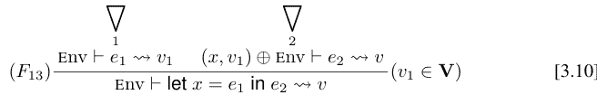

且一棵 Env ⊢ ((fun x ↦ e2) e1) ↝ v 的树可以从树 ∇1 和 ∇2 容易构造：

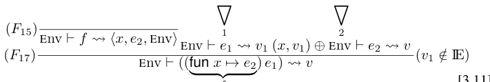

其次，树 Env ⊢ let x = e1 in e2 ↝ v 是使用规则 F14 得到的：

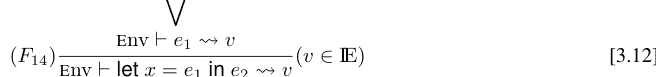

再次，一棵 Env ⊢ ((fun x ↦ e2) e1) ↝ v 的树可以从 ∇ 容易构造：

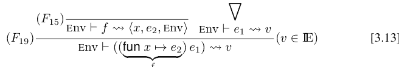

反过来，一棵 Env ⊢ ((fun x ↦ e2) e1) ↝ v 的树可用于构造一棵 Env ⊢ let x = e1 in e2 ↝ v 的树，因为树 [3.10] 和 [3.12] 分别可从树 [3.11] 和 [3.13] 得到。

#### 3.5.2. 等价环境

如我们在 3.1.4 节中非正式所述，在环境 ENV 中对表达式 e 求值的结果仅取决于 ENV 与 e 的自由变量关联的值。换句话说，e 的求值结果在所有将相同值关联到 e 的自由变量的环境中都是相同的。给出此属性的正式定义需要引入变量集上等价环境的概念，如下所示：

### 定义 3.4. 等价环境：

令 \( F \subseteq \mathbf{X} \) 为变量集，ENV₁ 和 ENV₂ 为两个环境：

ENV\(_1 \equiv_F\) ENV\(_2 \Leftrightarrow \forall x \in F \, \) ENV\(_1(x) = \) ENV\(_2(x)\)

显然，给定 \(\mathbf{X}\) 的两个子集 \( F_1 \) 和 \( F_2 \)，若 \( F_1 \subseteq F_2 \) 且 ENV₁ ≡_{F₂} ENV₂，则 ENV₁ ≡_{F₁} ENV₂。现在可以正式地表达，对于任何表达式 e，[[e]]_Env 的值仅取决于 ENV 中绑定到 e 的自由变量（\(\mathcal{F}(e)\)）的值。

### 命题 3.3。

对于任何表达式 \( e \in \mathbf{Exp}_2 \):

\(\forall \text{ENV}_1, \text{ENV}_2 \in \mathbf{E}\)
ENV\(_1 \equiv_{\mathcal{F}(e)}\) ENV\(_2\)
\(\Rightarrow\)
\(\left( \begin{aligned} [[e]]_{\text{ENV}_1} = [[e]]_{\text{ENV}_2} \\ \text{or} [[e]]_{\text{ENV}_1} = \langle x, e', \text{ENV}'_1 \rangle \text{ and } [[e]]_{\text{ENV}_2} = \langle x, e', \text{ENV}'_2 \rangle \\ \text{and } \text{ENV}'_1 \equiv_{\mathcal{F}(e)\backslash \{x\}} \text{ENV}'_2 \\ \text{or} [[e]]_{\text{ENV}_1} = \langle f, x, e', \text{ENV}'_1 \rangle \text{ and } [[e]]_{\text{ENV}_2} = \langle f, x, e', \text{ENV}'_2 \rangle \\ \text{and } \text{ENV}'_1 \equiv_{\mathcal{F}(e)\backslash \{x\}} \text{ENV}'_2 \end{aligned} \right)\)

此命题的证明冗长而复杂。练习 3.5 为不含函数表达式的语言建立了此属性。在此情况下，证明通过对表达式的句法结构进行归纳得到。在存在函数值的情况下，此归纳不再充分，证明需要使用不动点理论的定理。

### 3.6. 习题

### 练习 3.1

给定环境 Env，计算：

\( [[\text{fun } x \mapsto \text{let } y = 3 \text{ in } x + y]]_{\text{Env}} \text{ and } [[\text{let } y = 3 \text{ in } \text{fun } x \mapsto x + y]]_{\text{Env}} \)


## Exercise 3.2

令 Env 为由表达式 $e \in \mathbf{Exp}_2$ 和初始环境 $ENV_0$ 定义的以下环境：

```
ENV = (x, 4) ⊕ (f, ⟨y, e, (x, 3) ⊕ ENV₀⟩) ⊕ (x, 3) ⊕ ENV₀
```

- 1) 给出表达式 $e$ 的一个条件，使得：

$[[let f = fun y \mapsto e \text{ in } (f x)]]_{Env} = [[(f x)]]_{Env}$

- 2) 当 $e = y + x$ 时，计算 $[[let f = fun x \mapsto x + (f x) \text{ in } (f x)]]_{Env}$。

## Exercise 3.3

考虑以下表达式 $e$：

```
let x = 3 in (let f = e_1 in (let g = e_2 in (let h = e_3 in e_4)))
```

其中：

- $e_1$: fun $x \mapsto (let y = x in y)$
- $e_2$: let $y = x$ in fun $x \mapsto y$
- $e_3$: fun $k \mapsto fun x \mapsto (k x)$

本练习中，表达式求值采用按值调用策略。

- 1) 在环境 $ENV_0$ 中为表达式 $e$ 构建一棵“部分”求值树，以确定将用于求值表达式 $e_4$ 的环境 $ENV_4$。
- 2) 为 $e_4 = ((h f) 2)$ 补全树。
- 3) 为 $e_4 = ((h g) 2)$ 补全树。

## Exercise 3.4

考虑以下表达式 $e_0$：

```
let x = 2 in (let f = e_1 in e)
```

其中 $e_1$ 是表达式 fun $y \mapsto y + x$。本练习中，表达式求值采用按名调用策略。

- 1) 在环境 $ENV_0$ 中为表达式 $e_0$ 构建一棵“部分”求值树，以确定将用于求值表达式 $e$ 的环境 $ENV_2$。
- 2) 为以下表达式 $e$ 补全树：let $x = 3$ in $(f x)$。
- 3) 为以下表达式 $e$ 补全树：
  let $x = 3$ in $((fun y \mapsto y + x) x)$
- 4) 为以下表达式 $e$ 补全树：
  let $g = e_2$ in $((g (x - 1)) f)$，其中 $e_2$ 是表达式：
  rec $g z = fun k \mapsto if z = 0 then (k x) else ((g (z - 1)) k)$

## Exercise 3.5

本练习中，我们考虑 $\mathbf{Exp2}$ 的一个子集，该子集仅包含简单的算术表达式，仅保留框 3.1 中的构造 (1)、(2)、(4) 和 (6)，其中 $\mathbf{K} = \mathbb{Z}$ 且 $\text{op} \in \{+, -, *\}$。该语言（记为 EA）的语法如下：

```
e ::= k | x | e_1 + e_2 | e_1 - e_2 | e_1 * e_2 | let x = e_1 in e_2
```

为简化起见，我们在此假设，用于求值任意表达式 $e$ 的环境始终包含 $e$ 中出现的每个自由变量的绑定；因此，我们无需考虑错误情况。因此，EA 中表达式的运行语义可由值集合 $V = \mathbb{Z}$（因为 $\text{IE} = \emptyset$）定义，且仅考虑框 3.2 和框 3.3 中的规则 F1、F4、F11 和 F13。证明：在环境 Env 中求值表达式 $a \in \text{EA}$ 的结果仅取决于环境 Env 中与 $a$ 的自由变量关联的值。

$$
\forall a \in \text{EA} \;\forall \text{Env}_1, \text{Env}_2 \in \mathbf{E} \;\text{Env}_1 =_{F(a)} \text{Env}_2 \Rightarrow (\text{Env}_1 \vdash a \rightsquigarrow n \Leftrightarrow \text{Env}_2 \vdash a \rightsquigarrow n)
$$

## Exercise 3.6

本练习中，我们考虑练习 3.5 中定义的去掉 let-in 构造的语言 EA。将表达式 $e \in \text{EA}$ 中的变量 $x \in X$ 替换为表达式 $e' \in \text{EA}$，得到的表达式由以下归纳定义：

$$
e[x \leftarrow e'] = 
\begin{cases} 
k & \text{if } e = k \in \mathbb{Z} \\
e' & \text{if } e = x \in X \\
y & \text{if } e = y \in X \text{ and } y \neq x \\
e_1[x \leftarrow e'] \text{ op } e_2[x \leftarrow e'] & \text{if } e = e_1 \text{ op } e_2
\end{cases}
$$

证明：

$$
\forall e, e' \in E_A \;\forall x \in \mathbf{X} \;\forall \text{Env} \in \mathbf{E} \;\llbracket e[x \leftarrow e'] \rrbracket_{\text{Env}} = \llbracket e \rrbracket_{(x, \llbracket e' \rrbracket_{\text{Env}}) \oplus \text{Env}}
$$

## Exercise 3.7

小步运行语义。本练习中，我们考虑练习 3.5 中定义的去掉 *let-in* 构造的语言 $E_A$（运行语义仅使用框 3.2 和框 3.3 中的规则 $F_1$、$F_4$ 和 $F_{11}$ 定义）。可以定义一种小步运行语义来求值 $E_A$ 中的表达式。小步语义使我们能够以比大步语义更细致的粒度考虑导致计算结果的步骤。配置定义为一对 $\langle e, \text{Env} \rangle$，其中 $e \in E_A$ 且 $\text{Env} \in \mathbf{E}$。我们使用框 3.5 中提出的推理系统定义配置转换关系。直觉上，$\langle e, \text{Env} \rangle \mapsto \langle e', \text{Env} \rangle$ 表示，在环境 $\text{Env}$ 中求值表达式 $e$ 会导致我们在同一环境中求值“更简单”的表达式 $e'$。例如：

```
\langle 3 + (2 * 8), Env \rangle \mapsto \langle 3 + 16, Env \rangle
```

(AS1) $\frac{}{\langle x, Env \rangle \mapsto \langle Env(x), Env \rangle}$ (x $\in$ X)   n1, n2 $\in$ Z  
(AS2) $\frac{}{\langle n_1 + n_2, Env \rangle \mapsto \langle n, Env \rangle}$ (n = n1 + n2)  
(AS3) $\frac{}{\langle n_1 * n_2, Env \rangle \mapsto \langle n, Env \rangle}$ (n = n1 * n2)  
(AS4) $\frac{}{\langle n_1 - n_2, Env \rangle \mapsto \langle n, Env \rangle}$ (n = n1 - n2)  
(AS5) $\frac{\langle e_1, Env \rangle \mapsto \langle e'_1, Env \rangle}{\langle e_1 + e_2, Env \rangle \mapsto \langle e'_1 + e_2, Env \rangle}$  
(AS6) $\frac{\langle e_2, Env \rangle \mapsto \langle e'_2, Env \rangle}{\langle n_1 + e_2, Env \rangle \mapsto \langle n_1 + e'_2, Env \rangle}$  
(AS7) $\frac{\langle e_1 * e_2, Env \rangle \mapsto \langle e'_1 * e_2, Env \rangle}{...}$  
(AS8) $\frac{}{\langle n_1 * e_2, Env \rangle \mapsto \langle n_1 * e'_2, Env \rangle}$  
(AS9) $\frac{\langle e_1, Env \rangle \mapsto \langle e'_1, Env \rangle}{\langle e_1 - e_2, Env \rangle \mapsto \langle e'_1 - e_2, Env \rangle}$  
(AS10) $\frac{\langle e_2, Env \rangle \mapsto \langle e'_2, Env \rangle}{\langle n_1 - e_2, Env \rangle \mapsto \langle n_1 - e'_2, Env \rangle}$

### 框 3.5. 小步运行语义

转换序列是形式为以下的潜在无限序列：

```
\langle e_0, Env \rangle \mapsto \langle e_1, Env \rangle \mapsto \langle e_2, Env \rangle \mapsto \cdots
```

使得对所有 \(i \ge 0\)，都存在 \(\langle e_i, Env \rangle \mapsto \langle e_{i+1}, Env \rangle\) 的推理树。如果配置形式为 $\langle n, \text{Env} \rangle$（其中 $n \in \mathbb{Z}$），则称该配置为*终端*配置（在此情况下，求值结果即可得到）。关系 $\xleftrightarrow{*}$ 定义为：$\langle e, \text{Env} \rangle \xleftrightarrow{*} n$ 当且仅当存在长度为有限正数或零的转换序列：

$\langle e_0, \text{Env} \rangle \leftrightarrow \langle e_1, \text{Env} \rangle \leftrightarrow \langle e_2, \text{Env} \rangle \leftrightarrow \dots \leftrightarrow \langle e_m, \text{Env} \rangle$

使得配置 $\langle e_m, \text{Env} \rangle$ 为终端配置且 $e_m = n$。

- 1) 给出用于描述在满足 Env(x) = 1、Env(y) = 3 和 Env(z) = 2 的环境 Env 中求值表达式 $(z + (x - y)) * (x + 7)$ [3.14] 的转换序列。
- 2) 由于转换序列的每一步都会“简化”表达式，我们证明所有转换序列长度均为有限。
  - a) 从自然整数集合 $\mathbb{N}$ 上的良基序关系 $^2 \le$ 出发，在 $\mathbb{N} \times \mathbb{N}$ 上定义一个良基序关系 $\preceq$。
  - b) 给定表达式 $e \in E_A$，令 $\mathcal{N}_V(e)$ 为 $e$ 中变量出现的次数，$\mathcal{N}_O(e)$ 为 $e$ 中算符出现的次数。证明，若 $\langle e, \text{Env} \rangle \leftrightarrow \langle e', \text{Env} \rangle$，则：
    $(\mathcal{N}_V(e'), \mathcal{N}_O(e')) \prec (\mathcal{N}_V(e), \mathcal{N}_O(e))$
    其中 $\prec$ 为与 $\preceq$ 关联的严格序关系。
  - c) 从上述结果推出，所有转换序列均为有限。
  - d) 添加以下规则后，上述结果是否仍然成立？请说明理由。
    (AS11) $\frac{}{\langle e_1 + e_2, \text{Env} \rangle \leftrightarrow \langle e_2 + e_1, \text{Env} \rangle}$
- 3) 证明，若 $\text{Env} \vdash e \rightsquigarrow n$，则 $\langle e, \text{Env} \rangle \xleftrightarrow{*} n$。
- 4) 证明，若 $\langle e_1, \text{Env} \rangle \leftrightarrow \langle e_2, \text{Env} \rangle$ 且 $\text{Env} \vdash e_2 \rightsquigarrow v$，则 $\text{Env} \vdash e_1 \rightsquigarrow v$。
- 5) 运用上一题的结果，证明，若 $\langle e, \text{Env} \rangle \xleftrightarrow{*} n$，则 $\text{Env} \vdash e \rightsquigarrow n$。


6) 现在我们希望使用以下计算序列，在相同环境 Env 中描述表达式 [3.14] 的求值：

```
⟨(z + (x - y)) * (x + 7), Env⟩ ↪ ⟨(z + (x - y)) * (1 + 7), Env⟩
↪ ⟨(z + (x - y)) * 8, Env⟩ ↪ ⟨(z + (x - 3)) * 8, Env⟩
↪ ⟨(z + (1 - 3)) * 8, Env⟩ ↪ ⟨(z + -2) * 8, Env⟩
↪ ⟨(2 + -2) * 8, Env⟩ ↪ ⟨0 * 8, Env⟩ ↪ ⟨0, Env⟩
```

提出一个新的推理系统来定义关系 ↪，使得该转换序列中的每个步骤都有使用该系统的推理树。
