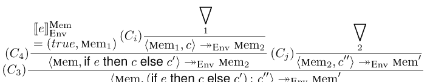
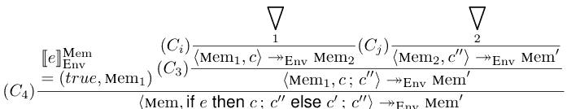

## 4. 命令式特性的语义

本章介绍了编程语言中最常见命令式特性的三种经典语义方法，处理方式通常如下（参见 [NIE 07, WIN 93]）。

### 4.1. 命令式语言内核的语法

我们在此考虑一种语言 Lang₃，它对应于大多数命令式语言的内核。它允许显式处理 _引用_ 的位置，即内存地址。这种语言由两种语言构成：用于定义的 Def₃ 和用于表达式的 Exp₃。两者都是第 2 章中引入的语言 Def₁ 和 Exp₁ 的变体。在表 4.1 中定义的语言 Def₃ 包含一个结构，用于将绑定引入执行环境。

| Construct | Description |
|---|---|
| d ::= let x = e; | 不可变变量的定义（x ∈ X，e ∈ Exp₃） |

**表 4.1。** 定义语言 Def₃

用于表达式的语言 Exp₃ 旨在操纵值并通过为新值分配位置来修改内存。Exp₃ 的语法在表 4.2 中给出。

因此，表达式 e ∈ Exp₃ 可以是：
- 常数 k ∈ K = Z ∪ IB；
- 标识符 x ∈ X；
- 通过对一个表达式（或两个表达式）应用一元（或二元）运算符得到的表达式；
- 分配 \(\uparrow e\)，它保留一个位置，将 \(e\) 的求值结果存储在该位置，并返回该位置的引用 \(r \in \mathbf{R}\)；
- 解引用 \(\downarrow e\)，它求值表达式 \(e\)，并且如果 \(e\) 的值是一个引用，则返回存储在该位置的值。

| Construct | Description | No. |
|---|---|---|
| k | 常数（\(k \in \mathbf{K}\)） | (1) |
| x | 变量（\(x \in \mathbf{X}\)） | (2) |
| op e1 | 原始一元运算符的应用 | (3) |
| e1 op e2 | 原始二元运算符的应用 | (4) |
| \(\uparrow\) e | 间接，内存分配 | (5) |
| \(\downarrow\) e | 解引用 | (6) |

**表 4.2.** 表达式语言 Exp₃

这里不描述可能的原始运算符；取决于所选语言，这些运算符可以处理整数、布尔值或引用（指针算术）。

常数集定义为整数、布尔值和引用的并集。使用整数表示引用，使用以下定义来表示 \(\mathbf{K} \cup \mathbf{R}\)。

```python
class CInt4:
    def __init__(self, cst_int):
        self.cst_int = cst_int

class CRef4:
    def __init__(self, cst_adr):
        self.cst_adr = cst_adr

class CBool4:
    def __init__(self, cst_bool):
        self.cst_bool = cst_bool
```

```ocaml
type const4 = CInt4 of int | CBool4 of bool | CRef4 of int
```

出于我们的目的，我们将使用第 3 章中引入的相同经典运算符。

```python
class Not4:
    pass

class Minus4:
    pass

class Div4:
    pass

class Or4:
    pass

class Leq4:
    pass

class Plus4:
    pass

class Mult4:
    pass

class And4:
    pass

class Eq4:
    pass
```

```ocaml
type unary_op4 = Not4
type bin_op4 = Plus4 | Minus4 | Mult4 | Div4 | And4 | Or4 | Eq4 | Leq4
```

Exp₃ 的表达式定义如下：

```python
class Cste4:
    def __init__(self, cste):
        self.cste = cste

class Var4:
    def __init__(self, symb):
        self.symb = symb

class U_0p4:
    def __init__(self, op, exp1):
        self.op = op
        self.exp1 = exp1

class B_0p4:
    def __init__(self, op, exp1, exp2):
        self.op = op
        self.exp1 = exp1
        self.exp2 = exp2

class Ref4:
    def __init__(self, exp):
        self.exp = exp

class Deref4:
    def __init__(self, exp):
        self.exp = exp
```

```ocaml
type 'a exp4 =
  | Cste4 of const
  | Var4 of 'a
  | U_0p4 of unary_op4 * 'a exp4
  | B_0p4 of bin_op4 * 'a exp4 * 'a exp4
  | Ref4 of 'a exp4
  | Deref4 of 'a exp4
```

最后，语言 Lang₃ 包含赋值（在第 2 章中已为语言 Lang1 介绍过）以及大多数命令式语言中出现的经典控制结构（序列、条件、循环）。Lang₃ 的语法在表 4.3 中定义。

| Construct | Description | No. |
|---|---|---|
| x := e | 赋值（x ∈ X，e ∈ Exp₃） | (1) |
| skip | | (2) |
| c1 ; c2 | 序列 | (3) |
| if e then c1 else c2 | 条件（e ∈ Exp₃） | (4) |
| while e do c1 | 循环（e ∈ Exp₃） | (5) |

**表 4.3.** 命令语言 Lang₃。

此时，定义语言 Def₃ 和程序语言 Lang₃ 可以分别定义。但是，在第 4.6 节中，Def₃ 将被扩展以定义过程。过程的主体是 Lang₃ 中的程序，并且 Lang₃ 将通过 Def₃ 中表达式引入的变量的局部定义进行扩展。因此，语言 Def₃ 和 Lang₃ 以递归方式定义如下（这些定义将在第 4.6 节中扩展）。

```python
class Let_def4:
    def __init__(self, symb, exp):
        self.symb = symb
        self.exp = exp

class ICond4:
    def __init__(self, exp, pgm1, pgm2):
        self.exp = exp
        self.pgm1 = pgm1
        self.pgm2 = pgm2

class IAffect4:
    def __init__(self, symb, exp):
        self.symb = symb
        self.exp = exp

class ISkip4:
    pass

class ISeq4:
    def __init__(self, pgm1, pgm2):
        self.pgm1 = pgm1
        self.pgm2 = pgm2

class IWhile4:
    def __init__(self, exp, pgm):
        self.exp = exp
        self.pgm = pgm
```

```ocaml
type 'a adef =
 | Let_def4 of 'a * 'a exp4 | ... procedure definitions
and 'a pgm4 =
 | IAffect4 of 'a * 'a exp4 | ISkip4
 | ISeq4 of 'a pgm4 * 'a pgm4 | ICond4 of 'a exp4 * 'a pgm4 * 'a pgm4
 | IWhile4 of 'a exp4 * 'a pgm4 | ... blocks with local variables
 | ... procedure calls
```

### 示例 4.1.

计算最大公约数的程序：下面抽象语法树中表示的程序片段计算已经存储在内存位置 x 和 y 中的两个自然数的最大公约数：

```
       (1) y := | y - x |           (1) x := | x - y |
          (4)     if x <= y then y := y - x else x := x - y
(5)
while not(| x = y |) do if x <= y then y := y - x else x := x - y
[4.1]
```

该程序写作如下：

```python
ex_pgm4_1 = IWhile4(U_0p4(Not4(),
    B_0p4(Eq4(),Deref4(Var4("x")),Deref4(Var4("y"))),
    ICond4(B_0p4(Leq4(),Deref4(Var4("x")),Deref4(Var4("y"))),
    IAffect4("y",B_0p4(Minus4(),Deref4(Var4("y")),
        Deref4(Var4("x")))),
    IAffect4("x",B_0p4(Minus4(),Deref4(Var4("x")),
        Deref4(Var4("y"))))))
```

```ocaml
let ex_pgm4_1 =
 IWhile4
 (U_0p4 (Not4, B_0p4 (Eq4, Deref4 (Var4 "x"), Deref4 (Var4 "y"))),
  ICond4 (B_0p4 (Leq4, Deref4 (Var4 "x"), Deref4 (Var4 "y")),
   IAffect4 ("y", B_0p4 (Minus4, Deref4 (Var4 "y"),
       Deref4 (Var4 "x"))),
   IAffect4 ("x", B_0p4 (Minus4, Deref4 (Var4 "x"),
       Deref4 (Var4 "y")))))
```

用于定义函数和过程的构造将在后面介绍。但是，以下定理表征了在此阶段定义的语言 Lang₃ 的表达能力。

### 定理 4.1.

Böhm 和 Jacopini [BOE 66]：任何算法都可以表示为三种控制结构的组合：序列、条件指令和迭代。

为语言 Lang₃ 定义语义使我们能够对赋值和控制指令产生的内存修改进行精确描述。在本章中，我们假设所有定义了语义的表达式和程序在语法上都是正确且类型正确的（参见第 5 章）：对表达式的求值或程序的执行永远不会产生类型错误。

### 4.2. 表达式求值

如第 2 章一样，Exp₃ 中的表达式在由执行环境 Env E 和内存 Mem M 组成的状态中求值。但是，表达式语言 Exp₃ 包含一个运算符 ^，它分配内存，将其参数的值存储在这个新位置，并返回其引用。因此，虽然求值表达式永远不会修改执行环境，但它可能会触发内存状态的修改（称为求值的副作用）。求值表达式返回一个值，该值可以是整数、布尔值或引用，因此 V = Z ∪ B ∪ R。由于我们只考虑类型正确的表达式（即求值不会导致类型错误的表达式），唯一可能的错误是定义错误 ErrU（访问环境中未定义的标识符）和执行错误 ErrE（例如除以 0 的情况）。因此，IE = {ErrU, ErrE}，V = V ∪ IE 是表达式求值所有可能结果的集合。

我们定义如下求值函数：

```
[[ ]]_- : (E x M x Exp₃) → (V x M)
```

这意味着 [[e]]Env^Mem = (v, Mem') 表示 v 是在状态 (Env, Mem) 中对表达式 e 求值得到的值，而 Mem' 是计算 v 时从 Mem 得到的内存。该函数在表 4.4 中定义。

我们假设每个运算符 op 都有一个语义，定义如何通过值域上的运算符 opV 来解释它。我们还假设在分配（运算符 ^）期间，一个外部机制在内存中提供位置并返回它们的引用。对于 e1 op e2 形式的表达式，我们选择求值


先对表达式 $e_1$ 求值，然后 – 根据结果 – 对 $e_2$ 求值。此外，当表达式求值过程中产生错误时，返回的值对应于该错误，内存是上一次无错误求值所产生的内存。

| e | 规则 | 条件 |
|---|------|------|
| k | $v = k$<br>$\text{Mem}' = \text{Mem}$ | $(k \in \mathbf{K})$ |
| x | $v = \text{Env}(x)$<br>$\text{Mem}' = \text{Mem}$ | $\text{如果 } x \in \text{dom}(\text{Env}) \quad (x \in \mathbf{X})$ |
| x | $v = \text{Err}_\text{U}$<br>$\text{Mem}' = \text{Mem}$ | $\text{如果 } x \notin \text{dom}(\text{Env}) \quad (x \in \mathbf{X})$ |
| op $e_1$ | $v = \text{op}_\mathbf{V} v_1$<br>$\text{Mem}' = \text{Mem}_1$ | $\text{如果 } [[e_1]]^{\text{Mem}}_{\text{Env}} = (v_1, \text{Mem}_1) \text{ 且 } v_1 \in \mathbf{V}$ |
| op $e_1$ | $v = v_1$<br>$\text{Mem}' = \text{Mem}$ | $\text{如果 } [[e_1]]^{\text{Mem}}_{\text{Env}} = (v_1, \text{Mem}_1) \text{ 且 } v_1 \in \mathbf{I}$ |
| $e_1 \text{ op } e_2$ | $v = v_1 \text{ op}_\mathbf{V} v_2$<br>$\text{Mem}' = \text{Mem}_2$ | $\text{如果 } [[e_1]]^{\text{Mem}}_{\text{Env}} = (v_1, \text{Mem}_1) \text{ 且 } v_1 \in \mathbf{V} \text{ 且 } [[e_2]]^{\text{Mem}_1}_{\text{Env}} = (v_2, \text{Mem}_2) \text{ 且 } v_2 \in \mathbf{V}$ |
| $e_1 \text{ op } e_2$ | $v = v_1$<br>$\text{Mem}' = \text{Mem}$ | $\text{如果 } [[e_1]]^{\text{Mem}}_{\text{Env}} = (v_1, \text{Mem}_1) \text{ 且 } v_1 \in \mathbf{I}$ |
| $e_1 \text{ op } e_2$ | $v = v_2$<br>$\text{Mem}' = \text{Mem}_1$ | $\text{如果 } [[e_1]]^{\text{Mem}}_{\text{Env}} = (v_1, \text{Mem}_1) \text{ 且 } v_1 \in \mathbf{V} \text{ 且 } [[e_2]]^{\text{Mem}_1}_{\text{Env}} = (v_2, \text{Mem}_2) \text{ 且 } v_2 \in \mathbf{I}$ |
| $\uparrow e_1$ | $v = r$<br>$\text{Mem}' = \text{Mem}_1[r := v_1]$ | $\text{如果 } [[e_1]]^{\text{Mem}}_{\text{Env}} = (v_1, \text{Mem}_1) \text{ 且 } v_1 \in \mathbf{V}$ |
| $\uparrow e_1$ | $v = v_1$<br>$\text{Mem}' = \text{Mem}$ | $\text{如果 } [[e_1]]^{\text{Mem}}_{\text{Env}} = (v_1, \text{Mem}_1) \text{ 且 } v_1 \in \mathbf{I}$ |
| $\downarrow e_1$ | $v = \text{Mem}_1(v_1)$<br>$\text{Mem}' = \text{Mem}_1$ | $\text{如果 } [[e_1]]^{\text{Mem}}_{\text{Env}} = (v_1, \text{Mem}_1) \text{ 且 } v_1 \in \mathbf{R}$ |
| $\downarrow e_1$ | $v = v_1$<br>$\text{Mem}' = \text{Mem}$ | $\text{如果 } [[e_1]]^{\text{Mem}}_{\text{Env}} = (v_1, \text{Mem}_1) \text{ 且 } v_1 \in \mathbf{I}$ |

### 表 4.4. Exp$_3$ 中表达式的求值

在本章中，我们选择使用异常机制（参见第 8 章），而不是为错误引入特殊值。如果在求值表达式时触发错误，将引发异常 Eval_Error 并且求值停止。因此，值的集合 V 包括来自 K 的常量和来自 R 的引用。其他值将在下面给出的定义之外稍后引入。

```
Python VCste4:
class VCste4:
    def __init__(self,cst):
        self.cst = cst

OCaml
type 'a valeurs4 = | VCste4 of const4 | ...
```

由于引用由整数表示，进行内存分配的一种简单方法是将最后创建的引用加 1。这样我们就得到了新分配的引用 $r$，并且绑定 $(r, v)$ 可以添加到表示内存的列表的头部。下面的函数执行此操作，并返回一个由新引用和表示新内存的列表组成的对。

```
Python
def add_mem(mem,v):
    if len(mem) == 0: return (0,[(0,v)])
    else:
        n1,v1 = mem[0]
        return (n1+1,[(n1+1,v)]+mem)
```

```
OCaml
let add_mem mem v = match mem with
| [] -> (0, [(0, v)])
| (n1, v1) :: mem1 -> (n1 + 1, ((n1 + 1), v) :: mem)
val add_mem : (int * 'a) list -> 'a -> int * (int * 'a) list
```

运算符的解释在第 3 章中定义。错误处理被引发异常 Eval_Error 所取代。

```
Python
def apply4_unary_op(op,v):
    if isinstance(op,Not4) and isinstance(v,VCste4) \
      and isinstance(v.cst,CBool4):
        return VCste4(CBool4(not v.cst.cst_bool))
        raise ValueError

def apply4_binary_op(op,v1,v2):
    if isinstance(v1,VCste4) and isinstance(v2,VCste4) :
        vc1 = v1.cst
        vc2 = v2.cst
        if isinstance(op,Plus4):
            if isinstance(vc1,CInt4) and isinstance(vc2,CInt4):
                return VCste4(CInt4(vc1.cst_int + vc2.cst_int))
            raise ValueError
        if isinstance(op,Minus4):
            if isinstance(vc1,CInt4) and isinstance(vc2,CInt4):
                return VCste4(CInt4(vc1.cst_int - vc2.cst_int))
            raise ValueError
        if isinstance(op,Mult4):
            if isinstance(vc1,CInt4) and isinstance(vc2,CInt4):
                return VCste4(CInt4(vc1.cst_int * vc2.cst_int))
            raise ValueError
        if isinstance(op,Div4):
            if isinstance(vc1,CInt4) and isinstance(vc2,CInt4) \
              and vc2.cst_int != 0:
                return VCste4(CInt4(vc1.cst_int / vc2.cst_int))
            raise ValueError
        if isinstance(op, And4):
            if isinstance(vc1, CBool4) and isinstance(vc2, CBool4):
                return VCste4(CBool4(vc1.cst_bool and vc2.cst_bool))
            raise ValueError
        if isinstance(op, Or4):
            if isinstance(vc1, CBool4) and isinstance(vc2, CBool4):
                return VCste4(CBool4(vc1.cst_bool or vc2.cst_bool))
            raise ValueError
        if isinstance(op, Eq4):
            if isinstance(vc1, CInt4) and isinstance(vc2, CInt4):
                return VCste4(CBool4(vc1.cst_int == vc2.cst_int))
            raise ValueError
        if isinstance(op, Leq4):
            if isinstance(vc1, CInt4) and isinstance(vc2, CInt4):
                return VCste4(CBool4(vc1.cst_int <= vc2.cst_int))
            raise ValueError
        raise ValueError
```

OCaml
```
let apply4_unary_op op v = match op with
| Not4 -> (match v with
| VCste4 (CBool4 b) -> VCste4 (CBool4 (not b))
| _ -> raise Eval_Error)
val apply4_unary_op : unary_op4 -> 'a valeurs4 -> 'b valeurs4
let apply4_binary_op op v1 v2 =
match op with
| Plus4 -> (match (v1, v2) with
| (VCste4 (CInt4 n1), VCste4 (CInt4 n2)) -> VCste4 (CInt4 (n1 + n2))
| _ -> raise Eval_Error)
| Minus4 -> (match (v1, v2) with
| (VCste4 (CInt4 n1), VCste4 (CInt4 n2)) -> VCste4 (CInt4 (n1 - n2))
| _ -> raise Eval_Error)
| Mult4 -> (match (v1, v2) with
| (VCste4 (CInt4 n1), VCste4 (CInt4 n2)) -> VCste4 (CInt4 (n1 * n2))
| _ -> raise Eval_Error)
| Div4 -> (match (v1, v2) with
| (VCste4 (CInt4 n1), VCste4 (CInt4 n2)) ->
if n2 = 0 then raise Eval_Error else VCste4 (CInt4 (n1 / n2))
| _ -> raise Eval_Error)
| And4 -> (match (v1, v2) with
| (VCste4 (CBool4 b1), VCste4 (CBool4 b2)) -> VCste4 (CBool4 (b1 && b2))
| _ -> raise Eval_Error)
| Or4 -> (match (v1, v2) with
| (VCste4 (CBool4 b1), VCste4 (CBool4 b2)) -> VCste4 (CBool4 (b1 || b2))
| _ -> raise Eval_Error)
| Eq4 -> (match (v1, v2) with
| (VCste4 (CInt4 n1), VCste4 (CInt4 n2)) -> VCste4 (CBool4 (n1 = n2))
| _ -> raise Eval_Error)
| Leq4 -> (match (v1, v2) with
| (VCste4 (CInt4 n1), VCste4 (CInt4 n2)) -> VCste4 (CBool4 (n1 <= n2))
| _ -> raise Eval_Error)
val apply4_binary_op : bin_op -> 'a valeurs4 -> 'b valeurs4 -> 'c valeurs4
```

现在可以定义求值表达式的函数了。在本章中，状态将由一个环境表示，该环境将 V 中的一些值绑定到变量符号，以及由一个内存表示，该内存将 K ∪ R 中的常量绑定到引用（由整数表示）。

```
def eval_exp4(env,mem,e):
    if isinstance(e,Cste4): return (VCste4(e.cst),mem)
    if isinstance(e,Var4):
        x = valeur_de(env,e.symb)
        if x is None: raise ValueError
        return (x,mem)
    if isinstance(e,U_Op4):
        v,memv = eval_exp4(env,mem,e.exp1)
        return (apply4_unary_op(e.op,v),memv)
    if isinstance(e,B_Op4):
        v1,mem1 = eval_exp4(env,mem,e.exp1)
        v2,mem2 = eval_exp4(env,mem1,e.exp2)
        return (apply4_binary_op(e.op,v1,v2),mem2)
    if isinstance(e,Ref4):
        v,mem1 = eval_exp4(env,mem,e.exp)
        r,mem2 = add_mem(mem1,v.cst)
        return (VCste4(CRef4(r)),mem2)
    if isinstance(e,Deref4):
        v1,mem1 = eval_exp4(env,mem,e.exp)
        if isinstance(v1,VCste4) and isinstance(v1.cst,CRef4):
            v2 = valeur_ref(mem1.v1.cst.cst_adr)
            if v2 is None: raise ValueError
            else: return (VCste4(v2),mem1)
        raise ValueError
    raise ValueError
```

```
let rec eval_exp4 env mem e = match e with
| Cste4 k -> (VCste4 k, mem)
| Var4 x ->
    match valeur_de env x with Some(v) -> (v, mem) | _ -> raise Eval_Error)
| U_Op4 (op, e1) -> (match eval_exp4 env mem e1 with
    | (VCste4 v, mem1) -> ((apply4_unary_op op (VCste4 v)), mem1)
    | _ -> raise Eval_Error)
| B_Op4(op,e1,e2) -> (match eval_exp4 env mem e1 with
    | (VCste4 v1, mem1) -> (match eval_exp4 env mem1 e2 with
        | (VCste4 v2, mem2) ->
            ((apply4_binary_op op (VCste4 v1) (VCste4 v2)), mem2)
```


```
| _ -> raise Eval_Error)
| _ -> raise Eval_Error)
| Ref4 e1 -> (match eval_exp4 env mem e1 with
| (VCste4 v, mem1) ->
let (a, mem2) = (add_mem mem1 v) in (VCste4 (CRef4 a), mem2)
| _ -> raise Eval_Error)
| Deref4 e1 -> (match eval_exp4 env mem e1 with
| (VCste4 (CRef4 a), mem1) -> (
match valeur_ref mem1 a with
| Some v -> (VCste4 v, mem1) | _ -> raise Eval_Error)
| (VCste4 _, mem1) -> raise Eval_Error
| _ -> raise Eval_Error)
val eval_exp4 : (?a * ?b valeurs4) list -> (int * const4) list -> ?a exp4
-> ?b valeurs4 * (int * const4) list
```

### 4.3. 定义的求值

语言 Def3 引入的定义仅修改执行环境。其语义定义为：

(Env, Mem) --let x = e;-->_{Def_3} ((x, v) \oplus Env, Mem') if [[e]]^{Mem}_{Env} = (v, Mem')

当 [[e]]^{Mem}_{Env} = (v, Mem') 时，该定义将绑定 (x, v) 添加到环境 Env 中，并将内存设置为 Mem'。使用有限定义序列 d = [d_1, ..., d_n] 和初始状态 (Env_0, Mem_0)，该关系计算状态 (Env_n, Mem_n)：

((Env_0, Mem_0) -->_{d_1 --> Def_3} (Env_1, Mem_1) -->_{d_2 --> Def_3} ... -->_{d_n --> Def_3} (Env_n, Mem_n)

该转换序列表示为：(Env_0, Mem_0) -->*_{d} Def_3 (Env_n, Mem_n)。

由一个定义（或定义列表）生成的状态转换定义如下。随着语言 Def_3 的扩展，这些定义将进一步完善。

```python
def trans_def4(e, d):
    env, mem = e
    if isinstance(d, Let_def4):
        v, mem1 = eval_exp4(env, mem, d.exp)
        return (ajout_liaison_env(env, d.symb, v), mem1)
    if ...
        raise ValueError

def trans_def4_exec(e, ld):
    if len(ld) == 0: return e
    else: return trans_def4_exec(trans_def4(e, ld[0]), ld[1:])
```

```ocaml
let trans_def4 (env, mem) d = match d with
| Let_def4 (x, e) -> (match eval_exp4 env mem e with
| (VCste4(v), mem1) -> ((ajout_liaison_env env x v), mem1))
| ...
val trans_def4 : ('a * 'a valeurs4) list * (int * const4) list -> 'a def4
-> ('a * 'a valeurs4) list * (int * const4) list

let trans_def4_exec (env, mem) ld = (List.fold_left trans_def4 (env, mem) ld)
val trans_def4_exec : ('a * 'a valeurs4) list * (int * const4) list
-> 'a def4 list -> ('a * 'a valeurs4) list * (int * const4) list
```

与第 2 章介绍的定义语言 Def1 不同，Def3 不包含形式为 var x = e; 的命令来定义可变变量。然而，从语义角度来看，可以使用 ↑ 运算符获得相同的效果。考虑一个表达式 e，其求值产生一个值 v 且不修改内存，即满足 [[e]]^Mem_Env = (v, Mem)，则有 [[↑e]]^Mem_Env = (r, Mem[r := v])，因此：

(Env, Mem) var x = e; ==>Def1 ((x,r) ⊕ Env, Mem[r := v])
(Env, Mem) let x = ↑e; ==>Def3 ((x,r) ⊕ Env, Mem[r := v])

### 示例 4.2.– 框 4.1 中的转换序列展示了，从以下定义序列开始：

let x1 = ↑4; let x2 = x1; let x3 = 2 + ↓ x1; let x4 = ↑ x1; let x5 = ↑↑ x1; [4.2]

和状态 (Env, Mem)，我们得到状态：

((x5, rx5) ⊕ (x4, rx4) ⊕ (x3, 6) ⊕ (x2, rx1) ⊕ (x1, rx1) ⊕ Env)
Mem[rx1 := 4][rx4 := rx1][ra := rx1][rx5 := ra] [4.3]

[4.2] 中定义的序列编码为：

```python
ex_ld4_1 = [Let_def4("x1", Ref4(Cste4(CInt4(4)))),
Let_def4("x2", Var4("x1")),
Let_def4("x3", B_Op4(Plus4(), Cste4(CInt4(2)), Deref4(Var4("x1")))),
Let_def4("x4", Ref4(Var4("x1"))),
Let_def4("x5", Ref4(Ref4(Var4("x1"))))]
```

```ocaml
let ex_ld4_1 = [
Let_def4 ("x1", Ref4 (Cste4 (CInt4 4))) ;
Let_def4 ("x2", Var4 "x1") ;
Let_def4 ("x3", B_Op4 (Plus4, Cste4 (CInt4 2), Deref4 (Var4 "x1")) ;
Let_def4 ("x4", Ref4 (Var4 "x1")) ;
Let_def4 ("x5", Ref4 (Ref4 (Var4 "x1")))]
```

其在空环境下的执行结果如下：

```python
>>> print_state(trans_def4_exec(([],[]), ex_ld4_1))
[ ( x5 , VCste4 ('CRef4', 3) ), ( x4 , VCste4 ('CRef4', 1) ),
  ( x3 , VCste4 ('CInt4', 6) ), ( x2 , VCste4 ('CRef4', 0) ),
  ( x1 , VCste4 ('CRef4', 0) ) ],
[ ( 3 , ('CRef4', 2) ), ( 2 , ('CRef4', 0) ), ( 1 , ('CRef4', 0) ),
  ( 0 , ('CInt4', 4) ), ]
```

```ocaml
# trans_def4_exec ([], []) ex_ld4_1 ;;
# - : (string * string valeurs4) list * (int * const4) list =
([("x5", VCste4 (CRef4 3)); ("x4", VCste4 (CRef4 1));
  ("x3", VCste4 (CInt4 6)); ("x2", VCste4 (CRef4 0));
  ("x1", VCste4 (CRef4 0))],
 [(3, CRef4 2); (2, CRef4 0); (1, CRef4 0); (0, CInt4 4)])
```

取 $r_{x_1} = 0, r_{x_4} = 1, r_{x_5} = 3$ 和 $r_a = 0$，我们就得到了 [4.3] 中定义的状态。

(Env, Mem)

let x1 = 4; -> Def3  (x1, r_x1) ⊕ Env1, Mem1[r_x1 := 4]  (i)
                 Env1       Mem1

let x2 = x1; -> Def3  (x2, r_x1) ⊕ Env1, Mem1  (ii)
                 Env2

let x3 = 2 + ↓ x1; -> Def3  (x3, 6) ⊕ Env2, Mem1  (iii)
                 Env3

let x4 = ↑ x1; -> Def3  (x4, r_x4) ⊕ Env3, Mem1[r_x4 := r_x1]  (iv)
                 Env4       Mem2

let x5 = ↑↑ x1; -> Def3  (x5, r_x5) ⊕ Env4, Mem2[r_a := r_x1][r_x5 := r_a]  (v)
                 Env5       Mem3

(i) [[4]] = (4, Mem)
(ii) [[x1]] = (Env1(x1), Mem1) = (r_x1, Mem1)
(iii) [[2 + ↓ x1]] = (2 + Mem1[[x1]]) = (6, Mem1)
(iv) [[↑ x1]] = (r_x4, Mem1[r_x4 := Env3(x1)]) = (r_x4, Mem1[r_x4 := r_x1])
(v) [[↑↑ x1]] = (r_x5, Mem2[r_a := r_x1][r_x5 := r_a])
since [[↑ x1]] = (r_a, Mem2[r_a := Env4(x1)]) = (r_a, Mem2[r_a := r_x1])

### 框 4.1. 示例：定义序列的执行

### 4.4. 操作语义

所有命令式语言核心的指令是 *赋值*，它改变内存的状态，即修改其内容。在状态 $(Env, Mem)$ 中执行赋值 $x := e$ 包括：在此状态下求值表达式 $e$ 以获得值 $v$ 和新的内存状态 $Mem'$，在环境 $Env$ 中查找 $x$ 的值 $r = Env(x) \in \mathbf{R}$，最后，将值 $v$ 写入位置 $r$ 以获得内存 $Mem'[r := v]$。

### 注。—— 很少有高级语言包含用于区分变量位置的引用和存储在此位置的值的语法结构。这两个不同的值通常仅由变量名称表示；由用户确定表达式中每个变量名出现时应使用哪个值。如我们在 2.3 节末尾所见，在这些语言中，赋值中出现的变量名的含义取决于其位于赋值符号左侧还是右侧：左侧变量名表示位置，右侧变量名表示值。

命令式程序的执行包括执行一系列赋值和测试。程序中包含的控制结构指定了要执行的赋值、执行顺序以及应执行的次数。给定执行环境，$\mathbf{Lang}_3$ 的语义描述了与 $\mathbf{Lang}_3$ 中每条指令相关的内存转换。这些转换由一个关系描述，遵循 [PLO 04] 首先引入的方法。

#### 4.4.1. 大步语义

给定执行环境 $ENV$，语言 $\mathbf{Lang}_3$ 的大步操作语义定义了一个转换关系：

$$
\rightarrow_{ENV} \subseteq M \times \mathbf{Lang}_3 \times M
$$

这样，$\langle Mem, c \rangle \rightarrow_{ENV} Mem'$ 意味着在状态 $(ENV, Mem)$ 中执行指令 $c$ 会导致内存状态 $Mem'$。该关系通过归纳法定义，使用框 4.2 中呈现的推理系统。

规则 $C_1$ 定义了赋值 $x := e$ 的语义：在状态 $(ENV, Mem)$ 中对 $e$ 的求值不得引发错误，且在环境 $ENV$ 中对变量 $x$ 的求值必须产生一个引用，否则执行中止。由于该规则的前提不采用 $\langle Mem, c \rangle \rightarrow_{ENV} Mem'$ 的形式，它们必须被视为应用规则的条件。


## 框 4.2. Lang3 的大步操作语义

$(C_1) \frac{\text{Env}(x) = r \in \mathbf{R} \quad \llbracket e \rrbracket_{\text{Env}}^{\text{Mem}_1} = (v, \text{Mem}_2) \in \mathbf{V} \times \mathbf{M}}{\langle \text{Mem}_1, x := e \rangle \rightarrow_{\text{Env}} \text{Mem}_2[r := v]}$

$(C_2) \frac{}{\langle \text{Mem}, \text{\textbf{跳过}} \rangle \rightarrow_{\text{Env}} \text{Mem}}$

$(C_3) \frac{\langle \text{Mem}, c_1 \rangle \rightarrow_{\text{Env}} \text{Mem}_1 \quad \langle \text{Mem}_1, c_2 \rangle \rightarrow_{\text{Env}} \text{Mem}_2}{\langle \text{Mem}, c_1 ; c_2 \rangle \rightarrow_{\text{Env}} \text{Mem}_2}$

$(C_4) \frac{\llbracket e \rrbracket_{\text{Env}}^{\text{Mem}} = (\text{\textit{真}}, \text{Mem}_1) \quad \langle \text{Mem}_1, c_1 \rangle \rightarrow_{\text{Env}} \text{Mem}_2}{\langle \text{Mem}, \text{\textbf{如果}} e \text{\textbf{则}} c_1 \text{\textbf{否则}} c_2 \rangle \rightarrow_{\text{Env}} \text{Mem}_2}$

$(C_5) \frac{\llbracket e \rrbracket_{\text{Env}}^{\text{Mem}} = (\text{\textit{假}}, \text{Mem}_1) \quad \langle \text{Mem}_1, c_2 \rangle \rightarrow_{\text{Env}} \text{Mem}_2}{\langle \text{Mem}, \text{\textbf{如果}} e \text{\textbf{则}} c_1 \text{\textbf{否则}} c_2 \rangle \rightarrow_{\text{Env}} \text{Mem}_2}$

$(C_6) \frac{\llbracket e \rrbracket_{\text{Env}}^{\text{Mem}} = (\text{\textit{真}}, \text{Mem}_1) \quad \langle \text{Mem}_1, c \rangle \rightarrow_{\text{Env}} \text{Mem}_2 \quad \langle \text{Mem}_2, \text{\textbf{当}} e \text{\textbf{执行}} c \rangle \rightarrow_{\text{Env}} \text{Mem}_3}{\langle \text{Mem}, \text{\textbf{当}} e \text{\textbf{执行}} c \rangle \rightarrow_{\text{Env}} \text{Mem}_3}$

$(C_7) \frac{\llbracket e \rrbracket_{\text{Env}}^{\text{Mem}} = (\text{\textit{假}}, \text{Mem}_1)}{\langle \text{Mem}, \text{\textbf{当}} e \text{\textbf{执行}} c \rangle \rightarrow_{\text{Env}} \text{Mem}_1}$

规则 \(C_2\) 仅指示执行指令 skip 不会影响状态。规则 \(C_3\) 描述了执行两条指令序列期间内存的演变。规则 \(C_4\) 和 \(C_5\) 指定与条件语句相关的内存转换；它们包含一个应用条件，该条件取决于表达式 \(e\) 的求值结果。

最后，规则 \(C_6\) 和 \(C_7\) 与 **当** \(e\) **执行** \(c\) 循环相关，并指定根据条件表达式 \(e\) 的值，循环体 \(c\) 的执行应重复多少次。与其他指令不同，**当** \(e\) **执行** \(c\) 允许我们编写执行不会终止的程序，因此，这种程序无法由推导树描述，因为这样的树是有限的树。对于这种非终止程序 \(c\)，不存在内存状态 \(\text{Mem}'\) 使得 \(\langle \text{Mem}, c \rangle \rightarrow_{\text{Env}} \text{Mem}'\)。例如，取程序 \(\text{\textit{foo}} = \text{\textbf{当}} \text{\textit{真}} \text{\textbf{执行}} c\)，不存在内存状态 \(\text{Mem}'\) 使得 \(\langle \text{Mem}, \text{\textit{foo}} \rangle \rightarrow_{\text{Env}} \text{Mem}'\)。事实上，这个程序包含一个无限循环，因此不可能为它构建有限执行树：

$\frac{ \begin{array}{c} \llbracket \text{\textit{真}} \rrbracket_{\text{Env}}^{\text{Mem}} \\ (C_2) \frac{ \langle \text{Mem}, \text{\textbf{跳过}} \rangle \rightarrow_{\text{Env}} \text{Mem} }{ } \\ (C_6) \frac{ \vdots }{ \langle \text{Mem}, \text{\textit{foo}} \rangle \rightarrow_{\text{Env}} ? } \end{array} }{ \langle \text{Mem}, \text{\textit{foo}} \rangle \rightarrow_{\text{Env}} ? }$ \\
\((C_6) \frac{ \dots }{ \langle \text{Mem}, \text{\textit{foo}} \rangle \rightarrow_{\text{Env}} ? }\)

由于 \(\langle \text{Mem}, \text{\textit{foo}} \rangle \rightarrow_{\text{Env}} ?\) 既出现在根节点，也出现在前提中。大步操作语义使用推导树——这些树是有限的——因此无法考虑非终止程序的执行。一种更精细的方法，适合描述非终止程序的执行，将在第 4.4.2 节中介绍。

让我们实现一个函数，给定状态 (Env, Mem) 和程序 c，计算新内存 Mem’，使得 \(\langle\text{Mem}, c\rangle \rightarrow_\text{Env} \text{Mem}'\)。然而请注意，就像第 3 章中定义的求值函数一样，这不符合数学函数。实际上，如果将此函数应用于在给定状态下执行不会终止的程序，则该函数可能不会终止。当执行导致无限循环时就会出现这种情况（如我们在第 3 章中看到的，对应于递归函数应用的表达式，求值导致了无限次递归调用）。此函数复制了框 4.2 中语义规则描述的执行机制。因此，它不是组合式的：程序的执行不仅仅对应于其各个组件的执行。规则 \(C_6\) 描述了使用组件 c 的执行来执行指令 **当** 执行 c，但也包括循环本身的执行。我们将在第 4.7.1 节回到这一点。由于我们假设程序执行不会产生类型错误，因此这里只需引入一个异常 Exec_Error，在执行出错时引发。再次说明，随着语言 \(\text{Lang}_3\) 的扩展，此函数的定义将被扩展。

```
Python
def exec_pgm4(env,mem,c):
    if isinstance(c,IAffect4):
        r = valeur_de(env,c.symb)
        if r is None: raise ValueError
        if isinstance(r,VCste4) and isinstance(r.cst,CRef4):
            v,mem1 = eval_exp4(env,mem,c.exp)
            if isinstance(v,VCste4):
                return write_mem(mem1,r.cst.cst_adr,v.cst)
            raise ValueError
        raise ValueError
    if isinstance(c,ISkip4): return mem
    if isinstance(c,ISeq4):
        return exec_pgm4(env,exec_pgm4(env,mem,c.pgm1),c.pgm2)
    if isinstance(c,ICond4):
        b,mem1 = eval_exp4(env,mem,c.exp)
        if isinstance(b,VCste4) and isinstance(b.cst,CBool4):
            if b.cst.cst_bool: return exec_pgm4(env,mem1,c.pgm1)
            else: return exec_pgm4(env,mem1,c.pgm2)
        raise ValueError
    if isinstance(c,IWhile4):
        b,mem1 = eval_exp4(env,mem,c.exp)
        if isinstance(b,VCste4) and isinstance(b.cst,CBool4):
            if b.cst.cst_bool:
                return exec_pgm4(env,exec_pgm4(env,mem1,c.pgm),c)
            else: return mem1
        raise ValueError
    if ...:
        raise ValueError
```

```
OCaml
exception Exec_Error

let rec exec_pgm4 env mem c = match c with
  | Iaffect4 (x, e) -> (
    match ((valeur_de env x), (eval_exp4 env mem e)) with
    | (Some (VCste4 (CRef4 a)), (VCste4 v, mem1)) -> write_mem mem1 a v
    | _ -> raise Exec_Error)
  | ISkip4 -> mem
  | ISeq4 (c1, c2) -> exec_pgm4 env (exec_pgm4 env mem c1) c2
  | ICond4(e,c1,c2) -> (match eval_exp4 env mem e with
    | (VCste4 (CBool4 true), mem1) -> exec_pgm4 env mem1 c1
    | (VCste4 (CBool4 false), mem1) -> exec_pgm4 env mem1 c2
    | _ -> raise Exec_Error)
  | IWhile4 (e, c1) -> (match eval_exp4 env mem e with
    | (VCste4 (CBool4 true), mem1) -> exec_pgm4 env (exec_pgm4 env mem1 c1) c
    | (VCste4 (CBool4 false), mem1) -> mem1
    | _ -> raise Exec_Error)
  | ...
val exec_pgm4 : (?a * ?a valeurs4) list -> (int * const4) list -> ?a pgm4
       -> (int * const4) list
```

## 示例 4.3. 示例 4.1 中程序的执行：

```
while not(|x| = y) do if |x| ≤ |y| then y := |y| - |x| else x := |x| - |y|
   e_w           e       c_1           c_2
          c_w
```

在状态 (Env, Mem) = ((y, ry) ⊕ (x, rx) ⊕ Env0, Mem0[rx := 4][ry := 2]) 下，由以下推导树描述：

[[e_w]]^{\text{Mem}}_{\text{Env}} = (\text{真}, \text{Mem})     ∇   ∇
                  1   2
(C6) <Mem, 当 e_w 执行 c_w> →^*_{\text{Env}} Mem[rx := 2]

其中 ∇1 是树：

[[e]]^{\text{Mem}}_{\text{Env}} = (\text{假}, \text{Mem})   (C1) Env(x) = rx   [[x - |y|]]^{\text{Mem}}_{\text{Env}} = (2, \text{Mem})
(C5) -------------------------------------------------------------
     <Mem, c2> →^*_{\text{Env}} Mem[rx := 2]
     -------------------------------------------------------------
     <Mem, c_w> →^*_{\text{Env}} Mem[rx := 2]

其中 ∇2 是树：

[[e_w]]^{\text{Mem[rx:=2]}}_{\text{Env}} = (\text{假}, \text{Mem[rx := 2]})
(C5) ----------------------------------------------------------
     <Mem[rx := 2], 当 e_w 执行 c_w> →^*_{\text{Env}} Mem[rx := 2]


返回示例 4.1 中介绍的程序 ex_pgm4_1，此执行过程如下：

```
Python ex_ld4_2 = [Let_def4("x",Ref4(Cste4(CInt4(4)))),
                 Let_def4("y",Ref4(Cste4(CInt4(2))))]

(env_ex_ld4_2,mem_ex_ld4_2) = trans_def4_exec([[],[]],ex_ld4_2)
>>> print_state((env_ex_ld4_2,exec_pgm4(env_ex_ld4_2,mem_ex_ld4_2,ex_pgm4_1)))
( y , VCste4 ( 'CRef4' , 1 ) , ( x , VCste4 ( 'CRef4' , 0 ) ) , ]
[ ( 1 , ('CInt4', 2) ), ( 0 , ('CInt4', 2) ), ]
```

```
OCaml let ex_ld4_2 = [ Let_def4 ("x", Ref4 (Cste4 (CInt4 4)));
                     Let_def4 ("y", Ref4 (Cste4 (CInt4 2)))]
# let (env, mem) = trans_def4_exec ([],[]) ex_ld4_2 in exec_pgm4
          env mem ex_pgm4_1 ;;
- : (int * const4) list = [(1, CInt4 2); (0, CInt4 2)]
```

#### 4.4.2. 小步语义

4.4.1 节中介绍的大步运行语义处理形式为 <Mem1,c> ↦_Env Mem2 的元素，这些元素只能指定程序 c 执行后获得的内存最终状态 Mem2，而不能提供关于导致该状态的步骤的任何精确信息（此信息可以在 <Mem1,c> ↦_Env Mem2 的树中检索）。此外，由于按惯例推导树是有限对象，此语义无法解释非终止程序的执行，正如我们之前所见。小步运行语义提供了关于程序执行的更精细、更详细的信息。为了阐述它，我们将配置定义为 Lang₃ × M 中程序 c 和内存状态 Mem 的一对 <c, Mem>。然后我们使用 Box 4.3 中定义的推导系统定义了配置之间的迁移关系。

直观而言，<c1,Mem1> ↦_Env <c2,Mem2> 表示在状态 (Env,Mem1) 下执行程序 c1 的一步（这对应于配置 <c1,Mem1>）会导致状态 (Env,Mem2)，其中 c2 是待执行的程序其余部分：这对应于配置 <c2,Mem2>。如果配置采用形式 <skip,Mem>，则称其为终端配置，在这种情况下，内存 Mem 不再被修改。从形式上讲，通向终端配置的仅有两条规则分别对应赋值（S1）和循环退出（S7）。

## Box 4.3. Lang$_3$ 的小步运行语义

计算序列是下述形式的序列，可能为无限：

\((c_0, \text{Mem}_0) \mapsto_{\text{Env}} (c_1, \text{Mem}_1) \mapsto_{\text{Env}} (c_2, \text{Mem}_2) \mapsto_{\text{Env}} \cdots\)

使得对所有 \(i \ge 0\) 都存在 \((c_i, \text{Mem}_i) \mapsto_{\text{Env}} (c_{i+1}, \text{Mem}_{i+1})\) 的推导树。关系 \(\mapsto^*_{\text{Env}}\) 可定义为：\((c, \text{Mem}) \mapsto^*_{\text{Env}} \text{Mem}'\) 当且仅当存在一个仅包含有限次迁移（或零次迁移）的计算序列

\((c_0, \text{Mem}_0) \mapsto_{\text{Env}} (c_1, \text{Mem}_1) \mapsto_{\text{Env}} (c_2, \text{Mem}_2) \mapsto_{\text{Env}} \cdots \mapsto_{\text{Env}} (c_k, \text{Mem}_k)\)

使得 \(c = c_0\)、\(\text{Mem} = \text{Mem}_0\) 且 \(\text{Mem}' = \text{Mem}_k\)，并且配置 \((c_k, \text{Mem}_k)\) 是终端的（即 \(c_k = \text{skip}\)）。如果我们知道序列的长度，如本例所示，则记作 \((c, \text{Mem}) \mapsto^k_{\text{Env}} \text{Mem}'\)。

示例 4.4.– 考虑示例 4.1 中所示程序片段的执行：

```
while not(↓x = ↓y) do if ↓x ≤ ↓y then y := ↓y − ↓x else x := ↓x − ↓y
```

在状态 (Env, Mem) = ((y, ry) ⊕ (x, rx) ⊕ Env₀, Mem₀[rx := 4][ry := 2]) 中。该程序的小步语义构建如下序列：

⟨c, Mem⟩                                  (S₆)   [[e_w]]_Env^Mem = (true, Mem)
↦_Env ⟨c_w ; c, Mem⟩      (S₂, S₅)   [[e]]_Env^Mem = (false, Mem)
↦_Env ⟨c₂ ; c, Mem⟩       (S₂, S₁)   Env(x) = r_x and
                                          [[↓x - ↓y]]_Env^Mem = (2, Mem)
↦_Env ⟨skip ; c, Mem[rx := 2]⟩   (S₃)
↦_Env ⟨c, Mem[rx := 2]⟩          (S₇)   [[e_w]]_Env^Mem[rx:=2]
                                          = (false, Mem[rx := 2])
↦_Env ⟨skip, Mem[rx := 2]⟩

因此我们得到 ⟨c, Mem⟩ ↦^*_Env Mem[rx := 2]。

#### 4.4.3. 运行语义的表达能力

如示例 4.3 和 4.4 所示，当用于描述 Lang₃ 中终止程序的执行时，大步和小步运行语义产生相同的结果。这种语义等价性在 4.5.4 节中得到证明。尽管如此，由于它对程序执行提供了更精细的描述，小步语义可以处理某些编程语言的特性，这些特性无法使用大步语义描述。并行性就是这样一个特性。考虑表示两个程序 c₁ 和 c₂ 并行执行的结构 c₁ || c₂。大步语义仅允许我们描述程序 c₁ 和 c₂ 执行后的内存状态；在这种方法中，执行 c₁ || c₂ 的唯一可能方式是先执行 c₁ 再执行 c₂，或者先执行 c₂ 再执行 c₁：

(C_P^1) ⟨Mem, c₁⟩ ↦_Env Mem'   ⟨Mem', c₂⟩ ↦_Env Mem''
           ---------------------------------------------
                    ⟨Mem, c₁ || c₂⟩ ↦_Env Mem''
(C_P^2) ⟨Mem, c₂⟩ ↦_Env Mem'   ⟨Mem', c₁⟩ ↦_Env Mem''
           ---------------------------------------------
                    ⟨Mem, c₁ || c₂⟩ ↦_Env Mem''

例如，使用这些规则，程序 c 仅有两种可能的执行：

x := 2 || (x := 3 ; x := ↓ x * ↓ x)

这给出：

⟨Mem, c⟩ ↦_Env Mem[Env(x) := 2] 和 ⟨Mem, c⟩ ↦_Env Mem[Env(x) := 9]

这种语义无法考虑 c1 和 c2 执行之间的可能交错。另一方面，小步语义允许我们描述程序仅一部分的执行：

```
(S_P^1) <c1, Mem> ↦_Env <c1', Mem'>
-----------------------------
<c1 || c2, Mem> ↦_Env <c1' || c2, Mem'>
```

```
(S_P^2) <c2, Mem> ↦_Env <c2', Mem'>
-----------------------------
<c1 || c2, Mem> ↦_Env <c1 || c2', Mem'>
```

```
(S_P^3) <c1, Mem> ↦_Env <skip, Mem'>     (S_P^4) <c2, Mem> ↦_Env <skip, Mem'>
----------------------------------     ----------------------------------
<c1 || c2, Mem> ↦_Env <c2, Mem'>       <c1 || c2, Mem> ↦_Env <c1, Mem'>
```

这些规则可用于描述程序 c 的以下三种执行：

```
<c, Mem> ↦_Env <x := 3 ; x := ↓ x * ↓ x, Mem[Env(x) := 2]>
    ↦_Env <skip ; x := ↓ x * ↓ x, Mem[Env(x) := 3]>
    ↦_Env <x := ↓ x * ↓ x, Mem[Env(x) := 3]>
    ↦_Env <skip, Mem[Env(x) := 9]>

<c, Mem> ↦_Env <x := 2 || (skip ; x := ↓ x * ↓ x), Mem[Env(x) := 3]>
    ↦_Env <x := 2 || x := ↓ x * ↓ x, Mem[Env(x) := 3]>
    ↦_Env <x := 2, Mem[Env(x) := 9]>
    ↦_Env <skip, Mem[Env(x) := 2]>

<c, Mem> ↦_Env <x := 2 || (skip ; x := ↓ x * ↓ x), Mem[Env(x) := 3]>
    ↦_Env <x := 2 || x := ↓ x * ↓ x, Mem[Env(x) := 3]>
    ↦_Env <x := ↓ x * ↓ x, Mem[Env(x) := 2]>
    ↦_Env <skip, Mem[Env(x) := 4]>
```

### 4.5. 语义属性

在本节中，我们将介绍先前给出的语义定义的应用，以及使用这些形式主义的几种经典证明技术。

#### 4.5.1. 等价程序

由于运行语义描述程序行为，因此可以识别“等价”程序，即执行终止并导致相同内存状态的程序。使用大步运行语义，这种等价关系可以正式定义如下：


### 定义 4.1. 等价程序：两个程序 \(c_1\) 和 \(c_2\) 是等价的，记作 \(c_1 \equiv c_2\)，当且仅如果：

\(\forall Env \in \mathbf{E} \forall Mem, Mem' \in \mathbf{M} \langle Mem, c_1 \rangle \Rightarrow_{Env} Mem' \Leftrightarrow \langle Mem, c_2 \rangle \Rightarrow_{Env} Mem'\)

### 示例 4.5. 考虑以下两个程序：

\(c_1 : (if \ e \ then \ c \ else \ c') ; c'' \quad c_2 : if \ e \ then \ c; c'' \ else \ c' ; c''\)

要证明 \(c_1 \equiv c_2\)，我们从 \(\langle Mem, c_2 \rangle \Rightarrow_{Env} Mem'\) 的推导树构建 \(\langle Mem, c_1 \rangle \Rightarrow_{Env} Mem'\) 的推导树，反之亦然。为此，我们考察构建此类树的所有可能规则，并区分 \(e\) 的两种可能求值情况。然后，我们只需将推导树“组合”起来即可。如果 \(e\) 的求值结果为 \(true\)，那么，从树



我们可以得到树



反之亦然。当 \(e\) 的求值结果为 \(false\) 时，适用类似的推理。

### 示例 4.6. 考虑以下两个程序：

\(c_1 : c ; (if \ e \ then \ c' else \ c'') \quad c_2 : if \ e \ then \ c; c' else \ c; c''\)

要证明 \(c_1 \not\equiv c_2\)，只需构造一个反例，其中 \(c\)、\(c'\) 和 \(c''\) 分别为指令 \(x := 0\)、\(x := \downarrow x + 1\) 和 \(x := \downarrow x + 5\)，且 \(e\) 为表达式 \(1 \le \downarrow x\)。从状态 \((Env, Mem)\) 出发，其中 \(Env(x) = r_x \in \mathbf{R}\) 且 \(Mem(r_x) = 2\)，我们得到：

\(\langle Mem, c ; (if \ e \ then \ c' else \ c'') \rangle \Rightarrow_{Env} Mem_1 \text{ with } Mem_1(x) = 5\)

\(\langle Mem, if \ e \ then \ c; c' else \ c; c'' \rangle \Rightarrow_{Env} Mem_2 \text{ with } Mem_2(x) = 1\)

#### 4.5.2. 程序终止

描述程序执行的推导树的存在保证该执行是有限的。由于所有推导树都是有限的，使用大步操作语义证明程序 $c$ 从初始状态 $(\text{Env}, \text{Mem})$ 终止，归结为证明存在一个内存状态 $\text{Mem}'$，使得 $\langle \text{Mem}, c \rangle \rightarrow_{\text{Env}} \text{Mem}'$。

### 示例 4.7. 回到示例 4.1 中使用的程序片段：

while not(↓x = ↓y) do if ↓x ≤↓y then y := ↓y - ↓x else x := ↓x - ↓y

让我们证明，当从任何在位置 $x$ 和 $y$ 处存储严格正整数值的内存状态开始时，该程序的执行会终止。正式地，我们必须证明：

\(\forall \text{Env} \in \mathbf{E} \forall \text{Mem} \in \mathbf{M}\)
\((\text{Mem}(\text{Env}(x)) \ge 1 \text{ and } \text{Mem}(\text{Env}(y)) \ge 1) \Rightarrow \exists \text{Mem}' \in \mathbf{M} \langle \text{Mem}, c \rangle \rightarrow_{\text{Env}} \text{Mem}'\)

要证明此性质，给定环境 $\text{Env} \in \mathbf{E}$，我们定义集合：

\(M_{\text{Env}} = \{ \text{Mem} \mid \text{Mem}(\text{Env}(x)) \ge 1 \text{ and } \text{Mem}(\text{Env}(y)) \ge 1 \} \subseteq \mathbf{M}\)

并且我们必须证明：

\(\forall \text{Mem} \in M_{\text{Env}} \exists \text{Mem}' \in \mathbf{M} \langle \text{Mem}, c \rangle \rightarrow_{\text{Env}} \text{Mem}'\)

该证明通过良好归纳法获得。首先，我们在 $M_{\text{Env}}$ 的元素上定义一个关系 $\preceq_{\text{Env}}$。然后，我们证明该关系是良基序关系，即不存在根据 $\preceq_{\text{Env}}$ 的严格递减无限值序列。最后，我们证明对于任何元素 $\text{Mem} \in M_{\text{Env}}$，在对所有 $\text{Mem}' \prec_{\text{Env}} \text{Mem}$ 的假设 $P_{\text{Env}}(\text{Mem}')$ 下，我们可以得到 $P_{\text{Env}}(\text{Mem})$。

由于循环体每次执行时，与两个变量 $x$ 和 $y$ 相关的值中至少有一个会减小，因此 $M_{\text{Env}}$ 上的关系 $\preceq_{\text{Env}}$ 可定义如下：

\(\text{Mem}_1 \preceq_{\text{Env}} \text{Mem}_2 \Leftrightarrow \left( \begin{array}{l} \text{Mem}_1(\text{Env}(x)) \le \text{Mem}_2(\text{Env}(x)) \\ \text{and } \text{Mem}_1(\text{Env}(y)) \le \text{Mem}_2(\text{Env}(y)) \\ \text{and } \forall z \in \mathbf{X} \setminus \{x, y\} \text{ Mem}_1(\text{Env}(z)) = \text{Mem}_2(\text{Env}(z)) \end{array} \right)\)

与 \(\preceq_{\text{Env}}\) 相关的严格序 \(\prec_{\text{Env}}\) 由此定义为：

\(\text{Mem}_1 \prec_{\text{Env}} \text{Mem}_2 \Leftrightarrow \big( \big( \text{Mem}_1(\text{Env}(x)) \neq \text{Mem}_2(\text{Env}(x)) \text{ or } \text{Mem}_1(\text{Env}(y)) \neq \text{Mem}_2(\text{Env}(y)) \big) \text{ and } \text{Mem}_1(\text{Env}(x)) \le \text{Mem}_2(\text{Env}(x)) \text{ and } \text{Mem}_1(\text{Env}(y)) \le \text{Mem}_2(\text{Env}(y)) \text{ and } \forall z \in \mathbf{X} \setminus \{x, y\} \text{ Mem}_1(\text{Env}(z)) = \text{Mem}_2(\text{Env}(z)) \big)\)

在下面的证明中，有用的是注意到如果 Mem1 \(\prec_{\text{Env}}\) Mem2，则 Mem1(Env(x)) < Mem2(Env(x)) 或 Mem1(Env(y)) < Mem2(Env(y))。关系 \(\preceq_{\text{Env}}\) 明确定义了一个序关系（即它是自反的、反对称的和传递的）。

让我们证明 \(\preceq_{\text{Env}}\) 是良基的。

假设存在一个严格递减的无限序列：

- Mem1 \(\succ_{\text{Env}}\) Mem2 \(\succ_{\text{Env}}\) \(\cdots\)

\(M_{\text{Env}}\) 中的内存仅将严格正值关联到变量 \(x\) 和 \(y\)，且这些值本身会减小或保持不变。由于不存在严格正整数的无限递减序列，因此存在某个秩 \(k\)，使得该无限序列中秩大于 \(k\) 的所有元素都相等。因此，我们将有：

\(\forall j \ge k \quad \text{Mem}_k(\text{Env}(x)) = \text{Mem}_j(\text{Env}(x)) \text{ and } \text{Mem}_k(\text{Env}(y)) = \text{Mem}_j(\text{Env}(y))\)

但是，根据定义，如果 \(\text{Mem}_k \succ_{\text{Env}} \text{Mem}_{k+1}\)，那么：

\(\text{Mem}_k(\text{Env}(x)) \neq \text{Mem}_{k+1}(\text{Env}(x)) \text{ or } \text{Mem}_k(\text{Env}(y)) \neq \text{Mem}_{k+1}(\text{Env}(y))\)

这是一个矛盾：我们的假设是错误的。

现在，让我们通过良好归纳法证明 \(P_{\text{Env}}(\text{Mem})\)。取 \(\text{Mem} \in M_{\text{Env}}\)。根据归纳假设，我们有 \(\forall \text{Mem}' \prec_{\text{Env}} \text{Mem}, P_{\text{Env}}(\text{Mem}')\)，并且必须证明性质 \(P_{\text{Env}}(\text{Mem})\)。令 \(\text{Mem}(\text{Env}(x)) = m\) 且 \(\text{Mem}(\text{Env}(y)) = n\)。有两种可能的情况：

- 1) 如果 \(m = n\)，则我们得到 \(P_{\text{Env}}(\text{Mem})\)，因为我们可以构造以下树：

```
(C_7) [[e]]_Env^Mem = (false, Mem)
      <Mem, c> ->Env Mem
```

- 2) 如果 \(m \neq n\)，则有两种可能的子情况：

- a) 如果 \(m \le n\)，则我们可以构造树 \(\nabla_1\)：

```
[[e]]_Env^Mem = (true, Mem)   (C_1) [ [↓y - ↓x]_Env^Mem = (n - m, Mem) ]
-----------------------------------------------------------------------
<Mem, c_1> ->Env Mem[Env(y) := n - m]
(C_4) <Mem, c_w> ->Env Mem[Env(y) := n - m]
```

但是，根据定义，Mem[Env(y) := n - m] <Env Mem，并且根据归纳假设，我们得到树 \(\nabla_2\)：

```
::
(Ci) <Mem[Env(y) := n - m], cw> →Env Mem'
```

- b) 如果 \(m > n\)，则我们可以构建树 \(\nabla_1\)：

```
[[e]]_Env^Mem = (false, Mem) (C1) [[↓x - ↓y]]_Env^Mem = (m - n, Mem)
(C5) <Mem, c2> →Env Mem[Env(x) := m - n]
-------------------------------------------
<Mem, cw> →Env Mem[Env(x) := m - n]
```

同样，我们得到 Mem[Env(x) := m - n] <Env Mem，并且使用归纳假设，我们得到树 \(\nabla_2\)：

```
::
(Cj) <Mem[Env(x) := m - n], cw> →Env Mem'
```

在所有情况下，我们都能得到结果，因为我们可以构造以下树：

```
[[e]]_Env^Mem = (true, Mem) V1 V2
(C6) -----------------------------------
<Mem, c> →Env Mem'
```

此证明通常用于证明程序终止：首先，必须构建一个良基序（这一点并不总是立即显而易见），然后可以通过良好归纳法完成证明。

#### 4.5.3. 程序执行的确定性

为了确保从相同状态执行的相同程序总是产生相同的结果，我们证明指令的执行是确定的。

### 命题 4.1. 指令执行的确定性:

\(\forall c \in \text{Lang3} \forall \text{Env} \in \text{E} \forall \text{Mem}, \text{Mem}_1, \text{Mem}_2 \in \text{M}\)
\((\langle \text{Mem}, c \rangle \rightarrow_{\text{Env}} \text{Mem}_1 \text{ and } \langle \text{Mem}, c \rangle \rightarrow_{\text{Env}} \text{Mem}_2) \Rightarrow \text{Mem}_1 = \text{Mem}_2\)

我们首先尝试通过程序结构归纳来证明此命题。对于程序 while e do c，根据归纳假设，我们可以假设该性质对 c 成立。使用以下两棵树

```
(V1) (Cj) :: ... (V2) (Cj') :: ...
```

我们因此得到 Mem1 = Mem'1。


在 e 求值为 true 的情况下，我们必须证明两个内存状态 Mem1 和 Mem2 之间的相等性，这两个状态以如下方式获得（注意表达式的求值是确定性的）：

```
[e]EnvMem = (true, Mem')    :
(Ck) <Mem1, while e do c>Env Mem2
(C6) <Mem, while e do c>Env Mem2

[e]EnvMem = (true, Mem')    :
(Ck) <Mem1, while e do c>Env Mem2
(C6) <Mem, while e do c>Env Mem2
```

关于 c 的归纳假设确立了 Mem1 = Mem1 的相等性。要推导 Mem2 = Mem2，还需要关于 while e do c 指令的归纳假设，但无法获得它。

因此，通过程序结构进行归纳推理不足以证明程序执行的确定性。在这种情况下，我们不应使用由 Lang3 的归纳定义生成的归纳方案，而应使用由定义关系 Mem, c Env Mem 的推理系统生成的归纳方案。这导致对执行而非程序进行归纳推理。该归纳方案的正式定义如 Box 4.4 所示。

```
if Mem M Env(x) = r R and [e]EnvMem = (v, Mem') V M
Mem, x := e Env Mem'[r := v]
and Mem M P(< Mem, skip > Env Mem)
and c1, c2 Lang3 Mem, Mem1, Mem2 M
(P(< Mem, c1 > Env Mem1) and P(< Mem1, c2 > Env Mem2))
< Mem, c1 ; c2 > Env Mem2)
and c1, c2 Lang3 Mem, Mem1, Mem2 M e Exp3
[e]EnvMem = (true, Mem1) and P(< Mem1, c1 > Env Mem2))
P(< Mem, if e then c1 else c2 > Env Mem2)
and c1, c2 Lang3 Mem, Mem1, Mem2 M e Exp3
[e]EnvMem = (false, Mem1) and P(< Mem1, c2 > Env Mem2))
P(< Mem, if e then c1 else c2 > Env Mem2)
and c Lang3 Mem, Mem1, Mem2, Mem3 M e Exp3
[e]EnvMem = (true, Mem1) and P(< Mem1, c > Env Mem2)
and P(< Mem2, while e do c > Env Mem3))
P(< Mem, while e do c > Env Mem3)
and c Lang3 Mem, Mem1 M e Exp3
[e]EnvMem = (true, Mem1) P(< Mem, while e do c > Env Mem1)
then c Lang3 Mem, Mem' M P(< Mem, c > Env Mem')
```

### Box 4.4. 关于 Mem, c Env Mem 的结构归纳推理方案

证明.–（这是命题 4.1 的证明）

要证明的属性 \(P(\langle Mem, c \rangle \rightarrow_{Env} Mem_1)\) 定义为：

\(\forall Mem_2 \in \mathbf{M} \langle Mem, c \rangle \rightarrow_{Env} Mem_2 \Rightarrow Mem_1 = Mem_2\)

我们证明以下几点。

- \(\langle Mem, x := e \rangle \rightarrow_{Env} Mem_1\) 的树形结构只能为：

\((C_1) \frac{Env(x) = r \in \mathbf{R} \quad \llbracket e \rrbracket_{Env}^{Mem} = (v, Mem') \in \mathbf{V} \times \mathbf{M}}{\langle Mem, x := e \rangle \rightarrow_{Env} Mem'[r := v]}\)

故 \(Mem_1 = Mem'[r := v]\)。由于表达式求值是确定性的，这是 \(\langle Mem, x := e \rangle \rightarrow_{Env} Mem_2\) 唯一可能的树，因此 \(Mem_1 = Mem_2\)。

- \(\langle Mem, \mathbf{skip} \rangle \rightarrow_{Env} Mem_1\) 的树形结构只能为：

\((C_2) \frac{}{\langle Mem, \mathbf{skip} \rangle \rightarrow_{Env} Mem}\)

这也是 \(\langle Mem, \mathbf{skip} \rangle \rightarrow_{Env} Mem_2\) 唯一可能的树，因此 \(Mem_1 = Mem = Mem_2\)。

- \(\langle Mem, c_1 ; c_2 \rangle \rightarrow_{Env} Mem_1\) 的树必须采用如下形式：

\((C_i) \vdots \quad (C_j) \vdots\)
\((C_3) \frac{\langle Mem, c_1 \rangle \rightarrow_{Env} Mem' \quad \langle Mem', c_2 \rangle \rightarrow_{Env} Mem_1}{\langle Mem, c_1 ; c_2 \rangle \rightarrow_{Env} Mem_1}\)

同样，\(\langle Mem, c_1 ; c_2 \rangle \rightarrow_{Env} Mem_2\) 的树必须采用如下形式：

\((C_{i'}) \vdots \quad (C_{j'}) \vdots\)
\((C_3) \frac{\langle Mem, c_1 \rangle \rightarrow_{Env} Mem'' \quad \langle Mem'', c_2 \rangle \rightarrow_{Env} Mem_2}{\langle Mem, c_1 ; c_2 \rangle \rightarrow_{Env} Mem_2}\)

根据归纳假设，我们有 \(P(\langle Mem, c_1 \rangle \rightarrow_{Env} Mem')\)，因此 \(Mem' = Mem''\)；并且仍根据归纳假设，我们有 \(P(\langle Mem', c_2 \rangle \rightarrow_{Env} Mem_1)\)，最终得到 \(Mem_1 = Mem_2\)。

- 当 \(\llbracket e \rrbracket_{Env}^{Mem} = (true, Mem')\) 时，\(\langle Mem, \mathbf{if} e \mathbf{then} c_1 \mathbf{else} c_2 \rangle \rightarrow_{Env} Mem_1\) 的树必须采用如下形式：

\(\llbracket e \rrbracket_{Env}^{Mem} = (true, Mem') \quad (C_i) \vdots\)
\((C_4) \frac{}{\langle Mem, \mathbf{if} e \mathbf{then} c_1 \mathbf{else} c_2 \rangle \rightarrow_{Env} Mem_1}\)

同样，\(\langle \text{Mem}, \text{if } e \text{ then } c_1 \text{ else } c_2 \rangle \rightarrow_{\text{Env}} \text{Mem}_2\) 的树必须采用如下形式:

```
\(\begin{array}{c}
\llbracket e \rrbracket_{\text{Env}}^{\text{Mem}} = (\text{true}, \text{Mem}') \qquad (C_j) \qquad \vdots \\
\hline \\
(C_4) \quad \langle \text{Mem}, \text{if } e \text{ then } c_1 \text{ else } c_2 \rangle \rightarrow_{\text{Env}} \text{Mem}_2
\end{array}\)
```

根据归纳假设，我们有 \(P(\langle \text{Mem}', c_1 \rangle \rightarrow_{\text{Env}} \text{Mem}_1)\)，因此 \(\text{Mem}_1 = \text{Mem}_2\)。当 \(\llbracket e \rrbracket_{\text{Env}}^{\text{Mem}} = (\text{false}, \text{Mem}')\) 时的推理过程类似。

- 当 \(\llbracket e \rrbracket_{\text{Env}}^{\text{Mem}} = (\text{true}, \text{Mem}')\) 时，\(\langle \text{Mem}, \text{while } e \text{ do } c \rangle \rightarrow_{\text{Env}} \text{Mem}_1\) 的树必须采用如下形式：

```
\(\begin{array}{c}
\llbracket e \rrbracket_{\text{Env}}^{\text{Mem}} = (\text{true}, \text{Mem}') \qquad (C_i) \qquad \vdots \qquad (C_j) \qquad \vdots \\
\hline \\
(C_6) \quad \langle \text{Mem}, \text{while } e \text{ do } c \rangle \rightarrow_{\text{Env}} \text{Mem}_1
\end{array}\)
```

同样，\(\langle \text{Mem}, \text{while } e \text{ do } c \rangle \rightarrow_{\text{Env}} \text{Mem}_2\) 的树必须采用如下形式：

```
\(\begin{array}{c}
\llbracket e \rrbracket_{\text{Env}}^{\text{Mem}} = (\text{true}, \text{Mem}') \qquad (C_{i'}) \qquad \vdots \qquad (C_{j'}) \qquad \vdots \\
\hline \\
(C_6) \quad \langle \text{Mem}, \text{while } e \text{ do } c \rangle \rightarrow_{\text{Env}} \text{Mem}_2
\end{array}\)
```

根据归纳假设，我们有 \(P(\langle \text{Mem}', c \rangle \rightarrow_{\text{Env}} \text{Mem}'_1)\)，因此 \(\text{Mem}'_1 = \text{Mem}'_2\)；并且再次根据归纳假设，我们有 \(P(\langle \text{Mem}'_1, \text{while } e \text{ do } c \rangle \rightarrow_{\text{Env}} \text{Mem}_1)\)，最终得到 \(\text{Mem}_1 = \text{Mem}_2\)。

- 当 \(\llbracket e \rrbracket_{\text{Env}}^{\text{Mem}} = (\text{false}, \text{Mem}')\) 时，\(\langle \text{Mem}, \text{while } e \text{ do } c \rangle \rightarrow_{\text{Env}} \text{Mem}_1\) 的树必须采用如下形式：

```
\(\begin{array}{c}
(C_7) \quad \llbracket e \rrbracket_{\text{Env}}^{\text{Mem}} = (\text{false}, \text{Mem}') \\
\hline \\
\langle \text{Mem}, \text{while } e \text{ do } c \rangle \rightarrow_{\text{Env}} \text{Mem}'
\end{array}\)
```

这也是 \(\langle \text{Mem}, \text{while } e \text{ do } c \rangle \rightarrow_{\text{Env}} \text{Mem}_2\) 唯一可能的树，因此我们得到 \(\text{Mem}_1 = \text{Mem}' = \text{Mem}_2\)。

#### 4.5.4. 大步与小步

大步和小步运行语义提供了描述 \(\text{Lang}_3\) 中程序执行的两种方式。这些描述基于不同的形式主义，但从语义角度来看是等价的。正如我们从示例 4.3 和 4.4 所见，同一程序的有限执行在大步语义中可由一棵树描述，在小步语义中可由一个转移序列描述；两种方法得到的结果是一致的。我们现在正式证明这种语义等价性。我们首先证明以下引理。

引理 4.1.- 如果 \(\langle c_1 ; c_2, \text{Mem} \rangle \leftrightarrow^k_{\text{Env}} \text{Mem}''\)，则存在 \(\text{Mem}' \in \mathbf{M}\) 和两个整数 \(k_1\) 和 \(k_2\)，使得 \(\langle c_1, \text{Mem} \rangle \leftrightarrow^{k_1}_{\text{Env}} \text{Mem}'\) 且 \(\langle c_2, \text{Mem}' \rangle \leftrightarrow^{k_2}_{\text{Env}} \text{Mem}''\)，其中 \(k = k_1 + k_2 + 1\)。

证明.- 我们对 \(k\) 进行归纳。如果 \(k=0$，则该属性平凡成立（因为在这种情况下，假设 \(\langle c_1 ; c_2, \text{Mem} \rangle \leftrightarrow^0_{\text{Env}} \text{Mem}\) 无法验证，因为 \(\langle c_1 ; c_2, \text{Mem} \rangle\) 不是终端配置）。如果 \(k = k_0 + 1\)，则有两种可能的情况：

- 1) 如果假设中的转移序列为：

\(\langle c_1 ; c_2, \text{Mem} \rangle \leftrightarrow_{\text{Env}} \langle c'_1 ; c_2, \text{Mem}_1 \rangle \leftrightarrow_{\text{Env}} \dots \leftrightarrow_{\text{Env}} \langle \text{skip}, \text{Mem}'' \rangle\)
长度为 \(k_0\) 的序列

其中 \(\langle c_1, \text{Mem} \rangle \leftrightarrow_{\text{Env}} \langle c'_1, \text{Mem}_1 \rangle\)，那么，根据归纳假设，存在两个整数 \(k'_1\) 和 \(k'_2\)，使得 \(\langle c'_1, \text{Mem}_1 \rangle \leftrightarrow^{k'_1}_{\text{Env}} \text{Mem}'_1\) 且 \(\langle c_2, \text{Mem}'_1 \rangle \leftrightarrow^{k'_2}_{\text{Env}} \text{Mem}''\)，其中 \(k_0 = k'_1 + k'_2 + 1\)。我们构造如下长度为 \(k'_1 + 1\) 的序列：

\(\langle c_1, \text{Mem} \rangle \leftrightarrow_{\text{Env}} \langle c'_1, \text{Mem}_1 \rangle \leftrightarrow^{k'_1}_{\text{Env}} \text{Mem}'_1\)

这使我们可以得出 \(k_1 = k'_1 + 1\) 和 \(k_2 = k'_2\)。

- 2) 如果假设中的转移序列为：

\(\langle \text{skip} ; c_2, \text{Mem} \rangle \leftrightarrow_{\text{Env}} \langle c_2, \text{Mem} \rangle \leftrightarrow_{\text{Env}} \dots \leftrightarrow_{\text{Env}} \langle \text{skip}, \text{Mem}'' \rangle\)
长度为 \(k_0\) 的序列

那么我们可以直接得出 \(k_1 = 0\) 和 \(k_2 = k_0\)。□

现在可以证明大步和小步运行语义之间的等价性了。

命题 4.2.- \(\forall c \in \mathbf{Lang}_3 \forall \text{Env} \in \mathbf{E} \forall \text{Mem}_1, \text{Mem}_2 \in \mathbf{M}\)：
\(\langle \text{Mem}_1, c \rangle \to^*_{\text{Env}} \text{Mem}_2 \Leftrightarrow \langle c, \text{Mem}_1 \rangle \leftrightarrow^*_{\text{Env}} \text{Mem}_2\)

证明.-

\((\rightarrow)\) 我们对 \(\langle \text{Mem}_1, c \rangle \to^*_{\text{Env}} \text{Mem}_2\) 进行归纳（应用 Box 4.4 中提出的归纳方案）。


如果 $\langle \text{Mem}_1, c \rangle \mapsto_{\text{Env}} \text{Mem}_2$ 是通过规则 $C_1$ 得到的：

\[(C_1) \frac{\text{Env}(x) = r \in \mathbf{R} \quad \llbracket e \rrbracket^{\text{Mem}_1}_{\text{Env}} = (v, \text{Mem}) \in \mathbf{V} \times \mathbf{M}}{\langle \text{Mem}_1, x := e \rangle \mapsto_{\text{Env}} \text{Mem}[r := v]}\]

那么规则 $S_1$ 得出 $\langle x := e, \text{Mem}_1 \rangle \mapsto_{\text{Env}} \langle \text{skip}, \text{Mem}[r := v] \rangle$，且由于 $\langle \text{skip}, \text{Mem}[r := v] \rangle$ 是一个终止配置，我们得出：

\[\langle x := e, \text{Mem}_1 \rangle \mapsto^*_{\text{Env}} \text{Mem}[r := v]\]

如果 $\langle \text{Mem}_1, c \rangle \mapsto_{\text{Env}} \text{Mem}_2$ 是通过规则 $C_2$ 得到的，那么 $c$ 是指令 skip 且 $\text{Mem}_1 = \text{Mem}_2$，并且由于 $\langle \text{skip}, \text{Mem}_2 \rangle$ 是一个终止配置，通过考虑长度为零的序列，我们得出：

\[\langle \text{skip}, \text{Mem}_1 \rangle \mapsto^*_{\text{Env}} \text{Mem}_2\]

如果 $\langle \text{Mem}_1, c \rangle \mapsto_{\text{Env}} \text{Mem}_2$ 是通过规则 $C_3$ 得到的：

\[(C_3) \frac{\begin{array}{c} (C_i) \vdots \\ \langle \text{Mem}_1, c_1 \rangle \mapsto_{\text{Env}} \text{Mem} \end{array} \quad \begin{array}{c} (C_j) \vdots \\ \langle \text{Mem}, c_2 \rangle \mapsto_{\text{Env}} \text{Mem}_2 \end{array}}{\langle \text{Mem}_1, c_1 ; c_2 \rangle \mapsto_{\text{Env}} \text{Mem}_2}\]

根据归纳假设，我们有 $\langle c_1, \text{Mem}_1 \rangle \mapsto^*_{\text{Env}} \text{Mem}$ 和 $\langle c_2, \text{Mem} \rangle \mapsto^*_{\text{Env}} \text{Mem}_2$。因此，我们有两个转移序列：

\[\langle c_1, \text{Mem}_1 \rangle \mapsto_{\text{Env}} \cdots \mapsto_{\text{Env}} \langle \text{skip}, \text{Mem} \rangle\] [4.4]

\[\langle c_2, \text{Mem} \rangle \mapsto_{\text{Env}} \cdots \mapsto_{\text{Env}} \langle \text{skip}, \text{Mem}_2 \rangle\] [4.5]

将规则 $S_2$ 应用于序列 [4.4] 中的每个转移，我们可以构建以下序列：

\[\langle c_1 ; c_2, \text{Mem}_1 \rangle \mapsto_{\text{Env}} \cdots \mapsto_{\text{Env}} \langle \text{skip} ; c_2, \text{Mem} \rangle\] [4.6]

并且由于规则 $S_3$ 允许我们构建转移：

\[\langle \text{skip} ; c_2, \text{Mem} \rangle \mapsto_{\text{Env}} \langle c_2, \text{Mem} \rangle\] [4.7]

通过连接 [4.6]、[4.7] 和 [4.5]，我们得到以下序列：

\[\langle c_1 ; c_2, \text{Mem}_1 \rangle \mapsto_{\text{Env}} \cdots \mapsto_{\text{Env}} \langle \text{skip}, \text{Mem}_2 \rangle\]

从而 $\langle c_1 ; c_2, \text{Mem}_1 \rangle \mapsto^*_{\text{Env}} \text{Mem}_2$。

- 如果 $\langle \text{Mem}_1, c \rangle \mapsto_{\text{Env}} \text{Mem}_2$ 是通过规则 $C_4$ 得到的：

\[(C_4) \frac{\llbracket e \rrbracket^{\text{Mem}_1}_{\text{Env}} = (\text{true}, \text{Mem}) \quad \begin{array}{c} (C_i) \vdots \\ \langle \text{Mem}, c_1 \rangle \mapsto_{\text{Env}} \text{Mem}_2 \end{array}}{\langle \text{Mem}_1, \text{if } e \text{ then } c_1 \text{ else } c_2 \rangle \mapsto_{\text{Env}} \text{Mem}_2}\]

那么，根据归纳假设，我们有 $\langle c_1, \text{Mem}_1 \rangle \mapsto^*_{\text{Env}} \text{Mem}$ 并且存在一个转移序列：

\[\langle c_1, \text{Mem}_1 \rangle \mapsto_{\text{Env}} \cdots \mapsto_{\text{Env}} \langle \text{skip}, \text{Mem} \rangle\]

由此，通过应用规则 $S_4$，我们可以得到：

\[\langle \text{if } e \text{ then } c_1 \text{ else } c_2, \text{Mem}_1 \rangle \mapsto_{\text{Env}} \langle c_1, \text{Mem}_1 \rangle \mapsto_{\text{Env}} \cdots \mapsto_{\text{Env}} \langle \text{skip}, \text{Mem} \rangle\]

这给出了 $\langle \text{if } e \text{ then } c_1 \text{ else } c_2, \text{Mem}_1 \rangle \mapsto^*_{\text{Env}} \text{Mem}_2$。

- 如果 $\langle \text{Mem}_1, c \rangle \mapsto_{\text{Env}} \text{Mem}_2$ 是通过规则 $C_5$ 得到的，推理过程与前一种情况类似。

- 如果 $\langle \text{Mem}_1, c \rangle \mapsto_{\text{Env}} \text{Mem}_2$ 是通过规则 $C_6$ 得到的：

\[(C_6) \frac{\begin{array}{c} \llbracket e \rrbracket^{\text{Mem}_1}_{\text{Env}} = (\text{true}, \text{Mem}) \\ \begin{array}{c} (C_i) \vdots \\ \langle \text{Mem}, c_0 \rangle \mapsto_{\text{Env}} \text{Mem}' \end{array} \qquad \begin{array}{c} (C_j) \vdots \\ \langle \text{Mem}', \text{while } e \text{ do } c_0 \rangle \mapsto_{\text{Env}} \text{Mem}_2 \end{array} \end{array}}{\langle \text{Mem}_1, \text{while } e \text{ do } c_0 \rangle \mapsto_{\text{Env}} \text{Mem}_2}\]

那么，根据归纳假设，我们得到 $\langle c_0, \text{Mem} \rangle \mapsto^*_{\text{Env}} \text{Mem}'$ 和 $\langle \text{while } e \text{ do } c_0, \text{Mem}' \rangle \mapsto^*_{\text{Env}} \text{Mem}_2$，因此我们有两个转移序列：

\[\langle c_0, \text{Mem} \rangle \mapsto_{\text{Env}} \cdots \mapsto_{\text{Env}} \langle \text{skip}, \text{Mem}' \rangle\] [4.8]

\[\langle \text{while } e \text{ do } c_0, \text{Mem}' \rangle \mapsto_{\text{Env}} \cdots \mapsto_{\text{Env}} \langle \text{skip}, \text{Mem}_2 \rangle\] [4.9]

将规则 $S_2$ 应用于序列 [4.8] 中的每个转移，可以构建以下序列：

\[\langle c_0 ; \text{while } e \text{ do } c_0, \text{Mem} \rangle \mapsto_{\text{Env}} \cdots \mapsto_{\text{Env}} \langle \text{skip} ; \text{while } e \text{ do } c_0, \text{Mem}' \rangle\] [4.10]

并且由于规则 $S_3$ 和 $S_6$ 允许我们构建转移：

\[\langle \text{skip} ; \text{while } e \text{ do } c_0, \text{Mem}' \rangle \mapsto_{\text{Env}} \langle \text{while } e \text{ do } c_0, \text{Mem}' \rangle\] [4.11]

\[\langle \text{while } e \text{ do } c_0, \text{Mem}_1 \rangle \mapsto_{\text{Env}} \langle c_0 ; \text{while } e \text{ do } c_0, \text{Mem} \rangle\] [4.12]

通过连接 [4.12]、[4.10]、[4.11] 和 [4.9]，我们得到以下序列：

\[\langle \text{while } e \text{ do } c_0, \text{Mem}_1 \rangle \mapsto_{\text{Env}} \cdots \mapsto_{\text{Env}} \langle \text{skip}, \text{Mem}_2 \rangle\]

因此 $\langle \text{while } e \text{ do } c_0, \text{Mem}_1 \rangle \mapsto^*_{\text{Env}} \text{Mem}_2$。

- 如果 $\langle \text{Mem}_1, c \rangle \mapsto_{\text{Env}} \text{Mem}_2$ 是通过规则 $C_7$ 得到的，那么 $c$ 是指令 while $e$ do $c_0$ 且 $\llbracket e \rrbracket^{\text{Mem}_1}_{\text{Env}} = (\text{false}, \text{Mem}_2)$。规则 $S_7$ 给出转移 $\langle \text{while } e \text{ do } c, \text{Mem}_1 \rangle \mapsto_{\text{Env}} \langle \text{skip}, \text{Mem}_2 \rangle$，且由于 $\langle \text{skip}, \text{Mem}_2 \rangle$ 是一个终止配置，我们得到 $\langle \text{while } e \text{ do } c_0, \text{Mem}_1 \rangle \mapsto^*_{\text{Env}} \text{Mem}_2$。

(<=) 由于根据假设 $\langle c, \text{Mem}_1 \rangle \mapsto^*_{\text{Env}} \text{Mem}_2$，存在一个长度为 \(k\) 的转移序列：

\[\langle c, \text{Mem}_1 \rangle \mapsto_{\text{Env}} \langle c'_1, \text{Mem}'_1 \rangle \mapsto_{\text{Env}} \cdots \mapsto_{\text{Env}} \langle c'_k, \text{Mem}'_k \rangle = \langle \text{skip}, \text{Mem}_2 \rangle\]

证明通过对 \(k\) 进行 well-founded 归纳，然后针对该序列中的第一个转移进行分类讨论获得。如果 \(k = 0\)，则初始配置为终止配置，$\text{Mem}_1 = \text{Mem}_2$ 且规则 $C_2$ 允许我们得出结论。否则，存在多种可能的情况。

- 如果第一个转移是 $\langle x := e, \text{Mem}_1 \rangle \mapsto_{\text{Env}} \langle \text{skip}, \text{Mem}[r := v] \rangle$（通过规则 $S_1$ 得到），那么 $k = 1$ 因为 $\langle \text{skip}, \text{Mem}[r := v] \rangle$ 是一个终止配置，并且使用规则 $C_1$ 我们得到：

\[\langle \text{Mem}_1, x := e \rangle \mapsto_{\text{Env}} \text{Mem}[r := v]\]

- 如果第一个转移是通过规则 $S_2$ 得到的：

\[\langle c_1 ; c_2, \text{Mem}_1 \rangle \mapsto_{\text{Env}} \underbrace{\langle c''_1 ; c_2, \text{Mem}'_1 \rangle}_{c'_1} \mapsto_{\text{Env}} \cdots \mapsto_{\text{Env}} \underbrace{\langle c'_k, \text{Mem}'_k \rangle}_{= (\text{skip}, \text{Mem}_2)}\]

其中 $\langle c_1, \text{Mem}_1 \rangle \mapsto_{\text{Env}} \langle c''_1, \text{Mem}'_1 \rangle$，那么，根据引理 4.1，存在两个整数 $k_1$ 和 $k_2$ 使得 $\langle c_1, \text{Mem}_1 \rangle \mapsto^{k_1}_{\text{Env}} \text{Mem}'$ 和 $\langle c_2, \text{Mem}' \rangle \mapsto^{k_2}_{\text{Env}} \text{Mem}_2$ 且 $k_1 + k_2 + 1 = k$。因此 $k_1 < k$ 且 $k_2 < k$ 并且，根据归纳假设，我们得到 $\langle \text{Mem}_1, c_1 \rangle \mapsto_{\text{Env}} \text{Mem}'$ 和 $\langle \text{Mem}', c_2 \rangle \mapsto_{\text{Env}} \text{Mem}_2$ 并可以通过构建以下树来得出结论：

\[\begin{array}{c} (C_i) \frac{\vdots}{\langle \text{Mem}_1, c_1 \rangle \mapsto_{\text{Env}} \text{Mem}'} \qquad \qquad (C_j) \frac{\vdots}{\langle \text{Mem}', c_2 \rangle \mapsto_{\text{Env}} \text{Mem}_2} \\ (C_3) \frac{ }{\langle \text{Mem}_1, c_1 ; c_2 \rangle \mapsto_{\text{Env}} \text{Mem}_2} \end{array}\]

- 如果第一个转移是通过规则 $S_3$ 得到的：

\[\langle \text{skip} ; c'_1, \text{Mem}_1 \rangle \mapsto_{\text{Env}} \langle c'_1, \text{Mem}'_1 \rangle \mapsto_{\text{Env}} \cdots \mapsto_{\text{Env}} \underbrace{\langle c'_k, \text{Mem}'_k \rangle}_{= (\text{skip}, \text{Mem}_2)}\]

其中 $\text{Mem}_1 = \text{Mem}'_1$，那么我们根据归纳假设得到 $\langle \text{Mem}_1, c'_1 \rangle \mapsto_{\text{Env}} \text{Mem}_2$ 并可以通过构建以下树来得出结论：

\[\begin{array}{c} (C_2) \frac{\vdots}{\langle \text{Mem}_1, \text{skip} \rangle \mapsto_{\text{Env}} \text{Mem}_1} \qquad \qquad (C_i) \frac{\vdots}{\langle \text{Mem}_1, c'_1 \rangle \mapsto_{\text{Env}} \text{Mem}_2} \\ (C_3) \frac{ }{\langle \text{Mem}_1, \text{skip} ; c'_1 \rangle \mapsto_{\text{Env}} \text{Mem}_2} \end{array}\]

- 如果第一个转移是通过规则 $S_4$ 得到的：

\[\langle \text{if } e \text{ then } c'_1 \text{ else } c_2, \text{Mem}_1 \rangle \mapsto_{\text{Env}} \langle c'_1, \text{Mem}'_1 \rangle \mapsto_{\text{Env}} \cdots \mapsto_{\text{Env}} \langle c'_k, \text{Mem}'_k \rangle = \langle \text{skip}, \text{Mem}_2 \rangle\]

其中 $\llbracket e \rrbracket^{\text{Mem}_1}_{\text{Env}} = (\text{true}, \text{Mem}'_1)$，那么 $\langle \text{Mem}_1, c'_1 \rangle \mapsto^*_{\text{Env}} \text{Mem}_2$ 根据归纳假设，并且我们通过构建以下树来得出结论：

\[\llbracket e \rrbracket^{\text{Mem}_1}_{\text{Env}} = (\text{true}, \text{Mem}'_1) \quad (C_i) \frac{\vdots}{\langle \text{Mem}_1, c'_1 \rangle \mapsto^*_{\text{Env}} \text{Mem}_2}\]
\[(C_4) \frac{\langle \text{Mem}_1, \text{if } e \text{ then } c'_1 \text{ else } c_2 \rangle \mapsto_{\text{Env}} \text{Mem}_2}{}\]

- 如果第一个转移是通过规则 $S_5$ 得到的，则使用类似推理。

- 如果第一个转移是通过规则 $S_6$ 得到的：

\[\langle \text{while } e \text{ do } c_0, \text{Mem}_1 \rangle \mapsto_{\text{Env}} \langle c_0 ; \text{while } e \text{ do } c_0, \text{Mem}'_1 \rangle \mapsto_{\text{Env}} \cdots \mapsto_{\text{Env}} \langle c'_k, \text{Mem}'_k \rangle = \langle \text{skip}, \text{Mem}_2 \rangle\]

其中 $\llbracket e \rrbracket^{\text{Mem}_1}_{\text{Env}} = (\text{true}, \text{Mem}'_1)$，那么 $\langle \text{Mem}_1, c'_1 \rangle \mapsto^*_{\text{Env}} \text{Mem}_2$ 根据归纳假设，并且我们可以构建以下树：

\[\llbracket e \rrbracket^{\text{Mem}_1}_{\text{Env}} = (\text{true}, \text{Mem}'_1) \quad (C_i) \frac{\vdots}{\langle \text{Mem}'_1, c'_1 \rangle \mapsto_{\text{Env}} \text{Mem}_2}\]
\[(C_4) \frac{\langle \text{Mem}_1, \text{if } e \text{ then } (c_0 ; \text{while } e \text{ do } c_0) \text{ else skip} \rangle \mapsto_{\text{Env}} \text{Mem}_2}{}\]

并且由于我们可以证明（参见练习 4.1）：

\[\text{while } e \text{ do } c_0 \equiv \text{if } e \text{ then } (c_0 ; \text{while } e \text{ do } c_0) \text{ else skip}\]

我们得到 $\langle \text{Mem}_1, \text{while } e \text{ do } c_0 \rangle \mapsto_{\text{Env}} \text{Mem}_2$。

- 如果第一个转移是通过规则 $S_7$ 得到的：

\[\langle \text{while } e \text{ do } c_0, \text{Mem}_1 \rangle \mapsto_{\text{Env}} \langle \text{skip}, \text{Mem}_2 \rangle\]

其中 $\llbracket e \rrbracket^{\text{Mem}_1}_{\text{Env}} = (\text{false}, \text{Mem}_2)$（因此 $k=1$），我们可以构建以下树：

\[(C_7) \frac{\llbracket e \rrbracket^{\text{Mem}_1}_{\text{Env}} = (\text{false}, \text{Mem}_2)}{\langle \text{Mem}_1, \text{while } e \text{ do } c_0 \rangle \mapsto_{\text{Env}} \text{Mem}_2}\]


### 4.6. 过程

过程用于构建程序的代码结构，隔离某些部分，并使其可从程序中的任何位置访问（通过过程调用指令）。我们将首先引入块的概念，块将变量和过程的定义限制在代码的一部分中。然后，我们将在此概念基础上引入过程，过程触发块的执行，并概述不同的参数传递模式。函数和过程的概念构成了程序架构的基础，并将在第 2 卷中通过模块化和面向对象特性进行扩展。大步操作语义形式主义将贯穿本节，作为介绍新构造的基础。

#### 4.6.1. 块

Lang3 的语法通过添加以下构造进行扩展：

```
begin d c end
```

其中 d 是 Def3 语言中的定义序列（可能为空，可扩展以允许过程的局部定义），c 是 Lang3 语言中的一个程序。这个新构造确保由 d 定义的变量和过程在执行 c 期间可访问。在状态 (Env, Mem) 中执行 begin d c end 是一个两步过程：

- 1) 通过对 d 中的定义求值，构建执行程序 c 的状态：

```
(Env, Mem) ->*d_Def3 (Env1, Mem1)
```

其中 ->*d_Def3 是第 4.2 节中定义的关系（针对语言 Def3 进行了调整）；

- 2) 在状态 (Env1, Mem1) 中执行程序 c：

```
<Mem1, c> ->Env1 Mem2
```

为了考虑这个新构造，方框 4.5 中给出的规则 C8 被添加到方框 4.2 中的规则。

(C8) (Env, Mem) ->*d_Def3 (Env1, Mem1)   <Mem1, c> ->Env1 Mem2
-----------------------------------------------
<Mem, begin d c end> ->Env Mem2

### 方框 4.5. 大步操作语义：块

再次强调，执行块只能修改内存：对声明 d 的求值将 Mem 转换为 Mem1，从而导致指令 c 开始执行的状态；该执行导致 Mem2。起始环境仅在执行 c 期间被临时修改。

我们引入向语言 **Lang₃** 添加块的语法构造。首先，使用 Python，我们定义以下类：

```
class IBLoc4:
    def __init__(self,list_def,pgm):
        self.list_def = list_def
        self.pgm = pgm
```

使用 OCaml，将以下构造函数添加到和类型 ‘a pgm4 的定义中（参见第 4.1 节）：

```
| IBLoc4 of (‘a def4) list * ‘a pgm4
```

执行 **Lang₃** 程序的函数 exec_pgm4（参见第 4.1 节）已扩展以处理这个新构造。使用 Python，我们只需在函数代码中插入以下指令：

```
if isinstance(c,IBLoc4):
    env1,mem1 = trans_def4_exec((env,mem),c.list_def)
    return exec_pgm4(env1,mem1,c.pgm)
```

使用 OCaml，将以下模式添加到函数中：

```
| IBLoc4 (d, c1) ->
let (env1, mem1) = trans_def4_exec (env, mem) d in exec_pgm4 env1 mem1 c1
```

### 示例 4.8.

在由 Env = (y, ry) ⊕ (x, rx) ⊕ Env0 和 Mem = Mem0[rx := 3][ry := 0] 定义的状态（Env0, Mem0）为任意给定状态）中，由以下内容定义的块 c 的执行：

begin (let z = x;let w = ↑↓x;let x = 5); z := x ; y := w end

首先通过构建要执行块指令的状态来获得：

(Env, Mem)
let z = x; →Def₃ ((z, rₓ) ⊕ Env, Mem)
let w = ↑↓x; →Def₃ ((w, r_w) ⊕ (z, rₓ) ⊕ Env, Mem[r_w := 3])
let x = 5; →Def₃ ( (x, 5) ⊕ (w, r_w) ⊕ (z, rₓ) ⊕ Env, Mem[r_w := 3] )
             <---------- Env₁ ----------> <--- Mem₁ --->

使用规则 C₈，我们得到以下执行树：

(Env, Mem) →* Def₃ (Env₁, Mem₁)   (C₃)   ∇₁   ∇₂
                               1       2
(C₈) ---------------------------------------------------------------
                 <Mem, c> →Env Mem₁[r_x := 5][r_y := r_w]
                                    Mem'

其中 ∇₁ 和 ∇₂ 是以下树：

∇₁ : (C₁) Env₁(z) = rₓ [[x]]Mem₁Env₁ = (5, Mem₁)
<Mem₁, z := x> →Env₁ Mem₁[r_x := 5]

∇₂ : (C₁) Env₁(y) = r_y [[w]]Mem₁Env₁[r_z:=5] = (r_w, Mem₁[r_x := 5])
<Mem₁[r_x := 5], y := w> →Env₁ Mem₁[r_x := 5] [r_y := r_w]

在执行块 c 期间，环境 Env₁ 将变量 x 绑定到值 5，将变量 z 绑定到引用 rₓ。因此，赋值 z := x 将值 5 存储在 rₓ 所表示的位置中。块执行期间也会发生分配：环境 Env₁ 将变量 w 绑定到引用 r_w。在该块执行结束时，环境 Env₁ 不再可访问，该绑定也不再可用。尽管如此，赋值 y := w 将引用 r_w 存储在 r_y 所表示的位置中，因此 r_w 所表示位置的内容可通过求值表达式 ↓↓y 保持可访问。

本示例开头介绍的状态 (Env, Mem) 和块 c 的定义，以及构建满足 <Mem, c> →Env Mem' 的状态 (Env, Mem')，分别如下：

```python
(env_ex_ld4_3,mem_ex_ld4_3) \
= trans_def4_exec(([],[]),
[Let_def4("x",Ref4(Cste4(CInt4(3)))),
Let_def4("y",Ref4(Cste4(CInt4(0))))])
ex_pgm4_2 = IBloc4([Let_def4("z",Var4("x"))),
Let_def4("w",Ref4(Deref4(Var4("x")))),
Let_def4("x",Cste4(CInt4(5)))],
ISq4(IAffect4("z",Var4("x")),IAffect4("y",Var4("w"))))
>>> print_state(env_ex_ld4_3,ex_def4.pgm(env_ex_ld4_3,mem_ex_ld4_3,ex_pgm4_2))
[ ( y , VCste4 ('CRef4', 1) ), ( x , VCste4 ('CRef4', 0) ), ]
[ [ 2 , ('CInt4', 3) ), ( 1 , ('CRef4', 2) ), ( 0 , ('CInt4', 5) ), ]
```

```ocaml
# let (env,mem) = (trans_def4_exec ([],[])
[Let_def4("x",Ref4(Cste4(CInt4(3))));
Let_def4("y",Ref4(Cste4(CInt4(0))))])
in let ex_pgm4_2 =
IBloc4([Let_def4("z",Var4("x"));
Let_def4("w",Ref4(Deref4(Var4("x"))));
Let_def4("x",Cste4(CInt4(5)))],
ISq4(IAffect4("z",Var4("x")),IAffect4("y",Var4("w"))))
in (env,exec_pgm4 env xpgm4_2));;
- : (string * string * valeurs4) list * (int * const4) list =
[(("y", VCste4 (CRef4 1)); ("x", VCste4 (CRef4 0))],
[(2, CInt 3); (1, CRef4 2); (0, CInt 5)])
```

#### 4.6.2. 过程

##### 4.6.2.1. 定义语言

向 Def3 添加了一个新的语法构造：proc p(x){c}。该构造定义了一个名为 p（标识符）的过程，该过程具有一个由变量 x 表示的参数和一个主体，主体是 Lang3 中的程序 c。为了简单起见，我们将讨论限制在只有一个参数的过程。下面的描述可以轻松扩展到具有多个参数的过程，例如将单个参数替换为 n 元组。对于没有参数的过程，参数是“空”类型的值。

我们实现了在 Def3 中用于定义过程的语法构造。使用 Python，我们定义以下类：

```python
class Let_proc4:
    def __init__(self,name,param,pgm):
        self.name = name
        self.param = param
        self.pgm = pgm
```

使用 OCaml，和类型 ’a def4（参见第 4.1 节）的定义通过以下构造函数进行扩展：

```ocaml
| Let_proc4 of ’a * ’a * ’a pgm4
```

过程的执行是通过对其进行调用（也称为激活）来触发的。如第 3 章中描述函数应用时，确定过程应在其下执行的状态有几种可能的选择。

使用静态（或词法）作用域机制，过程在其定义时的状态中执行（并为其参数添加绑定），因此与过程关联的值是包含其定义环境的闭包。

使用动态作用域机制，过程在调用时的状态中执行，因此与过程关联的值是仅包含参数名称和过程主体的闭包。

在这两种情况下，将过程名称绑定到其值的绑定被添加到执行环境中，从而允许定义递归过程。表 4.5 描述了在两种情况下如何扩展关系 →Def₃。

| 作用域 | 规则 |
|---|---|
| 静态作用域 | \( (Env, Mem) \frac{proc p(x)\{c\}}{\rightarrow Def_3} ((p, \langle x, c, Env \rangle) \oplus Env, Mem) \) |
| 动态作用域 | \( (Env, Mem) \frac{proc p(x)\{c\}}{\rightarrow Def_3} ((p, \langle x, c \rangle) \oplus Env, Mem) \) |

表 4.5. 关系 →Def₃ 的扩展：过程

允许定义过程需要定义与闭包对应的新值。首先考虑静态作用域机制。使用 Python，我们只需添加以下类：

```python
class Ferm4:
    def __init__(self,param,pgm,env):
        self.param = param
        self.pgm = pgm
        self.env = env
```

使用 OCaml，和类型 ’a valeurs4（参见第 4.2 节）必须通过以下构造函数进行扩展：

```ocaml
| Ferm4 of ’a * ’a pgm4 * (’a * ’a valeurs4) list
```


采用动态作用域机制，使用 Python 时，我们添加以下类：

```
class Ferm4:
    def __init__(self,param,pgm):
        self.param = param
        self.pgm = pgm
```

而使用 OCaml 时，和类型 ’a valeurs4 的定义通过构造函数进行扩展：

```
| Ferm4 of ’a * ’a pgm4
```

为了在考虑过程定义的同时扩展关系 →Def3，我们需要修改在第 4.3 节中定义的函数 trans_def4。

使用 Python 时，在静态作用域的情况下，这是通过将以下指令插入函数代码中完成的：

```
if isinstance(d,Let_proc4):
    return (ajout_liaison_env(env,d.name,Ferm4(d.symb,d.pgm,d.env)),mem)
```

而在动态作用域的情况下，插入以下指令：

```
if isinstance(d,Let_proc4):
    return (ajout_liaison_env(env,d.name,Ferm4(d.symb,d.pgm)),mem)
```

使用 OCaml 时，在静态作用域下，我们使用以下模式扩展函数 trans_def4：

```
| Let_proc4(p,x,c) -> ((ajout_liaison_env env p (Ferm4(x,c,env))),mem)
```

在动态作用域下，我们添加以下模式：

```
| Let_proc4(p,x,c) -> ((ajout_liaison_env env p (Ferm4(x,c))),mem)
```

##### 4.6.2.2. 过程调用机制

###### 4.6.2.2.1. 按值调用

在调用过程时，按值调用机制传递一个值，该值是在调用的当前环境中对表达式 e 求值得到的结果。使用此机制，Lang$_3$ 中过程调用的语法结构如下所示：

call p(e)

为了在 Python 中添加过程调用的语法结构，我们定义以下类：

```
class ICall4:
    def __init__(self,name,exp):
        self.name = name
        self.exp = exp
```

使用 OCaml 时，和类型 ’a pgm4（参见第 4.1 节）的定义通过以下构造函数进行扩展：

```
| ICall4 of ’a * ’a exp4
```

方框 4.6 介绍了该调用机制的不同语义。在第一种版本中，传递的值被视为常量：参数与该值的绑定直接出现在环境中（因此该值不能被修改）。

在第二种版本中，过程的参数被视为过程局部的可变变量，并使用传递的值进行初始化。在此情况下，会进行一次分配，参数引用该位置，并且该位置的内容可以由过程体中的指令修改。与块的情况一样，一旦过程执行完毕，该引用可能仍然可访问，前提是它被赋值给了过程“外部”的变量。这两种版本均针对静态和动态作用域机制进行了介绍。

### 按值调用：常量参数

静态作用域   \( (C_9) \)   
\( \text{Env}(p) = \langle x, c, \text{Env}_p \rangle \quad \llbracket e \rrbracket^{\text{Mem}}_{\text{Env}} = (v, \text{Mem}') \\ \text{Env}' = (p, \langle x, c, \text{Env}_p \rangle) \oplus \langle x, v \rangle \oplus \text{Env}_p \\ \langle \text{Mem}', c \rangle \rightarrow_{\text{Env}'} \text{Mem}'' \\ \hline \langle \text{Mem}, \text{call } p(e) \rangle \rightarrow_{\text{Env}} \text{Mem}'' \)

动态作用域   \( (C_9) \)   
\( \text{Env}(p) = \langle x, c \rangle \quad \llbracket e \rrbracket^{\text{Mem}}_{\text{Env}} = (v, \text{Mem}') \\ \text{Env}' = (p, \langle x, c \rangle) \oplus \langle x, v \rangle \oplus \text{Env} \\ \langle \text{Mem}', c \rangle \rightarrow_{\text{Env}'} \text{Mem}'' \\ \hline \langle \text{Mem}, \text{call } p(e) \rangle \rightarrow_{\text{Env}} \text{Mem}'' \)

### 按值调用：可变参数

静态作用域   \( (C_9) \)   
\( \text{Env}(p) = \langle x, c, \text{Env}_p \rangle \quad \llbracket e \rrbracket^{\text{Mem}}_{\text{Env}} = (v, \text{Mem}') \\ \text{Env}' = (p, \langle x, c, \text{Env}_p \rangle) \oplus \langle x, r_x \rangle \oplus \text{Env}_p \\ \langle \text{Mem}'[r_x := v], c \rangle \rightarrow_{\text{Env}'} \text{Mem}'' \\ \hline \langle \text{Mem}, \text{call } p(e) \rangle \rightarrow_{\text{Env}} \text{Mem}'' \)

动态作用域   \( (C_9) \)   
\( \text{Env}(p) = \langle x, c \rangle \quad \llbracket e \rrbracket^{\text{Mem}}_{\text{Env}} = (v, \text{Mem}') \\ \text{Env}' = (p, \langle x, c \rangle) \oplus \langle x, r_x \rangle \oplus \text{Env} \\ \langle \text{Mem}'[r_x := v], c \rangle \rightarrow_{\text{Env}'} \text{Mem}'' \\ \hline \langle \text{Mem}, \text{call } p(e) \rangle \rightarrow_{\text{Env}} \text{Mem}'' \)

### 按引用调用

静态作用域   \( (C_9) \)   
\( \text{Env}(p) = \langle x_p, c, \text{Env}_p \rangle \quad \text{Env}(x) = r_x \in \mathbf{R} \\ \text{Env}' = (p, \langle x_p, c, \text{Env}_p \rangle) \oplus \langle x_p, r_x \rangle \oplus \text{Env}_p \\ \langle \text{Mem}, c \rangle \rightarrow_{\text{Env}'} \text{Mem}' \\ \hline \langle \text{Mem}, \text{call } p(x) \rangle \rightarrow_{\text{Env}} \text{Mem}' \)

动态作用域   \( (C_9) \)   
\( \text{Env}(p) = \langle x_p, c \rangle \quad \text{Env}(x) = r_x \in \mathbf{R} \\ \text{Env}' = (p, \langle x_p, c \rangle) \oplus \langle x_p, r_x \rangle \oplus \text{Env} \\ \langle \text{Mem}, c \rangle \rightarrow_{\text{Env}'} \text{Mem}' \\ \hline \langle \text{Mem}, \text{call } p(x) \rangle \rightarrow_{\text{Env}} \text{Mem}' \)

### 方框 4.6. 大步操作语义：过程调用

使用静态作用域机制和按常量参数传值调用，我们向 Python 函数 exec_pgm4（参见第 4.4.1 节）的代码中添加以下指令：

```
if isinstance(c, ICall4):
    v,mem1 = eval_exp4(env,mem,c.exp)
    fp = valeur_de(env,c.name)
    if fp is None: raise ValueError
    if isinstance(fp, Ferm4) and isinstance(v, VCste4):
        enve = ajout_liaison(ajout_liaison_env(fp.env,fp.param,v),
            c.name,fp)
        return exec_pgm4(enve,mem1,fp.pgm)
    raise ValueError
raise ValueError
```

在这种情况下，使用 OCaml 时，函数 exec_pgm4 的定义被扩展以包含以下模式：

```
| ICall4(p,e) -> (match ((valeur_de env p),(eval_exp4 env mem e)) with
    (Some(Ferm4(xp,cp)),(VCste4(v),mem1))
    -> let enve = (ajout_liaison_env
        (ajout_liaison_env envp xp (VCste4(v)))
        p (Ferm4(xp,cp,envp)))
    in (exec_pgm4 enve mem1 cp)
| _ -> raise Exec_Error)
```

使用动态作用域机制和按常量参数传值调用，我们向 Python 函数 exec_pgm4 的代码中添加以下指令：

```
if isinstance(c, ICall4):
    v,mem1 = eval_exp4(env,mem,c.exp)
    fp = valeur_de(env,c.name)
    if fp is None:
        raise ValueError
    if isinstance(fp, Ferm4) and isinstance(v, VCste4):
        enve = ajout_liaison(ajout_liaison_env(env,fp.param,v),
            c.name,fp)
        return exec_pgm4(enve,mem1,fp.pgm)
    raise ValueError
```

在这种情况下，使用 OCaml 时，函数 exec_pgm4 的定义被扩展以包含以下模式：

```
| ICall4(p,e) -> (match ((valeur_de env p),(eval_exp4 env mem e)) with
    (Some(Ferm4(xp,cp)),(VCste4(v),mem1))
-> let env = (ajout_liaison_env
(ajout_liaison_env env xp (VCste4(v)))
p (Ferm4(xp,cp)))
in (exec_pgm4 env mem1 cp)
| _ -> raise Exec_Error)
```

我们仅考虑上述两种情况的实现。其他情况（可变参数和按引用调用）以类似方式获得。

###### 4.6.2.2.2. 按引用调用

按引用调用机制向过程传递一个值，该值是调用当前环境中存在的可变变量的引用。使用此机制，Lang3 中过程调用的语法结构为：

call p(x)

其中 x 是调用环境中的一个可变变量。执行 p 的过程体时，其内容可能会被直接修改。

该机制的正式定义在方框 4.6 中给出。与按值调用机制不同（在按值调用中，参数被视为过程局部变量），此情况下不进行分配。该机制将在第 7.4 节中更详细地讨论，我们将在其中解释使用指针的实现。

### 4.7. 其他方法

到目前为止，只考虑了小步和大步操作语义。两种情况都涉及定义一个转换关系，以表征由程序执行（以及程序中出现的表达式的求值，因为所选表达式语言允许副作用）导致的状态转换。在本节中，我们介绍了命令式语言语义的另外两种经典方法。为求简化，我们假设表达式的求值不会修改内存的状态，并写作 [[e]]Env Mem = v 以表示在状态 (Env, Mem) 中对 e 的求值返回值 v。我们使用语言 Lang3（不包含块和过程），其语法定义在表 4.3 中。

#### 4.7.1. 直表示语义

##### 4.7.1.1. 与程序关联的偏函数

函数 exec_pgm4（在第 4.4.1 节中定义）计算在状态 (Env, Mem) 中执行程序 c 后获得的内存状态 Mem'。然而，如我们所述，exec_pgm4 不对应于一个数学函数，因为


Mem' 的计算不一定终止。我们现在希望用一个真正的数学函数来定义这个语义：

[[ ]] : (E x Lang_3) -> (M -> M)

这是直译语义的目的。在这个框架内，关于程序及其执行的某些属性更容易证明，该框架在 [STO 77] 中有详细阐述。

当然，这个函数 [[ ]] 与操作语义必须在语义上等价。用正式术语说：

```
forall Env in E forall c in Lang_3 [[c]]_Env(Mem) = Mem' <-> <Mem, c> -->_Env Mem'
forall Mem, Mem' in M
[4.13]
```

因此，[[c]]_Env 是一个从 M 到 M（记作 M -> M）的偏函数，它给定一个内存状态 Mem，在有限时间内计算出在环境 Env 中执行程序 c 后得到的内存状态 Mem'。如果程序 c 在状态 (Env, Mem) 中的执行不终止，则函数 [[c]]_Env 对 Mem 未定义（我们用 [[c]]_Env(Mem) = undef 表示这种情况）。因此，直译语义定义了一个函数 [[ ]]_Env，为每个程序 c 提供一个描述执行 c 时发生的内存状态转换的函数。这个函数 [[ ]]_Env 是偏函数，而且也是组合式的：函数 [[c]]_Env 是通过组合与 c 的组件对应的函数得到的。exec_pgm 的情况并非如此，它通过在不同状态下递归使用相同指令的语义来定义某个状态下 while e do c 的语义，该状态是在循环体执行一次后得到的。

```
[[x := e]]_Env = Mem |-> { Mem[r := v] if Env(x) = r in R and v = [[e]]_Env^Mem in V
                             undef      otherwise

[[skip]]_Env = id = Mem |-> Mem

[[c1 ; c2]]_Env = [[c2]]_Env o [[c1]]_Env = Mem |-> [[c2]]_Env([[c1]]_Env(Mem))

[[if e then c1 else c2]]_Env = cond([[e]]_Env, [[c1]]_Env, [[c2]]_Env)
cond : (M -> IB) x (M -> M) x (M -> M) -> (M -> M)

cond(fb, f1, f2) = Mem |-> { f1(Mem) if fb(Mem) = 1
                             f2(Mem) if fb(Mem) = 0
                             undef    if fb(Mem) = undef

[[while e do c]]_Env = lfp(F) = Union { F^n(perp) | n >= 0 }
F : (M -> M) -> (M -> M)
F : f |-> cond([[e]]_Env, f o [[c]]_Env, id)
perp : Mem |-> undef
```

## 框 4.7. 直译语义

$[[c]]_{\text{Env}}$ 的定义在框 4.7 中给出。赋值指令 $x := e$ 与一个函数相关联，该函数通过将表达式 $e$ 的求值结果（如果不引发错误）存储在 $x$ 所表示的位置（如果 $x$ 表示一个引用）来转换内存状态。与指令 $\mathbf{skip}$ 相关联的函数是恒等函数。对于序列 $c_1 ; c_2$，我们组合与 $c_1$ 和 $c_2$ 相关联的两个函数；此外，如果其中一个函数应用于其未定义的状态，那么应用该组合的结果也是未定义的。与 if $e$ then $c_1$ else $c_2$ 相关联的函数使用函数 $\mathbf{cond}(f_b, f_1, f_2)$，该函数给定一个内存状态，根据该状态下布尔函数（$f_b$）的结果选择应用于该状态的函数（$f_1$ 或 $f_2$）。最后，考虑指令 $\mathbf{while}\ e\ \mathbf{do}\ c$。使用大步操作语义形式主义，可以很容易地证明（参见练习 4.1）：

\(\mathbf{while}\ e\ \mathbf{do}\ c \equiv \text{if } e \text{ then } (c; \mathbf{while}\ e\ \mathbf{do}\ c) \text{ else skip}\)

因此，使用上述定义，与循环 while e do c 相关联的函数可以是：

\([[\mathbf{while}\ e\ \mathbf{do}\ c]]_{\text{Env}} = \mathbf{cond}([[e]]_{\text{Env}}, [[\mathbf{while}\ e\ \mathbf{do}\ c]]_{\text{Env}} \circ [[c]]_{\text{Env}}, id)\)

但是，使用 $[[\mathbf{while}\ e\ \mathbf{do}\ c]]_{\text{Env}}$ 的这种定义不是组合式的。解决这个问题的一个方案是将函数 $[[\mathbf{while}\ e\ \mathbf{do}\ c]]_{\text{Env}}$ 抽象化以得到函数：

\(F : f \mapsto \mathbf{cond}([[e]]_{\text{Env}}, f \circ [[c]]_{\text{Env}}, id)\)

这个函数 $F$ 被称为泛函，因为它的参数本身也是一个函数。它的主体仅使用 $\mathbf{while}\ e\ \mathbf{do}\ c$ 的组件，因此 $F$ 是组合式的。此外，它验证：

\(F([[ \mathbf{while}\ e\ \mathbf{do}\ c ]]_{\text{Env}}) = [[ \mathbf{while}\ e\ \mathbf{do}\ c ]]_{\text{Env}}\)

换句话说，$[[\mathbf{while}\ e\ \mathbf{do}\ c]]_{\text{Env}}$ 是 $F$ 的一个不动点。要采用这种方法，我们必须建立 $F$ 至少存在一个不动点，并且当存在多个不动点时，确定使用哪一个。

例如，考虑程序 $\mathbf{while}\ \downarrow x = 0\ \mathbf{do}\ \mathbf{skip}$，它可以与泛函 $F : f \mapsto \mathbf{cond}((\downarrow x = 0)_{\text{Env}}, f, id)$ 相关联，因为 $[[\mathbf{skip}]]_{\text{Env}} = id$ 且 $f \circ id = f$。根据 $\mathbf{cond}$ 的定义，我们因此有：

\(F : f \mapsto \left( \text{Mem} \mapsto \begin{cases} f(\text{Mem}) & \text{if } \text{Mem}(\text{Env}(x)) = 0 \text{ and } \text{Env}(x) \in \mathbf{R} \\ \text{Mem} & \text{if } \text{Mem}(\text{Env}(x)) \neq 0 \text{ and } \text{Env}(x) \in \mathbf{R} \\ \text{undef} & \text{else} \end{cases} \right)\)

给定一个函数 $h : \mathbf{M} \rightarrow \mathbf{M}$，我们定义如下函数 $g_h : \mathbf{M} \rightarrow \mathbf{M}$：

\(g_h : \text{Mem} \mapsto \begin{cases} h(\text{Mem}) & \text{if } \text{Mem}(\text{Env}(x)) = 0 \text{ and } \text{Env}(x) \in \mathbf{R} \\ \text{Mem} & \text{if } \text{Mem}(\text{Env}(x)) \neq 0 \text{ and } \text{Env}(x) \in \mathbf{R} \\ \text{undef} & \text{else} \end{cases}\)

根据 $F$ 的定义，我们因此有：

$$
F(g_h) : \text{Mem} \mapsto \left\{\begin{array}{ll} g_h(\text{Mem}) & \text{if } \text{Mem}(\text{Env}(x)) = 0 \text{ and } \text{Env}(x) \in \mathbf{R} \\ \text{Mem} & \text{if } \text{Mem}(\text{Env}(x)) \neq 0 \text{ and } \text{Env}(x) \in \mathbf{R} \\ \text{undef} & \text{else} \end{array}\right.
$$

并且从 $g_h$ 的定义我们得到：

$$
F(g_h) : \text{Mem} \mapsto \left\{\begin{array}{ll} h(\text{Mem}) & \text{if } \text{Mem}(\text{Env}(x)) = 0 \text{ and } \text{Env}(x) \in \mathbf{R} \\ \text{Mem} & \text{if } \text{Mem}(\text{Env}(x)) \neq 0 \text{ and } \text{Env}(x) \in \mathbf{R} \\ \text{undef} & \text{else} \end{array}\right.
$$

因此 $F(g_h) = g_h$，所以对于每个函数 $h : \mathbf{M} \nrightarrow \mathbf{M}$，$g_h$ 都是 $F$ 的一个不动点。这个例子表明泛函 $F$ 存在多个不动点。

我们现在需要确定这些不动点中哪一个与操作语义刻画完全相同的状态（参见属性 [4.13]）。对于满足 $\text{Mem}(\text{Env}(x)) = 2$ 的内存状态 Mem，循环体不执行，内存也不修改。对于满足 $\text{Mem}(\text{Env}(x)) = 0$ 的内存状态 Mem，循环体执行无穷多次，程序不终止，因此我们希望 $[[\text{while } \downarrow x = 0 \text{ do skip}]]_{\text{Env}}(\text{Mem}) = \text{undef}$。从函数 $k : \text{Mem} \mapsto \text{undef}$，我们定义 $g_k$：

$$
g_k : \text{Mem} \mapsto \left\{\begin{array}{ll} \text{Mem} & \text{if } \text{Mem}(\text{Env}(x)) \neq 0 \text{ and } \text{Env}(x) \in \mathbf{R} \\ \text{undef} & \text{else} \end{array}\right.
$$

我们看到 $g_k$ 是 $F$ 的一个不动点，而且这是我们希望与 $[[\text{while } \downarrow x = 0 \text{ do skip}]]_{\text{Env}}$ 关联的不动点。

对于 $F$ 中的任何其他不动点 $g_h$，如果 $g_k(\text{Mem}) \neq \text{undef}$，那么 $g_k(\text{Mem}) = g_h(\text{Mem})$。如我们将看到的，通过定义从 $\mathbf{M}$ 到 $\mathbf{M}$ 的偏函数上的偏序关系，这个不动点对应于泛函 $F$ 的最小不动点，记为 $\text{lfp}(F)$。这个不动点的存在性和唯一性证明，以及用于计算它的程序，将在下面介绍。

##### 4.7.1.2. 泛函最小不动点的存在性、唯一性与计算

###### 4.7.1.2.1. 偏函数上的偏序关系

为了定义泛函最小不动点的概念，我们在从 $A$ 到 $B$ 的偏函数集合（记作 $[A \to B]$）上引入了序关系 $\sqsubseteq$：

$$
f_1 \sqsubseteq f_2 \Leftrightarrow (\forall x \in A \ f_1(x) \neq \text{undef} \Rightarrow f_1(x) = f_2(x))
$$

直观上，$f_1 \sqsubseteq f_2$ 当且仅当 $f_2$ 扩展了 $f_1$，即 $f_2$ 保留了 $f_1$ 的所有结果，并可能提供一些新结果。我们可以轻松证明该关系定义了


一个记作（\(\sqsubseteq\), [\(A \to B\)]）的偏序：该关系是自反的、反对称的和传递的。

我们回顾一下，给定一个偏序 (D, \(\sqsubseteq\))，子集 \(Y \subseteq D\) 的上界和下界定义如下：

\(Maj(Y) = \{d \in D \mid \forall y \in Y \, y \sqsubseteq d\} \qquad Min(Y) = \{d \in D \mid \forall y \in Y \, d \sqsubseteq y\}\)

\(Y \subseteq D\) 的上确界 \(\sqcup Y\) 是 Y 的最小上界，如果存在：

\(\forall d \in D \, (\forall y \in Y \, y \sqsubseteq d) \Rightarrow \sqcup Y \sqsubseteq d\)

\(Y \subseteq D\) 的最小元（最小值），如果存在，是 \(Min(Y) \cap Y\) 中的唯一元素。下面的命题易证。

命题 4.3.— \(\bot : \text{Mem} \mapsto \text{undef}\) 是 [\(\text{M} \to \text{M}\)] 的最小元。

给定一个偏序 (D, \(\sqsubseteq\)) 和一个函数 \(f : D \to D\)，元素 \(d \in D\) 当且仅当 \(f(d) = d\) 时是 \(f\) 的不动点。如果存在，\(f\) 的最小不动点，记作 lfp(f)，是 \(f\) 的一个不动点，使得：

\(\forall d \in D \, (f(d) = d \Rightarrow \text{lfp}(f) \sqsubseteq d)\)

###### 4.7.1.2.2. 完全偏序

函式的最小不动点通过构造一系列越来越精确的近似值以增量方式获得。最小不动点是这系列近似值的最小上界。完全偏序为在这些情况下建立最小上界存在性提供了框架。给定一个偏序 (D, \(\sqsubseteq\))，如果子集 \(Y \subseteq D\) 的元素全序，则它是一个 *链*：

\(\forall y_1, y_2 \in Y \, y_1 \sqsubseteq y_2 \text{ or } y_2 \sqsubseteq y_1\)

一个 ccpo —— *链完全偏序* —— 是一个偏序 (D, \(\sqsubseteq\))，使得对于任何链 \(Y \subseteq D\)，\(\sqcup Y\) 存在。如果对于每个子集 \(Y \subseteq D\)，\(\sqcup Y\) 都存在，则偏序 (D, \(\sqsubseteq\)) 是一个完备格（因此也是一个 ccpo）。

引理 4.4.— 每个 ccpo (D, \(\sqsubseteq\)) 都有一个最小元 \(\bot = \sqcup \emptyset\)。

证明。—— \(\emptyset\) 显然是一个链，且由于 (D, \(\sqsubseteq\)) 是一个 ccpo，\(\sqcup \emptyset\) 存在。因为 \(\sqcup \emptyset \in D\)，要证明 \(\sqcup \emptyset\) 是 D 中的最小元，只需证明它是 D 的一个下界。根据 \(\sqcup \emptyset\) 的定义，我们有：

\(\forall d \in D \, (\forall x \in \emptyset \, x \sqsubseteq d) \Rightarrow \sqcup \emptyset \sqsubseteq d\)

并且由于 \(\forall x \in \emptyset \ x \sqsubseteq d\) 恒成立，我们有 \(\forall d \in D \ \sqcup \emptyset \sqsubseteq d\)，因此 \(\sqcup \emptyset\) 是 D 的一个下界。

下面的引理是定义的直接推论，将按如下方式使用。

引理 4.3.— 给定一个 ccpo \((D, \sqsubseteq)\) 和一个链 \(Y \subseteq D\)，我们有：

\(\sqcup(Y \cup \{\bot\}) = \sqcup Y\)

下面的命题刻画了从 \(\mathbf{M}\) 到 \(\mathbf{M}\) 的部分函数链的最小上界。

命题 4.4.— \(([\mathbf{M} \rightarrow \mathbf{M}], \sqsubseteq)\) 是一个 ccpo，使得对于任何链 \(Y\)：

\(\sqcup Y : \text{Mem} \mapsto \begin{cases} f(\text{Mem}) & \text{if there exists } f \in Y \text{ such that } f(\text{Mem}) \neq \text{undef} \\ \text{undef} & \text{else} \end{cases}\)

证明。—— 设 \(Y\) 是 \(([\mathbf{M} \rightarrow \mathbf{M}], \sqsubseteq)\) 中的一个链。

首先，让我们证明 \(\sqcup Y\) 定义了一个函数。如果存在一个函数 \(f \in Y\) 使得 \(f(\text{Mem}) \neq \text{undef}\)，那么对于任何函数 \(f' \in Y\) 使得 \(f'(\text{Mem}) \neq \text{undef}\)，我们有 \(f'(\text{Mem}) = f(\text{Mem})\)。因为 \(Y\) 是一个链，根据定义，要么 \(f \sqsubseteq f'\) 从而 \(f'(\text{Mem}) = f(\text{Mem})\)（因为 \(f(\text{Mem}) \neq \text{undef}\)），要么 \(f' \sqsubseteq f\) 并且因为 \(f'(\text{Mem}) \neq \text{undef}\) 我们有 \(f(\text{Mem}) = f'(\text{Mem})\)。

现在，让我们证明 \(\sqcup Y\) 定义了 \(Y\) 的最小上界。给定 \(f \in Y\) 和 \(\text{Mem} \in \mathbf{M}\)，如果 \(f(\text{Mem}) \neq \text{undef}\)，则根据构造我们有 \((\sqcup Y)(\text{Mem}) = f(\text{Mem})\) 且 \(f \sqsubseteq \sqcup Y\)。所以 \(\sqcup Y\) 定义了 \(Y\) 的一个上界。现在我们证明这是 \(Y\) 的最小上界：设 \(g\) 是 \(Y\) 的一个上界，我们需要证明 \(\sqcup Y \sqsubseteq g\)。取 \(\text{Mem} \in \mathbf{M}\) 使得 \((\sqcup Y)(\text{Mem}) \neq \text{undef}\)；根据定义，存在 \(f \in Y\) 使得 \(f(\text{Mem}) = (\sqcup Y)(\text{Mem})\)，并且因为 \(f \sqsubseteq g\)（因为 \(g\) 是 \(Y\) 的一个上界），我们得到 \((\sqcup Y)(\text{Mem}) = f(\text{Mem}) = g(\text{Mem})\)，从而得出结论。

###### 4.7.1.2.3. 连续函数

函式 \(F\) 的最小不动点计算基于该函数的连续性。给定两个偏序 \((D_1, \sqsubseteq_1)\) 和 \((D_2, \sqsubseteq_2)\)，函数 \(f : D_1 \rightarrow D_2\) 是单调的，当且仅当它保持序，即当且仅当：

\(\forall x, y \in D_1 \ x \sqsubseteq_1 y \Rightarrow f(x) \sqsubseteq_2 f(y)\)

下面的引理易证，因为 \(\sqsubseteq\) 是传递关系。

引理 4.4.— 设 \((D_1, \sqsubseteq_1)\)、\((D_2, \sqsubseteq_2)\) 和 \((D_3, \sqsubseteq_3)\) 为三个偏序。如果函数 \(f : D_1 \rightarrow D_2\) 和 \(f' : D_2 \rightarrow D_3\) 是单调的，则 \(f' \circ f : D_1 \rightarrow D_3\) 是单调的。

下面的引理建立了关于链及其在单调函数下的像的最小上界的一个性质。

引理 4.5.— 设 \((D_1, \sqsubseteq_1), (D_2, \sqsubseteq_2)\) 为两个 ccpo，\(f : D_1 \to D_2\) 为单调函数。如果 \(Y\) 是 \((D_1, \sqsubseteq_1)\) 的一个链，则 \(f(Y)\) 是 \((D_2, \sqsubseteq_2)\) 的一个链，且 \(\sqcup_2 f(Y) \sqsubseteq_2 f(\sqcup_1 Y)\)。

证明。—— 如果 \(Y = \emptyset\)，则 \(f(Y) = \emptyset\) 是 \((D_2, \sqsubseteq_2)\) 的一个链，且由于 \((D_2, \sqsubseteq_2)\) 是一个 ccpo，根据引理 4.2，\(\sqcup_2 \emptyset\) 是 \(D_2\) 中的最小元，因此 \(\sqcup_2 \emptyset \sqsubseteq_2 f(\sqcup_1 \emptyset)\)。如果 \(Y \neq \emptyset\)，则对于 \(x_2, y_2 \in f(Y)\)，根据定义，存在 \(x_1, y_1 \in Y\) 使得 \(x_2 = f(x_1)\) 且 \(y_2 = f(y_1)\)。因为 \(Y\) 是 \((D_1, \sqsubseteq_1)\) 的一个链，要么 \(x_1 \sqsubseteq_1 y_1\) 从而 \(x_2 = f(x_1) \sqsubseteq_2 f(y_1) = y_2\)，要么 \(y_1 \sqsubseteq_1 x_1\) 从而 \(y_2 = f(y_1) \sqsubseteq_2 f(x_1) = x_2\)（因为 \(f\) 是单调的）。因此 \(f(Y)\) 是 \((D_2, \sqsubseteq_2)\) 的一个链。

让我们证明 \(\sqcup_2 f(Y) \sqsubseteq_2 f(\sqcup_1 Y)\)。根据定义，\(\forall y \in Y\, y \sqsubseteq_1 \sqcup_1 Y\)，且因为 \(f\) 是单调的，\(\forall y \in Y\, f(y) \sqsubseteq_2 f(\sqcup_1 Y)\)，因此 \(f(\sqcup_1 Y)\) 是 \(f(Y)\) 的一个上界。我们知道 \(\sqcup_2 f(Y)\) 是 \(Y\) 的最小上界，所以 \(\sqcup_2 f(Y) \sqsubseteq_2 f(\sqcup_1 Y)\)。

给定两个偏序 \((D_1, \sqsubseteq_1)\) 和 \((D_2, \sqsubseteq_2)\)，函数 \(f : D_1 \to D_2\) 被称为 _连续_，当且仅当它是单调的并且保持链的最小上界，即当且仅当 \(f\) 是单调的并且对于 \((D_1, \sqsubseteq_1)\) 中任何非空链 \(Y\) 都有 \(\sqcup_2 f(Y) = f(\sqcup_1 Y)\)。函数 \(f\) 被称为 _严格_，如果该性质对空链也成立：

\(\sqcup_2 f(\emptyset) = \sqcup_2 \emptyset = \bot_2 = f(\bot_1) = f(\sqcup_1 \emptyset)\)

再次，两个连续函数的复合本身也是一个连续函数。

引理 4.6.— 取三个 ccpo \((D_1, \sqsubseteq_1)\)、\((D_2, \sqsubseteq_2)\) 和 \((D_3, \sqsubseteq_3)\)。如果 \(f : D_1 \to D_2\) 和 \(f' : D_2 \to D_3\) 是连续的，则 \(f' \circ f : D_1 \to D_3\) 是连续的。

证明。—— 函数 \(f\) 和 \(f'\) 是连续的，因此我们可以像引理 4.4 所述那样证明 \(f' \circ f\) 是单调的。设 \(Y\) 是 \((D_1, \sqsubseteq_1)\) 中的一个非空链。由于 \(f\) 是连续的，根据定义，\(\sqcup_2 f(Y) = f(\sqcup_1 Y)\) 且 \(f\) 是单调的。根据引理 4.5，\(f(Y)\) 是 \((D_2, \sqsubseteq_2)\) 中的一个非空链，且由于 \(f'\) 是连续的，我们得到 \(\sqcup_3 f'(f(Y)) = f'(\sqcup_2 f(Y))\)；由于 \(\sqcup_2 f(Y) = f(\sqcup_1 Y)\)，我们得到 \(\sqcup_3 (f' \circ f)(Y) = f'(f(\sqcup_1 Y))\)，从而 \(\sqcup_3 (f' \circ f)(Y) = (f' \circ f)(\sqcup_1 Y)\)，这证明了 \(f' \circ f\) 是连续的。

现在可以建立以下函式是连续的：

$F : f \mapsto \mathsf{cond}([\![e]\!]_{\text{Env}}, f \circ [\![c]\!]_{\text{Env}}, id)$

为此，我们将函式视为两个函数的复合，它们的连续性证明如下：


## 命题 4.5.- 取两个偏函数 \(f_b : \mathbf{M} \rightarrowtail \mathbf{IB}\) 和 \(f_0 : \mathbf{M} \rightarrowtail \mathbf{M}\)。函数 \(F : f \mapsto \mathbf{cond}(f_b, f, f_0)\) 是连续的。

证明.- 首先，让我们证明函数 \(F\) 是单调的。

设 \(f_1\) 和 \(f_2\) 为 \([\mathbf{M} \rightarrowtail \mathbf{M}]\) 中的两个函数，使得 \(f_1 \sqsubseteq f_2\)，并让我们展示 \(F(f_1) \sqsubseteq F(f_2)\)。假设 \(\mathsf{Mem} \in \mathbf{M}\) 使得 \((F(f_1))(\mathsf{Mem}) \neq \mathsf{undef}\)；我们展示 \((F(f_1))(\mathsf{Mem}) = (F(f_2))(\mathsf{Mem})\)。

如果 \(f_b(\mathsf{Mem}) = 1\)，则：

```
\((F(f_1))(\mathsf{Mem}) = f_1(\mathsf{Mem})\) and \((F(f_2))(\mathsf{Mem}) = f_2(\mathsf{Mem})\)
```

由于 \(f_1 \sqsubseteq f_2\) 且 \(f_1(\mathsf{Mem}) = (F(f_1))(\mathsf{Mem}) \neq \mathsf{undef}\)，我们有 \(f_1(\mathsf{Mem}) = f_2(\mathsf{Mem})\)，因此 \((F(f_1))(\mathsf{Mem}) = (F(f_2))(\mathsf{Mem})\)，从而确立 \(F(f_1) \sqsubseteq F(f_2)\)。如果 \(f_b(\mathsf{Mem}) = 0\)，则 \((F(f_1))(\mathsf{Mem}) = f_0(\mathsf{Mem})\) 且 \((F(f_2))(\mathsf{Mem}) = f_0(\mathsf{Mem})\)，故 \((F(f_1))(\mathsf{Mem}) = (F(f_2))(\mathsf{Mem})\)，这使我们能够确立 \(F(f_1) \sqsubseteq F(f_2)\)。如果 \(f_b(\mathsf{Mem}) = \mathsf{undef}\)，则 \((F(f_1))(\mathsf{Mem}) = \mathsf{undef}\)，这与假设矛盾。

让我们证明，对于 \(([\mathbf{M} \rightarrowtail \mathbf{M}], \sqsubseteq)\) 中的任何非空链 \(Y\)，\(\sqcup F(Y) = F(\sqcup Y)\)。

由于我们知道 \(F\) 是单调的，根据引理 4.5，我们得到 \(\sqcup F(Y) \sqsubseteq F(\sqcup Y)\)。仍需证明 \(F(\sqcup Y) \sqsubseteq \sqcup F(Y)\)，即 \(F(\sqcup Y) \sqsubseteq \sqcup \{F(f) \mid f \in Y\}\)。取 \(\mathsf{Mem}_1 \in \mathbf{M}\)。让我们证明，如果 \((F(\sqcup Y))(\mathsf{Mem}_1) = \mathsf{Mem}_2 \neq \mathsf{undef}\)，则 \((\sqcup F(Y))(\mathsf{Mem}_1) = \mathsf{Mem}_2\)。如果 \(f_b(\mathsf{Mem}_1) = 1\)，则 \((F(\sqcup Y))(\mathsf{Mem}_1) = (\sqcup Y)(\mathsf{Mem}_1) = \mathsf{Mem}_2\)，并且根据命题 4.4，存在 \(f \in Y\) 使得 \(f(\mathsf{Mem}_1) = \mathsf{Mem}_2\)。根据定义，对于所有 \(f \in Y\)，我们有 \(F(f) \sqsubseteq \sqcup F(Y)\)，因此得到 \((\sqcup F(Y))(\mathsf{Mem}_1) = \mathsf{Mem}_2\)。否则，如果 \(f_b(\mathsf{Mem}_1) = 0\)，则 \((F(\sqcup Y))(\mathsf{Mem}_1) = f_0(\mathsf{Mem}_1) = \mathsf{Mem}_2\)，并且对于某个函数 \(f \in Y\)：

```
\((F(f))(\mathsf{Mem}_1) = f_0(\mathsf{Mem}_1) = \mathsf{Mem}_2 \neq \mathsf{undef}\)
```

再次，根据定义，对于所有 \(f \in Y\)，我们有 \(F(f) \sqsubseteq \sqcup F(Y)\)，因此得到 \((\sqcup F(Y))(\mathsf{Mem}_1) = \mathsf{Mem}_2\)。最后，如果 \(f_b(\mathsf{Mem}_1) = \mathsf{undef}\)，则 \((F(\sqcup Y))(\mathsf{Mem}_1) = \mathsf{undef}\)，这与假设矛盾。

## 命题 4.6.- 取 \(f_0 : \mathbf{M} \rightarrowtail \mathbf{M}\)。函数 \(F : f \mapsto f \circ f_0\) 是连续的。

证明.- 首先，让我们证明 \(F\) 是单调的。设 \(f_1\) 和 \(f_2\) 为 \([\mathbf{M} \rightarrowtail \mathbf{M}]\) 中的两个函数，使得 \(f_1 \sqsubseteq f_2\)，并让我们证明 \(F(f_1) \sqsubseteq F(f_2)\)。取 \(\mathsf{Mem} \in \mathbf{M}\) 使得 \((F(f_1))(\mathsf{Mem}) \neq \mathsf{undef}\)：我们可以证明 \((F(f_1))(\mathsf{Mem}) = (F(f_2))(\mathsf{Mem})\)。根据定义，\((F(f_1))(\mathsf{Mem}) = f_1(f_0(\mathsf{Mem})) \neq \mathsf{undef}\)，故 \(f_0(\mathsf{Mem}) \neq \mathsf{undef}\)，并且由于 \(f_1 \sqsubseteq f_2\)，我们得到 \(f_1(f_0(\mathsf{Mem})) = f_2(f_0(\mathsf{Mem}))\)，从而得出结论。现在，我们必须证明 \(F\) 是连续的：

\((F(\sqcup Y))(\mathsf{Mem}_1) = (\sqcup Y)(f_0(\mathsf{Mem}_1)) = \mathsf{Mem}_2\)
\(\Leftrightarrow \exists f \in Y\ f(f_0(\mathsf{Mem}_1)) = \mathsf{Mem}_2\)（参见命题 4.4）
\(\Leftrightarrow \exists f \in Y\ (F(f))(\mathsf{Mem}_1) = \mathsf{Mem}_2\)
\(\Leftrightarrow (\sqcup F(Y))(\mathsf{Mem}_1) = \mathsf{Mem}_2\)（参见命题 4.4）

## 命题 4.7.-- 函数项 \(F : f \mapsto \text{cond}([\![e]\!]_{\text{Env}}, f \circ [\![c]\!]_{\text{Env}}, id)\) 是一个连续函数。

证明.-- 取 \(F_1 : f \mapsto \text{cond}([\![e]\!]_{\text{Env}}, f, id)\) 和 \(F_2 : f \mapsto f \circ [\![c]\!]_{\text{Env}}\)，则 \(F(f) = F_1(F_2(f)) = F_1(f \circ [\![c]\!]_{\text{Env}}) = \text{cond}([\![e]\!]_{\text{Env}}, f \circ [\![c]\!]_{\text{Env}}, id)\)，故 \(F = F_1 \circ F_2\)。根据命题 4.5，函数 \(F_1\) 是连续的，且根据命题 4.6，函数 \(F_2\) 是连续的。引理 4.6 从而得出结论。

###### 4.7.1.2.4. ccpo 上连续函数的最小不动点

现在让我们展示如何对函数项 \(F\) 的最小不动点进行增量计算。该构造基于以下定理。

###### 定理 4.2.-- 令 \((D, \sqsubseteq)\) 为一个 ccpo，\(f : D \to D\) 为一个连续函数：

\[
\text{lfp}(f) = \sqcup(\{f^n(\bot) \mid n \ge 0\})
\]

证明.-- 首先，让我们证明 \(\sqcup(\{f^n(\bot) \mid n \ge 0\})\) 的存在性。这可以通过对 \(n\) 进行归纳证明来轻松完成：

\[
\forall n \in \mathbb{N}\ \forall m \in \mathbb{N}\ m \ge n \Rightarrow f^n(\bot) \sqsubseteq f^m(\bot)
\]

（因为，根据引理 4.2，\(\bot\) 是 \(D\) 的最小元素，且 \(f\) 是连续的，因此也是单调的）。\(\{f^n(\bot) \mid n \ge 0\}\) 因此是一条链，并且由于 \((D, \sqsubseteq)\) 是一个 ccpo，\(\sqcup(\{f^n(\bot) \mid n \ge 0\})\) 存在。现在，我们可以证明 \(\sqcup(\{f^n(\bot) \mid n \ge 0\})\) 是 \(f\) 的一个不动点：

\[
f(\sqcup(\{f^n(\bot) \mid n \ge 0\})) = \sqcup(f(\{f^n(\bot) \mid n \ge 0\})) \quad \text{因为 } f \text{ 是连续的}
\]
\[
= \sqcup(\{f^n(\bot) \mid n \ge 1\}) = \sqcup(\{f^n(\bot) \mid n \ge 1\} \cup \{\bot\}) = \sqcup(\{f^n(\bot) \mid n \ge 0\})
\]

仍需证明 \(\sqcup(\{f^n(\bot) \mid n \ge 0\})\) 是 \(f\) 的最小不动点。设 \(d \in D\) 为 \(f\) 的一个不动点。根据引理 4.2，\(\bot \sqsubseteq d\)，因此对于任何自然数 \(n\)，我们有 \(f^n(\bot) \sqsubseteq f^n(d)\)（这可以通过对 \(n\) 进行归纳证明，因为 \(f\) 是连续的，因此也是单调的）。此外，我们通过对 \(n\) 进行归纳得到 \(\forall n \in \mathbb{N}\ f^n(d) = d\)，因为 \(d\) 是 \(f\) 的一个不动点。\(d\) 因此是 \(\{f^n(\bot) \mid n \ge 0\}\) 的一个上界，并且由于 \(\sqcup(\{f^n(\bot) \mid n \ge 0\})\) 是 \(\{f^n(\bot) \mid n \ge 0\}\) 的最小上界，我们得到 \(\sqcup(\{f^n(\bot) \mid n \ge 0\}) \sqsubseteq d\)。

## 4.7.1.2.5. 示例

考虑以下程序，它计算 ↓y = ↓x!，其中 ↓x 是一个严格正整数：

```
y := 1; while not(↓x = 1) do (y := ↓y × ↓x; x := ↓x - 1)
```

让我们计算在状态 (Env₀, Mem₀) 中执行此程序的结果，使得 Mem₀(Env₀(x)) = 5 且 Env₀(y) ∈ R。在以下内容中，我们假设 Env(x) 和 Env(y) 分别是 R 中的元素，分别记为 r_x 和 r_y。根据定义，与该程序各个组件相关的函数如下：

```
[[c1]]_Env : Mem ↦ Mem[ry := 1]

[[e]]_Env : Mem ↦ {
    1 if Mem(r_x) ≠ 1
    0 if Mem(r_x) = 1
}

[[c3]]_Env = [[c5]]_Env ∘ [[c4]]_Env
[[c3]]_Env : Mem ↦ [[c5]]_Env(Mem[ry := Mem(ry) × Mem(rx)])
           = Mem[ry := Mem(ry) × Mem(rx)][rx := Mem(rx) - 1]

[[c2]]_Env = lfp(F) where F : f ↦ cond([[e]]_Env, f ∘ [[c3]]_Env, id)
F(f) : Mem ↦ {
    f([[c3]]_Env(Mem)) if Mem(r_x) ≠ 1
    Mem              if Mem(r_x) = 1
}
```

函数 [[c3]]_Env 描述了执行循环体后获得的状态。当循环体执行两次时，函数 [[c3]]²_Env = [[c3]; c3]]_Env = [[c3]]_Env ∘ [[c3]]_Env 定义为：

```
Mem ↦ (
    Mem [
        ry := Mem(ry) × Mem(rx)
        rx := Mem(rx) - 1
        ry := Mem(ry) × Mem(rx) × (Mem(rx) - 1)
        rx := Mem(rx) - 1 - 1
    ]
)
= (
    Mem [
        ry := Mem(ry) × Mem(rx) × (Mem(rx) - 1)
        rx := Mem(rx) - 2
    ]
)
```

更一般地，当循环体执行 \(n\) 次时，函数 \(\llbracket c_3 \rrbracket^n_{\text{Env}}\) 定义为：

```
\(\text{Mem} \mapsto \left( \text{Mem} \begin{bmatrix} r_y := \text{Mem}(r_y) \times \text{Mem}(r_x) \times (\text{Mem}(r_x) - 1) \\ \vdots \\ r_x := \text{Mem}(r_x) - n \end{bmatrix} \right)\)
```

因此，在满足 \(\text{Mem}(r_x) = p\) 的状态中，我们有：

```
\(\llbracket c_3 \rrbracket^{p-1}_{\text{Env}}(\text{Mem}) = \left( \text{Mem} \begin{bmatrix} r_y := \text{Mem}(r_y) \times p \times (p - 1) \times \dots \times 2 \\ r_x := \text{Mem}(r_x) - 1 \end{bmatrix} \right)\)
\(= \text{Mem}[r_y := \text{Mem}(r_y) \times p!][r_x := \text{Mem}(r_x) - 1]\)
```

使用定理 4.2，我们可以从 \(F^0(\perp) = \perp : \text{Mem} \mapsto \text{undef}\) 计算 \(\text{lfp}(F) = \sqcup \{ F^n(\perp) \mid n \ge 0 \}\)。根据定义，我们有：

```
\(F^1(\perp) = F(\perp) : \text{Mem} \mapsto \begin{cases} \text{undef} & \text{if } \text{Mem}(r_x) \neq 1 \\ \text{Mem} & \text{if } \text{Mem}(r_x) = 1 \end{cases}\)
```

同样：

```
\(F^2(\perp) = F(F^1(\perp)) : \text{Mem} \mapsto \begin{cases} F^1(\perp)(\llbracket c_3 \rrbracket_{\text{Env}}(\text{Mem})) & \text{if } \text{Mem}(r_x) \neq 1 \\ \text{Mem} & \text{if } \text{Mem}(r_x) = 1 \end{cases}\)
```

并且由于 \(\llbracket c_3 \rrbracket_{\text{Env}}(\text{Mem})(r_x) = \text{Mem}(r_x) - 1\)，我们有：

```
\(F^2(\perp) : \text{Mem} \mapsto \begin{cases} \text{undef} & \text{if } \text{Mem}(r_x) \neq 1 \text{ and } \text{Mem}(r_x) \neq 2 \\ \llbracket c_3 \rrbracket_{\text{Env}}(\text{Mem}) & \text{if } \text{Mem}(r_x) = 2 \\ \text{Mem} & \text{if } \text{Mem}(r_x) = 1 \end{cases}\)
```

经过进一步迭代，我们得到：

```
\(F^3(\perp) = F(F^2(\perp)) : \text{Mem} \mapsto \begin{cases} F^2(\perp)(\llbracket c_3 \rrbracket_{\text{Env}}(\text{Mem})) & \text{if } \text{Mem}(r_x) \neq 1 \\ \text{Mem} & \text{if } \text{Mem}(r_x) = 1 \end{cases}\)
```

因此：

```
\(F^3(\perp) : \text{Mem} \mapsto \begin{cases} \text{undef} & \text{if } \text{Mem}(r_x) \neq 1 \text{ and } \text{Mem}(r_x) \neq 2 \text{ and } \text{Mem}(r_x) \neq 3 \\ \llbracket c_3 \rrbracket^2_{\text{Env}}(\text{Mem}) & \text{if } \text{Mem}(r_x) = 3 \\ \llbracket c_3 \rrbracket_{\text{Env}}(\text{Mem}) & \text{if } \text{Mem}(r_x) = 2 \\ \text{Mem} & \text{if } \text{Mem}(r_x) = 1 \end{cases}\)
```

通过归纳，我们得到：

```
\(F^n(\perp) : \text{Mem} \mapsto \begin{cases} \text{undef} & \text{if } \text{Mem}(r_x) \neq 1 \text{ and } \text{Mem}(r_x) \neq 2 \text{ and } \dots \text{ and } \text{Mem}(r_x) \neq n \\ \llbracket c_3 \rrbracket^{n-1}_{\text{Env}}(\text{Mem}) & \text{if } \text{Mem}(r_x) = n \\ \llbracket c_3 \rrbracket^{n-2}_{\text{Env}}(\text{Mem}) & \text{if } \text{Mem}(r_x) = n - 1 \\ \dots \\ \llbracket c_3 \rrbracket_{\text{Env}}(\text{Mem}) & \text{if } \text{Mem}(r_x) = 2 \\ \llbracket c_3 \rrbracket^0_{\text{Env}}(\text{Mem}) & \text{if } \text{Mem}(r_x) = 1 \end{cases}\)
```


可以写成更简单的形式：

```
F^n(\perp) : Mem \mapsto \left\{\begin{array}{ c c }\text{undef} & \text{if } Mem(r_x) < 1 \text{ or } Mem(r_x) > n \\ [[c_3]]_{Env}^{p-1}(Mem) & \text{if } Mem(r_x) = p \text{ and } 1 \le p \le n\end{array}\right.
```

并且函数 \([[c_2]]_{Env} = \text{lfp}(F) = \sqcup_{n \ge 0}\{F^n(\perp)\}\) 由此定义为：

```
[[c_2]]_{Env} : Mem \mapsto \left\{\begin{array}{ c c }\text{undef} & \text{if } Mem(r_x) < 1 \\ [[c_3]]_{Env}^{p-1}(Mem) & \text{if } Mem(r_x) = p \text{ and } p \ge 1\end{array}\right.
```

利用前面建立的 \([[c_3]]_{Env}^{p-1}\) 的表达式，我们最终得到：

```
[[c_2]]_{Env} : Mem \mapsto \left\{\begin{array}{ l }\text{undef if } Mem(r_x) < 1 \\ Mem[r_y := Mem(r_y) \times p!][r_x := Mem(r_x) - 1] \\ \text{if } Mem(r_x) = p \text{ and } p \ge 1\end{array}\right.
```

现在可以按以下方式计算 \([[c]]_{Env_0}(Mem_0)\)：

```
[[c]]_{Env_0}(Mem_0) = [[c_2]]_{Env_0}([[c_1]]_{Env_0}(Mem_0)) = [[c_2]]_{Env_0}(Mem_0[r_y := 1]) \\
= Mem_0[r_y := 5!][r_x := 1]
```

在状态 (Env_0, Mem_0) 下执行程序 c 结束时，单元 y 中包含的值因此为 Mem_0(Env_0(x))! = 5! = 120，单元 x 中包含的值为 1。

#### 4.7.2. 公理语义，Hoare 逻辑

本章介绍的语言 **Lang**_3_ 的操作语义和指称语义描述了程序执行过程中状态的转换。这些语义提供的状态描述是“完整”的，因为它们确定了每个内存单元中包含的值。公理语义通过状态所验证的属性来描述这些状态。这些属性通常称为 _断言_，可能涉及任何位置的内容，但也可以考虑仅为位置子集定义的属性。此外，这种公理语义通常用于证明关于程序预期结果的属性，而不是描述它们的执行。它还提供了一种形式主义，用于建立程序相对于所期望属性（即程序规格）的正确性。这种形式主义在 [HOA 83] 中提出，基于一种规范语言，用于为程序分配的任务创建形式化描述，并表达程序输入和输出之间的关系。正确性属性使用 Hoare 三元组来表示：

```
{P_1}c{P_2}
```

其中 P1 和 P2 是某种规范语言中给出的表达式，c 是一个程序。直观地说，这个三元组表达了这样的概念：如果内存状态满足断言 P1（前条件），那么程序 c 的执行将导致满足断言 P2（后条件）的内存状态。

公理语义表征“真”的 Hoare 三元组（例如，三元组 {↓x = 2}x := ↓x + 1{↓x = 3} 是“真”的，而三元组 {↓x = 2}x := ↓x + 1{↓x = 5} 是“假”的）。用于表达断言的逻辑形式主义可能对应于一阶逻辑（带有演绎方法）的一个片段，或者对应于外延方法，其中断言 P 被视为状态上的一个谓词，使得 P((Env, Mem)) 当且仅当 [[P]]_Env^Mem = 1 时得到满足。在这种情况下，断言与语言中使用的布尔表达式同化。我们在此采用这种方法。

##### 4.7.2.1. 部分正确性

###### 4.7.2.1.1. 可证明的 Hoare 三元组

方框 4.8 中的推理系统包含一组规则，表征了一组可证明的 Hoare 三元组，表达了 c 在前条件 P1 和后条件 P2 下的部分正确性。

```
(Skp) {P} skip {P}             (Aff) {P[↓x ← e]}x := e{P}

(Seq) {P1} c1 {P2}   {P2} c2 {P3}
      ---------------------------
      {P1} c1 ; c2 {P3}

(Cond) {P1 and e} c1 {P2}   {P1 and not e} c2 {P2}
       -------------------------------------------
       {P1} if e then c1 else c2 {P2}

(WP) {P1 and e} c {P1}
     ----------------
     {P1} while e do c {P1 and not e}

(Cons) {P1'} c {P2'}   (P1 => P1')
       {P1} c {P2}     (P2' => P2)
       ---------------------------
```

### 方框 4.8. 公理语义：部分正确性

由于指令 skip 不修改内存状态，规则 (Skp) 仅表示 skip 执行前后的状态验证相同的属性。规则 (Aff) 指出，要使在执行 x := e 之后被指定为 x 的内存单元的内容验证某个属性，该属性必须在赋值执行之前对 e 验证。例如，我们有：

```
(Aff) {↓x + 1 = 3}x := ↓x + 1{↓x = 3}
```

请注意，这里的前条件 \(\downarrow x + 1 = 3\)（等价于 \(\downarrow x = 2\)）对应于后条件 \(\downarrow x = 3\)，其中 \(\downarrow x\)（其中 x 是赋值的左部）已被 \(\downarrow x + 1\)（赋值的右部）替换，记作 \((\downarrow x + 1) [\downarrow x \leftarrow \downarrow x + 1]\)。在本规则中，\(P[\downarrow x \leftarrow e]\) 指的是通过在 \(P\) 中将 \(\downarrow x\) 替换为 \(e\) 得到的断言：替换机制取决于用于表达断言的规范语言。

使用上面描述的外延方法，断言 \(P[\downarrow x \leftarrow e]\) 满足：

\([[P[\downarrow x \leftarrow e]]]^{\text{Mem}}_{\text{Env}} = [[P]]^{\text{Mem}'}_{\text{Env}}\) where \(\text{Mem}' = \text{Mem}[\text{Env}(x) := [[e]]^{\text{Mem}}_{\text{Env}}]\)

规则 (Seq) 指出，如果在满足 \(P_1\) 的状态中执行 \(c_1\) 导致满足 \(P_2\) 的状态，并且在这样的状态中执行 \(c_2\) 导致满足 \(P_3\) 的状态，那么在满足 \(P_1\) 的状态中执行序列 \(c_1 ; c_2\) 导致满足 \(P_3\) 的状态。例如，我们有：

(Aff) \(\{0 + x \ge 0\} a := 0 \{ \downarrow a + x \ge 0 \}\)   (Aff) \(\{ \downarrow a + x \ge 0 \} b := x \{ \downarrow a + \downarrow b \ge 0 \}\)
(Seq) \(\frac{}{\{0 + x \ge 0\} a := 0 ; b := x \{ \downarrow a + \downarrow b \ge 0 \}}\)

在这个示例中，我们希望以更简单的形式写出前条件，将 \(0 + x \ge 0\) 替换为 \(x \ge 0\) 并将后条件表示为 \(\downarrow a \ge - \downarrow b\) 的形式。这种转换可以使用规则 (Cons) 实现：如果每个满足 \(x \ge 0\) 的状态也满足 \(0 + x \ge 0\)，并且从这样的状态执行序列 \(a := 0 ; b := x\) 导致一个满足 \(\downarrow a + \downarrow b \ge 0\) 的状态（该状态必须验证 \(\downarrow a \ge - \downarrow b\)），那么 \(\{x \ge 0\} a := 0 ; b := x \{ \downarrow a \ge - \downarrow b \}\) 是一个可证明的三元组：

(Seq) \(\frac{\{0 + x \ge 0\} a := 0 ; b := x \{ \downarrow a + \downarrow b \ge 0 \}}{\{x \ge 0\} a := 0 ; b := x \{ \downarrow a \ge - \downarrow b \}}\)   (Cons) \(\begin{pmatrix} x \ge 0 \Rightarrow 0 + x \ge 0 \\ \downarrow a + \downarrow b \ge 0 \Rightarrow \downarrow a \ge - \downarrow b \end{pmatrix}\)

此规则对 Hoare 三元组断言的转换基于必须建立的逻辑蕴含。采用外延方法，证明 \(P_1 \Rightarrow P_2\) 要求我们表明：对于任何状态 \((\text{Env}, \text{Mem})\)，如果 \([[P_1]]^{\text{Mem}}_{\text{Env}} = 1\)，则 \([[P_2]]^{\text{Mem}}_{\text{Env}} = 1\)。可以仅使用以下两条规则之一转换 Hoare 三元组中的两个断言中的一个：

(Consg) \(\frac{\{P'_1\} c \{P_2\}}{\{P_1\} c \{P_2\}} (P_1 \Rightarrow P'_1)\)   (Consd) \(\frac{\{P_1\} c \{P'_2\}}{\{P_1\} c \{P_2\}} (P'_2 \Rightarrow P_2)\)

这些规则可以直接从规则 (Cons) 推导出来。规则 (Cond) 将条件指令的后条件表达为布尔表达式的一个函数


在该指令中发现，以及与该指令两个分支中所发现的程序相关联的后件条件。例如，我们有：

```
(Aff) {y=0} x := y {↓x=0}           (Aff) {not y=0} x := 0 {↓x=0}
(ConsG) {true}                     (ConsG) {true}
       {                           }
       and                         and
       x := y {↓x=0}               x := 0 {↓x=0}
       y = 0                       not y = 0
(Cond) -----------------------------------------------------------
      {true} if y=0 then x := y else x := 0 {↓x=0}
```

最后，考虑属性 \(P_I\)，规则 \((W_P)\) 确立：

- \(P_I\) 在循环执行开始时得到验证；
- 如果 \(P_I\) 与进入循环的条件均得到验证，\(P_I\) 在执行循环体后仍保持为真，则循环执行后 \(P_I\) 成立且进入循环的条件不再满足。

\(P_I\) 被称为 *循环不变式*，用于表达循环所执行计算的属性。例如：

```
(Aff) {↓x+1 ≤ b} x := ↓x + 1 {↓x ≤ b}
                \(P_1'\)
(ConsG) {↓x ≤ b and ↓x < b} x := ↓x + 1 {↓x ≤ b} (\(P_1 \Rightarrow P_1'\))
                \(P_1\)
(W_P) --------------------------------------------------------------------
      {↓x ≤ b} while ↓x < b do x := ↓x + 1 {↓x ≤ b and not ↓x < b}
                                          \(P_2'\)
(ConsD) -------------------------------------------------------------------
                    (\(P_2' \Rightarrow P_2\))
                  {↓x ≤ b} while ↓x < b do x := ↓x + 1 {↓x = b}
                                          \(P_2\)
```

###### 4.7.2.1.2. 有效性和完整性

一个程序 \(c\) 相对于前件 \(P_1\) 和后件 \(P_2\) 是部分正确的，当且仅当对于每个满足 \(P_1\) 且程序 \(c\) 执行终止的状态，执行后得到的状态满足 \(P_2\)。由于 4.4.1 节中提出的操作语义可以用于表征终止执行及这些执行产生的状态，我们可以确立，可证明的 Hoare 三元组 \(\{P_1\}c\{P_2\}\)（采用本文所用的外延方法）精确对应于表征 \(c\) 相对于 \(P_1\) 和 \(P_2\) 的部分正确性的三元组。首先，可以证明推理系统 \(c\) 是有效的（如果一个三元组可证明，则该程序部分正确）：

```
\(\{P_1\}c\{P_2\}\)
\(\Rightarrow \forall (\text{Env}, \text{Mem}) \in \mathbf{E} \times \mathbf{M} \left( \begin{matrix} \} \end{matrix} \right) \Rightarrow \} = 1\)
```

其次，我们可以证明该系统是完备的（如果一个程序部分正确，则相应的 Hoare 三元组可证明）：

```
\(\left( \begin{matrix} \forall (\text{Env}, \text{Mem}) \in \mathbf{E} \times \mathbf{M} \left( \begin{matrix} \} \end{matrix} \right) \Rightarrow \} = 1 \right)\)
\(\Rightarrow \{P_1\}c\{P_2\}\)
```

这两个属性的证明可见 [NIE 07]。

##### 4.7.2.2. 全正确性

程序的部分正确性涉及程序执行终止时所获得的状态的属性。对于非终止执行，所获得的属性是不正确的，即使相关 Hoare 三元组的推理树是有限的。这的典型例子是程序 **while** \( \text{true} \) **do** \( \text{skip} \)，可以证明以下两个三元组：\(\{ \text{true} \} \mathbf{while} \text{true} \mathbf{do} \text{skip} \{ \text{true} \}\) 和 \(\{ \text{true} \} \mathbf{while} \text{true} \mathbf{do} \text{skip} \{ \text{false} \}\)：

```
\(\frac{}{(\text{Skip}) \{ \text{true} \} \text{skip} \{ \text{true} \}}\)
\(\frac{(\text{Cons}_G) \{ \text{true and true} \} \text{skip} \{ \text{true} \}}{((\text{true} \text{ and } \text{true}) \Rightarrow \text{true})}\)
\(\frac{(\text{W}_P) \{ \text{true} \} \mathbf{while} \text{true} \mathbf{do} \text{skip} \{ \text{true and not } \text{true} \}}{\{ \text{true} \} \mathbf{while} \text{true} \mathbf{do} \text{skip} \{ \text{true / false} \} (I)}\)
```

由于表达式 \( \text{true} \text{ and not } \text{true} \) 永远不会得到验证，所以 \( I \) 可以对应于每个蕴含式 \( (\text{true and not } \text{true}) \Rightarrow \text{true} \) 和 \( (\text{true and not } \text{true}) \Rightarrow \text{false} \)。

程序 \(c\) 相对于前件 \(P_1\) 和后件 \(P_2\) 是全正确的，当且仅当对于任何满足 \(P_1\) 的状态，程序 \(c\) 在此状态下的执行在满足 \(P_2\) 的状态中终止。为了表征表达程序全正确性的可证明三元组，我们只需修改规则 (W<sub>P</sub>)（因为非终止仅由构造 **while** \( e \) **do** \( c \) 引起）。新规则

```
\((\text{W}_T) \frac{\{ P_I \text{ and } e \text{ and } V = n \} c \{ P_I \text{ and } V < n \}}{\{ P_I \} \mathbf{while} \ e \mathbf{do} \ c \{ P_I \text{ and not } e \}} (P_I \Rightarrow V \ge 0)\)
```

引入一个 _循环变体_ \( V \)，当不变式 \( P_I \) 得到验证时 \( V \) 必须为正，并且在每次循环迭代中必须严格递减。这保证了循环将终止，因为在自然数集 IN 上不存在严格递减的无穷序列。例如，我们可以证明以下三元组所表达的全正确性：

```
{ ↓ x ≤ b } while ↓ x < b do x := ↓ x + 1 { ↓ x = b }
```

通过考虑变体 V = b − ↓ x。前件保证 V ≥ 0 并且 V 在每次循环迭代中严格递减（因为 ↓ x 严格递增）。

```
(Aff)
----------------
{ ↓ x + 1 ≤ b and b − ↓ x − 1 < n }
x := ↓ x + 1 { A5 }
          A6
(ConsG)
---------------------------------- (I3)
{ ↓ x ≤ b and ↓ x < b and b − ↓ x = n } x := ↓ x + 1 { ↓ x ≤ b and b − ↓ x < n }
          A4                                      A5
(W_T)
{ A1 } while ↓ x < b do x := ↓ x + 1 { ↓ x ≤ b and not ↓ x < b }
                                   A3
(ConsD)
---------------------------------- (I1)
{ ↓ x ≤ b } while ↓ x < b do x := ↓ x + 1 { ↓ x = b }
      A1                           A2
```

规则 (ConsG) 和 (ConsD) 的选择是正确的，因为 I1 和 I3 分别是蕴含式 A3 ⇒ A2 和 A4 ⇒ A6，这些很容易验证。规则 (W_T) 也被正确使用，因为 I2 对应于蕴含式 ↓ x ≤ b ⇒ b − ↓ x ≥ 0。

### 4.8. 练习

### 练习 4.1

证明：

- 1) c1 ; (c2 ; c3) ≡ (c1 ; c2) ; c3 ;
- 2) while e do c ≡ if e then (c; while e do c) else skip.

### 练习 4.2

语言 Lang3 扩展了如下构造：repeat c until e，其中 c ∈ Lang3 且 e ∈ Exp3。其非正式语义是：“执行 c，直到 e 取值为 true”。

- 1) 给出表达该构造大步语义的推理规则。
- 2) 给出以下程序 c 的执行树：

```
repeat (z := ↓ z * ↓ x ; x := ↓ x - 1) until ↓ x = 0
```

在状态 (Env, Mem) = ((z, r_z) ⊕ (x, r_x) ⊕ Env0, Mem0[r_x := 2][r_z := 3]) 中。

- 3) 证明：

```
repeat c until e ≡ c; if e then skip else repeat c until e
```

- 4) 证明：

```
while e do c ≡ if e then repeat c until not e else skip
repeat c until e ≡ c; while not e do c
```

提示。使用以下符号：

- c1 : while e do c
- c2 : if e then repeat c until not e else skip
- c3 : repeat c until e
- c4 : c ; while not e do c

证明以下属性，然后得出结论：

- (P1) ∀Mem, Mem' ∈ M <Mem, c1> →Env Mem' ⇔ <Mem, c2> →Env Mem'
- (P2) ∀Mem, Mem' ∈ M <Mem, c2> →Env Mem' ⇔ <Mem, c1> →Env Mem'
- (P3) ∀Mem, Mem' ∈ M <Mem, c3> →Env Mem' ⇔ <Mem, c4> →Env Mem'
- (P4) ∀Mem, Mem' ∈ M <Mem, c4> →Env Mem' ⇔ <Mem, c3> →Env Mem'

(P1) 和 (P3) 的证明可以通过对推理树进行结构归纳来获得；蕴含式 (P2) 和 (P4) 利用 (P1) 和 (P3) 非常容易证明。

### 练习 4.3

本练习涉及欧几里得除法的直示语义和公理语义。


