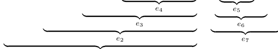
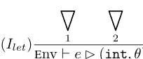
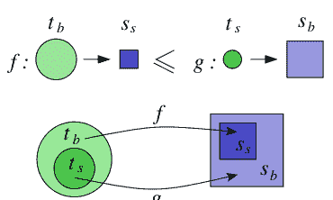

## 5 类型

考虑程序 $c_d$，它通过连续减法计算 $x$ 除以 $y$ 的欧几里得除法的商和余数，定义如下：

```
$(a := 0 ; b := x) ; \mathbf{while} \downarrow b \ge y \mathbf{do} b := \downarrow b - y ; a := \downarrow a + 1$
```

- 1) 计算 $[[c_d]]_{\text{Env}}$ 并推导出 $[[c_d]]_{\text{Env}}(\text{Mem})(\text{Env}(a))$ 是 $\text{Env}(x)$ 除以 $\text{Env}(y)$ 的整数除法的商，$[[c_d]]_{\text{Env}}(\text{Mem})(\text{Env}(b))$ 是此除法的余数。

- 2) 证明以下 Hoare 三元组的全部正确性：

```
$\{x \ge 0 \text{ and } y > 0\} c_d \{x = (\downarrow a \times y) + \downarrow b \text{ and } \downarrow b < y\}$
```

语言 Exp2 的语法，即定义构成该语言的表达式正确形式的规则，已在第 3 章中介绍。该语言的执行语义，说明用该语言编写的程序如何执行，已采用多种方法描述。

然而，在引入语言表达式时（特别是应用，参见第 3.1.1 节），接着是求值函数（参见第 3.2 节）以及运算符的解释（参见第 3.2.3 节），我们注意到语法并不能阻止我们编写无法求值的表达式，例如 3 + true、(1 2) 或 1 = false。换句话说，为该语言选择的执行语义无法为这些表达式赋值。现有语法也允许我们编写表达式 f = g，其中 f 和 g 是函数，这引发了关于此类表达式含义的实质性问题。下文将更深入地讨论这些语法正确但含义不明确的表达式的语义。

在表达式 3 + true 中，原语 + 的语义是 Z 上的加法。分配给 true 的语义不是 Z 的元素，因此不属于该加法的定义域。因此，此表达式无法求值。但是，可以通过将 true 与某个整数（例如 1）关联来在 Z 中为其分配语义。这可能不明智，因为 true 将承担双重角色，既表示真值又表示整数 1。开发人员、编译器、解释器和代码审查人员随后需要确定程序中每个 true 出现的角色，以分配正确的语义（这会造成显著的混淆风险，进而导致错误风险）。因此，在源代码中用整数对 true 进行编码容易出错。出于这个原因，我们引入了一组 IB 来为布尔值分配语义。

函数应用必须将函数值作为其左操作数。一旦形式参数被右操作数（即参数）替换，对函数值主体的求值将返回该应用的值。在表达式“(1 2)”中，常量 1 不是函数，因此没有主体；此应用无法求值。

在数学中，相等是定义在同一集合元素上的二元关系。由于 Exp₂ 的语义是在数学上定义的，ℤ 和 IB 是两个不相交的集合，其元素不可比较。例如，表达式 1 = false 的语义未定义。有些语言摆脱了与数学的这种联系。例如，在 Python 中，整数与布尔值之间存在已定义的相等关系。例如，1 = false 求值为 false，而 1 = true 求值为 true，但 42 = true 求值为 false。这对其他关系运算符也成立，因此，例如，在 Python 中 true < 2 求值为 true。

对于 f = g 这样的函数之间的相等，存在多种可能的语义。最好避免在程序中测试此类相等，因为结果往往不可预测。如果 f 和 g 的定义域或值域不同，它们显然不能相等。它们的类型将被称作“不兼容”（这一概念将在后面讨论）。但是，具有相同定义域和值域的两个函数之间的相等在数学中经常使用，例如，在以下陈述中：“如果两个关于实数的函数 f 和 g 满足 f = g，那么 ∫ᵇₐ f(t)dt = ∫ᵇₐ g(t)dt”。要使用此定理，我们首先需要证明 f = g。在程序执行过程中对该表达式求值需要一个算法，该算法要么写在源代码中，要么从库中导入，能够证明对于 f 和 g 定义域中的任何值 x，等式 f(x) = g(x) 为真。20 世纪初，逻辑学家证明，不存在能够在有限时间内确定任何两个函数是否“相同”的一般算法。函数相等性问题被称为不可判定。如果定义域是有限的，则仍然可以找到适应的算法，但执行所需的时间取决于定义域中元素的数量。在 Exp₂ 中，函数之间的相等不分配语义，因为这些相等的含义在很大程度上取决于函数的定义域。证明布尔值集合上两个函数的相等性很容易。另一方面，证明整数集合上两个函数（限于内存中可表示的整数）的相等性可能需要一些时间。尽管如此，出于各种原因，某些编程语言的设计者选择允许函数相等性测试。分配给表达式 f = g 的语义因此相当是临时性的。一个版本涉及定义的语法相等：x ↦ x + 2 等于其自身，但不等于 x ↦ 1 + x + 1，也不等于 x ↦ 2 + x 或 y ↦ y + 2。另一个选项关注编译后 f 和 g 的代码在内存中的位置相等性。

我们鼓励使用测试函数相等性的语言的读者查阅相关参考手册，了解分配给 f = g 的含义。但是，我们不建议使用此类表达式。

### 5.1. 类型检查：何时以及如何进行？

在本章开头介绍的示例中，我们引用了数学集合的概念，同时解释了为什么某些表达式应该被拒绝。出于源自数学逻辑研究的原因，编程语言研究中的“集合”概念被 *类型* 概念所取代。

在类型语言中，所有表达式都有类型，函数本身也是如此。例如，整数加法是一个函数，其参数是两个整数，结果是一个整数。浮点数（称为 floats）的加法是一个函数，其参数和结果都是 floats。但是，两种加法不能使用相同的算法，因为内存中整数和浮点数的内部表示完全不同：它们的编码结构不同，位的含义也不同。例如，要计算表达式 3 + 4.5，我们必须先确定使用哪种加法算法。某些强类型语言会拒绝此表达式，因为它“类型错误”。其他一些语言会接受它，但 3 会被视为浮点数值。这种转换通常保持隐式；最好的情况下，它们可能导致难以理解的程序，最坏的情况下，可能导致难以检测的执行错误。这些隐式转换很难在类型规则中予以考虑。

对程序进行类型检查是指验证其所有表达式的构造是否符合关于类型的良构规则，这些规则称为 *类型规则*。如果类型规则设计良好，可以证明类型正确的程序是 *一致* 的，也就是说，该程序的任何执行（如果不死循环）都会提供类型检查所给出的类型的结果。在这种情况下，该语言被称为 *强类型*。如果类型系统不能保证此属性，则称为 *弱类型*。例如，当系统允许在类型之间进行显式转换时就是这种情况：程序员可以强制编译器认为表达式的类型与编译器自身声明或计算的类型任意不同。

类型检查显著降低了编写和执行错误程序的风险。语言的类型语言及其表达式的类型规则定义了该语言的 *类型语义*，本章将对其进行正式研究。

#### 5.1.1. 何时验证类型？

有两种可能的类型检查机制。第一种是在程序执行期间验证类型，并确定执行是否可以安全继续或是否会发生运行时错误。这种语义称为 *动态类型*，它与语言的动态执行语义交互。当表达式被识别为类型正确时，其求值将返回一个


值不可能是输入错误；否则，将引发错误（该机制最初在第3章中与ErrT错误相关介绍）。在此情况下，语义规则必须包括类型规则，并必须解释由类型不兼容导致的错误。第二种机制是在执行前进行类型检查：这称为静态类型。只有当类型检查未检测到类型不兼容时，程序才能执行。因此，类型错误检测比动态类型的情况发生得更早，并且执行保证没有类型错误。执行语义只需处理类型正确的程序，使其更易于处理。

#### 5.1.2. 如何验证类型？

一旦选择了静态或动态类型机制，验证就有两种选择。某些编程语言要求程序员显式声明变量的类型。例如，在C语言中，示例3.3中介绍的计算n!的函数写作如下：

```c
int fact (int n) {
  if (n <= 1) return 1 ;
  else return n * fact (n - 1) ;
}
```

其中给出了参数n和结果的类型（int）。

如果该函数的代码使用了临时变量，则应声明该变量的类型：

```c
int fact (int n) {
  if (n <= 1) return 1 ;
  else {
    int rec_result = fact (n - 1) ;
    return n * rec_result ;
  }
}
```

类型检查器在应用类型规则时使用此显式类型信息，以保证该程序是类型正确的。其他一些语言不要求源代码中包含类型注解，任何表达式的类型都会自动推导。这种机制称为类型推断或类型综合。它也基于类型规则，但需要额外的分析。由此获得的类型被称为综合或推断的类型。

Exp2的设计采用了类型推断机制。第5.3节研究了定义第5.4节中描述的类型推断算法所用的正式类型验证规则。关于类型的更详细研究可见[PIE 02]。

### 5.2. 程序Exp<sub>2</sub>的非正式类型

#### 5.2.1. 第一个示例

让我们先直观地计算第3.1.4节中介绍的表达式[3.3]的类型：

let x(1) = 25 in let f = fun x(2) ↦ x(3) + 3 in (f 7) + x(4)

- let x(1) = 25 in ...

第一个let将x(1)绑定到常量值25。由于这个字面常量表示一个整数，我们推断x(1)必须具有整数类型，表示为int。

- let f = fun x(2) ↦ x(3) + 3 in ...

第二个let将f绑定到一个函数表达式。因此，它的类型必须是接受某种类型的参数并返回另一种类型值的函数的类型。现在，我们需要确定这两种类型。目前，参数x(2)的类型是未知的，因为没有为其提供类型注解。我们引入一个未知类型α（也称为类型变量）来表示这个未知类型。让我们检查f的函数体以推断结果的类型。这个函数体包含对+运算符的应用，其语义是两个整数的加法。这意味着f的结果必须是int类型；此外，作为+参数的两个子表达式也必须是int类型。3就是这种情况，因为它是表示整数的字面常量。左边的子表达式x(3)也需要是int类型。但是，x(3)是标识符x(2)的一个出现，由这个函数f绑定。只有当x(3)和x(2)（我们为其分配了未知类型α）具有相同类型时，这个函数才是类型正确的。因此，α = int。最后，f的类型是一个参数为整数并返回整数的函数的类型。这个类型表示为int → int，其中箭头表示函数的类型，其参数类型在箭头左侧，返回值类型在箭头右侧。

- (f 7) + x(4)

这个表达式是对+运算符的应用，它接受两个int类型的参数。左边，函数f明显被应用于一个整数（7是int类型）并返回一个整数。右边，x(4)是由let x(1) = 25 in ...绑定的标识符x(1)的一个出现，也是int类型。因此，+的应用是类型正确的，并返回一个int类型的结果，即整个表达式的类型。

在类型检查机制的这种非正式描述中，我们不得不检索标识符的类型。就像表达式在执行环境中求值一样，类型检查需要一个类型环境。作为一种初步方法，我们将考虑该环境将标识符绑定到其类型；这一点将在后面更详细地讨论。

#### 5.2.2. 条件表达式的类型检查

沿用我们的非正式方法，我们现在将计算表达式fun x ↦ if x then true else 0的类型。这是一个具有参数x的函数。与前一个示例一样，我们没有类型注解，因此x的类型是未知类型α。分析函数体，我们看到x充当条件，意味着它必须是布尔值，表示为bool。因此我们必须有α = bool。这个表达式结果的类型是条件表达式的类型。then分支的类型是bool，else分支的类型是int。应该选择哪种类型？让我们从另一个角度来看这个问题。当将此函数应用于实际值时，结果的类型将取决于参数的值，这一点阻止了该结果在源代码中进一步使用。因此，类型正确的条件表达式必须对布尔值进行测试，并在两种可能的情况下返回相同类型的值。结论，我们正在研究的这个表达式是类型错误的。

#### 5.2.3. 无类型约束的类型检查

在类型检查介绍的这最后部分，我们考虑以下表达式：

let f_(1) = fun x_(1) ↦ x_(2) in if (f_(2) true) then 8 else (f_(3) 7)

- let f_(1) = fun x_(1) ↦ x_(2) in ...

与我们的第一个示例一样，let将f_(1)绑定到一个函数表达式。因此，我们需要确定其参数和函数体的类型。同样，由于出现的x_(1)没有类型注解，其类型未知，将用α表示。f的函数体只是返回参数；这没有提供关于x类型的任何进一步信息。因此，该类型没有约束，意味着α可以被任何类型替代。确实，这个函数可以应用于任何值，因为它只是将该值作为结果返回。因此，f_(1)的类型是α → α。

- if (f_(2) true), then 8 else (f_(3) 7)

在条件表达式中，条件表达式必须是bool类型。因此，我们必须确保(f_(2) true)是bool类型。函数f_(1)的类型是α → α，由于它被应用于类型为bool的常量true，我们必须有α = bool。条件的类型是bool，因为α也是f_(1)结果的类型。现在，我们必须确保这个条件表达式两个分支中的表达式具有相同的类型。由于then分支是int类型，else分支也必须是int类型。最后一个分支是将f_(3)应用于类型为int的参数7，因此结果也是int类型。因此，条件表达式的两个分支具有相同的类型，这也是整个表达式的类型。但是，我们的推理中存在一个微妙的一致性问题，将在5.2.4节中解释。

#### 5.2.4. 多态

在第5.2.3节的最后一个示例中，将\( f_{(2)} \)应用于\( true \)时，我们使用了\( \alpha = \text{bool} \)。然后，将\( f_{(3)} \)应用于7时，我们隐式地使用了\( \alpha = \text{int} \)。根据等价的传递性，我们得到\( \text{bool} = \text{int} \)，这当然是错误的。但是，由于\( f \)是恒等函数，\( f \)的两种用法似乎都是合法的。虽然关于\( f_{(1)} \)的类型没有约束，但类型表达式\( \alpha \to \alpha \)不能直接用于在\( \alpha \)与几种可能不兼容的不同类型之间建立等式约束。对于\( f \)的每个出现，我们必须使用其类型表达式的一个“副本”，并将类型变量\( \alpha \)替换为新的类型变量（称为*新鲜变量*）。这可以防止由\( f \)的不同出现引入的类型约束之间产生干扰。因此，类型环境将标识符绑定到其类型的“形式”，而不是类型本身；这种形式称为*类型方案*。该方案可能包含称为*泛化*类型变量的特殊类型变量。在类型环境中查找标识符的类型时，会生成类型方案的一个“新鲜”副本，其中泛化类型变量被替换为新变量。这个副本称为方案的一个*实例*，这些新变量不是泛化的，因为它们表示某些尚未知晓的类型。因此，一个类型方案，记为\( \sigma \)，由泛化类型变量列表（待复制）和用这些变量编写的类型形状组成。上面描述的函数\( f \)的类型方案因此表示为\( \forall \alpha. \alpha \to \alpha \)。

在类型检查过程结束时，其类型包含类型变量的表达式被称为*多态*的。如我们将在第5.6节中看到，在类型检查过程结束时，某些表达式的类型可能包含无法泛化的未知变量。

### 5.3. Typing rules in Exp<sub>2</sub>

我们现在转向类型检查规则的正式定义。这些规则目前尚不允许我们在程序中综合类型，但它们使检查程序是否类型正确成为可能。这些规则将在第5.4节中用于开发自动类型计算的推断算法。

#### 5.3.1. 类型、类型方案和类型环境

首先，必须定义用于表示类型的表达式中使用的语言，称为*类型代数*。每种类型\( \tau \)对应一组值。Exp2包括整数、布尔和函数值。如我们所见，还需要类型变量。类型使用表5.1所示的文法归纳定义。

在以下内容中，\( \alpha_1 \to \alpha_2 \to \cdots \to \alpha_{n+1} \)将用于表示类型：

\(\alpha_1 \to (\alpha_2 \to (\cdots (\alpha_n \to \alpha_{n+1})))\)


## 表 5.1. Exp$_2$ 的类型代数

| $\tau := \alpha$ | 变量 |
| :--- | :--- |
| int | 整数 |
| bool | 布尔值 |
| $\tau_1 \to \tau_2$ | 函数 |

这种记法反映了这样一个事实：带有 \(n\) 个参数的函数 \(f : \alpha_1 \times \alpha_2 \times \cdots \times \alpha_n \rightarrow \alpha_{n+1}\) 总可以定义为单参数函数，该函数返回一个带有 \(n - 1\) 个参数的函数。

```ocaml
type var_name_t = string
type type_t = T_var of var_name_t | T_int | T_bool | T_fun of (type_t * type_t)

let new_ty_var =
  let cpt = ref 0 in
  function () -> cpt := !cpt + 1 ; T_var ("t" ^ (string_of_int !cpt))
val new_ty_var : unit -> type_t
```

类型代数在 OCaml 中使用和类型实现。变量通过名称（字符串）来区分。我们还定义了一个函数 new_ty_var，用于创建一个新的类型变量，其名称与所有已创建的变量不同。这种名称上的唯一性是通过一个局部于该函数的计数器实现的；该计数器在每次创建变量时递增，其值用作变量的名称。与之前的实现一样，Python 中使用类来对 OCaml 的和类型进行编码。

```python
class T_int:
    def __init__(self):
        pass

class T_bool:
    def __init__(self):
        pass

class T_fun:
    def __init__(self, t1, t2):
        self.t1 = t1
        self.t2 = t2

class T_var:
    def __init__(self, vname):
        self.vname = vname

var_cpt = 0


def new_ty_var():
    global var_cpt
    var_cpt = var_cpt + 1
    return T_var("t" + str(var_cpt))
```

每个类都定义为表示类型代数的一个构造子。虽然 OCaml 允许创建局部于函数的持久引用，但在 Python 中，用于为每个新变量分配唯一名称的计数器必须定义为全局变量。显然，只有函数 new_ty_var 会使用这个计数器。例如，第一次应用此函数将返回字符串 "t0"，第二次将返回 "t1"，以此类推。

与使用自然语言给出类型规则不同，我们引入了类型关系 Env ⊢ e : τ 的数学定义，它表示在类型环境 Env 中，表达式 e 具有类型 τ。对表达式进行类型化时，我们需要一个类型环境，该环境将每个标识符与一个类型方案关联，正如我们在 5.2.4 节中看到的，一个表达式可能从同一个类型方案中导出多种类型。在这种情况下，每种类型都源自一个“骨架”类型方案：这就是多态的定义。

### 定义 5.1. 类型方案：类型方案的语法由以下文法定义：σ := ∀α1 ... αn.τ，其中 τ 是方案的主体，α1, ..., αn 是泛化变量。

在方案中普遍量化变量 αi 出现的顺序并不重要。假设它们的名称都不同。例如，∀α1 α2. α1 → α2 和 ∀α2 α1. α1 → α2 表示相同的方案。此外，仅因量化变量名称不同而不同的两个类型方案被视为相同（这些方案也可以说是模 α-变换等价）。例如，∀α1 α2. α1 → α2 和 ∀α3 α4. α3 → α4 表示相同的方案。

类型环境由一组绑定列表表示：

Env = [(x1, σ1), · · · , (xn, σn)]

其中每个标识符 xi 都绑定到其类型方案 σi。

```ocaml
type scheme_t = (var_name_t list * type_t)
```

类型方案在 OCaml 中编码为一对，第一个组件是泛化变量的列表，第二个组件是表示方案主体的类型。Python 不允许类型定义，因此无法给出该语言的编码。然而，我们在 Python 和 OCaml 中使用相同的数据结构（即第一个组件是列表的一对）。类型环境的表示与执行环境中使用的表示类似。绑定到标识符的值简单地被类型方案替换。

```ocaml
type ty_env_t = (string * scheme_t) list
exception Unbound_var of string

let rec find_id_ty idname = function
  | [] -> raise (Unbound_var idname)
  | h :: q -> if fst h = idname then snd h else find_id_ty idname q
val find_id_ty : string -> (string * 'a) list -> 'a
```

```python
class Unbound_var(Exception):
    def __init__(self, id):
        self.id = id

def find_id_ty(idname, env):
    for (n, ty) in env:
        if n == idname: return ty
    raise Unbound_var(idname)
```

类型环境定义为标识符与其类型方案之间的关联列表。函数 `find_id_ty` 在其第二个参数（编码当前环境的列表）中搜索其第一个参数（标识符）的第一个出现位置。它从列表的开头开始，如果在到达列表末尾时未找到该参数，则引发特定错误。这种表示与执行环境中使用的表示类似；绑定到标识符的值简单地被类型方案替换。

#### 5.3.2. 泛化、替换和实例化

要构建环境，标识符必须绑定到类型方案，因此类型必须转换为方案。此转换需要两个步骤。然而，在少数不应进行泛化的情况下，类型会转换为所谓的平凡类型方案。

### 定义 5.2. 平凡类型方案：平凡方案是形式为 ∀0.τ 的方案。

```ocaml
let trivial_scheme ty = (([]), ty) : scheme_t
val trivial_scheme : type_t -> scheme_t
```

如果没有在 `trivial_scheme` 上显式添加类型注解 `scheme_t`，OCaml 将会将“更一般”的类型 `’a -> (’b list * ’a)` 与 `trivial_scheme` 关联。该注解会导致更精确的类型，这一点有助于开发人员。

```python
def trivial_scheme(ty):
    return ([], ty)
```

相反，对类型表达式中出现的变量进行泛化需要一个类型泛化操作，该操作返回一个多态类型方案。然而，只有某些变量才应被泛化：

- 在环境中任何位置都未出现的变量；
- 在环境中存在的类型方案中被泛化的变量；这些变量可以重命名而不改变方案的指称，称为绑定变量。

换句话说，环境中存在但未被 ∀ 绑定的变量不会被泛化：这些变量称为所涉环境的自由变量。自由变量表示一种尚未知晓的类型，环境中该变量的所有自由出现都表示同一类型。

### 定义 5.3. 类型方案的自由变量：类型方案 σ 的自由变量集合 F(σ) 包含 σ 的类型变量，即那些未被泛化的变量。该集合定义为：

F(∀α1 ... αn . τ) = F(τ) \ {α1, ..., αn}

其中 F(τ) 定义为：

- F(int) = F(bool) = ∅
- F(α) = {α}
- F(τ1 → τ2) = F(τ1) ∪ F(τ2)

此定义可扩展到类型环境：

F(Env) = ⋃ (x,σ)∈Env F(σ)

### 定义 5.4. 泛化：环境 Env 中类型 τ 的泛化是定义的类型方案：

Gen(τ, Env) = ∀α1 ... αn. τ，其中 {α1 ... αn} = F(τ) \ F(Env)

### 示例 5.1. 给定环境：

Env = [(x, ∀α1. α1 → α1), (y, ∀α1. α1 → α2), (z, ∀∅. α3), (w, ∀∅. int)]

我们有 F(Env) = {α2, α3}，并且：

Gen((α1 → α2) → (α3 → α4), Env) = ∀α1 α4. (α1 → α2) → (α3 → α4)

```ocaml
let find_vars_in_type in_ty =
  let rec rec_find accu = function
    | T_int | T_bool -> accu
    | T_fun (t1, t2) ->
        let new_accu = rec_find accu t1 in rec_find new_accu t2
    | T_var v_name ->
        if not (List.mem v_name accu) then v_name :: accu else accu
  in
  rec_find [] in_ty
val find_vars_in_type : type_t -> var_name_t list
```

```python
def find_vars_in_type(in_ty):
    def rec_find(accu, ty):
        if isinstance(ty, T_int) or isinstance(ty, T_bool):
            return []
        elif isinstance(ty, T_fun):
            return find_vars_in_type(ty.t1) + find_vars_in_type(ty.t2)
        elif isinstance(ty, T_var):
            if ty.vname in accu: return accu
            else: return [ty.vname] + accu
        else: raise ValueError
    return rec_find([], in_ty)
```

用于在类型中查找自由变量的函数在类型结构上递归操作。在类型变量的情况下，我们使用标准库中的 List.mem 函数来验证元素是否属于列表；这防止将变量多次插入到累加器中。

```ocaml
let rec find_vars_in_env = function
  | [] -> []
  | (_, (gen_vars, body)) :: rem ->
      let vars_of_body = find_vars_in_type body in
      let sch_free_vars =
        List.filter (fun var -> not (List.mem var gen_vars)) vars_of_body in
      sch_free_vars @ (find_vars_in_env rem)
val find_vars_in_env :
  ('a * (var_name_t list * type_t)) list -> var_name_t list
```

```python
def find_vars_in_env(env):
    accu = []
    for (_, (gen_vars, body)) in env:
        vars_of_body = find_vars_in_type(body)
        sch_free_vars = \
            list(filter(lambda var: not (var in gen_vars), vars_of_body))
        accu = accu + sch_free_vars
    return accu
```

```ocaml
let generalize env ty =
    let vars_of_ty = find_vars_in_type ty in
    let vars_of_env = find_vars_in_env env in
    let gen_vars =
      List.filter (fun var -> not (List.mem var vars_of_env)) vars_of_ty in
    (gen_vars, ty)
val generalize :
  ('a * ('b * type_t)) list -> type_t -> (var_name_t list * type_t)
```

```python
def generalize(env, ty):
    vars_of_ty = find_vars_in_type(ty)
    vars_of_env = find_vars_in_env(env)
    gen_vars = list(filter(lambda var: not (var in vars_of_env), vars_of_ty))
    return (gen_vars, ty)
```


泛型化函数分三个阶段进行。首先，获取待泛型化类型中存在的所有变量。然后，计算环境中的自由变量集合。最后一步计算类型中存在的变量列表，排除环境中找到的变量。在 OCaml 中，此过滤操作使用标准库中的 `List.filter` 函数执行，该函数仅保留列表中满足给定谓词的元素。在 Python 中，通过使用 `lambda` 构造定义此谓词来执行过滤。

相反，若要为标识符表达式进行类型推导，需要从环境中绑定到该标识符的类型方案生成一个类型。这由 `instantiation` 操作完成，该操作通过“特化”方案返回一个方案的 `instance`。一个实例的正式定义使用 `substitution` 的概念，如下所示。

**定义 5.5. 替换：** 替换是从类型变量集合到类型代数的偏函数，具有有限定义域。
\([\alpha_1 \leftarrow \tau_1; \dots; \alpha_n \leftarrow \tau_n]\) 表示替换 \(\theta\)。\(\theta\) 的定义域，记作 \(\text{dom}(\theta)\)，是集合 \(\{\alpha_1, \dots, \alpha_n\}\)。\(\theta\) 的值域，记作 \(\text{codom}(\theta)\)，是集合 \(\{\tau_1, \dots, \tau_n\}\)。\(\theta\) 将类型 \(\tau_i\) 关联到变量 \(\alpha_i\)。

_为简化起见，在以下内容中，我们假设_ \(\text{dom}(\theta)\) _中的变量互不相同，并且：_

\(\text{dom}(\theta) \cap \bigcup_{\tau \in \text{codom}(\theta)} \mathcal{F}(\tau) = \emptyset\)

替换自然扩展为从类型到类型的偏函数，仍具有有限定义域，方式如下：

\(\overline{\theta}(\text{int}) = \text{int} \quad \overline{\theta}(\text{bool}) = \text{bool}\)

\(\overline{\theta}(\alpha) = \begin{cases} \theta(\alpha) & \text{if } \alpha \in \text{dom}(\theta) \\ \alpha & \text{else} \end{cases}\)

\(\overline{\theta}(\tau_1 \to \tau_2) = \overline{\theta}(\tau_1) \to \overline{\theta}(\tau_2)\)

从今以后，我们将把替换 \(\theta\) 及其扩展 \(\overline{\theta}\) 视为同一对象，两者均记作 \(\theta\)。定义替换所用的假设保证，对于任意类型 \(\tau\)，\(\overline{\theta}(\overline{\theta}(\tau)) = \overline{\theta}(\tau)\)（在这种情况下，\(\theta\) 被称为 _幂等的_）。

```ocaml
type subst_t = (var_name_t * type_t) list
let empty_subst = ([]) : subst_t
val empty_subst : subst_t
let singleton var_name ty = ([(var_name, ty)] : subst_t)
val singleton : var_name_t -> type_t -> subst_t
```

```python
empty_subst = []
def singleton(var_name, ty):
    return [(var_name, ty)]
```

替换由关联列表表示，即一对对的列表，其中第一个组件表示类型变量的名称，第二个组件表示用于替换该变量的类型。如果关联列表只包含一个元素，则该替换称为初等替换。

```ocaml
let rec apply_one transf = function
| T_fun (t1, t2) -> T_fun (apply_one transf t1, apply_one transf t2)
| T_var var_name ->
  if (fst transf) = var_name then snd transf else T_var var_name
| any -> any
val apply_one : (var_name_t * type_t) -> type_t -> type_t
```

```python
def apply_one(transf, ty):
    if isinstance(ty, T_int) or isinstance(ty, T_bool):
        return ty
    elif isinstance(ty, T_fun):
        return T_fun(apply_one(transf, ty.t1), apply_one(transf, ty.t2))
    elif isinstance(ty, T_var):
        (fst_transf, snd_transf) = transf
        if fst_transf == ty.vname:
            return snd_transf
        else:
            return ty
    else:
        raise ValueError
```

函数 apply_one 的第一个参数是编码初等替换的列表，第二个参数是一个类型。该函数返回该类型的更新，其中初等替换涉及的变量被其关联的类型所替换。

```ocaml
let rec apply ty = function
| [] -> ty
| h :: q -> apply (apply_one h ty) q
val apply : type_t -> (var_name_t * type_t) list -> type_t
```

```python
def apply(ty, subst):
    ty_res = ty
    for transf in subst:
        ty_res = apply_one(transf, ty_res)
    return ty_res
```

apply 函数将替换应用于类型。换句话说，该类型的更新是通过迭代执行表示替换的列表中包含的初等替换来完成的。这种做法之所以正确，是基于定义 5.5 中确立的假设。

替换的概念用于定义类型方案的实例。

**定义 5.6.** 实例：如果存在替换 \(\theta\)，使得 \(\text{dom}(\theta) = \{\alpha_1, \dots, \alpha_k\}\) 且 \(\tau' = \theta(\tau)\)，则称 \(\tau'\) 是类型方案 \(\sigma = \forall \alpha_1 \dots \alpha_k . \tau\) 的一个实例，记作 \(\sigma \le \tau'\)。在这种情况下，类型 \(\tau'\) 与 \(\tau\) 兼容。

#### 5.3.3. 类型规则与类型树

我们现在可以给出用于确保表达式具有良好类型的规则。这些规则在 Box 5.1 中给出，采用了 3.3 节中已用于描述 **Exp**<sub>2</sub> 的大步运行语义的符号。我们给出关系 \(\text{Env} \vdash e : \tau\) 的正式定义，这意味着在类型环境 Env 中，表达式 \(e\) 的类型为 \(\tau\)。

\((T_\text{true}) \frac{}{\text{Env} \vdash true : \text{bool}} \quad (T_\text{false}) \frac{}{\text{Env} \vdash false : \text{bool}} \quad (T_\text{int}) \frac{}{\text{Env} \vdash i : \text{int}}\)
\((T_\text{var}) \frac{\text{Env}(x) \le \tau}{\text{Env} \vdash x : \tau} \quad (T_\text{unop}) \frac{\text{Env} \vdash \text{op} : \tau_1 \to \tau_2 \quad \text{Env} \vdash e : \tau_1}{\text{Env} \vdash \text{op } e : \tau_2}\)
\((T_\text{binop}) \frac{\text{Env} \vdash \text{op} : \tau_1 \to \tau_2 \to \tau_3 \quad \text{Env} \vdash e_1 : \tau_1 \quad \text{Env} \vdash e_2 : \tau_2}{\text{Env} \vdash e_1 \text{ op } e_2 : \tau_3}\)
\((T_\text{ite}) \frac{\text{Env} \vdash e_1 : \text{bool} \quad \text{Env} \vdash e_2 : \tau \quad \text{Env} \vdash e_3 : \tau}{\text{Env} \vdash \text{if } e_1 \text{ then } e_2 \text{ else } e_3 : \tau}\)
\((T_\text{fun}) \frac{(x, \forall \emptyset . \tau_1) \oplus \text{Env} \vdash e : \tau_2}{\text{Env} \vdash \text{fun } x \mapsto e : \tau_1 \to \tau_2}\)
\((T_\text{let}) \frac{\text{Env} \vdash e_1 : \tau_1 \quad \sigma = \text{Gen}(\tau_1, \text{Env}) \quad (x, \sigma) \oplus \text{Env} \vdash e_2 : \tau_2}{\text{Env} \vdash \text{let } x = e_1 \text{ in } e_2 : \tau_2}\)
\((T_\text{rec}) \frac{(f, \forall \emptyset . \tau_1 \to \tau_2) \oplus (x, \forall \emptyset . \tau_1) \oplus \text{Env} \vdash e : \tau_2}{\text{Env} \vdash \text{rec } f \, x = e : \tau_1 \to \tau_2}\)
\((T_\text{app}) \frac{\text{Env} \vdash e_1 : \tau_2 \to \tau_1 \quad \text{Env} \vdash e_2 : \tau_2}{\text{Env} \vdash (e_1 \, e_2) : \tau_1}\)

**Box 5.1.** _**Exp**<sub>2</sub> 中的类型规则_

规则 \(T_\text{true}\)、\(T_\text{false}\) 和 \(T_\text{int}\) 表示布尔常量的类型为 \(\text{bool}\)，整数常量的类型为 \(\text{int}\)。根据规则 \(T_\text{var}\)，标识符的类型是其在类型环境中绑定的方案的一个实例，且 \(\text{Env}(x)\) 表示在 Env 中绑定到 \(x\) 的类型方案。规则 \(T_\text{unop}\) 指出，一元运算符作用于参数的表达式的类型是该运算符返回的类型，前提是参数的类型是该运算符要求的类型。类似地，规则 \(T_{binop}\) 指出，二元运算符作用于两个参数的表达式的类型是该运算符返回的类型，前提是两个参数的类型都是该运算符要求的类型。规则 \(T_{ite}\) 指出，条件表达式的类型是其 then 和 else 分支所构成的两个子表达式共享的类型，前提是条件子表达式的类型为 bool。

根据规则 \(T_{fun}\)，如果当变量 \(x\) 的类型被取为 \(\tau_1\) 时表达式 \(e\) 的类型为 \(\tau_2\)，那么一个主体为表达式 \(e\) 的变量 \(x\) 的函数的类型为 \(\tau_1 \to \tau_2\)。请注意，绑定到参数 \(x\) 的方案是平凡的：\(\tau_1\) 中可能出现的类型变量不会被泛型化。如果这些变量被泛型化，则可能对不正确的程序进行类型推导。例如，考虑表达式 fun \(x \mapsto\) if \(x\) then \(x + 1\) else \(x + 2\)。对该表达式进行类型推导必须失败，因为 \(x\) 既被用作布尔值（规则 \(T_{ite}\)），又被用作整数（规则 \(T_{binop}\)）。如果将 \(x\) 的类型泛型化为一个用于类型检查函数主体的方案，那么 \(x\) 的每个出现都将使用方案的一个新实例进行类型推导：第一个实例与布尔值兼容，而第二个实例与整数兼容。因此，类型 \(\tau_1\) 不会被泛型化，这意味着函数主体中 \(x\) 的所有出现都必须使用同一个实例。

规则 \(T_{let}\) 指出，表达式 let \(x = e_1\) in \(e_2\) 的类型是子表达式 \(e_2\) 的类型，假设 \(x\) 绑定到泛型化 \(e_1\) 类型的方案。根据规则 \(T_{rec}\)，一个主体为表达式 \(e\) 的变量 \(x\) 的递归函数 \(f\) 的类型为 \(\tau_1 \to \tau_2\)，其中 \(\tau_2\) 是 \(e\) 在以下假设下的类型：\(x\) 的类型为 \(\tau_1\)，以及 \(f\) 的类型方案与 \(\tau_1 \to \tau_2\) 兼容。最后，规则 \(T_{app}\) 指出，要将表达式 \(e_1\) 应用于参数 \(e_2\)，\(e_1\) 必须是函数类型 \(\tau_1 \to \tau_2\)，且 \(e_2\) 必须是类型 \(\tau_1\)。整体表达式的类型是函数结果的类型，即 \(\tau_2\)。

请注意，规则 \(T_{rec}\) 将递归定义的函数与一个平凡的类型方案之间的绑定引入环境。因此，表达式

```
rec f x = let y = (f 7) in (f true)
```

会被类型检查过程拒绝。确实，\(f\) 在该表达式中既被用作类型 int \(\to \alpha\)，也被用作类型 bool \(\to \alpha\)。

请注意，将 \(f\) 的类型泛型化，即给 \(f\) 赋予类型 \(\beta \to \alpha\)，在表达式求值所用的执行语义方面仍然是正确的。\(f\) 的方案必须限制为一个平凡方案，以保证类型推导的可判定性（即设计一种保证终止的类型计算算法的可能性）。


注.-- 此限制也适用于允许定义互递归函数的语言，即使互定义的函数并不执行实际的递归调用。因此，下面这个显然正确的程序将被类型检查过程拒绝：

```OCaml
let rec map f l = match l with [] -> [] | h :: q -> (f h) :: (map f q)
and map_succ l = map (fun x -> x + 1) l
and map_not l = map (fun x -> not x) l ;;
Error: This expression has type int but an expression was
 expected of type bool
```

该程序重新定义了对列表 l 上作为参数传入的函数 f 进行迭代的函数 map。在这个互递归定义中（由 let rec 和 and 引入），它还定义了一个给整数列表的每个元素加 1 的函数，以及一个对布尔列表的每个元素取补的函数。由于在同一定义中 map 被应用于整数列表和布尔列表，OCaml 编译器拒绝了这三个函数的联合定义。子表达式 map 的类型检查不会对其类型进行泛化。如果 map 独立于其两种用途进行递归定义，则会进行泛化。

```OCaml
let rec map f l = match l with [] -> [] | h :: q -> (f h) :: (map f q) ;;
val map : ('a -> 'b) -> 'a list -> 'b list = <fun>
```

```OCaml
let map_succ l = map (fun x -> x + 1) l
and map_not l = map (fun x -> not x) l ;;
val map_succ : int list -> int list = <fun>
val map_not : bool list -> bool list = <fun>
```

为避免此类困难，OCaml 提供了关键字 rec 来标注其作者认为是递归的函数。使用此标注可避免隐式地将所有函数视为递归函数（如许多没有类型推断的语言所做），这将禁止对其类型进行泛化，从而取消任何多态性的可能性。

请注意，在编译期间区分递归函数和非递归函数还有其他优势，包括能够生成更高效的代码。

计算表达式类型所涉及的不同阶段可以用类型树的形式描述，类似于第 3 章中用于表示表达式求值的树。

## 示例 5.2.- 表达式 let f = fun x -> x in (f 5) 的类型树如下：

(T_var) α ≤ α
----------------
(x, ∀θ, α) ⊕ Env ⊢ x : α
(T_var) β → β ≤ int → int
Env' ⊢ 5 : int
----------------
(T_app) ...
(T_let) Env ⊢ let f = fun x -> x in (f 5) : int

### 5.4. Exp2 中的类型推断算法

第 5.3 节介绍的规则用于验证包含类型注释的程序的类型。它们还定义了语言的类型系统，并且如我们在第 5.5 节中将看到的那样，保证类型正确程序的某些安全性属性。在本节中，我们描述一个从程序表达式生成类型的算法。推而广之，此推断算法也可用于检查程序是否类型正确。显然，类型推断算法必须相对于类型系统及其相关规则是正确的。类型推断的优势在于，程序员无需在程序中提供显式的类型注释。

#### 5.4.1. 主类型

类型推断算法由一组规则正式描述。这些规则确立了这样一个事实：在类型环境 Env 中，当类型上由替换 θ 描述的一组约束可以被满足时，表达式 e 的类型为 τ（例如，这组约束不得要求类型变量 α 同时等于 int 和 bool）。这表示为 Env ⊢ e ▷ (τ, θ)。

此外，在多态性情况下，此算法计算的类型 τ 必须尽可能一般：它称为 e 的主类型。例如，表达式 fun x -> fun y -> (x y) 的类型是 τ0 = (α → β) → α → β，但也可能是：

- τ1 : (int → int) → int → int
- τ2 : (int → bool) → int → bool
- τ3 : (int → bool → int) → int → bool → int

然而，类型 τ0 是最一般的，因为它允许该表达式在最多的上下文中使用。其他可能的类型都由应用于 τ0 的替换得到。例如，类型 τ1、τ2 和 τ3 可按以下方式获得：

- τ1 = τ0[α ← int, β ← int]
- τ2 = τ0[α ← int, β ← bool]
- τ3 = τ0[α ← int, β ← (bool → int)]

考虑表达式的主类型可以防止某些类型冲突。如果类型推断算法不使用表达式的主类型，它可能会拒绝实际上是类型正确的表达式。出于这个原因，任何表达式都必须具有属于类型系统的主类型（在 Exp2 语言中情况如此），否则推断将不可能，或者用户将被迫为程序的某些部分提供类型注释。

#### 5.4.2. 约束集与一元化

类型推断算法确立，当一组约束可以被满足时，即存在一个解时，表达式 \( e \) 的类型为 \( \tau \)。约束引入了两种类型之间的等式。例如，从表达式 if \( (f\ 4) \) then \( 5 \) else \( (g\ true) \)，我们推导出以下需要满足的约束集：

- \( f \) 的类型 \( \tau_f \) 是函数类型：\( \tau_f = \alpha \rightarrow \beta \)；
- \( f \) 的参数是整数：\( \alpha = \text{int} \)；
- 由于 \( f \) 的结果用作条件，因此它是布尔值：\( \beta = \text{bool} \)；
- \( g \) 的类型 \( \tau_g \) 是函数类型：\( \tau_g = \gamma \rightarrow \delta \)；
- \( g \) 的参数是布尔值：\( \gamma = \text{bool} \)；
- \( g \) 的结果与表达式 5 具有相同的类型，即它是整数：\( \delta = \text{int} \)。

如果所有这些等式约束可以同时被满足，那么该表达式就是类型正确的。在这里，如果取 \( \alpha = \text{int} \)、\( \beta = \text{bool} \)、\( \gamma = \text{bool} \) 和 \( \delta = \text{int} \)，则成立。此时未受约束的变量是可泛化的（在某些条件下），并有助于建立类型的多态性。

证明约束 \( \tau_1 = \tau_2 \) 已被满足，需要能够将等号左边和/或右边的某些变量替换为类型，这些类型本身可能包含其自己的变量。换句话说，必须存在一个替换 \( \theta \)，使得 \( \theta(\tau_1) = \theta(\tau_2) \)。确定是否存在这样的替换被称为类型一元化问题。如果存在这样的替换，则称 \( \tau_1 \) 和 \( \tau_2 \) 为 *可一元化的*，并称替换 \( \theta \) 为术语 \( \tau_1 \) 和 \( \tau_2 \) 的 *一元子*。因此，如果两个术语的全部或部分变量可以被同一替换实例化，从而使它们在结构上相等，则它们是可一元化的。

由于一个表达式可能被赋予多种类型，因此可能存在多个替换来识别两个术语（这就是类型多重性的原因）。考虑两个术语 \( \tau_1 = \alpha \rightarrow \beta \) 和 \( \tau_2 = \alpha \rightarrow \text{bool} \)。两个替换 \( \theta_1 = [\alpha \leftarrow \text{int}; \beta \leftarrow \text{bool}] \) 和 \( \theta_2 = [\beta \leftarrow \text{bool}] \) 是 \( \tau_1 \) 和 \( \tau_2 \) 的一元子，因为 \( \theta_1(\tau_1) = \theta_1(\tau_2) = \text{int} \rightarrow \text{bool} \) 且 \( \theta_2(\tau_1) = \theta_2(\tau_2) = \alpha \rightarrow \text{bool} \)。

\(\tau_1\) 和 \(\tau_2\) 的 _主一元子_（也常称为 _最一般一元子_）是一个替换 \(\mu\)，使得对于任何其他一元子 \(\theta\)，\(\theta(\tau_1)\) 是 \(\mu(\tau_1)\) 的一个实例，即 \(\theta(\tau_1)\) 可以通过对 \(\mu(\tau_1)\) 应用替换 \(\theta'\) 得到。这基本上相当于说主一元子 \(\mu\) 是一个最小替换，因此所有其他一元子 \(\theta\) 都包含此替换，并可写为 \(\theta = \theta' \circ \mu\)。在前一个示例中，\(\theta_2\) 是主一元子，而 \(\theta_1\) 不是。在这种情况下，有 \(\theta_1 = [\alpha \leftarrow \text{int}] \circ \theta_2\)。

两种类型 \(\tau_1\) 和 \(\tau_2\) 的主一元子是通过求解方程组 \(\{\tau_1 = \tau_2\}\) 计算得出的。第 5.4.2 节介绍的一元化算法 Mgu 可用于求解此类方程组。它以类型之间的等式集 \(Q\)（称为 _约束_）作为参数。系统 \(Q\) 的解（当存在时）是一个替换 \(\theta\)，使得对 \(Q\) 中的每个方程 \(\tau_1 = \tau_2\)，都有 \(\theta(\tau_1) = \theta(\tau_2)\)。该算法是递归的，并计算系统 \(Q\) 的最一般一元子。系统 \(Q[\alpha \leftarrow \tau]\) 表示系统 \(Q\)，其中在每个方程中 \(\alpha\) 被 \(\tau\) 替换。如果没有列出的情况适用，则操作失败，触发类型推断过程的失败。值得注意的是，如果等式的一边是变量，则另一边不能是包含该变量的类型（除非它本身是变量）。此约束对于避免对形式 Mgu (\(\{\alpha = \text{int} \to \alpha\}\)) 的问题进行无限循环是必需的，此类问题不存在有限大小的类型来求解该方程。如果 \(\alpha = \text{int} \to \alpha\)，则有 \(\alpha = \text{int} \to \text{int} \to \alpha\)、\(\alpha = \text{int} \to \text{int} \to \text{int} \to \alpha$，以此类推。

```
Mgu (∅) = id
Mgu ({α = α} ∪ Q) = Mgu (Q)
Mgu ({α = τ} ∪ Q) = Mgu (Q[α ← τ]) ◦ [α ← τ] if α ∉ F(τ)
Mgu ({τ = α} ∪ Q) = Mgu (Q[α ← τ]) ◦ [α ← τ] if α ∉ F(τ)
Mgu ({int = int} ∪ Q) = Mgu (Q)
Mgu ({bool = bool} ∪ Q) = Mgu (Q)
Mgu ({τ₁ → τ'₁ = τ₂ → τ'₂} ∪ Q) = Mgu ({τ₁ = τ₂; τ'₁ = τ'₂} ∪ Q)
```

### 方框 5.2. Exp\(_2\) 的类型一元化算法

### 示例 5.3.- 让我们计算 \(\tau_1 = \alpha_1 \to (\alpha_2 \to \text{int})\) 和 \(\tau_2 = \text{int} \to (\alpha_3 \to \alpha_1)\) 的主一元子。

Mgu ({\alpha_1 \to (\alpha_2 \to \text{int}) = \text{int} \to (\alpha_3 \to \alpha_1)})
= Mgu ({\alpha_1 = \text{int}; \alpha_2 \to \text{int} = \alpha_3 \to \alpha_1})
= Mgu ({\alpha_2 \to \text{int} = \alpha_3 \to \text{int}}) \circ [\alpha_1 \leftarrow \text{int}]
= Mgu ({\alpha_2 = \alpha_3; \text{int} = \text{int}}) \circ [\alpha_1 \leftarrow \text{int}]
= Mgu ({\text{int} = \text{int}}) \circ [\alpha_2 \leftarrow \alpha_3] \circ [\alpha_1 \leftarrow \text{int}]
= Mgu (\emptyset) \circ [\alpha_2 \leftarrow \alpha_3] \circ [\alpha_1 \leftarrow \text{int}]
= \text{id} \circ [\alpha_2 \leftarrow \alpha_3] \circ [\alpha_1 \leftarrow \text{int}]
= [\alpha_2 \leftarrow \alpha_3; \alpha_1 \leftarrow \text{int}] = \theta


我们可以验证 \(\theta(\tau_1) = \theta(\tau_2) = \text{int} \to (\alpha_2 \to \text{int})\)。

```OCaml
exception Cycle
exception Incompatible_tys of (type_t * type_t)

let rec occur_check v_name = function
  | T_int | T_bool -> false
  | T_fun (t1, t2) -> (occur_check v_name t1) || (occur_check v_name t2)
  | T_var n -> v_name = n

val occur_check : var_name -> type_t -> bool
```

```OCaml
let rec unify t1 t2 =
  match (t1, t2) with
  | (T_int, T_int) | (T_bool, T_bool) -> empty_subst
  | (T_fun (a, b), T_fun (c, d)) ->
    let subst_left = unify a c in
    let b_subst = apply b subst_left in
    let d_subst = apply d subst_left in
    compose (unify b_subst d_subst) subst_left
  | (T_var v, other) | (other, T_var v) ->
    if occur_check v other then raise Cycle ;
    singleton v other
  | _ -> raise (Incompatible_tys (t1, t2))

val unify : type_t -> type_t -> subst_t
```

```Python
class Cycle (Exception) :
    pass

class Incompatible_tys (Exception) :
    def __init__ (self, ty1, ty2) :
        self.ty1 = ty1
        self.ty2 = ty2

def occur_check (v_name, ty) :
    if isinstance (ty, T_int) or isinstance (ty, T_bool) : return False
    elif isinstance (ty, T_fun) :
        return occur_check (v_name, ty.t1) or occur_check (v_name, ty.t2)
    elif isinstance (ty, T_var) : return ty.vname == v_name
    else : raise ValueError
```

```Python
def unify (ty1, ty2) :
    if (isinstance (ty1, T_int) and isinstance (ty2, T_int)) or\
       (isinstance (ty1, T_bool) and isinstance (ty2, T_bool)) :
        return empty_subst
    elif isinstance (ty1, T_fun) and isinstance (ty2, T_fun) :
        a, b, c, d = ty1.t1, ty1.t2, ty2.t1, ty2.t2
        subst_left = unify (a, c)
        b_subst = apply (b, subst_left)
        d_subst = apply (d, subst_left)
        return compose (unify (b_subst, d_subst), subst_left)
    elif isinstance (ty1, T_var) or isinstance (ty2, T_var) :
        (other, v) = (ty1, ty2.vname) if isinstance (ty2, T_var) \
        else (ty2, ty1.vname)
        if occur_check (v, other) : raise Cycle
        return singleton (v, other)
    else : raise Incompatible_tys (ty1, ty2)
```

验证“如果 \(\alpha \notin \mathcal{F}(\tau)\)”是通过函数 `occur_check` 进行的，该函数检查变量是否出现在类型中。正如我们从规则中所见，该函数用于变量必须与类型统一的两种情况。

函数 unify 通过两种类型的结构工作，在基本类型的情况下验证相等性，对函数类型进行递归调用，并在两种类型中有一个是变量的情况下扩展替换结果。

异常 `Incompatible_tys` 有两个参数：引发统一冲突的两种类型。这种可能性有助于创建错误消息，向用户提供有关问题性质的更多细节。出于效率考虑，此处给出的实现不是对一组约束进行操作，而仅对要统一的两种类型进行操作。

现在可以使用示例 5.3 测试统一函数 `unify`，使用 Python 语法定义此示例中的两种类型。

```Python
Type1 = T_fun ((T_var ("t1")), (T_fun ((T_var ("t2")), (T_int )))))
type2 = T_fun ((T_int )), (T_fun ((T_var ("t3")), (T_var ("t1"))))))
mgu = unify (type1, type2)
print_subst (mgu)
[('t1', <type.T_int object at 0x10cb29290>),
 ('t3', <type.T_var object at 0x10cb29150>)]
(t1 <- T_int); (t3 <- T_var (t2))
```

使用通用函数 `print` 显示替换并不能揭示替换本身的完整结构。使用用于显示类型和替换的函数（`print_subst`，未包含在此实现中），我们看到实现返回的结果与我们理论计算的结果相符。不过请注意，实现返回的替换中，\(\alpha_3\) 被替换为 \(\alpha_2\)；而在我们的示例中我们计算的是相反的情况，尽管两者都正确。这种差异是因为实现将两个不相交的情况 \(\mathsf{Mgu} \left( \{ \alpha = \tau \} \cup Q \right)\) 和 \(\mathsf{Mgu} \left( \{ \tau = \alpha \} \cup Q \right)\) 合并为单一情况处理（在某些情况下会导致定义域和陪域变量的反转）。

使用类型统一算法，我们现在可以介绍用于计算任何表达式类型的推理算法。

#### 5.4.3. 类型推理算法

##### 5.4.3.1. 类型方案的实例化

定义 5.7. – 类型方案的新鲜实例。我们定义函数 Inst (σ)，它返回类型方案 σ 的一个实例，其中广义化类型变量 αᵢ 被新鲜变量 α'ᵢ 替换，即在当前类型环境中没有自由出现的变量。

Inst (∀α₁, ..., αₙ.τ) = τ[α₁ ← α'₁, ..., αₙ ← α'ₙ]

为“新鲜变量”概念赋予正式含义意味着在整个形式化中包含无限可计数变量集合的存在，并跟踪 5.4.3 节所介绍推理算法中每条规则的假设和结论中使用的变量集合。为简单起见，我们将在记法中省略此技术细节。

```OCaml
let specialize (vars, body) =
  let fresh_assoc =
    List.map
    (fun var -> let fresh_var = new_ty_var () in (var, fresh_var)) vars in
  let rec copy ty =
    match ty with
    | T_int | T_bool -> ty
    | T_fun (t1, t2) ->
        let t1_copied = copy t1 in
        let t2_copied = copy t2 in
        T_fun (t1_copied, t2_copied)
    | T_var v_name ->
        (try List.assoc v_name fresh_assoc with Not_found -> ty) in
  copy body

val specialize : (var_name_t list * type_t) -> type_t
```

```Python
class Not_found (Exception) :
    pass

def list_assoc (key, l) :
    for (k, v) in l :
        if k == key : return v
    raise Not_found

def specialize (sch) :
    (vars, body) = sch
    fresh_assoc = list (map (lambda var : (var, new_ty_var ()), vars))
    def copy (ty) :
        if isinstance (ty, T_int) or isinstance (ty, T_bool) : return ty
        elif isinstance (ty, T_fun) :
            t1_copied = copy (ty.t1)
            t2_copied = copy (ty.t2)
            return T_fun (t1_copied, t2_copied)
        elif isinstance (ty, T_var) :
            try :
                return list_assoc (ty.vname, fresh_assoc)
            except Not_found : return ty
            else : raise ValueError
    return copy ( body)
```

函数 specialize 用于获取类型方案的一个实例，它创建一个关联列表，将方案中的每个广义化变量绑定到一个新鲜变量。随后，它沿着递归路径，复制方案体的结构，并将每个广义化变量替换为其对应的新鲜版本（否则，保留非广义化变量）。OCaml 实现使用标准库中的函数 List.assoc，该函数在关联列表中搜索与键关联的值，如果找不到，则引发异常 Not_found。此函数在 Python 中不存在，因此我们将其定义为 list_assoc。

由于环境包含类型方案，我们还需要能够将替换应用于方案和环境。

定义 5.8. – 应用于类型方案的替换：取一个类型方案 \(\sigma = \forall \alpha_1 \dots . \alpha_n . \tau\) 和一个替换 \(\theta\)，使得：

\((dom(\theta) \cup \mathcal{F}(\theta(\tau))) \cap \{ \alpha_1, \dots , \alpha_n \} = \emptyset\)

我们定义 \(\theta(\sigma) = \forall \alpha_1 \dots . \alpha_n . \theta(\tau)\)。

此定义显著禁止替换类型方案的广义化变量。在以下实现中，我们不验证替换的定义域和陪域中的变量是否出现在方案中。这一选择对推理算法的正确性没有影响，该算法仅在类型之间建立相等约束。此处的类型永远不包含广义化变量，因为它们由实例化操作产生，该操作用新鲜变量替换广义化变量。因此，构建的替换永远不会包含广义化变量。

注意.– 将替换 \(\theta\) 应用于类型方案 \(\sigma\) 的更一般定义是可能的，无需对 \(\sigma\) 和 \(\theta\) 作出任何假设。这是通过用既不在 \(\theta\) 的定义域中也不在 \(\theta(\tau)\) 中的变量重命名 \(\sigma\) 的广义化变量 \(\alpha_1 \dots . \alpha_n\) 来实现的。

将替换应用于环境归根结底是创建一个环境，其中绑定所涉及的方案的主体已被替换所转换。


```
OCaml
let subst_env subst env =
  List.map
    (fun (name, (vars, body)) ->
       let body' = apply body subst in
       let sch' = (vars, body') in
       (name, sch'))
    env
val subst_env :
  subst_t -> ('a * ('b * type_t)) list -> ('a * ('b * type_t)) list
```

```
Python
def subst_env (subst, env) :
  def do_binding (binding) :
    (name, sch) = binding
    (vars, body) = sch
    body_new = apply (body, subst)
    sch_new = (vars, body_new)
    return (name, sch_new)
```

##### 5.4.3.2. 替换的组合

推理算法通过递归处理表达式，确定等式约束。每一步，它构造一个替换和一个类型。类型是当前表达式的类型，替换记忆为获得该类型而必须满足的等式约束。为每个子表达式构造的替换必须组合。两个替换的组合定义如下。

组合两个替换 \(\theta_1\) 和 \(\theta_2\)，由列表表示
\[\theta_1 = [(\alpha_1, \tau_1), \cdots, (\alpha_n, \tau_n)] \quad \theta_2 = [(\beta_1, \tau'_1), \cdots, (\beta_k, \tau'_k)]\)

归结为计算替换 \(\theta_1 \circ \theta_2\)，使得 \(\theta_1 \circ \theta_2(x) = \theta_1(\theta_2(x))\)。因此，我们将 \(\theta_1\) 应用于 \(\theta_2\) 中包含的所有类型；替换 \(\theta_1\) 中仅保留那些变量不在 \(\theta_2\) 的定义域中的绑定。替换 \(\theta_1 \circ \theta_2\) 因此由列表表示：

\[[(\beta_1, \theta_1(\tau'_1)), \cdots, (\beta_k, \theta_1(\tau'_k)), (\alpha_1, \tau_1), \cdots, (\alpha_n, \tau_n)]\)

从中消去了所有满足 \(\beta_i = \theta_1(\tau'_i)\) 的对 \((\beta_i, \theta_1(\tau'_i))\)（因为在这种情况下，\(\beta_i\) 不再属于 \(\theta_1 \circ \theta_2\) 的定义域）以及所有满足 \(\alpha_i \in \{\beta_1, \cdots, \beta_k\}\) 的对 \((\alpha_i, \tau_i)\)（这些对不再有用，因为替换 \(\theta_2\) 在替换 \(\theta_1\) 之前应用）。

示例 5.4.– 给定两个替换：

\(\theta_1 = [(\alpha_1, \tau_1), (\alpha_2, \alpha_4)] \text{ and } \theta_2 = [(\alpha_3, \alpha_1 \rightarrow \tau_2), (\alpha_1, \tau_3), (\alpha_4, \alpha_2)]\)

组合 $\theta_1 \circ \theta_2$ 是替换：

$\theta_1 \circ \theta_2 = [(\alpha_1, \tau_3), (\alpha_3, \tau_1 \rightarrow \tau_2), (\alpha_2, \alpha_4)]$

在这种情况下，来自 \(\theta_1\) 的绑定 \((\alpha_1, \tau_1)\) 不被保留，因为 \(\alpha_1\) 属于 \(\theta_2\) 的定义域；绑定 \((\alpha_4, \theta_1(\alpha_2))\) 不被保留，因为 \(\alpha_4 = \theta_1(\alpha_2)\)。

```
OCaml
let compose subst1 subst2 =
  let subst_1_2 =
    (List.map (fun (name, ty) -> (name, apply ty subst1)) subst2) @
    (List.filter (fun (name, _) -> not (List.mem_assoc name subst2)) subst1) in
  List.filter
    (fun (name, ty) ->
      match ty with Types.T_var name -> name <> name' | _ -> true)
    subst_1_2
val compose : subst_t -> subst_t -> subst_t
```

```
Python
def list_mem_assoc (key, l) :
    for (k, v) in l :
        if k == key : return True
    return False

def compose (subst1, subst2) :
    def subst1_on_binding (binding) :
        (name, ty) = binding
        return (name, apply (ty, subst1))
    def filter_not_in_subst2 (binding) :
        (name, _) = binding
        return not (utils.list_mem_assoc (name, subst2))
    def filter_not_identity (binding) :
        (name, ty) = binding
        if isinstance (ty, T_var) : return name != ty.vname
        return True
    part1 = list (map (subst1_on_binding, subst2))
    part2 = list (filter (filter_not_in_subst2, subst1))
    return list (filter (filter_not_identity, part1 + part2))
```

该实现使用标准 OCaml 库中的函数 List.mem_assoc。该函数的参数是一个键和一个关联列表，它返回一个布尔值，指示该键是否出现在关联列表的定义域中。此函数在 Python 中不存在，因此我们将其命名为 list_mem_assoc 来定义。

##### 5.4.3.3. 类型推断

为了限制推理规则的数量，我们选择将一元和二元运算符的应用视为函数一般应用的特殊情况。通常（且无损失一般性），运算符的类型位于任何程序的初始环境中。运算符的名称与程序员声明的标识符的名称起完全相同的作用。在框 5.3 中呈现的规则中，id 表示恒等替换。

示例 5.5.- 用于推断表达式 $e$ 类型的树，定义如下：

```
let f = fun x ↦ fun y ↦ fun z ↦ if x then y else z in (((f true) 2) 3)
```





其中 \(\nabla_1\) 是以下所示的类型树 Env $\vdash e_1 \triangleright (\mathtt{bool} \to (\alpha_3 \to (\alpha_3 \to \alpha_3))), \theta_1)$，并通过以下内容得到：

```
$\mu_1 = \mathtt{Mgu}(\{\alpha_1 = \mathtt{bool}\}) = \mathtt{Mgu}(\emptyset) \circ [\alpha_1 \leftarrow \mathtt{bool}] = id \circ [\alpha_1 \leftarrow \mathtt{bool}]$
$= [\alpha_1 \leftarrow \mathtt{bool}]$
\(Env'_3 = \mu_1(id(Env_3)) = [(z, \forall \emptyset. \alpha_3), (y, \forall \emptyset. \alpha_2), (x, \forall \emptyset. \mathtt{bool})]\)
\(\mu_2 = \mathtt{Mgu}(\{id(\alpha_2) = \alpha_3\}) = \mathtt{Mgu}(\emptyset) \circ [\alpha_2 \leftarrow \alpha_3] = [\alpha_2 \leftarrow \alpha_3]\)
\(\theta_1 = \mu_2 \circ id \circ id \circ \mu_1 \circ id = \mu_2 \circ \mu_1 = [\alpha_2 \leftarrow \alpha_3; \alpha_1 \leftarrow \mathtt{bool}]\)
```

```
$(I_{true}) \frac{}{Env \vdash true \triangleright (\mathtt{bool}, id)} \qquad (I_{false}) \frac{}{Env \vdash false \triangleright (\mathtt{bool}, id)}$
$x \in dom(Env)$
$(I_{int}) \frac{}{Env \vdash v \triangleright (\mathtt{int}, id)} \qquad (I_{var}) \frac{}{Env \vdash x \triangleright (\mathtt{Inst}(Env(x)), id)}$
$Env \vdash e_1 \triangleright (\tau_1, \theta_1) \quad \mu_1 = \mathtt{Mgu}(\{\tau_1 = \mathtt{bool}\}) \quad \mu_1(\theta_1(Env)) \vdash e_2 \triangleright (\tau_2, \theta_2)$
\(\theta_2(\mu_1(\theta_1(Env))) \vdash e_3 \triangleright (\tau_3, \theta_3) \quad \mu_2 = \mathtt{Mgu}(\{\theta_3(\tau_2) = \tau_3\})\)
$(I_{ite}) \frac{}{Env \vdash \mathtt{if} \, e_1 \, \mathtt{then} \, e_2 \, \mathtt{else} \, e_3 \triangleright (\mu_2(\tau_3), \mu_2 \circ \theta_3 \circ \theta_2 \circ \mu_1 \circ \theta_1)}$
\(Env \vdash e_1 \triangleright (\tau_1, \theta_1) \quad \theta_1(Env) \vdash e_2 \triangleright (\tau_2, \theta_2)\)
\(\alpha \text{ fresh} \quad \mu = \mathtt{Mgu}(\{\theta_2(\tau_1) = \tau_2 \to \alpha\})\)
$(I_{app}) \frac{}{Env \vdash (e_1 \, e_2) \triangleright (\mu(\alpha), \mu \circ \theta_2 \circ \theta_1)}$
\(\alpha \text{ fresh} \quad (x, \forall \emptyset. \alpha) \oplus Env \vdash e \triangleright (\tau_1, \theta_1)\)
$(I_{fun}) \frac{}{Env \vdash \mathtt{fun} \, f \mapsto e \triangleright (\theta_1(\alpha) \to \tau_1, \theta_1)}$
\(Env \vdash e_1 \triangleright (\tau_1, \theta_1) \quad (x, \mathtt{Gen}(\tau_1, \theta_1(Env))) \oplus \theta_1(Env) \vdash e_2 \triangleright (\tau_2, \theta_2)\)
$(I_{let}) \frac{}{Env \vdash \mathtt{let} \, x = e_1 \, \mathtt{in} \, e_2 \triangleright (\tau_2, \theta_2 \circ \theta_1)}$
\(\alpha, \beta \text{ fresh} \quad (f, \forall \emptyset. \alpha \to \beta) \oplus (x, \forall \emptyset. \alpha) \oplus Env \vdash e \triangleright (\tau_1, \theta_1)\)
\(\mu = \mathtt{Mgu}(\{\theta_1(\beta) = \tau_1\})\)
$(I_{rec}) \frac{}{Env \vdash \mathtt{rec} \, f \, x = e \triangleright (\mu(\theta_1(\alpha \to \beta)), \mu \circ \theta_1)}$
```

### 框 5.3. Exp$_2` 的类型推断算法

因此，类型树 \(\nabla_1\) 如下：

```
(I_var) Env3 |- x > (alpha1, id)   (I_var) Env3' |- y > (alpha2, id)   (I_var) Env3' |- z > (alpha3, id)
(I_ite) --------------------------------------------------------------------------------------------
      (z, ∀∅. alpha3) (+) Env2 |- e4 > (alpha3, theta1)
(I_fun) --------------------------------------------------------------------------------------------
      (y, ∀∅. alpha2) (+) Env1 |- e3 > (alpha3 -> alpha3, theta1)
      Env2 -------------------------------------------------------------------------------------------
(I_fun) --------------------------------------------------------------------------------------------
      (x, ∀∅. alpha1) (+) Env |- e2 > (alpha3 -> (alpha3 -> alpha3), theta1)
      Env1 -------------------------------------------------------------------------------------------
(I_fun) --------------------------------------------------------------------------------------------
      Env |- e1 > (bool -> (alpha3 -> (alpha3 -> alpha3)), theta1)
```

并且 \(\nabla_2\) 是类型树：

```
     (I_var) Env4 |- f > (bool -> (alpha4 -> (alpha4 -> alpha4)), id)       5 / \\
(I_app) --------------------------------------------------------------------------------   4 / \\
      Env4 |- e5 > (alpha4 -> (alpha4 -> alpha4), mu3 o id)
(I_app) --------------------------------------------------------------------------------   3 / \\
      Env4 |- e6 > (int -> int, mu4 o id o mu3)
-------------------------------------------------------------------------------
      Env4 |- e7 > (int, mu5 o id o mu4 o id o mu3)
```

其中 Env4 = (x, ∀alpha3. (bool -> (alpha3 -> (alpha3 -> alpha3)))) (+) Env，并且 e5 的类型通过以下内容得到：

```
mu3 = Mgu({id(bool -> (alpha4 -> (alpha4 -> alpha4))) = bool -> alpha5})
= Mgu({bool = bool; alpha4 -> (alpha4 -> alpha4) = alpha5})
= Mgu({alpha4 -> (alpha4 -> alpha4) = alpha5})   = Mgu({emptyset}) o [alpha5 <- alpha4 -> (alpha4 -> alpha4)]
= [alpha5 <- alpha4 -> (alpha4 -> alpha4)]
mu3(alpha5) = alpha4 -> (alpha4 -> alpha4)
```

对于 e6 的类型：

```
mu3(Env4) = Env4
mu4 = Mgu({id(alpha4 -> (alpha4 -> alpha4)) = int -> alpha6})
= Mgu({alpha4 -> int; alpha4 -> alpha4 = alpha6})
= Mgu({int -> int = alpha6}) o [alpha4 <- int]
= Mgu({emptyset}) o [alpha6 <- int -> int] o [alpha4 <- int]
= [alpha6 <- int -> int; alpha4 <- int]
mu4(alpha6) = int -> int
```

对于 e7 的类型：

```
mu4(Env4) = Env4
mu5 = Mgu({id(int -> int) = int -> alpha7}) = Mgu({int = int; int = alpha7})
= Mgu({int = alpha7}) = Mgu({emptyset}) o [alpha7 <- int] = [alpha7 <- int]
mu5(alpha7) = int
```


$$\theta = \mu_5 \circ id \circ \mu_4 \circ id \circ \mu_3 = \mu_5 \circ \mu_4 \circ \mu_3$$ $$= [\alpha_7 \leftarrow int; \alpha_6 \leftarrow int \to int; \alpha_4 \leftarrow int; \alpha_5 \leftarrow int \to (int \to int)]$$ $$\nabla_3, \nabla_4 \text{ 和 } \nabla_5 \text{ 分别是下列树:}$$ $$(I_{int})_{\text{Env}_4 \vdash 3 \vartriangleright (int, id)} \qquad (I_{int})_{\text{Env}_4 \vdash 2 \vartriangleright (int, id)}$$ $$(I_{true})_{\text{Env}_4 \vdash true \vartriangleright (bool, id)}$$

```ocaml
let rec type_expr env = function
| Cste2 (CInt2 _) -> (T.int, empty_subst)
| Cste2 (CBool2 _) -> (T.bool, empty_subst)
| Var2 v -> (specialize (find_id_ty v env), empty_subst)
| Fun2 (arg_name, body) ->
let arg_ty = new_ty_var () in
let (body_ty, body_subst) =
type_expr
((arg_name, (trivial_scheme arg_ty)) :: env) body in
(T.fun (apply arg_ty body_subst, body_ty)),
body_subst)
| Letin2 (v_name, e1, e2) ->
let (e1_ty, e1_subst) = type_expr env e1 in
let new_env = (v_name, (generalize env e1_ty)) :: env in
let new_env2 = subst_env e1_subst new_env in
let (e2_ty, e2_subst) = type_expr new_env e2 in
(e2_ty, compose e2_subst e1_subst)
| App2 (e1, e2) ->
let (e1_ty, e1_subst) = type_expr env e1 in
let (e2_ty, e2_subst) =
type_expr
(type_expr (subst_env e1_subst env)) e2 in
let fun_res_ty = new_ty_var () in
let e1_ty_subst = apply e1_ty e2_subst in
let mu = unify (T.fun (e2_ty, fun_res_ty)) e1_ty_subst in
((apply fun_res_ty mu),
(compose mu (compose e2_subst e1_subst)))
| If2 (cond_e, then_e, else_e) ->
let (cond_ty, cond_subst) = type_expr env cond_e in
let mu1 = unify cond_ty T.bool in
let env_then = subst_env mu1 (subst_env cond_subst env) in
let (then_ty, then_subst) = type_expr env_then then_e in
let env_else = subst_env then_subst env_then in
let (else_ty, else_subst) = type_expr env_else else_e in
let mu2 = unify (apply then_ty else_subst) else_ty in
(apply else_ty mu2),
(compose mu2 (compose else_subst (compose then_subst (compose mu1 cond_subst)))))
| Rec2 (f_name, arg_name, body) ->
  let arg_ty = new_ty_var () in
  let fun_res_ty = new_ty_var () in
  let fun_ty = T_fun (arg_ty, fun_res_ty) in
  let new_env =
    (f_name, trivial_scheme fun_ty) ::
    (arg_name, (trivial_scheme arg_ty)) :: env in
  let (body_ty, body_subst) = type_expr new_env body in
  let mu = unify (apply fun_res_ty body_subst) body_ty in
    ((apply (apply fun_ty body_subst) mu),
     (compose mu body_subst))
val type_expr : (string * scheme_t) list -> exp2 -> (type_t * subst_t)
```

```python
def type_expr (env, exp):
    if isinstance (exp, Cste2) :
      if isinstance (exp.cst, CInt2) : return (T_int (), empty)
      elif isinstance (exp.cst, CBool2) : return (T_bool (), empty)
      else : raise AstValError
    elif isinstance (exp, Var2) :
      return (specialize (find_id_ty (exp.name, env)), empty)
    elif isinstance (exp, Fun2) :
      arg_ty = new_ty_var ()
      arg_name = exp.id_arg
      body = exp.body
      (body_ty, body_subst) = \
        type_expr ([(arg_name, trivial_scheme (arg_ty))] + env, \
                   body)
      return (T_fun (apply (arg_ty, body_subst), body_ty), \
              body_subst)
    elif isinstance (exp, Letin2) :
      (e1_ty, e1_subst) = type_expr (env, exp.exp1)
      new_env = [(exp.name, generalize (env, e1_ty))] + env
      newenv2 = subst_env (e1_subst, new_env)
      (e2_ty, e2_subst) = type_expr (new_env2, exp.exp2)
      return (e2_ty, compose (e2_subst, e1_subst))
    elif isinstance (exp, App2) :
      (e1_ty, e1_subst) = type_expr (env, exp.exp1)
      (e2_ty, e2_subst) = \
        type_expr (subst_env (e1_subst, env), exp.exp2)
      fun_res_ty = new_ty_var ()
      e1_ty_substed = apply (e1_ty, e2_subst)
      mu = unify (T_fun (e2_ty, fun_res_ty), e1_ty_substed)
      return \
        (apply (fun_res_ty, mu), \
         compose (mu, compose (e2_subst, e1_subst)))
    elif isinstance (exp, If2) :
      (cond_ty, cond_subst) = type_expr (env, exp.cond_e)
      mu1 = unify.unify (cond_ty, T_bool ())
      env_then = subst_env (mu1, subst_env (cond_subst, env))
      (then_ty, then_subst) = type_expr (env_then, exp.then_e)
      env_else = subst_env (then_subst, env_then)
      (else_ty, else_subst) = type_expr (env_else, exp.else_e)
      mu2 = unify.unify (apply (then_ty, else_subst), else_ty)
      return \
      (apply (else_ty, mu2), \
      compose \
      (mu2,\
      compose \
      (else_subst,\
      compose \
      (then_subst, compose (mu1, cond_subst)))))
    elif isinstance (exp, Rec2) :
      arg_ty = new_ty_var ()
      fun_res_ty = new_ty_var ()
      fun_ty = T_fun (arg_ty, fun_res_ty)
      new_env = \
      [(f_name, trivial_scheme (fun_ty))] + \
      [(arg_name, trivial_scheme (arg_ty))] + env
      (body_ty, body_subst) = type_expr (new_env, body)
      mu = unify.unify (apply (fun_res_ty, body_subst), body_ty)
      return \
      (apply (apply (fun_ty, body_subst), mu),\
      compose (mu, body_subst))
    else: raise AstValError
```

函数 type_expr 按表达式的结构进行定义。它返回一个对，其中第一个分量是类型化表达式的类型，第二个分量是类型化产生的替换。如前所述，一元运算符和二元运算符的情况不会单独讨论，因为这些只是通用应用 App2 的特例。

### 5.5. 属性

#### 5.5.1. 类型检查的属性

我们可以建立框 5.1 中阐述的类型系统的若干属性，这些属性保证了其相对于语言语义的正确性。这里列出了这些属性中最重要的一项，尽管我们不提供证明；相关证明可见 [DAM 82]。

> 提议 5.1.– 强安全性：设 e 为一个表达式，τ 为一个类型，Env$_t$ 为一个类型环境，Env 为一个求值环境，使得对 ∀x ∈ X，Env$_t$ ⊢ Env$(x)$ : Env$_t(x)$。如果 Env$_t$ ⊢ e : τ 且 Env ⊢ e $\rightsquigarrow v$，则 $v$ 是类型 τ 的一个值。

#### 5.5.2. 推断算法的属性

正如类型规则需要满足若干属性一样，算法本身必须满足四个要求：终止性、正确性、完备性和最一般性。终止性保证表达式的类型将在有限时间内被推断（编译器不会进入无限循环）。如果对于给定的表达式 e 和类型环境 Env，算法返回的类型相对于框 5.1 中阐述的类型规则是正确的，则该算法是正确的。这种正确性意味着推断算法不会产生错误结果。完备性意味着如果存在给定表达式 e 和类型环境 Env 的类型，则算法将找到它：换句话说，算法不会“遗漏”任何解。最一般性保证算法始终计算最一般的类型，其含义如第 5.4 节中所示。

提议 5.2.– 推断算法的正确性：如果 Env ⊢ e ▷ (τ, θ)，则 θ(Env) ⊢ e : τ。

提议 5.3.– 推断的完备性和最一般性：设 Env 为一个环境，e 为一个表达式。如果存在替换 θ′ 和类型 τ′，使得 θ′(Env) ⊢ e : τ′，则 Env ⊢ e ▷ (τ, θ)，并且存在替换 θ″，使得 τ′ = θ″(τ) 且 θ′ = θ″ ◦ θ。

### 5.6. 命令式构造的类型检查

为了引入命令式语言的类型检查，我们将为第 4 章中引入的语言 Lang3 定义规则，该语言使用块结构进行了扩展（参见第 4.6.1 节）。这里给出的类型系统不是框 5.1 中所示规则的扩展，因为我们不考虑函数特性，只考虑可变变量。因此，我们需要对定义语言（见表 4.1）、表达式语言（见表 4.2）和指令（见表 4.3）进行类型化。出于简洁考虑，将使用相同的符号来表示所有三种类型关系。

#### 5.6.1. 类型代数

由于引用属于值集合，因此必须为其指定一个类型，该类型称为 ref。为了以一致的方式处理引用所表示地址处存储的值，类型 ref 还必须指示被引用值的类型。Lang3 的内核不包含函数或多态性，仅包含整型和布尔型常量；因此类型代数非常简单。该代数如表 5.2 所示，包含整型 int、布尔型 bool 以及对类型 τ 值的引用类型，表示为 τ ref。

由于未考虑多态性，类型环境不将标识符绑定到类型方案，而只是绑定到类型。


| τ := int | 整数 |
| bool | 布尔值 |
| τ ref | 引用 |

### 表 5.2. Lang3 的类型代数

#### 5.6.2. 类型规则

让我们先列出语言中表达式的类型规则。与框 5.1 中介绍的规则类似，类型关系 Env ⊢ e : τ 确立，在类型环境 Env 中，表达式 e 是类型 τ。

- (T_int) k ∈ ℤ / Env ⊢ k : int
- (T_bool) k ∈ 𝔹 / Env ⊢ k : bool
- (T_var) Env(x) = τ / Env ⊢ x : τ
- (T_unop) ⊢ op : τ1 → τ2, Env ⊢ e : τ1 / Env ⊢ op e : τ2
- (T_binop) ⊢ op : τ1 → τ2 → τ3, Env ⊢ e1 : τ1, Env ⊢ e2 : τ2 / Env ⊢ e1 op e2 : τ3
- (T_ref) Env ⊢ e : τ / Env ⊢ ↑ e : τ ref
- (T_deref) Env ⊢ e : τ ref / Env ⊢ ↓ e : τ

### 框 5.4. Lang3 中表达式的类型规则

现在，让我们考虑变量声明和块的类型检查。变量声明 d 可用于通过将声明的标识符绑定到其定义表达式的类型来扩展类型环境。因此，关系 Env ⊢ d : Env' 表明，在环境 Env 中，对声明 d 进行类型检查将从 Env 创建一个新环境，记为 Env'。我们回顾，一个块写作 begin d c end，其中 d 是（可能为空的）声明序列（参见第 4.6.1 节），c 是一条指令。因此，我们需要对声明序列进行类型检查的规则。令 d d 表示以声明 d 开头、后跟序列 d 的序列。空序列记为 ∅。

我们选择认为，指令 c 没有类型，因为它没有值。尽管如此，给定类型环境 Env，类型算法必须检查指令中涉及的表达式是否被正确类型化。此类型关系记为 Env ⊢ c : WT（WT 表示 well-typed）。请注意，在某些语言中，例如 OCaml 或某些 C 扩展（例如 GCC 编译器可用的那些），

指令是表达式，这意味着它们具有值，因而具有类型。这些类型的性质取决于语言固有的选择。

- (T_let) Env ⊢ e : τ
  Env ⊢ let x = e ; (x, τ) + Env
- (T_descseq) Env ⊢ empty : Env
- (T_descseq) Env ⊢ d : Env1   Env1 ⊢ d : Env2
  Env ⊢ d d : Env2

### 框 5.5. Lang₃ 中声明的类型规则

- (T_assign) Env(x) = τ ref   Env ⊢ e : τ
  Env ⊢ x := e : WT
- (T_skip) Env ⊢ skip : WT
- (T_seq) Env ⊢ c1 : WT   Env ⊢ c2 : WT
  Env ⊢ c1 ; c2 : WT
- (T_loop) Env ⊢ e : bool   Env ⊢ c : WT
  Env ⊢ while e do c : WT
- (T_cond) Env ⊢ e : bool   Env ⊢ c1 : WT   Env ⊢ c2 : WT
  Env ⊢ if e then c1 else c2 : WT
- (T_block) Env ⊢ d : Env1   Env1 ⊢ c : WT
  Env ⊢ begin d c end : WT

### 框 5.6. Lang₃ 中指令的类型规则

### 示例 5.6. – 考虑在第 4.1 节中介绍并由以下内容定义的最大公约数计算程序：

```
begin let x = 45;let y = 5;
while not(↓ x = ↓ y) do if ↓ x <= ↓ y then y := ↓ y - ↓ x else x := ↓ x - ↓ y
end
```

其类型检查树为：

- (T_int) Env ⊢ 45 : int
- (T_int) Env1 ⊢ 5 : int
- (T_let) Env ⊢ let x = 45 ; Env1
- (T_let) Env1 ⊢ let y = 5 ; Env2
- (T_descseq) Env ⊢ let x = 45;let y = 5 ; Env2
- (T_block) Env ⊢ begin let x = 45;let y = 5; while e1 do i1 end : WT

其中 Env1 = (x, int ref) ⊕ Env，Env2 = (y, int ref) ⊕ Env1，而 ∇1 是 while e1 do i1 的类型树，写作：

| Env2 ⊢ : int → int → bool | ∇ | ∇ |
|---|---|---|
| | 2 | 3 |
| Env2 ⊢ not : bool → bool (T_binop) | | Env2 ⊢ ↓x = ↓y : bool |
| (T_unop) | ∇ | |
| Env2 ⊢ not(↓x = ↓y) : bool | 4 | |
| (T_loop) | | |
| Env2 ⊢ while e1 do i1 : WT | | |

而 ∇2 和 ∇3 是 ↓x 和 ↓y 的类型树：

| (T_var) Env2(x) = int ref | (T_var) Env2(y) = int ref |
|---|---|
| (T_deref) Env2 ⊢ x : int ref | (T_deref) Env2 ⊢ y : int ref |
| Env2 ⊢ ↓x : int | Env2 ⊢ ↓y : int |

而 ∇4 是 if e2 then i2 else i3 的类型树：

| Env2 ⊢ ≤ : int → int → bool | ∇ | ∇ |
|---|---|---|
| | 2 | 3 |
| (T_binop) | Env2 ⊢ e2 : bool | ∇ | ∇ |
| | 5 | 6 |
| (T_cond) | | |
| Env2 ⊢ if e2 then i2 else i3 : WT | | |

而 ∇5 和 ∇6 是指令 i2 和 i3 的类型树：

| Env2 ⊢ - : int → int → int | ∇ | ∇ |
|---|---|---|
| | 3 | 2 |
| Env2(y) = int ref (T_binop) | | Env2 ⊢ ↓y - ↓x : int |
| (T_assign) | | |
| Env2 ⊢ i2 : WT | | |
| Env2 ⊢ - : int → int → int | ∇ | ∇ |
| | 2 | 3 |
| Env2(x) = int ref (T_binop) | | Env2 ⊢ ↓x - ↓y : int |
| (T_assign) | | |
| Env2 ⊢ i3 : WT | | |

#### 5.6.3. 多态定义的类型检查

在接受多态性的语言中，引入引用会带来额外的困难。考虑定义 let x = ↑ [];，其中 [] 是空列表的值。假设该列表的类型是多态的，因此形式为 α list，其中 α 是元素的类型。如果将类型方案 ∀ α. (α list) ref 赋给 x，那么多态性规则可以用于，例如：

```
x := [1] ;
x := [true] ;
1 + head (↓ x) ;
```

其中函数 head（假设存在）返回一个（非空）列表的第一个元素。在这个程序中，由于 x 的类型是多态的，可以将 x 赋为任何给定列表。程序中的最后一条指令是类型正确的：x 是 (α list) ref 类型，因此 ↓ x 是 α list 类型，因而 head 返回一个类型为 α 的值，后者在加法表达式中被实例化为 int。然而，在实践中，x 包含一个布尔值，因此执行必然会引发错误，因为加法仅定义于整数。

反之，请考虑以下程序：

```
let f = fun x -> ↑ x ;
```

它在输入值上创建一个引用。函数 f 的类型是 α → α ref。对 α 的泛化没有问题。函数 f 可以应用于任何类型 t 的值，并将返回一个类型为 t ref 的引用，该引用不是多态的。

解决此问题的一个简单方法是仅泛化某些变量。对应于常量、变量或函数的表达式的类型会被泛化，而函数或算子应用的类型则不会被泛化。在上面的示例中，在声明 let x = ↑ [] ; 中，表达式 ↑ [] 是算子 ↑ 的应用，因此类型 α list ref 不应被泛化。此方案仅依赖于语法标准。已开发出其他方法（例如 [LER 91, PIE 02]）来放宽此限制并增加安全泛化的数量，但这些超出了本书的范围。

### 5.7. 子类型化和重载

许多语言提供对类型概念的扩展，旨在使类型算法接受其原本会拒绝的表达式。这在编写代码时增加了灵活性，但使审查变得更加困难：除了类型规则外，用户还必须掌握子类型化和重载的规则。

子类型化使得可以放宽关于函数参数类型 t1 的约束，从而可以将其应用于类型 t2 的表达式，只要类型 t2 的值至少共享类型 t1 值的特征。

重载允许使用相同的名称 f 来表示不同的值（通常是函数），留给类型算法确定在表达式中 f 的每个出现应使用哪个绑定。在此情况下，其目的是放宽类型学科带来的约束：一个标识符必须且只能有一个类型。

在本节中，我们对子类型化和重载进行了简要介绍。这些特性将在第 2 卷的第 1 章和第 3 章中详细讨论，示例将在第 2 章和第 4 章中提供。


#### 5.7.1. 子类型

如果语言所使用的类型算法满足部分正确性属性，则任何类型正确的程序都将被求值为预期类型的值或进入循环。某些被类型过程拒绝的程序也遵守这一部分正确性属性，但类型检查无法确定这一点。出于这个原因，类型语言和类型算法可能会被丰富，以减少程序拒绝，同时保持部分正确性属性。

子类型是一种利用类型上的比较关系 $t_s \preceq t_b$ 以及一种类型算法来细化类型过程的方法，该算法允许将任何类型为 $t_s$ 的表达式 $e$ 接受为类型为 $t_b$ 的表达式。比较关系必须是自反的和传递的：换句话说，该关系 $\preceq$ 是一个部分预序（不需要使用 $\preceq$ 比较任何两个类型）。我们在 5.4 节中已经遇到过这样的预序。关系 "\(\tau'\) 是类型方案 \(\sigma = \forall \alpha_1 ... \alpha_k . \tau\) 的一个实例"，记作 \(\sigma \le \tau'\)，确实是多态类型方案上的一个部分预序，类型方案 \(\forall \emptyset . \text{int}\) 和 \(\forall \emptyset . \text{bool}\) 无法比较，而 \(\forall \alpha . \alpha \to \alpha\) 小于 \(\text{int} \to \text{int}\)。

类型上的预序可以定义如下。我们首先选择一类已知如何比较的类型族 $F$。然后，在必要时（预序不需要是全序）将为 $F$ 选择的预序扩展到其他类型。由于类型语言通常通过归纳构造，扩展也通常通过归纳进行。这为归纳构造与比较之间的一致性提供了一些保证。例如，考虑 $t_s \preceq t_b$ 和 $s_s \preceq s_b$。如果类型语言包含积类型，那么通过取 $t_s \times s_s \preceq t_b \times s_b$ 来扩展这一顺序似乎是一致的。

现在假设类型上的顺序是其值集合的包含顺序：如果类型 $t_s$ 的值集合包含于类型 $t_b$ 的值集合，则 $t_s \preceq t_b$。例如，如果类型 $t_b$ 的值表示个体人员，而类型 $t_s$ 的值表示个体员工，则会出现这种情况。假设 $t_s \preceq t_b$ 和 $s_s \preceq s_b$。考虑函数 $f : t_b \to s_s$。在这种情况下，$f$ 允许我们通过将 $f$ 简单地限制为类型 $t_s$ 的值子集来定义函数 $g : t_s \to s_b$。此外，由于 $g$ 取值于 $s_s$，它也取值于 $s_b$，如图 5.1 所示。

函数 $f$ 定义在包含 $g$ 的定义域上的定义域，且 $f$ 的值域包含于 $g$ 的值域。因此，$g$ 处理的任何内容也都由 $f$ 处理，$f$ 返回的任何值都包含在 $g$ 返回的值中。从这个直观解释出发，可以证明定义在类型族 $F$ 上的子类型关系可以通过采用以下规则来扩展：如果 $t_s \preceq t_b$ 和 $s_s \preceq s_b$，则 $(t_b \to s_s) \preceq (t_s \to s_b)$。



图 5.1. 协变和逆变。此图的彩色版本，请参见 www.iste.co.uk/hardin/programming1.zip

| 规则 | 推导 |
| :--- | :--- |
| \((T_{\preceq})\) | \(\dfrac{\text{Env} \vdash e : t_s \quad t_s \preceq t_b}{\text{Env} \vdash e : t_b}\) |
| \((T_{app \preceq})\) | \(\dfrac{\text{Env} \vdash e_1 : t_b \to t \quad \text{Env} \vdash e_2 : t_s \quad t_s \preceq t_b}{\text{Env} \vdash (e_1 \ e_2) : t}\) |

### 方框 5.7. 子类型规则

规则 \(T_{\preceq}\) 定义了类型上的顺序关系的语义：任何类型为 $t_s$ 且小于类型 $t_b$ 的表达式 $e$ 也具有类型 $t_b$。规则 \(T_{app \preceq}\) 是这种语义的结果：任何要求以类型为 $t_b$ 的表达式作为其参数的函数都会接受具有类型 $t_s$（是 $t_b$ 的子类型）的参数。

下面通过我们的示例描述的情况经常使用这种顺序。考虑函数 $f$，以个体作为其参数并返回例如他们的出生年份（因此 $f$ 是类型 $t_b \rightarrow \text{int}$ 的函数）。$f$ 可以限制为类型为 $t_s$ 的数据，即针对个体员工。将此限制记作 $g$，则 $g$ 的类型为 $t_s \rightarrow \text{int}$。我们有 $(t_b \rightarrow \text{int}) \preceq (t_s \rightarrow \text{int})$，从而确保了这种限制在类型方面的一致性。

通常，限制保留名称 $f$（而不是引入新名称 $g$）。编程语言手册通常规定，任何类型为 $t_1 \rightarrow t_2$ 的函数都可以应用于任何类型为 $t$ 的值，如果 $t$ 是 $t_1$ 的子类型，并且结果类型 $t_2$ 保持不变。这种方法没有充分利用函数类型比较的全部潜力。我们将在第 2 卷第 1 章回到这一点。

扩展类型关系的这些规则不能不加区分地推广到任何操作；然而，这并不降低子类型的实用性，因为只需要一个部分预序。例如，子类型关系不能扩展到赋值。考虑 \( t_s \ge t_b \)：在我们的示例中，$t_s$ 是个体员工的类型，给出他们的姓名和薪水，而 $t_b$ 是所有个体的类型，仅给出他们的姓名。现在，假设类型为 $t_s$ 的值存储在比类型为 $t_b$ 的值更多的字节中。这正是我们示例中的情况。将 $v : t_b$ 赋值给 $x : t_s \text{ ref}$ 将在 $x$ 所指向的区域中留出若干个"空闲"字节；显然，这不可接受，除非编译器识别问题并以合适的方式处理它。现在，让我们来看看通过详细考察扩展到赋值如何获得这种"常识"约束。考虑赋值算子 \( := : \text{type } t_b \text{ ref} \times t_b \to \text{unit} \)。如果我们通过归纳将子类型扩展到这个算子，那么 \( := \) 也将具有类型 \( t_s \text{ ref} \times t_b \to \text{unit} \)。这意味着对类型为 $t_s$ 的值的引用将变成对类型为 $t_b$ 的值的引用。这引出了单词"引用"的实际含义问题（参见第 6 章）。

我们在这里不打算详细讨论子类型及其属性；我们的介绍仅限于最常见的概念。存在其他方法，例如，使用在函数类型上诱导的不同顺序，这些顺序可能在参数类型上是协变的。在所有情况下，都需要复杂的理论研究来证明这些子类型概念的部分正确性属性，并最终创建有效且高效的类型算法。子类型的许多示例将在第 2 卷中研究，特别是在第 2 章和第 4 章。

#### 5.7.2. 重载

标识符重载是某些编程语言提供的一种语法便利。在这种情况下，相同的标识符可以用于定义不同的函数或算符，因而具有不同的类型和值。重载常用于给规范非常相似但应用于不同数据类型的操作赋予相同的名称。例如，表达式 3 + 4、3.5 + 4.6 和 "aa" + "bb" 都使用 +，但该标识符所表示的操作的代码和类型截然不同。编译器负责在求值每个这些表达式时选择正确版本的 +。此任务称为重载解析。

为了考虑重载，环境模型必须进行调整。没有重载时，为环境 E 中已绑定的标识符 f 添加新绑定将屏蔽 E 中 f 的预先存在的绑定。在存在合法重载的情况下，E 中可能可访问 f 的多个绑定。类型算法必须在根据 e 的类型对应用 f(e) 进行类型化时确定使用 f 的哪个绑定。重载解析可以在程序编译或执行期间进行。重载解析


所使用的算法在很大程度上取决于语言所做的选择。不同的形式，例如运算符重载、函数和过程重载、常量重载和方法重载，可能会也可能不会被包含，彼此独立。重载解析方法可以非正式地描述如下。设 $exp$ 为包含重载标识符 $f$ 的表达式。为对该表达式进行类型化并从而确定使用哪个值的 $f$，我们必须：

- 1) 将一个类型变量与每个出现的 $f$ 关联，表示该标识符的可能类型之一；
- 2) 建立这些变量必须满足的方程组，使用语言的类型化规则。也可以使用其他信息，例如形式参数的名称（如果在传递实际参数时使用这些参数）；
- 3) 在此步骤结束时，每个类型变量都关联到至少一个类型；
- 4) 验证方程组只有一个解。为此，我们逐个将每个类型变量替换为其关联类型之一。如果没有解，则 $exp$ 类型错误。如果存在多个解，则存在歧义，$exp` 将被类型化过程拒绝。

请考虑以下示例，该示例使用一种伪语言编写，允许对函数和定义枚举类型的常量进行重载，即由一组明确命名且不可变的值定义的类型：

```
type color is (blue, green, red)
type light is (green, red)
function F(c:color):light = ...
function F(x:light):color = ...
```

设 F_a 为 F 的第一个声明，F_b 为第二个声明。设 green_C 和 red_C 为类型 color 的重载值，green_F 和 red_F 为类型 light 的重载值。表达式 F(blue) 显然是可类型化的，选择 F_a 作为 F，因为 blue 显然且明确地属于类型 color。另一方面，表达式 F(green) 和 F(F(green)) 明显存在歧义，因此将被拒绝。

该歧义在 F(F(green)) = F(blue) 中被消除：对该表达式进行类型化引导我们解决 F 和 green 的重载。为此，我们将表达式写成形式 F_1(F_2(green)) = F_3(blue)。设 $\tau_1 = \tau_{11} \rightarrow \tau_{12}$ 为 F_1 的类型，$\tau_2 = \tau_{21} \rightarrow \tau_{22}$ 为 F_2 的类型，$\tau_3 = \tau_{31} \rightarrow \tau_{32}$ 为 F_3 的类型，其中 $t_{ij}$ 表示类型变量。$\tau_1$ 的可能值为 light $\rightarrow$ color 和 color $\rightarrow$ light。由于 F_1 作用于 F_2 的结果，我们推导出方程 $\tau_{11} = \tau_{22}$。F_1 和 F_3 的结果必须具有相同的类型，从而得到方程 $\tau_{12} = \tau_{32}$。由于 F_3 作用于 blue，我们有 $\tau_{31} =$ color，因此 \(\tau_{32} = \text{light}\)，因此 \(\tau_{12} = \text{light}\) 和 \(\tau_{11} = \tau_{32} = \text{color}\)，从而 green 的类型为 light。然后，类型化算法在解析后分析表达式 F(F(green)) = F(blue)，将其视为 F_a(F_b(green)) = F_a(blue)。

重载解析中使用的规则在函数可能具有可变数量的参数、存在可选参数、以及语言包含允许与继承和子类化交互的方法重载的对象特性时可能更加复杂。Volume 2 的第 1 章和第 3 章简要介绍了重载，该主题也与 Volume 2 第 2 章和第 4 章中介绍的每种语言相关联。请注意，C 语言不允许重载。

重要的是要注意，虽然重载使编写程序变得更容易，但也可能使程序难以审查；用户必须对相关语义有深入了解，语义可能因语言而异。这一点将在 Volume 2 的第 3 章和第 4 章中进一步阐述。
