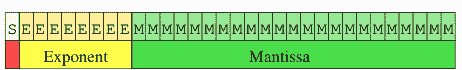

## 6. 数据类型

### 6.1. 基本类型

我们用来描述语义和类型化概念的语言 Exp2、...、Lang3 仅考虑两种数据类型：整数和布尔值。然而，大多数编程语言包含更多基本类型。在本节中，我们将介绍最普遍的数据类型，以及它们在语言之间的差异。

#### 6.1.1. 布尔值

对于某些语言，例如 OCaml、Java、Ada 和 Pascal，布尔类型 bool 是类型代数的构造子，并具有两个可能的值：true 和 false。其他语言，例如 C 和 C++，将布尔值编码为整数，值 0 通常用于表示“false”，任何其他值都对应“true”。这些语言中的一些，例如 C++，包含类型 bool 和预定义标识符 false 和 true，但这些值与整数值完全兼容。任何整数表达式都可用作循环或 if-then-else 的条件。任何布尔表达式都可用作数组索引，或作为算术运算的操作数。这使得源文本更难以理解，并可能导致难以检测的错误。

Python 的行为有所不同。它提供两个值 True 和 False，但允许整数和布尔值混合。因此，可以测试整数值是否等于或不等于布尔值，或使用整数值作为条件的测试。不推荐这些做法，请参见以下示例。请记住，整数（例如示例 6.1 中的值 2）可能是对更复杂表达式求值的结果。如果将此值 2 用作布尔值导致执行错误，则可能难以在源代码中找到其来源。

### EXAMPLE 6.1.--

```
$ python3.7
>>> 0 == True
False
>>> 0 == False
True
>>> 1 == True
True
>>> 1 == False
False
>>> 2 == True
False
>>> 2 == False
False
```

示例 6.1 显示 Python 3.7 版本将 False 解释为值 0，将 True 解释为值 1。值得注意的是，值 2（或任何不是 0 或 1 的其他值）既不是 True 也不是 False。因此，示例 6.2 中的两个表达式（具有相同的直观语义）给出了不同的结果。

### EXAMPLE 6.2.--

```
>>> if 2 == True :
...     print ("2 == True")
... else :
...     print ("2 != True")
...
2 != True
>>> if 2 == False :
...     print ("2 != True")
... else :
...     print ("2 == True")
...
2 == True
```

由于测试 2 == True 和 2 == False 始终为 false，这两个表达式都计算 else 分支，显示出矛盾的结果。但是，如果直接将整数值 2 用作条件，则将计算 then 分支，仿佛 2 等效于 True。

### EXAMPLE 6.3.--

```
>>> if 2 :
...     print ("Then branch")
... else :
...     print ("Else branch")
...
Then branch
```

#### 6.1.2. 整数

鉴于寄存器的有限大小，只能表示有限数量的二进制配置。由于每个整数都以二进制（基数 2）编码，寄存器只能编码有限数量的整数。

对于正整数，二进制配置中第 n 位表示值 2^n。由二进制配置编码的整数的值是其幂的和。例如，8 位上的配置 01100101 对应 2^6+2^5+2^2+2^0 = 101。

正整数和负整数通过使用符号位进行区分，符号位是整数二进制表示中最高有效位 (MSB)。此外，负整数使用补码编码。为了获得正数的相反数，我们反转绝对值二进制表示的位，然后在结果上加 1。因此，值 4 用 4 位表示为 0100，值 – 4 表示为 1100。这种编码保证了值 0 的唯一性，并提供了一条与操作数符号无关的加法指令。

##### 6.1.2.1. 整数大小

到目前为止，我们只使用了一个整数类型 int，表示有符号整数。某些语言，例如 C、C++ 和 Java，包含多个整数类型：char、short、long、long long 和 int。它们在用于编码值的位数方面有所不同。在 Java 中，每个整数类型的位数明确指定；在 C 中，标准的连续版本仅指示每个整数类型的最小大小。C/C++ 中 int 的值通常以 32 位编码，long int 的值以 64 位编码，至少在当前架构中是如此。

| Java | 位 | C/C++ | 位 |
| :--- | :--- | :--- | :--- |
| byte | 8 | char | ≥ 8 |
| short | 16 | short (int) | ≥ 16 |
| int | 32 | int | ≥ 16 |
| long | 64 | long (int) | ≥ 32 |
| | | long long (int) | ≥ 64 |

表 6.1. 按语言划分的整数大小

在其他语言中，例如 OCaml 或 Python 3（Python 2 允许指定 long），无法指定整数大小，而是由语言标准设定。无论如何，用户都应牢记整数大小，以避免某些错误。


##### 6.1.2.2. 有符号和无符号整数

在 C 和 C++ 中，程序员可以选择使用有符号整数（用于表示相对整数）或无符号整数（用于表示自然数）。此选择定义了 MSB 的使用方式。对于有符号整数，该位用于符号，采用补码编码。对于无符号整数，该位与其他位以相同方式用于编码值。在 OCaml、Java 和 Python 中不可用此选择，其中整数始终是有符号的。

整数类型可表示的数据范围取决于是否存在符号以及分配给该类型的位数。这在表 6.2 中有所介绍。

### 表 6.2. 按类型划分的数据范围

| 位数 | 符号 | 最小值 | 最大值 |
|---|---|---|---|
| 8 | 否 | 0 | 255 ($2^8 - 1$) |
| 8 | 是 | -128 ($-2^7$) | 127 ($2^7 - 1$) |
| 16 | 否 | 0 | 65535 ($2^{16} - 1$) |
| 16 | 是 | -32768 ($-2^{15}$) | 32767 ($2^{15} - 1$) |
| 32 | 否 | 0 | 4294967295 ($2^{32} - 1$) |
| 32 | 是 | -2147483648 ($-2^{31}$) | 2147483647 ($2^{31} - 1$) |
| 64 | 否 | 0 | 18446744073709551615 ($2^{64} - 1$) |
| 64 | 是 | -9223372036854775808 ($-2^{63}$) | 9223372036854775807 ($2^{63} - 1$) |

##### 6.1.2.3. 溢出

由于整数大小是预先确定的，_溢出_ 可能发生在整数“太大”或“太小”而无法在分配给其类型的位数 $n$ 上表示的情况下。因此，整数运算及其属性不属于 $\mathbb{Z}$，而属于算术 _模_ $\mathbb{Z}/n\mathbb{Z}$。

考虑以下示例。十进制值 9 在 $\mathbb{Z}$ 中以二进制表示为 1001；值 7 表示为 0111，它们的和表示为 10000。采用对 4 位进行编码的无符号整数表示。9 和 7 的表示与在 $\mathbb{Z}$ 中找到的相同，因为它们只需要 4 位。然而，16 的表示变为 0000：MSB 已丢失。实际计算为 $(9+7) \mod 2^4$，而非 $9+7$。对称地，考虑 $-8-1$：假设这些是有符号值，我们是否得到 $-9$？十进制值 -8 在二进制中表示为 1000，值 1 表示为 0001。它们的差为 1111，现在需要 5 位。同样，MSB 已丢失，我们得到结果 1111，等于十进制中的 -1。

类似地，如果给定整数变量的位置固定为 $n$ 位，并且该变量被赋予一个需要 $m$ 位的值（其中 $m > n$），则会发生溢出：$(m-n)$ 位将丢失。

##### 6.1.2.4. 混合整数

将计算的有符号结果赋给无符号变量，反之亦然，也可能导致溢出。因此，计算值必须转换为与变量相同类型的值。这种“有符号 ↔ 无符号”转换有些危险。

让我们考虑将有符号数 -4 转换为使用 4 位整数编码的无符号数。使用补码，-4 的编码为 1100。如果无符号变量被赋予此位序列（不使用补码），则其值将被解码为无符号值，并表示（必然为）正值 12。现在，考虑将无符号数 15 转换为有符号数。15 的编码是序列 1111，它被解释为使用补码的有符号数，值为 -1。

类似地，在计算中混合使用有符号和无符号整数可能导致溢出。在这种情况下，必须转换一个操作数的值以获得另一个操作数的类型。示例 6.4 展示了一种混合情况及其影响。

### 示例 6.4.

```c
#include <stdio.h>
int main () {
int i = -10 ;
unsigned int u = 1 ;
if (i + u < 0) printf ("%d + %u < 0\n", i, u) ;
else printf ("%d + %u >= 0\n", i, u) ;
return (0) ;
}
```

```
$ ./a.out
-10 + 1 >= 0
```

如果 i + u 为负，则计算将使用 int 进行；否则，将使用 unsigned int。C 标准规定，如果同时存在有符号和无符号操作数，则必须将有符号操作数转换为无符号操作数。因此，i 的值被解释为无符号，导致溢出，因为符号位被视为“普通”值位，i 不再表示 -10，而是 4294967286。因此，操作结果为正。然而，如果计算使用 int 进行，则 i 的值将保持为负，计算结果也将为负。

（必需的）使用模 n 运算（其中 n 是整数的大小）会产生特别棘手的溢出问题，这些问题通常发生在可表示整数域的边界上。因此，一个程序可能在一段时间内针对许多不同的输入正确运行，但突然且静默地对接近限制的情况产生不一致的结果（而不引发任何错误）。在没有错误消息的情况下，此不一致结果可能在执行过程中传播，远离其出现的位置；这使得错误的来源特别难以识别。

##### 6.1.2.5. 整数算术

我们将根据整数在大多数编程语言中的特性，通过考虑数学上下文中整数算术的一些属性来结束对计算机科学中整数的研究。加法是 N 上的全运算，扩展为 Z 上的全运算。减法在 N 上不是全运算（5 – 25 在 N 中无法计算），但在 Z 中变为全运算。在 N 中遇到的除法是欧几里得除法（带有整数商和余数）。精确除法运算在 Q 中定义。

在实践中，从 N 到 Z 的过渡通常是隐式的：“温度为 10°，下降了 25°，现在是 - 15°”。这种从 N 到 Z 或从 Z 到 R 的隐式过渡对应于计算中的类型更改。在 N 中，表达式 1 / 4 表示商为 0 的欧几里得除法，而在 R 中，1 / 4 等于 0.25。忽略数字集之间这些转换可能会产生一些令人惊讶的结果：例如，(1 / 4) * 4 给出的结果为 0，而 (1 * 4) / 4 给出的结果为 1。这些结果完全正确，因为在整数算术中 / 用于表示欧几里得除法。然而，/ 通常被隐式解释为表示精确除法，因此才会感到惊讶。

在编写使用整数的算术表达式时，某些运算（如乘法和除法）的求值顺序至关重要，应使用括号指定。否则，在表达式 1 / 4 * 4 中，编译器将根据实现选择先计算除法还是乘法。因此，切换到另一个编译器可能会导致结果改变，并可能出现错误。此错误不一定会立即显现：它可能保持潜伏状态，使人觉得程序是正确的。

请注意，动态类型的 Python 3 可能会以无法察觉的方式更改算术表达式的类型，从整数表达式转移到浮点表达式，如示例 6.5 所示。除法运算符自动返回浮点（实）类型的值。

### 示例 6.5.

```python
>>> x = 5
>>> type (x)
<class 'int'>
>>> type(x + x)
<class 'int'>
>>> type (x / x)
<class 'float'>
>>> x / x
1.0
```

变量 x 初始化为值 5，被视为整数类型。x + x 的结果也是整数类型。另一方面，x / x 的结果会自动转换为浮点数，正如我们从 x / x 的类型以及包含小数部分的显示值中所见。

##### 6.1.2.6. C 中整数的隐式转换

C 标准规定，算术表达式中的中间计算默认应用于 int。C 的这一语义特性解释了示例 6.6 中获得的结果，否则该结果看起来会令人惊讶。

### 示例 6.6.

```c
#include <stdio.h>

int main (int argc, char *argv[]) {
 signed char i = -128 ;
 i = (i - 1) / 2 ;
 printf ("%d\n", i) ;
 return (0) ;
}
```

```
$ ./a.out
-64
```

变量 i（作为 8 位有符号整数，signed char）被初始化为最小可能值。因此，使用模运算对 (i - 1) 的求值会导致溢出，生成值 0；将该结果除以 2，得到 0。然而，由于算术表达式被隐式地使用 int（即 32 位整数）执行，i - 1 的计算不会生成溢出，并给出结果 - 129。然后该结果使用整数除法除以 2，产生最终结果 - 64。这一语义特性阻止了预期溢出的发生，但也可能成为意外结果的原因，如示例 6.7 所示。

### 示例 6.7.

```c
#include <stdio.h>

int main (int argc, char *argv[]) {
 int a = 100000, b = 100000 ;
 long int c = a * b ;
 printf ("%ld\n", c) ;
 c = (long int) (a * b) ;
 printf ("%ld\n", c) ;
 c = (long int) a * b ;
```


```
printf ("%ld\n", c) ;
return (0) ;
}
```

```
$ ./a.out
1410065408
1410065408
10000000000
```

该程序试图计算 \(10^5 \times 10^5\)，并将结果存储在一个 `long int` 中，该类型足够大，可容纳 \(10^{10}\) 的结果。第一次计算的结果不是 \(10^{10}\)。乘法使用两个 `int`s 进行，导致溢出。然后将结果存储在 `long int` c 中。为乘法结果指定类型并不能解决问题，正如我们从第二次计算中所见。转换发生得太晚：溢出已经发生。要获得正确结果，必须将其中一个操作数（例如 `a`）的类型转换为 `long`，如第三次计算所示。

#### 6.1.3. 字符

在引入 Unicode 标准以及 UTF-8、UTF-16 和 UTF-32 编码之前，字符由 8 位（一个字节）整数表示。前 128 个值中的每一个都与一个"字母"相关联，遵循 ASCII 标准。用于表示每个字符的整数值被称为其 ASCII 码。ASCII 标准被扩展，出现了不同的变体，其中剩余的 128 个值用于表示其他"字母"（包括带重音符号的字符）。

Unicode 通过允许"字母"占用多个字节，极大地扩展了字符编码的可能性。某些语言具有处理 Unicode 编码的专用类型；例如，Java 除了用于处理 ASCII 编码的 `byte` 类型外，还使用 `char` 类型（一个 16 位整数）。其他语言，如 OCaml 和 C/C++ 只包含一个 `char` 类型，用于 8 位整数。在这种情况下，如果扩展 ASCII 不够用，程序员需要手动使用其他类型来编码字符。

在 Python 3 中，字符串和单个字符之间没有区别。在语法级别，任何看起来像字符的内容（在许多语言中显示在单引号之间）都会生成与字符串相同类型的值（通常显示在双引号之间）。示例 6.8 说明了这一点。

### 示例 6.8.–

```python
>>> u = 'c'
>>> u
'c'
>>> v = "c"
>>> v
'c'
>>> type (u)
<class 'str'>
>>> type (v)
<class 'str'>
```

同样，从字符串中提取给定位置的字符（例如示例 6.9 中的第二个字符）将返回由单个字符组成的字符串。

### 示例 6.9.–

```python
>>> str = "Aloha"
>>> str[1]
'l'
```

Python 3 还包含另一种类型 `byte`，顾名思义，用于表示字节。此类型主要用于按字节表示数据，而不是编码单个字符。小于 128 的字节值对应 ASCII 标准中的字符。任何更高的值都不被解释为字符，如示例 6.10 所示。

### 示例 6.10.–

```python
>>> b'\x41'
b'A'
>>> b'\xc3'
b'\xc3'
```

#### 6.1.4. 浮点数

浮点数的编码方式与整数完全不同。浮点数的编码由 IEEE 754 标准规定，该标准指定了两种不同的长度：32 位的 float 和 64 位的 double。标准 IEC60559（与 32 位和 64 位 float 的 IEEE 754 兼容）引入了另一种大小 `long double`，其数值范围不是固定的。这些 `long double` 旨在比 double 实现更高的精度，且范围至少与 double 一样大。

根据这些标准，浮点数由三组具有不同含义的位表示。最高有效位 (MSB) 用于表示符号。下一组位表示指数。最后，尾数（*significand*，也称为 *mantissa*）编码在剩余位上。作为第一近似——在技术上是错误的，但足以建立直观理解——我们可以认为浮点数的值为 *符号 × 尾数 × 2^指数*。

与整数的情况一样，某些语言（如 C/C++）允许用户指定浮点数的大小；而其他语言（如 Java、OCaml 和 Python）则有预定义的默认大小。



**图 6.1.** 32 位浮点数的编码。要查看此图的彩色版本，请参见 www.iste.co.uk/hardin/programming1.zip

浮点数在有限数量的位上编码，这意味着这些数的集合是有限的。由于浮点数确实是有理数，任何介于两个连续浮点数之间的有理数（或实数）都无法精确表示。换句话说，在两个使用浮点数精确表示的连续有理数之间存在“空洞”，如示例 6.11 所示。

### 示例 6.11.–

```c
#include <stdio.h>

int main () {
    float f11 = 48431.1231 ;
    float f12 = 48431.1239 ;
    float f13 = 48431.1250 ;

    printf ("f11: %f f12: %f f13: %f\n", f11, f12, f13) ;
    printf ("f11 == f12 ? %d\n", (f11 == f12)) ;
    printf ("f12 == f13 ? %d\n", (f12 == f13)) ;
    printf ("f11 == f13 ? %d\n", (f11 == f13)) ;

    f11 = f11 + 0.0001 ;
    printf ("f11 + 0.0001: %f\n", f11) ;

    return (0) ;
}
```

```text
$ ./a.out
f11: 48431.125000   f12: 48431.125000   f13: 48431.125000
f11 == f12 ? 1
f12 == f13 ? 1
f11 == f13 ? 1
f11 + 0.0001: 48431.125000
```

声明了三个 `float` 类型的变量，并用语法上不同的常数进行初始化。显示似乎表明它们相等，但此显示的准确性和精度可能值得怀疑。因此，我们将这些值相互比较，并考虑相等性测试（布尔值）的结果。此验证表明，这三个变量实际上是相等的：两个初始化值丢失在了一个“空洞”中。向第一个变量添加 `0.0001` 得到的结果也是如此，该结果不变：这也丢失在一个“空洞”中。浮点数不是数学中的理想有理数。由于 `float` 值的数量有限，在求值声明和算术运算时，近似和舍入无法避免。示例 6.12 显示了对 double 简单加法预期结果的验证。

### 示例 6.12. –

```c
#include <stdio.h>

int main () {
    double f11 = 0.1 ;
    double f12 = 0.2 ;
    double f13 = 0.3 ;
    double f14 = f11 + f12 ;
    printf ("f11: %f f12: %f f13: %f f14: %f\n", f11, f12, f13, f14) ;
    printf ("f13 = f14 ? %d\n", (f13 == f14)) ;
    return (0) ;
}
```

```text
$ ./a.out
f11: 0.100000 f12: 0.200000 f13: 0.300000 f14: 0.300000
f13 = f14 ? 0
```

显示变量和计算结果似乎表明 0.1 + 0.2 = 0.3。然而，加法与赋值为 0.3 的变量 `f13` 之间的相等性测试讲述了一个不同的故事：计算受到了舍入的影响。最后，显示的值也经过了舍入，并不与内存中存储的实际值相对应。

为了避免与值舍入和浮点数计算相关的某些问题，编程语言中的相等运算符永远不应该用于测试两个浮点数 $v_1$ 和 $v_2$ 的相等性。最好使用所谓的 \(\epsilon\) *比较*（也称为测试 \(\pm \epsilon\)），即 \(-\epsilon \le v_1 - v_2 \le \epsilon\)，或 \(|v_1 - v_2| \le \epsilon\)，如示例 6.13 所示。

### 示例 6.13. –

```c
#include <stdio.h>
#include <math.h>
#define EPSILON (1e-6) /* Very small epsilon... */

int main () {
    double f11 = 0.1 ;
    double f12 = 0.2 ;
    double f13 = 0.3 ;
    double f14 = f11 + f12 ;
    printf ("f11: %f f12: %f f13: %f f14: %f\n", f11, f12, f13, f14) ;
    printf ("f13 ~ f14 ? %d\n", (fabs (f13 - f14) < EPSILON)) ;
    return (0) ;
}
```

```text
$ ./a.out
f11: 0.100000 f12: 0.200000 f13: 0.300000 f14: 0.300000
f13 ~ f14 ? 1
```

C 数学库中的 fabs 函数用于计算 f13 和 f14 之间差值的绝对值。所选的 \(\epsilon\) 值使我们能够忽略计算过程中发生的舍入，这意味着我们可以认为这两个值相等。请注意，\(\epsilon\) 的值取决于计算中所涉及值的数量级。例如，在天文学中，如果计算结果表明两颗星相距在 100 米以内，这很可能意味着这两颗星实际上已经相撞。另一方面，在粒子物理的背景下，如果计算结果表明两个粒子相距 0.0001 米，那么它们显然没有相撞。

上述示例都使用了相对“简单”的数字，没有小数点后的长数字序列。我们描述的问题可能出现在任何使用浮点数的程序中。此外，由于浮点数的编码是标准化的，这些问题同样适用于任何编程语言。

##### 6.1.4.1. 混合使用整数和浮点数

某些语言（如 OCaml）禁止同时包含整数和浮点数的算术运算。如示例 6.14 所示，使用整数的加法运算表示为 +，类型为 int → int → int；使用浮点数的加法运算表示为 +.，类型为 float → float → float。


### 示例 6.14

```ocaml
# (+) ; ;
- : int -> int -> int = <fun>
# (.) ; ;
- : float -> float -> float = <fun>
# 3 + 4.5 ; ;
Error: This expression has type float but an expression was expected of type
int
```

尝试使用类型不正确的值将导致类型错误。开发人员必须使用语言标准库中的函数显式指定一个操作数的转换，如示例 6.15 所示。

### 示例 6.15

```ocaml
# (float_of_int 3) +. 4.5 ; ;
- : float = 7.5
# 3 + (int_of_float 4.5) ; ;
- : int = 7
```

这种选择防止了任何“静默”值转换：程序完全按照开发者指定的方式执行。这种选择带来的灵活性损失，由更易于理解和更可靠的可维护性所抵消。其他语言根据其自身特定规则，在整数和浮点数之间进行隐式转换。例如，C 标准（ISO/IEC 9899:201x）规定，如果算术运算符的一个操作数是浮点数，则另一个操作数必须转换为浮点数，结果也将是此类型。在将结果赋值给变量的情况下，变量的类型不会影响算术计算的类型。一旦获得结果，它将被转换以符合变量的类型。

### 6.2. 数组

_数组_ 是一种数据结构，它将相同类型的数据元素分组到固定大小的连续序列中。数组中的任何元素都可以通过索引机制在常数时间内访问。给定数组中第一个元素在内存中的位置（_基地址_）和单个元素的大小，索引为 _i_ 的元素可以在地址 base + _i_ × 元素大小处访问。因此，数组中元素的索引是整数值（或者，更一般地，在某些语言中，是离散且全序类型的值）。由于数组的大小固定，尝试访问数组外的元素是一种编程错误，并且可能不会立即，甚至不一定会触发执行错误：因此该错误是潜伏的。确实，尝试访问数组边界之外的位置很可能涉及正在执行的程序所属的内存位置；在这种情况下，不会违反访问权限，操作系统也不会做出反应。程序将读取——或者，在赋值的情况下，静默地销毁——对应其他变量的区域，使得该错误非常难以检测。一旦检测到变量行为的变化——这可能需要一些时间——用户需要逆向查找数组中负责损坏数据的非法访问。在最有利的情况下，程序尝试访问的区域不属于程序本身：这会导致程序被操作系统立即中止。

某些语言包含一种机制，用于检测尝试访问数组边界之外位置的行为。例如，在执行期间，Python、Ada 和 Java 会检查索引是否保持在数组边界内。这些验证在 OCaml 中可以被禁用，从而产生类似于 C/C++ 中的机制，其中不执行任何验证。然而，以这种方式获得的性能改进（由于缺乏验证而实现更快的访问）是以牺牲程序安全性为代价的。

在某些语言中，如 OCaml、C/C++ 和 Java，索引从 0 运行到数组大小 – 1。在其他语言中，如 Ada 和 Pascal，索引范围可以使用上界和下界来定义。例如，一个数组可以定义为索引从 3 变化到 15（包含）。然后编译器将这些索引转换，使最小索引对应于数组的基址，即移位为 0。

Python 对数组采取了非常不同的方法。这结合了上述其他语言中数组的一些特性与列表机制。换言之，可以通过索引直接访问元素，但也可以在数组的任何“位置”（例如索引 i）添加新元素或删除某些元素，这将导致索引大于 i 的元素的索引发生变化。这种灵活性意味着插入操作的复杂度会有所不同，因为可能需要移动一个或多个其他元素。Python 中数组的内部结构不能简单地由基址来描述。同样，数组的大小不是固定的，而是在添加和删除元素时在运行时进行调整。每当数组已满时，Python 会通过一次性添加多个单元重新分配一个更大的数组，以避免过于频繁的扩展。当数组包含一定比例的未使用单元时，会分配一个更小的数组。Python 中使用的确切扩容/缩容策略超出了本书的范围。请注意，Python 中数组的行为比其他编程语言更复杂，因为其内部结构不太容易掌握。

Python 还允许使用负索引，它对应于从数组末尾开始倒数的第 n 个元素，从而从“右”到“左”遍历数组。它还允许用户操作数组的切片，切片被视为包含两个定义切片的边界之间存在的数组元素的子数组，并可能应用一个递增步长，如示例 6.16 所示。

### 示例 6.16

```python
>>> t = [0, 2, 4, 6, 8, 10, 12, 14, 16, 18, 20, 22, 24]
>>> t[2:10]
[4, 6, 8, 10, 12, 14, 16, 18]
```

构造的切片从索引 2 的元素开始，到索引 10 结束（不包含索引 10）。让我们继续此示例。

### 示例 6.17

```python
>>> t[2:10:3]
[4, 10, 16]
```

使用递增步长为 3 时，切片仍从索引 2 的元素开始并运行到索引 10（不包含索引 10），但每次都会从初始数组中跳过两个元素（即每次索引递增 3）。

切片的一般语法是 array[start:end:increment]：三个组件中任何一个都可以缺失、为正或为负，在后一种情况下，数组按逆序处理。示例 6.18 中数组 t 的第一个切片按逆序获取数组的所有元素，从倒数第五个元素开始，一直回溯到数组的第一个元素。换句话说，它按逆序获取所有元素，但不包括初始数组中的最后四个值。第二个切片只每两个元素取一个。

### 示例 6.18

```python
>>> t[5::-1]
[16, 14, 12, 10, 8, 6, 4, 2, 0]
>>> t[5::-2]
[16, 12, 8, 4, 0]
```

这种表达数组的灵活性是以代价为代价的，因为这些数组操作的语法变体含义更复杂。纯粹出于娱乐目的，读者可能希望确定 t[-6:2:-3]、t[6:-2:-1] 或 t[6:-2:1] 的结果。

### 6.3. 字符串

字符串（或 *字符串*）是字符的连续序列。字符串本质上是字符数组，与单个字符的表示方式无关（参见第 6.1.3 节）。许多语言为字符串提供了预定义类型，以及一系列相关操作（连接、字符访问、长度计算等）。Java 和 C++ 为字符串提供了专用类；OCaml 和 Python 使用预定义类型和提供操作的模块。在 C 中，字符串由开发人员作为字符数组编码。一个特殊字符（称为 *哨兵*），值为 0 并记作 `\0`，用于标记字符串的结束。此表示在 C++ 内部使用，以确保与 C 风格字符串的兼容性。

根据所选语言，可能也不可能修改字符串中的某些字符。Python、Java 和 OCaml 不允许修改，这些语言中的字符串不是 *可变的*。这些语言提供替代类型，使用可变字节实现字符序列。然而，可以使用语言标准库中的合适函数将这些序列转换为字符串。在 C（以及不使用专用类的 C++）中，虽然字符串采用数组形式，但可变性并不完全简单直接。字符串可以以两种方式定义，如示例 6.19 所示。

### 示例 6.19

```
char arr[] = "A string" ;
char *str = "A string" ;
```

在第一种情况下，编译器创建一个存储在程序变量内存区域中的字符数组；字符串中的字符可以被修改。在第二种情况下，编译器创建一个不可变的字符串，存储在内存的只读区域中。任何尝试修改字符串中字符的行为都会导致执行错误，因为操作系统会检测到向只读区域非法写入的尝试。

所有为字符串包含特定类型的语言也提供比较原语，用于测试字符串之间的相等性或顺序关系。而 C 语言不包含专用类型，也不为字符串提供比较运算符。在这种情况下，应用于两个字符串的比较运算符将简单地比较各自数组的地址，而不是检查字符串的内容（参见第 6.6 节）。语言的标准库提供一个字符串比较函数 (`strcmp`)。

### 6.4. 类型定义

我们在第 5.4 节介绍了类型检查和推理机制。在这种情况下，类型代数是固定的，包含基本类型和“函数”类型


构造器。在第 6.1 节中，我们考察了现代编程语言中使用的若干基本类型。除了这些添加到类型代数中的基本类型之外，所有语言都包含用于定义新类型的构造。类型定义回应了三个正交需求。首先，用户可能希望创建不同于基本类型（如 int 或 bool）的值。其次，有时需要组合多种类型，以创建更复杂的数据结构。最后，重命名现有类型可能会有所帮助，从而使代码更易于阅读和维护。在所有情况下，类型定义涉及将一个称为类型构造器的新名称添加到类型代数中。

类型定义的引入修改了类型之间现有的相等关系。类型代数项的相等性，即结构相等性，在第 5 章中被隐式使用；如果两个类型的项相同，则认为这两个类型相等。当我们引入新的类型名称——无论是为了重命名现有类型还是创建结构化类型——类型相等性有两种可能的含义。在名义类型化的情况下，我们认为当且仅当两个类型具有相同的名称时，它们才相等。否则，相等性通过验证绑定到名称的类型的结构是否相等来定义：这被称为结构类型化。选择这两种选项之一是语义决策，不取决于语言中可用的定义形式。

## 6.4.1. 类型缩写

类型缩写由为类型表达式命名组成。在 C 和 C++ 中，此命名操作使用 typedef 构造来执行。在 OCaml 中，通过类型定义引入新名称，该定义必须与简单的类型表达式相关（即仅包含类型构造器的表达式）。

暂且不论第 2 卷第 1 章中介绍的封装机制。创建缩写是缩短类型表达式的一种方法。考虑用 C 编写的示例 6.20。我们可能希望使用更简洁的别名，而不是 const unsigned long long int，引入构造器 cullint_t 并在声明中使用它。

### 示例 6.20.

```c
typedef const unsigned long long int cullint_t ;

cullint_t t[10] ;

cullint_t add (cullint_t x, cullint_t x) {
return (x + y) ;
}
```

使用类型缩写也使代码更易于阅读和维护。考虑一个函数，其输入为压力和速度，并为机器返回功率命令。该函数的类型是 `float → float → float`。使用此类型，无法区分代表这些不同值的 `float` 数字，并且函数的类型对其参数没有提供任何语义信息。引入三个类型缩写，如示例 6.21 所示，允许更具信息量的函数类型。

### 示例 6.21.

```ocaml
# type pressure_t = float ;;
type pressure_t = float
# type speed_t = float ;;
type speed_t = float
# type command_t = float ;;
type command_t = float
# let regulate (p : pressure_t) (s : speed_t) : command_t = ... ;;
val regulate : pressure_t -> speed_t -> command_t = <fun>
```

在许多语言中，例如 C、C++ 和 OCaml，类型缩写不意味着名义类型化。别名仍然等于其定义的主体。这使得可以定义类型为 pressure_t 的变量 p 和类型为 speed_t 的变量 s，并比较它们或使用类型为 float → float → float 的运算器 +.，如示例 6.22 所示。

### 示例 6.22.

```ocaml
# let p : pressure_t = 2.0 ;;
val p : pressure_t = 2.
# let s : speed_t = 25.0 ;;
val s : speed_t = 25.
# p +. 2.5 = s ;;
- : bool = false
```

#### 6.4.2. 记录

个人可以由包括姓、名和出生日期在内的数据来描述。姓和名是字符串，而出生日期由三个整数组成。由于这些数据元素的类型不同，它们不能存储在数组中。记录（或结构体）的概念用于在单一类型中聚合不同类型的数据。

每个数据元素都有名称，并表示记录的一个字段。因此，每个字段都分配了它旨在包含的数据元素对应的类型。记录类型的定义由类型名称和字段名称的枚举（以及各自的类型）给出。

### 示例 6.23.

```ocaml
type person = {
  surname : string ; firstname : string ; month : int ; day : int ; year : int ;
}
```

### 示例 6.24.

```c
struct person {
  char *surname ; char *firstname ; int month ; int day ; int year ;
};
```

如我们在第 6.3 节中所见，字符串不是 C 中的基本类型，这解释了它们声明的特定方式。

如果 e 是包含字段 fld 的记录类型的表达式，则“点表示法” e.fld 表示 e 的值的字段 fld。

记录类型值通过指定每个字段关联的值来构造。在 OCaml 中，如示例 6.25 所示，记录值通过指定字段名称来定义，以启用类型综合。这种看似冗长的方法的一个优点是，字段值可以以任何顺序定义。即使没有类型推理机制，Ada 也是如此。

### 示例 6.25.

```ocaml
let p = { firstname = "John" ; month = 7 ; day = 5 ;
          year = 1900 ; surname = "Doe" }
```

在 C 中，不会显示字段名称，因此必须按照声明记录类型时使用的相同顺序指定字段值。

### 示例 6.26.

```c
struct person p = { "Doe", "John", 7, 5, 1900 } ;
```

在许多编程语言中，记录的字段不能彼此定义，也不能相对于前面的字段定义。示例 6.27 和 6.28 说明了这一点。

### 示例 6.27.

```ocaml
# type t = { a : int ; b : int } ; ;
type t = { a : int ; b : int ; }
# let v = { a = 5 ; b = v.a } ; ;
Error: Unbound value v
# let rec v = { a = 5 ; b = v.a } ; ;
Error: This kind of expression is not allowed as right-hand side of 'let rec'
```

### 示例 6.28.

```c
#include <stdio.h>
struct t { int a ; int b ; } ;
void f () {
  struct t v = { 15, v.a } ;
  printf ("%d\n", v.b) ;
}
int main () {
  f () ;
  return (0) ;
}
```

```shell
$ gcc foo.c
foo.c:7:22: warning: variable 'v' is uninitialized when used within its own initialization [-Wuninitialized]
  struct t v = { 15, v.a } ;
            ~
1 warning generated.
$ ./a.out
0
```

在 C 中，编译器不会拒绝此类定义，但会警告用户，在定义记录本身时使用的记录字段的值未初始化。以这种方式获得的程序的执行清楚地表明，字段 b 未正确初始化。

##### 6.4.2.1. 记录类型化

记录类型定义将一个新名称（类型构造器）引入类型环境。因此，需要考虑如何确定记录值的类型，并进而考虑具有相同结构但不同名称的记录类型如何相互作用。记录类型化有两种主要方法。

第一种方法（允许类型推断）包括根据表达式中找到的字段名称来指导类型。因此，记录表达式的值必须包括字段名称，而不仅仅是它们的值。OCaml 就是这样。因此，类型定义 type t = { a : int ; b : float } 将两个新名称 a 和 b 引入环境中的记录字段名称命名空间，同时记录它们属于类型 t 这一事实。分析记录表达式时，其字段都必须属于同一类型，以指导其验证。因此，两个不同的记录类型不能共享相同的字段名称（除非程序员付出大量努力）。但是，如果在不同的编译单元或模块中进行类型定义，可以通过指定包含这些定义的编译单元来避免歧义。示例 6.29 说明了这一点。

### 示例 6.29.

```ocaml
# type foo = { a : int ; b : float } ; ;
type foo = { a : int ; b : float ; }
# type bar = { a : int ; b : float } ; ;
type bar = { a : int ; b : float ; }
# let v = { a = 42 ; b = 3.14 } ;;
val v : bar = {a = 42; b = 3.14}
```

绑定到值 v 的表达式被推断为 bar 类型，因为它负责将字段名称 a 与记录类型的最近绑定。由于相应的字段名称被屏蔽，因此无法再创建 foo 类型的值。但是请注意，仍然可以通过操作其字段来操作 foo 类型的值。使用一种能够覆盖推断的类型注解形式，可以编写函数 get_foo_a 以从 foo 类型的值中获取字段 a 的值。

### 示例 6.30.

```ocaml
# let get_foo_a (x : foo) = x.a ;;
val get_foo_a : foo -> int = <fun>
```

第二种方法（例如在 C 中使用）使用分配给接受记录类型值的变量的类型。在这种情况下，无需在记录值中指定字段名称。因此，值 { 42, 3.14 } 本身没有类型，除了它是一个双字段结构体，第一个字段是整数，第二个字段是浮点数。但是，在赋值或初始化点，会检查在定义接收变量时给定的类型是否与表达式的字段兼容。这意味着两个不同的记录类型可以共享相同的字段名称，如示例 6.31 所示。


### 示例 6.31

```c
struct foo { int a ; float b ; } ;
struct bar { int a ; float b ; } ;

void f ( ) {
    struct foo v1 = { 42, 3.14 } ;
    struct bar v2 = { 43, 3.15 } ;
}
```

请注意，在 C 中，记录表达式只能用于初始化变量。因此，形式为 `f ({ 42, 3.14 })` 的表达式是非法的。

在 C、Java 或 OCaml 中，如果两个记录类型结构相同但名称不同，则它们不兼容：记录的类型是名义类型，而不是结构类型。让我们在之前用 C 编写的程序中添加将 `v2` 赋值给 `v1` 的操作。在示例 6.32 中，尽管这两个变量均由相同形式的表达式初始化，但将 `v2` 赋值给 `v1` 的操作会被拒绝。

### 示例 6.32

```c
...
void f () {
    struct foo v1 = { 42, 3.14 } ;
    struct bar v2 = { 43, 3.15 } ;
    v1 = v2 ;
}
```

```
$ gcc -Wall foo.c
foo.c:14:6: error: assigning to 'struct foo' from incompatible type 'struct bar'
  v1 = v2 ;
  ~ ^ ~
1 error generated.
```

#### 6.4.3. 枚举类型

交通灯的“值”为红色、黄色和绿色。我们希望编写一个函数 next，它接收交通灯的当前状态并返回下一个状态。

第一个解决方案是为交通灯的每个值选择一个基本类型（例如 int）的值：例如，取 red = 54，yellow = 12 和 green = 36。然而，没有任何东西能阻止将“交通灯值”与任何其他整数值组合。red/2 或 (next 23) 等表达式类型完全正确，尽管它们在语义上是不正确的。函数 next 的设计目的是仅针对三个特定值进行操作——那么如果它接收到一个意外的输入值，应该怎么做呢？

假设我们不小心同时定义了 red = 36 和 green = 36。尽管这两个本应互斥的交通灯值现在相等，但不会引发任何错误。用于测试交通灯值的表达式将不再区分红灯和绿灯。

我们明确选择了要分配给灯值的整数值。考虑到用于对颜色进行编码的值对作用于它们的算法没有任何影响，这种选择没有真正的理由。某些语言包含一种结构，允许用户执行枚举类型值的所有可能情况的测试并验证穷举性（没有遗漏任何值）。在光值由整数编码的情况下，我们最好需要编写一个永远不应该发生的一般情况，或者最坏的情况下需要编写所有其他永远不应该发生的可能情况。定义一个具有两两互斥值且仅与该类型的其他值兼容的新类型的能力消除了这些缺点。这种枚举类型定义枚举了赋予值的名称，称为 *值构造器*。

诸如 Java、C 和 C++ 等语言允许通过 enum 类型构造来创建这些定义。一旦引入了值构造器，它们就可以像其他任何值一样使用。示例 6.33 对此进行了说明。

### 示例 6.33

```c
enum signal_t { Green, Yellow, Red } ;

enum signal_t next (enum signal_t state) {
if (state == Green) return Yellow ;
if (state == Yellow) return Red ;
return Green ;
}
```

语言编译器负责在内部通过整数对这些值进行编码。值构造器的强类型程度可能因语言而异。在 C 中，它们本身就是整数：始终可以使用任何给定整数调用 next 函数。在 C++ 和 Java 中，构造器仅是声明它们的类型的值，且与整数不兼容。例如，在 C++ 中使用 0 作为参数调用 next 会导致类型错误：

```
foo.cpp:14:3: error: no matching function for call to 'next'
next (0) ;
^~~
bar.cpp:4:15: note: candidate function not viable: no known conversion from
'int' to 'enum signal_t' for 1st argument
enum signal_t next (enum signal_t state)
^
1 error generated.
```

#### 6.4.4. 和类型

OCaml 使用的和类型比简单的构造器枚举更复杂。和类型用于将多种类型的值分组为单一类型。取两种类型 t1 和 t2。让我们定义一种类型 t，其中所有值要么是类型 t1 的值（由 C1 标记），要么是类型 t2 的值（由 C2 标记）。和类型的构造类似于集合上的不交并运算（因此得名和类型）。C1 定义了类型 t1 的值 v1 的注入，结果为类型 t 的值 C1(v1)；同样，类型 t2 的值 v2 被注入为 t 中的 C2(v2)。C1 和 C2 称为类型 t 的值构造器。

本书中展示的 OCaml 代码已经大量使用了和类型来表示语言的抽象语法和遇到的各种代数。在示例 6.34 中，扑克牌由一种和类型编码。

### 示例 6.34

```ocaml
type card_t = Jack | Queen | King | Number of int
```

一张牌可能是一张牌面卡，仅由其名称标识。或者，它可能是一张数字卡，必须知道数字才能将其与花色中的其他卡牌区分开来。值构造器 Number 应用于 int 类型的值。值构造器 Jack 定义了 card_t 类型的一个唯一值。

和类型可以是多态的。其中一些构造器可以应用于使用类型变量编写的类型，这些变量由和类型的定义引入。OCaml 标准库中的预定义列表由一种递归且多态的类型定义给出，类似于示例 6.35 所示的定义。

### 示例 6.35

```ocaml
type 'a list = Nil | Cons of ('a * 'a list)
```

在 C/C++ 中，没有用于值构造器的语法结构。程序员必须自行使用 union 和 struct 类型对构造器进行编码。联合类型本质上是其定义中提到的不同类型的不交并。联合的值在一个内存范围内表示，其大小为这些不同类型的值大小的最大值。因此，它与记录不同，记录中的数据是聚合的。联合的每个字段允许访问联合的数据，该数据将被解释为具有与字段相关联的类型。示例 6.36 说明了这一点。

### 示例 6.36

```c
#include <stdio.h>

union int_float_t { int as_int ; float as_float ; } ;

int main () {
  union int_float_t v ;
  v.as_float = 3.14 ;
  printf ("As the float %f as the integer %d\n", v.as_float, v.as_int) ;
  return (0) ;
}
```

```
$ ./a.out
As the float 3.140000 as the integer 1078523331
```

union 类型 int_float_t 的任何值都可以有两种解释。变量 v 通过将联合视为 float 来初始化。显示了该值的两种视图。第一个视图是作为 float，允许根据写入时所做的解释来解释内存中包含的数据。因此，我们找到值 3.14。第二个显示是通过将值解释为整数来执行的。由于整数和浮点数的编码根本不同，我们看到一个似乎无关的值。

C 中的联合类型不像 OCaml 中的和类型那样具有值构造器。因此，有必要添加一个标记，以便在运行时知道应使用联合的哪个字段以及如何解释联合的值。示例 6.36 表明，错误的解释会产生语义上不正确的结果。合适的标记可以是一个枚举类型，其值的数量至少与联合的字段数量相同。然后应通过记录将此标记和联合分组在一起。让我们通过示例 6.37 来看看这一点。

### 示例 6.37

```c
#include <stdio.h>

enum tag_t { Val_int, Val_float } ;
union int_float_t { int as_int ; float as_float ; } ;
struct sum_t { enum tag_t tag ; union int_float_t val ; } ;

struct sum_t read_int () {
  struct sum_t v ;
  scanf ("%d", &v.val.as_int) ;
  v.tag = Val_int ;
  return (v) ;
}

struct sum_t read_float () {
  struct sum_t v ;
```


```c
scanf("%f", &v.val_as_float);
v.tag = Val_float;
return v;
}
void print(struct sum_t v) {
    if (v.tag == Val_int) printf("%d\n", v.val_as_int);
    else if (v.tag == Val_float) printf("%f\n", v.val_as_float);
}
int main() {
    print(read_int());
    print(read_float());
    return 0;
}
```

```text
$ ./a.out
42
42
45.7
45.700001
```

该程序定义了一个和类型，等同于 OCaml 定义 `type sum_t = Val_int of int | Val_float of float`。函数 `read_int` 和 `read_float` 允许用户输入一个整数和一个浮点数，并通过用适当的标记和字段初始化联合值来生成和类型值。`print` 函数根据标记选择一个选项，并调用 `printf`，使用打印格式（`%f` 或 `%d`）和联合字段（该字段对应此标记）。请注意存在舍入误差：`45.7` 显示为 `45.700001`。

Java 不提供 `union` 或和类型构造。联合概念可以由记录替换，为联合的每种类型分配一个字段，并保留标记字段以区分其他字段。然而，在这种情况下，数据元素的大小将是所有字段大小之和，而不是最大字段的大小，从而导致内存浪费。解决此问题的常见方案是创建类层次结构，扩展基类，表示不带构造函数的和类型（不熟悉面向对象编程概念的读者可能希望先查阅第 2 卷第 4 章，然后再返回此解释）。每个值构造函数由基类的继承类编码，其参数由该类的属性定义。此外，类必须具有返回这些属性值的方法。为了区分联合中的不同种类的值，有一些解决方案：要么基类提供一个标记，要么对联合的类型进行动态测试，要么必须将算法调整为面向对象风格。

Python 同样不提供联合或和类型机制。这就是为什么在本书中，使用 Python 实现语义概念时使用类和 `isinstance` 构造。这允许模仿 OCaml 的 *模式匹配*，以获得相当相似的代码。请注意，Python 中的这种编程风格相当“啰嗦”，并不总是符合面向对象编程的最佳实践规则。

将在 6.5 节中介绍一种名为 *模式匹配* 的附加构造，用于逐案区分和类型或枚举类型的值。

##### 6.4.4.1. 和类型的类型化

在将枚举类型简化为整数（通过 *枚举* 构造）的语言中，例如 C 或 Java，和类型表达式的类型化方式与整数类型表达式完全相同。

在 OCaml 中，和类型的类型化由表达式中出现的值构造函数的名称指导，就像记录的类型化由字段名称指导一样。定义 `type t = A | B of int` 将名称 t、A 和 B 引入类型环境；还会记录 A 和 B 是 t 的构造函数、A 没有参数以及 B 具有一个 int 类型的参数。两个不同的和类型不能共享相同的构造函数名称；如果发生这种情况，最近的值构造函数将屏蔽之前和类型中同名的构造函数。如果定义在不同的编译单元或模块中，则可以通过明确指定其编译单元来区分构造函数。

### 6.5. 广义条件语句

大多数编程语言都包含一种构造，用于区分类型的不同值，以避免出现级联的“如果...那么...如果”情况。这是一种仅测试相等性的广义条件语句。这种控制结构允许根据给定表达式的不同可能值来描述处理方式。

#### 6.5.1. C 风格的 switch/case

在最简单的形式中，广义条件语句是对求值表达式类型的某些或所有值的枚举，其中每个情况都绑定到要执行的代码。C 中的 `switch` 构造允许区分标量类型的值（更准确地说，是由整数表示的类型：这包括 `enum` 但不包括浮点数）。在 Java 中，从版本 7 开始，字符串也可以以这种方式处理。示例 6.38 展示了 C 中这种构造的示例。

### 示例 6.38

```c
void f(int x) {
    switch (x) {
    case 0: printf("x is 0\n"); break;
    case 1: printf("x is 1\n"); break;
    default: printf("x is something else\n"); break;
    }
}
```

函数 f 对 x 求值并执行与 x 值对应的情况的代码。因此执行 f (1) 将显示 "x 为 1"。每个情况都以 break 指令结束，从而与下一个情况分开。

由于整数类型拥有数量非常大（尽管不是无限）的值，因此使用一个标记为 default 的特殊情况来考虑所有未在显式情况中出现的值。需要注意的是，default 情况不是强制性的。如果未提供 default 情况，且值不对应任何列出的情况，则不会执行任何操作（静默地）。例如，如果在计算 f (2) 之前从示例中删除 default 情况，则该函数不会显示任何内容。

不建议在不包含 default 情况的情况下使用 switch。在读取代码时，无法知道是遗漏了该情况，还是只是未编写它，因为在“所有其他情况”中，“空”行为是合适的。为了生成可维护的代码，最佳实践是显式包含一个空的 default 情况，后面紧跟 break。这种包含没有任何代价——编译器不会为此情况生成任何代码——并且从源代码中可以明显看出，作者打算在这种情况下不执行任何操作。

由于 C 中的枚举 仅仅是整数，因此可以通过枚举其值（构成有限集）来对枚举类型进行区分，如示例 6.39 所示。

### 示例 6.39

```c
enum dir { North, East, South, West };
enum dir invert(enum dir d) {
    enum dir res;
    switch (d) {
    case North: res = South; break;
    case East: res = West; break;
    case South: res = North; break;
    case West: res = East; break;
    }
    return res;
}
```

本示例中没有 default 情况。实际上，由于已考虑该类型的所有可能值，其效用并不明显。在实践中，由于枚举的值由整数编码，程序并未涵盖计算域中的所有可能值，而仅涵盖类型中声明的值。在 C 中，枚举 类型与整数值完全兼容：带有枚举类型参数的函数可以使用任何整数进行调用。因此，如果没有 default 情况，对 invert 函数的错误调用将不会被检测到。强烈建议添加 default 情况以增强健壮性，在开发关键软件时这是必不可少的。

这种看似规则的 case 结构掩盖了更复杂的现实。break 指令用于中断某个情况的指令序列，就像它可以用于中断循环一样。在示例 6.40 中，如果省略两个 case 之间的 break，程序将紧接着执行第一个情况之后的第二个情况的代码。

### 示例 6.40

```c
void f(int x) {
    switch (x) {
    case 0: printf("x is 0\n");
    case 1: printf("x is 1\n"); break;
    default: printf("x is something else\n"); break;
    }
}
```

在示例 6.40 中，case 0 末尾的 break 已被删除。因此，调用 f (0) 将显示 "x 为 0"，但也会显示 "x 为 1"。

此外，case 可以被视为简单的跳转标签，因为其顺序不遵循任何特定结构。case 可以按任意顺序排列（尽管 default 纯粹按惯例是最后一个被考虑的情况，但这并非强制性），并且可以放置在界定 switch 的花括号范围内的任何位置。示例 6.41 说明了这些要点。

### 示例 6.41

```c
void f(void) {
    int j = 24;
    switch (j) {
    case 23: {
        printf("case 23\n");
        while (j) {
        default:
        printf("case default\n");
        }
    }
    break;
    }
}
```


在本示例中，`default` 分支出现在 case 23 的标签和终止该分支的 `break` 之间的代码中。此外，它位于循环体内。上述程序在 C 中完全合法，编译不会触发任何警告。执行时，由于 `j` 不等于 23，程序将跳转到 `default` 分支，即 `while` 循环的中间，并且由于条件始终为真，将无限循环下去。

#### 6.5.2. 模式匹配

某些语言，如 OCaml、Haskell、Scala、F# 和 C#，包含一种称为 *模式匹配* 的结构。这与 6.5.1 节中看到的 switch/case 结构类似，但它更具表现力，因为它允许对结构化值（和类型值、记录或对象）进行析构。switch/case 结构测试所检查值与原子常量的相等性。模式匹配是一种使用值的结构进行测试的方式。考虑和类型 `t = I of int | B of bool` 和 `t` 类型的值 `v`。我们可以说明诸如 "`v` 是 `I` 的某种形式或 `B` 的某种形式”这样的情况，并在专门用于该情况的处理中使用值“something”。

*模式* 是一种由值构造函数、记录标签和变量构建的骨架，定义了一种形状。这样的模式与所有具有相同形状的值匹配，此匹配将模式的变量绑定到值的相应子项上。这些变量的名称可由与模式关联的指令使用，并在执行指令时使用它们的绑定。对于上面的类型 `t`，模式 `I x` 与值 `I 46` 匹配：它们都由相同的值构造函数 `I` 构建。当执行与模式 `I x` 关联的代码时，此匹配将 `x` 绑定到 46。

下面给出了模式/值兼容性的更正式定义。然而，首先让我们考虑一些示例，这些示例采用 OCaml 并使用 match/with 结构。

### 示例 6.42。

```OCaml
type dir = North | East | South | West

let invert d =
  match d with North -> South | East -> West | South -> North | West -> East
```

该函数按情况定义，与示例 6.39 中为说明 C 语言的 switch/case 结构而编写的函数相同。由于类型 `dir` 仅由无参数构造函数组成，模式匹配的操作方式与简单的 switch/case 相同。如果 `invert` 的参数是 `West`，则在执行期间将选择匹配的第四个分支，并返回值 `East`。

### 示例 6.43。

```OCaml
type intlist = End | Cell of (int * intlist)
let rec sum l = match l with Cell (i, remainder) -> i + sum remainder | End -> 0
```

`intlist` 类型表示整数列表，函数 `sum` 返回列表中整数的和。如果 `l = Cell (a, r)`，则变量 `i` 绑定到 `a`，变量 `remainder` 绑定到 `r`。这两个模式变量的绑定用于分支体中，从而可以将当前整数值与余数列表的和相加，该和是递归计算的。如果 `l = End`，递归停止并返回值 0。

请注意，如果该变量匹配的值在分支体中未使用，表示为 `_` 的“万能”模式可以替换模式变量。此模式相当于一个变量，但避免引入新名称。它向读者明确指示匹配值的这一部分未被使用。

### 示例 6.44。

```OCaml
let is_empty l = match l with Cell (_, _) -> false | _ -> true
```

如果 `Cell` 构造函数在值中没有出现，则列表为空，该值因此为 `End`。我们首先考虑由构造函数 `Cell` 构建的值的情况，无论此构造函数的整数和余数列表参数是什么，都将返回 `false`。因此，相应的模式是带有两个 `_` 出现的 `Cell (_,_)`。对于所有其他情况（在我们的示例中，仅 `End`），列表为空。请注意，最终的 `_` “捕获”了唯一剩余的情况 `End`；因此，我们可以完全等价地写作 `| End -> true`。

##### 6.5.2.1. ML 风格的模式匹配：形式化

在建立模式匹配的形式语义之前，我们需要对 _术语_ 的概念进行更详细的解释，我们已在 5.4 节的类型推断上下文中简要讨论过该概念，其中 _术语_ 一词指类型表达式。更一般地，术语是由一组 \(\Sigma\) 的符号构造的，每个符号都具有一个 _参数个数_（符号的“参数”数量）和一组变量 _V_，根据以下归纳定义。

### 定义 6.1.- 术语：\(\Sigma\) 和 _V_ 上的术语集 \(\mathcal{T}(\Sigma, V)\) 定义如下：

- 每个参数个数为 0 的符号都是 \(\mathcal{T}(\Sigma, V)\) 中的术语；
- _V_ 中的每个变量都是 \(\mathcal{T}(\Sigma, V)\) 中的术语；
- 如果 _t_<sub>1</sub>, ..., _t<sub>n</sub>_ 是 \(\mathcal{T}(\Sigma, V)\) 中的术语，且 _C_ 是参数个数为 _n_ 的符号，那么 _C_(_t_<sub>1</sub>, ..., _t<sub>n</sub>_) 是 \(\mathcal{T}(\Sigma, V)\) 中的术语。

正如我们在类型上定义了替换，用类型替换类型变量一样，我们在术语上定义替换，作为从变量集到术语集的偏定义有限域函数，并将其自然地扩展为从术语到术语的函数。

替换可用于在术语上建立一般性的预序。如果存在替换 \(\phi\) 使得 _t_<sub>1</sub> = \(\phi(t_2)\)，则术语 _t_<sub>1</sub> 不如术语 _t_<sub>2</sub> 一般，并记作 _t_<sub>1</sub> ≤ _t_<sub>2</sub>。

从形式上讲，将值 _v_ 与模式 _m_ 进行匹配，包括将模式 _m_ 视为一个术语并确定 _v_ ≤ _m_。因此，我们必须计算替换 \(\phi\)，将模式的变量与 _v_ 的子项（子值）相关联。如果存在这样的替换 \(\phi\)，则称 _m_ 与 _v_ 匹配，并使用 \(\phi\) 来扩展模式匹配分支的执行环境。

###### 6.5.2.1.1. 模式顺序

模式匹配是根据 match/with 结构中涉及的模式进行的，在为该机制提供形式语义之前，我们先说明如何选择正确的模式。模式按其出现的顺序进行检查。如果第一个模式与所检查的值不匹配，则测试第二个分支，依此类推，直到必要为止。

如果找不到与所讨论值匹配的模式，则会引发执行错误。请注意，ML 家族的语言在编译时分析模式的穷尽性，并在模式匹配不穷尽时由其编译器发出警告。

如果一个值与多个模式匹配，则模式列出的顺序至关重要：使用第一个匹配的模式，其他匹配的模式被忽略。

如果多个模式始终匹配相同的值，则选择第一个模式的原则仍然适用；然而，例如在 OCaml 中，编译器会发出警告以指示 match/with 结构中存在这种冗余。

这些不同情况（部分重叠的分支、完全重叠的分支和缺失的分支）在示例 6.45 中得到说明。

### 示例 6.45。

```OCaml
type logic_op = Or of (bool * bool) | And of (bool * bool)
let eval e =
match e with
| Or (true, _) | Or (_, true) | Or (false, true) | And (true, true) -> true
| And (_, _) -> false
Warning 8: this pattern-matching is not exhaustive.
Here is an example of a case that is not matched:
Or (false, false)
Warning 11: this match case is unused.
val eval : logic_op -> bool = <fun>
```

类型 `logic_op` 表示布尔合取和析取表达式。请注意，`true` 和 `false` 是 OCaml 语法中求和类型构造函数必须始终以大写字母开头这一规则的例外。函数 `eval` 返回表达式的布尔值。如果我们计算 `eval (Or (false, true))`，第一个模式不匹配，因为模式中 `or` 的第一个参数是 `true`。然后我们检查第二个分支：该模式匹配，因为任何值都被接受为第一个参数，并且 `true` 在模式和匹配值中都是第二个参数。第三个模式是冗余的，因为它捕获的所有值都已被前面的分支匹配。编译器在第二个警告中标记此问题。然而，对中两个参数均为 `false` 的情况未被考虑，即形式为 `And (false, false)` 的值未被考虑：编译器发出警告，请参见示例中显示的第一条消息。

###### 6.5.2.1.2. 操作语义

我们将扩展在 3.1.1 节中介绍的 `Exp₂` 的抽象语法，如表 6.3 所示。

| p ::= | v | 模式变量 |
|---|---|---|
| | C(p1, ..., pn) | 值构造函数 |
| e ::= | ... | 先前的表达式 |
| | match e with p -> e | _ -> e | 模式匹配 |

表 6.3. 模式匹配的 Exp2 语法扩展

首先，我们需要定义模式的语法，模式本质上由构造函数和变量组成（万能模式可以视为名称无关紧要的变量）。然后，我们添加一个仅包含两个分支的模式匹配结构。第一个分支是给定的模式，第二个分支是万能模式，它始终成功。这种结构限制用于简化说明，对语言的一般性没有影响。始终可以重写

```OCaml
match e with P1 -> e1 | P2 -> e2 | P3 -> e3
as
match e with
| P1 -> e1
| _ -> (
match e with
| P2 -> e2
| _ -> e3
)
```


函数 filter 用于检查模式 p 是否与值 v 匹配，其定义是通过递归比较 p 和 v 的结构。它使用空初始替换调用函数 filter'。作为 filter' 输入的替换累积了模式与值之间比较所创建的绑定。Box 6.1 展示了这两个函数的定义，仅提供名义情况。匹配过程在所有其他情况下隐式失败。

```
x 
\notin dom(phi)
filter'(phi, x, v) = phi \oplus (x, v)           phi(x) = v
filter'(phi, x, v) = phi

phi1 = filter'(phi, p1, v1)   ...   phi_n = filter'(phi_{n-1}, p_n, v_n)
filter'(phi, C(p1, ..., pn), C(v1, ..., vn)) = phi_n

filter(p, v) = filter'(empty, p, v)
```

### Box 6.1. 匹配函数

操作语义的规则显示在 Box 6.2 中，并使用 Box 6.1 的匹配函数。规则 E_match1 对应于第一个模式 p 匹配表达式 e 的值 v 的情况，返回替换 phi。值得注意的是，替换和环境的结构是相同的，即变量和值的关联列表。因此，我们可以用 filter 返回的替换 phi 扩展环境，以求值 e1，即与第一个模式关联的表达式。规则 E_match2 对应于第一个模式与 e 的值 v 不匹配的情况，表示无法找到替换 phi。计算的结果是求值与第二个模式关联的表达式 e2，它捕获任何值。

```
(E_match1)    Env |- e ~~ v   phi = filter(p, v)   phi \oplus Env |- e1 ~~ v1
                    Env |- match e with p -> e1 | _ -> e2 ~~ v1

(E_match2)    Env |- e ~~ v   not(phi = filter(p, v))   Env |- e2 ~~ v2
                    Env |- match e with p -> e1 | _ -> e2 ~~ v2
```

### Box 6.2. 模式匹配的操作语义

###### 6.5.2.1.3. 类型规则

match/with 构造的类型推导与条件表达式存在相似之处，即所有分支必须返回相同类型的值。值构造子的类型是函数类型，其参数类型是其参数类型的乘积，结果类型是 t（即使用该构造子构建的值的类型）。我们假设存在一个函数 TypeCstr，它提供构造子的类型方案。当和类型被定义时，其值构造子会在类型环境中绑定到其类型方案。

规则 T_{pvar} 和 T_{pcons} 对模式进行类型检查，并返回由模式变量绑定到其各自类型所扩展的环境。规则 T_{match} 确保模式和被检查的值具有相同的类型。它在模式变量绑定所扩展的环境中对第一个分支的主体进行类型检查，并在初始环境中对第二个分支的主体进行类型检查，验证这些主体的类型是否相同。

```
\( (T_{pvar}) \text{Env} \vdash x : \tau \Rightarrow (x, \tau) \oplus \text{Env} \
(\tau_1 * ... * \tau_n) \rightarrow \tau \le \text{TypeCstr}(C) \
\\
(T_{pcons}) \frac{\text{Env} \vdash p_1 : \tau_1 \Rightarrow \text{Env}_1 \quad ... \quad \text{Env}_{n-1} \vdash p_n : \tau_n \Rightarrow \text{Env}_n}{\text{Env} \vdash C(p_1, ..., p_n) : \tau \Rightarrow \text{Env}_n} \
\\
(T_{match}) \frac{\text{Env} \vdash e : \tau \quad \text{Env} \vdash p : \tau \Rightarrow \text{Env}' \quad \text{Env}' \vdash e_1 : \tau' \quad \text{Env} \vdash e_2 : \tau'}{\text{Env} \vdash \text{match } e \text{ with } p \rightarrow e_1 | \_ \rightarrow e_2 : \tau'}
```

### Box 6.3. 模式匹配的类型规则

##### 6.5.2.2. 扩展和其他形式的匹配

###### 6.5.2.2.1. 带守卫的模式

许多使用模式匹配的语言将一个称为守卫（guard）的条件与模式关联（OCaml、C# 和 F# 中的 `when` 构造，或 Scala 中的 `if`）。只有在模式匹配被检查的值且条件满足时，相关分支才会在运行时被采用，如示例 6.46 所示。

### 示例 6.46.

```ocaml
card type = Jack | Queen | King | Number of int

let card_name c =
  match c with
  | Jack -> "jack"
  | Queen -> "queen"
  | King -> "king"
  | Number 1 -> "ace"
  | Number n when n > 1 && n < 11 -> string_of_int n
  | Number _ -> "illegal card!"
```

card_name 函数单独处理 Number 1 的情况，使其能够返回更常见的字符串，即 "ace" 而不是 "1"。其他合法的数值，从 2 到 10 含两端，也单独处理。这是通过使用匹配分支 Number n 完成的，该分支仅限于该区间内的数值。为该模式添加守卫意味着它无法匹配 card 类型的所有剩余值，即使它们在结构上兼容。因此，还需要一个额外的分支来处理由守卫拒绝的值。

###### 6.5.2.2.2. 模式的析取

有些情况需要对多个分支应用相同的处理。在这种情况下，与其逐个枚举模式并每次重复相同的主体，不如使用由（子）模式析取定义的单个模式，然后可以应用单个处理，如示例 6.47 所示。

### 示例 6.47.

```ocaml
let crowned_head c = match c with Queen -> true | King -> true | _ -> false
let crowned_head2 c = match c with Queen | King -> true | _ -> false
```

crowned_head 函数（用于指定纸牌上是否显示皇冠）生成了两次相同的代码：一次用于 Queen，一次用于 King。在第二个版本中，前两个模式被替换为一个同时接受 Queen 和 King 的单一模式。该模式可读作“匹配 Queen 或 King”。在每种情况都应用相同的（且冗长）处理代码的情况下，使用“或”模式特别有用。在这些情况下共享代码可减少源代码和可执行文件的大小。

鉴于析取模式对每个子模式使用相同的处理，如果其中一个子模式包含变量，则该变量也必须出现在其他子模式中，并且类型相同。此条件是必要的，以确保该模式变量能够被正确绑定，无论使用哪个特定子模式来捕获被检查的值，并且它只有一个类型。这一点在示例 6.48 中得到说明。

### 示例 6.48.

```ocaml
type expirith =
  | Plus of (expirith * expirith) | Minus of (expirith * expirith)
  | Mult of (expirith * expirith) | Div of (expirith * expirith) | Num of int

let rec count_operators e =
  match e with
  | Plus (e1, e2) | Minus (e1, e2) | Mult (e1, e2) | Div (e1, e2) ->
      1 + (count_operators e1) + (count_operators e2)
  | Num _ -> 0
```

count_operators 函数的目的是统计算术表达式中存在的运算符数量。关于 +、-、*、/ 的四种情况都需要两次递归调用，一次用于每个子表达式。相关构造子的处理可以被提取，因为它们允许在每种情况下将相同的变量 e1 和 e2 绑定到相同的类型。

###### 6.5.2.2.3. 匹配记录

模式语法还包括带有命名字段的记录，如第 6.4.2 节所述。在模式中，只需命名与处理相关的字段。这避免了需要用 `_` 作为子模式包含所有字段，如示例 6.49 所示。

### 示例 6.49.

```ocaml
type transport = Bus | Metro | Tram
type line = { number : int ; kind : transport ; company : string }

let rec filter_metro l =
  match l with
  | [] -> []
  | li :: rest -> (
    match li with
    | { number = n ; kind = Metro } -> n :: (filter_metro rest)
    | _ -> filter_metro rest
    )
```

filter_metro 函数以公共交通线路列表作为输入，并返回仅包含地铁线路编号的列表。由于 company 字段与此函数无关，因此它未包含在模式中。在实践中，最终模式 `_` 具有记录类型 line，隐含地表示“该类型所有字段的任何值”。

###### 6.5.2.2.4. 基于类型的匹配

有些语言能够测试执行过程中遇到的值的类型。这种能力通常与对象机制相关，我们将在第二卷第 4 章中更详细地介绍。

例如，C# 或 Scala 的类可以用于定义结构化类型的层次结构，并逐步丰富，同时包含用于测试其处理的对象类型并相应调整其处理的函数。

### 示例 6.50.

```scala
import scala.math.sqrt

abstract class Shape

case class Point (x : Double, y : Double) extends Shape
case class Line (x1 : Double, y1 : Double, x2 : Double, y2 : Double)
  extends Shape
case class Circle (x : Double, y : Double, radius : Double) extends Shape

def perimeter (shape : Shape) : Double = {
  shape match {
    case Point (_, _) => 0
    case Line (x1, y1, x2, y2) =>
      sqrt ((x2 - x1) * (x2 - x1) + (y2 - y1) * (y2 - y1))
    case Circle (_, _, r) => 2.0 * 3.14159 * r
  }
}
```


这个程序使用 Scala 编写，定义了一个通用类型 `Shape`，接着定义了两个类型 `Point` 和 `Line`，它们使用自己的字段“扩展”了第一个类型。`perimeter` 函数使用通用类型的值作为输入，并检查该值的精确类型。随后，每个匹配分支的主体可以使用被检查值的实际类型所带来的特定字段。

乍一看，`case class` 似乎是定义和类型的另一种语法方法；然而，该构造不仅仅局限于匹配，还提供了面向对象编程中使用的若干额外机制。

### 6.6. 相等

在 6.5 节中，我们介绍了泛化条件结构，首先用于处理多于两个分支的情况，然后用于提供由模式匹配扩展的“相等”概念。尽管编程语言中使用的相等概念看似简单直接，但仍有必要进行更详细的探讨。

在数学语境下，相等被定义为同一集合中两个元素之间具有自反性、对称性和传递性的关系。两个元素相等的直观语义在于：若在数学表达式中将第一个元素替换为第二个元素（或反之），表达式的值保持不变。相等概念于 17 世纪由戈特弗里德·威廉·莱布尼茨正式化，他指出，两个值 $x$ 和 $y$ 当且仅当对于任何谓词 $P$，$P(x)$ 为真当且仅当 $P(y)$ 为真时相等：

$(x = y) \Leftrightarrow \forall P, P(x) \Leftrightarrow P(y)$

该定义的难点在于需要对谓词（即返回真值的函数）进行全称量化。因此，该定义无法直接应用于计算机科学。

通常认为，若两个“计算机”值在内存中的表示相同，则它们被视为相等。换句话说，对这些值进行编码的位序列必须长度相同，并且逐位相同。采用整数加法的通常语义，很容易理解 $4 = 3 + 1$；换句话说，表达式 4 和 $3 + 1$ 求值所得的*值*相等，并且两者在内部都将以二进制形式表示为 $100_b$。

注.-- 相等所用的语法在不同语言之间有所不同。例如，在 C、Java、Python 等语言中，使用 == 表示法。而在 OCaml 中，相等则记为 =（== 具有不同的相等语义），这与 Basic、Pascal 和 Ada 类似。鉴于许多语言中赋值也记为 =，强烈建议用户研究任何新语言的语法，以避免误解。

在检测两个标识符 x₁ 和 x₂ 的相等性时，存在两种可能的解释：我们可能希望检查 Env(x₁) = Env(x₂)，或者 Mem(Env(x₁)) = Mem(Env(x₂))。

#### 6.6.1. 物理相等

在 C 等语言中，相等运算符 == 测试被比较表达式中值的标识性。这些值必须是标量，否则编译期间将拒绝该测试。这一点对比较数据结构有重要影响。通常，用于构建复杂数据结构的编码涉及指针，而指针是标量值。数据结构之间的相等可以涉及这些结构的地址（即物理相等的情况），也可以涉及结构的值，即结构相等性（将在 6.6.2 节中介绍）。在 C 中，当对数据结构使用相等 == 时，它表示物理相等。

这一现象最显著的例子涉及字符串的比较。如我们在 6.3 节中所见，C 语言中的字符串被编码为字符数组（以字符 '\0' 结尾），数组由指针表示（参见 7.3 节）。在测试表示字符串的两个变量的相等性时，我们实际上测试的是表示这些字符串的指针的相等性，而不是这些位置处存储的数据的相等性。示例 6.51 对此进行了说明。

### 示例 6.51.–

```c
#include <stdio.h>
int main () {
char *s1 = "Foo" ;
char s2[4] = { 'F', 'o', 'o', '\0' } ;
if (s1 == s2) printf ("Equal\n") ;
else printf ("Different\n") ;
return (0) ;
}
```

该程序声明了包含字符串 "Foo" 的变量 s1，以及作为字符数组的变量 s2，该数组包含与字符串 "Foo" 相同的字母并以 '\0' 结尾。因此，s1 和 s2“包含”相同的字符串。然而，在运行时，该程序将返回 Different，因为 s1 和 s2 所表示的位置不同。

在考虑常量字符串声明的情况时，C 语言中相等的语义更加复杂。编译器的工作方式是在程序中为每个常量字符串创建唯一一个实例。因此，使用相同常量字符串初始化的不同变量将表示同一个引用。下面展示了示例 6.51 的修改版本，其中 s1 和 s2 均用相同的字符串 "Foo" 进行初始化。

### 示例 6.52.–

```c
#include <stdio.h>

int main () {
  char *s1 = "Foo" ;
  char *s2 = "Foo" ;
  if (s1 == s2) printf ("Equal\n") ;
  else printf ("Different\n") ;
  return (0) ;
}
```

在运行时，该程序将返回 Equal，因为编译器使用字符串 "Foo" 的唯一出现位置初始化了 s1 和 s2，该位置在程序代码中一次性分配。

如我们在 6.3 节中所见，将字符串声明为指针或数组的区别增加了另一层微妙的难度。数组声明必然导致独立的内存分配，因此即使使用相同字符串初始化此类型的两个变量，在相等性测试中也会产生否定结果。

在下面的示例中，对 6.52 中的程序进行了微妙的更改。我们没有将 s2 声明为 char*，而是选择将其声明为 char[]，即数组。

### 示例 6.53.–

```c
#include <stdio.h>

int main () {
  char *s1 = "Foo" ;
  char s2[] = "Foo" ;
  if (s1 == s2) printf ("Equal\n") ;
  else printf ("Different\n") ;
  return (0) ;
}
```

在运行时，该程序将返回 Different，因为由 s2 表示的数组必然位于与用于初始化两种情况的字符串 "Foo" 分离的位置。

#### 6.6.2. 结构相等性

结构相等性涉及地址的内容。物理相等的两个值必然结构相等，但反之不一定成立。

结构相等性仅在具有原生数据结构的语言中可行，并且构成结构的信息的大小和形式必须在编译时已知。OCaml 和 Python 都是这种情况，它们允许对列表、数组等进行结构比较。在这些语言中，编译器选择这些结构的表示形式，而与 C 不同，C 语言中编码由程序员决定。相等的内部实现依赖于对编译器表示选择的知识。请注意，这些语言也能够测试物理相等性（OCaml 中为 ==，Python 中为 is）。

在 C 或 C++ 等语言中，编译器无法自动确定在比较两个任意数据结构时应使用哪种语义。无法得知给定指针表示的是单个实体的地址，还是数组的地址（因此是多个值）。这项任务只能由开发者完成，开发者了解自己创建的结构的语义。因此，在链表结构的情况下，程序员必须实现一个遵循列表中链接的比较操作，明知每个指针仅提供下一个元素的地址。在涉及链表数组的情况下，程序员必须开发一个比较连续对象的操作，明知数组的指针指示一系列元素的开头。示例 6.54 对此进行了说明。

### 示例 6.54.–

```c
#include <stdlib.h>
#include <stdbool.h>

struct list {
int val ; /* Cell value. */
struct list *next ; /* Address of the next cell. */
};

/* Equality check of two lists denoted by the address of their head
cells. */
bool list_equal (struct list *l1, struct list *l2) {
if (l1 == NULL) {
if (l2 == NULL) return (true) ;
else return (false) ;
}
else {
if (l2 == NULL) return (false) ;
else return ((l1->val == l2->val) && list_equal (l1->next, l2->next)) ;
}
}

/* Equality check of two arrays of lists. The sizes of the arrays are used
as arguments, as they are not included in the array structures. */
bool tab_list_equal (int long1, struct list *t1, int long2, struct list *t2) {
int i ;
```


```
if (long1 != long2) return (false) ;
else {
for (i = 0; i < long1; i++) {
if (! list_equal (&t1[i], &t2[i])) return (false) ;
}
return (true) ;
}
}
```

虽然函数 `list_equal` 和 `tab_list_equal` 都使用指向 `struct list` 的指针，但由于语义上这些指针不代表相同的数据结构，它们的行为截然不同。请注意，在 C 语言中，数组的大小与其结构无关；因此，每个数组的大小必须作为参数提供给函数 `tab_list_equal`。由于数组 `t1` 和 `t2` 包含列表而不是指向列表的指针，函数 `list_equal` 在调用时需指定数组中要比较元素的地址。将 `t1` 和 `t2` 定义为列表数组而非列表地址的决定是任意的；我们的目的本质上是展示，即使两个比较函数的类型相似，它们的算法也根本不同。请注意，在实际中，此类数据结构通常是动态创建的，`t1` 和 `t2` 最有可能包含指向列表的指针，因此其类型将是 `struct list**`。

对于字符串，C 语言的标准库包含函数 `strcmp`，用于结构比较。此函数易于编写，因为字符串是以哨兵标记（`'\0'`）终止的数组。在面向对象语言中，如 Java 或 C++，字符串被封装在其标准库的类中，这些类包含结构比较函数。然而，此函数并非这些语言的原语，而是由库的开发者编写的。在包含运算符重载机制的语言中，如 C++（参见第 5.7.2 节），可以更改 `==` 在与数据结构一起使用时的行为，以便赋予专用语义，例如结构相等。此重定义是在实现数据结构时完成的。再次，此方法依赖于数据结构设计者基于对该结构语义的深入了解所进行的显式开发工作。

#### 6.6.3. 函数之间的相等性

我们在第 5 章开头讨论了函数相等性测试的语义，指出这个问题不存在令人满意的解答。多种语言采用的选择如下所述。

##### 6.6.3.1. C、C++、Python

这些语言比较被比较函数的代码地址。因此，相等性本质上是隐式物理的。获得积极测试结果的唯一方法是将函数标识符与其自身进行比较。

##### 6.6.3.2. OCaml

在这种情况下，任何测试两个函数结构相等性的尝试都会导致错误消息，即使两个操作数是相同的函数标识符。尽管如此，物理相等性仍可测试，其语义与 C 或 C++ 中相同，如示例 6.55 所示。

### 示例 6.55。

```
OCaml
# let f x = x ;;
val f : 'a -> 'a = <fun>
# f = f ;;
Exception: Invalid_argument "compare: functional value".
Raised by primitive operation at unknown location
Called from file "toplevel/toplevel.ml", line 180, characters 17-56
# let g x = x ;;
val g : 'a -> 'a = <fun>
# f == f ;;
- : bool = true
# g == f ;;
- : bool = false
```

##### 6.6.3.3. Java

在 Java 中，函数比较是非法的，编译期间会给出提示。函数没有预定义 `==` 运算符的实现，因此编译器会直接拒绝这些表达式。此外，函数（方法）不是属于类的对象，因此用于测试类中对象之间相等性的 equal 方法不适用。

##### 6.6.3.4. Coq

该工具既是形式化证明环境，也是一种编程语言。它被广泛用于构建由计算机验证的属性证明，例如有关通信协议的属性 [DUB 18]。用户可以编写表达式（包括函数），并对其证明属性。在某些条件下——这些条件超出了本书的范围——可以从 Coq 的开发中自动提取 OCaml 代码。

Coq 可以操作表示程序的项，因此可以重写某些项并推导出相等性。这对某些函数也成立，即可以证明语法上先验不同的函数之间的相等性，如示例 6.56 所示。

### 示例 6.56。

```
Coq Welcome to Coq 8.8.2 (November 2018)

Coq < Definition f (x : nat) := x.
f is defined

Coq < Definition g (y : nat) := if true then y else 0.
g is defined

Coq < Goal f = g.
1 subgoal

================================
f = g

Unnamed_thm < compute.
1 subgoal

================================
(fun x : nat => x) = (fun y : nat => y)

Unnamed_thm < auto.
No more subgoals.

Unnamed_thm < Qed.
Unnamed_thm is defined
```

我们先定义两个函数 f 和 g，并明确我们的目标，即证明它们的相等性（使用 Goal 命令）。我们使用 Coq 原生的策略来计算并重写要证明的目标中发现的项（使用 compute 命令）。随后，Coq 能够消除 g 中发现的测试（false），生成两个函数体，它们除绑定变量的名称外完全相同。最后，尽管变量名称有所不同，自动得出了相等性结论（auto 命令）。

当然，这种能力既来自开发者引导 Coq 完成证明过程，也来自被比较的函数相对简单。自动过程仅适用于相对简单的函数。在更复杂的情况下，证明责任落在用户身上，并且可能会根据函数的定义方式变得极其复杂（甚至不可能）。例如，无法自动验证函数 f x = x + x 和 g y = 2 * y 的相等性，证明可以完成，但需要大量工作。
