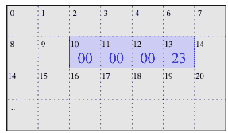
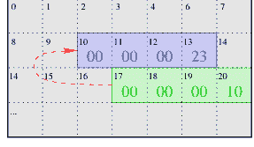
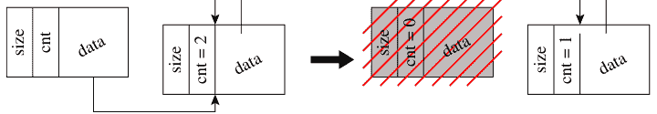
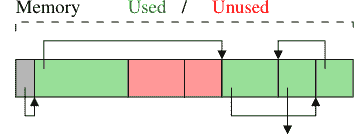
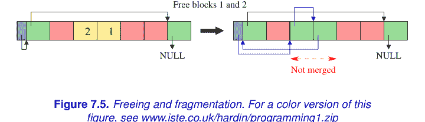
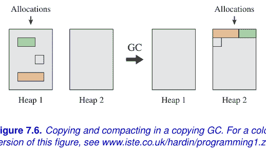

## 7. 指针与内存管理

本章专门介绍第 4 章中已提及的指针和引用概念，示例大多用 C 和 C++ 编写。这些语言包含显式指针，有时会揭示与计算机架构紧密相关的技术细节。指针和引用是对象概念的基础，该概念将在面向对象语言的语境中（第 2 卷，第 3 和 4 章）详细讨论，涉及 Java（参见第 2 卷，第 4.1 节）、Python（参见第 2 卷，第 4.4 节）和 C++（参见第 2 卷，第 4.2 节）。

### 7.1. 地址与指针

从底层实现的角度来看，计算机内存可以被视为一个巨大的字节“数组”。这个“数组”由对应于程序变量的区域组成，更一般地说，由程序显式或静默分配的区域组成。其中一些区域由程序的执行机制自动创建，一些由编译机制创建，另一些则由源代码中明确提出的需求创建。程序操作的信息存储在内存的某个位置，由地址指示：这一概念已在第 2 章和第 4 章中讨论过。因此，地址可以被视为内存“数组”中存储信息的索引。

地址是一种信息元素，与其他元素无异：它可以被记录、操作，或用于在其所表示的位置进行读写。地址类型的值称为指针。因此，包含地址的变量属于地址类型。“指针”一词常被不加区分地用来指代地址类型或地址值，具体取决于上下文。

正如我们在研究命令式特性的类型时所见，指针类型指示所指向值的类型。此规则适用于 C 和 C++ 等语言，并保证存储在地址中的值将以与其类型一致的方式进行操作。例如，在 C 语言中，假设我们正在读取由指针 p 表示的位置上的值。如果 p 表示整数（int）的地址，则有 4 个字节需要读取。在浮点数（double）的情况下，有 8 个字节需要读取。图 7.1 展示了内存中从地址 10 开始的整数 23 的示意图。内存中字节的组织方式将在第 7.2 节中详细讨论。



图 7.1. 内存与地址的示意图。要查看此图的彩色版本，请访问 www.iste.co.uk/hardin/programming1.zip

在 C 语言中，指针类型由构造符 * 表示。因此，int * 表示指向 int 的指针，即将找到整数类型信息的地址。符号 int *x; 将变量 x 声明为指向整数的指针：字面上，x 所指向的值的类型为 int。可以创建变量来记录地址，这些变量本身也存储在内存中的某个地址上。因此，int** 表示指向指向整数的指针的指针。此类指针所指定地址处找到的信息本身就是一个地址。

图 7.2 展示了图 7.1 中介绍的整数与一个指针并排的情况，该指针的值表示该先前整数的地址。为了表示目的，指针被任意视为与整数大小相同，但这在当前架构中并非总是如此。



图 7.2. 指向指针的指针。要查看此图的彩色版本，请访问 www.iste.co.uk/hardin/programming1.zip


### 7.2. 字节序

整数在内存中的存储方式因处理器而异。整数的存储需要若干字节，这些字节可以从左到右或从右到左存储在内存中。这种顺序称为 *字节序*，由处理器架构决定。将整数最低有效字节存储在最低地址的处理器被称为“小端”。在这种架构下，对于十六进制值 01020304，字节 01 将被放置在整数起始地址，字节 02 将被放置在下一个地址，以此类推。Intel x86 和 ARM 处理器是小端字节序。按逆序存储字节、将最高有效字节置于最低地址的处理器被称为“大端”。在这种情况下，对于值 01020304，字节 04 将存储在整数起始地址，接着是 03，以此类推。摩托罗拉 MC68000 系列处理器是大端字节序。某些处理器，如 MIPS 或 PowerPC 型号，可以配置（使用硬件、软件或两者）以任一模式运行。当然，如果数据结构直接从内存中提取并通过网络或作为磁盘上的文件传输到具有不同字节序的处理器，字节序可能会导致兼容性问题。在这种情况下，必须使用程序在尝试访问接收到的整数值之前对相关字节进行重新排序。

### 7.3. 指针与数组

如我们所见，地址代表内存中的一个“位置”。因此，它可以是变量的位置，也可以是连续数据区域的起始位置。在某些语言中，数组（即相同类型数据的连续序列）仅由其所在内存区域的起始地址表示。因此，如我们在 6.2 节中所见，数组中的元素是通过从数组起始位置、每个元素的大小和索引计算其地址来访问的。使用地址进行的计算通常被称为 *指针运算*。在 C 和 C++ 中，编译器将使用类型 *t* 上的指针 *p* 与整数 *n* 的加法操作 *p + n* 解释为“从 *p* 移动 *n* 个类型为 *t* 的元素”，这是指针上唯一允许的算术运算。

例如，如果 *p* 由 `int *p` 声明，则表达式 `p[5]` 的内存访问操作将在地址 `p + 5 * 4` 处发生，因为整数由 4 个字节组成。在实践中，带括号的表示法 `p[5]` 与解引用地址 `p + 5` 相同。在 C 中，这写作 `*(p + 5)`（由于加法满足交换律，表示法 `i[tab]` 在语义上等同于 C 中的 `tab[i]`，也表示数组 `tab` 中的单元 `i`，但出于可读性考虑应避免使用）。

### 7.4. 按地址传递参数

在 4.6 节中，我们考察了不同的过程调用机制，定义了调用者与被调用过程之间不同的通信模式。在按值传递的情况下，调用者将值传输给被调用过程：该值要么是常量，要么是可变变量，该变量局部于过程并由传输的值初始化。在按引用传递的情况下，调用者与被调用过程之间的通信是双向的：调用环境中一个可变变量的地址被传输给该过程，然后该过程可以修改该变量的值。框 4.6 描述了这些不同调用机制的可能语义。在本节中，我们将介绍在传递参数中使用指针：这被称为 *按地址传递参数*。这是一种实现按引用传递的技术，但也对某些编译器来说，是优化大参数传输的一种手段。下文描述了按地址传递有帮助的几种情况。

按定义，函数返回单个值。但是，我们可能需要返回多个值。一个简单的例子是一个设计用于获取整数数组并返回数组中负数、零和正数个数的函数。在原生支持 n 元组的语言中，将返回一个三元组值。示例 7.1 展示了该函数在 Python 中的定义。

### 示例 7.1

```python
def count(t):
    vneg = 0
    vnul = 0
    vpos = 0
    i = 0
    while i < len(t):
        if t[i] < 0: vneg = vneg + 1
        elif t[i] == 0: vnul = vnul + 1
        else: vpos = vpos + 1
        i = i + 1
    return (vneg, vnul, vpos)
```

如果所选语言不支持 n 元组——如 C 语言——则必须使用另一种机制，例如创建包含三个整数的记录类型并返回该类型的值，如示例 7.2 所示。

### 示例 7.2

```c
struct three_ints { int vneg; int vnul; int vpos; };

struct three_ints count(int *t, int size_t) {
  int i;
  struct three_ints res = { 0, 0, 0 };
  for (i = 0; i < size_t; i++) {
    if (t[i] < 0) res.vneg++;
    else if (t[i] == 0) res.vnul++;
    else res.vpos++;
  }
  return res;
}
```

此解决方案的缺点是，对于希望返回的每种多值类型，都需要创建一个“实用”结构体。因此，如果另一个函数需要返回两个整数和一个浮点数，则必须为此创建一个新结构体，以此类推，增加了代码的大小。此外，这些结构体的定义“污染”了源代码并限制了可维护性，不利于那些有助于揭示程序算法架构的定义。

另一种解决方案是创建专用于该函数的全局变量，函数将要返回的值写入其中。显然，每个要返回的值都需要一个全局变量，就像之前的方法需要多个结构体一样。这使得程序更难以维护，因为我们需要确保每个函数写入自己的全局变量，并且每个调用函数从正确的全局变量中读取结果。该方案还限制了重用性：函数的代码无法在不导入相关全局变量声明的情况下在另一个程序中重用。

可以通过 *按地址传递参数* 来避免这些问题，这是一种涉及指针的方法。该函数接受表示应存储要传输给调用者的结果的地址的参数。因此，该函数的形式参数和实际参数均为指针类型。调用者传输的实际参数是将存储函数调用结果的变量的地址。这一点在示例 7.3 中得到说明。

### 示例 7.3

```c
void count(int *t, int size_t, int *vneg, int *vnul, int *vpos) {
  int i;
  for (i = 0; i < size_t; i++) {
    if (t[i] < 0) (*vneg)++;
    else if (t[i] == 0) (*vnul)++;
    else (*vpos)++;
  }
}

void caller() {
  int t[6] = { 1, 1, 0, 0, 0, -2 };
  int vneg, vnul, vpos;
  count(t, 6, &vneg, &vnul, &vpos);
  printf("Negative: %d Null: %d Positive: %d\n", vneg, vnul, vpos);
}
```

调用者函数传输三个局部变量 vneg、vnul 和 vpos 的地址，这些地址将作为 count 的“邮箱”。count 函数将把其计算返回的值存储在这些位置。计算递增在指定地址处找到的值（在 (*vneg)++、(*vnul)++ 和 (*vpos)++ 中使用 *）。我们选择不在该函数中使用 return：所有结果都将使用按地址传递机制来传输。

在示例 7.3 中，count 函数以写入模式使用按地址传递的变量。这种模式通常称为“输出”，表示参数是函数的输出。这些参数也可以同时用于读取和写入：这被称为“输入输出”模式。在这种情况下，函数首先读取地址处的值以进行计算；然后它覆盖这些值以存储计算结果。这些带有专用语法的按地址传递参数的模式也出现在 Ada 语言中，该语言在第二卷第 2.2 节中简要介绍。考虑示例 7.4 中的函数，它将一个二维向量与一个标量相乘。结果向量可以“覆盖”重写参数向量。

### 示例 7.4

```c
void mult_vect_scal(float *x, float *y, float n) {
   *x = *x * n;
   *y = *y * n;
}
```

函数 mult_vect_scal 必须先检索向量每个分量的值，然后再将其乘以标量，接着将此乘积的结果写入原始向量。

当要传递给函数的参数很大时，按地址传递参数也是合理的。与其将整个结构体的内容复制以传输给被调用函数——这在时间和内存方面都可能代价高昂——不如仅传输结构体的地址。然而，如果结构体的内容必须保持被调用函数给定的状态，则此策略并非没有风险：如果该函数可以访问调用者的内存区域，则没有什么能阻止它


来进行修改。某些语言包含类型修饰符，可用于将变量或形参声明为 *constant*。声明作用域内的代码禁止在初始化后对该变量进行任何修改。此修饰符在 C 和 C++ 中名为 const，在 Ada 中也名为 const，在 Java 中名为 final。

在示例 7.5 中，函数 f 尝试向 i 指定的地址写入，但该地址被定义为常量。因此，该程序在编译期间被拒绝。

### 示例 7.5。

```c
void f (const int *i) { *i = *i + 1 ; }
```

```
$ gcc foo.c -c
foo.c:5:6: error: read-only variable is not assignable
 *i = *i + 1 ;
 ~~ ^
1 error generated.
```

### 7.5. 引用

注.-- 此处描述的 *reference*（引用）概念源于 C++ 和 Java 中使用的术语。它与第 2 章和第 4 章中关于可变变量所使用的引用不同。不幸的是，该术语的两种用法在编程语言语境中都已被广泛接受，因此了解任何给定语言中使用的特定含义非常重要，以防止歧义。

如第 7.4 节所见，参数可以通过地址传递给函数，从而允许函数修改调用者中的相应值。在 C 中，这是通过指针完成的，被调函数必须读取或写入作为参数接收的地址。*reference*（引用）的概念不需要使用指针即可产生相同的效果，简化了源代码的编写方式。

#### 7.5.1. C++ 中的引用

在 C++ 的语境中，引用是一个别名，指向预先分配的内存区域。引用使用表示内存区域的表达式进行初始化，该表达式由一个名称访问（即第 2.3.2 节中引入的 *l-value* 的更精确定义）。这样的名称可以是变量名、数组单元、对象属性等，因此它不能是任意表达式，例如常量或中间计算结果。然而，自引入 C++11 以来，用户可以定义由其他表达式初始化的引用，称为 *r-value references*（右值引用）；此机制的描述超出了本书的范围。即使在旧标准中，如果引用被声明为常量，也可以由 *r-value*（右值）初始化。有兴趣了解该主题更多细节的读者可阅读关于 C++ 的专业文档。

正如每个指针都是指向“类型”的指针一样，每个引用都是指向“类型”的引用。在 C++ 中，声明类型 t 的引用的语法是 t&。示例 7.6 展示了引用的声明，以及对其引用变量进行修改的效果。

### 示例 7.6。

```c
#include <stdio.h>
int main () {
int i = 46 ;
int& j = i ;
i = i + 1 ;
j = j + 1 ;
printf( "i = %d j = %d\n", i, j) ;
return 0 ;
}
```

变量 j 被声明为 int 的引用，并使用 i 的地址进行初始化。当 i 被修改时，j 也会被修改，反之亦然。在执行期间，该程序将显示 i = 48 j = 48，因为进行了两次递增，一次在标识符 i 上，另一次在 j 上。

示例 7.7 是示例 7.6 的修改版本，其中引用被替换为（常量）指针。请注意指针的显式操作，无论是在提取 i 的地址还是在解引用 j 时。

### 示例 7.7。

```c
#include <stdio.h>
int main () {
int i = 46 ;
int *j = &i ;
i = i + 1 ;
*j = *j + 1 ;
printf( "i = %d j = %d\n", i, *j) ;
return (0) ;
}
```

示例 7.8 中的程序，我们尝试用常量初始化引用 j，并用函数调用返回的值初始化引用 k，该程序无法编译：常量 10 和 times2 返回的整数都不表示已分配的内存区域。

### 示例 7.8。

```c++
#include <stdio.h>

int times2 (int v) {
return (2 * v);
}

int main () {
int i = 46 ;
int& j = 10 ;
int& k = times2 (i) ;
return 0 ;
}
```

使用 g++ 编译器尝试编译此程序将导致关于 j 和 k 初始化的错误：

```
$ g++ refs2.cpp
refs2.cpp:11:8: error: non-const lvalue reference to type 'int' cannot bind to
a temporary of type 'int'
int& j = 10 ;
^
refs2.cpp:12:8: error: non-const lvalue reference to type 'int' cannot bind to
a temporary of type 'int'
int& k = times2 (i) ;
^~~~~~~~~~
2 errors generated.
```

使用数组表示内存区域，可以创建对单元格的引用，如示例 7.9 所示。

### 示例 7.9。

```c++
#include <stdio.h>

int main () {
int t[2] = { 12, 21 } ;
int& i = t[1] ;
i = i + 1 ;
printf ("i = %d t[1] = %d\n", i, t[1]) ;
return 0 ;
}
```

变量 i 是对整数的引用，表示数组 t 中的第二个单元格。由于 t 表示内存中的一个区域，第二个单元格也将表示内存中的一个区域。运行此程序将返回预期结果 i = 22 t[1] = 22。

引用也可以用作函数参数，以“悄悄”地按地址传递参数，如示例 7.10 所示。

### 示例 7.10。

```cpp
#include <stdio.h>

void f (int& v) { v = v + 1 ; }

int main () {
int i = 46 ;
f (i) ;
printf("i = %d\n", i) ;
return 0 ;
}
```

f 的形参 v 是对整数的引用。因此，在调用 f(i) 期间，v 成为 i 的别名；换句话说，i 和 v 表示内存中的同一位置，尽管这两个标识符不在同一作用域中。因此，f 中对 v 的递增在调用者函数的 i 中可见，程序返回 i = 47。

鉴于引用是别名，完全可以创建对引用的引用，或将引用传递给接受引用作为参数的函数；引用始终指向同一个初始变量。示例 7.11 说明了这一点。

### 示例 7.11。

```cpp
#include <stdio.h>

void f (int& v) { v = v + 1 ; }

int main () {
int i = 46 ;
int &j = i ;
int &k = j ;
f (i) ;
f (j) ;
f (k) ;
printf("i = %d j = %d k = %d\n", i, j, k) ;
return (0) ;
}
```

将 j 创建为 i 的引用，并将 k 创建为 j 的引用，标识符 j 和 k 都是 i 的别名。在使用每个标识符作为参数调用 f 的上下文中，形参 v 也成为 i 的别名。因此，应用了三次递增，程序返回 i = 49 j = 49 k = 49。

函数调用的上下文中也是如此：为引用类型参数传递的实参必须指定一个内存区域。再次说明，此机制的目的是为标识符创建别名。因此，编译器将拒绝示例 7.12。

### 示例 7.12。

```c++
#include <stdio.h>

void f (int& v) { v = v + 1 ; }

int main () {
f (67) ;
return 0 ;
}
```

对 f 的调用使用了一个不表示内存区域的实参，导致编译期间出现错误消息。

```
$ g++ refs.cpp
refs.cpp:8:3: error: no matching function for call to ’f’
f (67) ;
~
refs.cpp:3:6: note: candidate function not viable: expects an l-value for 1st
argument
void f (int& v)
~
1 error generated.
```

与按地址传递的情况一样，引用可用于传输调用的大型参数，避免复制它们的需要。可以声明常量引用（与常量指针的方式相同）以防止被调函数修改调用者函数传输的内存区域。

#### 7.5.2. Java 中的引用

虽然 Java 不包含显式引用机制，但一些作者认为，如果参数是原始类型（整数、布尔值或浮点数），该语言按值传递参数；如果该参数具有对象类型（包括此处视为对象的字符串），则按引用传递。这并不完全正确：实际上，Java 始终按值传递。原始值和对象值之间的区别在于，对象始终动态分配，因此由指针表示。当按值调用的实参是对象值时，实际作为实参传递的值是指针的副本。由于 Java 不使用显式指针，每次操作对象时，都是通过其地址悄悄完成的。


### 7.6. 内存管理

本节将讨论使用手动或自动方法进行内存分配和释放。在高级语言中，数据由执行过程存储在内存中，开发者无需直接干预。在某些语言中，开发者还可以使用较低级别的特性来获得对内存存储的全部或部分控制权。现在将对由执行过程（有时伴随程序员参与）的内存管理进行相对简要的介绍。

#### 7.6.1. 内存分配

当编译器分析变量定义时，它会分配一块内存区域来存储绑定到该变量的值。此操作称为 _内存分配_。对于变量以及大小可在编译时确定的数组，内存需求是已知的，分配可以在编译期间规划。这称为 _静态分配_。

在示例 7.13 中，变量 i 和 s 的大小在不同执行之间不会变化：它们的分配是静态的。

### 示例 7.13

```c
int i = 42 ;
char s[20] ;
```

##### 7.6.1.1. 动态分配

在其他情况下，程序所有可能执行所需的内存数量无法预先确定。例如，编写本书所用文本编辑器的设计者无法知道每个文本文件将包含多少个字符，这意味着他们在写入过程中不知道所需的内存量。换言之，内存需求在编译时是未知的。

程序员当然可以预留“相当大”的内存量（例如使用一个非常大的数组），并告诉自己“这应该足够了”。这种解决方案由于几种原因令人不满意。首先，当执行过程使用的内存少于分配时预期的内存时，未使用的空间无法用于另一程序的执行。请记住，作为一种资源，内存由所有程序共享，其大小必然是有限的。其次，如果默认内存分配不足，剩下的办法只有修改源代码以请求更大的尺寸。这是不可接受的，因为一方面，软件用户不一定知道（或不需要知道）如何修改此源代码；另一方面，此源代码并不总是可用，尤其是当它来自专有和付费软件时。因此，执行系统（与操作系统协作）必须包含一种机制，在程序执行期间分配内存，以满足每次执行的实际需求。这种机制称为 *动态分配*。动态分配的结果是刚刚分配区域的起始地址，必须将其存储在指针中。

内存分配可能会被拒绝，例如当空间不足时。通常在这种情况下，用于内存分配的原语会返回一个“非法”地址，通常称为 NULL 指针（源自许多语言中用于定义此地址的常量的名称）。这引出了两个重要点。在尝试访问返回的地址之前，必须检查内存分配是否成功。此外，程序中的任何指针都可能（出于任何原因）包含此非法 NULL 值。必须检测此值，因为访问此非法地址会中断程序的执行。

##### 7.6.1.2. 大型结构的分配

针对非常大的数据（例如多兆字节）进行内存分配，可能会引发某些问题，这些问题因数据绑定的作用域而异。

考虑绑定到此类数据的局部变量的情况。内存分配通常在执行堆栈上完成，例如在 C 语言中即是如此。由于堆栈大小有限，它可能会完全填满并溢出，从而导致执行错误。示例 7.14 说明了这一点，尽管机器上有 16 GB 的 RAM 可用。

### 示例 7.14

```c
#include <stdio.h>
#include <stdlib.h>
#define SIZE (10000000L)

int main () {
  int t[SIZE] ;
  t[0] = 5 ;
  printf ( "%d\n", t[0] ) ;
  return 0 ;
}
```

无法将 1000 万个整数分配到堆栈上，因此执行此程序会生成段错误。

```
$ gcc foo.c
$ ./a.out
Segmentation fault: 11
```

现在，考虑绑定到非常大数据元素的全局变量的情况。如果此变量未初始化，大多数编译器会生成在加载可执行文件时执行的内存分配。如果数据已初始化，它将以 _完整地_ 的形式出现在编译器生成的代码中；这会显著增加可执行文件的大小（以及编译时间），正如示例 7.15 所示。

### 示例 7.15

```c
#include <stdio.h>
#include <stdlib.h>
#define SIZE (10000000L)
int t[SIZE] = { 1 } ;
int main () {
t[0] = 5 ;
printf ("%d\n", t[0]) ;
return (0) ;
}
```

示例 7.15 生成的可执行文件包含为 t 静态分配的初始化字节序列，这些字节被添加到为函数生成的代码中。在这种情况下生成的二进制文件的显示大小明显不同于使用动态分配的同一程序，后者更小，仅约 10 kB。

```
$ gcc foo.c
$ ls -l a.out
-rwxr-xr-x 1 user user 40005896 8 mar 09:34 a.out
```

最后，考虑函数将包含结果的本地内存区域传递给其调用者的情况，当该结果较大时（参见第 7.4 节）。在示例 7.16 中，f 创建一个为数组的局部变量，对该数组应用处理，并将数组返回给程序，该函数名为 f。

### 示例 7.16

```c
int* f () {
int t[10] ;
... /* Processing. */
return t ;
}
int* g () {
... f () /* Call to f */
}
```

示例 7.16 对于具有自动内存管理系统的语言，或者数组是原生数据结构的语言，是完全可接受的。然而，在 C 和 C++ 等语言中，这样的程序是不正确的。由于函数的局部变量在堆栈上分配，局部变量 t 在 f 开始执行时会被“压入堆栈”。在实践中，这意味着构成数组的 10 个整数被放置在堆栈上，t 包含数组第一个元素的地址（在堆栈中）。在 f 执行结束时，f 的局部变量会从堆栈中移除。然而，return t 语句并不返回数组 t 的内容，而只是返回其第一个元素在堆栈中的地址。如果调用 f 的函数 g 使用此地址，无法保证该地址上的当前数据仍与 t 有任何关联，因为在此期间堆栈可能已被修改。

这些问题可以通过使用动态分配来避免，即使内存分配的大小在编译时是已知的。在示例 7.16 中，数组 t 可以动态分配。在 f 执行结束时，局部变量会消失，但已分配区域仍可访问，只要它没有被显式释放。

##### 7.6.1.3. 动态分配运算符

动态内存分配通过调用语言中的专用函数来执行。在 C 中，此函数称为 malloc，其参数为要分配的字节数。它返回一个无类型指针（void*），即内存分配器分配的区域的起始地址。malloc 函数在 C++ 中也存在，但通常会使用更精巧的 new 运算符来代替。与 malloc 不同，new 会调用所创建对象的构造函数（在第 2 卷第 4.2 节中讨论）。new 不需要将要分配的字节数作为参数，因为编译器使用所分配对象的类型来处理此计算。请注意，作为运算符，new 可以被重载（参见第 5.7.2 节）。

#### 7.6.2. 释放内存

当动态分配的内存区域不再需要时，必须将其归还给系统以供重用。在某些语言中，程序员负责此归还机制，并必须指定执行中某些内存区域不再使用并可被释放的点。在大型程序的情况下，这种形式的内存管理可能极其复杂，并可能发生不同种类的错误。

首先，程序员可能会错误地判断某个区域何时不再需要，并过早释放它。因此，程序将继续运行使用存储在该区域中的值的指令。但是，由于该区域已被释放，它不再“属于”正在运行的程序。如果它尝试访问该区域，程序将被中断


因侵犯内存空间。事实上，操作系统禁止程序访问任何未分配给它们的内存区域。

过早释放内存会导致这种错误的更严重版本，即内存区域已被重新分配给程序用于其他用途。在这种情况下，程序继续访问属于它的该区域，因此操作系统不会中断它。然而，使用过早释放的区域的处理过程和在此释放后分配了该区域的处理过程，会在这个区域中并发读写它们的数据，导致不可预测的数据修改。这种无声的数据损坏会导致难以发现的错误，而纠正这个问题尤其困难。

内存也可能释放太晚，或者根本不释放。在这种情况下，程序无故“占用”内存资源。最坏的情况是没有足够的可用内存来满足其他需求，导致执行错误。轻则，现代操作系统有能力虚拟化内存：外部存储外设（硬盘）充当缓冲区，暂时释放当前未使用内存的程序或进程的内存。结果是整体机器变慢和性能崩溃，可能导致整个系统部分或完全瘫痪。

要释放内存，必须保存每个已分配区域的地址直到释放时点。如果这个地址丢失，将无法释放该区域，导致上述影响。这称为*内存泄漏*。

在示例7.17中，由原语`malloc`分配的区域在函数`f`结束时未被释放。该区域的地址存储在局部变量`p`中，在`f`的执行结束时消失。因此地址变得未知，结果是无法释放空间。

## 示例 7.17

```c
int f (int size) {
int *p = malloc (size) ;
for (int i = 0; i < size; i++) {
do_something (p[i]) ;
}
return (... ) ;
}
```

其他常见的内存释放错误包括释放未动态分配的区域，以及多次尝试释放同一区域。

与分配一样，内存释放是通过调用语言的一个构造来实现的。在C语言中，这个构造是`free`函数，其参数是由`malloc`分配的区域的起始地址。开发者不需要指定要释放的大小，因为在分配期间，这些信息已由内存管理器记忆。这一点尤为重要，因为`malloc`不一定分配正好请求的内存量：实际分配可能大一些，原因我们在此不详述。程序员无法确切知道要释放多少内存，因此卸载此问题很重要。在C++中，所有使用`new`分配的内存都必须使用`delete`运算符释放。在调用`delete`期间，分配对象的析构函数（在第2卷第4.2节中描述）会被自动调用；使用`free`则不会这样。作为运算符，`delete`也可以被重载。

#### 7.6.3. 自动内存管理

为了克服内存释放的难度及其引起的错误，Java、OCaml、Python和Lisp等语言在其运行时中包含一种机制；该机制自动检索并释放不再可访问、因此无用的内存区域。这种机制称为*垃圾收集器*（GC），它提高了语言安全性，因为用户免除了内存管理的责任。

要自动管理内存，执行管理者需要知道每个已分配内存区域的大小。程序使用的内存块（区域）集合（称为*活跃块*）被组织成一个内存图。其起始点，称为*根*，是寄存器、执行栈和全局变量。该图的边是位于块中的指针。任何*活跃块*都可以通过从根传递地跟随指针来访问。该块在执行时仍然有用。所谓的*死块*从根是不可访问的，因此可以被检索。因此，GC的基本任务是在执行过程中浏览内存图，寻找死块。因此，它必须能够区分指针和其他类型的数据。

GC的效率通过其增加执行时间的程度、所需内存空间的大小以及其释放所有可释放内存的能力来衡量。它取决于程序中分配的频率和赋值的频率。不同的GC使用不同的技术，没有哪一种明显优于其他。以下各节提供了基本轮廓。

##### 7.6.3.1. 引用计数GC

引用计数GC为每个已分配的内存块关联一个计数器。每次创建指向该块的指针时，计数器加1；每次销毁指针时，计数器减1。如果计数器达到0，则表示该块不再被使用并可以释放；这可能导致指向其他块的指针被删除。如果是这种情况，这些后续块的计数器将被减1；如果这些计数器中的任何一个达到0，将触发新一轮GC。块中的指针管理会带来成本，成本可能很高。这种GC机制无法释放循环数据结构，即引用自身的结构，因为它们的计数器永远不会达到零：如图7.3所示。这种现象会导致内存泄漏。



图7.3。循环和引用计数器。此图的彩色版本，请参见www.iste.co.uk/hardin/programming1.zip

##### 7.6.3.2. 标记-清除GC

标记-清除GC遍历内存图，标记活跃块。未标记的块因此是死块，GC将它们添加到自由内存中，由自由块链表表示。



图7.4。自由块列表。此图的彩色版本，请参见www.iste.co.uk/hardin/programming1.zip

标记-清除GC有能力释放循环结构。然而，它们无法合并连续的自由块，因为每个块被独立地重新插入到自由块列表中。这导致内存碎片化，如图7.5所示，这可能阻止分配比任何单个自由块更大的结构，即使自由内存的总量足够。

##### 7.6.3.3. 复制GC

复制GC使用两个大小相等的内存区域。任何时候，只使用其中一个区域来分配内存。当可用内存量不足时，GC遍历内存图并将所有活跃块连续复制到未使用区域。在此过程结束时，之前未使用的区域包含所有活跃块，GC反转两个区域的角色。块复制防止内存碎片化，但复制块中的指针必须更新。复制GC有两个主要缺点：首先，在GC阶段程序执行停止；其次，它将所需的内存量加倍。





##### 7.6.3.4. 分代GC

分代GC基于经验观察：最近分配的（所谓的年轻）块倾向于保持活跃一段短时间。这些年轻块大多存储临时变量的值，以及块或函数的局部变量的值，这些变量在块或函数执行后就会消失。全局变量必须在整个执行期间保持可访问，其值将存储在会“老化”的块中。因此，内存被分割成几个包含年龄相近块的区域，每个区域称为一个代。分配在包含最年轻块的区域中进行。如果这个区域不足以满足分配请求，GC将扫描图中这个更年轻代的活跃块，并将它们复制到稍年长的代。一旦这个更老的代因复制而饱和，GC就会寻找死块以

消除它们。在双代垃圾回收中，年轻代和老年代的处理通常分别称为 *次要* 和 *主要* GC。

与基于复制的 GC 情况类似，内存会自动被压缩。此外，如果语言导致大量临时分配，次要 GC 只需检查年轻代即可释放大量内存。分代 GC 的执行意味着记录和管理从老块到年轻块的指针，导致赋值操作期间产生额外开销。同样，与复制 GC 类似，这种方法会中断程序的执行；但是，中断持续时间可以通过调整不同代的大小参数来缩短。

###### 7.6.3.5. 保守式 GC

要向依赖“手动”分配/释放的语言添加自动内存回收机制，可以使用 *保守式* GC。它扫描内存，假设内存中任何可以表示地址值的字节序列都是指针。它释放所有肯定已死亡的块。但是，一些块被错误地识别为活动的，因为它们包含被 GC 当作指针的值。这样的块确实可能已死，但在整个执行期间都会被视为活动的。此 GC 不允许内存压缩，并可能导致内存泄漏。

为了总结本节，内存管理方法是高级语言和低级语言之间的分界点。由于复杂性，手动内存管理是公认的错误源头。用于检查这种手动管理的工具非常少。在本节中，我们简要概述了 GC，这些 GC 在一定程度上弥补了这些困难。其他更复杂的解决方案，例如在多处理器架构上运行的并发或并行 GC [DOL 93, DOL 94]，在此不予讨论，因为它们超出了本书的范围。
