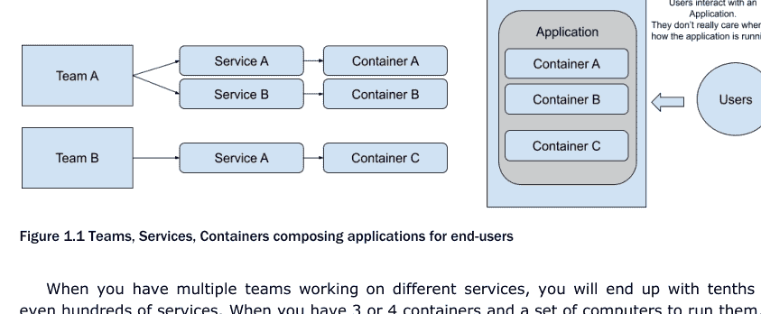
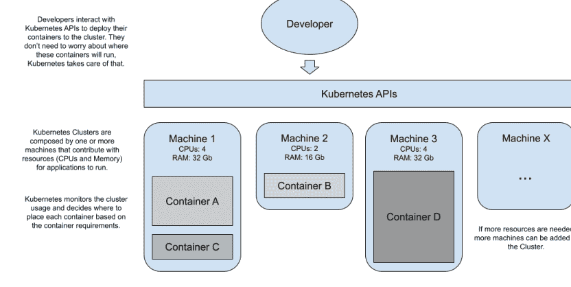
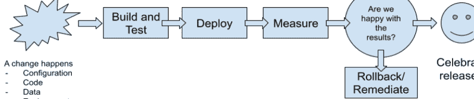
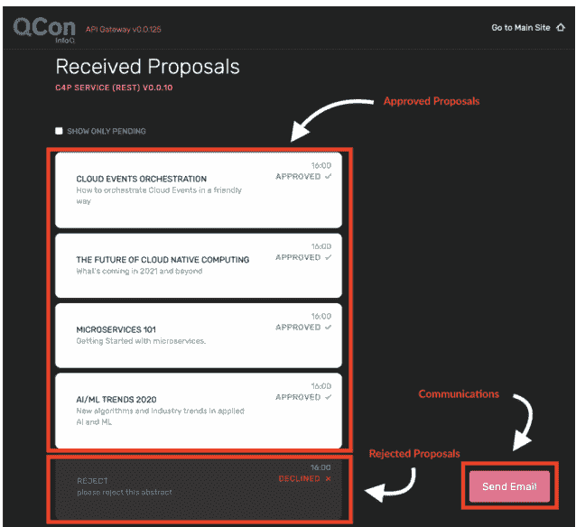
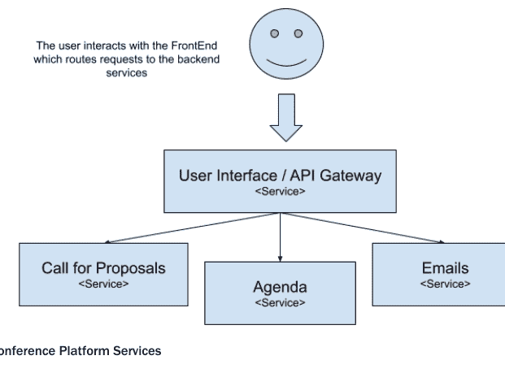
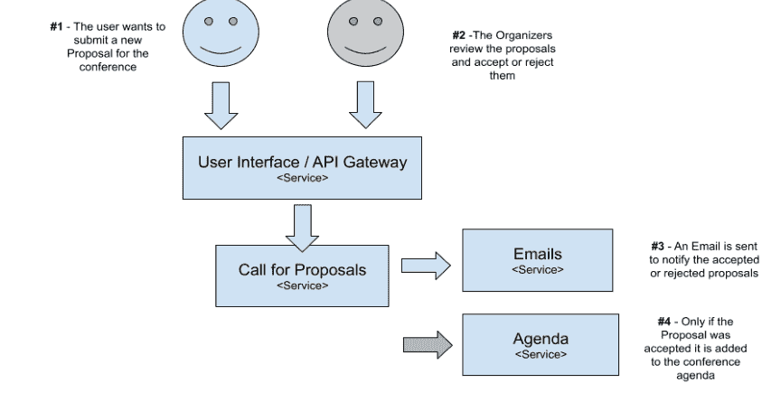
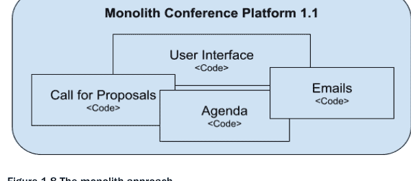

# 1

## Cloud-Native Continuous Delivery

## This chapter covers

+   - An introduction to Cloud-Native Applications, how they are architected and how they are related to Kubernetes
+   - An introduction to the goal of Continuous Delivery practices: Why these practices essential to deliver a continuous stream of value to your end-users
+   - Introduces a “walking skeleton” project that will be used throughout the chapters and explains how the rest of the book works

Building modern Cloud-Native applications is hard. You end up building highly complex distributed applications that are continuously evolving on top of a tech stack that is continuously changing. Delivering software has always been challenging; delivering software efficiently and reliably is still considered a holy grail by many. In today’s world, how fast you deliver new features to your users/customers can become a real differentiator from your competition; hence it is becoming a priority for companies from all industries to change the way they work, how they organise teams and how they architect and deliver software.

This book focuses on applying Continuous Delivery practices to modern Cloud-Native environments using Kubernetes as the target platform. This book aims to be very practical in showing how you can use these tools with the primary goal of delivering software reliably and efficiently.

To make sure that the practices and tools are efficient, and you are continuously improving, you first need to measure how things are currently working. This book relies on the research presented by another great book called Accelerate (https://www.amazon.com/Accelerate-Software-Performing-Technology-Organizations/dp/1942788339), where a statistical analysis has been done to understand which key metrics help organizations to improve their performance.

The tools introduced in this book have been chosen to solve specific challenges that you will face when building Cloud-Native applications. Some of these tools solve very technical and architectural challenges. Some cover how teams will improve collaboration. But all the tools presented have a shared goal: "help you to deliver robust and reliable software to your customers".

This first chapter covers some basic concepts and definitions that are used throughout this book, giving you context about where the tools presented in the following chapters can be useful and how they were designed. Before we can deep dive into the specifics of Cloud-Native Continuous Delivery, let's get started checking where you are in your Cloud-Native journey.

## 1.1 Are you Cloud-Native?

Let’s go straight to the point, you will see a lot about Kubernetes in this book but you need to understand that you can implement Cloud-Native applications without using Kubernetes. Similarly, you can apply Continuous Delivery practices without Kubernetes. Still, this book aims to deliver a practical experience on a real technology stack that is widely available today, so the reader can experience the advantages of Continuous Delivery first hand.

Let’s get the definitions out of the way, Cloud-Native is a very overloaded term, and while you shouldn’t worry too much about it, it is essential to understand why this book makes use of concrete tools that run on top of Kubernetes using containers.

A good definition of the term can be found in VMWare site by Joe Beda (Co-Founder, Kubernetes and Principal Engineer, VMware) https://tanzu.vmware.com/cloud-native

> "Cloud-Native is structuring teams, culture, and technology to utilise automation and architectures to manage complexity and unlock velocity."

As you can see, there is much more than the technology associated with the term Cloud-Native. There is a people and culture angle to it, that pushes us to reevaluate how we are building software. This book, while covering technology, will make a lot of references to practices that can speed up the process of creating and delivering Cloud-Native applications.

On the technical side, Cloud-Native applications are heavily influenced by the "12-factor apps" principles (https://12factor.net) which were defined to leverage cloud computing infrastructure. These principles were created way before Kubernetes existed and served to establish recommended practices for when building distributed applications. With these principles, you can separate services to be worked by different teams all using the same assumptions on how these services will work and interact with each other. These 12-factors are:

+   - I. Codebase
+     One codebase tracked in revision control, many deploys
+   - II. Dependencies
+     Explicitly declare and isolate dependencies
+   - III. Config
+     Store config in the environment
+   - IV. Backing services
+     Treat backing services as attached resources
+   - V. Build, release, run
+     Strictly separate build and run stages
+   - VI. Processes
+     Execute the app as one or more stateless processes
+   - VII. Port binding
+     Export services via port binding
+   - VIII. Concurrency
+     Scale out via the process model
+   - IX. Disposability
+     Maximize robustness with fast startup and graceful shutdown
+   - X. Dev/prod parity
+     Keep development, staging, and production as similar as possible
+   - XI. Logs
+     Treat logs as event streams
+   - XII. Admin processes
+     Run admin/management tasks as one-off processes

By following these principles, you are aiming to manage and reduce the complexity of building distributed applications, for example, by scoping a smaller and more focused set of functionalities into what is known as a microservice. These principles guide you to build stateless microservices (VI and VIII) that can be scaled by creating new instances (replicas) of the service to handle more load. By having smaller microservices, you end up having more services for your applications. This force you to have a clear scope for each microservice, where the source code is going to be stored and versioned (I) and its dependencies (II and IV). Having more moving pieces (microservices), you will need to rely on automation to build, test and deploy (V) each service, having a clear strategy becomes a must from day one. Now you need to manage an entire fleet of running services, instead of just one big ship (monolith), which requires you to have visibility on what is going on (XI) and plan accordingly for cases when things go wrong (XII). Finally, to catch

尽早发现生产问题（X），强烈建议在尽可能接近生产环境的环境中工作并定期进行测试。

Cloud-Native 术语也与容器技术（如 Docker）密切相关，因为容器按设计遵循了“12 因素应用”原则的最佳实践，它们是为 Cloud-Native 应用和云基础设施而设计的。再次强调，你可以在不使用容器的情况下实现 Cloud-Native 模式。尽管如此，为了简单起见，在本书中，Cloud-Native 服务、“12 因素应用”和微服务都将打包为容器，并且这些术语将被用作同义词。

如果你遵循“12 因素应用”原则，你和你的团队将构建一组具有不同生命周期并且可以独立演进的服务。无论团队规模大小，你都需要围绕这些服务组织人员和工具。

图 1.1 团队、服务、容器组成面向终端用户的应用

当多个团队在不同的服务上工作时，你最终会拥有数十甚至数百个服务。当你有 3 或 4 个容器和一组运行它们的计算机时，可以手动决定这些服务将在哪里运行，但当服务数量增长，并且你的数据中心需要扩展时，你就需要自动化这项工作。这正是容器编排器的任务，它将根据集群（数据中心中的机器）的大小和利用率等其他特征为你决定服务将在哪里运行。

行业已经选择 Kubernetes 成为容器编排的事实标准。你可以在每个主要云提供商以及 Red Hat、VMWare 等公司提供的本地服务中找到托管的 Kubernetes 服务。

Kubernetes 提供了一组抽象来处理一组计算资源（通常称为集群，可想象为数据中心）作为一台计算机。处理一台计算机简化了操作，因为你可以依赖 Kubernetes 根据集群状态做出正确的负载放置。开发人员可以专注于部署应用程序，Kubernetes 将承担放置它们到更合适位置的负担。

Kubernetes 提供了一个对开发人员和运维友好的声明式 REST API 来与这些抽象交互。开发人员和运维可以通过

使用名为 `kubectl` 的 CLI（命令行界面）或直接调用每个集群公开的 REST API 与不同的 Kubernetes 集群交互。

图 1.2 Kubernetes 让你专注于运行你的服务。

Kubernetes 负责决定你的容器将在哪里运行（在哪个具体机器上），基于集群利用率和其他你可以调整的特征。大多数情况下，作为开发人员，你只关心你的应用程序正在运行，而不是它们运行在哪里。

《Kubernetes in Action》和《Core Kubernetes》都是强烈推荐的书籍，如果你有兴趣学习如何使用 Kubernetes 以及 Kubernetes 内部的工作原理。

### 1.1.1 交付 Cloud-Native 应用的挑战

在使用 Kubernetes、容器和 12 因素应用时，你会很快注意到有很多事情在发生。如果你第一次进入此类环境，有很多挑战需要解决，才能理解各个部分如何组合在一起。

从架构角度来看，你的（微）服务现在依赖于不在同一台机器上共址的其他组件。这些服务需要配置为理解它们运行的环境，并且这些服务需要遵循某些约定和最佳实践，以便它们能够协同工作。

这些服务将由不同的团队独立拥有和演进；当可能影响其他团队和服务的更改发生时，需要协作和持续的沟通。

要在 Kubernetes 中运行这些服务，现在你需要考虑创建、构建和测试容器以及 Kubernetes YAML 文件。不再仅仅是为你的应用程序生成二进制文件，你现在需要考虑你的应用程序如何容器化、配置以及部署到 Kubernetes 集群。

迟早，你会意识到已经没有 Application 存在了，现在你有一组独立的服务，它们以不同的速度演进。

如果没有正确的位置测试，你将花费数周（包括周末）试图理解为什么其中一个服务导致整个系统崩溃。

如果没有正确的位置度量，你永远不会知道除了添加功能之外的更改是否正在减慢整个客户体验，或者是否会在未来导致停机。

也很重要的一点是，要理解对于你的用户来说，使用 Kubernetes、容器甚至构建 Cloud-Native 应用并不重要，他们所寻找的只是新的、更好的应用来帮助他们解决问题。为了确保价值始终是我们真正的指南针，我们依赖于持续交付实践。持续交付（简称 CD），如《持续交付》一书所述（参考待添加），是一组帮助团队以可靠和高效的方式向用户交付有价值软件的实践。CD 非常注重自动化和衡量我们的交付流程，以不断改进。解释 CD 涉及的所有实践超出了我们本章想要涵盖的范围；现在，我将简单解释 CD 背后的目标以及为什么你应该关心学习并将 CD 应用于日常软件实践。在下一节中，我们将更详细地了解持续交付的目标以及它们与 Cloud-Native 应用的关系。我们将在后续章节中介绍实践，当我们深入研究帮助我们将这些实践应用于项目的工具时。

## 1.2 持续交付目标

以高效的方式向你的客户/用户交付有价值的软件应该是你的主要目标。在构建 Cloud-Native 应用时，这变得具有挑战性，因为你不再处理单个应用程序，你现在处理的是复杂的分布式应用程序和多个以不同速度交付功能的团队。

对于本书的其余部分，将使用以下持续交付目标来指导为你的团队选择不同项目和工具：

来自《持续交付》一书

> “目标：尽可能快地向用户交付有用、可工作的软件
> 专注于减少周期时间（从决定做出更改到用户可用的时间）”

该目标定义来自 Jez Humble 和 David Farley（2010 https://www.amazon.co.uk/Continuous-Delivery-Deployment-Automation-Addison-Wesley/dp/0321601912/ref=asc_df_0321601912/?tag=googshopuk-21&linkCode=df0&hvadid=3109134879798&hvpos=&hvnetw=g&hvrand=15021799242967420863&hvpone=&hvptwo=&hvqmt=&hvdev=c&hvdvcmdl=&hvlocint=&hvlocphy=9045944&hvtargid=pla-4345140654988&psc=1&th=1&psc=1）撰写的《持续交付》一书。该书有意不深入任何技术，除了命名它们之外，并且因为它是在十多年前写的，云和 Kubernetes 并不存在于今天的方式。

Humble 和 Farley 的书涵盖了一些重要的领域，你将在这里读到，例如：

- 部署流水线：创建和发布我们应用程序服务的软件制品所需的所有步骤。
- 环境管理：如何创建和管理不同的环境以开发、测试并为我们的客户/用户托管应用程序。
- 发布管理：验证和验证服务的新的发布的流程。
- 配置管理：如何在不同环境中以高效和安全的方式管理配置更改。

本书《Cloud-Native Continuous Delivery》旨在成为一个实践指南，你可以在其中亲身体验 Humble 和 Farley 在他们的书中描述的概念，使用简单的工具和一个可修改的工作示例来测试持续交付的不同方面。

仅仅采用 Kubernetes、重新架构你的应用程序并运行你的工作负载是不够的，要从中受益（并获得投资回报）。只有当你的组织更快地向用户交付更多更好的软件时，你才能充分利用 Kubernetes 的设计原则。

以这种方式，Cloud-Native 持续交付目标可以表述如下：

> “通过组织团队以自动化方式构建和部署在云无关设置中运行的 Cloud-Native 应用，尽可能快地向用户交付有用、可工作的软件。”

该目标意味着多个团队在这些 Cloud-Native 应用的不同部分工作，可以部署到不同的云提供商以避免供应商锁定。这也意味着 Cloud-Native 应用比旧的单体更复杂，但这种固有的复杂性如果管理得当，也能释放速度、可扩展性和弹性。

### 1.2.1 你已经在做持续交付了吗？

持续交付就是关于加快从你向用户发布某物到团队能够根据反馈采取行动并实施更改或新功能请求的反馈循环。为了高效和可靠的高质量软件，你需要自动化这个过程的大部分。

我经常听到人们说他们已经在做持续交付；因此本节简要概述了本书其余部分将涵盖的内容，以便你可以将当前情况与这些要点进行映射：

- **每次更改都需要触发反馈循环：** 有四件主要事情需要你监控更改并验证这些更改不会破坏应用程序：
  - **代码：** 如果你更改将被构建和运行的源代码，你需要为每次更改触发构建、测试和发布流程
  - **配置：** 如果配置中的某些内容发生变化，你需要重新测试并确保这些更改没有破坏任何东西。
  - **环境：** 如果运行应用程序的环境发生变化，你需要重新测试并验证应用程序仍然按预期运行。这里是你控制和监控你使用哪个版本的 Operating System，你的集群每个节点使用哪个版本的 Kubernetes 等。

- **数据结构：** 如果你的应用程序中的数据结构发生变化，你需要验证应用程序是否仍按预期工作，因为数据代表非常宝贵的资产，每一次变更都需要得到正确验证。这还涉及一个决定变更的向后兼容性程度以及旧结构与新结构之间迁移如何工作的流程。

- **反馈循环需要快速：** 反馈循环越快，你就能越快地采取行动，并且变更越小。为了使反馈循环更快，大多数验证都需要通过采用持续集成的方法进行自动化。通常，你会发现需要以下类型的测试来验证这些变更：

  - **单元测试：** 在每个项目/服务级别，这些测试可以快速运行（在 10 秒以内）并验证服务的内部逻辑是否正常工作。通常，在这里你会避免联系数据库或外部服务，以防止测试运行时间过长。开发人员在推送任何变更之前都应运行这些测试。

  - **集成/组件测试：** 这些测试需要更长时间，因为它们会与其他组件交互。但会验证这些交互是否仍在正常工作。对于这些测试，组件可以被模拟，本书涵盖了“消费者契约测试”以验证当服务接口（契约）发生变化时，新版本的服务不会破坏应用程序。

  - **验收测试：** 验证应用程序是否从业务角度实现了其应有的功能。通常，这是在服务级别而不是用户界面级别进行验证的，但有不同的技术来覆盖不同的角度。这些测试是在整个应用程序之上执行的，这需要创建一个完整的环境并使用包含新变更的服务版本进行配置，并且运行起来可能需要更长时间。

  - **手动测试：** 这是由一个团队执行的，他们将在与生产环境相似的环境中测试应用程序。理想情况下，这些测试人员应该测试用户将获得的内容。这些测试时间较长，因为需要人员逐一检查应用程序。

- **一切都需要被衡量：** 为了确保我们朝着正确的方向前进，并且你能持续向用户交付高质量的软件，你需要跟踪从开始到结束的反馈循环花费了多少时间和资源。以下是一些关键指标，可帮助你了解自己的表现如何。根据关于 DevOps 现状的 DORA 报告（https://services.google.com/fh/files/misc/state-of-devops-2019.pdf）你可以衡量：

  - **代码部署的频率：** 你多久向生产环境部署一次新版本？

  - **从提交变更到部署服务的交付时长：** 从你在版本控制中提交变更到这些变更部署到生产环境需要多长时间？

- **从事件中恢复所需的时间：** 从问题被报告到系统再次处于稳定状态，修复一个（或一组）行为异常的服务需要多长时间？
- **变更失败率：** 你部署的新版本导致生产环境出现问题的频率有多高？

Figure 1.3 Fast feedback loops help you to accelerate your deliveries

有很大可能你已经在做其中的一些事情，但除非你进行衡量，否则就无法断定你的变更对用户是否有用。

本书的主要目标是展示如何在云原生环境中实现持续交付。这可以帮助你应对分布式团队在分布式应用程序上工作的复杂性。正因如此，需要一个示例，而通过示例，我并不是指为我将在后续章节中提到的每项技术提供典型的“hello world”。

为了让你确信持续交付可以为你的公司或场景实现，你需要看到一个示例，你可以几乎一对一地映射到你的日常挑战。以下部分介绍了一个示例，将在整本书中使用。为了突出一些工具和框架，我们需要不止一个简单的示例，因此我们使用“行走骨架”这一术语，它代表一个功能完整的应用程序，包含足够多的组件和功能以实现端到端运行。“行走骨架”旨在突出定义的架构以及组件如何相互交互。这个“行走骨架”会促使你定义将使用哪些框架、目标平台以及哪些工具来交付你的软件。后续章节将深入探讨行走骨架的不同特性，该行走骨架以开源方式创建，供你在自己的环境中运行，并作为在将新技术应用于自己的项目之前进行测试的游乐场。

## 1.3 “行走骨架”的需求

在 Kubernetes 生态系统中，通常至少需要集成 10 个或更多项目或框架才能交付一个简单的 PoC（概念验证）。从如何将这些项目构建为可在 Kubernetes 内部运行的容器，到如何将流量路由到这些容器中提供的每个 REST 端点。如果你想尝试新项目以查看它们是否适合你自己的生态系统，你最终会构建一个 PoC 来验证你对这个新项目如何工作以及它将如何为你和你的团队节省时间的理解。

为本书，我创建了一个简单的“行走骨架”，这是一个云原生应用程序，它超越了简单的 PoC，并允许你探索如何应用不同的架构模式以及如何集成不同的工具和框架，而无需为了实验而更改你自己的项目。

这个行走骨架的主要目的是突出如何从架构角度和交付实践角度解决非常具体的挑战。你应该能够将样本云原生应用程序中这些挑战的解决方案映射到你自己的特定领域。挑战并不总是相同的，但我希望突出每种建议解决方案和所采取方法背后的原则，以指导你自己的决策。

借助这个行走骨架，你还可以弄清楚你需要的最小可行产品是什么，并快速将其部署到生产环境中，以便从那里进行改进。通过将行走骨架一直部署到生产环境，你可以获得对其他服务以及从基础设施角度你将需要什么的宝贵见解。它还可以帮助你的团队了解使用这些项目需要什么，以及事情可能在何处以及如何出错。

在我看来，用于构建“行走骨架”的技术栈并不重要，更重要的是理解各个部分如何契合，以及可以使用哪些工具和实践来使每个服务背后的团队（或一组服务）能够以安全高效的方式演进。

### 1.3.1 构建会议平台

在本書中，你将使用一个会议平台应用程序进行工作。这个会议平台可以在不同的环境中部署，以在需要时为不同的会议活动提供服务。该平台依赖于容器、Kubernetes 以及可在任何主要云提供商以及本地 Kubernetes 安装中工作的工具。

这是应用程序主页面看起来如何：

Figure 1.4 Conference Platform Main Site

会议应用程序在议程页面列出所有已批准的投稿。主页面还允许潜在演讲者在“征集提案”窗口仍开放时提交提案。组织者还有一个后台办公室部分，用于在组织会议时审阅提案并执行管理任务：

图 1.5 会议平台后台页面

该应用程序由一组具有不同职责的服务组成：

图 1.6 会议平台服务

图 1.6 显示了你控制的应用程序的主要组件，换句话说，就是你可以更改并且负责交付的服务。这些服务在功能上组成了应用程序，下面是对每个服务的简要描述：

- **用户界面/API 网关：** 该服务作为用户访问应用程序的主要入口点。因此，该服务托管 HTML、JavaScript 和 CSS 文件，这些文件将被与应用程序交互的客户端浏览器下载。
- **议程服务：** 该服务负责列出已批准用于会议的所有演讲。此服务需要在会议日期期间保持高度可用，因为与会者会在一天中多次访问此服务以在会议之间移动。
- **邮件服务：** 该服务仅是一个外观，公开 REST 端点以抽象出需要在应用程序运行的基础设施中配置的 SMTP 邮件服务。
- **征集提案 (C4P)：** 该服务包含处理“征集提案”用例的逻辑（简称为 C4P），当会议正在组织时。正如你在下图中看到的，C4P 服务同时调用议程服务和邮件服务，因此从 C4P 服务的角度来看，这两个服务被视为“下游”服务。

图 1.7 征集提案用例

在云原生架构中，为用户访问应用程序暴露单个入口点是相当正常的，这通常是通过 API 网关实现的，API 网关负责将请求路由到未暴露在集群外部的后端服务。

这个简单的应用程序实现了一组定义良好的用例，这些用例对于活动的进行至关重要，例如：

- 征集提案：潜在演讲者提交需要由会议组织者验证的提案。如果获批，提案将被发布在会议议程中。
- 与会者注册：与会者需要购买门票才能参加会议
- 活动议程（日程）：托管已批准的提案、时间和描述。
- 通信：向组织者、与会者和赞助商发送电子邮件。

在查看这些用例是如何实现的同时，你还需要考虑在实现新用例或需要引入更改时如何在团队之间进行协调。为了改善协作，你需要可见性，你需要了解平台的工作方式，本书的最后几章将介绍如何集成用于监控、可视化和编排服务的工具，以便从应用程序中了解和收集业务指标。

你还需要考虑这个云原生应用程序的运维方面。你可以想象，会有一个时期应用程序会开放“征集提案”请求供潜在演讲者提交提案，然后在临近会议日期时开放与会者注册页面等。

在整本书中，我会鼓励你通过添加新服务和实现新的用例来进行实验。在第 2 章，当你将应用程序部署到 Kubernetes 集群时

你将检查这些服务是如何配置为工作的，不同服务之间的数据如何流动以及如何扩展服务。

通过使用一个虚构的应用程序进行操作，你可以自由地更改每个服务的内部实现，使用不同的工具并比较结果，甚至可以并行尝试每个服务的不同版本。每个服务都提供了部署这些服务到你自己的环境所需的所有资源。在第 3 章，你将更深入地了解每个服务，以了解如何更改功能和行为。

通过让这个示例应用程序运行起来，你将能够理解并通过一个具体的例子体验如何衡量你的持续交付实践，例如：

- **每次更改都需要触发反馈循环：** 你需要建立什么样的设置来触发这些反馈循环？你如何协调不同的服务反馈循环，以及当它们发生时如何聚合这些更改？本书第 2 部分介绍了如何定义和实现部署管道。
- **反馈循环需要快速：** 在哪里测试？测试什么？以及当测试出错时如何停止推广工件？本书第 3 部分介绍了消费者驱动的契约测试如何帮助我们回答这些问题
- **一切都需要被衡量：** 衡量什么？何时衡量？以及如何确保新的更改不会让你的应用程序走向错误的方向。第 2 部分和第 3 部分的结合将帮助我们了解如何使用事件驱动的方法在何处收集正确的度量，以了解我们的表现。

在继续实际部署这个云原生会议平台之前，重要的是要提到一些主要区别，即将所有这些功能捆绑在一个单一的单体应用程序中。

云原生会议平台是基于一个单体应用程序创建的，该应用程序提供相同的目的，但存在一些缺点。单体应用程序实现了完全相同的用例，但它在下一节中讨论的几个缺点下运作。

### 1.3.2 与单体的差异

理解拥有单一单体应用程序与完全分布式的一组服务之间的差异对于理解为什么增加的复杂性是值得的努力至关重要。如果你仍在使用想要拆分为分布式方法的单体应用程序，本节强调了你将在单体和一组服务之间遇到的主要差异，这些服务从最终用户角度实现或多或少相同的功能。

单体方法将不同用例的逻辑紧密耦合在单个应用程序版本下。这会推动所有团队在同一个代码库上工作并协调更改的应用和发布方式。

图 1.8 单体方法

从功能上看它们是相同的，你可以完成相同数量的用例，但单体应用程序存在一些缺点，你可能已经在自己的单体应用程序中体验到，以下要点比较了云原生方法与之前的单体实现：

- **现在服务可以独立演进，团队能够更快地推进，代码库层面不再存在瓶颈：** 在单体应用程序中，不同团队工作的代码仓库只有一个，项目的持续集成管道只有一个且速度缓慢，团队使用功能分支导致复杂的合并问题。
- **现在平台可以根据不同场景进行不同的扩展：** 从可扩展性角度来看，每个单独的服务现在可以根据其经历的负载水平进行扩展。对于单体应用程序，运维团队只能在需要扩展单个功能时创建整个应用程序的新实例。对不同功能如何扩展进行精细控制可能是你用例的一个重要差异，但你需要尽职调查。
- **云原生版本复杂得多，因为它是一个分布式系统：** 但它更好地利用了云基础设施的灵活性和特性，使运维团队能够使用工具来管理这种复杂性和日常运营。在构建单体应用程序时，更常见的做法是创建自己的内部机制来运营大型应用程序。在云原生环境中，云提供商和开源项目提供了大量可用于运营和监控云原生应用程序的工具。
- **每个服务可以使用不同的编程语言或不同的框架构建：** 使用单体，应用程序开发人员被困在旧版本的库中，因为更改或升级库通常涉及大规模重构，并且整个应用程序需要进行测试以保证应用程序不会中断。在云原生方法中工作时，服务不受单一技术栈的强制。这使团队能够在选择自己的工具时更加自主，这在某些情况下可以加快交付时间。
- **单体是全有或全无：** 如果单体应用程序宕机，整个应用程序都会宕机，用户将无法访问任何内容。借助应用程序的云原生版本，即使服务宕机，用户仍可以访问应用程序。示例“行走骨架”展示了如何通过采用一些流行工具来支持降级服务。通过使用 Kubernetes，它被设计为监控你的服务并在服务表现不佳时采取行动，平台将尝试自我修复你的应用程序。
- **每个会议活动都需要单体的不同版本：** 在处理不同的会议活动时，每个会议都需要一个与其它活动略有不同的单体版本，这导致代码库分歧和整个项目的重复。大多数为会议所做的更改在活动结束后就丢失了。在云原生方法中，我们通过具有可互换的精细化服务来促进可重用性，从而避免整个平台的重复。

虽然单体应用程序比云原生应用程序更简单地进行操作和开发，但本书的其余部分重点介绍如何处理构建分布式应用程序的复杂性。我们将通过了解如何采用合适的工具和实践来实现这一点，这将使你的团队更独立、更高效，同时提升应用程序的弹性和健壮性。

## 1.4 本书其余部分的运作方式

在本书中，你将致力于确保最大化为应用程序的不同服务工作的团队所交付的价值，同时通过使用合适的工具来缩短周期时间。

虽然本书选择举例说明一些具体的工具，但每个工具都将被剖析，以突出每个工具的价值/有用性以及其构建所依据的概念。可以使用不同的工具来实现相同的结果，但我更倾向于展示一个具体的工具在运行，而不是让概念悬在空中。

本书将带你踏上一段旅程，在这段旅程中，不同的工具将被应用于我们的行走骨架，以改进应用程序架构以及如何高效地交付和衡量变更。

- **第 2 章：云原生应用挑战**：本章将行走骨架部署到 Kubernetes 集群中，并探索其服务以及它们如何相互连接。本章描述了如何使用 Helm，即 Kubernetes 的包管理器，来打包、发布和安装我们的应用程序到集群中。一旦理解了行走骨架的基础知识并且可以与应用程序交互，本章就会深入讨论这个简单应用程序所呈现的所有挑战。通过在开发应用程序的早期阶段就了解这些挑战，我们可以计划并尝试使用不同的工具来减轻或减少这些挑战的影响。
- **第 3 章：服务和环境流水线**：上一章描述了应用程序运行的挑战，我们需要了解应用程序的每个服务是如何构建、发布和发布的，以便应用程序可以安装在本地和远程 Kubernetes 集群中。本章还涵盖了如何管理不同的环境及其配置，以便我们的应用程序能够以可靠且可重复的方式为用户开发、测试和托管。本章以 Tekton 为例，介绍了一种 CI/CD 流水线引擎，可帮助我们自动化云原生应用程序的构建、发布和部署。本章还介绍了其他工具，如 Jenkins X，其旨在解决我们 Kubernetes 的大部分 CI/CD 需求。
- **第 4 章：多云基础设施：** 本章尝试界定我们应用程序的服务与基础设施之间的界限。每个应用程序都需要数据库、消息代理、邮件服务器以一种我们的服务可以连接的方式进行配置和配置。本章探讨了 Crossplane 如何帮助我们以与云提供商无关的方式解决与在云提供商中配置基础设施相关的一些挑战。
- **第 5 章：金丝雀发布：** 如果你对服务进行更改但不将其发布到生产环境，你可能是在浪费时间。本章介绍使用 Knative Serving 的金丝雀发布，允许你的团队同时部署服务的多个版本，从而让你可以在不向所有实时用户公开这些版本的情况下测试不同版本中包含的不同功能。
- **第 6 章：用于解耦服务的事件驱动功能：** 虽然使用 REST 进行服务到服务的交互是使两个服务通信和共享信息的最广泛理解的方法，但对于某些场景，使用事件驱动方法可能会带来一些好处。本章介绍如何使用 Knative Eventing 通过事件进行服务通信，以及这些事件如何以非常解耦的方式产生和消费。
- **第 7 章：**
  不再赘述，让我们跳到下一章，在 Kubernetes 集群中启动并运行行走骨架。

## 1.5 总结

- 云原生应用程序遵循 12 因素原则，以构建健壮且有弹性的分布式应用程序，这些应用程序可以扩展。你将使用 Docker 容器和 Kubernetes 来运行这些分布式应用程序。
- 持续交付实践的目标旨在减少做出变更决策与变更对终端用户生效之间的周期时间。
- Kubernetes 是云提供商之间的共同点，它为我们提供了构建云原生应用程序的有用抽象集，但它只是起点，而不是终点。
- 行走骨架可用于找出云原生应用程序的高风险或具有挑战性的方面。云原生会议平台将在整本书中用作行走骨架，以举例说明不同的开源项目如何帮助我们加快向终端用户交付软件的速度。

### 1.5.1 为什么是 Kubernetes？

当构建云原生应用程序时，将 Kubernetes 作为目标平台是有意义的，原因有很多，以下是在评估云提供商和行业走向时最相关的几点：

- **Kubernetes 是云提供商和本地工作负载之间的共同点：** 每个主要云提供商都提供 Kubernetes 管理服务 [AKS, GKE, EKS, TKG, LKE]，使开发人员能够使用一套共享的通用 API，而不考虑公司选择的云提供商。Kubernetes 社区也在引领定义构建下一代云原生应用程序的工具和最佳实践。
- **Kubernetes 用于探索和交付多云解决方案、与云提供商无关的解决方案：** 如果你的公司希望将正在生产的应用程序部署到多个云提供商，也许是为了避免供应商锁定，你最终会处于一个不能过于依赖云提供商特定解决方案和工具的位置。在这种情况下，开发人员希望构建抽象，使他们能够将每个应用程序和应用程序基础设施迁移到不同的云提供商。如果是这种情况，你可以依赖 Kubernetes 抽象来处理云基础设施，以及构建在其之上的其他抽象，如 Knative 来处理应用程序特定的主题，如消息传递。本书在第 X 章和第 X 章中涵盖了 Knative。
- **Kubernetes 用于构建你的 SaaS 平台，用于交付你的云服务：** 如果你的公司计划向客户提供 *软件即服务* 平台，而你的客户并不关心平台实际运行在哪里，你可能希望利用 Kubernetes 及其不断增长的社区来招聘资源来构建此类平台。有大量公司依赖 Kubernetes 为终端用户提供服务，你不会感到孤单。
- **Kubernetes 提供了一个充满活力、发展迅速、多厂商的生态系统：** Kubernetes 不仅仅是另一个开源项目，正如前面提到的，每个主要云提供商今天都是 Kubernetes 社区的重要组成部分。云提供商 [如 Amazon、Google、Microsoft] 致力于将客户升级到 Kubernetes 最新版本，确保没有人被落下。这促进了在构建工具和更高级别的开发人员和团队使用的工具方面的协作，这些工具依赖于 Kubernetes API 而不是云提供商特定的工具。
- Kubernetes 提供从本地云和混合云到公有云的过渡：如果你在受严格审计的环境中，需要将数据保留在你的国家或你的数据中心内，Kubernetes 为你提供了一条构建可以在你的本地 Kubernetes 安装中托管的应用程序的路径，并在云提供商为你提供所有关于数据和安全保证时轻松迁移到公有云。混合替代方案，例如在本地运行部分工作负载，其余部分在公有云上运行，也由不同供应商提供。

列出了 Kubernetes 的良好特性后，认识到 Kubernetes 并不是万能药也很重要，它不会解决所有问题，在某些情况下，它可能会在你已有的问题之上增加更多问题。因此，我需要提到何时不使用 Kubernetes。

### 1.5.2 何时不使用 Kubernetes？

Kubernetes 并不是万能药，你始终需要评估是否值得付出努力。仍然存在大量采用云提供商特定工具来实现本书中描述的实践和目标的情况。

当你希望采用 Kubernetes 时，你将面临的第一个挑战之一是开发人员理解该生态系统的陡峭学习曲线。关于开发人员是否需要真正理解 Kubernetes 才能进行日常工作，存在激烈的讨论。让整个团队跟上进度是一个挑战，一个可以通过培训轻松解决的挑战。关于全新生态系统和工具的知识共享对于组织利用新技术至关重要。必须明确认识到，你的团队需要进行培训，以使你的团队能够理解和日常使用本书中涵盖的项目。

如果你的团队拥有与特定云提供商相关的技能，并且截止日期很短且不包括 Kubernetes 培训，那么你的团队可能会被推动使用云提供商特定的工具来交付。

如果你没有理由迁移到另一个云提供商，或者你已经在自己的本地基础设施中运行，那么将 Kubernetes 添加到混合中可能会具有挑战性。

当你评估采用 Kubernetes 时，这不是你唯一需要考虑的事情。Kubernetes 本身是不够的，你需要深入研究你的开发人员将使用哪些工具，这就是本书的原因，以及你将如何交付软件。

归根结底，Kubernetes 是一个抽象，而抽象带来了在某些领域的专业化不足。过去一年中，大多数这些粗糙的边缘已被云提供商解决，为他们的 Kubernetes 用户提供了一流的公民体验，其中集中式日志记录、监控和其他云特定工具已与他们的 Kubernetes 管理服务集成。

本书依赖于 Kubernetes 被主要云提供商采用的事实，并且你为你的业务重视这一点。但正如前面提到的，Kubernetes 只是起点，你需要思考你的团队将如何与 Kubernetes 合作，以向你的客户或用户交付出色的软件。我希望本书能帮助你了解如何评估

different Open Source projects and their characteristics to save time when working with Kubernetes, no matter if you are working on a Cloud-Provider, in an On-Prem setup or aiming for a hybrid approach.
