# 2
## Cloud-Native Application Challenges
## This chapter covers
- Working with a Cloud-Native application running in a Kubernetes Cluster
- Choosing between local and remote clusters
- Exploring the application to understand the main components and Kubernetes Resources
- How to break a Cloud Native application and understanding the challenges of distributed applications

When I want to try something new, a framework, a new tool, or just a new application, I tend to be impatient; I want to see it running right away. Then, when it is running, I want to be able to dig deeper and understand how it is working. I tend to break things to experiment and validate that I understand how these tools, frameworks or applications are internally working. That is the sort of approach we'll take in this chapter!

To have a Cloud Native application up and running you will need a Kubernetes Cluster. In this chapter, you are going to work with a local Kubernetes Cluster using a project called KIND (Kubernetes IN Docker - https://kind.sigs.k8s.io/). This local cluster will allow you to deploy applications locally for development and experimentation purposes. To install a set of microservices you will be using Helm, a project that helps us to package, deploy and distribute Kubernetes applications. You will be installing the walking skeleton services introduced in Chapter 1 which implements a Conference Platform application.

Once the services for the Conference Platform are up and running you will inspect its Kubernetes resources to understand how the application was architected and its inner workings by using `kubectl`. Once you get an overview of the main pieces inside the application, you will jump ahead to try to break the application, finding common challenges and pitfalls that your Cloud Native applications can face. This chapter covers the basics of running Cloud-Native applications in a modern technology stack based on Kubernetes highlighting the good and the bad that comes with developing, deploying and maintaining distributed applications. The following chapters tackle these

associated challenges by looking into projects whose main focus is to speed up and make more efficient the delivery of your projects.

## 2.1 Running the walking skeleton

To understand the innate challenges of Cloud-Native applications, we need to be able to experiment with a simple example that we can control, configure, and break for educational purposes. To run a Cloud-Native application, in this case, the walking skeleton introduced in chapter 1, you need a Kubernetes cluster. Where this cluster is going to be installed and who will be responsible for setting it up is the first question that developers will have. It is quite common for developers to want to run things locally, in their laptop or workstation, and with Kubernetes, this is definitely possible... but is it optimal? Let’s analyze the advantages and disadvantages of running a local cluster against other options.

### 2.1.1 Choosing the best Kubernetes environment for you

This section doesn’t cover a comprehensive list of all the available Kubernetes flavours, but it focuses on common patterns on how Kubernetes clusters can be provisioned and managed.

There are three possible alternatives. All them with advantages and drawbacks:
- **Local Kubernetes in your laptop/desktop computer:**
  I tend to discourage people from using Kubernetes running on their laptops, as you will see in the rest of the book, running your software in similar environments to production is highly recommended to avoid issues that can be summed up as "but it works on my laptop". These issues are most of the time caused by the fact that when you run Kubernetes on your laptop, you are not running on top of a real cluster of machines. Hence, there is no network, no round-trips and no real load balancing.
  - Pros: lightweight, fast to get started, good for testing, experimenting and local development. Good for running small applications.
  - Cons: not a real cluster, it behaves differently, reduced hardware to run workloads. You will not be able to run a large application on your laptop.

- **On-Premise Kubernetes in your data centre:**
  This is a typical option for companies where they have private clouds. This approach requires the company to have a dedicated team and hardware to create, maintain and operate these Clusters. If your company is mature enough, it might have a self-service platform that allows users to request new Kubernetes Clusters on demand.
  - Pros: real cluster on top of real hardware, will behave closer to how a production cluster will work. You will have a clear picture of which features are available for your applications to use in your environments.
  - Cons: it requires a mature operation team to set up clusters and gives credentials to users, it requires to have dedicated hardware for developers to work on their experiments

- **Managed Service Kubernetes offering in a Cloud Provider:**
I tend to be in favour of this approach, as using a Cloud Provider service allows you to pay for what you use, and services like Google Kubernetes Engine (GKE), Azure AKS and AWS EKS are all built with a self-service approach in mind, enabling developers to spin up new Kubernetes Cluster quickly. There are two primary considerations:
  1) You need to choose one and have an account with a big credit card to pay for what your teams are going to consume, this might involve setting up some caps in the budget and defining who has access. By selecting a Cloud Provider, you might be going into a vendor lock-in situation, if you are not careful.
  2) Everything is remote, and for some people, this is too big of a change. It takes time for developers to adapt, as the tools and most of the workloads will be running remotely. This is also an advantage, as the environments used by your developers and the applications that they are deploying are going to behave as if they were running in a production environment.
  - Pros: You are working with real (fully-fledged) clusters, you can define how much resources you need for your tasks, when you are done you can delete it to release resources. You don’t need to invest in hardware upfront.
  - Cons: you need a potentially big credit card, you need your developers to work against remote clusters and services.

A final recommendation is to check the following repository which contains free Kubernetes credits in major Cloud Providers: https://github.com/learnk8s/free-kubernetes . I’ve created this repository to keep an updated list of these free trials that you can use to get all the examples in the book up and running on top of real infrastructure.

Developers are used to work locally

These are in-house setups, but they feel remote

These are fully remote setups, developers needs to get used to new tools and procedures

# Local
+ Pros
+ - Lightweight
+ - Fast to get started
+ - Good for local development
+ - Good for testing (CI)
+ - Good for small applications
+ 
+ Cons
+ - Limited capacity
+ - It doesn't behave as a real cluster as it is not running on top of a real machines
+ - Network bandwidth to download containers to your local environment

# On Prem
+ Pros
+ - Real Cluster on top of machines
+ - It behaves closer to a production environment
+ - Provides a remote environment for developers to work
+ 
+ Cons
+ - Requires to have hardware available
+ - Requires a mature operation team to provision and distribute credentials
+ - It might lack features that are present in Cloud Providers such as integrations with Databases and Message Brokers
+ - Difficult to scale the operation for a large number of clusters

# Cloud Provider
+ Pros
+ - Fully-Fledged Managed Clusters
+ - You don't need to deal with hardware
+ - Easy to scale and manage
+ - Other services provided
+ - Pay-as-you-go
+ 
+ Cons
+ - Difficult to estimate cost
+ - Possible vendor lock-in
+ - Cloud Provider specific expertise required
+ - You might need a big credit card to pay for what you use

Figure 2.1 Kubernetes Cluster Local vs Remote setups

While these three options are all valid and have drawbacks, in the next sections, you will be using Kubernetes KIND (Kubernetes IN Docker: https://kind.sigs.k8s.io/) to deploy the walking skeleton introduced in chapter one in a local Kubernetes environment running in your laptop/pc.

### 2.1.2 Installing Kubernetes KinD locally

There are several options to create Local Kubernetes Clusters for development. This book has chosen KIND because it supports different platforms and has ease of customization to run your clusters with minimum dependencies, as KIND doesn't require you to download a Virtual Machine. In the following chapters, you will also use Google Kubernetes Engine to run bigger and larger projects, highlighting the power of relying on the Kubernetes API to run your workloads on top of very different hardware.

For practical reasons, having access to a local Kubernetes environment can help you to get started. It is essential to understand that most of the steps are not tied to Kubernetes KIND in any way, meaning that you can run the same commands against a remote Kubernetes Cluster (on-prem or in a cloud provider). If you have access to a fully-fledged Kubernetes Cluster I encourage you to use that one instead, you can skip the following section on KIND and move straight away to 2.X: Installing the application with Helm.

For the examples in this section to work you need to have installed:


- **Docker,** 按照其网站上提供的文档进行安装：https://docs.docker.com/get-docker/
- **Kubernetes KinD**（Kubernetes in Docker），按照其网站上提供的文档在你的笔记本电脑上安装 KinD：https://kind.sigs.k8s.io/docs/user/quick-start/#installation
- `kubectl`，按照官方 Kubernetes 网站上提供的文档安装 `kubectl` https://kubernetes.io/docs/tasks/tools/
- **Helm,** 你可以在其网站上找到安装 Helm 的说明：https://helm.sh/docs/intro/install/

安装完所有内容后，我们就可以开始使用 KIND，它是一个项目，可让你使用 Docker 容器“节点”在本地运行 Kubernetes 集群。

在本节中，你将在笔记本电脑/PC 上创建一个本地 Kubernetes 集群并进行设置，以便你可以访问在其中运行的应用程序。

通过使用 KIND，你可以快速为运行和测试你的应用程序 provision 一个 Kubernetes 集群；因此，当处理由多个服务组成的应用程序时，使用此类工具来作为持续集成管道的一部分运行集成测试是有意义的。

一旦在你的环境中安装了 `kind`，你就可以通过在终端中运行单行命令来创建集群。

你将要创建的集群将被称为 `dev`，并且将有四个节点，三个 worker 节点和一个 master 节点（控制平面），如图 2.2 所示。我们希望能够看到我们的应用程序服务放置在 Kubernetes 集群中的哪些节点上。

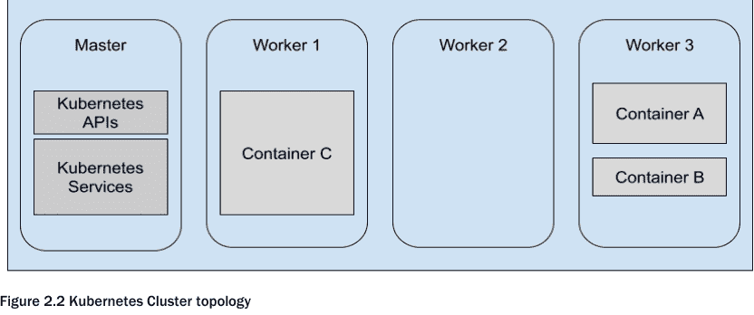

图 2.2 Kubernetes 集群拓扑

KinD 将模拟一个由一组机器或虚拟机构成的真实集群，在本例中，每个节点都将是一个 Docker 容器。当你在这些节点之上部署应用程序时，Kubernetes 将根据集群整体利用率决定应用程序容器的运行位置。Kubernetes 还将处理这些节点的故障，以最大限度地减少你的应用程序停机时间。由于你在本地运行 Kubernetes 集群，因此存在局限性，例如你的笔记本电脑/PC 可用的 CPU 和内存。在真实集群中，这些节点中的每一个都是不同的物理或虚拟机，可以在不同的位置运行以最大化弹性。

你可以通过在终端中运行以下命令来创建集群：

```
cat <<EOF | kind create cluster --name dev --config=-
kind: Cluster
apiVersion: kind.x-k8s.io/v1alpha4
nodes:
- role: control-plane
  kubeadmConfigPatches:
  - |
    kind: InitConfiguration
    nodeRegistration:
      kubeletExtraArgs:
        node-labels: "ingress-ready=true"
  extraPortMappings:
  - containerPort: 80
    hostPort: 80
    protocol: TCP
  - containerPort: 443
    hostPort: 443
    protocol: TCP
- role: worker
- role: worker
- role: worker
EOF
```

你可以从 GitHub 复制之前的命令和以下命令：https://github.com/salaboy/from-monolith-to-k8s/blob/master/kind/README.md

请注意，除了创建集群之外，你还需要设置一个 Ingress Controller（因此控制平面节点中的标签：`node-labels: "ingress-ready=true"` 以及一些端口映射以将流量从你的笔记本电脑路由到集群内运行的服务。

在运行前一个命令后，你应该会看到类似于图 2.3 的内容：

Creating cluster "dev" ...
✓ Ensuring node image (kindest/node:v1.21.1)
✓ Preparing nodes
✓ Writing configuration
✓ Starting control-plane
✓ Installing CNI
✓ Installing StorageClass
✓ Joining worker nodes
Set kubectl context to "kind-dev"
You can now use your cluster with:

kubectl cluster-info --context kind-dev

Have a nice day!

图 2.3 KIND 集群已创建

要将你的 `kubectl` CLI 工具与此新创建的集群连接，你可能需要运行：

```
kubectl cluster-info --context kind-dev
```

你应该会看到类似于以下内容：

Kubernetes control plane is running at https://127.0.0.1:60714
CoreDNS is running at https://127.0.0.1:60714/api/v1/namespaces/kube-system/services/kube-dns:dns/proxy

To further debug and diagnose cluster problems, use 'kubectl cluster-info dump'.

图 2.4 为 `kubectl` 设置上下文

一旦你已连接到集群，你就可以开始与其交互。例如，你可以通过运行以下命令来检查集群节点：

```
kubectl get nodes -owide
```

运行该命令的输出应类似于：

| NAME | STATUS | ROLES | AGE | VERSION | INTERNAL-IP | EXTERNAL-IP | OS-IMAGE | KERNEL-VERSION | CONTAINER-RUNTIME |
| dev-control-plane | Ready | control-plane,master | 6m37s | v1.21.1 | 172.18.0.6 | <none> | Ubuntu 21.04 | 5.10.25-linuxkit | containerd://1.5.2 |
| dev-worker | Ready | <none> | 6m7s | v1.21.1 | 172.18.0.2 | <none> | Ubuntu 21.04 | 5.10.25-linuxkit | containerd://1.5.2 |
| dev-worker2 | Ready | <none> | 6m7s | v1.21.1 | 172.18.0.5 | <none> | Ubuntu 21.04 | 5.10.25-linuxkit | containerd://1.5.2 |
| dev-worker3 | Ready | <none> | 6m7s | v1.21.1 | 172.18.0.4 | <none> | Ubuntu 21.04 | 5.10.25-linuxkit | containerd://1.5.2 |

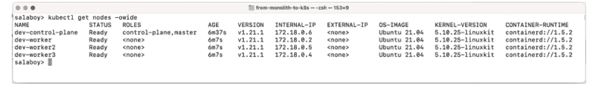

图 2.5 列出所有 Kubernetes 节点

正如你所见，你的 Kubernetes 集群由四个节点组成，其中一个是控制平面。请注意，你正在使用 `-owide` 标志来获取有关节点的更多信息。

最后，你将使用 NGINX Ingress Controller（更详细的说明可以在这里找到：(https://kind.sigs.k8s.io/docs/user/ingress/)）将流量从 Kubernetes 集群外部路由到在集群内部运行的应用程序。有许多 Ingress Controller 实现可以安装来进行此路由，但 NGINX Ingress Controller 被广泛采用，是最受欢迎的选择。有关可用选项的非详尽列表，你可以查看 Kubernetes 网站：https://kubernetes.io/docs/concepts/services-networking/ingress-controllers/。要安装 NGINX Ingress Controller，你需要运行以下命令：

```
kubectl apply -f https://raw.githubusercontent.com/kubernetes/ingress-nginx/master/deploy/static/provider/kind/deploy.yaml
```

此命令在名为 `ingress-nginx` 的新 Kubernetes 命名空间中创建运行 NGINX Ingress Controller 所需的一组资源：

```
namespace/ingress-nginx created
serviceaccount/ingress-nginx created
configmap/ingress-nginx-controller created
clusterrole.rbac.authorization.k8s.io/ingress-nginx created
clusterrolebinding.rbac.authorization.k8s.io/ingress-nginx created
role.rbac.authorization.k8s.io/ingress-nginx created
rolebinding.rbac.authorization.k8s.io/ingress-nginx created
service/ingress-nginx-controller-admission created
service/ingress-nginx-controller created
deployment.apps/ingress-nginx-controller created
ingressclass.networking.k8s.io/ingress created
validatingwebhookconfiguration.admissionregistration.k8s.io/ingress-nginx-admission created
serviceaccount/ingress-nginx-admission created
clusterrole.rbac.authorization.k8s.io/ingress-nginx-admission created
clusterrolebinding.rbac.authorization.k8s.io/ingress-nginx-admission created
role.rbac.authorization.k8s.io/ingress-nginx-admission created
rolebinding.rbac.authorization.k8s.io/ingress-nginx-admission created
job.batch/ingress-nginx-admission-create created
job.batch/ingress-nginx-admission-patch created
```

图 2.6 安装 NGINX Ingress Controller

顺便提一下，你可以通过运行以下命令来检查此 Ingress Controller 在你的集群中运行的位置：

```
kubectl get pods -n ingress-nginx -owide
```

此命令的输出应如下所示：

```
NAME                                    READY   STATUS      RESTARTS   AGE     IP           NODE             NOMINATED NODE   READINESS GATES
ingress-nginx-admission-create-c8ptk    0/1     Completed   0          8m1s    10.244.2.2   dev-worker        <none>           <none>
ingress-nginx-admission-patch-nxsd5    0/1     Completed   0          8m1s    10.244.3.2   dev-worker2       <none>           <none>
ingress-nginx-controller-c9459f755-6k2r5 1/1   Running     0          8m2s    10.244.0.5   dev-control-plane <none>           <none>
```

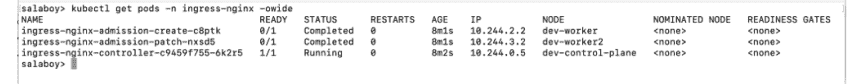

图 2.7 Ingress Controller 运行在 `control-plane` 节点上

这里可以看到 Ingress Controller 运行在控制平面节点上。
好了；你的集群已启动并运行，你的 `kubectl` 命令行界面已配置为针对你的新集群工作！现在你可以在新创建的集群中安装应用程序了。


### 2.1.3 使用 Helm 安装 Walking Skeleton

在本节中，我们将使用 Helm，一个 Kubernetes 应用的包管理器，将我们的 Walking Skeleton 安装到我们刚刚创建的 Kubernetes 集群中。由于我们安装了 Ingress Controller，我们应该能够从笔记本电脑的常用浏览器访问该应用程序。

要在 Kubernetes 之上运行容器化应用程序，你需要将每个服务都打包为容器镜像，并且需要定义这些容器如何在你的 Kubernetes 集群中运行。为此，Kubernetes 允许你使用不同种类的资源（使用 YAML 格式）来配置你的容器如何运行以及如何相互通信。最常见的资源类型有：

- **Deployments：** 声明式地定义你的应用程序正常工作所需运行的容器副本数量。Deployments 还允许我们选择要运行哪个容器（或多个容器）以及这些容器需要如何配置（使用环境变量）。
- **Services：** 声明式地定义一个高级抽象，用于将流量路由到部署创建的容器。它还充当部署内部副本之间的负载均衡器。Services 使集群内的其他服务和应用程序能够使用服务名称而不是容器的物理 IP 地址进行通信，提供所谓的服务发现。
- **Ingress：** 声明式地定义一条从集群外部路由流量到集群内部服务的路由。通过使用 Ingress 定义，我们只能暴露由集群外部运行的客户端应用程序所需的服务。
- **ConfigMap/Secrets：** 声明式地定义和存储配置对象以设置我们的服务实例。Secrets 被视为应受保护访问的敏感信息。

如果你的大型应用程序包含数十个服务，这些 YAML 文件将会变得复杂且难以管理。跟踪更改并通过使用 `kubectl` 应用这些文件来部署应用程序会变得复杂。本书的范围不包括对这些资源的详细说明，因为有其他书籍和在线资源可用。在本书中，我们将集中讨论如何处理大型应用程序的这些资源以及可以帮助我们完成该任务的工具。在下一节中，我们将了解 Helm（http://helm.sh）如何帮助我们打包、发布和管理这些资源。

## HELM 基础

Helm 的创建目的是将服务或整个应用程序的 YAML 文件打包成称为 Charts 的包。

要使用 Helm，你需要创建其中一个 chart（包）。Helm Chart 由一组文件定义，这些文件使用非常特定的目录结构组织。你可以对这些 Charts 进行版本控制以处理配置更改和应用程序/服务的新版本。

如以下图所示，`Chart.yaml` 文件是必需的，用于定义 Chart 元数据，例如名称和版本。`templates` 目录包含部署和配置我们的服务/应用程序所需的所有 YAML 文件。正如目录名称所示，`templates` 目录中的文件可以包含可参数化的值，你可以在将 chart 安装到特定环境时替换这些值。最后，`values.yaml` 文件

包含模板中包含的可参数化占位符的默认值。在安装 chart 时，你可以提供自己的 `values.yaml` 文件来覆盖默认值。

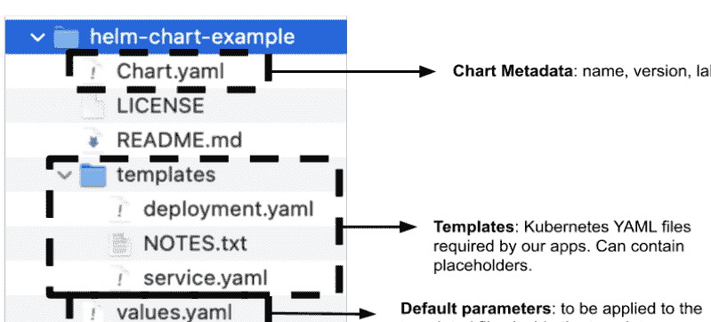

图 2.8 简单的 Helm Chart

Helm 还提供了一个命令行工具（`helm`）来打包、搜索和安装这些包。Helm Charts 可以存储在“Helm Repositories”中，并分发给其他用户使用。你最常用的 `helm` 命令是 `helm install <release name> <chart name>`。这将把 chart 安装到 Kubernetes 集群中。你可能会想安装到哪个集群？Helm 使用 `kubectl` 用于与 Kubernetes API 交互的相同配置，因此如果你可以使用 `kubectl` 连接到你的集群，Helm 也能够在该集群中安装 charts。

你可以在这里查看此示例 chart 的每个文件：https://github.com/salaboy/helm-chart-example README.md 文件还包括如何在自己的 Kubernetes 集群中打包和安装 chart 的最常见操作。

当你将 Chart 安装到 Kubernetes 时，Helm 会创建一个 Release，我们可以在新版本的 chart 可用时随时升级它。Helm 会跟踪这些发布，如果应用程序的新版本出现问题，允许我们回滚到之前的发布。

要安装 Helm Charts（包/应用程序），你可以将新仓库添加到与应用程序存储位置相同的位置。对于 Java 开发者来说，这些仓库就像 Maven Central、Nexus 或 Artifactory。

```
helm repo add fmtok8s https://salaboy.github.io/helm/
helm repo update
```

你应该会看到以下输出：

```
salaboy> helm repo add fmtok8s https://salaboy.github.io/helm/
"fmtok8s" has been added to your repositories
salaboy> helm repo update
Hang tight while we grab the latest from your chart repositories...
...Successfully got an update from the "fmtok8s" chart repository
Update Complete. #Happy Helming!#
```

图 2.9 添加自定义 Helm 仓库

前两行将一个新的仓库添加到你的 Helm 安装中，名为 **fmtok8s**；第二行获取描述你已注册的每个仓库中所有可用包及其版本的文件。现在你已经安装了新的仓库，你无需从 chart 源代码安装 chart，而可以使用 `https://salaboy.github.io/helm/` 仓库中的发布版本。请注意，Helm Chart 仓库可以为小型设置创建在 Github 中，就像我在以下仓库中所做的那样：https://github.com/salaboy/helm。请查看仓库 README.md 以了解更多关于其工作原理的详细信息。

在开始安装我们的 walking skeleton 之前，还需要知道 Helm 还提供了这些包之间的依赖管理，这意味着你可以定义一个 Chart 依赖于一个或多个 Charts，并且 Helm 在你安装（父）Chart 时会下载并安装这些依赖的 charts。这使我们能够在无需将所有 YAML 文件打包在一起的情况下同时安装多个服务和其他组件。你可以通过向 Chart.yaml 文件添加一个部分来定义依赖项，例如：

```
dependencies:
- name: postgresql
  repository: https://charts.bitnami.com/bitnami
  version: 10.8.0
```

如果你使用依赖项，请确保在 `helm package` 之前运行 `helm dependency build` 以获取这些 charts。这将使你的 chart 包独立，不依赖于其他 Chart 仓库以使你的应用程序正常工作。

现在，让我们开始安装我们的 walking skeleton。

## 使用单个命令安装会议平台

现在你的 Helm 安装已经从 **fmtok8s** Chart 仓库获取了所有可用的包，你就可以安装在第 1 章第 X 节中介绍的 Conference Platform 应用程序了。该会议平台允许会议组织者接收潜在演讲者的提案、评估这些提案并维护一个包含活动已批准提交的最新议程。我们将在整本书中使用此应用程序来举例说明你在构建真实应用程序时将面临的挑战。此应用程序构建为 walking skeleton，这意味着它不是一个完整的应用程序，但具有使某些用例正常工作所需的所有组件，并且这些组件可以进一步迭代以支持真实场景。在以下各节中，你将把应用程序安装到集群中并与其交互，以查看它在 Kubernetes 之上运行时表现如何。

让我们使用以下命令安装应用程序：


```
helm install app fmtok8s/fmtok8s-app
```

你应该会看到以下输出：

```
NAME: app
LAST DEPLOYED: Sat Aug 28 13:52:48 2021
NAMESPACE: default
STATUS: deployed
REVISION: 1
TEST SUITE: None
NOTES:
Cloud-Native Conference Platform V1

Chart Deployed: fmtok8s-app - 0.1.0
Release Name: app
```

Figure 2.10 Helm installed the chart fmtok8s-app version 0.1.0

`helm install` 创建了一个 Helm Release，这意味着你创建了一个应用程序实例，在本例中，该实例名为 `app`。使用 Helm，你可以根据需要部署应用程序的多个实例。你可以通过运行以下命令列出 Helm 发布版本：

```
helm list
```

输出应如下所示：

```
NAME NAMESPACE REVISION UPDATED STATUS CHART APP VERSION
app default 1 2021-08-28 13:52:48.748112 +0100 BST deployed fmtok8s-app-0.1.0 0.1.0
```

Figure 2.11 List Helm releases

> NOTE: 如果你不是使用 `helm install` 而是运行 `helm template`，Helm 将输出将应用于集群的 YAML 文件。在某些情况下，你可能希望这样做而不是 `helm install`，例如，如果你想覆盖 Helm 图表不允许你参数化的值，或在将请求发送到 Kubernetes 之前应用任何其他转换。

## VERIFYING THAT THE APPLICATION IS UP AND RUNNING

一旦应用程序部署完成，容器将被下载到你的笔记本电脑上运行，这可能需要一段时间。你可以通过列出集群中运行的所有 Pod 来监控进度，再次使用 `-owide` 标志获取更多信息：

kubectl get pods -owide

输出应如下所示：

```
NAME READY STATUS RESTARTS AGE IP NODE NOMINATED NODE READINESS GATES
app-fmtok8s-agenda-rest-7cfc4b5b4c-msq r9 1/1 Running 0 3h14m 10.244.3.6 dev-worker2 <none> <none>
app-fmtok8s-api-gateway-8b4b6d56b-kr2a9 1/1 Running 0 3h14m 10.244.2.4 dev-worker2 <none> <none>
app-fmtok8s-cp-rest-558b8d7bbd-c7768 1/1 Running 0 3h14m 10.244.3.5 dev-worker2 <none> <none>
app-fmtok8s-email-rest-7795df6885-mv5m6 1/1 Running 0 3h14m 10.244.1.4 dev-worker3 <none> <none>
```

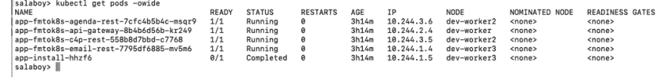

Figure 2.12 Listing application Pods

你需要注意 READY 和 STATUS 列，其中 READY 列中的 1/1 表示一个 `Pod` 副本正在运行，并且预期运行一个。

请注意，`Pod` 可以被调度到不同的节点。你可以在 `NODE` 列中检查这一点；这是 Kubernetes 高效使用集群资源的方式。

如果所有 `Pod` 都已启动并运行，你就成功了！应用程序现在已启动并运行，你可以通过将你喜欢的浏览器指向以下地址来访问它： `http://localhost`

如果需要，有一个逐步教程说明如何使用 Helm 将此应用程序部署到 Kubernetes 集群，你可以在以下存储库中找到： https://github.com/salaboy/from-monolith-to-k8s/tree/master/helm.

### 2.1.4 Interacting with your application

在上一节中，我们将应用程序安装到本地 Kubernetes 集群中。在本节中，我们将快速与应用程序交互，以了解服务如何相互交互以完成一个简单的用例：“接收和批准提案”。请记住，你可以通过将浏览器指向以下地址来访问应用程序： `http://localhost`

Conference Platform 应用程序应如下所示：

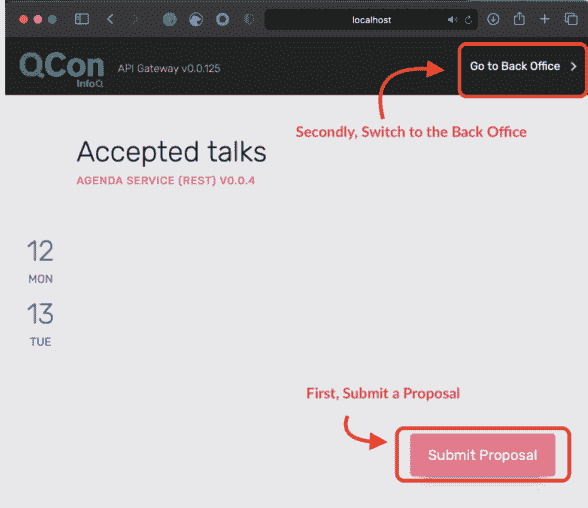

Figure 2.X Application Main Page

此应用程序将帮助会议组织者和与会者在活动之前和期间进行互动。

应用程序主页面列出了会议安排的所有演讲。这些演讲由潜在演讲者提交并由会议组织者评审。当你第一次启动应用程序时，议程上不会有任何演讲，但你现在可以继续 `Submit a Proposal`。

Figure 2.X Submitting a proposal for organisers to review

请注意，你需要在表单中填写四个字段（Title、Author、Email 和 Abstract）才能提交提案。组织者将使用此信息来评估你的提案，并在你的提案被批准或拒绝时通过电子邮件与你联系。提交提案后，你可以进入 `Back Office` 并 `Accept` 或 `Reject` 提交的提案。你将在此屏幕上充当会议组织者：

Figure 2.X Conference organizers can Accept or Reject incoming proposals

已接受的提案将出现在主页面上。在此阶段访问页面的与会者可以浏览会议的主要演讲者。

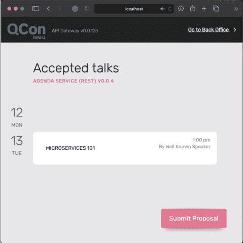

Figure 2.X Your proposal is now live on the agenda!

在此阶段，潜在演讲者应已收到有关其提案批准或拒绝的电子邮件。你可以通过使用终端中的 `kubectl` 查看 Email Service 日志来检查这一点：

```
kubectl logs -f app-fmtok8s-email-rest-<POD_ID>
```

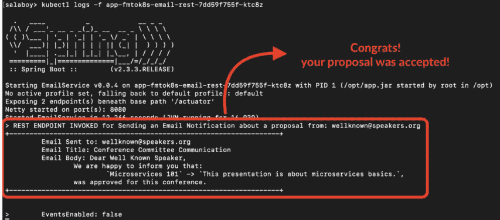

Figure 2.X Email Service logs

如果你进行到这里，恭喜，会议平台按预期工作。我鼓励你提交另一个提案并拒绝它，以验证是否向潜在演讲者发送了正确的电子邮件。

在前面的章节中，你使用 Helm 安装了 Conference platform 应用程序，然后验证应用程序是否已启动并运行，并且平台可以被潜在演讲者和会议组织者用来提交提案、批准或拒绝这些提案并通过电子邮件通知潜在演讲者这些决定。

在接下来的章节中，我们将更深入地了解应用程序如何配置为在 Kubernetes 中运行，创建了哪些 Kubernetes 资源，我们如何与这些资源交互，最后我们如何破坏应用程序或至少其中的一部分。

## 2.2 Inspecting the walking skeleton

如果你使用 Kubernetes 一段时间了，你可能对 `kubectl` 了如指掌。因为此版本的应用程序使用原生的 Kubernetes Deployments 和 Services，你可以使用 `kubectl` 检查和排除这些 Kubernetes 资源的故障。

通常，与其只是查看正在运行的 Pod（使用 kubectl get pods），为了理解和操作应用程序，你将查看 Services 和 Deployments。让我们先探索 Deployment 资源。

### 2.2.1 Kubernetes Deployments basics

让我们从 Deployments 开始。Kubernetes 中的 Deployments 负责包含运行我们容器的配方。Deployments 还负责定义容器如何运行以及在需要时如何升级到新版本。通过查看 Deployment 详细信息，你可以获得非常有用的信息，例如

- 此部署使用的 **container**：请注意，这只是一个简单的 docker 容器，这意味着如果你愿意，甚至可以使用 `docker run` 在本地运行此容器。这对于排除问题至关重要。
- 部署所需的 **replicas** 数量：对于此示例设置为 1，但在下一节中你将更改它。拥有更多副本可以增加应用程序的弹性，因为这些副本可能会宕机。Kubernetes 将生成新的实例以始终保持所需副本数量。
- 容器的 **resources allocation**：根据负载和用于构建服务的软件技术栈，你需要微调 Kubernetes 允许容器使用的资源数量。
- `readiness` 和 `liveness` 探针的状态：Kubernetes 默认情况下会监控容器的健康状况。它通过执行两个探针来实现这一点：1) `readiness probe` 检查容器是否准备好响应请求 2) `liveness probe` 检查容器的主进程是否正在运行。
- 滚动更新策略定义了我们的 Pod 如何更新以避免对用户造成停机。使用 RollingUpdateStrategy 你可以定义在触发更新到新版本时允许多少个副本宕机。

首先，让我们使用以下命令列出所有可用的 Deployments：

```
kubectl get deployments
```

输出如下所示：

| NAME | READY | UP-TO-DATE | AVAILABLE | AGE |
|---|---|---|---|---|
| app-fmtok8s-agenda-rest | 1/1 | 1 | 1 | 3h20m |
| app-fmtok8s-api-gateway | 1/1 | 1 | 1 | 3h20m |
| app-fmtok8s-c4p-rest | 1/1 | 1 | 1 | 3h20m |
| app-fmtok8s-email-rest | 1/1 | 1 | 1 | 3h20m |

Figure 2.X Listing your application’s Deployments

## EXPLORING DEPLOYMENTS

在以下示例中，你将描述 API Gateway / User Interface deployment。你可以使用以下命令更详细地描述每个部署：

```
kubectl describe deployment app-fmtok8s-api-gateway
```


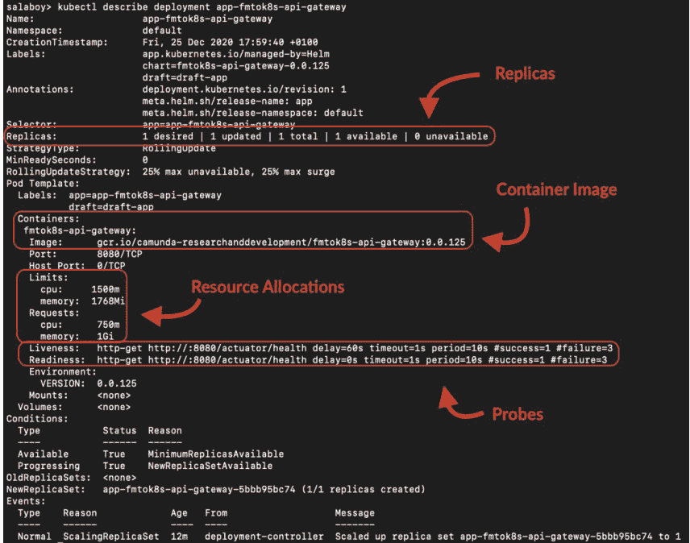

Figure 2.X Describing a deployment to see its details

以这种方式描述部署在部署出现问题时将会很有帮助。例如，如果未满足所需副本数，描述该资源将有助于了解问题可能出在哪里。务必始终查看底部的事件，以获取有关资源状态的更多信息，在此案例中，部署在 12 分钟前已扩缩至 1 个副本。

如前所述，部署还负责协调版本或配置的升级和回滚。部署更新策略默认设置为“Rolling Update”，这意味着部署会逐个逐步升级 Pod，以最大限度地减少停机时间。也可以设置另一种策略，称为“Recreate”，它会关闭所有 Pod 并创建新的 Pod。

与 Pod 不同，部署不是临时的；因此，如果你创建了一个 `Deployment`，无论其底层的容器是否失败，你都可以随时查询它。默认情况下，当你创建部署资源时，Kubernetes 会为处理和检查部署请求的副本创建一个中间资源。

## ReplicaSets

拥有容器的多个副本是一项重要的功能，可以让你扩展应用程序。如果你的应用程序正承受来自用户的流量负载，你可以轻松地扩展服务的副本数以处理所有传入请求。同样，如果你的应用程序没有经历大量请求，这些副本可以缩减以节省资源。Kubernetes 创建的对象称为 `ReplicaSet`，可以通过运行以下命令进行查询：

```
kubectl get replicaset
```

输出应如下所示：

| NAME | DESIRED | CURRENT | READY | AGE |
|---|---|---|---|---|
| app-fmtok8s-agenda-rest-7cfc4b5b4c | 1 | 1 | 1 | 3h18m |
| app-fmtok8s-api-gateway-8b4b6d56b | 1 | 1 | 1 | 3h18m |
| app-fmtok8s-c4p-rest-558b8d7bbd | 1 | 1 | 1 | 3h18m |
| app-fmtok8s-email-rest-7795df6885 | 1 | 1 | 1 | 3h18m |

Figure 2.X Listing Deployment's Replica Sets

这些 `ReplicaSet` 对象完全由 Deployment` 资源管理，通常你不需要处理它们。

ReplicaSets 在处理滚动更新时也很重要，你可以在这里找到有关此主题的更多信息：https://kubernetes.io/docs/tutorials/kubernetes-basics/update/update-intro/。在后面的章节中，你将使用 Helm 对应用程序进行更新，此时这些机制将被触发。

如果你想更改部署的副本数，你可以再次使用 `kubectl` 来执行：

```
kubectl scale --replicas=2 deployments/<DEPLOYMENT_ID>
```

你可以尝试对 API Gateway 部署执行此操作：

```
kubectl scale --replicas=2 deployments/app-fmtok8s-api-gateway
```

此命令会更改 Kubernetes 中的部署资源，并触发为 API Gateway 部署创建第二个副本。增加面向用户的服务的副本数是很常见的，因为所有用户在访问会议页面时都会访问该服务。

如果你再次在浏览器中访问应用程序，屏幕顶部在 API Gateway 服务版本号旁边，你可以看到 Pod 名称以及 Pod 运行的节点：

Figure 2.X First replica answering your request

如果你现在刷新页面，第二个副本应该会响应你的请求：

Figure 2.X Second replica is now answering; this replica might be on a different node

默认情况下，Kubernetes 会在副本之间进行负载均衡。通过仅更改副本数即可扩展，无需部署任何新内容，Kubernetes 将负责配置新的 Pod（其中包含新的容器）来处理更多流量。Kubernetes 还会确保始终保持所需数量的副本。你可以通过删除一个 Pod 并观察 Kubernetes 如何自动重新创建它来测试这一点。

## 2.2.2 Connecting services together

我们已经了解了部署，它负责启动我们的容器并保持其运行，但到目前为止，这些容器只能在 Kubernetes 集群内部访问。如果我们希望其他服务与这些容器交互，我们需要查看另一个 Kubernetes 资源，称为“Service”。Kubernetes 提供了高级服务发现机制，允许服务仅通过知道彼此的名称即可相互通信。这对于在容器 IP 地址可能随时间变化的情况下连接大量服务至关重要，而无需使用这些 IP 地址。

## EXPLORING SERVICES

要将容器公开给其他服务，你需要使用 `Kubernetes Service` 资源。每个应用程序服务都定义此 `Service` 资源，以便其他服务和客户端可以连接。 在 Kubernetes 中，服务将负责将流量路由到应用程序容器。这些 `Service` 代表一个逻辑名称，你可以使用它来抽象容器的运行位置。如果你有多个容器副本，服务资源将负责在所有副本之间进行负载均衡。

你可以通过运行以下命令列出所有服务：

```
kubectl get services
```

运行命令后，你应该会看到如下图所示的内容：

| NAME | TYPE | CLUSTER-IP | EXTERNAL-IP | PORT(S) | AGE |
|---|---|---|---|---|---|
| fmtok8s-agenda | ClusterIP | 10.96.22.133 | <none> | 80/TCP | 3h22m |
| fmtok8s-api-gateway | ClusterIP | 10.96.2.222 | <none> | 80/TCP | 3h22m |
| fmtok8s-c4p | ClusterIP | 10.96.114.4 | <none> | 80/TCP | 3h22m |
| fmtok8s-email | ClusterIP | 10.96.215.48 | <none> | 80/TCP | 3h22m |
| kubernetes | ClusterIP | 10.96.0.1 | <none> | 443/TCP | 7h20m |

Figure 2.X Listing application's services

你也可以通过以下命令描述服务以查看更多信息：

```
kubectl describe service fmtok8s-api-gateway
```

这应该会给出类似图 2.X 的结果。服务和部署通过选择器属性链接，在以下图像中突出显示。换句话说，服务将流量路由到由包含标签 app=app-fmtok8s-api-gateway 的部署创建的所有 Pod。

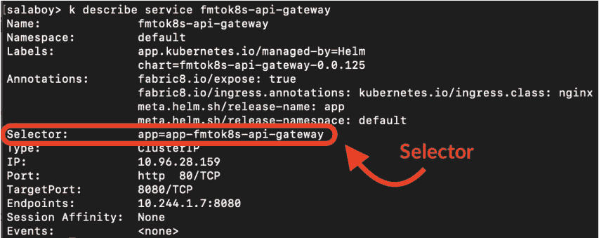

Figure 2.X Describing the API Gateway Service

## SERVICE DISCOVERY IN KUBERNETES

使用服务后，如果你的应用程序服务需要向任何其他服务发送请求，它可以使用 Kubernetes 服务名称和端口，在大多数情况下，如果你使用 HTTP 请求，可以使用端口 80，这样只需要使用服务名称即可。

如果你查看服务的源代码（你可以在这里找到：https://github.com/salaboy/fmtok8s-c4p-rest/blob/main/src/main/java/com/salaboy/conferences/c4p/rest/services/EmailService.java#L14），你会看到 HTTP 请求是针对服务名称创建的，无需 IP 地址或端口。

最后，如果你想将服务公开到 Kubernetes 集群之外，你需要一个 Ingress 资源。正如名称所示，此 Kubernetes 资源负责将集群外部的流量路由到集群内部的服务。通常，你不会公开多个服务，从而限制应用程序的入口点。
你可以通过运行以下命令获取所有可用的 Ingress 资源：

```
kubectl get ingress
```

输出应如下所示：

```
NAME       CLASS    HOSTS   ADDRESS     PORTS   AGE
frontend   <none>   *       localhost   80      4m32s
```

Figure 2.X Listing application's Ingress Resources

然后你可以用与处理其他资源类型相同的方式描述 Ingress 资源，以获取有关它的更多信息：

```
kubectl describe ingress frontend
```

你应该期望输出如下所示：

```
Name:                     frontend
Namespace:                default
Address:                  localhost
Default backend:          default-http-backend:80 (<error: endpoints "default-http-backend" not found>)
Rules:
  Host        Path  Backends
  ----        ----  --------
  *
              /     fmtok8s-api-gateway:80 (10.244.1.8:8080)
Annotations:  kubernetes.io/ingress.class: nginx
              meta.helm.sh/release-name: app
              meta.helm.sh/release-namespace: default
              nginx.ingress.kubernetes.io/rewrite-target: /
Events:
  Type    Reason  Age   From                      Message
  ----    ------  ----  ----                      -------
  Normal  Sync    7m58s (x2 over 7m59s)  nginx-ingress-controller  Scheduled for sync
```

Figure 2.X Describing Ingress Resource

正如你所见，Ingress 也使用服务名称来路由流量。此外，要使其正常工作，你需要一个 Ingress Controller，就像我们在创建 KinD 集群时安装的那样。如果你运行在云提供商上，你可能需要安装一个 Ingress 控制器。


查看以下博客文章以了解可供您使用的 Ingress 控制器有哪些不同选项：https://docs.google.com/spreadsheets/u/2/d/191WWNpJj2za6-nbG4ZoUMXMpUK8KICIosvQB0f-og3k/edit#gid=907731238

使用 Ingress，您可以配置单个入口点并使用基于路径的路由将流量重定向到您需要公开的每个服务。图 2.20 中的前一个 Ingress 资源将发送到 `/` 的所有流量路由到 `fmtok8s-api-gateway` 服务。请注意，Ingress 规则非常简单，您不应该在此级别添加任何业务逻辑路由。

## TROUBLESHOOTING INTERNAL SERVICES

有时，访问内部服务以调试或排查出现问题的服务非常重要。对于这种情况，您可以使用 `kubectl port-forward` 命令临时访问未通过 Ingress 资源在集群外部公开的服务。例如，要在不经过 API 网关的情况下访问 Agenda 服务，您可以使用以下命令：

```
kubectl port-forward svc/fmtok8s-agenda-rest 8080:80
```

您应该会看到以下输出，请确保不要终止该命令：

```
Forwarding from 127.0.0.1:8080 -> 8080
Forwarding from [::1]:8080 -> 8080
```

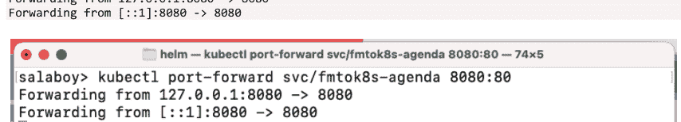

图 2.X `kubectl port-forward` 允许您为调试目的公开服务

然后使用您的浏览器、curl 在另一个标签页或任何其他工具指向 http://localhost:8080/info 来访问公开的 Agenda 服务。以下图像显示了如何使用 `curl` 访问 Agenda 服务 info 端点并借助 `jq` 打印漂亮/彩色的 JSON 负载，您需要单独安装 `jq`。

```
curl localhost:8080/info | jq --color-output
{
  "name": "Agenda Service (REST)",
  "version": "v0.1.0",
  "source": "https://github.com/salaboy/fmtok8s-agenda-rest/releases/tag/v0.1.0",
  "podId": "app-fmtok8s-agenda-rest-7cfc4b5b4c-llqr4",
  "podNamespase": "default",
  "podNodeName": "dev-worker"
}
```

图 2.X 使用 `port-forward` 通过 curl localhost:8080 访问 Agenda 服务

在本节中，您已检查了创建以在 Kubernetes 中运行应用程序容器的主要 Kubernetes 资源。通过查看这些资源及其关系，您将能够在问题出现时排查问题。

对于日常操作，`kubectl` 命令行工具可能不是最优的，可以使用不同的仪表板来探索和管理 Kubernetes 工作负载，例如：k9s、Kubernetes Dashboard 和 Octant。您可以在附录 X 中查看使用 Octant 探索同一应用程序。

## 2.3 Cloud-Native applications Challenges

与单体应用程序不同，如果出现问题，单体应用程序会完全宕机，而 Cloud-Native 应用程序在某个服务宕机时不应崩溃。Cloud-Native 应用程序为故障而设计，应在出现错误时继续提供有价值的功能。在修复问题的同时提供降级服务，比完全无法访问应用程序要好。在本节中，您将更改 Kubernetes 中的某些服务配置，以了解应用程序在不同情况下的行为。

在某些情况下，应用程序/服务开发人员需要确保他们构建的服务具有弹性，并且一些问题将由 Kubernetes 或基础设施解决。

本节涵盖与 Cloud Native 应用程序相关的最常见挑战之一。我认为提前了解会出什么问题很有用，而不是在构建和交付应用程序时才发现。这不是一个详尽的列表，它只是开始，以确保您不会被众所周知的问题困住。以下部分将以会议平台为例说明并突出这些挑战。

- **不允许停机**：如果您在 Kubernetes 之上构建和运行 Cloud-Native 应用程序，而仍然遭受应用程序停机的影响，那么您就没有充分利用所使用的技术栈的优势。
- **服务的内置弹性**：下游服务会宕机，您需要确保您的服务已为此做好准备。Kubernetes 有助于动态服务发现，但这不足以使您的应用程序具有弹性。
- **处理应用程序状态并非易事**：我们必须了解每个服务的<|message|> 基础设施要求，以便高效地允许 Kubernetes 扩展我们的服务。
- **数据不一致数据**：在分布式应用程序中工作时常见的问题是数据不存储在单一位置，而趋向于分布。应用程序需要准备好处理不同服务对世界状态有不同视图的情况。
- **了解应用程序的工作方式（监控、追踪和遥测）**：清楚了解应用程序的性能以及它是否按预期工作，对于在出现问题时快速找到问题至关重要。
- **应用程序安全和身份管理**：处理用户和安全问题总是事后才考虑。对于分布式应用程序，及早明确记录和实现这些方面将有助于您通过定义“谁可以在何时做什么”来完善应用程序需求。

让我们从第一个挑战开始。

### 2.3.1 Downtime is not allowed

在第 2.2.x 节中，您增加了 API 网关的副本数；当您的服务基于平台通过创建运行服务的容器副本来扩展服务的假设创建时，这是一个很棒的功能。那么，当服务无法处理复制，或某个服务没有可用的副本时会发生什么？

您还将 API 网关扩展为始终运行 2 个副本。这意味着如果其中一个副本因任何原因停止运行，Kubernetes 将尝试启动另一个，直到运行 2 个。

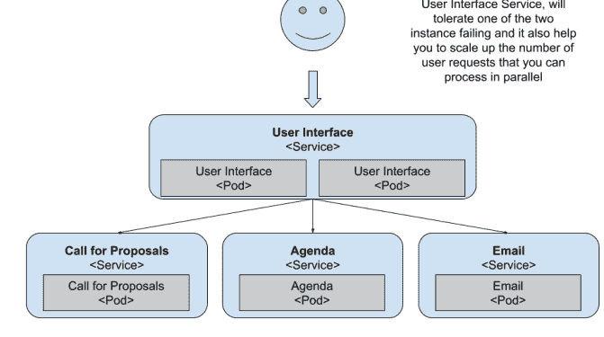

图 2.X API 网关 / 用户界面的两个副本

您可以通过杀死 API 网关的两个 Pod 中的一个来快速尝试 Kubernetes 的此自愈功能。您可以通过运行以下命令来执行此操作：

```
kubectl get pods
```

图 2.X 检查两个副本是否都在运行

现在，复制其中一个 Pod Id 并删除它：

```
kubectl delete pod <POD_ID>
```

然后再次列出 Pod：

```
kubectl get pods
```

图 2.X Kubernetes 一旦检测到一个 Pod 宕机，就会立即创建一个新的副本

您可以看到 Kubernetes（更具体地说是 ReplicaSet）一旦检测到只有一个正在运行，就会立即创建一个新的 Pod。在新 Pod 创建和启动期间，您有一个副本来响应请求，直到第二个副本启动并运行。此机制确保至少有两个副本来响应用户的请求。

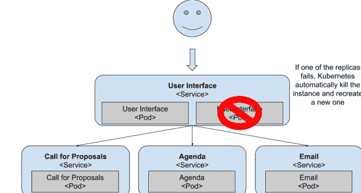

图 2.X 一旦 Kubernetes 检测到一个 Pod 行为异常，就会将其杀死并创建一个新的

如果您只有一个副本，如果您杀死正在运行的 Pod，您将在新容器创建并准备好提供请求之前经历应用程序停机。您可以使用以下命令恢复到单个副本：

```
kubectl scale --replicas=1 deployments/<DEPLOYMENT_ID>
```

继续尝试，删除 API 网关 Pod 唯一可用的副本：

```
kubectl delete pod <POD_ID>
```

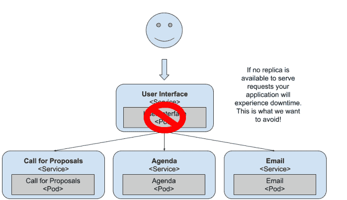

图 2.X 在单个副本重启时，没有备份来响应用户请求

在杀死 Pod 后，立即通过刷新浏览器（http://localhost）访问应用程序。您应该在浏览器中看到“503 Service Temporarily Unavailable”，因为 Ingress Controller（为简单起见，图中未显示）无法在 API 网关服务后面找到正在运行的副本。如果等待片刻，您将看到应用程序恢复。


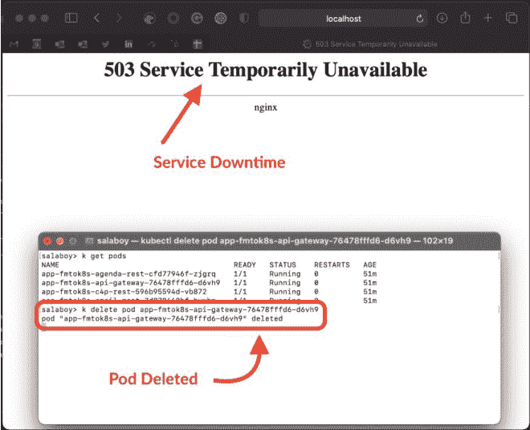

Figure 2.X 在单副本重启时，没有备份来响应用户请求

这种行为是可以预期的，因为 API Gateway Service 是一个面向用户的服务。如果它宕机，用户将无法访问任何功能，因此建议拥有多个副本。从这个角度来看，我们可以断定 API Gateway / FrontEnd 服务是整个应用中最重要的服务，因为我们应用的首要目标是避免停机。

总之，请特别注意暴露在集群外部的面向用户服务。无论是用户界面还是仅仅是 API，都要确保你拥有足够多的副本来处理传入请求。对于大多数用例，尤其是开发环境之外的情况，避免使用单个副本。

## 2.3.2 服务内置的弹性

但现在，如果其他服务宕机了会怎样？例如 Agenda Service，它仅负责列出所有提交给会议参会者的已接受提案。

该服务也很关键，因为议程列表就在应用的主页面上。

那么，让我们将该服务缩容：

```
kubectl scale --replicas=0 deployments/app-fmtok8s-agenda-rest
```

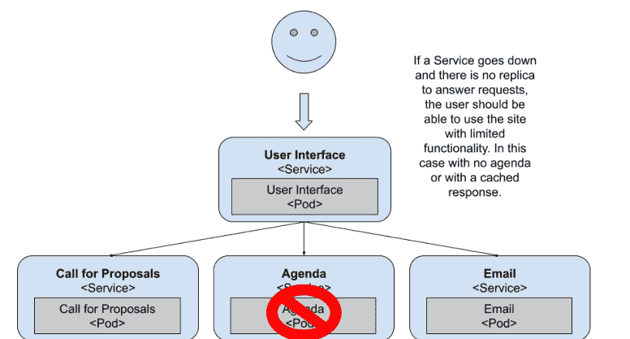

Figure 2.X Agenda Service 没有 Pod

运行此命令后，容器将被杀死，并且服务将没有任何容器来响应其请求。
尝试在浏览器中刷新应用：

Figure 2.X 在单副本重启时，没有备份来响应用户请求

正如你所见，应用仍然在运行，但 Agenda Service 目前不可用。你可以为此类场景做好准备；在这种情况下，API Gateway 有缓存的响应，至少可以向用户展示一些内容。如果 Agenda Service 因某种原因宕机，至少用户仍能够访问其他服务和应用的其他部分。从应用的角度来看，重要的是不要将错误传播回用户。用户应该能够在 Agenda Service 恢复之前继续使用应用的其他服务。

在开发将在 Kubernetes 中运行的服务时，你需要特别注意，因为现在你的服务负责处理下游服务产生的错误。这很重要，以确保错误或服务宕机不会导致整个应用宕机。拥有简单的机制，例如缓存响应，将使你的应用更具弹性，并且还允许你逐步升级这些服务，而不必担心导致整个系统宕机。记住，不允许停机。

## 2.3.3 处理应用状态并非易事

让我们再次将其扩容回单个副本：

```
kubectl scale --replicas=1 deployments/app-fmtok8s-agenda-rest
```

让我们创建一些提案，以便议程中有一些数据。你可以通过从终端运行以下命令来完成此操作：

```
curl -X POST http://localhost/api/test
```

此命令创建了一些模拟提案，你需要在应用的 Back Office 部分接受/拒绝它们。继续接受所有提案。

你现在应该能在主页面上的议程中看到所有提案。

现在，你认为如果我们将 Agenda Service 扩容到两个副本会发生什么？

```
kubectl scale --replicas=2 deployments/app-fmtok8s-agenda-rest
```

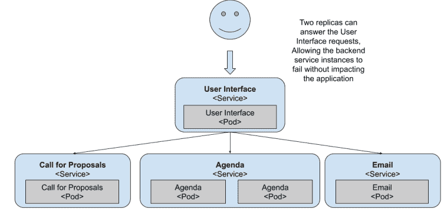

Figure 2.X 两个副本现在可以处理更多流量

有两个副本处理你的用户请求时，用户界面将有两个实例可供查询。如果你多次刷新应用，你会注意到偶尔议程页面会变为空。

这是因为 Agenda Service 将议程项保存在内存中，而每个 Pod 都有独立的内存空间。你的所有服务都应该是无状态的，这意味着你应该将状态存储在某种存储中，无论哪个 Pod 尝试访问它，都能保持状态。数据库通常用于将状态从服务外部化，从而允许你的服务独立扩容。

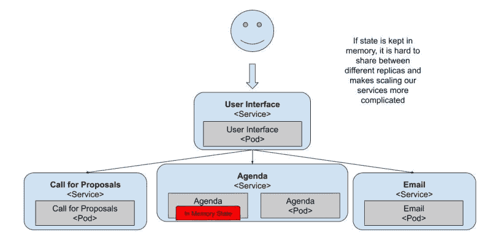

Figure 2.X Agenda Service 将状态保存在内存中

通过扩容这些服务，我们发现了其中一个应用服务设计上的问题。Agenda Service 将状态保存在内存中，这会影响 Kubernetes 的扩容能力。幸运的是，我们可以通过添加持久化存储来解决这个问题。

为了让之前的服务保留数据，我们只需安装 Redis 和 PostgreSQL 来为议程和征集提案服务提供数据支持。与我们使用 Helm 安装 Conference Platform 的方式相同，我们也可以使用 Helm 在集群内部安装 Redis 和 PostgreSQL。

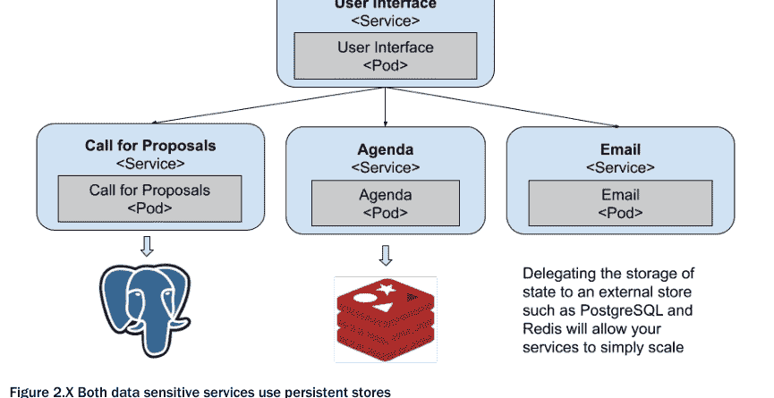

Figure 2.X 两个数据敏感服务都使用持久化存储

了解你的服务需求将帮助你规划和自动化你的基础设施需求，例如数据库、消息代理等。应用越大越复杂，对这些基础设施组件的依赖就越多。

## 2.3.4 处理不一致的数据

将数据存储到像 PostgreSQL 这样的关系型数据存储或像 Redis 这样的 NoSQL 方法并不能解决不同存储之间数据不一致的问题。由于这些存储应该由服务 API 隐藏起来，你需要有机制来检查服务处理的数据是否一致。在分布式系统中，很常见的是谈论“最终一致性”，这意味着最终系统会变得一致。拥有最终一致性肯定比完全没有一致性要好。对于此示例，我们可以构建的一个简单检查机制是，偶尔检查一次（例如每天一次）Agenda Service 中的已接受演讲，看看它们是否已在征集提案服务中获得批准。如果有条目未被征集提案服务（C4P）批准，那么我们可以发出一些警报或向会议组织者发送电子邮件。

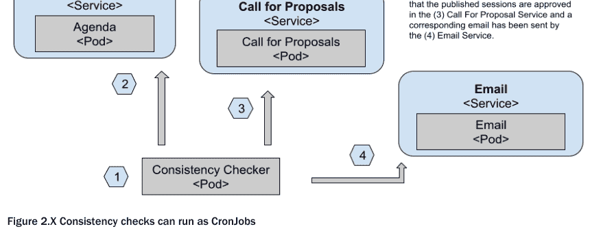

每个固定周期我们可以对服务执行检查，以确保状态一致。例如：（1）每天午夜查询议程服务（2）验证已发布的会议是否在（3）征集提案服务中获得批准，并且（4）电子邮件服务已发送了相应的电子邮件。

Figure 2.X 一致性检查可以作为 CronJobs 运行

在图 2.X 中，我们可以看到 CronJob（1）将每隔 X 时间执行一次，具体取决于我们修复一致性问题的紧迫性。然后它将继续查询议程服务公共 API（2）以检查哪些已接受提案正在被列出，并将其与征集提案服务已批准列表（3）进行比较。最后，如果发现任何不一致，可以使用电子邮件服务公共 API（4）发送电子邮件。

想想这个应用设计的简单用例，你还需要哪些其他检查？在我看来立刻想到的一个是验证拒绝和已批准提案的电子邮件是否已正确发送。对于此用例，电子邮件非常重要，我们需要确保这些电子邮件已发送。

## 2.3.5 了解应用的工作方式

分布式系统是复杂的系统，从第一天起就完全理解它们的工作方式可以帮助你在出现问题时节省时间。这推动了监控、追踪和遥测社区努力提出解决方案，帮助我们随时了解事物的工作方式。

https://opentelemetry.io/ OpenTelemetry 社区伴随着 Kubernetes 一起发展，现在可以提供你监控服务工作方式所需的大多数工具。如其网站所述：“你可以使用它来对软件进行检测、生成、收集和导出遥测数据（指标、日志和追踪），以便进行分析，从而了解软件的性能和行为。” 需要注意的是，OpenTelemetry 同时关注软件的行为和性能，因为两者都会影响你的用户和用户体验。

从行为角度来看，你希望确保应用按预期执行，为此你需要了解哪些服务调用了哪些其他服务或基础设施来执行任务。


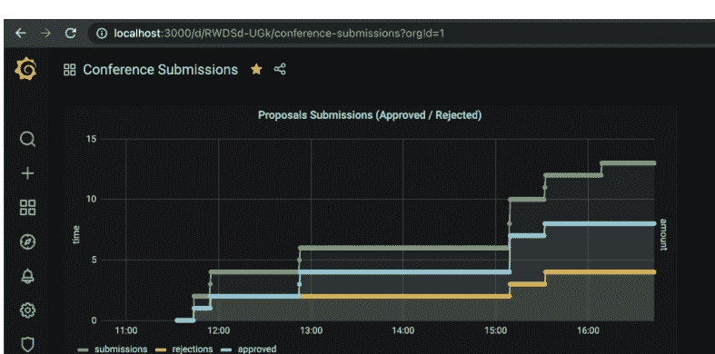

Figure 2.X Monitoring telemetry data with Prometheus & Grafana

使用 Prometheus 和 Grafana 不仅可以让我们看到服务的遥测数据，还可以构建特定领域的仪表板来突出显示某些应用级指标，例如图 2.x 所示随时间推移的已批准与已拒绝提案的数量。

从性能角度来看，你需要确保服务遵守其服务等级协议（SLAs），这基本上意味着它们不会花费太长时间来响应请求。如果你的某个服务行为异常，花费的时间比平时多，你希望能够及时察觉。

对于追踪而言，如果你有兴趣了解内部操作及其性能，则需要修改你的服务。OpenTelemetry 在大多数语言中提供了即插即用的[content]


Figure 2.X Monitoring telemetry data with Prometheus & Grafana

使用 Prometheus 和 Grafana 不仅可以让我们看到服务的遥测数据，还可以构建特定领域的仪表板来突出显示某些应用级指标，例如图 2.x 所示随时间推移的已批准与已拒绝提案的数量。

从性能角度来看，你需要确保服务遵守其服务等级协议（SLAs），这基本上意味着它们不会花费太长时间来响应请求。如果你的某个服务行为异常，花费的时间比平时多，你希望能够及时察觉。

对于追踪而言，如果你有兴趣了解内部操作及其性能，则需要修改你的服务。OpenTelemetry 在大多数语言中提供了即插即用的仪器化库，用于将服务指标和追踪外部化。

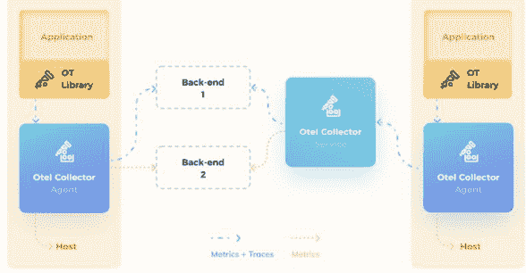

Figure 2.X OpenTelemetry architecture and library

一旦仪器化库被包含在我们的服务中，我们就可以使用 Jaeger 等工具来检查追踪：

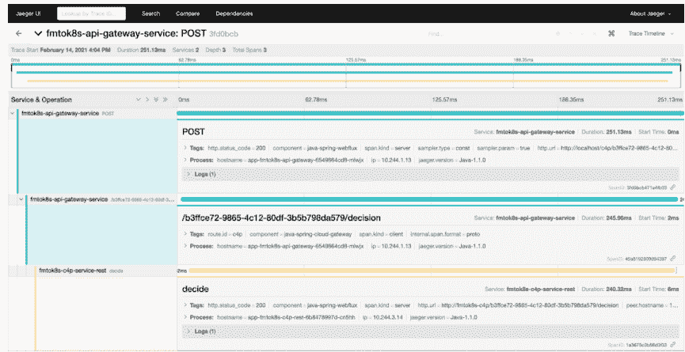

Figure 2.X Tracing diagram from Jaeger

你可以在上图中看到，每个服务在处理单个用户请求时所使用的时间。

这里的建议是：如果你在创建行走骨架，请确保它内置了 OpenTelemetry。如果将监控推迟到项目的后期阶段就太晚了，事情会出错，而找出责任人将花费你太多时间。

## 2.3.6 Application security and identity management

如果你曾经构建过 Web 应用程序，你就知道提供身份管理（用户账户和用户身份）以及身份验证和授权是一项相当大的工作。破坏任何应用程序（云原生或非云原生）的一种简单方法是执行你不应该执行的操作，例如删除所有提案的演示文稿，除非你是会议组织者。

在分布式系统中，这也变得具有挑战性，因为授权和用户身份需要在不同的服务之间传播。在分布式架构中，通常会有组件代表用户生成请求，而不是让用户直接与所有服务交互。在我们的示例中，API 网关就是这个组件。大多数时候，你可以将这个面向外部的组件用作外部服务与内部服务之间的屏障。因此，通常会将 API 网关配置为使用 OAuth2 协议与授权和身份验证提供程序连接。

在身份管理方面，你已经看到应用程序本身不处理用户或其数据，这对于 GDPR 等法规来说是件好事。我们可能希望允许用户使用其社交媒体账户登录我们的应用程序，而无需为他们创建单独的账户。这通常被称为社交登录。

一个流行的解决方案 Keycloak 提供了 OAuth2 和身份管理。由 Red Hat/JBoss 创建的开源项目，为单点登录解决方案和高级身份管理提供一站式服务。或者，正如我们在第 4 章中将看到的，你始终可以使用云提供商提供的身份管理。

与追踪和监控一样，如果你计划拥有用户（你最终肯定会拥有），将单点登录和身份管理纳入行走骨架将促使你思考“谁将能够做什么”的具体细节，从而进一步细化你的用例。

## 2.3.7 Other challenges

在前面的章节中，我们已经涵盖了在构建云原生应用程序时将面临的几个常见挑战，但这些并非全部。你能想到破坏此应用程序第一个版本的其他方法吗？

请注意，解决本章讨论的挑战会有帮助，但还有其他与我们交付由日益增多的服务组成的持续演进的应用程序相关的挑战。

在下一章中，我们将通过管道来交付服务的全新版本，涵盖我们分布式应用程序的更动态方面，之后，第 4 章将探讨我们如何以声明式的方式处理对应用程序运行至关重要基础架构组件。

## 2.4 Summary

- 在本地和远程 Kubernetes 集群之间进行选择需要认真考虑
  - 你可以使用 Kubernetes KIND 启动本地 Kubernetes 集群来开发你的应用程序。主要缺点是，你的集群受限于本地资源（CPU 和内存），并且它不是真正的机器集群。
  - 你可以在云提供商拥有一个账户，并针对远程集群进行所有开发。这种方法的主要缺点是，大多数开发人员不习惯全天候远程工作，并且需要有人为远程资源付费。
- Helm 帮助你打包、分发和安装 Kubernetes 应用程序，在本章中，你已使用单个命令行将应用程序获取并安装到本地 Kubernetes 集群中
- 了解你的应用程序创建了哪些 Kubernetes 资源，可以让你了解应用程序在出现问题时的行为方式，以及在现实场景中需要哪些额外的考虑。
- 即使是使用非常简单的应用程序，你也会面临需要逐一解决的挑战。提前了解这些挑战可以帮助你以正确的思维方式规划和设计你的服务。
- 拥有一个行走骨架可以帮助你在受控环境中尝试不同的场景和技术。在本章中，你已经尝试了：
  - 扩展和缩减你的服务，以亲身体验应用程序在出现问题时的行为
  - 保持状态是困难的，我们需要专门的组件来高效地执行此操作
  - 为我们的服务至少提供 2 个副本，最大限度地避免停机。确保面向用户的组件始终正常运行可保证，即使出现问题，用户仍能与应用程序的部分进行交互
  - 拥有回退和内置机制来处理出现的问题，使你的整体应用程序更具弹性。
