# 3

## Service and Environment Pipelines

### This chapter covers

- 交付云原生应用程序到 Kubernetes 所需的组件
- 为你的服务创建和标准化服务管道的优势
- 创建环境管道以管理你的环境（如 Dev、Staging、Prod）的益处
- 项目如 Tekton 和 Jenkins X 如何帮助你更高效地交付软件

在上一章中，你安装并与一个由 4 个服务组成的简单分布式会议平台进行了交互。本章涵盖了使用管道作为交付机制，以持续交付方式交付这些组件中的每个组件所需的内容。本章描述并在实践中展示了如何构建、打包、发布和发布这些服务中的每一个，以便它们可以在你的组织环境中运行。

本章介绍了两个主要概念：服务管道和环境管道。服务管道负责从源代码到工件准备就绪以运行所需的所有步骤。而环境管道则涵盖了将每个服务的全新版本安装和升级到实时环境（如暂存、测试和生产）方面的内容。

本章分为 3 个主要部分：

- 交付云原生应用程序需要什么？
- 管道
  - 什么是服务管道？
  - 什么是环境管道？
- 云原生实现
  - Tekton 作为云原生管道引擎
  - Jenkins X (http://jenkins-x.io) 作为 Kubernetes 中 CI/CD 的一站式商店


## 3.1 要持续交付一个云原生应用需要什么？

在使用 Kubernetes 工作时，团队现在需要负责更多涉及容器及其在 Kubernetes 中运行方式的动态部分和任务。这些额外任务并非免费。团队需要学习如何自动化和优化使每个服务都正常运行所需的步骤。过去由运维团队负责的任务，现在越来越多地成为负责开发各个独立服务的团队的责任。新的工具和新方法赋予开发者开发、运行和维护他们所生产服务的权力。我们将在本章后半部分介绍的工具旨在自动化所有涉及的任务，从源代码到在 Kubernetes 内部运行的服务。

本章重点描述将软件组件（我们的应用服务）交付到这些服务将运行的多个环境所需的机制。但在深入工具之前，让我们先快速了解一下我们面临的挑战。

构建和交付云原生应用带来了团队必须应对的重大挑战：

- **处理构建应用不同部分的**不同团队**。这需要团队之间的协调，并确保服务的设计方式不会阻碍负责该服务的团队对其他团队的进展或他们持续改进服务的能力。
- **我们需要在不破坏或停止所有其他正在运行的服务的情况下升级服务**。如果我们想要实现持续交付，服务应该能够独立升级，而无需担心导致整个应用崩溃。
- **存储和发布每个服务可供不同环境访问/下载的多个制品，这些环境可能位于不同区域。** 如果我们在云环境中工作，所有服务器都是远程的，所有生成的制品都需要可供这些服务器获取。如果你在本地部署环境中工作，存储这些制品的所有仓库都需要内部配置、配置和维护。
- **为开发、测试、Q&A 和生产等各种目的管理并配置不同的环境。** 如果你真的想加快开发和测试计划，开发人员和团队应该能够按需配置这些环境。将环境配置得尽可能接近真实的生产环境，将为你在错误影响到你的真实用户之前捕获错误节省大量时间。

正如我们在上一章所看到的，在处理云原生应用时主要的范式转变是，我们的应用没有单一的代码库。团队可以独立地在其服务上工作，但这需要新的方法来弥补在分布式系统上工作的复杂性。如果团队每次向系统添加新服务时都会担心并浪费时间，我们就是做错了。端到端自动化对于团队在添加或重构服务时感到安心是必要的。这种自动化通常由通常被称为管道的东西执行。如图 3.X 所示，这些管道

描述了构建和运行我们的服务需要做什么，通常它们可以在没有人工干预的情况下执行。

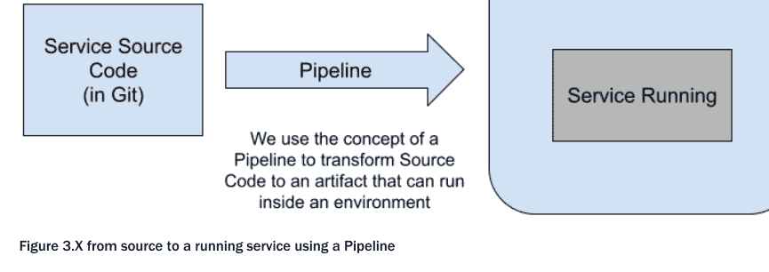

图 3.X 使用管道从源代码到运行中的服务

但这些管道到底在做什么？我们需要从头创建自己的管道吗？我们在项目中如何实现这些管道？我们需要一个还是多个管道来实现这一点？

## 3.2 管道

本章重点介绍使用管道构建可以复制、共享并多次执行以产生相同结果的解决方案。管道可以为不同的目的创建，通常将它们定义为一系列步骤（按顺序一个接一个）产生一组预期输出。根据这些输出，这些管道可以分为不同的组。

大多数管道工具允许你将管道定义为一组任务（也称为步骤或作业）的集合，这些任务将运行特定的作业或脚本以执行具体操作。这些步骤可以是任何内容，从运行测试、将代码从一个地方复制到另一个地方、部署软件、配置虚拟机等。

管道定义可以由一个称为管道引擎的组件执行，该组件负责获取管道定义以创建一个新的管道实例，该实例运行每个任务。任务将按顺序一个接一个执行，并且每个任务执行可能生成可以与后续任务共享的数据。如果管道涉及的任何步骤出现错误，管道将停止，并且管道状态将被标记为错误（失败）。如果没有错误，管道执行（也称为管道实例）可以被标记为成功。根据管道定义以及执行是否成功，我们应该验证是否生成或产生了预期的输出。

在图 3.x 中，我们可以看到管道引擎获取我们的管道定义并创建可以以不同方式参数化的不同实例以产生不同的输出。例如，

管道实例 1 正确完成，而管道实例 2 无法完成定义中包含的所有任务。管道实例 3 在这种情况下仍在运行。

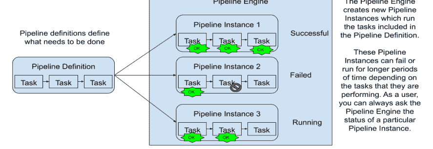

图 3.X 管道定义可以由管道引擎多次实例化

如预期，使用管道定义我们可以创建大量不同的自动化解决方案，但这些概念如何应用于交付云原生应用？对于云原生应用，我们对如何构建、打包、发布和发布我们的软件组件（服务）以及它们应该部署在哪里有非常具体的期望。在交付云原生应用的上下文中，我们可以定义两种主要类型的管道：

- 服务管道：将负责构建、单元测试、打包和分发（通常到制品仓库）我们的软件制品
- 环境管道：将负责部署和更新给定环境中的所有服务，例如暂存、测试、生产等。

服务和环境管道在不同资源上执行，并具有不同的期望。以下各节将更详细地介绍我们为服务和环境管道需要定义步骤，因为这些步骤无论我们使用哪种技术栈都将相似。让我们看一下服务管道定义的原型。

### 3.2.1 服务管道

服务管道负责定义和执行构建、打包和分发服务制品以便部署到环境所需的所有步骤。服务管道不负责部署新创建的服务制品，但它可以负责通知感兴趣的各方有新版本可供服务使用。

如果你标准化了服务需要如何构建、打包和发布，你可以为不同的服务共享相同的管道定义。你应该避免让每个团队为每个服务定义完全不同的管道，因为他们很可能会重新发明其他团队已经定义、测试并改进过的内容。

正如我们将在本节中看到的那样，需要执行相当多的任务，并且有一组约定，当遵循时可以减少执行这些任务所需的时间。

“服务管道”这一名称指的是我们的每个应用服务都将有一个管道，描述该特定服务所需的任务。如果服务相似并且使用相似的技术栈，那么管道看起来会非常相似。这些服务管道的主要目标之一是包含足够的细节，以便它们可以在没有任何人工干预的情况下运行，端到端自动化管道中包含的所有任务。

**注意：** 认为为整个应用（服务集合）创建一个单一管道很诱人，就像我们对单体应用所做的那样，但这违背了以各自的速度独立更新每个服务的初衷。你应该避免为一组服务定义单一管道的情况，因为它将阻碍你独立发布服务的能力。

## 约定将为你节省时间

服务管道可以在其结构和范围上更具主见，通过遵循以下一些强有力的意见和约定，你可以避免让团队定义每一个细节并通过反复试验来发现这些约定。以下方法已被证明是有效的：


- **基于主干的开发：** 这里的想法是确保源代码仓库的主分支中拥有的内容始终可以发布。你不会合并破坏该分支构建和发布流程的更改。只有当你要合并的更改已准备好发布时才合并。这种方法还包括使用功能分支，这允许开发人员在不破坏主分支的情况下处理功能。当功能完成并经过测试后，开发人员可以发送 Pull 请求（更改请求）供其他开发人员审查和合并。这也意味着当你将某些内容合并到主分支时，可以自动为你的服务（以及所有相关的工件）创建一个新版本。这会产生持续的发布流，在每次新功能合并到主分支后生成。因为每个版本都是一致的并且经过了测试，所以你可以将此新版本部署到包含应用程序其他服务的环境中。这种方法使服务背后的团队能够继续前进并不断发布，而不必担心其他服务。
- **一个服务/一个仓库/一个流水线：** 你将服务的源代码和构建、打包、发布和部署所需的所有配置都保存在同一个仓库中。这允许服务背后的团队以他们想要的任何节奏推送更改，而不必担心其他服务的源代码。常见的做法是将源代码放在同一个仓库中，该仓库中还包含 Dockerfile 描述如何创建 docker 镜像，以及部署服务到 Kubernetes 集群所需的 Kubernetes 清单。这些配置应包括用于构建和打包服务的流水线定义。
- **消费者驱动的契约测试：** 你的服务使用契约对其他服务运行测试，单元测试单个服务不应需要其他服务处于运行状态。通过创建消费者驱动的契约，每个服务都可以针对其他服务的 API 测试其自身的功能。如果任何下游服务发布了新版本，就会将新契约与所有上游服务共享，以便它们可以针对新版本运行测试。第 XX 章将更详细地介绍消费者驱动的契约测试。

如果我们考虑到这些实践和约定，我们可以定义服务流水线的职责如下：“将源代码转换为可以在环境中部署的工件”。

## 服务流水线结构

有了这个定义，让我们来看看云原生应用程序的服务流水线中包含哪些任务，这些应用程序将在 Kubernetes 上运行：

- **注册以接收源代码仓库主分支更改的通知：**（源版本控制系统，如今是 Git 仓库）：如果源代码发生变化，我们需要创建一个新版本。我们通过触发服务流水线来创建新版本。
- **从仓库克隆源代码：** 为了构建服务，我们需要将源代码克隆到具有构建/编译源代码为可执行二进制格式所需工具的机器上。
- **为要发布的新的版本创建新标签：** 基于基于主干的开发，每次发生更改时都可以创建一个新版本。这将帮助我们了解正在部署的内容以及每个新版本中包含的更改。
- **构建并测试源代码：**
  - 作为构建过程的一部分，大多数项目会执行单元测试，并在出现任何失败时中断构建
  - 根据我们使用的技术栈，我们需要为此步骤准备一套工具，例如编译器、依赖项、linter（静态源代码分析器）等。
- **将二进制工件发布到工件仓库：** 我们需要确保这些二进制文件可供其他系统使用，包括流水线中的后续步骤。此步骤涉及通过网络将二进制工件复制到不同位置。此工件将与在仓库中创建的标签共享相同的版本，为我们提供从二进制到用于生成它的源代码的可追溯性。
- **构建容器：** 如果我们正在构建云原生服务，我们需要构建容器镜像。今天最常见的方法是使用 Docker。此步骤要求源代码仓库具有例如 Dockerfile 来定义如何构建此容器镜像。
- **将容器发布到容器注册表：** 与我们发布在构建服务源代码时生成的二进制工件相同，我们需要将容器镜像发布到可以被他人访问的集中位置。此容器镜像将具有与在仓库中创建的标签和已发布的二进制文件相同的版本。这有助于我们清楚地看到运行容器镜像时将运行哪个源代码。
- **Lint、验证并打包 Kubernetes 部署的 YAML 文件（此处可使用 Helm）：** 如果你将这些容器运行在 Kubernetes 中，你需要管理、存储和版本化定义容器如何部署到 Kubernetes 集群的 Kubernetes 清单。如果你使用 Helm 等包管理器，你可以使用与二进制文件和容器镜像相同的版本来版本化包。
- **（可选）将这些 Kubernetes 清单发布到集中位置：** 如果你使用 Helm，将这些 Helm 包（称为 charts）推送到集中位置是有意义的。这将允许其他工具获取这些 charts，以便它们可以部署到任意数量的 Kubernetes 集群中。
- **通知相关方有关服务的新的版本：** 如果我们试图从源代码到运行中的服务全程自动化，服务流水线应该能够向可能正在等待新版本部署的所有感兴趣的服务发送通知。

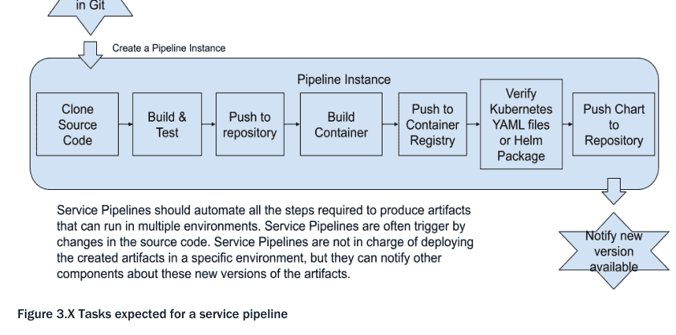

服务流水线应自动化生产可在多个环境中运行的工件所需的所有步骤。服务流水线通常由源代码中的更改触发。服务流水线不负责将创建的工件部署到特定环境，但它们可以通知其他组件有关这些工件的新版本。

Figure 3.X Tasks expected for a service pipeline

该流水线的输出是一组可以部署到环境中以使服务运行的工件。服务本身需要在不依赖任何特定环境的方式下构建和打包。服务可能依赖于环境中存在其他服务才能工作，例如基础设施组件如数据库和消息代理，或只是其他下游服务。

## 实际中的服务流水线

在现实生活中，每当你将更改合并到仓库的主分支时，此流水线都需要运行，如果你遵循基于主干的开发方法，这就是它应该的工作方式：

- 当你将更改合并到主分支时，此流水线应运行为你的软件创建新版本。这意味着你不应在不可发布的情况下将代码合并到主分支。
- 对于你的每个功能分支，一个非常相似的流水线应运行以验证分支中的更改是否可以构建、测试和发布。在现代环境中，Github Pull 请求的概念用于运行这些流水线，以确保在合并任何“Pull 请求”之前，流水线验证更改。

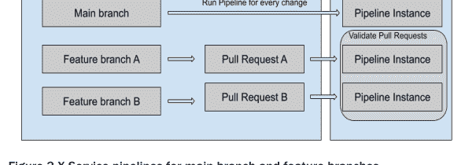

可以为构建新版本或验证功能分支中的更改创建流水线实例。这对于缩短开发人员在新功能上工作的反馈循环非常有用，同时减少新功能合并到主分支时可能出现的问题数量。

Figure 3.X Service pipelines for main branch and feature branches

图 3.X 所示的此服务流水线代表了每次将内容合并到主分支时你需要执行的最常见步骤，但根据不同情况，你可能还需要运行此流水线的一些变体。不同的事件可以触发流水线执行，我们可以根据不同目的拥有略有不同的流水线，例如：

- **验证功能分支中的更改：** 此流水线可以执行与主分支流水线相同的步骤，但生成的工件应包含分支名称，可能作为版本或作为工件名称的一部分。每次更改后运行流水线可能成本太高且并非总是需要，因此你可能需要根据需要决定。
- **验证 Pull 请求/更改请求：** 流水线将验证 Pull 请求/更改请求的更改是否有效，并且可以使用最近的更改生成工件。通常，流水线的结果可以通知负责合并 PR 的用户，并且如果流水线失败则阻止合并选项。此流水线用于验证合并到主分支的内容是否有效并且可以发布。验证 Pull 请求/更改请求可以是一个不错的选择，以避免为功能分支中的每次更改运行流水线，因为当开发人员准备好从构建系统获取反馈时，可以创建 PR，从而触发流水线。如果开发人员在 Pull 请求之上进行了更改，流水线将被重新触发。

尽管可以为这些流水线添加一些小的差异和优化，但行为和生成的工件大多相同。这些约定和方法依赖于流水线执行足够的测试来验证正在生产的服务可以部署到环境中。

## 服务流水线要求

本节涵盖服务流水线正常工作所需的基础设施要求以及流水线执行其工作所需的源仓库内容。

让我们从服务流水线需要工作的基础设施要求开始：


- **用于源代码变更通知的 Webhooks**：首先，它需要能够访问注册到包含服务源代码的 Git 仓库的 Webhooks，以便在新的变更合并到主分支时可以创建流水线实例。
- **可用的制品仓库以及推送二进制制品的有效凭证**：一旦源代码构建完成，我们需要将新创建的制品推送到存储所有制品的制品仓库。这需要配置好制品仓库，并且拥有有效的凭证以能够推送新的制品。
- **Docker 镜像仓库以及推送新容器镜像的有效凭证**：与推送二进制制品相同，我们需要分发我们的 Docker 容器，以便 Kubernetes 集群在我们想要部署服务的新实例时可以获取镜像。拥有可用的容器镜像仓库以及有效的凭证是完成此步骤所必需的。
- **Helm Chart 仓库和有效凭证**：Kubernetes 清单可以打包并作为 Helm chart 分发，如果你使用 Helm，你将需要一个 Helm Chart 仓库以及有效的凭证以能够推送这些包。

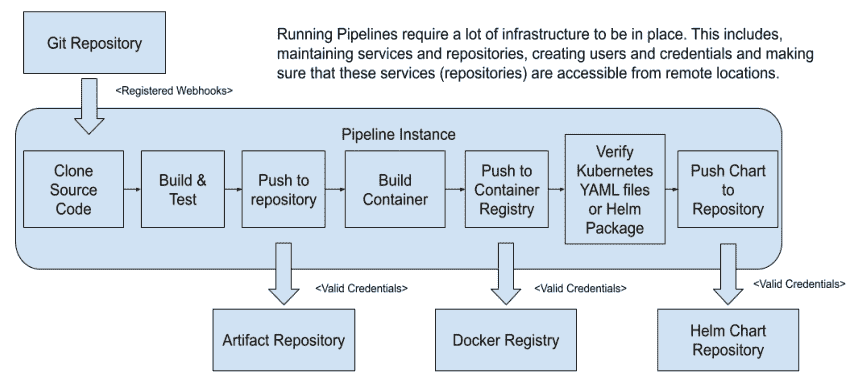

Figure 3.X Service pipelines required infrastructure

对于服务流水线要完成其工作，包含服务源代码的仓库还需要具有 Dockerfile 或生产容器镜像的方式，以及部署服务到 Kubernetes 所需的 Kubernetes 清单。常见的做法是在服务源代码中包含服务的 Helm chart 定义，换句话说，每个服务一个 Helm Chart，正如我们在以下章节中将看到的那样。

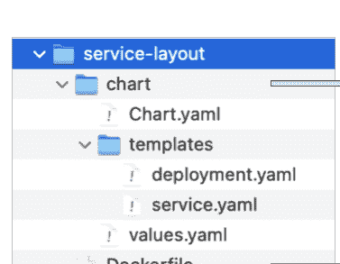

Figure 3.X The Service source code repository needs to have all the configurations for the Service pipeline to work

Figure 3.x 显示了我们服务源代码仓库的一种可能的目录结构，其中包括源代码（src）目录，该目录将包含所有将被编译为二进制格式的文件。用于构建服务容器镜像的 Dockerfile 以及包含创建可分发以安装服务到 Kubernetes 集群的 Helm chart 的所有文件的 Helm chart 目录。

如果我们将构建、打包和在 Kubernetes 集群中运行服务所需的一切都包含在内，服务流水线只需在主分支每次变更后运行即可创建服务的新版本。

更高级但非常有用的设置可能包括为 Pull Request（变更请求）运行流水线，这可以包括将制品部署到“预览”环境中，以便开发人员和其他利益相关者在将其合并到主分支之前验证变更。像 Jenkins X 这样的项目开箱即用地提供了此功能。

总之，服务流水线负责构建我们的源代码和相关制品，以便它们可以部署到环境中。如前所述，服务流水线不负责将生成的服务部署到生产环境中，这是环境流水线的责任，将在下一节中介绍。

## 3.2.2 Environment Pipeline

环境流水线负责在新的服务或现有服务的新版本可用时对我们的环境应用变更。环境流水线将针对托管此类环境期望配置的特定配置仓库运行。然后一个组件将监控此仓库中的变更，并对每个变更将期望状态应用/同步到正在运行的 Kubernetes 集群中。整个方法通常被称为 GitOps，因为它使用 Git 仓库作为我们环境的事实来源，并消除了手动与 Kubernetes 集群交互以避免配置和安全问题的需求。

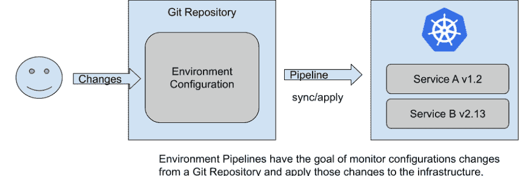

环境流水线的目标是从 Git 仓库监控配置变更，并在检测到新变更时将这些变更应用到基础设施。遵循这种方法允许我们通过回滚提交来回滚基础设施中的变更，并且也允许我们通过仅对另一个集群运行相同的流水线来复制完全相同的环境配置。

Figure 3.X Defining the state of the cluster using configuration in Git (GitOps)

当你开始使用环境流水线时，你的目标是停止手动交互、更改或修改环境的配置，并且所有交互都完全由这些流水线完成。为了给出一个非常具体的例子，而不是在我们的 Kubernetes 集群中执行 `kubectl apply -f` 或 `helm install`，流水线将负责根据包含需要安装到集群中的定义和配置的 Git 仓库的内容运行这些命令。

## STEPS INVOLVED WITH AN ENVIRONMENT PIPELINE

环境流水线通常包括以下步骤：

- **用于配置变更通知的 Webhooks：** 如果包含环境配置的仓库中有任何新变更，则会触发环境流水线的新实例
- **从包含我们环境期望状态的仓库克隆源代码：** 此步骤将克隆已更改的配置以便能够将其应用到集群。这通常包括执行 `kubectl apply -f` 或 `helm install` 命令来安装制品的新版本。请注意，使用 kubectl 或 helm 时，Kubernetes 足够智能，可以识别变更位置并仅应用差异。
- **将期望状态应用到实时环境：** 一旦流水线本地可访问所有配置，它将使用一组凭证将这些变更应用到 Kubernetes 集群。请注意，我们可以微调流水线对集群的访问权限，以确保从安全角度不会被利用。这也允许你移除个人团队成员对部署服务所在的集群的访问权限。
- **验证变更是否已应用并且状态与 git 仓库中描述的一致：** 一旦变更应用到实时集群，检查服务的新版本是否正常运行是必要的，以便确定是否需要回滚到以前的版本。如果需要回滚，操作相当简单，因为所有历史都存储在 git 中，应用以前的版本只需查看仓库中的前一个提交即可。

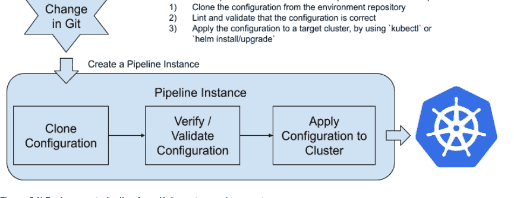

Figure 3.X Environment pipeline for a Kubernetes environment

为了使环境流水线正常工作，需要一个能够将变更应用到环境的组件，并且需要使用正确的访问凭证进行配置。

该组件背后的主要思想是确保没有人会通过手动与集群交互来更改环境配置。该组件是唯一允许更改环境配置、部署新服务、升级服务版本或从环境中移除服务的组件。

要使环境流水线正常工作，需要满足以下两个考虑因素：

- 包含环境期望状态的仓库需要具有创建和成功配置环境所需的所有配置。
- 环境将运行的 Kubernetes 集群需要使用正确的凭证进行配置，以便允许流水线更改状态。

术语环境流水线指的是每个环境都将有一个关联的流水线。由于通常需要多个环境（开发、 staging、生产）来交付应用程序，每个环境都将有一个负责部署和升级其上运行的组件的流水线。通过使用这种方法，在不同环境之间推广服务是通过向环境的仓库发送 Pull Request/变更请求实现的，流水线将负责将变更反映到目标集群中。

## ENVIRONMENT PIPELINE REQUIREMENTS AND DIFFERENT APPROACHES

那么这些环境仓库的内容是什么？在 Kubernetes 世界中，一个环境可以是 Kubernetes 集群中的一个命名空间，也可以是 Kubernetes 集群本身。让我们从最直接的选项开始，“Kubernetes 命名空间”。正如你在下图中看到的那样，环境仓库的内容只是环境中需要存在哪些服务的定义，然后流水线就可以将这些 Kubernetes 清单应用到目标命名空间。

下图显示了你可以用来将配置文件应用到 Kubernetes 集群的三种不同方法。请注意，三种选项都包含一个 `environment-pipeline.yaml` 文件，其中定义了需要执行的任务。

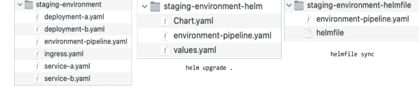

Figure 3.X Three different approaches for defining environments' configurations

第一个选项（简单布局）只是将所有 Kubernetes YAML 文件存储到 Git 仓库中，然后环境流水线将仅对配置的集群使用 `kubectl apply -f *`。虽然这种方法很简单，但有一个很大的缺点，如果你有你的


Kubernetes YAML 文件在服务仓库中为每个服务提供，然后环境仓库会复制这些文件，它们可能会不同步。想象一下，如果你有多个环境，你将需要维护所有副本的一致性，这可能会变得非常具有挑战性。

第二个选项（Helm 布局）稍微复杂一些，现在我们使用 Helm 来定义集群的状态。你可以使用 Helm 依赖项创建一个父 chart，该 chart 将包含应存在于环境中的所有服务的依赖项。如果这样做，环境流水线可以使用 `helm update` 将 chart 应用到集群中。我不喜欢这种方法的一点是，你为每次更改创建一个 Helm release，并且没有为每个服务单独的 release。这种方法的先决条件是每个服务都作为 Helm chart 打包，以便环境可以获取。

第三个选项是使用一个名为 `helmfile` 的项目（https://github.com/robol1/helmfile），它正是为此特定目的而设计的，用于定义环境配置。`helmfile` 允许你以声明方式定义需要在我们的集群中存在的 Helm release。这些 Helm release 将在我们运行 `helmfile sync` 时创建，前提是已定义了一个包含我们希望在集群中拥有的 helm release 的 `helmfile`。

无论你使用这些方法中的任何一种还是其他工具来执行此操作，期望都是明确的。你有一个包含配置的仓库（通常每个环境一个仓库），流水线将负责获取配置并使用工具将其应用到集群。

通常会有多个环境（staging、qa、production），甚至允许团队按需创建自己的环境以运行测试或日常开发任务。

如果你使用“每个环境一个命名空间”方法，通常为每个环境维护一个单独的 git 仓库，因为这有助于保持对环境的访问隔离和安全。这种方法很简单，但它在 Kubernetes 集群上提供的隔离不足，因为 Kubernetes 命名空间是为集群的逻辑分区而设计的，在这种情况下，Staging 环境将与 Production 环境共享集群资源。

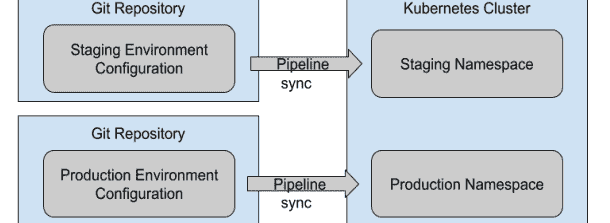

一种策略是使用命名空间为不同的环境服务。虽然这简化了流水线将服务部署到不同环境所需的配置，但命名空间没有强大的隔离保证。

Figure 3.X One Environment per Kubernetes Namespace

一种替代方法可以是为每个环境使用一个全新的集群。主要区别是隔离和访问控制。通过为每个环境拥有一个集群，你可以更严格地定义谁以及哪些组件可以在这些环境中部署和升级事物，并为每个集群配置不同的硬件，例如多区域设置和其他

可扩展性问题，这些问题可能不适合在你的 Staging 和 Testing 环境中拥有。通过使用不同的集群，你还可以实现多云设置，其中不同的环境可以在不同的云提供商中托管。

Figure 3.x shows how you can use the namespace approach for Development Environments which will be created by different teams and then having separated clusters for Staging and Production. The idea here is to have the Staging and Production cluster configured as similarly as possible, so applications deployed behave in a similar way.

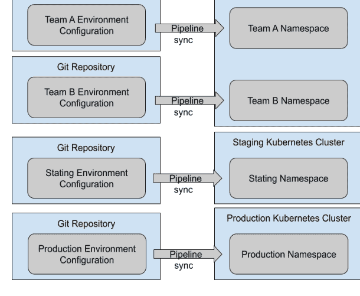

一种更现实的方法可以是使用同一个集群供不同团队日常工作，并为 Staging 和 Production 环境使用单独的集群。可以通过简单地复制另一个团队的仓库并创建一个新命名空间来添加新团队。对于服务要提升到 Staging 或 Production 环境，可以向特定的环境 git 仓库发送 Pull Requests/Merge Requests。

Figure 3.X One Environment per Kubernetes Cluster

### 3.2.3 Service Pipelines + Environment Pipelines

最后，让我们看看 Service Pipelines 和 Environment Pipeline 如何连接。这两个流水线之间的连接通过对仓库的 Pull Request 实现，因为当更改提交并合并时，流水线将被触发：

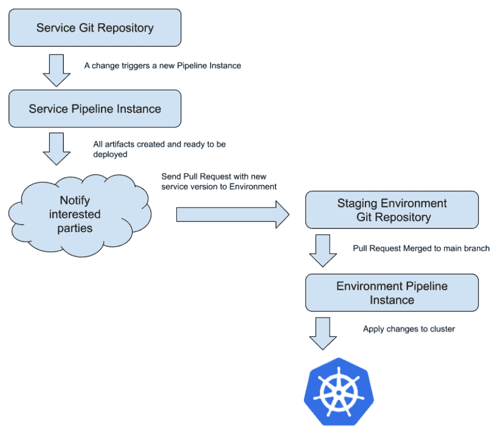

Figure 3.X A Service Pipeline can trigger an Environment Pipeline via a Pull Request

Service Pipeline 在所有工件发布并发布后，可以向需要更新或部署服务的环境仓库发送自动 Pull Request，从而触发 Environment Pipeline。这种简单但有效的机制允许在每次想要将某些内容升级或部署到我们的环境中时发送自动或手动 Pull Request。对于某些环境，例如 staging 或 development 环境，你可以自动化包含新服务版本的 Pull Request 的合并，从而使服务仓库中的更改能够自动传播到这些低风险环境。

在下一节中，我们将研究使用 Cloud-Native 方法实现这些流水线。

## 3.3 Implementing Cloud-Native Pipelines

正如我们之前讨论的，如果你想实现这些（Service 和 Environment）或其他流水线，你将需要一个 Pipeline Engine 来处理自动化所有这些任务，这样你实际上不需要实现任何代码，例如从版本控制系统克隆源代码或将工件发布到中央仓库。到目前为止，我们一直在概念层面上讨论流水线，但现在是时候看看实际实现。

过去已经构建了几个 Pipeline Engine，例如 Hudson/Jenkins，但在本书中，我们正在研究 Cloud-Native 解决方案，这些解决方案是专门为利用 Kubernetes 而构建的。如果我们具体谈论 Kubernetes，我们将寻找具有以下特征的解决方案：

- 流水线引擎可以根据工作量进行扩展，因此如果我们有更多流水线需要执行，流水线引擎应该能够仅请求更多硬件并动态扩展
- 流水线引擎应使用 Kubernetes 机制来运行流水线实例
- 流水线引擎应与 Kubernetes 生态系统集成

与 Service 和 Environment 流水线相关的任务大多很常见，并且已经被世界各地的团队作为开源代码实现并共享。如果你有与私有系统集成的特定需求，你可能需要实现一些集成，对于流水线中的大多数通用步骤，大多数技术栈都有现成解决方案。

由于本书使用 Kubernetes 作为目标平台，下一个部分是对一个流行的 Cloud-Native Pipeline Engine Tekton 的概述。

### 3.3.1 Tekton Cloud-Native Pipelines

Tekton 最初作为 Knative 项目的一部分创建（http://knative.dev），由 Google 创建，最初称为 Knative Build，后来从 Knative 中分离出来成为一个独立项目。你可以访问项目网站：http://tekton.dev。Tekton 的主要特点是它是一个为 Kubernetes 设计的 Cloud-Native Pipeline Engine。在本节中，我们将研究如何使用 Tekton 来定义 Service 和 Environment Pipelines。

### Tekton in Action

在 Tekton 中你有两个主要概念：Tasks 和 Pipelines。Tekton，Pipeline Engine 由一组组件组成，这些组件将理解如何执行我们定义的 Tasks 和 Pipelines。Tekton，与本书中涵盖的大多数 Kubernetes 项目一样，可以通过运行 `kubectl` 或使用 Helm Charts 安装到你的 Kubernetes 集群中。

当你安装 Tekton 时，你正在安装一组 Custom Resource Definitions，它们是 Kubernetes API 的扩展，在 Tekton 的情况下定义了 Tasks 和 Pipelines 是什么。Tekton 还安装了 Pipeline Engine 本身，它知道如何在我们创建它们时处理 Tasks 和 Pipelines 资源。

你可以使用 Helm 安装 Tekton，这要归功于与 Continuous Delivery foundation 的合作：https://github.com/cdfoundation/tekton-helm-chart

与每个 Helm Chart 一样，你首先需要添加 Helm Chart 仓库，然后安装 chart：


```
helm repo add cdf https://cdfoundation.github.io/tekton-helm-chart/
helm install tekton cdf/tekton-pipeline
```

一旦你安装了 Tekton Helm chart，你会看到一个新的命名空间被创建了。这个名为 `tekton-pipelines` 的新命名空间包含了 pipeline 控制器（即 pipeline 引擎）和 pipeline webhook 监听器，后者用于监听来自外部源（如 git 仓库）的事件。

你也可以安装 `tkn` 命令行工具，如果你正在处理多个任务和复杂的 pipeline，这会很有帮助。你可以按照这里的安装说明进行操作：https://github.com/tektoncd/cli

如果现在列出集群中安装的所有 CustomResourceDefinitions 并属于 tekton，你会看到有一组新的资源可以使用：

```
> kubectl get crds | grep tekton #1
clustertasks.tekton.dev
conditions.tekton.dev
pipelineresources.tekton.dev
pipelineruns.tekton.dev    #2
pipelines.tekton.dev      #3
runs.tekton.dev
taskruns.tekton.dev       #4
tasks.tekton.dev          #5
```

#1 我们可以使用 kubectl 获取所有 Custom Resource Definitions (crd) 并只过滤与 tekton 相关的那些

#2 #3 #4 #5 是我们将为 pipeline 创建的资源类型，注意你也可以通过使用 `kubectl get` 和资源类型来获取这些资源

一旦你安装了 Tekton，你就可以开始创建简单的 YAML 任务定义。Tekton 中的 Task 看起来像一个普通的 Kubernetes 资源：

```
apiVersion: tekton.dev/v1beta1
kind: Task
metadata:
  name: echo-hello-world
spec:
  steps:
  - name: echo
    image: ubuntu #1
    command:
    - echo #2
    args:
    - "Hello World" #3
```

#1 名为 ubuntu 的 docker 镜像将用于此任务

#2 此任务使用的主要命令是 echo，注意它是一个命令列表

#3 命令参数（args）在这种情况下只是 "Hello World" 字符串，注意你可以为更复杂的命令发送参数列表

基于此示例，你可以为任何你想要的内容创建任务，因为你有灵活性来定义使用哪个容器以及运行哪些命令。一旦你有了任务定义，你需要通过使用 `kubectl apply -f task.yaml` 将此文件应用到集群中，使其对 Tekton 可用。通过将文件应用到 Kubernetes，我们只是使定义对集群中的 Tekton 组件可用，但任务不会运行。

如果你想运行此任务，任务可以被执行多次，Tekton 要求你创建一个如下的 TaskRun 资源：

```
apiVersion: tekton.dev/v1beta1
kind: TaskRun
metadata:
  generateName: hello-run-
spec:
  taskRef:
    name: echo-hello-world
```

或者，你可以使用 `tkn` 来启动任务定义：

```
salaboy> tkn task start echo-hello-world
TaskRun started: echo-hello-world-run-q7vgw

In order to track the TaskRun progress run:
tkn taskrun logs echo-hello-world-run-q7vgw -f -n default
```

然后通过运行建议的命令获取日志：

```
salaboy> tkn taskrun logs echo-hello-world-run-q7vgw -f -n default
[echo] Hello World
```

无论你将此 TaskRun 应用到集群（`kubectl apply -f taskrun.yaml` 或使用 `tkn task start`），Pipeline Engine 都会执行此任务。在 YAML 文件中，你可以看到此资源没有 `metadata.name`，而是具有 `metadata.generateName` 字段。当 Tekton 运行此任务时，它会为资源生成一个唯一名称以跟踪该特定执行。你可以继续应用相同的资源，每次将其应用到集群时，都会安排一次新的执行。TaskRun 资源用于保留 Task 定义的执行的所有信息以及这些执行的输出。

## TEKTON 中的 PIPELINES

Task 本身可能很有用，但当你使用 Pipelines 创建这些任务的序列时，Tekton 变得非常有趣。

pipeline 是这些任务在具体序列中的集合，让我们看一下在 Tekton 中定义的简单 Service Pipeline（`service-pipeline.yaml`）：

```
apiVersion: tekton.dev/v1beta1
kind: Pipeline
metadata:
  name: service-pipeline
spec:
  resources:
    ...
tasks:
  - name: clone-repository
    taskRef:
      name: git-clone
      bundle: gcr.io/tekton-releases/catalog/upstream/git-clone:0.4
    params:
      ...
  - name: maven-build
    runAfter: [clone-repository]
    taskRef:
      name: maven
      bundle: gcr.io/tekton-releases/catalog/upstream/maven:0.2
    params:
      ...
  - name: docker-image-build-and-publish
    runAfter: [maven-build]
    taskRef:
      name: kaniko
      bundle: gcr.io/tekton-releases/catalog/upstream/kaniko:0.4
    params:
      ...
```

你可以在这里找到完整的 pipeline 定义：https://github.com/salaboy/from-monolith-to-k8s/blob/master/tekton/service-pipeline.yaml

再次，你需要将此 pipeline 资源应用到你的集群，以便 Tekton 知道：`kubectl apply -f service-pipeline.yaml`。

正如你在 pipeline 定义中看到的，`spec.tasks` 字段包含一个任务引用的数组。这些任务需要在集群中已经部署，Pipeline 定义负责定义这些任务将被执行的顺序。这些 Task 引用可以是你自己的任务，或者像示例中一样，可以来自 Tekton Catalog，这是一个包含社区维护的任务定义仓库，你可以重用它们。

同样地，就像 Task 需要 TaskRun 进行执行一样，你需要为每次想要执行 Pipeline 时创建一个 PipelineRun。

```
apiVersion: tekton.dev/v1beta1
kind: PipelineRun
metadata:
  generateName: service-pipeline-
spec:
  pipelineRef:
    name: service-pipeline
```

现在当你将此文件应用到集群 `kubectl apply -f pipelinerun.yaml` 时，Tekton 将通过运行 pipeline 定义中定义的所有任务来执行 pipeline。或者你也可以使用 `tkn`：

```
salaboy> tkn pipeline start service-pipeline
```

遵循与此处定义的 service pipeline 类似的方法，我们还可以创建一个 Environment Pipeline，它将负责将包含需要部署到环境中的服务的 git 仓库的状态同步到正在运行的 Kubernetes 集群。

```
apiVersion: tekton.dev/v1beta1
kind: Pipeline
metadata:
  name: staging-environment-pipeline
spec:
  tasks:
  - name: clone-repository
    taskRef:
      name: git-clone
      bundle: gcr.io/tekton-releases/catalog/upstream/git-clone:0.4
    params:
    - name: url
      value: $(params.gitRepository)
    - name: revision
      value: $(params.gitRevision)
  - name: helm-update
    runAfter: [clone-repository]
    taskSpec:
      steps:
      - name: update
        image: quay.io/roboll/helmfile:helm3-v0.135.0
        script: |
          #!/bin/sh
          set -ex
          helmfile sync
```

再次，此 pipeline 非常简单，你可以在这里找到完整的 pipeline 定义：https://github.com/salaboy/from-monolith-to-k8s/blob/master/tekton/environment-pipeline.yaml

此 pipeline 包含两个任务，一个从 Environment Repository 克隆源代码，在这种情况下包含一个 helmfile，定义了环境中安装的内容，第二个任务只是将此文件应用到配置的集群。用于运行此 pipeline 的仓库可以在这里找到：https://github.com/salaboy/fmtok8s-staging-env

你可以使用以下命令运行此 pipeline：

```
salaboy> tkn pipeline start staging-environment-pipeline -s runner -w name=sources,volumeClaimTemplateFile=workspace-template.yaml
```

由于此 pipeline 将执行针对 Kubernetes API 的请求，因此需要特定的 RBAC（基于角色的访问控制配置），因此 `-s` 参数指示 `runner` service account 对于此 pipeline 的工作是必需的。

如果需要，你可以在以下仓库找到有关如何在 Kubernetes 集群中安装 Tekton 以及如何运行 Service 和 Environment pipelines 的逐步教程：https://github.com/salaboy/from-monolith-to-k8s/tree/master/tekton

## TEKTON 优势和额外功能

正如我们所见，Tekton 超级灵活，允许你创建相当高级的 pipelines，并且它包含其他功能，例如：


+   - 在任务之间共享数据的输入和输出映射
+   - 事件触发器，允许你监听将触发 Pipeline 或 Task 的事件
+   - 一个命令行工具，可轻松从终端与 Task 和 Pipeline 交互
+   - 一个简单的仪表板，用于监控你的 pipeline 和任务执行情况。

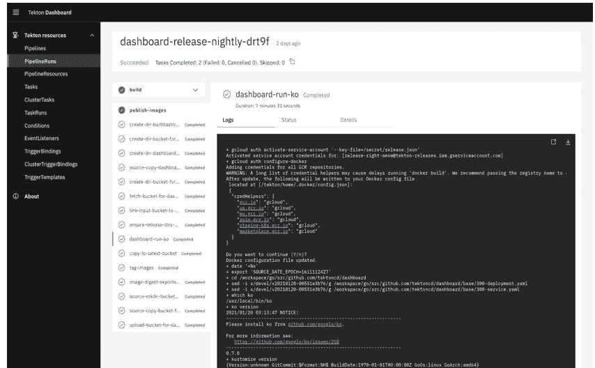

Figure 3.X Tekton Dashboard a user interface to monitor your pipelines

图 3.x 显示了社区驱动的 Tekton Dashboard，你可以用它来可视化你的 pipeline 执行情况。请记住，由于 Tekton 是构建在 Kubernetes 之上运行的，你可以使用 `kubectl` 来监控你的 pipeline，就像监控任何其他 Kubernetes 资源一样，但对于技术性较低的用户来说，没有什么能比得上用户界面的。

但现在，如果你想使用 Tekton 实现一个 Service Pipeline，你将花费大量时间定义 Task、Pipeline、如何映射输入和输出、为你的 Git 仓库定义正确的事件监听器，然后再深入到低层级定义每个 Task 将使用哪些 docker 镜像。创建和维护这些 pipeline 及其相关资源可能会成为一份全职工作，为此 Tekton 启动了一个计划来定义一个 Catalog，其中可以共享 Task（Pipeline 和 Resources 计划在未来版本中发布），即 Tekton Catalog：https://github.com/tektoncd/catalog

在 Tekton Catalog 的帮助下，我们可以创建引用在 catalog 中定义的 Task 的 pipeline，因此我们无需担心定义它们。你还可以访问 https://hub.tekton.dev，它允许你搜索 Task 定义并为你在 pipeline 中安装和使用这些任务提供详细的文档。

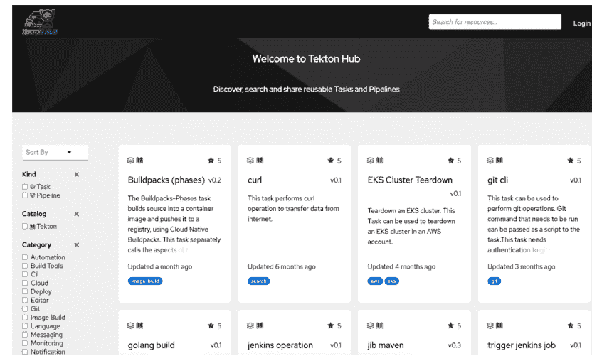

Figure 3.X Tekton Hub a portal to share and reuse Tasks and Pipeline definitions

一个很好的例子是 Helm Upgrade from Source Task，它允许你基于 Helm Chart 源升级 Helm release。你可以在这里查看任务文档：https://hub.tekton.dev/tekton/task/helm-upgrade-from-source 像这样的 Task 对于实现环境 Pipeline 非常有帮助，我们用 Helm chart 定义环境的 content，然后每当我们更改 chart 的 content 时，就只需用 Tekton 升级 Helm Release。

Tekton Hub 和 Tekton Catalog 允许你重用由大量用户和公司创建的 Task 和 Pipeline。但你很快就会意识到 Tekton 对于你用构建的 pipeline 做什么并没有太多主见，因此在创建 Service 或 Environment pipeline 时，你需要做出大量不同的选项和选择。难道不是很好，如果所有被大量其他人使用的默认值、约定和最佳实践都能在一个工具中共享吗？在下一节中，我们将看看 Jenkins X 以及它如何采取整体方法来解决 Kubernetes 的 CI/CD。

### 3.3.2 Jenkins X: A one-stop-shop for CI/CD in Kubernetes

Jenkins X (http://jenkins-x.io) 为在 Kubernetes 之上进行 CI/CD 提供了一整套方案。这从安装你需要的组件开始，例如 Pipeline Engine（本例中为 Tekton）到监控 pipeline 的用户界面、制品仓库以及应用于基于约定的 pipeline 的最佳实践。理论上，使用 Jenkins X，在你安装之后，只需通过一条命令行导入你的服务，Service 和 Environment Pipeline 就会为你的项目设置好。Jenkins X 采取整体方法来解决 CI/CD，因此起初它是一个复杂的项目，很难掌握。本节旨在解释 Jenkins X 如何解决并简化 Kubernetes 项目的整个 CI/CD 流程，我的建议始终是尝试在自己的集群上使用该项目，但要解释所有组件如何协同工作则需要一整本书。

## JENKINS X ARCHITECTURE

如果你有兴趣尝试 Jenkins X，你需要明白 Jenkins X 分为两个主要组件：

+   - **一个名为 `jx` 的命令行工具**：你需要从 http://jenkins-x.io 网站下载 `jx` 命令行，或使用 brew for Mac OSX 或包管理器在本地安装命令行。

+   - **安装到 Kubernetes 集群中的一组服务和组件**：通过使用 `jx` 命令行工具，你可以在现有的 Kubernetes 集群中安装 Jenkins X。你可能会在部署应用程序的单独集群中安装 Jenkins X。

下图显示了安装 Jenkins X 时默认安装的组件，无论你决定在哪个云提供商上安装它。

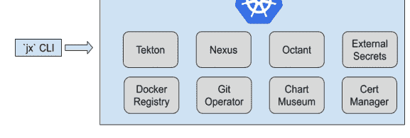

在集群中安装 Jenkins X 时，它会安装构建你的云原生服务和管理你的环境所需的所有基础设施。

Figure 3.X Jenkins X Components installed on a Kubernetes Cluster

使用名为 `jx` 的命令行工具，你可以将 Jenkins X 安装到你的集群中。为了运行 Jenkins X，你需要一个 Kubernetes 集群作为起点，Jenkins X 可以为你创建。Jenkins X 使用名为 Terraform (https://www.terraform.io) 的工具来创建集群并在不同的云提供商中安装所需的组件。它还使用 Kubernetes 和云提供商特定的服务来确保你的服务和环境 pipeline 拥有所需的一切。例如，如果你在 Google Cloud Platform 上安装 Jenkins X，它会配置 GCR（Google Container Registry）用于存储由你的服务 pipeline 生产的 docker 镜像。在本节中，我们将看看在集群中安装 Jenkins X 时会安装什么，以及从零到为你的服务实现完整 CI/CD 的基本命令。

Jenkins X 安装并配置了服务和环境 pipeline 所需的所有组件，确保组件可以注册到 git 仓库以接收更改，并且在推送更改时 pipeline 会自动触发。Jenkins X 还安装了 pipeline 引擎（Tekton）以及用于存储作为 pipeline 流程创建的制品的仓库。请记住，你需要一个地方来存储你的二进制制品（已安装 Nexus）、你的 docker 镜像（取决于你安装 Jenkins X 的云提供商，将使用不同的容器注册表，如果你在 Google Cloud，则会使用 GCR.io）以及你的 Kubernetes 清单。Jenkins X 依赖 Helm 来打包和分发 Kubernetes 清单（YAML 文件），因此它会在集群中安装 Chart Museum。

当你在 Kubernetes 集群中安装 Jenkins X 时，除了安装它所需的所有组件外，它还会自动创建两个环境：Staging 和 Production，以及各自的 Environment Pipeline 和包含默认配置的 Git 仓库。如以下图所示，你的应用程序服务将从 `dev` 环境开始，自动提升到 `staging` 环境，最终到达 `production` 环境，用户在该环境中消费我们的服务。

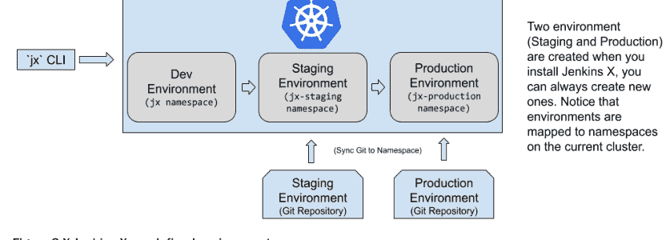

Figure 3.X Jenkins X pre-defined environments

两个 pipeline 都将与两个单独的命名空间关联，每个环境的 workload 都将在其中运行。默认情况下，不会创建任何 service pipeline，因为尚未定义应用程序服务。

作为安装过程的一部分，Jenkins X 创建了两个默认环境，名为 "staging" 和 "production"，为 staging 环境配置了自动提升，这意味着每当我们的服务有新版本时，Environment Pipeline 将负责将服务“提升”（添加或升级服务）到环境中。生产环境需要手动提升，这意味着用户将负责决定何时可以将服务的新版本安装到生产环境中。

到目前为止，仅安装 Jenkins X 后，我们就有了两个环境和默认的环境 pipeline 可以使用。你现在准备好开始添加服务了。

## YOUR PROJECTS AND JENKINS X

一旦所有 pipeline 所需的组件都安装并配置为协同工作，你就可以开始将你的项目“导入”到 Jenkins X。

让我们看看这对于我们的 Conference Platform 应用程序会是什么样子，该应用程序由四个服务组成。如果我们有四个服务，我们就需要四个 service pipeline。每个 pipeline 都将独立发布每个服务。在 Jenkins X 中，我们可以通过


just importing our project to our Jenkins X installation and we do that by running `jx import` inside the directory where our Service code is.

Because the Conference Platform Services were built with Java, let’s see how the process of importing a project to Jenkins X works.

Let’s assume that we want to create and run a Service Pipeline for our Agenda Service and all we have is the source code of the service. When you run `jx import` inside the project source code the following steps are executed locally inside the `jx` CLI tool:

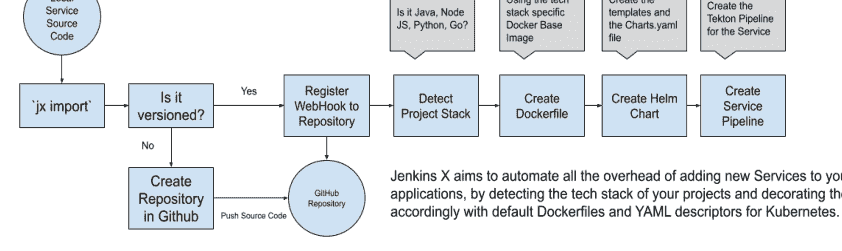

Jenkins X aims to automate all the overhead of adding new Services to your applications, by detecting the tech stack of your projects and decorating them accordingly with default Dockerfiles and YAML descriptors for Kubernetes.

## Figure 3.X Jenkins X import process

The first check that is done is about if the project is already in version control or not. If it is not, it will suggest you create a new repository (in Github or your preferred source version control system) to be able to monitor the changes and trigger releases. The next step is to register a Webhook, so Jenkins X components get notified whenever there is a new change or a Pull Request / Change Request. Then the decoration steps happen, in other words, Jenkins X will detect what kind of project do we have, if it is a Java, Node JS, Python or Go project and based on that it will decide to create a Dockerfile, a Helm Chart including the Kubernetes manifests and finally the Service Pipeline using Tekton is created.

A set of simple checks are executed here by Jenkins X, for example, because we have a Java project which is being built by Maven Jenkins X detects the `pom.xml` file which describes the project and its dependencies and knows what tools and steps are needed to build this kind of project. Once the project type is detected a Dockerfile is provided for that kind of project if none is detected to be present. The same with creating a Helm chart, if Jenkins X detects that there is no helm chart defined inside the project directory it will automatically create one based on a default chart for the detected project. Finally, Jenkins X will create a default service pipeline for the project which is strictly related to the kind of the detected project as it contains Tasks that have the right tools to build the project source code into a binary, a docker image and a helm chart.

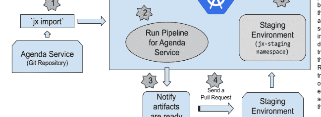

The first time that a service is imported to Jenkins X (1) a pipeline instance is created to build all the artifacts required for the service to run (2). Once the artifacts are built the pipeline sends a notification to all the interested components (3). By default that notification is transformed in a Pull Request to the Staging Environment Git Repository (4). This Pull Request triggers the environment pipeline of the Staging Environment, and if everything works as expected, the service is promoted (deployed) to the Staging Environment (5).

Figure 3.X Agenda Service imported to Jenkins X

After importing your project, you have a Service Pipeline configured and ready to go. Your project now contains all the necessary configurations and definitions to be built, packaged and run into a Kubernetes Cluster. Jenkins X took care of creating the Docker Image, the Helm Chart and the Service Pipeline for you. Because Jenkins X is creating a Tekton pipeline under the hood you can change and modify this pipeline if the one provided by default doesn't meet all your needs.

## FROM SOURCE TO SERVICE RUNNING

Once the Service Pipeline is created you can start the pipeline by running `jx pipeline start` and then select your service from the list. You will notice that when the pipeline runs it will create a new tag and a new release for your artifacts, which will be automatically promoted to the Staging Environment.

When changes are merged in each service repository, new releases are created by their corresponding pipelines and new versions of the services are promoted to the Staging Environment. This constant stream of releases allows teams to independently release their services in a continuous fashion.

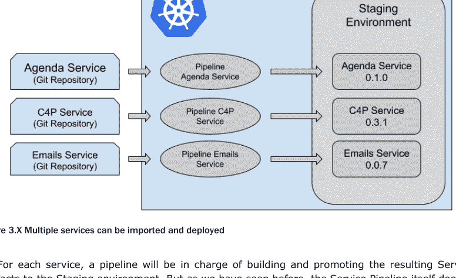

Figure 3.X Multiple services can be imported and deployed

For each service, a pipeline will be in charge of building and promoting the resulting Service artifacts to the Staging environment. But as we have seen before, the Service Pipeline itself doesn’t deploy the new version of the services, the promotion of the service happens by sending a Pull Request with the new version that was just released to the Staging Environment. When this PR is received in the Staging Environment Git Repository, an Environment Pipeline configured for Pull Requests will run to validate this service upgrade and automatically merge the change into the main branch. Once the change is merged in the main branch the Environment Pipeline for the main branch will be in charge of syncing the state described in the repository, with the new version of the service, into the cluster that is running the Staging Environment.

Once the services are running in the Staging environment, we can run integration tests and end to end tests which will check that different versions of the services are working together as expected. When we consider that everything is working, the Operations team or the person in charge can send a Pull Request to the Production environment for the promotion to start.

The Staging Environment is configured to automatically run pipelines and promote services. The Production Environment needs manual intervention from the Operations Team to validate which services are stable enough to be promoted to Production. The promotion process only involves sending and merging a Pull Request with the updated versions of the services that we want to run in Production.

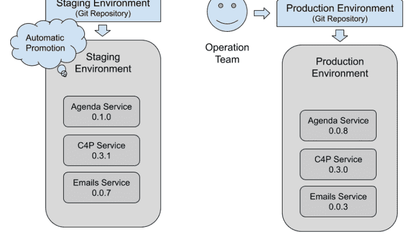

Figure 3.X Promoting services between different environments

It is quite common to require manual intervention to promote new services and new versions to more restricted environments such as the Production environment. A manual Pull Request merge might be required to promote the new services and versions forward to the production environment. By following the approach described in this section you limit the cluster permissions to the pipeline in charge of syncing the state of the Production environment git repository to the cluster state, limiting the accounts which have access to business-critical services and resources.

### 3.3.3 Other alternatives

Jenkins X provides a one-stop-shop for CI/CD for Kubernetes, but sometimes you don’t need all the tools and all the conventions applied by default in Jenkins X. Sometimes you are looking for a more specific tool and here are a few examples of more focused tools that can help to implement Service and Environment pipelines:

- Flux CD
- Argo CD
- Spinnaker

While these tools are more generic and less opinionated, you will need to define with your team what conventions and best practices work for you. I strongly recommend you to check this and other tools that might be more focused to solve specific problems and then with the big picture of CI/CD for Kubernetes in mind, decide how to combine them to achieve Continuous Delivery.

## 3.4 Summary

- Service pipelines define how to go from source code to artifacts that can be deployed in multiple environments. In general, following Trunk-Based Development and One Service = One repository practices help your teams to standardize how to build and release software artifacts in a more efficient way.
- Environment Pipelines are in charge of deploying software artifact to live environments. Environment Pipelines avoid teams interacting directly with the cluster where the applications run, reducing errors and misconfigurations. Environment Pipelines
- Tekton is a Pipeline Engine designed for Kubernetes, you can use Tekton to design your custom Pipelines and leverage all the shared Tasks and Pipelines openly available in the Tekton Catalog. You can now install Tekton in your cluster and start creating Pipelines.
- If you want to learn about best practices, conventions and how a large Open Source project deals with the complexities of building and delivering cloud-native software you should look at Jenkins X, which provides a one-stop-shop for CI/CD on top of Kubernetes, by using Tekton as the Pipeline Engine.
- If you are interested in smaller projects that tackle more specific challenges around Environment pipelines you can look at Flux CD or Argo CD.


