# 4
## 多云基础设施
## 本章涵盖

- 定义和管理应用程序所需的基础设施
- 管理自身应用程序基础设施组件的挑战
- Kubernetes 处理基础设施的方式（Crossplane）

在前几章中，我们安装了一个行走骨架，我们理解了如何使用服务流水线构建每个独立组件，以及如何使用环境流水线将它们部署到不同的环境中。现在我们面临一个巨大的挑战：处理基础设施，即创建我们的应用程序将运行的环境。很正常也很预期，这些应用程序需要其他组件存在才能正确工作，例如数据库、消息代理、身份管理解决方案、邮件服务器等。虽然有许多工具专注于如何自动化这些组件在本地部署和不同云提供商中的安装或配置，但在本章中，我们将只关注其中一种以 Kubernetes 方式实现的方法。本章分为三个主要部分：

- 处理基础设施的挑战
- 如何利用 Kubernetes 构造来处理基础设施
- 如何使用 Crossplane.io 为我们的行走骨架配置基础设施

在涵盖这些部分后，我们将讨论在 Kubernetes 之上构建平台，这是一个迟早会敲响你家门的问题。

## 4.1 在 Kubernetes 中管理基础设施的挑战

当你设计像第 1 章中介绍的行走骨架这样的应用程序时，你会面临一些与实现业务目标无关的核心挑战。安装、配置和维护支持我们应用程序服务的应用程序基础设施组件是一项需要由合适的团队以正确的专业知识仔细规划的大型任务。

这些组件可以归类为应用程序基础设施，通常涉及不会在内部开发的第三方组件，例如数据库、消息代理、身份管理解决方案等。现代云提供商成功的一个重要原因在于它们擅长处理这些组件的配置和维护，并允许你的开发团队专注于构建应用程序的核心功能，即为业务带来价值的功能。

重要的是区分应用程序基础设施和硬件基础设施，后者也是必需的。一般来说，我假设对于公有云服务，所有与硬件相关的话题都由提供商本身解决。对于本地部署场景，很可能你有一个专门的团队负责硬件维护（根据需要移除、添加和维护硬件）。

依靠云提供商服务来配置应用程序基础设施是很常见的，这样做有很多优势，例如按需付费、易于大规模配置和自动维护。但在那时，你严重依赖提供商特定的做法和工具。一旦你在云提供商中创建数据库或消息代理，你就跳出了 Kubernetes 的范畴。此时你依赖于他们的工具、他们的自动化机制，并且你为你的业务与特定云提供商创建了强烈的依赖。

让我们看看与配置和维护应用程序基础设施相关的挑战，以便你的团队能够提前规划并选择合适的工具：

- **配置组件以实现扩展：** 每个组件都需要不同的专业知识来配置（数据库管理员负责数据库，消息代理专家负责消息代理），并且需要深入了解我们的应用程序服务将如何使用它，以及可用的硬件。这些配置需要被版本化并密切监控，以便可以快速创建新环境来重现问题或只是测试我们应用程序的新版本。
- **长期维护组件：** 数据库和消息代理等组件会不断发布和修补以提高性能和安全性，这促使运维团队确保他们能够升级到新版本，同时在不中断整个应用程序的情况下保持所有数据安全。这需要涉及这些组件和服务的团队之间大量的协调和影响分析。
- **云提供商服务影响我们的多云策略：** 如果我们依赖云特定的应用程序基础设施和工具，我们需要找到一种方法使开发人员能够为开发和测试他们的服务而创建和配置他们的组件。我们需要一种抽象基础设施配置方式的方法，以使应用程序能够定义它们需要的基础设施部分，而无需直接依赖云特定的工具。

有趣的是，即使在没有分布式应用程序之前我们也存在这些挑战，配置和配置架构组件一直都很困难，通常远离开发人员。云提供商做得非常出色，将这些话题带到开发人员身边，使他们能够更自主地更快迭代。不幸的是，在使用 Kubernetes 工作时，我们有更多需要仔细考虑的选项，以确保我们理解权衡。下一节将介绍如何在 Kubernetes 内部管理我们的应用程序基础设施；虽然这通常不被推荐，但在某些场景下可能是实用的。

### 4.1.1 管理你自己的应用程序基础设施

应用程序基础设施已成为一个令人兴奋的领域。随着容器的兴起，每位开发人员都可以用几条命令启动数据库或消息代理，对于开发目的而言，这通常已经足够。在 Kubernetes 世界中，这转化为 Helm Charts，它使用容器来配置和配置数据库（关系型和 NoSQL）、消息代理、身份管理解决方案等。如我们在第 2 章中所见，你只需一条命令就安装了包含 4 个服务的行走骨架应用程序。应用程序基础设施组件也可以这样做。

例如，你可以运行 `helm install postgresql bitnami/postgresql` 在你的集群中安装一个 PostgreSQL 实例。Redis、Kafka 和 RabbitMQ 也是如此。今天可用的 Helm 图表数量令人惊叹，很容易认为安装 Helm 图表将是可行的方法。

```
helm install postgresql bitnami/postgresql
```

如第 2 章（处理应用程序状态）中所讨论，如果我们想扩展保存状态的服务，我们将需要配置专门的组件，例如数据库。应用程序开发人员将根据需要存储的数据类型和该数据的结构来定义哪种数据库最合适。对于我们的行走骨架，我们将为议程服务配置一个 Redis NoSQL 数据库，并为征集提案（C4P）服务配置一个 PostgreSQL 数据库。

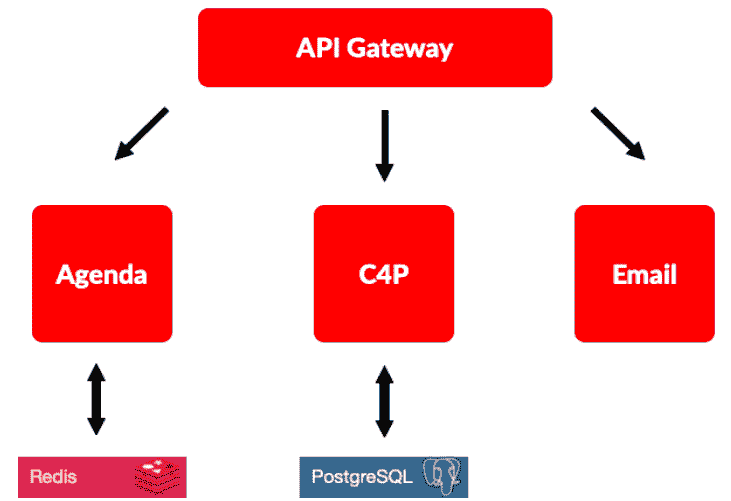

图 4.1 使用应用程序基础设施保持服务状态

在 Kubernetes 集群内部设置这些组件的过程涉及以下步骤：

- 查找或创建用于你想要启动的组件的正确 Helm Chart：对于本例，PostgreSQL（https://github.com/bitnami/charts/tree/master/bitnami/postgresql）和 Redis（https://github.com/bitnami/charts/tree/master/bitnami/redis）可以在 Bitnami Helm Chart 仓库中找到。如果你找不到 Helm Chart 但你有该组件的 Docker 容器，你可以在定义部署所需的基本 Kubernetes 构造后创建自己的图表。
- 研究图表配置和参数，以满足你的需求。每个图表都公开了一组可为不同用例调整的参数，请查看图表网站以了解可用内容。在这里，你可能希望纳入你的运维团队，例如 DBA 来检查数据库需要如何配置。这也需要 Kubernetes 专业知识，以确保组件可以在 Kubernetes 内部以高可用（HA）模式工作。
- 将图表安装到你的 Kubernetes 集群，使用 `helm install`。运行 `helm install` 时，你正在下载一组 Kubernetes 清单（YAML 文件），这些文件描述了你的应用程序/服务需要如何部署。然后 Helm 将继续将这些 YAML 文件应用到你的集群中。


- 长期维护这些组件，进行备份并确保故障转移机制按预期工作。

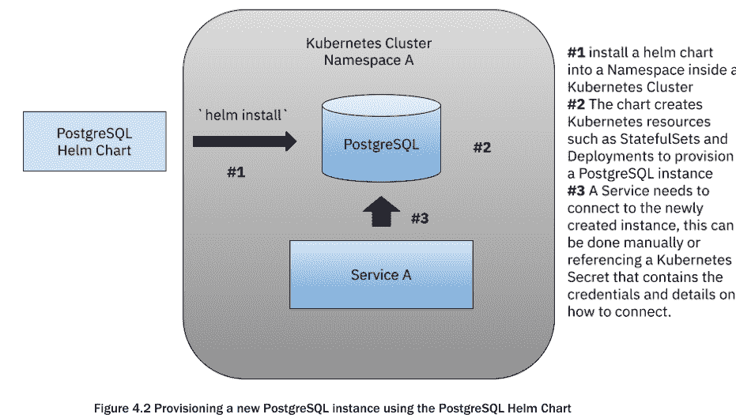

图 4.2 使用 PostgreSQL Helm Chart 部署新的 PostgreSQL 实例

如果你正在使用 Helm Charts，有一些注意事项和技巧你需要了解：

- 如果 Chart 不允许你配置你感兴趣更改的参数，你始终可以使用 `helm template`，然后修改输出以添加或更改你需要的参数，最后使用 `kubectl apply -f` 安装组件。或者，你可以向 Chart 仓库提交 Pull Request。不公开所有可能参数是一种常见做法，并等待社区成员建议让 Chart 暴露更多参数。如果是这种情况，不要害羞并联系维护者。无论你进行何种修改，Chart 内容都需要被维护和记录。通过使用 `helm template` 你将失去 Helm 发布管理功能，该功能允许你在有新 Chart 版本时升级 Chart。
- 大多数 Chart 都带有默认配置，该配置旨在实现扩展，这意味着默认部署将针对高可用性场景。这种情况会导致安装 Chart 时消耗大量资源，如果你使用的是笔记本电脑上的 Kubernetes KIND 或 Minikube，可能无法提供这些资源。同样，Chart 文档通常包含针对开发和资源受限环境的特殊配置。
- 如果你在 Kubernetes 集群内部安装数据库，每个数据库容器（Pod）都需要能够访问底层 Kubernetes 节点的存储。对于数据库，你可能需要一种特殊的存储类型以使数据库能够弹性扩展，这可能需要 Kubernetes 之外的高级配置。

如果你的 Conference Platform 已在 Kubernetes 集群中运行，你可以通过使用各自的 Chart 继续安装前面提到的组件。首先，你需要添加 Bitnami Helm Chart 仓库：

```
helm repo add bitnami https://charts.bitnami.com/bitnami
helm repo update
```

然后使用以下两行安装 Chart：

```
helm install postgresql bitnami/postgresql

helm install redis bitnami/redis
```

这两个命令的输出将为你提供如何访问用于连接实例的密码的说明，该密码存储在 Kubernetes Secret 中。你还会看到用于连接应用程序所需的 Kubernetes Service 名称。这是我们在部署其他应用程序将连接的新组件时在 Kubernetes 中的常见模式。找到服务的正确 URL、用户和密码对于你的应用程序连接至关重要。

如果你使用 `kubectl` 列出正在运行的 Pod，你应该会得到类似以下内容：

```
> kubectl get pods
NAME                              READY   STATUS    RESTARTS   AGE
app-fmtok8s-agenda-rest-68bd9c8bcb-dxbdt   1/1     Running   0          12m
app-fmtok8s-api-gateway-58d49588b4-vw7pc   1/1     Running   0          12m
app-fmtok8s-c4p-rest-7c8b0c4485-scj7r      1/1     Running   0          12m
app-fmtok8s-email-rest-8f954fbbd-p8hld    1/1     Running   0          12m
postgresql-0                      1/1     Running   0          6m30s
redis-master-0                    1/1     Running   0          3m47s
redis-replicas-0                  1/1     Running   0          3m47s
redis-replicas-1                  1/1     Running   0          3m13s
redis-replicas-2                  1/1     Running   0          2m36s
```

我们可以看到 PostgreSQL Chart 默认创建单个副本（Pod），而 Redis 则创建了一个主节点和 3 个副本。不同数据库具有不同的可扩展性机制和默认配置是很常见的。

## 连接我们的服务到新部署的基础设施

注意：Agenda 服务和征集提案（C4P）服务都已特别准备以支持内存存储和外部持久化。在你的项目中，除非你正在构建概念验证，否则不应依赖内存方法。

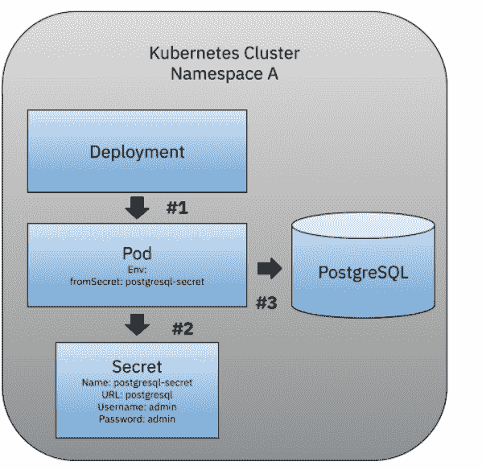

#1 创建一个 Kubernetes Deployment 来运行你的其中一个服务，Pod 模板包含用于配置此 Deployment 将创建的 Pod 的环境变量。
#2 Pod 是使用 Deployment 资源中指定的模板创建的，该模板指向包含连接 db 实例详细信息的 Secret。
#3 运行在 Pod 内部的容器需要准备好使用环境变量来连接 db 实例。

图 4.3 使用 Secrets 将服务连接到已部署的资源

让我们先连接征集提案（C4P）服务，你可以通过编辑名为 `app-fmtok8s-c4p-rest` 的 Kubernetes Deployment 并添加一些环境变量来指定数据库连接属性来实现。查找 `spec.template.spec.containers[0].env` 部分并添加以下新变量：

```
- name: SPRING_DATASOURCE_DRIVERCLASSNAME
  value: org.postgresql.Driver
- name: SPRING_DATASOURCE_PLATFORM
  value: org.hibernate.dialect.PostgreSQLDialect
- name: SPRING_DATASOURCE_URL
  value: jdbc:postgresql://${DB_ENDPOINT}:${DB_PORT}/postgres
- name: SPRING_DATASOURCE_USERNAME
  value: postgres
- name: SPRING_DATASOURCE_PASSWORD
  valueFrom:
    secretKeyRef:
      key: postgresql-password
      name: postgresql
- name: DB_ENDPOINT
  value: postgresql
- name: DB_PORT
  value: "5432"
```

加粗部分突出显示了我们如何使用安装 Chart 时动态生成的密码，以及 DB 端点 URL，在本例中为 PostgreSQL Kubernetes Service，也是由 Chart 安装的。如果你使用了不同的 Chart 发布名称，DB 端点将会不同。一旦你保存此部署配置，将启动一个新的 Pod，如果 Pod 成功连接到 PostgreSQL 实例，旧版本将由 Kubernetes 自动移除。

你现在可以增加征集提案服务的副本数量，因为服务现在是无状态的。服务的每个副本都将连接到同一个数据库实例以获取和存储数据。

Agenda 服务和 Redis 也可以这样做。

```
- name: SPRING_REDIS_IN_MEMORY
  value: "false"
- name: SPRING_REDIS_HOST
  value: redis-master
- name: SPRING_REDIS_PASSWORD
  valueFrom:
    secretKeyRef:
      key: redis-password
      name: redis
```

与之前一样，我们从名为 `redis` 的 Secret 中提取密码。REDIS_HOST 来自 Chart 创建的 Kubernetes Service 名称，这取决于你使用的 `helm release` 名称。与 C4P 服务一样，你现在可以为 Agenda 服务添加更多副本以支持更多流量。请记住，你的服务现在也可能崩溃，并且一旦恢复，它们将重新连接到数据库并获取可用数据。

如果你想使用 Helm 在 Kubernetes 集群中安装 PostgreSQL 和 Redis，你可以按照位于此处的逐步教程：https://github.com/salaboy/from-monolith-to-k8s/tree/master/helm-app-infra

我强烈建议你阅读该教程，以便亲身体验 Helm Charts 和 Kubernetes Deployments。

## 4.1.2 安装和监控应用程序基础设施组件的不同方法

根据服务如何使用这些数据库，你可能会发现数据库成为瓶颈。想象一下，如果 Agenda 服务的请求过多，你决定将 Agenda Deployment 的副本数量扩展到 200。此时，Redis 需要有足够的资源来处理 200 个 Pod 连接到 Redis 集群。使用 Redis 的优势在于，在会议进行期间我们可能会有大量读取操作时，Redis 集群允许我们从副本读取数据，从而可以分发负载。

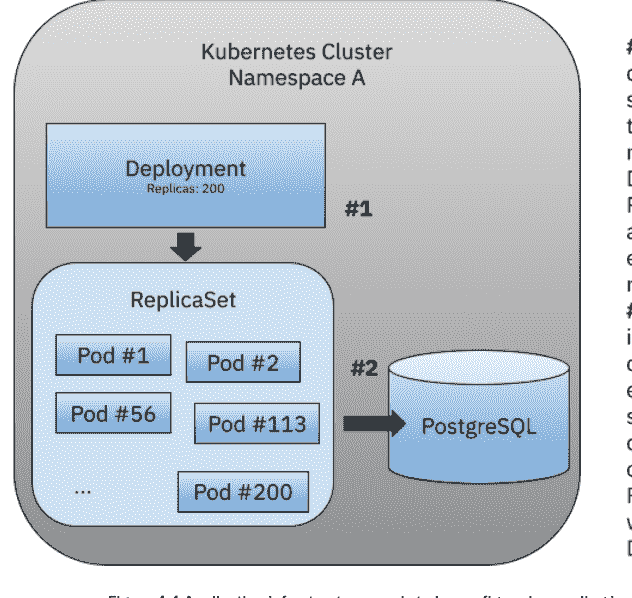

#1 如果你注意到某个服务的需求激增，你可能会想增加副本数量，而使用 ReplicaSet 的 Deployment 不会对此提出异议。如果集群有足够的资源，副本将被创建。
#2 如果应用程序基础设施配置不正确，你可能会遇到很多问题，例如耗尽数据库连接池，或使数据库 Pod 过载，因为在你扩展 Deployment 时它们不会随之扩展。

图 4.4 应用程序基础设施需要根据我们的服务将如何扩展进行配置


如果你使用 Helm 安装 Application Infrastructure，请注意 Helm 不会检查这些组件的健康状况，它只是执行安装。现在很常见的是找到另一种在 Kubernetes 集群中安装组件的替代方案，称为 Operators。通常与 Application Infrastructure 相关联，你可以找到更活跃的组件，它们会安装并监控已安装的组件。其中一个 Operators 的例子是 Zalando PostgreSQL Operator，你可以在这里找到：https://github.com/zalando/postgres-operator 。

总的来说，Kubernetes Operators 试图封装与特定组件相关的运维任务，在本例中是 PostgreSQL。我们将在第 X 章中更详细地介绍 Operator Pattern。虽然使用 Operators 可能会在安装给定组件的基础上增加更多功能，但你仍然需要维护组件本身以及 operator 本身。

关于你和你的团队决定使用的 Application Infrastructure，如果你计划在集群内部运行这些组件，请相应地规划，确保内部拥有管理、维护和扩展这些额外组件的正确专业知识。

在下面的章节中，我们将通过查看一个开源项目来了解如何应对这些挑战，该项目旨在通过使用声明式方法来简化 Cloud 资源和应用基础设施的配置。

## 4.2 使用 Crossplane 以声明式方式定义基础设施

使用 Helm 在 Kubernetes 内部安装应用基础设施组件对于大型应用和面向用户的环境来说远非理想，因为维护这些组件及其需求（如高级存储配置）的复杂性可能会变得过于复杂，超出团队的处理能力。

云提供商在允许我们配置基础设施方面做得非常出色，但它们都依赖于云提供商特定的工具，这些工具超出了 Kubernetes 的范畴。

在本节中，我们将介绍一种替代工具；一个 CNCF 项目 Crossplane（https://crossplane.io），它使用 Kubernetes API 和扩展点，使用 Kubernetes API 以声明式的方式使用户能够配置真实的基础设施。Crossplane 依赖 Kubernetes API 来支持多个云提供商，这也意味着它能很好地与所有现有的 Kubernetes 工具集成。

通过了解 Crossplane 的工作原理以及如何扩展它，你可以构建一种多云方法，将你的 Cloud Native 应用构建并部署到不同的提供商，而无需担心被锁定。因为 Crossplane 使用与 Kubernetes 相同的声明式方法，你将能够为你试图部署和维护的应用创建自己的高级抽象。

### 4.2.1 Crossplane Providers

Crossplane 通过安装一组称为“Providers”的组件来扩展 Kubernetes，这些组件负责理解并与云提供商特定的服务交互，为我们配置这些组件。

Figure 4.5 Crossplane installed with GCP and AWS Providers

通过安装 Crossplane providers，你扩展了 Kubernetes API 的功能，以配置外部资源，例如数据库、消息代理、存储桶以及其他将存在于 Kubernetes 集群之外但在云提供商范围内的云资源。有多个 Crossplane providers 覆盖主要云提供商，如 GCP、AWS 和 Azure。你可以在 Crossplane Github 的组织中找到这些 Crossplane providers：https://github.com/crossplane/

一旦安装了 Crossplane Provider，你就可以以声明式的方式创建提供商特定的资源，这意味着你可以创建一个 Kubernetes 资源，使用 `kubectl apply -f` 应用它，将这些定义打包在 Helm Charts 中，或使用环境管道将这些资源存储在 Git 仓库中。

依赖 Kubernetes API 配置云特定资源是一大进步，但 Crossplane 并没有止步于此。如果你去查看在任何主要云提供商中配置数据库所需的细节，你会意识到配置组件只是使组件准备好使用的众多任务之一。为了连接到这些已配置的组件，你需要网络和安全配置，以及用户凭据。

### 4.2.2 Crossplane Compositions

Crossplane 旨在服务于两种不同的人群：“Platform teams”和“Application teams”。虽然 Platform teams 是云提供商专家，懂得如何配置云提供商特定的组件，*Application* teams 了解应用需求并理解从 Application Infrastructure 角度需要什么。这种方法的有趣之处在于，使用 Crossplane 时，Platform teams 可以为特定云提供商定义这些复杂配置，并为 Application teams 暴露简化的接口。

在现实场景中，很少只是创建单个组件，例如，如果我们想配置一个数据库实例，应用团队还将需要正确的网络和安全配置，以便能够访问新创建的实例。能够组合并连接多个组件是一项非常方便的功能，为实现这些抽象和简化接口，Crossplane 引入了两个概念“*Composite Resource Definitions*”和“*Composite Resources*”。

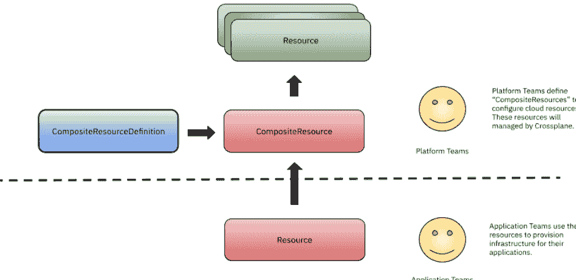

Figure 4.6 Resource Composition abstraction by Crossplane Composite Resources

上图显示了如何使用 Crossplane *Composite Resources* 为不同云提供商定义抽象。*Platform team* 可能非常熟悉 Google Cloud 或 Azure，因此他们将负责定义希望为特定应用组合在一起的资源。*Application team* 有一个简单的资源接口来请求他们感兴趣的资源。但通常，抽象很复杂，很好地展示了谁负责什么，但让我们看一个具体例子来理解 Crossplane Compositions 的强大功能。

## Figure 4.7 Provisioning a PostgreSQL instance in Google Cloud with Crossplane Compositions

Figure 4.x 显示了应用团队如何创建一个简单的 PostgreSQL 资源，以便在 Google Cloud 中配置一个 CloudSQLInstance 加上网络配置和一个存储桶。应用团队并不真正关心创建了哪些资源，甚至也不关心它们是在哪个云提供商中创建的，他们只关心拥有一个 PostgreSQL 实例来连接他们的应用。

这就引出了图中“Secret”框，它代表 Crossplane 将为我们的应用/服务 Pods 创建的 Kubernetes Secret，以便连接到已配置的资源。Crossplane 会创建这个 Kubernetes Secret，其中包含我们的应用连接到新创建资源所需的所有详细信息（或仅与应用相关的部分）。该 Secret 通常包含 URL、用户名、密码、证书或应用连接所需的一切。Platform teams 在定义 CompositeResources 时定义 Secret 中将包含的内容。在下面的章节中，当我们向我们的 Conference Platform 添加真实基础设施时，我们将探索这些 CompositeResources 的外观以及它们如何被应用来创建我们的应用所需的所有组件。

Crossplane 的另一个非常重要的功能是，你可以将这些组合打包成一个 OCI 镜像（容器）并像其他 docker 镜像一样共享。一旦使用配置安装了这些 Crossplane 包，Platform team 就可以创建这些简化资源，而无需了解或知道对他们可用的提供商是什么。这种关注点的清晰分离（请求应用


infrastructure and defining all the configuration required to provision these components) makes Crossplane really strong.

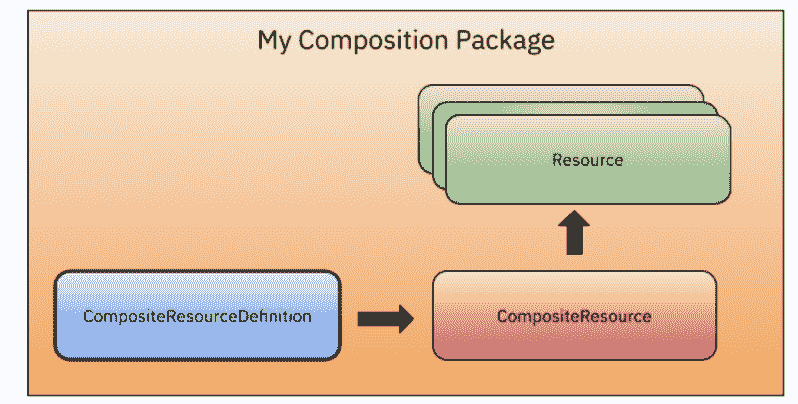

Figure 4.8 Packaging a Composition as an OCI Image for distribution

Figure 4.x shows how we can package and version these compositions as a Container Image (Open Container Image) that then we push to a container registry so other teams can consume it from different Kubernetes Clusters. In the following sections we will be looking and how does this look in practice. But before jumping into the specifics let's look in more detail how Crossplane works and what it requires for us to configure before using all these mechanisms and resources.

### 4.2.3 Crossplane Components and Requirements

To work with Crossplane Providers and CompositeResources we need to understand how Crossplane components will work together to provision and manage these components inside different Cloud Providers.

This section covers what Crossplane needs in order to work and how Crossplane components will manage our CompositeResources.

First of all, it is important to understand that you will need to install Crossplane in a Kubernetes cluster. This can be the Cluster where your applications are running or a separate cluster where Crossplane will run. This cluster will have some Crossplane components that will understand our CompositeManagedResources and have enough permissions on the cloud platform to provision resources on our behalf. You might be wondering if you can install Crossplane into a KIND Cluster, and the answer is yes, but Crossplane really shines if you have access to a Cloud Provider. For that reason, we will use Google Cloud Platform in the next sections.

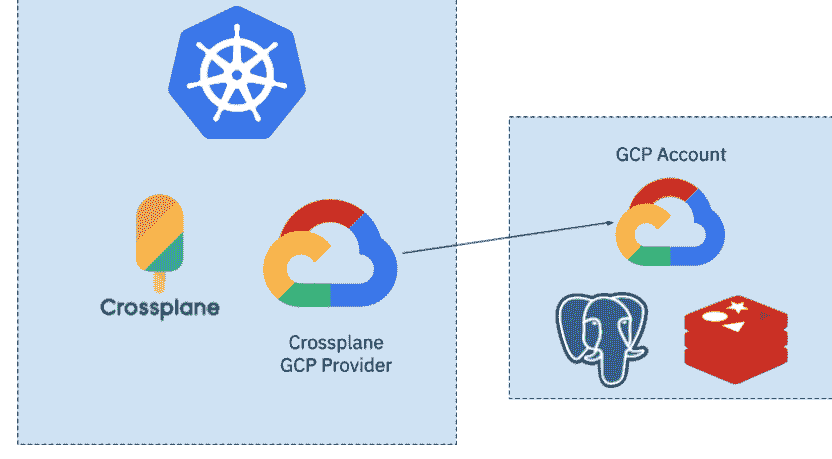

Figure 4.9 Crossplane in Google Cloud Platform

The previous figure shows Crossplane installed inside a Kubernetes Cluster, with the Crossplane GCP provider installed and configured to use a Google Cloud Platform account with enough rights to provision PostgreSQL and Redis instances.

Each of the Crossplane Providers available requires a specific security configuration to work and an account inside the Cloud Provider where we want to create resources.

Once a Crossplane Provider is installed and configured, in this case, the GCP provider we can start creating resources that are managed by this provider. You can find the resources offered by each provider in the following documentation site: https://doc.crds.dev/github.com/crossplane/provider-gcp

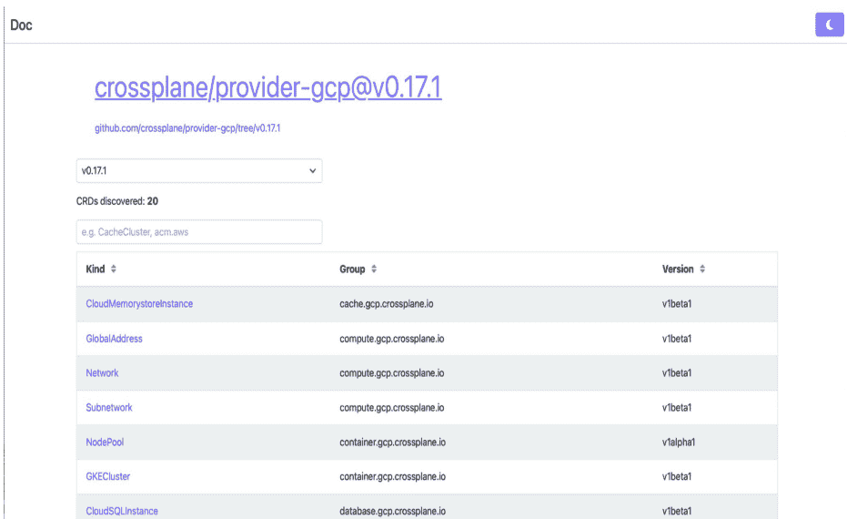

Figure 4.10 Crossplane GCP supported resources

As you can see in the previous figure, the GCP Provider version 0.17.1 supports 20 different CRDs (Custom Resource Definitions) for creating resources in Google Cloud Platform. Crossplane defines each of these resources as Managed Resources. Each of these individual managed resources will need to be enabled for the Crossplane Provider to have the right access to list, create and modify these resources.

In section 4.3, we will be provisioning new instances of PostgreSQL and Redis for our walking skeleton. We will be creating CloudMemoryStoreInstances and CloudSQLInstances in GCP, but these details are going to be abstracted away from our App Ops teams which will be using cloud-agnostic resources with a simplified interface.

### 4.2.4 Crossplane Behaviours

In contrast with installing components with Helm in our Kubernetes Clusters, we are using Crossplane to interact with the cloud provider-specific APIs to provision resources inside the Cloud infrastructure. This should simplify the maintenance tasks and costs related to these resources. Another important difference is that the Crossplane provider (GCP provider in this case) will monitor the created Managed Resources for us. These Managed Resources offer some advantages compared with just installed resources using Helm. Managed Resources

have very well defined behaviours, here is a summary of what to expect from a Crossplane Managed Resource:

- **Visible as any other Kubernetes Resource**: Crossplane Managed Resources are just Kubernetes resources, this means that we can use any Kubernetes tool to monitor and query the state of these resources.
- **Continuous Reconciliation**: when a managed resource is created the Provider will continuously monitor the resource to make sure that it exists and is working and report back the status to the Kubernetes resource. The parameters defined inside the managed resource are considered the desired state (source of truth) and providers will work to apply these configurations into the Cloud Provider resources. Once again, we can use standard Kubernetes tools to monitor change in state and trigger remediation flows.
- **Immutable Properties**: providers are in charge of reporting back if a user manually changed properties in the cloud provider. The idea here is to avoid configuration drifts from what was defined to what is actually running in the cloud provider. If so, the state is reported back to the managed resource. Crossplane will not delete the cloud provider resource, but it will notify back so actions can be taken. Other tools like terraform (https://www.terraform.io) will automatically delete the remote resources in order to recreate them.
- **Late initialization**: some properties in the Managed Resources can be optional, meaning that each provider will select the default values for these properties. When this happens Crossplane creates the resource with the default values and then sets the selected values into the Managed Resource. This simplifies the amount of configuration needed to create resources and reuse the sensible defaults defined by cloud providers usually in their user interfaces.
- **Deletion**: when deleting a Managed Resource, the action is immediately triggered in the cloud provider, but the Managed Resource is kept until the resource is fully removed from the Cloud Provider. Errors that might happen during deletion on the cloud provider will be added to the Managed resource status field.
- **Importing existing resources**: Crossplane doesn’t necessarily need to create the resources to be able to manage them. You can create Managed Resources that start monitoring components that were created previously before Crossplane was installed. You can achieve this by using a specific Crossplane annotation on the Managed Resource: `crossplane.io/external-name`

To summarize the interactions between Crossplane, the Crossplane GCP Provider, and our Managed Resources, let’s look at the following diagram:

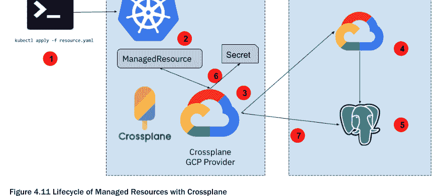

Figure 4.11 Lifecycle of Managed Resources with Crossplane

The following points indicate the sequence observed in Figure 4.X:

- 1. First, we need to create a resource, we can use any tool to create Kubernetes resources, `kubectl` here is just an example.
- 2. If the resource that we created is a Crossplane Managed Resource, let’s imagine a CloudSQLInstance resource, the specific Crossplane Provider will pick it up and manage it.
- 3. The first step to execute when managing a resource will be checking if it exists in the infrastructure (that is in the configured GCP account). If it doesn’t exist the Provider will send a request for the resource to be created in the infrastructure. Depending on the properties set on the resource, for example, which kind of SQL database is required, the appropriate SQL database will be provisioned, imagine for the sake of the example that we have chosen a PostgreSQL database.
- 4. The Cloud Provider after receiving the request, if the resources are enabled, will proceed to create a new PostgreSQL instance with the configured parameters in the Managed Resource.
- 5. The status of the PostgreSQL will be reported back to the Managed Resource, which means that we can use `kubectl` or any other tool to monitor the status of the provisioned resources. Crossplane provider’s will keep these in sync.
- 6. When the database is up and running the Crossplane Provider will create a secret to store the credentials and properties that our applications will need to connect to the newly created instance
- 7. Crossplane will regularly check the status of the PostgreSQL instance and update the managed resource.


### 4.2.5 Crossplane 配置包

如果我们从 GCP 提供商创建 CloudSQLInstances 资源，我们仍然在对提供商进行强引用。这些 GCP 资源仍然非常详细，例如，允许我们设置诸如 DiskEncryptionConfiguration、GceZone、OnpremisesConfiguration 等属性（https://doc.crds.dev/github.com/crossplane/provider-gcp/database.gcp.crossplane.io/CloudSQLInstance/v1beta1@v0.17.1），我们可能希望在团队间标准化或对其设置方式定义策略。

为了抽象掉资源上的这些提供商特定且低级别的细节，Crossplane 允许我们定义复合托管资源。这些组合允许我们组合多个提供商特定的资源，将它们一起配置，并为应用运维团队暴露一个简单的接口。

你可以基于这些组合创建自己的托管资源来创建你的包。一旦你知道谁将使用它们以及他们想要创建哪种资源，这些包就很容易创建。这些包还允许你创建托管资源，它们可以具有不同的云提供商实现，但为用户暴露相同的简化类型。

归根结底，一个包只是一组配置文件，可以打包为 OCI 容器并发布到 Docker Hub 或任何其他容器注册表。本书的最后一部分将更详细地介绍包，让我们先看看它们在实际中的使用。

以下部分将介绍如何将 Crossplane 与我们的行走骨架应用程序一起使用。

## 4.3 为我们的行走骨架提供真实基础设施

在本节中，我们将介绍如何在 Google Cloud Platform 上使用 Crossplane 为我们的行走骨架应用程序配置资源。

你可以继续在 GCP 中创建一个新的 Kubernetes 集群并使用 Helm 安装应用程序，就像你为 KIND 所做的那样。如第 2 章所述，你可以在大多数主要云提供商处获得免费积分，因此我们为你列出了一个清单：https://github.com/learnk8s/free-kubernetes。虽然本节中的示例是为 Google Cloud 设计的，但移植到其他云提供商非常容易。

一旦应用程序运行起来，你可以通过遵循其文档中列出的“自托管 Crossplane”和 GCP 指令来安装 Crossplane：https://crossplane.io/docs/v1.5/getting-started/install-configure.html

请注意，Crossplane 还提供了一个 `kubectl` 插件来安装自定义提供商和配置包。确保也安装此插件：https://crossplane.io/docs/v1.5/getting-started/install-configure.html#install-crossplane-cli

安装过程会安装具有适当访问权限的 GCP 提供商，以便代表我们配置组件。通常将 Crossplane 安装到与应用程序运行不同的单独集群中；为简单起见，这里我们将使用同一个 Kubernetes 集群用于应用程序和 Crossplane。请注意，Crossplane 示例还使用 PostgreSQL，因此它们启用了 CloudSQL API。你还需要启用 Redis API，可以在启用 Cloud SQL API 之后、在创建服务账号密钥文件之前将以下内容添加到安装步骤中：

```
export SERVICE="redis.googleapis.com"
gcloud services enable $SERVICE --project $PROJECT_ID

export ROLE="roles/redis.admin"
gcloud projects add-iam-policy-binding --role="$ROLE" $PROJECT_ID --member "serviceAccount:$SA"
```

有关如何为 Conference Platform 应用程序安装 Crossplane 的详细教程，你可以查看以下仓库：https://github.com/salaboy/from-monolith-to-k8s/tree/master/crossplane

### 4.3.1 配置我们的应用程序基础设施

一旦 Crossplane 和 GCP 提供商安装完成，你将能够配置 GCP 资源，但如上一节所述，如果你仍需定义云提供商特定的资源，后续迁移到不同的云提供商可能会很棘手，因此为这些资源创建抽象是有意义的。这些抽象应更易于开发人员使用和参数化。这些抽象不应泄露提供商特定的配置或参数，归根结底，我们的行走骨架需要的是一个 PostgreSQL 实例和一个 Redis 实例。

你可以继续安装为行走骨架创建的自定义配置包，运行：

```
kubectl crossplane install configuration salaboy/crossplane-fmtok8s-gcp:0.0.8
```

此 Crossplane 配置包包含我们行走骨架的 PostgreSQL 和 Redis 抽象，使我们能够配置 PostgreSQL 和 Redis 实例。一旦配置包安装完成，你可以使用 `kubectl`、Helm 或任何其他工具创建新注册的资源。

例如，对于 PostgreSQL，你可以使用以下资源：

```
apiVersion: db.fmtok8s.salaboy.com/v1alpha1
kind: PostgreSQLInstance
metadata:
  name: my-postgresql-db
  namespace: default
spec:
  parameters:
    storageGB: 20
  compositionSelector:
    matchLabels:
      provider: gcp
  writeConnectionSecretToRef:
    name: db-conn
```

或对于 Redis：

```
apiVersion: cache.fmtok8s.salaboy.com/v1alpha1
kind: RedisInstance
metadata:
  name: my-redis-db
  namespace: default
spec:
  parameters:
    memorySizeGb: 1
  compositionSelector:
  matchLabels:
    provider: gcp
  writeConnectionSecretToRef:
    name: redis-conn
```

你可以运行以下命令应用这些资源，对于 PostgreSQL：

```
kubectl apply -f postgresql.yaml
```

或对于 Redis：

```
kubectl apply -f redis.yaml
```

这将指示 Crossplane，即管理这些资源类型的组件，在 GCP 中创建一个新的 PostgreSQL 和 Redis 实例。从之前的代码片段中，重要的是要强调以下值：

- **ApiVersion (*.fmtok8s.salaboy.com) + Kind**：代表我们的自定义资源，这些资源不是 GCP 特定的，这意味着我们可以向 Crossplane 提供配置包以能够在不同的云提供商中配置相同的资源。
- **Name**：将创建的资源的名称，这将应用于配置的云提供商中创建的资源。通过创建具有不同名称的不同资源，你可以配置多个实例。
- **Spec.Parameters.\***：这些是这些资源抽象所暴露的参数。你可以看到它因资源而异（storageGb 和 memorySizeGb）。仅向应用团队暴露相关参数可以简化资源的配置并抽象掉配置这些数据库所需的所有复杂性。
- **WriteConnectionSecretToRef**：定义将写入连接参数的 secret 的名称。这对于应用程序服务知道从哪里获取连接字符串、用户名和密码以连接到新配置的资源非常重要。

### 4.3.2 将我们的服务与新配置的基础设施连接

Crossplane 将监控这些资源的状态与特定云提供商内部配置组件的状态，保持它们同步并确保期望的配置得到应用。此循环允许我们使用 `kubectl` 查询组件的状态。你可以运行以下命令来检查你配置的资源的状态：

```
kubectl get postgresqlinstances.fmtok8s.salaboy.com
```

检查 READY 列，如果状态为 READY，你就可以开始通过 Crossplane 为你创建的 secret 中的信息连接到新创建的数据库。例如，如果你想将征集提案（C4P）服务与新创建的 PostgreSQL 实例连接，你可以更新 C4P 部署中的环境变量。你可以通过以下方式编辑正在运行的部署：

```
kubectl edit deploy app-fmtok8s-c4p
```

然后在 `env` 部分更新环境变量：

```
env:
  - name: SPRING_DATASOURCE_DRIVERCLASSNAME
    value: org.postgresql.Driver
  - name: SPRING_DATASOURCE_PLATFORM
    value: postgres
  - name: SPRING_DATASOURCE_URL
    value: jdbc:postgresql://${DB_ENDPOINT}:${DB_PORT}/postgres
  - name: SPRING_DATASOURCE_USERNAME
    valueFrom:
      secretKeyRef:
        name: db-conn
        key: username
  - name: SPRING_DATASOURCE_PASSWORD
    valueFrom:
      secretKeyRef:
        name: db-conn
        key: password
  - name: DB_ENDPOINT
    valueFrom:
      secretKeyRef:
        name: db-conn
        key: endpoint
  - name: DB_PORT
    valueFrom:
      secretKeyRef:
        name: db-conn
        key: port
```

有了这些环境变量，我们指示服务使用 PostgreSQL JDBC 驱动程序连接，并使用 `db-conn` secret 内部的键：`username`、`password`、`endpoint` 和 `port`。

一旦你保存这些更改，Pod 将重新启动以应用配置更改。Pod 的新实例将使用提供的参数连接到我们新创建的 PostgreSQL 数据库。从那时起，你可以扩展副本数量，它们都将连接到 GCP 中的同一数据库，使用相同的参数。


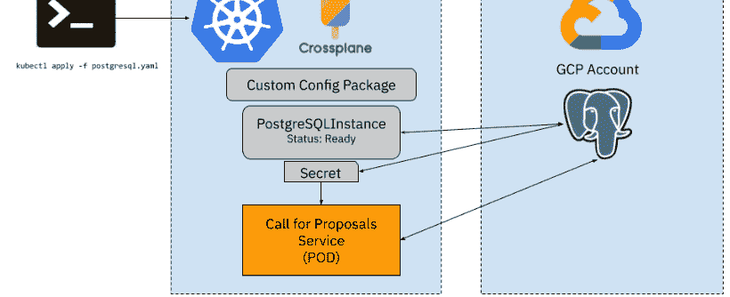

# 图 4.12 使用 Crossplane 提供的 PostgreSQL 的征集提案服务

总结我们迄今为止所取得的成果，我们可以说：

- 我们抽象了如何配置云特定的组件，例如 PostgreSQL 数据库以及访问新实例所需的所有配置，
- 我们为应用运维团队提供了一个简化且与云提供商无关的接口。
- 最后，我们通过依赖由 Crossplane 创建的 Kubernetes Secret 将应用程序服务连接到新配置的实例，该 Secret 包含连接到新创建实例所需的所有详细信息。

对于议程服务和 Redis 也可以实现相同效果。你可以按照逐步教程进行操作，该教程涵盖本节描述的所有步骤：https://github.com/salaboy/from-monolith-to-k8s/tree/master/crossplane

在本节中，我们使用了一个我创建的配置包来在 Google Cloud 上配置 PostgreSQL 和 Redis 数据库，而无需开发人员知道资源将被配置在何处或创建这些资源所需的特定于云提供商的所有配置。

如果你创建更复杂的复合资源和配置，你所定义的基本上是如何向应用程序公开重要资源的高级抽象。以某种方式，你最终将在 Kubernetes 之上构建一个领域特定的平台，并使用 Crossplane 来定义和管理这些高级结构。这种方法不仅简化了此类平台的创建和管理，而且还将允许这些结构在不同的云提供商之间共享，并将定义和使用这些抽象的责任划分给专门的团队。

下一节将快速回顾用于行走骨架应用程序的 Crossplane 复合资源，重点介绍我们之前安装的配置包的定义。

## 4.4 在 Kubernetes 之上构建云原生平台

大多数情况下，我们包中安装的配置将由了解云提供商功能和配置的 Infra 运维团队负责。

所用配置包的源代码可以在这里找到：https://github.com/salaboy/from-monolith-to-k8s/tree/master/crossplane/pkg

要定义提供商或配置包，你需要首先创建一个新的配置类型来描述你的包将涉及的内容及其依赖项。我们为会议平台安装的包将 "provider-gcp" 包定义为依赖项，因为它依赖于 GCP 特定类型。你可以将此包视为 GCP 类型之上的扩展，这正是我们在示例中使用的。

### 4.4.1 创建我们自己的 Crossplane 配置包

与我们在 Kubernetes 集群中安装的每个组件一样，我们需要维护它，并在需要更新配置或 Crossplane 组件更改时升级它，因此定义我们要针对的 Crossplane 版本非常重要。

```
crossplane.yaml:

apiVersion: meta.pkg.crossplane.io/v1
kind: Configuration
metadata:
  name: fmtok8s-gcp
  annotations:
    app: fmtok8s-app
    provider: gcp
spec:
  crossplane:
    version: ">=v1.0.0-0"
  dependsOn:
  - provider: crossplane/provider-gcp
    version: ">=v0.16.0"
```

下一步是创建 Composition，对于示例，我已尽可能保持简单，但在这种情况下 Crossplane 的强大功能真正得以体现，因为你可以创建复杂的组合，实现用户平台所需的常见模式和最佳实践。以下 yaml 文件定义了 CompositePostgreSQLInstance 类型，为简单起见，它仅涉及来自 Crossplane GCP 提供商的 CloudSQLInstance 类型。需要注意的是，配置包可以包含任意数量的组合。

```
composition.yaml:
apiVersion: apiextensions.crossplane.io/v1
kind: Composition
metadata:
  name: compositepostgresqlinstances.gcp.db.fmtok8s.salaboy.com
  labels:
    provider: gcp
    app: fmtok8s-app
spec:
  writeConnectionSecretsToNamespace: crossplane-system
  compositeTypeRef:
    apiVersion: db.fmtok8s.salaboy.com/v1alpha1
    kind: CompositePostgreSQLInstance
  resources:
    - name: cloudsqlinstance
      base:
        apiVersion: database.gcp.crossplane.io/v1beta1
        kind: CloudSQLInstance
        spec:
          forProvider:
            databaseVersion: POSTGRES_9_6
            region: europe-west2
            settings:
              tier: db-custom-1-3840
              dataDiskType: PD_SSD
              ipConfiguration:
                ipv4Enabled: true
                authorizedNetworks:
                  - value: "0.0.0.0/0"
          writeConnectionSecretToRef:
            namespace: crossplane-system
  patches:
    - fromFieldPath: "metadata.uid"
      toFieldPath: "spec.writeConnectionSecretToRef.name"
      transforms:
        - type: string
          string:
            fmt: "%s-postgresql"
    - fromFieldPath: "spec.parameters.storageGB"
      toFieldPath: "spec.forProvider.settings.dataDiskSizeGb"
  connectionDetails:
    - fromConnectionSecretKey: username
    - fromConnectionSecretKey: password
    - fromConnectionSecretKey: endpoint
    - type: FromValue
      name: port
      value: "5432"
```

请注意，在组合内部我们可以设置合理的默认值，因此我们的用户（应用运维团队）无需担心需要选择哪个版本的 PostgreSQL，数据库需要在哪个区域配置，甚至数据库需要哪种存储。

你的用户不会直接使用组合，他们将依赖于你可以定义并通过创建 CompositeResourceDefinition 来简化接口，该定义定义了可以设置并传播到我们之前定义的组合的参数（接口的形状）。

使用以下 `definition.yaml` 文件，我们为 PostgreSQLInstance 类型创建了一个模式，该模式定义了可以设置的参数以及哪些参数是必需的。对于这个简单示例，你可以设置且必需的唯一参数是 storageGB。

```
definition.yaml:
apiVersion: apiextensions.crossplane.io/v1
kind: CompositeResourceDefinition
metadata:
  name: compositepostgresqlinstances.db.fmtok8s.salaboy.com
spec:
  group: db.fmtok8s.salaboy.com
  names:
    kind: CompositePostgreSQLInstance
    plural: compositepostgresqlinstances
  claimNames:
    kind: PostgreSQLInstance
    plural: postgresqlinstances
  connectionSecretKeys:
  - username
  - password
  - endpoint
  - port
  versions:
  - name: v1alpha1
    served: true
    referenceable: true
    schema:
      openAPIV3Schema:
        type: object
        properties:
          spec:
            type: object
            properties:
              parameters:
                type: object
                properties:
                  storageGB:
                    type: integer
                required:
                - storageGB
        required:
        - parameters
```

请注意，你将向应用运维团队公开的这些简化接口可以并且应该像任何其他资源类型一样进行版本控制。

### 4.4.2 构建和分发我们的配置包

一旦定义了这 3 个文件，你就可以使用 Crossplane `kubectl` 插件通过运行以下命令打包你的配置包：

```
kubectl crossplane build configuration
```

这将生成一个 OCI 容器，你可以将其推送到 Docker Hub 或任何其他容器注册表。OCI 容器的名称将由你在 crossplane.yaml 文件中定义的 Configuration 资源名称定义。要将配置包推送到注册表，你也可以使用插件：

```
kubectl crossplane push configuration salaboy/crossplane-fmtok8s-gcp:0.0.8
```

请注意，你需要拥有推送到目标注册表的正确凭据。如果未指定，它将使用 Docker Hub，其中 "salaboy" 是我的 Docker Hub 用户名。

如果你真的想创建一个自助服务平台，就像 Google Cloud 用户界面一样但在 Kubernetes 之上，你需要构建一个用户界面，该界面从已安装的配置包中读取 **CompositeResourceDefinitions** 类型模式定义。你可以构建可参数化的用户屏幕，用户可以在其中选择所需资源类型，输入所需参数并创建资源，而无需在环境中安装 `kubectl`。

### 4.4.3 使用我们的自定义提供商扩展 Crossplane

本章讨论的大多数示例和场景都针对云提供商，但 Crossplane 也可以用于本地部署设置，并扩展以支持除 AWS、Azure 和 Google 提供的服务之外的其他托管服务。Crossplane 提供的抽象和机制在我们想要配置和监控的资源位于运行服务的 Kubernetes 集群之外的大量场景中都很有价值。

如果你想用自己的提供商扩展 Crossplane，我建议你查看 Provider Template（https://github.com/crossplane/provider-template）项目，该项目展示了如何创建和分发提供商的简单示例。Crossplane 提供商由一个 Kubernetes Controller 组成，该控制器将使用凭据连接到远程托管服务，然后将可以远程配置的资源作为 Kubernetes 资源公开。


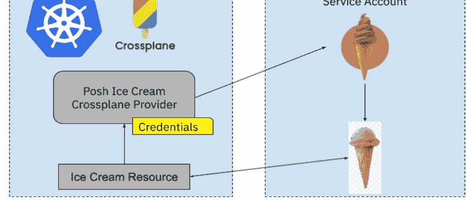

Figure 4.13 Custom Crossplane Provider for your Managed Service

想象一下，你有一个托管在其他地方的服务，可以生产新的 Pos 冰淇淋。要创建新的 Pos 冰淇淋实例，你只需要该服务的账号即可。你并不关心在自己的 Kubernetes 集群内部创建 Pos 冰淇淋实例，但你希望允许用户创建 Pos 冰淇淋，无论它们在哪里创建。这正是创建一个理解如何使用你的账号凭证连接到 Pos 冰淇淋服务的 Crossplane Provider 的完美场景。

Pos 冰淇淋 Crossplane Provider 的实现将包含一个新的 Kubernetes 自定义资源定义，称为 IceCream 资源，它将负责定义要在远程服务上创建的冰淇淋的属性。与 Compositions 类似，自定义 Crossplane Provider 可以管理和公开外部平台所提供的任意数量的新资源。例如，如果 Pos 冰淇淋服务还提供咖啡，Provider 可以添加额外资源以使用户能够创建远程咖啡杯。

如果你觉得该 Provider 对整个 Crossplane 社区有用，你可以将你的 Provider 捐赠给 Crossplane Contrib 组织：https://github.com/crossplane-contrib

## 4.5 Summary

- 云原生应用依赖于更多的应用基础设施，因为每个服务可能都需要不同的持久化存储、用于发送消息的消息代理以及其他组件来运行。
- 在云提供商内部创建应用基础设施很容易，可以为我们节省大量时间，但随后我们就依赖于他们的工具和生态系统。
- 通过依赖 Kubernetes API 和 Crossplane 等工具，可以以云无关的方式配置基础设施，这些工具抽象掉了底层的云提供商。
- Crossplane 为主要云提供商提供支持，并且可以扩展以支持其他服务提供商。
- 通过为应用基础设施创建我们简化的抽象，我们可以让开发人员以自助服务的方式配置组件，而无需了解所有云提供商特定的配置要求。我们可以通过创建 Crossplane 配置包（OCI 镜像）来共享这些抽象，这些包可以分发并与其它团队共享。
