## 5 Release Strategies

本章涵盖

- 使用 Deployments、Services 和 Ingress 的 Kubernetes 发布策略
- 如何实现滚动更新、金丝雀发布、蓝绿部署和 A/B 测试
- 使用 Kubernetes 内置资源高效发布软件的局限性和挑战
- Knative Serving 高级流量路由能力，用于降低发布风险并加快发布节奏

如果你和你的团队担心部署服务的全新版本，你就做错了。你正因更改或部署对运行中应用的风险而放慢了发布节奏。

降低风险并建立适当的机制以持续部署新版本，会极大提高对系统的信心。它还能减少从变更请求到变更在用户面前上线所需的时间。带有修复和新功能的新发布与业务价值直接相关，因为软件只有在为公司用户服务时才有价值。

虽然 Kubernetes 内置资源如 Deployments、Services 和 Ingresses 为我们部署服务并向用户公开服务提供了基本构建块，但要实现众所周知的发布策略，仍需要大量手动且容易出错的工作。

本章分为两个主要部分：

- 使用 Kubernetes 内置机制的发布策略
  - Rolling Updates
  - Canary Releases
  - Blue/Green Deployments
  - A/B Testing
  - 使用 Kubernetes 内置机制的局限性和复杂性
- 降低发布风险以提高交付速度
  - Introduction to Knative Serving
  - Advanced traffic-splitting features
  - Knative Serving applied to our Conference Platform application

在本章中，你将学习 Kubernetes 内置机制和 Knative Serving 以实现滚动更新、金丝雀发布、蓝绿部署和 A/B 测试等发布策略。本章首先介绍这些模式，了解其实现影响及其局限性。

本章的后半部分介绍了 Knative Serving，它允许我们对流量如何路由到应用的服务进行更细粒度的控制。我们探讨了 Knative Serving 流量拆分机制如何用于改进我们对云原生应用新版本的发布方式。

## 5.1 Kubernetes built-in mechanisms for releasing new versions

Kubernetes 带有内置机制，可随时部署和升级你的服务。Deployment 和 StatefulSets 资源都编排 ReplicaSets，在资源配置更改时运行内置的滚动更新机制。Deployment 和 StatefulSets 都会跟踪一个版本到下一个版本之间的更改，允许回滚到之前记录的版本。

Deployment 和 StatefulSets 就像饼干模具；它们包含服务容器如何配置的定义，并且基于指定的副本数，将创建相应数量的容器。为了将流量路由到这些容器，我们需要创建一个 Service，如第 2 章所述。

为每个 Deployment 使用一个 Service 是标准做法，并且足以让不同的服务通过众所周知的 Service 名称相互通信。但如果我们希望允许外部用户（来自 Kubernetes 集群外部）与我们的服务交互，我们将需要一个 Ingress 资源（加上 ingress controller）。Ingress 资源将负责配置网络基础设施，以使外部流量进入我们的 Kubernetes 集群；这通常针对少数几个服务完成。一般来说，并非每个服务都暴露给外部用户。

# Figure 5.1 Kubernetes built-in resources for routing traffic

现在，想象一下当你想要更新其中一个面向外部的服务的版本时会发生什么。我们可以同意，这对于这些服务来说是用户界面的情况相当常见。我们也可以同意，如果我们可以在没有停机的情况下升级服务，那将非常好。好消息是 Kubernetes 是为零停机升级而设计的，因此 Deployment 和 StatefulSets 都配备了滚动更新机制。

如果你有多个应用 Pod 副本，Kubernetes Service 资源充当负载均衡器。这允许集群内的其他服务使用 Service 名称，而无需关心它们正在与哪个副本交互（或每个副本的 IP 地址）。

# Figure 5.2 Kubernetes Service acting as a load balancer

为了将这些副本中的每一个附加到负载均衡器（Kubernetes Service）池，Kubernetes 使用一种称为 "Readiness Probe" 的探针（https://kubernetes.io/docs/tasks/configure-pod-container/configure-liveness-readiness-startup-probes/）来确保 Pod 内部运行的容器已准备好接受传入请求，换句话说，它已完成引导。在图 5.2 中，Pod C 尚未就绪，因此未附加到 Service 池，也没有请求转发到该实例。

现在，如果我们想升级到使用 `my-app:1.1` 容器镜像，我们需要对这些容器进行非常详细的编排。假设我们希望在更新期间不丢失任何传入流量。我们需要使用 `my-app:1.1` 镜像启动一个新副本，并确保该新实例已启动并运行并且准备好接收流量，然后再移除旧版本。如果我们有多个副本，我们可能不希望同时启动所有新副本，因为这会导致运行该服务所需资源翻倍。

我们也不希望一次性停止旧的 `my-app:1.0` 副本。我们需要保证新版本正在工作并正确处理负载，然后再关闭之前运行良好的旧版本。幸运的是，Kubernetes 使用滚动更新策略（https://kubernetes.io/docs/tutorials/kubernetes-basics/update/update-intro/）自动处理所有容器的启动和停止。

#### 5.1.1 Rolling updates

Deployment 和 StatefulSets 都内置了这些机制，我们需要了解这些机制的工作原理，才能知道何时依赖它们以及它们的局限性和挑战。

滚动更新由升级 Deployment 管理的任意数量副本的明确定义检查和操作组成。Deployment 资源编排 ReplicaSets 以实现滚动更新，下图展示了该机制的工作方式：


## 图 5.3 Kubernetes Deployment 的滚动更新

每当你更新一个 Deployment 资源时，滚动更新机制会默认启动。会创建一个新的 ReplicaSet 来处理使用 `spec.template` 中定义的新配置创建 Pod。 这个新的 ReplicaSet 不会立即启动全部三个副本，因为这会导致资源消耗激增。因此它会创建一个副本，验证其是否就绪，将其附加到服务池中，然后终止使用旧配置的副本。

通过这样做，Deployment 对象保证在任何时候都有三个副本处于活动状态来处理客户端请求。一旦 Pod D 启动并运行，且 Pod A 被终止，ReplicaSet 2 就可以创建 Pod E，等待其就绪然后终止 Pod B。 此过程会重复，直到 ReplicaSet 1 中的所有 Pod 被排空并被 ReplicaSet 2 管理的新版本替换。如果再次更改 Deployment 资源，将会创建一个新的 ReplicaSet（ReplicaSet 3），并且过程会以相同的方式重复。

使用滚动更新的一个额外好处是，ReplicaSets 包含创建特定 Deployment 配置的 Pod 所需的所有信息。如果新容器镜像出现问题（在本例中为 `my-app:1.1`），我们可以轻松回滚到以前的版本。你可以配置 Kubernetes 保留一定数量的修订版本（Deployment 配置的更改），以便可以回滚或向前滚动。

更改 Deployment 对象将触发滚动更新机制，你可以在此处查看可以配置为默认行为的一些参数

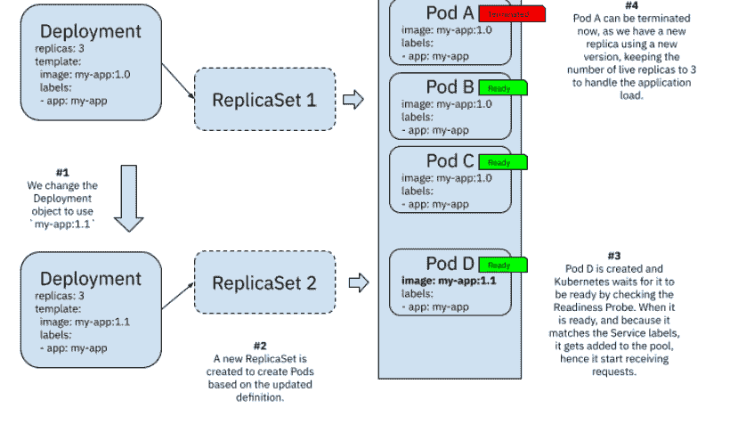

(https://kubernetes.io/docs/concepts/workloads/controllers/deployment/)。StatefulSets 的行为不同，因为每个副本的职责与所处理的 state 相关。默认的滚动更新机制工作方式略有不同。你可以在此处找到差异以及关于其如何工作的详细解释 (https://kubernetes.io/docs/concepts/workloads/controllers/statefulset/)。

查看以下命令以查看 Deployment 修订历史记录并回滚到以前的版本 (https://kubernetes.io/docs/concepts/workloads/controllers/deployment/#checking-rollout-history-of-a-deployment)：

```
kubectl rollout history deployment/frontend
kubectl rollout undo deployment/frontend --to-revision=2
```

如果你还没有尝试过使用 Kubernetes 的滚动更新，我强烈建议你创建一个简单的示例并尝试这些机制。网上有很多示例和交互式教程，可以看到实际效果。

## 5.1.2 金丝雀发布

滚动更新会自动启动，并且如果我们使用 Deployment，则会尽快执行；当我们想要对服务新版本的推出时间和方式有更多控制时，会发生什么？

金丝雀发布 (https://martinfowler.com/bliki/CanaryRelease.html) 是一种技术，用于在将新版本推送到所有实时流量之前测试其是否按预期运行。

虽然滚动更新会检查新服务副本是否已准备好接收流量，但 Kubernetes 不会检查新版本是否未能完成其应执行的功能。Kubernetes 不会检查最新版本是否与之前版本一样或更好。因此我们可能会向应用程序引入问题。需要对这些更新的执行方式有更多控制。

如果我们从配置为使用名为 `my-app:1.0` 的 Docker 镜像的 Deployment 开始，有两个副本，并使用 `app: myapp` 为其标记，Service 将在我们使用选择器 `app:myapp` 时路由流量。Kubernetes 将负责将 Service 选择器匹配到我们的 Pod。在这种情况下，100% 的流量将被路由到使用相同 Docker 镜像（`my-app:1.0`）的两个副本。

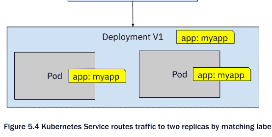

图 5.4 Kubernetes Service 通过匹配标签将流量路由到两个副本

现在想象更改配置或拥有新的 Docker 镜像版本（也许是 `my-app:1.1`）。我们不想自动将 Deployment V1 迁移到我们 Docker 镜像的新版本。或者，我们可以创建一个第二个 Deployment（V2）资源并利用 service `selector` 将流量路由到新版本。

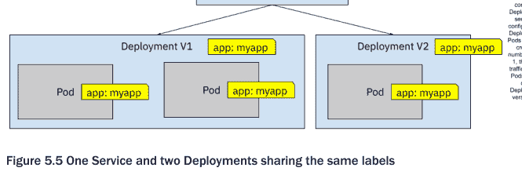

图 5.5 一个 Service 和两个共享相同标签的 Deployment

通过创建第二个 Deployment（使用相同的标签），我们将流量同时路由到两个版本，并且流向每个版本的流量量由为每个 Deployment 配置的副本数量定义。通过在 Deployment V1 上启动比 Deployment V2 更多的副本，你可以控制流向每个版本的流量百分比。图 5.5 显示了 V1 和 V2 之间 66%/34%（2 对 1 Pod）的流量分配。然后你可以减少 Deployment V1 的副本数量并增加 V2 的副本数量，慢慢地转向 V2。请注意，你无法精细控制哪些请求进入哪个版本——Service 以轮询方式将流量转发到所有匹配的 Pod。

因为我们始终有准备好接收流量的副本，因此在进行金丝雀发布时不应有服务停机。

关于滚动更新和金丝雀发布的一个重要点是，它们依赖于我们的服务支持同时将流量转发到不同版本而不会中断。这通常意味着我们不能从版本 1.0 到版本 1.1 存在破坏性更改，这会导致在从一个版本切换到另一个版本时应用程序（或服务消费者）崩溃。使用滚动更新和金丝雀发布的团队需要意识到此限制，因为流量将同时转发到两个版本。对于两种不同版本不能同时使用，并且需要在版本 1.0 和版本 1.1 之间进行硬切换的情况，我们可以查看蓝绿部署。

## 5.1.3 蓝绿部署

每当你面临无法从一个版本升级到下一个版本并让用户/客户端同时使用两个版本的情况时，你需要采用不同的方法。如前一节所述解释的金丝雀部署或滚动更新将无法工作。如果存在破坏性更改，你可能想尝试蓝绿部署 (https://martinfowler.com/bliki/BlueGreenDeployment.html)。

蓝绿部署帮助我们在固定时间点从版本 1.0 迁移到版本 1.1，在不允许两个版本同时接收请求且不中断服务的情况下更改流量路由到新版本的方式。

蓝绿部署可以通过使用内置的 Kubernetes 资源来实现，通过创建两个不同的 Deployment，如图 5.6 所示。

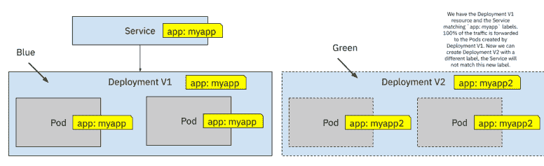

图 5.6 使用不同标签的两个 Deployment

与我们对金丝雀发布所做的相同，我们从一个 Service 和一个 Deployment 开始。这些资源的第一个版本我们称之为“蓝色”。对于蓝绿部署，我们可以创建一个单独的 Deployment（V2）资源来启动并为服务的新版本做好准备，当我们有新版本时。这个新的 Deployment 需要为其将创建的 Pod 使用不同的标签，这样 Service 暂时不会匹配这些 Pod。我们可以通过使用 `kubectl port-forward` 连接到 Deployment V2 Pod 或运行其他集群内测试，直到我们确信这个新版本正在工作。当我们对测试感到满意时，我们可以通过更新 Service 资源中定义的 `selector` 标签从蓝色切换到绿色。

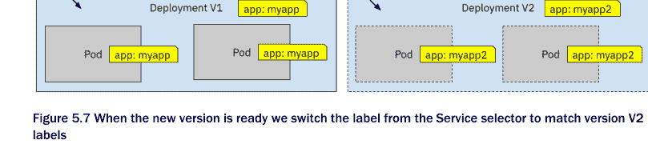

图 5.7 当新版本准备就绪时，我们切换 Service 选择器的标签以匹配版本 V2 标签

蓝绿部署在我们不能同时向两个版本发送流量时很有意义，但其缺点是需要在切换流量时同时保持两个版本处于运行状态。在进行蓝绿部署时，建议为新版本运行相同数量的副本。我们需要确保当流量被重定向到新版本时，这个版本能够处理与旧版本相同的负载。

一旦我们在 Service 资源中切换标签选择器，100% 的流量将被路由到新版本，Deployment V1 Pod 将停止接收流量。这是一个相当重要的细节，因为如果某些状态保存在 V1 Pod 中，你将需要从 Pod 中排出状态、迁移并使该状态可供 V2 Pod 使用。换句话说，如果你的应用程序将状态保存在内存中，你应该将该状态写入持久存储，以便 V2 Pod 可以访问它并继续处理该数据的工作。请记住，大多数这些机制是为无状态工作负载设计的，因此你需要确保遵循这些原则，以确保事情尽可能顺利地进行。

对于蓝绿部署，我们有兴趣在给定时间点从一个版本迁移到下一个版本，但对于我们想要同时使用用户积极测试两个或多个版本，然后决定哪个性能更好的场景呢？让我们接下来看看 A/B 测试。

## 5.1.4 A/B 测试

同时运行服务的两个版本并希望测试这两个版本以查看哪个性能更好，这是一个相当常见的需求。 (https://blog.christianposta.com/deploy/blue-green-deployments-a-b-testing-and-canary-releases/ )。有时你想尝试新的用户界面主题，将一些 UI 元素放在不同位置或向你的应用添加新功能，并从用户那里收集反馈以决定哪个效果最好。

要在 Kubernetes 中实现这种场景，你需要有两个不同的 Service 指向两个不同的 Deployment。每个 Deployment 处理应用程序/服务的单个版本。如果你想在集群外部公开这两个不同版本


你可以用两个规则定义一个 Ingress 资源。每个规则将负责定义访问每个服务的外部路径或子域名。

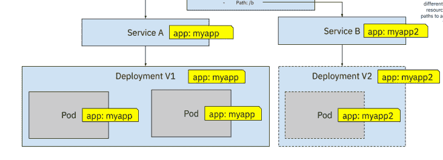

图 5.8 使用两个 Ingress 规则指向 A 和 B 版本

如果你将应用程序托管在 www.example.com 域名下，图 5.8 中定义的 Ingress 资源将把流量导向 Service A，让用户可以通过 www.example.com/b 访问 Service B。或者，根据你 Ingress Controller 的配置方式，你也可以使用子域名代替基于路径的路由，也就是说要访问默认版本可以继续使用 www.example.com，但要访问 Service B 可以使用 test.example.com 之类的子域名。

我能听到你在说，这太麻烦了，看看我为了实现一个感觉很基础、日常运营中必备的功能，需要定义和维护多少 Kubernetes 资源。让我们快速总结一下到目前为止发现的局限性和挑战，这样我们就可以看看 Knative Serving 以及它如何帮助我们以更 streamlined 的方式实现这些策略。

## 5.1.5 使用 Kubernetes 内置构建块的局限性和复杂性

金丝雀发布、蓝绿部署和 A/B 测试都可以使用内置的 Kubernetes 资源来实现。但正如你在前面的章节中所看到的，创建不同的部署、更改标签以及计算实现基于百分比的请求分发所需的副本数量是一项相当大的任务，而且很容易出错。即使你使用如 Jenkins X 所示的 GitOps 方法，或使用第 3 章中的其他工具，创建具有正确配置的所需资源也相当困难，而且需要花费大量精力。

我们总结一下使用 Kubernetes 构建块实现这些模式的缺点如下：

- 手动创建更多 Kubernetes 资源，例如 Deployment、Service 和 Ingress 规则来实现这些不同的策略，容易出错且繁琐。负责实施发布策略的团队需要深入了解 Kubernetes 的行为才能实现期望的配置。
- 没有开箱即用的自动化机制来协调和实施每种发布策略所需的资源。
- 容易出错，因为需要在不同的资源中同时应用多项更改，才能按预期工作
- 如果我们注意到服务的负载需求增加或减少，我们需要手动更改 Deployment 的副本数量，或安装和配置自定义自动扩缩器（本章末尾会详细介绍）。不幸的是，如果你将副本数量设置为 0，就不会有实例来响应请求，要求你必须始终至少运行一个副本。

开箱即用，Kubernetes 不包含任何用于自动化或简化这些发布策略的机制，如果你处理的是相互依赖的大量服务，这很快就会成为一个问题。

一件事很明确，你的团队需要意识到 Kubernetes 对 12 因素应用以及其服务 API 演进所施加的隐式契约，以避免停机。你的开发人员需要了解 Kubernetes 内置机制的工作原理，以便更好地控制应用程序的升级方式。

如果我们想降低发布新版本的风险，我们希望赋予开发人员这些发布策略，以便他们日常实验使用。在下一节中，我们将介绍 Knative Serving，这是一组构建在 Kubernetes 之上的工具和机制，用于简化前面章节中描述的所有手动工作。

## 5.2 降低发布风险以提高交付速度

我们希望确保我们的运维团队拥有实施所介绍的运行应用程序策略的正确工具。本节介绍 Knative Serving（ http://knative.dev ），一套促进渐进式交付（ https://redmonk.com/jgovernor/2018/08/06/towards-progressive-delivery/ ）方法的工具和机制。

虽然 Knative Serving 与 Serverless 平台相关联，但在接下来的章节中我们会看到，Serverless 方法是可以实现的，但绝不是 Knative Serving 提供的唯一功能。在接下来的章节中，我们将看到如何将之前介绍的发布策略与 Knative Serving 应用于我们的 Conference Platform 应用程序。

### 5.2.1 Knative Serving 简介

Knative 是你了解它能为你做什么之后，很难回头不用的技术之一。在参与该项目近 3 年并观察到其部分组件的演变后，我可以自信地说，每个 Kubernetes 集群都应该安装 Knative；你的开发人员会感激的。Knative 在 Kubernetes 内置资源之上提供更高级别的抽象，以实现良好实践和通用模式，使你的团队能够更快地工作，对其服务有更多控制，并促进事件驱动应用程序的实现。

正如本节标题所指定，接下来的章节重点介绍 Knative 提供的一个子集功能，称为 Knative Serving。Knative Serving 允许你定义“Knative 服务”，这极大地简化了在前几节中示例的发布策略的实现。Knative 服务将负责为你创建 Kubernetes 内置资源并跟踪其更改和版本，从而实现同时存在多个版本的需求场景。Knative 服务还提供高级流量处理和自动扩缩，可将副本缩减至零以实现 Serverless 方法。

要在集群上安装 Knative Serving，我强烈建议你查看官方 Knative 文档，你可以在这里找到：https://knative.dev/docs/admin/install/serving/install-serving-with-yaml/

如果你想在本地安装 Knative，你应该查看本地开发的入门指南（https://knative.dev/docs/getting-started/#install-the-knative-quickstart-environment）。可选地，你可以安装 `kn`，这是一个小型二进制文件，允许你以更自然的方式与 Knative 交互。你也可以始终使用 `kubectl` 与 Knative 资源交互。

安装 Knative Serving 时，你将在 `knative-serving` 命名空间中安装一组组件，这些组件了解如何使用 Knative Serving 自定义资源定义进行工作。

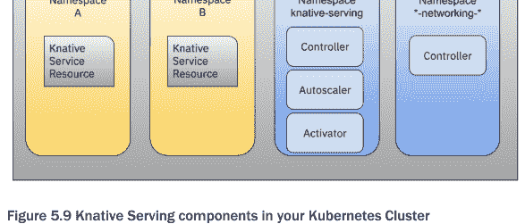

图 5.9 你 Kubernetes 集群中的 Knative Serving 组件

本书记载 Knative Serving 组件和资源的工作原理超出了本书的范围；我的建议是，如果我在接下来的章节中的示例能引起你的注意，你应该查看 Jacques Chester 所著的 Knative In Action 书籍（https://www.manning.com/books/knative-in-action）。

### 5.2.2 Knative 服务

一旦你安装了 Knative Serving，你就可以创建 Knative 服务。我能听到你在想：“但我们已经有 Kubernetes 服务了，为什么还需要 Knative 服务？” 相信我，我在看到相同名称时也有同样的感觉，但请继续跟随，这是有道理的。

当你在 Conference Application 中部署每个服务时，你至少需要创建两个 Kubernetes 资源，一个 Deployment 和一个 Service。我们在前一节中介绍过，使用 ReplicaSets 内部机制，Deployment 可以通过跟踪 Deployment 资源中的配置更改并为每次更改创建新的 ReplicaSets 来执行滚动更新。我们也在第 2 章中讨论了如果想从集群外部路由流量，就需要创建 Ingress 资源。通常，你只会为公开可用的服务创建 Ingress 资源，例如 Conference Platform 的用户界面。

Knative 服务在这些资源之上构建，并简化了为每个应用程序服务创建这些资源的方式。虽然它简化了任务并减少了我们需要维护的 YAML 量，但它也增加了一些令人兴奋的功能，但在跳入功能之前，让我们先看看 Knative 服务在实际中的样子。让我们从简单开始，使用 Conference Platform 中的 Email 服务来演示 Knative 服务的工作方式：

```
apiVersion: serving.knative.dev/v1
kind: Service
metadata:
  name: email-service #A
spec:
  template:
    spec:
      containers:
        - image: salaboy/fmtok8s-email-rest:0.1.0 #B
```

#A 你需要为资源指定一个名称，就像任何其他 Kubernetes 资源一样

#B 你需要指定要运行的容器镜像

与 Deployment 会选取 `spec.template.spec` 字段来 cookie-cut Pods 一样，Knative 服务使用相同的字段定义创建其他资源的配置。

到目前为止没有什么太奇怪的，但这与 Kubernetes 服务有什么不同？

如果你使用 `kubectl apply -f` 创建此资源，你可以开始探索差异。

你也可以使用 `kubectl get ksvc` 列出所有 Knative 服务（ksvc 代表 Knative Service），你应该能在其中看到你新创建的 Knative 服务：

```
NAME          URL                                           LATEST CREATED          READY
email-service http://email-service.default.X.X.X.X.sslip.io email-service-00001    True
```


这里有几个细节需要注意；首先，有一个 URL 可以复制到浏览器中访问该服务。如果你是在云服务提供商上运行并且在安装 Knative 时配置了 DNS，那么该 URL 应该可以立即访问。LASTCREATED 列显示的是该 Service 最新 Knative Revision 的名称。Knative Revision 是指向我们 Service 特定配置的指针，这意味着我们可以将流量路由到它们。

你可以使用 `curl` 或将浏览器指向 http://email-service.default.X.X.X.X.sslip.io/info 来测试 Knative Service URL

你应该会看到以下输出：

```
{"name":"Email Service (REST)","version":"v0.1.0","source":"https://github.com/salaboy/fmtok8s-email-rest/releases/tag/v0.1.0","podId":"","podNamespace":"","podNodeName":""}
```

与任何其他 Kubernetes 资源一样，你也可以使用 `kubectl describe ksvc email-service` 来获取该资源的更详细描述。

如果你列出其他知名资源，如 Deployment、Services 和 Pods，你会发现 Knative Serving 会为你创建并管理它们。因为这些现在是受管理的资源，通常不建议手动更改它们。如果你想更改应用程序配置，应该编辑 Knative Service 资源。

我们之前在集群上应用的 Knative Service，默认情况下的行为与手动创建 Service、Deployment 和 Ingress 不同。

Knative Service 默认情况下：

- **它是可访问的**：在公共 URL 下自行公开，以便你可以从集群外部访问它。它不会创建 Ingress 资源，因为它使用之前安装的 Knative Networking 堆栈。因为 Knative 对网络堆栈有更多控制权并管理 Deployment 和 Services，所以它知道服务何时准备好提供请求，减少了 Services 和 Deployments 之间配置错误。
- **管理 Kubernetes 资源**：它创建两个 Services 和一个 Deployment：Knative Serving 允许我们同时运行同一服务的多个版本。因此它会为每个版本创建一个新的 Kubernetes Service（在 Knative Serving 中称为 Revisions）
- **收集服务使用情况**：它会创建一个指定 `user-container` 的 Pod 和一个名为 `queue-proxy` 的 sidecar 容器。
- **根据需求伸缩**：如果没有请求命中服务，自动将自身缩放到零（默认在 90 秒后）
  - 它通过 `queue-proxy` 收集的数据将 Deployment 副本缩放到 0 来实现
  - 如果请求到达且没有可用的副本，它会在排队请求的同时进行扩容，以免请求丢失。
- 配置更改历史由 Knative Serving 管理：如果更改 Knative Service 配置，将会创建新的 Revision。默认情况下，所有流量都将路由到最新 revision。

当然，这些是默认值，但你可以微调每个 Knative Service 以满足你的目的，例如实现之前描述的发布策略。

在下一节中，我们将了解如何使用 Knative Serving 的高级流量处理功能来实现金丝雀发布、蓝绿部署、A/B 测试和基于 Header 的路由。

## 5.2.3 高级流量拆分功能

让我们先看看如何为应用程序的其中一个服务使用 Knative Service 实现金丝雀发布。

本节首先介绍如何使用基于百分比的流量拆分进行金丝雀发布。然后介绍通过基于标签和基于 Header 的流量拆分进行 A/B 测试。

### 使用基于百分比的流量拆分进行金丝雀发布

如果你获取 Knative Service 资源（使用 `kubectl get ksvc email-service -oyaml`），你会注意到 `spec` 部分现在还包含一个默认创建的 `spec.traffic` 部分，因为我们没有指定任何内容。

```
traffic:
- latestRevision: true
  percent: 100
```

默认情况下，100% 的流量被路由到服务的最新 Knative Revision。

现在假设你在服务中做了更改以改进邮件发送方式，但你的团队不确定人们会如何接受，并且我们希望避免因网站问题导致人们不愿登录会议而产生的反弹。因此我们可以让两个版本并行运行并控制有多少流量被路由到每个版本（在 Knative 术语中称为 Revision）。

让我们编辑（`kubectl edit ksvc email-service`）Knative Service 并应用更改：

```
apiVersion: serving.knative.dev/v1
kind: Service
metadata:
  name: email-service
spec:
  template:
    spec:
      containers:
      - image: salaboy/fmtok8s-email-rest:0.1.0-improved #A
  traffic: #B
  - percent: 80
    revisionName: email-service-00001
  - latestRevision: true
    percent: 20
```

#A 你已将服务将使用的 docker 镜像更新为 `fmtok8s-email-rest:0.1.0-improved`

#B 你已创建 80% / 20% 的流量拆分，其中 80% 的流量将继续流向你的稳定版本，20% 流向你刚刚更新的新版本

如果你现在尝试使用 `curl`，你应该能够看到流量拆分的效果：

```
salaboy> curl http://email-service.default.x.x.x.x.sslip.io/info
{"name":"Email Service (REST)","version":"v0.1.0",
"source":"https://github.com/salaboy/fmtok8s-email-rest/releases/tag/v0.1.0"}
salaboy> curl http://email-service.default.x.x.x.x.sslip.io/info
{"name":"Email Service (REST)","version":"v0.1.0",
"source":"https://github.com/salaboy/fmtok8s-email-rest/releases/tag/v0.1.0"}
salaboy> curl http://email-service.default.x.x.x.x.sslip.io/info
{"name":"Email Service (REST)","version":"v0.1.0",
"source":"https://github.com/salaboy/fmtok8s-email-rest/releases/tag/v0.1.0"}
salaboy> curl http://email-service.default.x.x.x.x.sslip.io/info
{"name":"Email Service (REST)","version":"v0.1.0",
"source":"https://github.com/salaboy/fmtok8s-email-rest/releases/tag/v0.1.0"}
salaboy> curl http://email-service.default.x.x.x.x.sslip.io/info
{"name":"Email Service (REST) - IMPROVED!!","version":"v0.1.0", #A
"source":"https://github.com/salaboy/fmtok8s-email-rest/releases/tag/v0.1.0"}
```

#A 每五个请求中有一个会进入新的 "IMPROVED!!" 版本。请注意，这可能需要一段时间，直到新的 Knative Revision 启动并运行。

一旦你验证了服务的新版本工作正常，你就可以开始发送更多流量，直到你有信心将 100% 的流量转移到它。如果出现问题，你只需将流量拆分恢复到稳定版本即可。

请注意，你不仅限于两个服务 revision；只要流量百分比总和为 100%，你可以创建任意多个。Knative 会确保遵循这些规则并扩缩所需 revision 以提供请求。你不需要创建任何新的 Kubernetes 资源，因为 Knative 会为你创建，从而降低了同时修改多个资源时可能出现的错误风险，希望一切保持一致。

使用百分比，你无法控制后续请求会落在何处。Knative 只会确保根据你指定的百分比保持公平的分布。如果例如你有一个用户界面而不是简单的 REST 端点，这可能会成为问题。

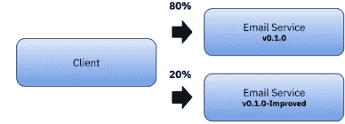

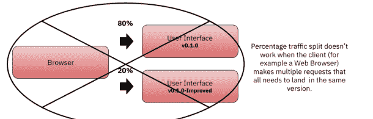

### 图 5.10 基于百分比的流量拆分场景和挑战

用户界面很复杂，因为浏览器会执行多个 GET 请求来渲染页面 HTML、CSS 和图像等。你很快就会遇到每个请求命中应用程序不同版本的情况。让我们看看另一种可能更适合测试用户界面或需要确保多个请求最终进入应用程序正确版本的情况的方法。

### 使用基于标签的路由进行 A/B 测试

如果你想对用户界面进行 A/B 测试，你需要给 Knative 一个区分请求发送位置的方法。你有两个选择。首先，你可以指向要尝试的服务的特殊 URL，其次是使用请求 header 来区分请求发送位置。让我们看看这两种替代方案的实际效果。

但让我们现在使用会议平台的用户界面：

```
apiVersion: serving.knative.dev/v1
kind: Service
metadata:
  name: ui-service #A
spec:
  template:
    spec:
      containers:
        - image: salaboy/fmtok8s-api-gateway:0.1.0 #B
```

#A 你需要为此 Service 指定一个名称

#B 你现在定义 API Gateway / 用户界面容器镜像，因为我们将测试多个请求进入同一版本


再次，我们刚刚创建了一个 Knative Service，但我们无法指定基于百分比的路由规则，因为该容器镜像包含一个 Web 应用程序。Knative 不会阻止你这样做。尽管如此，你会注意到请求被发送到不同的版本，并且会出现错误，因为某个镜像不在某个版本中，或者你最终会得到来自应用程序错误版本的样式表（CSS）。

让我们开始定义一个 Tag，以便你测试新的样式表。你可以通过修改 Knative Service 资源来实现，就像我们之前做的那样，首先将镜像更改为 `salaboy/fmtok8s-api-gateway:0.1.0-color`，然后让我们使用标签创建一些新的流量规则：

```
traffic:
- percent: 100 #A
  revisionName: ui-service-00001
- latestRevision: true
  tag: color #B
```

#A 100% 的流量将流向我们的稳定版本，没有请求会被发送到我们新更新的版本
#B 你创建了一个名为 `color` 的新标签，你可以通过描述 Knative Service 资源找到此新标签的 URL。

如果描述 Knative Service（`kubectl describe ksvc ui-service`）你会找到我们刚刚创建的标签的 URL：

```
Traffic:
  Latest Revision: false
  Percent: 100
  Revision Name: ui-service-00001
  Latest Revision: true
  Percent: 0
  Revision Name: ui-service-00001
  Tag: color
  URL: http://color-ui-service.default.x.x.x.x.sslip.io #A
```

#A Knative Serving 通过在服务名称前加上标签名创建了一个新的 URL。请使用浏览器检查，可以一致地访问修改后的版本和原始版本。


图 5.11 基于标签路由的 A/B 测试

使用标签可以保证所有请求都命中指向你服务正确版本的 URL。还有一个选项可以避免你为 A/B 测试指向不同的 URL，并且可能对调试目的有用。下一节将介绍使用 HTTP Headers 而不是不同 URL 的基于标签的路由。

## 基于 Header 的 A/B 测试路由

最后，让我们看一下一个实验性功能（截至撰写时），它允许你使用 HTTP Headers 来路由请求。此实验性（截至撰写时）功能也使用标签来知道将流量路由到哪里，但不是使用不同的 URL 来访问特定版本，你可以添加一个 HTTP Header 来实现此功能。

假设你希望开发人员能够访问应用程序的调试版本。应用程序开发人员可以在其浏览器中设置一个特殊 header，然后访问特定版本。

要启用此实验性功能，你或安装 Knative 的管理员需要在 `knative-serving` 命名空间中修补一个 ConfigMap：

```
kubectl patch cm config-features -n knative-serving -p '{"data":{"tag-header-based-routing":"Enabled"}}'
```

一旦功能启用，你可以通过再次更改我们在上一节中创建的 Knative Service 来测试此功能，如下所示：

```
apiVersion: serving.knative.dev/v1
kind: Service
metadata:
  name: ui-service
spec:
  template:
    spec:
      containers:
      - image: salaboy/fmtok8s-api-gateway:0.1.0-debug #A
  traffic:
  - percent: 100
    revisionName: ui-service-00001
  - revisionName: ui-service-00002 #B
    tag: color
  - latestRevision: true #C
    tag: debug
```

#A 你有 API Gateway / 用户界面的另一个版本，提供更多调试信息
#B 现在你将 revision 00002 固定到标签 color
#C 通过此最新更改（使用 -debug 镜像）你创建了一个名为 `debug` 的新标签

如果你将浏览器指向 Knative Service URL（`kubectl get ksvc`）你将看到与图 5.12 所示相同的应用程序，但如果你使用像 ModHeader 扩展（https://chrome.google.com/webstore/detail/modheader/idgpnmonknjnojddf kpqkjjpfnnfcklj?hl=en）这样的工具 for Chrome，你可以设置自定义 HTTP Headers，这些 Headers 将包含在浏览器产生的每个请求中。对于此示例，并且由于你创建的标签名为 `debug`，你需要设置以下 Http Header：`Knative-Serving-Tag: debug`。

一旦 HTTP Header 存在，Knative Serving 将把传入请求路由到 debug 标签。


图 5.12 基于 Http Header 路由到 Debug 版本的 A/B 测试

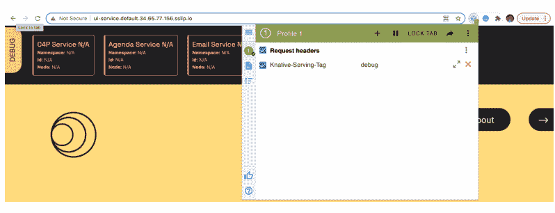

图 5.13 使用 ModHeader Chrome 扩展设置自定义 HTTP Headers

由于基于 Header 的路由实验性功能也使用标签来路由流量。如果你仍然创建了 `color` 标签，你可以通过将 `Knative-Serving-Tag` header 值更改为 `color` 来测试流量是否被路由，并查看是否返回正确的页面。

标签和基于 header 的路由都旨在确保如果命中特定 URL（为标签创建）或存在特定 Header，所有请求都将被路由到同一版本。最后，让我们看看如何使用 Knative Serving 进行 Blue/Green 部署。

## BLUE/GREEN 部署

对于我们需要在非常特定的时间点从一个版本更改到下一个版本的情况，因为没有向后兼容性，我们仍然可以使用基于标签的路由配合百分比。不是逐渐从一个版本迁移到下一个版本，我们使用百分比作为开关，将新版本从 0 切换到 100，旧版本从 100 切换到 0。

大多数 Blue/Green 部署场景需要在不同团队和服务之间进行协调，以确保服务和客户端同时更新。Knative Serving 允许你以声明方式定义何时从一个版本切换到下一个版本。

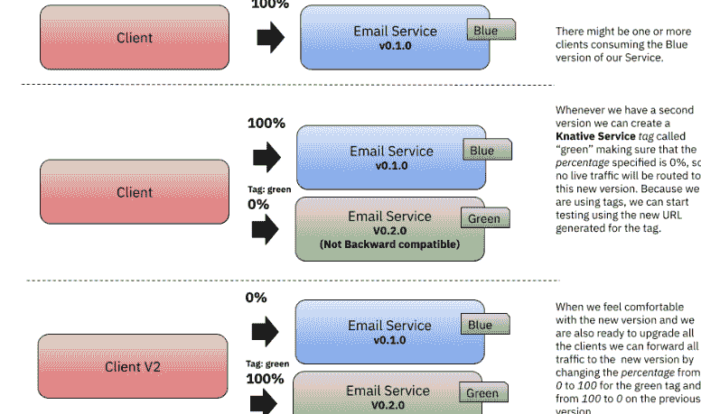

图 5.14 使用 Knative Serving 基于标签路由的 Blue/Green 部署

为了实现图 5.14 中描述的场景，我们可以在 Knative Service 中为新版本创建 "green" 标签，如下所示：

```
...
traffic:
  - revisionName: <first-revision-name>
    percent: 100 # 所有流量仍被路由到第一个版本
  - revisionName: <second-revision-name>
    percent: 0 # 0% 流量路由到第二个版本
    tag: green # 一个命名路由
```

通过创建新的标签（称为 "green"）我们现在将有一个新的 URL 可用于测试访问新版本。这对于测试客户端的新版本特别有用，因为如果服务 API 发生了不向后兼容的更改，客户端可能也需要更新。

一旦所有测试都完成，我们可以安全地将所有流量切换到服务的 "green" 版本。

```
traffic:
  - revisionName: <first-revision-name>
    percent: 0 # 所有流量仍被路由到第一个版本
  - revisionName: <second-revision-name>
    percent: 100 # 100% 流量路由到第二个版本
    tag: green # 一个命名路由
```

通常，我们不能逐步将流量从一个版本迁移到下一个版本，因为使用服务的客户端需要理解请求可能会落在不同（且不兼容）的服务版本中。

在前面的章节中，我们一直在研究 Knative Serving 如何简化不同发布策略的实现，以便你的团队持续交付功能和服务的新版本。Knative Serving 减少了创建多个 Kubernetes 内置资源以手动实现本章所述的发布策略的需求。它通过提供高级抽象如 Knative Services 来实现这一点，这些服务创建和管理 Kubernetes 内置资源以及用于高级流量管理的网络栈。

在本章的最后一节中，我们将研究 Knative Autoscaler，它增加了使用 Knative 的好处。

## 5.2.4 Knative Serving Autoscaler

Knative Serving 的一个重要部分是 Autoscaler，它允许你的 Knative Services 默认缩减到零，并在没有副本可用以响应传入请求时处理排队请求的逻辑，直到至少有一个副本启动。


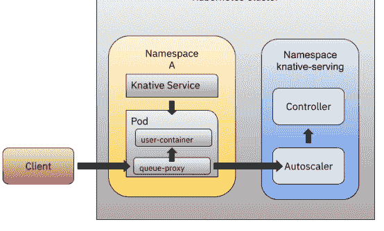

当你创建一个 Knative Service 时，它会自动为你的服务添加一个 sidecar 容器。这个 sidecar 容器（'queue-proxy'）负责接收所有传入流量并将其转发到你的应用容器。'queue-proxy' 还会收集指标并报告给 Autoscaler，后者可以根据这些信息决定是否扩容或缩容你的 Knative Service 的副本数。如果 Autoscaler 注意到没有流量接收，它可以通知控制器触发缩容至零的操作。

## Figure 5.15 Knative Serving Autoscaler and `queue-proxy`

Knative Autoscaler 在安装 Knative Serving 时默认安装，并且会持续监控你的 Knative Service 请求。如图 5.15 所示，为了监控所有入站流量，会将一个 sidecar 容器附加到你的应用容器上，所有流量都通过 "queue-proxy" 容器路由。"queue-proxy" 容器收集指标并告知 Autoscaler 应用容器（"user-container"）接收了多少流量。

基于这些信息，Autoscaler 可以通知 Knative Service 控制器扩容或缩容你的服务的副本。如果 "user-container" 在一段时间内没有处理请求，Autoscaler 将通知 Knative Service 控制器将副本数缩容至零。

扩容和缩容开箱即用，但你可以根据应用能力随时微调行为。一般来说，为了配置 Autoscaler，你可以通过为 Knative Service 添加注解来指定每个副本可以处理的并发请求数。这些信息将被 Autoscaler 用于决定何时需要新的副本。

```
apiVersion: serving.knative.dev/v1
kind: Service
metadata:
  name: helloworld-go
  namespace: default
spec:
  template:
    metadata:
      annotations:
        autoscaling.knative.dev/target: "100" # 100 concurrent request by default
```

你也可以通过更改 `config-autoscaler` ConfigMap 中的全局参数来为所有 Knative Service 更改此设置：

```
apiVersion: v1
kind: ConfigMap
metadata:
  name: config-autoscaler
  namespace: knative-serving
data:
  container-concurrency-target-default: "100" # 100 concurrent request by default
```

Knative Serving 还允许你通过缓冲来处理突发流量，确保不会丢失任何请求。我建议你查阅官方文档以了解更多关于如何配置这些机制的细节：https://knative.dev/docs/serving/autoscaling/concurrency/

最后，你可能会想知道当没有副本可用时 Knative Serving 如何处理流量，因为如果服务一段时间内没有请求，`user-container` 和 `queue-proxy` 都会被缩容至零。这时 Activator 组件就会介入，对请求进行排队和缓冲，直到 Knative Service Controller 启动一个副本并将请求转发到该副本。

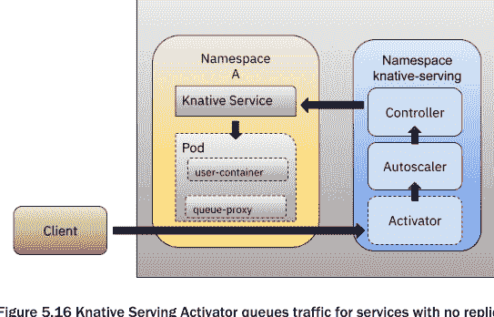

如果某个 Knative Service 没有副本，Activator 组件会自动配置为处理传入流量并将其排队，直到创建新的副本。一旦至少有一个副本存在，Activator 组件就会停止监听该特定服务的流量。

Figure 5.16 Knative Serving Activator queues traffic for services with no replicas

除了帮助我们无需创建大量不同的 Kubernetes 资源即可实现不同的发布策略外，Knative Serving 还允许我们根据服务在给定时间处理的并发请求进行扩容和缩容。这些机制开箱即用且基于实时流量，因此无需手动更改给定服务的副本数，Knative Serving 会根据需求自动调整，确保存活的副本数能够处理当前流量，并在不需要时节省资源。

## 5.3 Summary

- Kubernetes 内置的 Deployments 和 Services 可用于实现滚动更新、金丝雀发布、蓝绿部署和 A/B 测试模式。这使我们能够在不中断服务的情况下手动从一个服务版本迁移到下一个版本。
- 金丝雀发布可以通过拥有一个 Kubernetes Service、两个 Deployments（每个版本一个）和一个同时将流量路由到两个版本的共享标签来实现
- 蓝绿部署可以通过拥有一个 Kubernetes 单个 Kubernetes Service、两个独立的部署，并在新版本经过测试并准备好推广时切换标签来实现
- A/B 测试可以通过拥有两个 Services 和两个 Deployments 以及两个 Ingress 资源来实现
- Knative Serving 引入了一个高级网络层，允许我们对同时部署的服务不同版本如何路由流量进行精细控制。该功能构建在 Knative Services 之上，减少了为实现金丝雀发布、蓝绿部署和 A/B 测试发布策略而创建多个 Kubernetes 资源的繁琐工作。Knative Serving 简化了将流量迁移到新版本的运维负担，并借助 autoscaler 可根据需求进行扩容和缩容。
